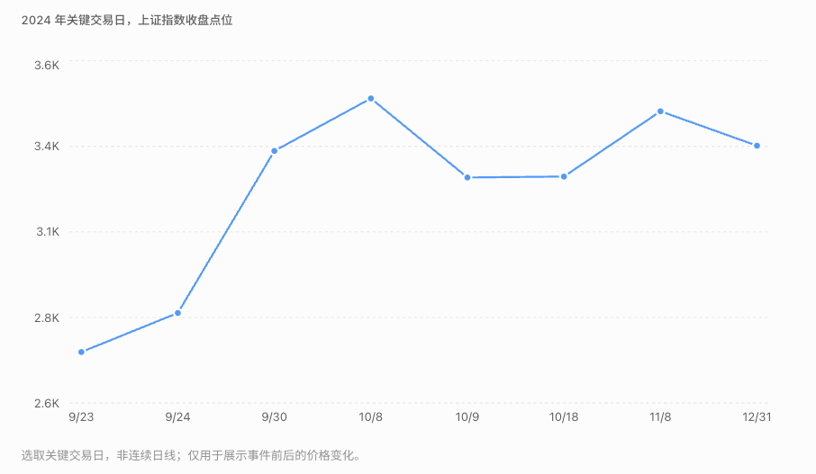

% 924

这段历史可以拆成三个不同的机制：

- **924 政策改变预期**：投资者突然意识到，政府开始更直接地支持资本市场。
- **国庆前后资金形成正反馈**：上涨吸引追涨资金，追涨又推动上涨，短期脱离基本面。
- **狂热退潮后重新定价**：追高者遭受损失，市场经历震荡，随后部分产业盈利、政策和资金因素支撑了新的上涨阶段。

| 时间 | 发生了什么 |
| :--- | :--- |
| 9 月 24 日 | 政策公布，上证指数上涨 4.15% |
| 9 月 30 日 | 节前资金抢筹，指数升至约 3336 点 |
| 10 月 8 日 | 节后高开冲高，上证指数收涨 4.59%，创业板暴涨 17.25% |
| 10 月 9 日 | 上证指数暴跌 6.62%，创业板暴跌 10.59% |
| 10–12 月 | 市场震荡、板块分化，年底没有延续国庆前的暴涨速度 |
| 2025 年 | 经历震荡后，科技成长等方向走出持续性行情 |

### 924 政策

2024 年 9 月 24 日，央行、金融监管总局和证监会联合发布了一揽子政策。把它们按照传导机制分类，比简单罗列更有意义。

| 政策         | 当时宣布的内容                          | 对股市的影响路径             |
| ---------- | -------------------------------- | -------------------- |
| 降准         | 存款准备金率下调 0.5 个百分点，释放约 1 万亿元长期流动性 | 改善银行体系流动性            |
| 降政策利率      | 7 天逆回购利率从 1.7% 降至 1.5%           | 降低融资成本、支持估值          |
| 降存量房贷利率    | 平均下降约 0.5 个百分点                   | 减轻居民偿债负担             |
| 降二套房首付     | 全国最低首付比例从 25% 降至 15%             | 稳定房地产需求              |
| 证券基金保险互换便利 | 首期 5000 亿元                       | 提高金融机构增持股票的融资能力      |
| 股票回购增持再贷款  | 首期 3000 亿元                       | 为上市公司回购、大股东增持提供低成本贷款 |

来源：[2024 年 9 月 24 日国新办发布会实录](https://www.csrc.gov.cn/csrc/c106311/c7508374/content.shtml?utm_source=chatgpt.com)。

最值得注意的是最后两项。这是 924 与普通降息、降准政策的重要区别。

过去货币宽松通常通过银行贷款、房地产、企业投资等路径间接影响股市。

924 则新增了专门服务于股票市场的融资工具。

### 两项工具如何影响买盘

1. **证券基金保险互换便利**：机构以合格资产作质押，换入高流动性资产，再通过市场融资投资股票。不是央行直接给券商 5000 亿元现金。
2. **股票回购增持再贷款**：商业银行向符合条件的上市公司和主要股东提供专项贷款，央行再向银行提供低成本资金。

这两项工具的本质是：降低潜在买家的融资约束，而不是承诺股市一定上涨。

### 后续的结构性牛市

924 并没有让所有行业重新进入长期增长周期，而是给市场创造了一个重新配置资金的机会。

我们可以把这轮行情理解成三个阶段。

**第一阶段：2024 年 9—10 月，系统性估值修复**

政策预期改善，市场对风险的定价发生变化。券商、地产、消费、科技一起上涨。这时不需要企业利润立刻增长。

**第二阶段：2024 年末—2025 年，资金开始重新选择行业**

第一波情绪退潮后，市场重新比较盈利前景。AI 算力、创新药、有色等领域出现新的产业催化，而房地产、部分消费企业的基本面改善不足。

**第三阶段：2026 年，盈利兑现与估值分化**

截至 2026 年 9 月 23 日，电子行业年内上涨约 46.7%，通信约 15.8%。与此同时，AI 产业链 2026 年上半年归母净利润同比增长约 91.6%。

这时已经不能主要依靠 924 的政策刺激解释涨幅，必须分析真实盈利增长与估值水平。

## 真正留下的长期影响

我认为最重要的不是 8000 亿元的额度本身，而是三个变化。

第一，股市获得了新的逆周期支持机制。

过去市场持续下跌时，投资者往往只能等待常规政策、机构自发买入或国家队采取临时措施。

现在，互换便利和回购增持贷款提供了制度化融资渠道。2025 年 4 月市场遭遇关税冲击时，相关工具的使用也有所增加。

不过，这不是一个明确的指数价格底线，也不保证市场不会大跌。

第二，政策降低了部分投资者对极端风险的担忧。

即使一项工具没有用满额度，只要投资者相信在市场严重失衡时可以被动用，就可能影响今天愿意支付的估值。

这是预期效应，不能仅用实际买入金额衡量。

第三，长期来看，股票最终还是要靠盈利和股东回报定价。

有一篇 2026 年 9 月的市场评论提出，924 的政策红利已经被较大程度消化，后续需要企业盈利改善来支撑股价。这是值得重视的观点，但不是可以直接验证的精确结论。
