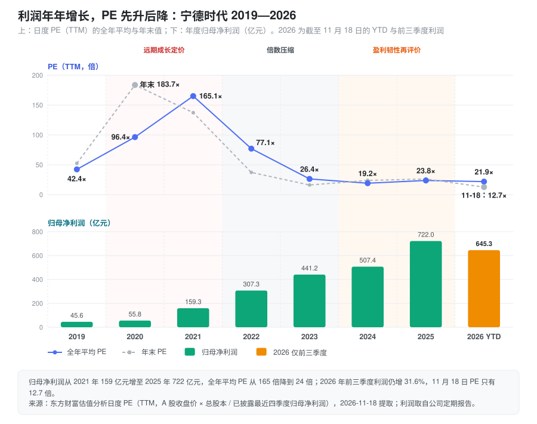
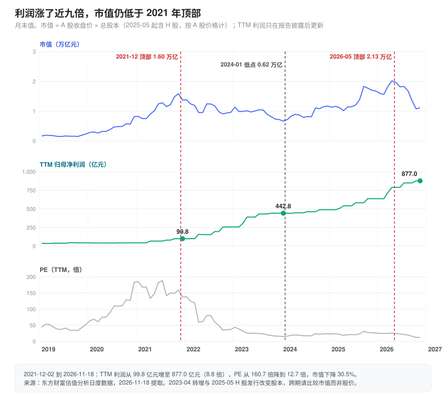
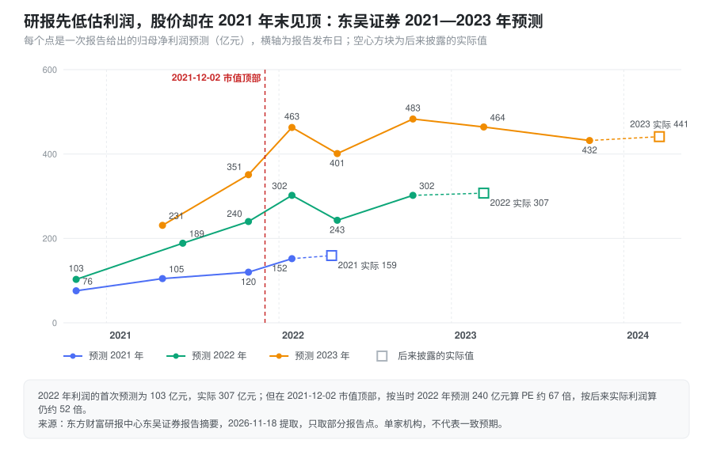
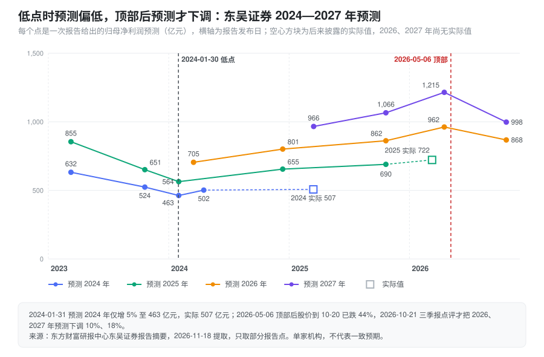
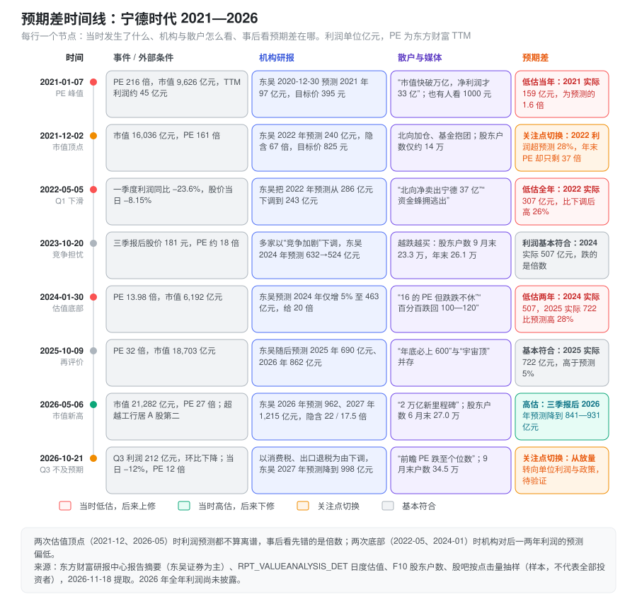

% 宁德时代：2019—2026 年历史定价、产业政策与国际竞争

**核心判断：2019—2026 年，宁德时代的归母净利润从 45.6 亿元增至 722 亿元（2025 年），市值却在 2021 年 12 月就到了这一轮的第一个顶点。之后五年，利润增长几乎全部被倍数压缩抵消。** 从 2021-12-02 到 2026-11-18，滚动四季度（TTM）利润增至 8.8 倍，PE（TTM）从 160.7 倍降到 12.7 倍，市值反而下降 30.5%。

沿时间线看，股价的几次大转向都发生在利润还在增长的时候，市场换了定价的问题：

- 2020—2021 年：市场为全球电动化的多年增长付钱，倍数领先利润。机构对后两年利润的预测持续偏低。
- 2021 年末—2024 年初：利润每年都超过或接近预测，PE 从 160 倍降到 14 倍。市场在重新估计竞争、海外准入和超额利润能持续多久。
- 2024 年初—2026 年 5 月：低点时机构预计利润只增 5%，实际增 15%、42%。利润和倍数同时修复，市值首次超过 2021 年顶部。
- 2026 年 5 月以后：出货继续高增，单位利润下降，消费税与出口退税调整进入报表，市场开始交易“量增利不增”。

2026 年全年业绩尚未披露。本文不预测全年结果，也不提供买卖价格。

### 研究范围与数据边界

- 公司：宁德时代新能源科技股份有限公司（CATL）。历史定价以深交所创业板 A 股 **300750.SZ** 为主。H 股 **03750.HK** 于 2025-05-20 上市，见[公司上市公告说明](https://www.catl.com/news/8519.html)，本文不把 A、H 股估值混成一条序列。
- 期间：2019—2025 完整年度，2026 年为截至 2026-11-18 的 YTD。数据提取日与信息截止日均为 **2026-11-18**。
- **日度估值**：东方财富估值分析（`RPT_VALUEANALYSIS_DET`），2018-06-11 至 2026-11-18 共 2,048 个交易日，字段含收盘价、总市值、总股本与 PE（TTM）。它的收盘价与东方财富不复权日线在 2019 年以来的 1,910 个交易日上全部一致，没有缺日，没有非正 PE。PE（TTM）= A 股收盘价 × 总股本 / 当时已披露的最近四季度归母净利润。分母在定期报告或业绩快报披露当日更新，因此每个日期的 PE 只用了当时已公开的利润。
- **股本口径**：总股本在 2023-04 转增（每 10 股转增 8 股）后从约 24.4 亿股增至 44.0 亿股；2025-05 起包含 H 股，截至 2026-11-18 为 46.27 亿股。跨期比较用市值，不用股价。这里的“市值”是 A 股价格乘全部股本，即假设 H 股也按 A 股定价。国信证券 2026-10-09 的报告称当时 H 股较 A 股溢价超过 40%，按两地实际价格计算的合计市值会更高。
- **财务**：人民币亿元，归母净利润与扣非归母净利润分列，取自公司定期报告；单季利润由累计值相减得到。
- **机构预测**：东方财富研报中心的报告摘要，以东吴证券为主线，其他机构作对照，只引用摘要中能看到的字段。没有取得 Wind、Choice 等一致预期，单家轨迹不代表市场一致预期。
- **散户与媒体**：东方财富 F10 股东户数，以及宁德时代股吧在关键日期按点击量排序的帖子标题。股吧是样本，不代表全部投资者。
- 本文不计算股价收益率。股价有转增和分红，估值变化也不等于股东回报。

### 年度 PE 与利润：利润年年增长，倍数先升后降

PE 单位为倍。全年平均为当年全部有效交易日日度 PE（TTM）的算术平均，极值附日期，年末值取最后一个交易日。

| 年份 | 交易日 | 全年平均 PE | 最低 PE / 日期 | 最高 PE / 日期 | 年末 PE |
| --- | ---: | ---: | --- | --- | ---: |
| 2019 | 244 | 42.36 | 33.33 / 2019-10-09 | 56.79 / 2019-03-05 | 52.53 |
| 2020 | 243 | 96.44 | 53.09 / 2020-01-02 | 183.68 / 2020-12-31 | 183.68 |
| 2021 | 243 | 165.09 | 120.35 / 2021-05-13 | 216.18 / 2021-01-07 | 137.36 |
| 2022 | 242 | 77.12 | 34.61 / 2022-10-28 | 141.77 / 2022-01-17 | 37.29 |
| 2023 | 242 | 26.42 | 14.60 / 2023-12-18 | 45.19 / 2023-02-01 | 16.22 |
| 2024 | 242 | 19.22 | 13.98 / 2024-01-30 | 28.45 / 2024-10-08 | 23.92 |
| 2025 | 243 | 23.77 | 18.27 / 2025-04-16 | 32.04 / 2025-10-09 | 26.28 |
| 2026 YTD，截至 11-18 | 211 | 21.88 | 11.63 / 2026-10-22 | 27.24 / 2026-04-15 | 12.72（11-18） |

来源：东方财富估值分析日度数据，2026-11-18 提取。

本文旧版使用[亿牛网](https://eniu.com/gu/sz300750/pe_ttm)的序列，它缺交易日，分母更新也滞后。例如 2022-12-30，亿牛网的 PE 为 62.12 倍，东方财富为 37.29 倍。当天市值 9,609 亿元除以 62.12，得到的分母约 154.7 亿元，正好是 2022 年半年报后的 TTM 利润；三季报已在 10 月披露，TTM 已升到 257.7 亿元。亿牛网 2023-02-01 的 75.28 倍同样用了 154.7 亿元的旧分母。因此旧版的 2022 年末值、2023 年最高值都偏高，本版改用东方财富序列。

| 财务报告期 | 营业收入 | 归母净利润 | 归母同比 | 扣非归母净利润 | 经营现金流净额 | 全年平均 PE | 业务与定价问题 |
| --- | ---: | ---: | ---: | ---: | ---: | ---: | --- |
| 2019 全年 | 457.88 | 45.60 | +34.64% | 39.15 | 134.72 | 42.36 | 补贴退坡下，龙头能否继续扩大业务 |
| 2020 全年 | 503.19 | 55.83 | +22.43% | 42.65 | 184.30 | 96.44 | 全球客户与政策能否打开多年增长空间 |
| 2021 全年 | 1,303.56 | 159.31 | +185.34% | 134.42 | 429.08 | 165.09 | 放量验证成长，但极高倍数提前透支多少未来 |
| 2022 全年 | 3,285.94 | 307.29 | +92.89% | 282.13 | 612.09 | 77.12 | 原材料涨价与调价机制如何分配利润 |
| 2023 全年 | 4,009.17 | 441.21 | +43.58% | 400.92 | 928.26 | 26.42 | 需求仍增长，稀缺供给溢价是否消退 |
| 2024 全年 | 3,620.13 | 507.45 | +15.01% | 449.93 | 969.90 | 19.22 | 收入下降而利润增长，量价与成本须分开看 |
| 2025 全年 | 4,237.02 | 722.01 | +42.28% | 645.08 | 1,332.20 | 23.77 | 动力与储能放量能否维持资本回报 |
| 2026 前三季度 | 4,421.37 | 645.30 | +31.60% | 578.76 | 616.25 | 21.88（YTD） | 收入 +56.19%，利润和现金流未同步增长 |

来源：2019 年数据见 [2019 年报](https://www.catl.com/uploads/1/file/public/2020/04/30/158821140988173wxpg.pdf)；2019—2021 比较数据见 [2021 年报摘要，第 3 页](https://www.catl.com/uploads/1/file/public/202204/20220426184804_20gq4q6m3h.pdf)；2022—2024 见 [2024 年报，第 9 页及经营分析](https://www.catl.com/uploads/1/file/public/202503/20250317094543_6ig9e0mwng.pdf)；2023—2025 见 [2025 年报，第 11 页](https://static.cninfo.com.cn/finalpage/2026-03-09/1225002666.PDF)；2026 见 [三季报，第 1、9—11 页](https://static.cninfo.com.cn/finalpage/2026-10-21/1225613175.PDF)；2022 年经营现金流见 [2022 年报](https://www.catl.com/uploads/1/file/public/202303/20230314112847_577pbym8lr.pdf)。

全年利润都在次年披露：2019 年报 2020-04-25，[2020 年报](https://static.cninfo.com.cn/finalpage/2021-04-28/1209834834.PDF) 2021-04-28，[2021 年报](https://static.cninfo.com.cn/finalpage/2022-04-22/1213027750.PDF) 2022-04-22，2022 年报 2023-03-10，[2023 年报](https://vip.stock.finance.sina.com.cn/corp/view/vCB_AllBulletinDetail.php?id=9876422) 2024-03-16，2024 年报 2025-03-15，2025 年报 2026-03-10，2026 年三季报 2026-10-21。表中的全年利润是事后检验，不代表当年年末市场已经知道。全年平均 PE 与利润增速只作描述性对照。

### 节点表：市值、TTM 利润与 PE 谁在动

年度表会掩盖拐点。下表取季末与关键日期，TTM 利润按“市值 / PE”反推，是当日已披露的最近四季度归母净利润。

| 日期 | 收盘价（元，不复权） | 市值（亿元） | TTM 利润（亿元） | PE（TTM） | 节点说明 |
| --- | ---: | ---: | ---: | ---: | --- |
| 2019-12-31 | 106.40 | 2,350 | 44.73 | 52.53 | 成长制造龙头 |
| 2020-06-30 | 174.36 | 3,848 | 42.55 | 90.44 | 利润未动，倍数先涨 |
| 2020-12-31 | 351.11 | 8,179 | 44.53 | 183.68 | 市值一年涨 2.1 倍，TTM 利润持平 |
| 2021-01-07 | 413.23 | 9,626 | 44.53 | 216.18 | PE 最高点 |
| 2021-06-30 | 534.80 | 12,456 | 67.96 | 183.29 | 利润开始追赶 |
| **2021-12-02** | **688.00** | **16,036** | **99.78** | **160.72** | **市值第一个顶点**，次日盘中 692 元 |
| 2022-05-05 | 376.00 | — | — | 56.65 | 一季报利润 −23.6%，当日 −8.15% |
| 2022-10-28 | 365.50 | — | — | 34.61 | 2022 年最低 PE |
| 2022-12-30 | 393.42 | 9,609 | 257.72 | 37.29 | 利润翻倍，PE 降到三分之一 |
| 2023-06-30 | 228.79 | 10,058 | 390.59 | 25.75 | 转增后股价不可直接比 |
| **2024-01-30** | **140.75** | **6,192** | **442.83** | **13.98** | **估值底部** |
| 2024-10-08 | 299.00 | 13,163 | — | 28.45 | 2024 年最高 PE |
| 2025-06-30 | 252.22 | 11,499 | 541.97 | 21.22 | H 股上市后 |
| 2025-09-30 | 402.00 | 18,343 | 583.65 | 31.43 | 一个季度市值 +60%，利润增 8% |
| **2026-05-06** | **460.00** | **21,282** | **789.76** | **26.95** | **市值新高**，次日盘中 468.75 元 |
| 2026-07-27 | 400.00 | 18,507 | — | 21.77 | 半年报后首个交易日 |
| 2026-10-20 | 259.08 | — | — | 14.10 | 三季报前一天 |
| 2026-10-21 | 227.90 | 10,546 | 876.97 | 12.02 | 三季报当日 −12.03% |
| 2026-10-22 | 220.41 | 10,199 | 876.97 | 11.63 | 2026 年最低 PE |
| 2026-11-18 | 241.01 | 11,152 | 876.97 | 12.72 | 本文截止 |

来源：东方财富估值分析日度数据与不复权日线，2026-11-18 提取。“—”表示该节点不需要或未列出该列。

按“市值 = TTM 利润 × PE”做乘法分解，选取的两个时点都是正 EPS，市值与净利润口径一致。分解不扣除增发、H 股发行与回购，因此描述的是公司整体估值，不是每股收益。

| 区间 | 市值变化 | TTM 利润倍数 | PE 倍数 | 读法 |
| --- | ---: | ---: | ---: | --- |
| 2019-12-31 → 2021-12-02 | ×6.82（+582%） | ×2.23 | ×3.06 | 倍数贡献大于利润 |
| 2020-12-31 → 2021-12-02 | ×1.96（+96%） | ×2.24 | ×0.88 | 2021 年已是利润在追价格 |
| 2021-12-02 → 2024-01-30 | ×0.39（−61%） | ×4.44 | ×0.087 | 利润增 3.4 倍，PE 只剩约十二分之一 |
| 2024-01-30 → 2026-05-06 | ×3.44（+244%） | ×1.78 | ×1.93 | 利润与倍数同时修复 |
| 2026-05-06 → 2026-10-22 | ×0.48（−52%） | ×1.11 | ×0.43 | 利润仍增长，倍数腰斩 |
| 2021-12-02 → 2026-11-18 | ×0.70（−30.5%） | ×8.79 | ×0.079 | 五年利润增长被倍数压缩全部抵消 |

单季利润能更早看出拐点。下表为单季归母净利润（亿元），由累计值相减得到。

| 季度 | Q1 | Q2 | Q3 | Q4 |
| --- | ---: | ---: | ---: | ---: |
| 2021 | 19.54 | 25.29 | 32.67 | 81.80 |
| 2022 | 14.93 | 66.75 | 94.24 | 131.38 |
| 2023 | 98.22 | 108.95 | 104.28 | 129.76 |
| 2024 | 105.10 | 123.55 | 131.36 | 147.44 |
| 2025 | 139.63 | 165.23 | 185.49 | 231.67 |
| 2026 | 207.38 | 225.46 | 212.46 | — |

两处拐点值得注意。2022Q1 是 2021 年以来唯一一次单季利润同比下降，股价在一季报后的首个交易日跌 8.15%。2026 年三个季度都低于 2025Q4 的 231.67 亿元，Q3 环比下降 5.8%，是 2023Q3 以来第一次非一季度的环比下降。2023 年也是同样的形态：四个季度都没有超过 2022Q4，PE 从年内最高 45 倍降到年末 16 倍。2026 年 Q3 披露当天，PE 从 14.1 倍降到 12.0 倍。来源：东方财富 F10 主要财务指标，按公司定期报告累计值计算。

### 机构研报：预测怎样被逐次修正

东方财富研报中心收录的宁德时代 A 股研报有 444 篇。东吴证券从 2020 年起覆盖最连续，评级一直是“买入”，下面用它的历次预测做主线，再用同期其他机构对照。这只是一家机构的轨迹，不等于一致预期。

#### 2021—2023 年：先低估利润，顶部在预测上修中出现

| 报告日 | 2021 年预测 | 2022 年预测 | 2023 年预测 | 目标价（元） | 当时的主要说法 |
| --- | ---: | ---: | ---: | ---: | --- |
| 2020-10-28 | 75.9 | 103.0 | — | — | 2020 年预测 50.6 亿元 |
| 2020-12-30 | 97.0 | 135.7 | — | 395.2 | |
| 2021-02-03 | 97.1 | 136.8 | — | 416 | |
| 2021-04-29 | 104.8 | 154.7 | 231.0 | 450 | 一季报后 |
| 2021-06-11 | 108.2 | 188.6 | 274.0 | 607.5 | |
| 2021-08-30 | 110.1 | 213.3 | 320.1 | 733 | 中报后 |
| 2021-10-28 | 120.0 | 240.0 | 351.0 | 825 | 给 2022 年 80 倍 PE |
| 2021-12-31 | 117.0 | 240.0 | 375.0 | 824 | |
| 2022-01-28 | 152.0 | 302.0 | 463.0 | 905.8 | 业绩预告后 |
| 2022-02-14 | 152.0 | 302.0 | 463.0 | 905.8 | “因各类谣言股价错杀，估值回调至历史底部” |
| 2022-04-22 | 实际 159.31 | 286.0 | 430.0 | 676 | 年报后，2024 年预测 599 |
| 2022-05-04 | — | 243.0 | 401.0 | 605.52 | 一季报利润下滑后 |
| 2022-08-24 | — | 280.0 | 480.0 | 787 | |
| 2022-10-11 | — | 302.0 | 483.0 | 711 | |
| 2023-01-15 | — | 307.0 | 483.0 | 712 | |
| 2023-03-10 | — | 实际 307.29 | 464.0 | 712 | 2024 年 632，“行业竞争加剧” |
| 2023-07-26 | — | — | 469.0 | 373.1 | 转增后口径 |
| 2023-10-20 | — | — | 432.0 | 298 | 2024 年预测 632 → 524 |
| 实际值 | 159.31 | 307.29 | 441.21 | — | 年报首次披露 |

单位为亿元归母净利润。来源：东方财富研报中心东吴证券报告摘要，例如 [2021-10-28](https://data.eastmoney.com/report/info/AP202110281525558064.html)，2026-11-18 提取。2023-04 转增后目标价不能与此前直接比较。

这段轨迹说明了三件事：

1. **前期的低估集中在后两年。** 2020-10-28 对 2022 年的预测是 103 亿元，实际 307 亿元，约为 3 倍。对当年的预测误差小得多：2021 年预测从 76 亿元逐步上调到 152 亿元，实际 159 亿元。
2. **市值顶点出现在预测上修途中。** 2021-12-02 市值 16,036 亿元，东吴当时对 2022 年的预测为 240 亿元，预测隐含 PE 约 **67 倍**；按后来的实际利润 307 亿元算，仍有约 **52 倍**。东吴对 2022 年的预测此后又上修 28%，股价却已经开始下跌。与中远海控 2021 年那种“利润被严重低估”的顶部不同，宁德时代顶部时的问题主要是倍数：即使提前知道 2022 年的真实利润，当时的价格也已经要求很长的高增长。
3. **2023 年预测基本准确，倍数继续下降。** 2023-03-10 对 2023 年的预测是 464 亿元，实际 441 亿元，误差 −5%。同一年 PE 从年内最高 45 倍降到年末 16 倍。2023-10 前后多家机构以“竞争加剧”下调预测，例如信达对 2023—2025 年的预测为 425/542/687 亿元，华安为 433/569/662 亿元。下调幅度最大的是 2024 年以后，而 2024 年实际 507 亿元，与东吴 2023-10-20 的 524 亿元相差 3%。

#### 2024—2027 年：低点时预测偏低，顶部之后才下调

| 报告日 | 2024 年预测 | 2025 年预测 | 2026 年预测 | 2027 年预测 | 目标价（元） | 当时的主要说法 |
| --- | ---: | ---: | ---: | ---: | ---: | --- |
| 2024-01-31 | 463 | 564 | — | — | 210 | 2024 年给 20 倍，单 Wh 利润按 0.07 元 |
| 2024-03-16 | 463 | 568 | 705 | — | 263 | 年报后 |
| 2024-04-16 | 502 | 622 | 768 | — | 285 | 一季报后 |
| 2024-10-20 | 502 | 617 | 756 | — | 393 | |
| 2024-12-12 | 504 | 655 | 801 | — | 446 | |
| 2025-03-16 | 实际 507.45 | 661 | 802 | 966 | 421 | |
| 2025-07-31 | — | 661 | 802 | 966 | 440 | |
| 2025-10-21 | — | 690 | 862 | 1,066 | 567 | 三季报后 |
| 2026-01-29 | — | 700 | 914 | 1,136 | 601 | |
| 2026-03-10 | — | 实际 722.01 | 940 | 1,168 | 618 | 2028 年 1,428 |
| 2026-04-16 | — | — | 962 | 1,215 | 632 | 一季报后，“业绩持续超预期” |
| 2026-07-26 | — | — | 962 | 1,214 | 约 656 | 中报后，给 2027 年 25 倍 |
| 2026-10-21 | — | — | 868 | 998 | 431 | “税费与产品结构影响盈利”，给 2027 年 20 倍 |

单位为亿元归母净利润。来源：东方财富研报中心东吴证券报告摘要，例如 [2026-04-16](https://data.eastmoney.com/report/info/AP202604161821255081.html)、[2026-07-26](https://data.eastmoney.com/report/info/AP202607261827357010.html)、[2026-10-21](https://data.eastmoney.com/report/info/AP202610211830744550.html)，2026-11-18 提取。

2026 年三季报后的同期对照（亿元，2026/2027/2028 年）：

| 报告日 | 机构 | 新预测 | 原预测 | 下调理由（摘要原文） |
| --- | --- | --- | --- | --- |
| 2026-10-21 | 东吴 | 868 / 998 / 1,195 | 962 / 1,214 / 1,468 | 26Q3 消费税影响约 10 亿元，资产减值损失环比增 11.9 亿元 |
| 2026-10-21 | 国金 | 902 / 1,062 / 1,283 | — | 出口退税退坡覆盖范围扩大、新增消费税，及碳酸锂减值 |
| 2026-10-24 | 国信 | 871.69 / 1,006.85 / 1,183.67 | 963.51 / 1,200.89 / 1,408.87 | “消费税、出口退税等政策调整” |
| 2026-10-24 | 交银国际 | 841.4 / 944.1 / 1,062 | — | “3 季度收入保持高增，但利润及毛利率低于预期” |
| 2026-11-13 | 华安 | 931 / 1,179 / 1,410 | 990 / 1,211 / … | 消费税 9 月开征及出口退税调整，公司正与客户协商共担税费 |

来源：[国金](https://data.eastmoney.com/report/info/AP202610211830762091.html)、[国信](https://data.eastmoney.com/report/info/AP202610241830879510.html)、[交银国际](https://data.eastmoney.com/report/info/AP202610241830877403.html)、[华安](https://data.eastmoney.com/report/info/AP202611131831687032.html)、[山西](https://data.eastmoney.com/report/info/AP202610211830763926.html)报告摘要。山西证券 2026-10-21 列出 Q3 收入与利润背离的三个原因：国内储能等低附加值产品交付占比提升、加急交付项目较多；出口退税从 9% 降至 6%，自 Q3 起全季体现，叠加 9 月 1 日开征的电池消费税，公司阶段性先行承担；以及原材料价格变化。东吴测算 Q3 储能单 Wh 利润 0.056 元，同比下降 38%。

从这段轨迹能读出：

1. **低点的预期偏低。** 2024-01-31 东吴预计 2024 年利润只增 5% 至 463 亿元，2025 年 564 亿元；实际为 507 亿元和 722 亿元，2025 年比当时的预测高 28%。报告当天市值 6,669 亿元，按这份 2024 年预测约 14.4 倍，按后来的 2025 年实际利润约 9.2 倍。
2. **2025—2026 年上半年，预测与股价一起上修。** 2026 年预测从 2024-03 的 705 亿元上调到 2026-04 的 962 亿元。2026-05-06 市值 21,282 亿元，对应东吴 2026 年预测约 **22.1 倍**、2027 年约 **17.5 倍**。
3. **股价先跌，预测后改。** 2026-05-06 到三季报前一天（10-20），A 股价格从 460 元跌到 259 元，跌 44%；这期间东吴 7 月中报点评仍维持 962 亿元，国信 2026-10-09 的报告也维持 963.51 亿元，并推演“极端悲观情景”下 PE（TTM）底线约 14 倍。这条底线在三季报后被跌破，10-22 降到 11.63 倍。这段时间的可核验事件包括 7 月 17 日公布电池消费税、9 月理想与小米扩展电池供应商、碳酸锂期货从 5 月高点回落四成，详见下文“产业政策与国际形势”。三季报披露后的一个月内，各家才把 2026 年预测降到 841—931 亿元，2027 年降到 944—1,179 亿元。
4. **截止日的预测隐含 PE。** 2026-11-18 市值 11,152 亿元，按东吴 2026 年预测约 12.8 倍，按 2027 年预测约 11.2 倍；按国金、华安的 2026 年预测约 12.4、12.0 倍，2027 年约 10.5、9.5 倍。这些都是尚未验证的预测，不是事实。

### 散户与媒体：人数在下跌中增加

散户的看法没有系统的历史问卷，这里用两类可核验的痕迹：东方财富 F10 披露的股东户数，以及宁德时代股吧在关键日期按点击量排序的帖子标题。股吧标题通过东方财富股吧文章列表接口按发帖时间检索，每个日期取点击量靠前的帖子，原文照录。这是样本，不代表全体投资者。

| 截止日 | 股东户数 | 环比 | 当期末收盘价（元，不复权） | PE（TTM） |
| --- | ---: | ---: | ---: | ---: |
| 2019-12-31 | 76,710 | −18.7% | 106.40 | 52.53 |
| 2020-03-31 | 150,855 | +96.7% | 120.39 | 61.03 |
| 2020-12-31 | 133,060 | +1.5% | 351.11 | 183.68 |
| 2021-03-31 | 182,794 | +37.4% | 322.17 | 168.54 |
| 2021-06-30 | 135,198 | −26.0% | 534.80 | 183.29 |
| 2021-12-31 | 141,963 | +5.8% | 588.00 | 137.36 |
| 2022-06-30 | 150,353 | +6.7% | 534.00 | 80.46 |
| 2022-09-30 | 185,383 | +23.3% | 400.89 | 49.88 |
| 2023-03-31 | 206,031 | +5.2% | 406.05 | 32.27 |
| 2023-09-30 | 233,256 | +7.3% | 203.03 | 20.63 |
| 2023-12-31 | **260,992** | +11.9% | 163.26 | 16.22 |
| 2024-12-31 | 212,061 | −7.4% | 266.00 | 23.92 |
| 2025-09-30 | 227,422 | +0.5% | 402.00 | 31.43 |
| 2026-06-30 | 269,979 | +18.7% | 393.01 | 23.02 |
| 2026-09-30 | **345,117** | +27.8% | 291.11 | 15.85 |

来源：[东方财富 F10 股东研究](https://emweb.securities.eastmoney.com/PC_HSF10/ShareholderResearch/Index?type=web&code=SZ300750)，2026-11-18 提取。环比按数据源相邻披露期计算，部分月份另有披露（如 2023-02、2024-02、2025-02），表中省略；2025-12-31 与 2026-03-31 数据源未列。2023-04 转增不改变户数，但会改变每户持股数。

户数和价格的关系，与“散户追高”的直觉相反：

- **2021 年市值翻倍时户数没有增加。** 2021-06 到 2021-12，户数在 13.4 万—14.2 万之间，股价在 535—688 元之间。当时的主力是公募与北向资金，户数是辅助证据，不能单独证明筹码结构。
- **2023 年越跌越多。** 户数从 2022-12 的 18.3 万增到 2023-12 的 26.1 万，同期 PE 从 37 倍降到 16 倍。
- **2026 年的增长最快。** 6 月末到 9 月末户数增 27.8% 到 34.5 万，是本文期间最高值；同期 PE 从 23 倍降到 16 倍。

股吧标题样本：

**2021-01-07，PE 216 倍。** “市值快破万亿了，可净利润才区区33多亿，这不明显扯淡么。”“不要在山尖上博傻，宁德时代2021不跌30-50%…”，也有“按我的理解未来此股股价能上1000吧”。怀疑估值和看高一线并存。

**2021-12-02 至 12-03，市值顶点。** 点击最高的是转载的资金新闻：“北向资金十大重仓股巨变！加仓“宁王”320亿元 减仓茅台超310亿元！”。讨论帖以“抱团”为主：“宁德和茅台一样，成了机构的壁风港…”“1489家基金抱团，死守宁德，看似筹码稳定”；也有“这货顶背离股价新高…市盈率154也太高，涨不动了。还不如买茅台”“宁德是好公司，但是现在价格太高，而且现在票大都在机构手里…”。

**2022-05-05，一季报利润下滑。** “北向资金今日净卖出23.62亿 净卖出宁德时代37亿”“成交额逾170亿创上市后新高 资金蜂拥逃出宁德时代”“宁王的二次伤害，资本市场不相信眼泪”。

**2024-01-30 至 01-31，估值底部。** “宁德时代短线跳水一度跌2.5% 股价创2020年12月以来新低”“今天周围不少人割肉宁德了，成本在180-220之间，出去的资金去买了银行券商”“宁王真便宜，16的pe，但是跌跌不休，让人看不到希望”“宁德百分百跌回100-120这个区间”。觉得便宜和看不到底同时出现。

**2025-10-09，PE 32 倍。** “现在是宇宙顶。”“年底必上600”“曾经我抛弃了150的宁王，现在已经遥不可及了”，以及转载的“摩根士丹利将宁德时代港股下调至同等权重 将宁德时代A股目标价上调15%至490元”。

**2026-04-16，一季报次日。** “宁德时代涨幅扩大至6% A股总市值反超工商银行跃居第二”“2万亿新里程碑！…年内暴增近3800亿”“宁德时代“超级科技日”将于4月21日举办”。

**2026-10-22，三季报次日。** “宁德时代Q3单位利润创新低，市值单日缩水超1460亿”“罕见，万亿巨头，前瞻PE跌至个位数！”“股价大跌 宁德时代回应三季度业绩：盈利能力变化受多因素影响”“暴跌12%后砸8亿回购！宁德时代，到底怎么了？”“豪掷近13亿元！宁德时代连续两天大额回购A股，拟全部注销”，以及“宁德时代破300的时候…300就是宁德时代的生命线”。讨论集中在单位利润和回购托底。

### 事件与预期差：两次顶部错在倍数，两次底部错在利润

预期差 = 当时的主流预期 − 后来的事实。下表把改变预期的节点按时间排开。“当时”一栏只用当日已公开的信息，“事后”一栏用后来披露的利润检验。

| 节点 | 当时可见的信息 | 当时的定价 | 事后检验 | 方向 |
| --- | --- | --- | --- | --- |
| 2021-01-07 | TTM 利润 44.5 亿元；东吴 2020-12-30 预测 2021 年 97 亿元 | PE 216 倍；按 2021 年预测约 99 倍 | 2021 实际 159 亿元，按实际约 60 倍 | 低估当年利润 |
| 2021-12-02 | 东吴 2022 年预测 240 亿元，北向与公募加仓 | PE 161 倍；按 2022 年预测约 67 倍 | 2022 实际 307 亿元，按实际仍约 52 倍；年末 PE 降到 37 倍 | 关注点切换 |
| 2022-05-05 | 一季报利润 −23.6%，东吴把 2022 年预测从 286 亿元降到 243 亿元 | 当日 −8.15%，PE 56.65 倍 | 2022 实际 307 亿元，比下调后高 26% | 低估全年利润 |
| 2023-10-20 | “竞争加剧”，东吴 2024 年预测 632 → 524 亿元 | PE 约 18 倍 | 2024 实际 507 亿元，误差 −3% | 利润基本符合 |
| 2024-01-30 | 东吴预计 2024 年只增 5% | PE 13.98 倍，2019—2025 年最低 | 2024、2025 实际 507、722 亿元 | 低估后两年利润 |
| 2025-10-09 | 东吴随后预测 2025 年 690 亿元 | PE 32 倍 | 2025 实际 722 亿元，高 5% | 基本符合 |
| 2026-05-06 | 一季报利润 207 亿元；东吴 2026 年预测 962 亿元 | 市值 21,282 亿元，按 2026 年预测约 22 倍 | 三季报后各家 2026 年预测降到 841—931 亿元 | 高估 |
| 2026-10-21 | Q3 利润环比 −5.8%，消费税、出口退税、碳酸锂减值进入报表 | 当日 −12.03%，PE 12.0 倍 | 全年利润未披露，待验证 | 关注点切换 |

逐个看方向：

1. **2021 年初的高倍数，有一部分被后来的利润消化。** 按当时的 2021 年预测，2021-01-07 的价格是 99 倍；按事后实际利润是 60 倍。研报低估了当年利润，但即便提前知道，60 倍仍是很高的成长定价。
2. **2021 年末的顶部是关注点切换，不是利润证伪。** 东吴对 2022 年的预测在顶部之后又上调到 302 亿元，2022 年实际 307 亿元。股价在 2022 年下跌，是因为市场不再愿意为 2023 年以后的增长付 50 倍以上的价格。同一时期的变化包括原材料涨价、美联储 2022 年 3 月开始加息、车企引入第二供应商，下文“产业政策与国际形势”一节单列。本文没有做事件收益模型，不把单一因素认定为下跌原因。
3. **2022—2023 年，预测越来越准，倍数却继续下降。** 2023 年预测误差只有 −5%，PE 却从年内最高 45 倍降到年末 16 倍。这时市场交易的变量已经从“今年赚多少”换成“超额利润能持续几年”。
4. **2024 年初的底部，错的是利润预期。** 机构按单 Wh 利润下降、利润只增 5% 建模，实际利润增长 15%，2025 年又增 42%。底部之后，利润和倍数同时修复，市值在 2026-05 超过 2021 年顶部。
5. **2026 年 5 月的顶部，又一次股价先于预测转向。** 5 月到 10 月，股价跌 44%，东吴、国信的 2026 年预测在 7 月、10 月初仍维持 962—964 亿元。三季报披露后，下调才集中出现。和 2021 年末相比，这次顶部的倍数低得多：按 2026 年预测约 22 倍，按 2027 年预测约 17.5 倍。

事后看，两次估值顶点（2021-12、2026-05）时的利润预测都不算离谱，先错的是倍数；两次底部（2022-05、2024-01）时，机构对后一两年利润的预测偏低。这一规律只来自本文两个周期的样本，不能当作必然重复的规律。

### 产业政策与国际形势：改变的是可服务市场和利润分配

政策和国际规则大多是提前公布的，它们通过需求节奏、竞争强度和市场准入进入定价。以下按时间整理，只作机制解释，不是每项政策对股价的因果估计。

**2019 年：补贴退坡，技术门槛提高。** 财建〔2019〕138 号自 3 月 26 日实施，过渡期到 6 月 25 日，降低补贴标准、提高技术要求，地方支持逐渐转向基础设施。[财政部原文](https://www.mof.gov.cn/gkml/caizhengwengao/wg201901/wg201904/201909/t20190902_3378548.htm)。下游补贴减少会增加车企压价，技术、安全、一致性要求则有利于有规模交付能力的供应商。政策支持产业，不等于补贴全部变成宁德时代的利润。

**2020 年：政策稳定预期，全球客户打开空间。** 4 月 23 日，购置补贴延长到 2022 年底并明确平缓退坡；11 月的产业规划提出 2025 年新能源车新车销量占比约 20%。[补贴政策](https://www.mof.gov.cn/zcsjtsgb/gfxwj/202004/t20200423_3583791.htm)、[产业规划](https://app.www.gov.cn/govdata/gov/202011/02/464402/article.html)。2020 年 2 月，公司公告拟向特斯拉供货，期间为 2020 年 7 月至 2022 年 6 月，采购量不作保证。[公司公告](https://www.catl.com/uploads/1/file/public/2020/04/30/15882126371324vkjp5.pdf)。这一年 TTM 利润几乎没变，PE 从 53 倍升到 184 倍，定价从“国内配套商”转向“全球电动化关键供应商”。

**2022 年：原材料涨价暴露利润分配问题。** 一季报于 4 月 30 日披露，收入同比 +153.97%，归母利润 −23.62%。[2022 一季报](https://vip.stock.finance.sina.com.cn/corp/view/vCB_AllBulletinDetail.php?id=8160475)。产品调价慢于采购成本时，利润率先被压缩，价格联动和重新议价随后才修复。美联储 2022 年 3 月开始加息，[当时声明](https://www.federalreserve.gov/newsevents/pressreleases/monetary20220316a.htm)，远期利润占比高的资产对折现率更敏感。

**2023—2024 年：补贴退出、竞争加剧与海外准入。** 购置补贴于 2022-12-31 终止，车辆购置税减免在 2023 年 6 月延续到 2027 年。[补贴退出通知](https://www.mof.gov.cn/gkml/caizhengwengao/wg2022/wg202203/202206/t20220623_3820629.htm)、[购置税政策](https://fgk.chinatax.gov.cn/zcfgk/c102416/c5207352/content.html)。因此 2023 年的估值压缩不能归结为“国家不支持新能源了”。美国 IRA 的 FEOC 规则在 2023-12 拟议、2024 年定稿，把特定电池组件和关键矿物来源纳入购车抵免资格限制。[美国财政部](https://home.treasury.gov/news/press-releases/jy1939)、[能源部最终指导](https://www.energy.gov/articles/doe-releases-final-interpretive-guidance-definition-foreign-entity-concern)。国信证券 2026-10-09 的报告回顾 2024 年初的低估值时，列了三重压力：2024 年 1 月创业板指单月 −16.8%；2023 年末至 2024 年初多家车企公布自研电池计划（“去宁化”）；美国 2024 年 1 月通过法案，禁止国防部自 2027 年 10 月起采购宁德时代等六家中国公司的电池，5 月对华锂电池关税上调至 25%。[国信 2026-10-09](https://data.eastmoney.com/report/info/AP202610091830273047.html)

**2024—2025 年：利润韧性与本地化。** 2024 年收入 −9.70%，归母利润 +15.01%，电池销量 +21.79% 至 475GWh，动力、储能毛利率分别为 23.94%、26.84%。[2024 年报，第 18—23 页](https://www.catl.com/uploads/1/file/public/202503/20250317094543_6ig9e0mwng.pdf)。销量增长而收入下降，说明主要是单价下降，不是需求萎缩。2025 年电池销量 661GWh，全球动力电池市占率 39.2%，扣非利润 +43.37%，经营现金流 1,332.20 亿元。[公司 2025 年业绩说明](https://www.catl.com/en/news/6773.html)。欧盟 2024 年 10 月对中国产纯电动车征收最终反补贴税，针对的是整车，会通过下游出口和产地迁移间接传导。[欧盟委员会公告](https://ec.europa.eu/commission/presscorner/api/files/document/print/en/ip_24_5589/IP_24_5589_EN.pdf)。美国对 2025-09-30 后取得的车辆终止清洁车辆税收抵免。[IRS 说明](https://www.irs.gov/clean-vehicle-tax-credits)

**2026 年：税费进入报表，增长质量受检验。**

- 购置税从 2026 年起由免征改为减半，每车减税上限从 3 万元降为 1.5 万元。这在 2023 年已明确，不是突发冲击。[2023 年第 10 号公告](https://fgk.chinatax.gov.cn/zcfgk/c102416/c5207352/content.html)
- 储能方面，发改价格〔2025〕136 号推动风电、光伏上网电量进入电力市场。[原文](https://www.ndrc.gov.cn/xxgk/zcfb/tz/202502/t20250209_1396066.html)。储能订单的长期质量要看项目实际收益，不能只看规划规模。
- 4 月 16 日一季报次日：归母利润 207.38 亿元，同比 +48.52%，股价盘中到 460 元的历史新高。2025 年度 A 股分红每 10 股 69.57 元，合计约 304.45 亿元，4 月 22 日除息。[每日经济新闻 2026-04-16](https://finance.eastmoney.com/a/202604163707361234.html)
- 4 月 28 日 H 股配售：按每股 628.2 港元配售 6,238.5 万股新 H 股，较前一日收盘折让约 7%，募资净额约 391.1 亿港元，用于海外新能源项目、零碳业务与研发。H 股当日盘中跌超 8%。[财联社 2026-04-28](https://finance.eastmoney.com/a/202604283721874640.html)。这次配售使总股本从 45.64 亿股增至 46.26 亿股，与估值数据中 4 月 30 日的股本变化一致。
- 7 月 17 日电池消费税：财政部、海关总署、税务总局公告，自 2026 年 9 月 1 日起对锂离子蓄电池等五类电池按 2% 征收消费税，2027 年 9 月 1 日起升至 4%；钠离子电池、固态电池等 2028 年底前免征。[每日经济新闻 2026-07-17](https://finance.eastmoney.com/a/202607173811428480.html)
- 7 月 24 日半年报：上半年归母利润 432.8 亿元，同比 +42.0%；同时推出 200 亿—400 亿元的 A 股回购方案，回购价上限 573 元，回购股份全部注销。上半年产能利用率 94.86%，在建产能 764GWh。据[山西证券 2026-07-29 报告摘要](https://data.eastmoney.com/report/info/AP202607291827453255.html)整理。
- 9 月客户分流与锂价回落：9 月 7 日理想汽车称自研电池将全面搭载到所有车型，新一代 MEGA、i9 首批用宁德时代电池，自研电池爬坡后全量切换。[财联社 2026-09-07](https://finance.eastmoney.com/a/202609073866625720.html)。9 月 15 日 A 股跌 6.16%，界面新闻称直接导火索“或是”市场对核心高端客户“去宁德化”的担忧，并列举小米把电池供应商扩展到四家、理想增资欣旺达动力。[界面新闻 2026-09-15](https://finance.eastmoney.com/a/202609153874777543.html)。同期碳酸锂期货主力合约从 5 月约 21 万元/吨跌到 9 月 16 日盘中约 12.4 万元/吨。[证券时报 2026-09-17](https://finance.eastmoney.com/a/202609173876451931.html)
- 三季报：Q3 毛利率 20.69%，同比 −5.11 个百分点；前三季度毛利率从上年同期约 25.31% 降到 22.72%，经营现金流 / 归母利润从约 1.64 倍降到 0.95 倍。[2026 三季报](https://static.cninfo.com.cn/finalpage/2026-10-21/1225613175.PDF)。前三季度“税金及附加”35.39 亿元，同比 +92%，上半年仅 13.25 亿元；出口退税方面，电池产品增值税出口退税率在 2026 年 4—12 月由 9% 降至 6%，2027 年起取消。管理层把现金流下降解释为三季度起主动缩短供应商账期、支付预付款。[21 世纪经济报道 2026-10-23](https://finance.eastmoney.com/a/202610233906729089.html)。东吴测算 Q3 消费税影响约 10 亿元，资产减值损失环比增加 11.9 亿元。
- 10 月 21 日 A 股跌 12.03%，第一财经称这是 2024 年 10 月 10 日以来最大单日跌幅，成交额 324.39 亿元；H 股同日跌 11.41% 至 364.8 港元，较 6 月 3 日高点 792.871 港元回撤约 54%。文章把原因归纳为增收不增利、消费税与出口退税调整、车企“去宁化”和贸易环境变化。[第一财经 2026-10-21](https://finance.eastmoney.com/a/202610213902780059.html)
- 三季报后公司连续回购 A 股。股吧转载的标题称两天合计近 13 亿元、拟全部注销，11 月 18 日又有“斥资1.5亿回购62.5万股A股”。

政策条款取自媒体对公告的转述，本文没有打开财政部原文核对文号；出口退税调整的公告日期也未核实。7 月 10 日（−7.12%）的单日大跌，本文未找到可核验的同日原因，不作归因。2025 年 9 月的上涨，本文只取得新闻标题，没有读到正文，因此也不作归因。

这些变化解释了一个看似矛盾的结果：**中国新能源产业越成功，宁德时代的收入空间可能越大；行业越成熟、海外越重视供应链自主，早期的稀缺性溢价就可能越低。**

### 定价阶段：市场在为哪种未来付钱

| 阶段 | 利润在变什么 | 估值在变什么 | 市场在为什么付钱 | 什么结束了这一阶段 |
| --- | --- | --- | --- | --- |
| 2019 年：成长制造龙头 | 归母利润 +34.6%，补贴退坡 | 全年平均 42 倍，33—57 倍 | 渗透率提升、龙头份额 | 2020 年政策延长补贴、全球客户落地 |
| 2020—2021 年 1 月：远期成长定价 | TTM 利润基本不变，约 44 亿元 | 53 倍 → 216 倍 | 全球电动化多年高增长 | 倍数到顶，之后靠利润追赶 |
| 2021 年：利润追价格 | TTM 利润从 44.5 亿元增至 99.8 亿元 | 216 倍 → 161 倍，市值仍翻倍 | 利润高增兑现 | 2021-12 市值顶点，关注点转向竞争与持续期 |
| 2022—2023 年：利润兑现、倍数压缩 | TTM 利润从 99.8 亿元增至 442.8 亿元 | 161 倍 → 14 倍 | 从远期空间转向当期利润 | 2024-01 底部，预测偏低的利润开始超出预期 |
| 2024 年—2026 年 5 月：利润与倍数同时修复 | TTM 利润从 442.8 亿元增至 789.8 亿元 | 14 倍 → 27—32 倍 | 储能放量、份额提升、现金回报 | 2026Q2 后单位利润下降、税费进入报表 |
| 2026 年 5 月至今：量增利不增 | Q3 单季利润环比 −5.8%，前三季度仍 +31.6% | 27 倍 → 12.7 倍 | 单位利润与政策成本 | 待观察 |

### 当前价格隐含了什么

截至 2026-11-18，A 股价格对应的市值为 11,152 亿元，PE（TTM）为 12.72 倍，低于 2024-01-30 的 13.98 倍。按券商 10—11 月的预测，2026 年隐含约 12.0—13.3 倍，2027 年约 9.5—11.8 倍。

这个价格能对应几种不同的假设，不能只凭“历史最低倍数”判断便宜：

- **如果券商的新预测成立**，即 2026 年约 841—931 亿元、2027 年约 944—1,179 亿元，那么当前价格对应的是“利润还会增长，但市场只给 10—13 倍”。这比 2024 年初的底部更低，隐含的问题是单位利润的下行会持续多久，以及海外准入和税费压力会不会扩大。
- **如果单位利润继续下降**，例如 Q3 的税费与减值影响在 Q4 以后延续、储能价格竞争加剧，那么 2027 年预测还可能被再次下调，低 PE 的部分保护会被分母收缩抵消。2022—2023 年已经出现过“利润增长、倍数下降”的阶段。
- **如果税费成本能与客户分担**，如华安摘要所说“公司正积极与客户协商共担税费”，单位利润回到上半年水平，那么当前价格对应的是 2024 年初那种“利润被低估”的底部。

可跟踪的验证指标：

1. **单位利润**：动力、储能的单 Wh 毛利与净利，能否回到上半年水平。山西证券估算 2026H1 综合单位利润约 0.1 元/Wh，国金估算 Q3 一体化归母口径约 0.08 元/Wh，东吴测算 Q3 储能单 Wh 利润为 0.056 元。
2. **税费传导**：消费税和出口退税下调后，产品价格是否上调，税金及附加、毛利率是否回升。
3. **预测修正的方向**：2027 年预测下一次是继续下调还是回升。本文两个周期的经验是，预测下调集中出现后，股价往往已经走在前面。
4. **现金转化**：经营现金流 / 归母利润能否从 0.95 倍回到 1.3 倍以上；应收、存货是否继续扩张。
5. **回购与股本**：200 亿—400 亿元回购的执行进度和注销情况，能多大程度抵消此前的股本增加。
6. **海外**：匈牙利、西班牙工厂的爬坡，以及美国、欧盟规则的变化。

这些是解释性的条件，不是买卖阈值，也不是投资建议。

### 尚待验证的问题

1. **利润增长能否穿越价格竞争？** 拆分动力与储能的销量、均价、毛利及费用，判断技术升级带来的是客户愿意支付的价值，还是只是跟随行业降价。
2. **储能扩张能否创造现金回报？** 区分电芯、系统集成与项目运营，检查保修、安全责任、客户账期和资本占用。AI 数据中心配储可以扩大空间，但没有订单与利润证据时，不能另加一层估值溢价。
3. **海外增长是技术回报，还是资本扩张？** 分别核算出口、本地制造、合作与授权的回报；欧洲整车关税、美国税收与准入政策不能混成同一种限制。
4. **2026 年利润与现金流背离能否收敛？** 检查销售收款、存货、供应商结算、投资收益、汇兑和资本开支。山西证券把上半年现金流增速低于利润增速归因于备货和存货扩张；管理层把三季度的下降解释为主动缩短供应商账期、支付预付款，并称未来会回到相对健康的水平。这些说法需要用全年报表验证。
5. **每股价值怎样变化？** 2025 年 H 股发行与 2026-04-28 的 H 股配售（新增 6,238.5 万股）稀释了每股收益，回购注销则相反。比较每股利润时要扣除这些变动。
6. **一致预期与两地估值。** 本文只有单家与少数机构的预测摘要，没有一致预期快照；A/H 两地实际合计市值与本文的“A 股价格 × 全部股本”口径不同，H 股溢价的变化也会改变两地定价的解读。

**最终判断：2019—2026 年宁德时代定价的主线，是市场反复回答“电动化和储能的增长，有多少能成为可持续的每股利润与自由现金流”。** 2021 年市场预付了太多年的增长，此后五年利润增长近九倍，市值仍低于顶部；2024 年初和 2026 年下半年，倍数又一次压到 12—14 倍。当前价格是否低估，取决于单位利润能否止跌，而不取决于 PE 是否创了新低。
