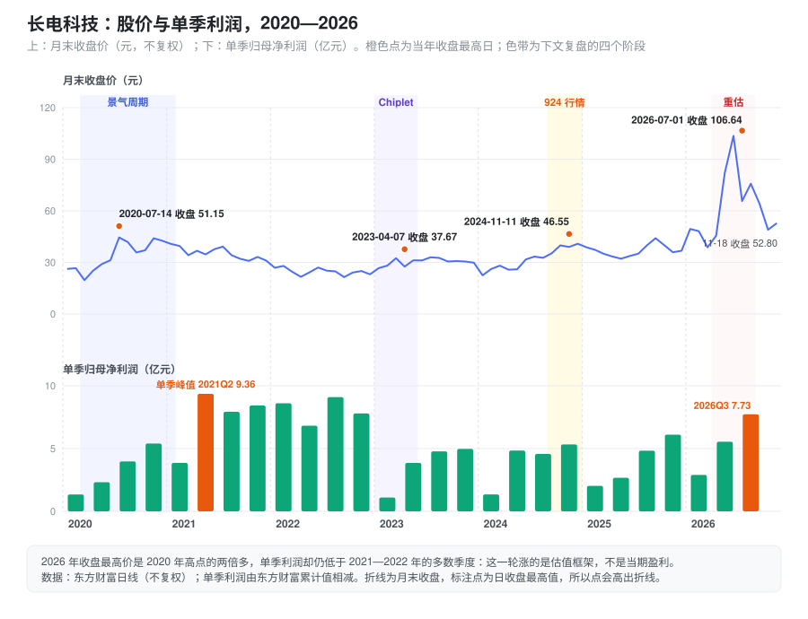
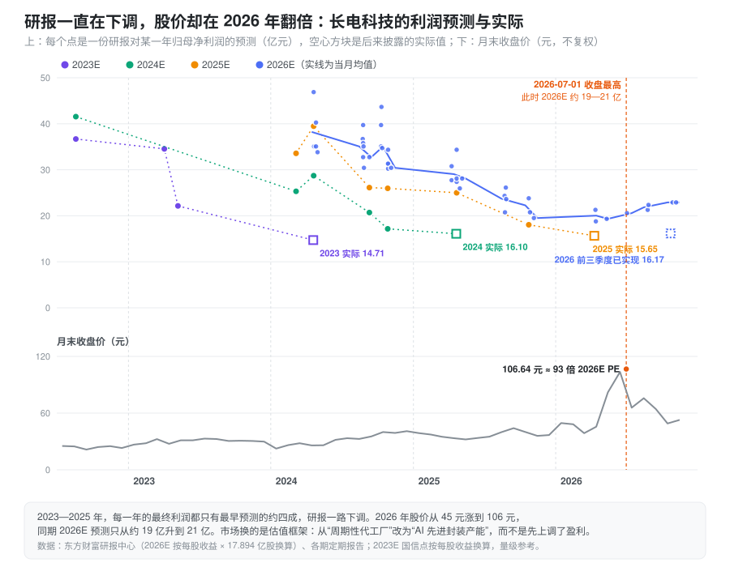

% 先进封装：长电科技与日月光的预期差复盘

**2020—2026 年，A 股封测龙头长电科技有过两次大涨，性质完全不同。2020 年是缺芯景气推动的利润行情，利润翻了十几倍，股价却在利润最好的 2021、2022 年连跌两年。2026 年是估值框架的重写：股价三个月内从 38 元涨到 107 元，研报对当年利润的预测只从约 19 亿元升到 21 亿元。** 中间三年，研报一直在高估利润：2023—2025 年每一年的实际利润，都只有最早预测的约四成。

日月光走的是另一张时间表。台积电 CoWoS 产能不够，把后段工序外包出来，日月光的 AI 先进封装收入在 2024—2025 年就开始兑现，台股市场也更早给了它重新定价。长电在 2026 年的重估，靠的是国产算力芯片、产能利用率和涨价，而不是已经出现在报表里的 AI 收入。

## 研究范围与数据口径

- **标的**：长电科技，上交所 **600584.SH**；通富微电，深交所 **002156.SZ**，作为 A 股对照；日月光投资控股，台湾证交所 **3711.TW**，美股 ADR 为 ASX。
- **期间**：2020—2025 年六个完整自然年，2026 年单列。资料提取日与信息截止日为 **2026-11-18**。
- **行情**：日月光取台湾证交所收盘价与本益比，详见日月光一节。长电、通富的年度表取青柠量化复盘页，收盘价为不复权人民币元，收益为后复权、含分红口径，PE 为供应商标注的年末 TTM 记录，页面数据截至 2026-10-16。日度和月末收盘价取东方财富 A 股不复权日线，2026-11-18 提取。
- **利润**：归母净利润，人民币亿元。单季值由东方财富数据中心累计值相减得到。全年利润要到次年三四月才披露，下文凡用全年数解释当年股价，都是事后检验。
- **研报**：东方财富研报中心 2020—2026 年长电科技研报共 106 篇，评级全部为“买入”“增持”“推荐”或“优于大市”。评级没有区分度，下文只看盈利预测和论点。
- **散户**：东方财富股吧历史列表需要身份核实，未能取得。散户看法用三类可核验的痕迹代替：季度股东户数、龙虎榜、面向个人投资者的财经媒体标题。这些是代理指标，不代表全体投资者。

相关背景：CoWoS 的工序拆分、台积电把 oS 段外包给日月光和 Amkor 的过程，见 [Blackwell 供应链](./blackwell_supply_chain.html)。

## 历史股价与年末定价

| 年份 | 长电 年末收盘 | 长电 含息收益 | 长电 年末 PE | 通富 年末收盘 | 通富 含息收益 | 通富 年末 PE |
| --- | ---: | ---: | ---: | ---: | ---: | ---: |
| 2020 | 42.57 | +93.7% | 65.9 | 25.24 | +53.4% | 108.8 |
| 2021 | 31.02 | −27.0% | 20.8 | 19.43 | −22.9% | 33.1 |
| 2022 | 23.05 | −25.1% | 12.4 | 16.48 | −15.2% | 34.1 |
| 2023 | 29.86 | +30.3% | 30.5 | 23.12 | +40.8% | 88.1 |
| 2024 | 40.86 | +37.3% | 46.5 | 29.55 | +27.9% | 57.1 |
| 2025 | 36.78 | −9.6% | 44.3 | 37.70 | +27.8% | 58.1 |
| 2026 YTD，至 10-16 | 56.96 | +55.1% | 52.6 | 48.67 | +29.2% | 30.7 |

来源：[青柠量化·长电科技](https://www.zpyztech.com/stock/600584/fupan/)、[青柠量化·通富微电](https://www.zpyztech.com/stock/002156/fupan/)，页面数据截至 2026-10-16，提取于 2026-11-18。2026-11-18 收盘价：长电 52.80 元，通富 43.45 元。

年末 PE 不能当估值高低的直接证据。2021 年长电 PE 从 65.9 倍降到 20.8 倍，主要是利润翻倍、价格下跌同时发生；2023 年 PE 回到 30.5 倍，主要是利润腰斩。通富 2026 年的 30.7 倍偏低，是因为分母里有一笔大额公允价值变动收益，见下文。

## 利润与毛利率

| 年份 | 长电 归母净利润 | 长电 毛利率 | 年报披露日 | 通富 归母净利润 | 通富 毛利率 |
| --- | ---: | ---: | --- | ---: | ---: |
| 2019 | 0.89 | — | 2020-04-30 | — | — |
| 2020 | 13.04 | 15.45% | 2021-04-29 | 3.38 | 15.47% |
| 2021 | 29.59 | 18.41% | 2022-03-31 | 9.57 | 17.16% |
| 2022 | 32.31 | 17.04% | 2023-03-31 | 5.02 | 13.90% |
| 2023 | 14.71 | 13.65% | 2024-04-19 | 1.69 | 11.67% |
| 2024 | 16.10 | 13.06% | 2025-04-21 | 6.78 | 14.84% |
| 2025 | 15.65 | 14.15% | 2026-04-10 | 12.19 | 14.59% |
| 2026 年 1—9 月 | 16.17 | 16.01% | 2026-10-23 | 30.61 | — |

来源：东方财富数据中心定期报告财务数据（`RPT_LICO_FN_CPD`），2026-11-18 提取；披露日为该接口记录的公告日。2026 年 1—9 月数据未经审计。长电 2026 年前三季度扣非归母净利润 15.61 亿元，同比 +99.17%。通富 2026 年前三季度扣非归母净利润只有 13.78 亿元，国信证券的半年报点评指出其上半年含 11.45 亿元公允价值变动收益，对应的投资标的本文未核实。

封测毛利率长期在 13%—18% 之间。2021 年景气顶点是 18.41%，2026 年三季度单季是 17.48%，还没有超过上一轮高点。**毛利率是判断“涨价逻辑”有没有兑现的最直接指标**，下文 2026 年一节会反复用到。

## 按时间线复盘：两次暴涨各自补上了什么预期差

先把结论放在前面：

- **2020 年的大涨补的是利润预期差。** 长电从 2019 年近乎不赚钱，变成 2020 年赚 13 亿元，股价先于报表涨了一倍半。到 2021 年研报转而认为“市场低估了景气持续性”，利润也确实继续增长，股价却连跌两年，因为市场已经在交易下一轮下行。
- **2023—2025 年是研报持续高估利润的三年。** “先进封装”“Chiplet”“国产替代”的主题让研报一再给出 30—40 亿元的远期利润，实际每年只有 15 亿元左右。这期间的几次上涨都是主题和事件驱动，没有盈利上修来接。
- **2026 年的大涨补的是估值框架的预期差。** 当年利润预测几乎没动，变的是市场把封测从“低技术壁垒的周期性代工”改看成“AI 算力的稀缺产能”。股价在 7 月 1 日见顶，对应约 93 倍 2026 年预测市盈率；之后利润连续超预期，股价反而回落一半。

价格口径：下文价格都是东方财富 A 股不复权收盘价。长电在 2020—2026 年没有送转，单次现金分红最多每股 0.20 元（含税），不复权价格的跨年比较误差有限，但涨跌幅仍不等于股东总回报。

### 2020—2021：缺芯景气，利润翻倍而估值先跌

**当时怎么看。** 2020 年 11 月开源证券首次覆盖时，对行业的定性是：“封测行业是劳动密集型行业，相对半导体设计、制造领域来说，技术壁垒、对人才的要求相对较低，是国内半导体产业链与国外差距最小环节。”这是当时卖方对封测的标准看法：它是半导体里最便宜、最像制造业的一环，估值要靠规模和景气支撑。[开源证券，2020-11-23](https://data.eastmoney.com/report/info/AP202011231432033820.html)

2021 年 7 月，国金证券把 2021—2023 年利润预测上调到 24.1、27.2、30.0 亿元，并写道：“我们认为市场低估了这一轮封测行业景气度的持续性……上游设备产能限制了实际产能的扩张进度，被动延长了景气周期……估值终将回升。”[国金证券，2021-07-02](https://data.eastmoney.com/report/info/AP202107021501282400.html)，当日收盘 39.09 元。

**散户怎么做。** 股东户数从 2019 年末的 12.0 万户，增加到 2020 年 9 月末的 31.1 万户，九个月里多了 1.6 倍。同期股价从 3 月末的 19.67 元涨到 7 月 14 日的 51.15 元。与中远海控 2020 年的情况不同，长电这一轮上涨散户是跟着进来的。2021 年股价从 1 月 18 日的 48.20 元跌到年末 31.02 元，股东户数仍然从 34.8 万户（6 月末）增加到 38.5 万户（12 月末），说明下跌中仍有人按“利润在增长”买入。

**发生了什么。** 单季利润从 2019 年一季度亏损 0.47 亿元，一路升到 2021 年二季度的 9.36 亿元，这是 2020—2026 年的单季最高值。2021 年全年利润 29.59 亿元，增长 127%；2022 年 32.31 亿元，又创新高。

**改变了什么预期。** 国金对 2022 年的预测 27.2 亿元低于实际，对 2023 年的预测 30.0 亿元则是实际 14.71 亿元的两倍。也就是说，“景气比市场想的持续得久”这一判断对 2021—2022 年成立，对 2023 年不成立，而股价交易的正是 2023 年。2021 年长电利润翻倍，含息收益 −27%，年末 PE 从 65.9 倍压到 20.8 倍。这一年市场修正的是“这份利润能维持几年”，和中远海控 2021 年下半年的情形相同。

| 报告日 | 机构 | 当年预测 | 次年预测 | 第三年预测 | 当日收盘 |
| --- | --- | ---: | ---: | ---: | ---: |
| 2021-07-02 | 国金 | 2021E 24.1 | 2022E 27.2 | 2023E 30.0 | 39.09 |
| 2022-08-19 | 开源 | 2022E 32.01 | 2023E 36.69 | 2024E 41.55 | 27.14 |
| 实际值 | 年报 | 2021 年 29.59 | 2022 年 32.31 | 2023 年 14.71 | — |

单位为亿元归母净利润。开源一行的“实际值”对应 2022、2023、2024 年，分别为 32.31、14.71、16.10 亿元。来源：[国金 2021-07-02](https://data.eastmoney.com/report/info/AP202107021501282400.html)、[开源 2022-08-19](https://data.eastmoney.com/report/info/AP202208191577373622.html)。

### 2022—2023 年上半年：利润创新高时下跌，Chiplet 主题时上涨

**发生了什么。** 2022 年长电利润 32.31 亿元，比 2021 年再增 9%，股价却从 1 月 4 日的 30.95 元跌到 4 月 26 日的 19.95 元，年末 23.05 元。消费电子需求在 2022 年下半年转弱，单季利润从三季度的 9.09 亿元降到四季度的 7.79 亿元，再到 2023 年一季度的 1.10 亿元。

2023 年 1 月，公司宣布 XDFOI 多维扇出封装平台进入稳定量产，并完成 4nm 工艺的 Chiplet 产品出货。随后 ChatGPT 带起 AI 算力主题，“Chiplet 是国产先进制程的突破口”成为 A 股主线之一。长电从 2 月 28 日的 28.14 元涨到 4 月 7 日的 37.67 元，五周涨 34%。

**研报怎么看。** 国信 2023-04-03 给出 2023—2025 年每股收益 1.93、2.38、3.04 元，按 23—24 倍 2023 年市盈率给出 43.30—46.39 元的合理估值，当日收盘 34.55 元。按 17.894 亿股换算，2023 年预测约 34.5 亿元，实际 14.71 亿元。民生 2023-05-08 首次覆盖，给 2023—2025 年 22.15、36.25、43.42 亿元，引用 Yole 的数据称先进封装市场将从 2021 年的 374 亿美元增至 2027 年的 650 亿美元，年复合增长 9.6%。[国信 2023-04-03](https://data.eastmoney.com/report/info/AP202304031585045963.html)、[民生 2023-05-08](https://data.eastmoney.com/report/info/AP202305081586354157.html)

**散户怎么做。** 这一段上涨里股东户数在减少：2022 年末 33.7 万户，2023 年 3 月末 28.4 万户，6 月末 26.8 万户，年末 22.7 万户。本文推断，2023 年的 Chiplet 行情主要由机构和主题资金推动，散户在前一轮下跌后陆续离场，没有在主题行情里大量回流。

**改变了什么预期。** 2023-04-26 一季报显示单季利润只有 1.10 亿元，同比下降 87%，当天收盘从 31.49 元跌到 28.34 元，跌 10%。Chiplet 主题改变的是“长电是不是先进封装公司”的叙事，没有改变 2023 年的利润。市场在一季报当天把这两件事分开了：叙事可以先涨，利润不来，价格就回到原处。此后研报把 2023 年预测降到约 22 亿元，仍比实际高出约 50%。

### 2023 年下半年—2024 年：海外 CoWoS 外溢，A 股靠事件定价

**海外发生了什么。** 英伟达 H100 需求在 2023 年下半年爆发，瓶颈落在台积电的 CoWoS 产能上。台积电在扩自身产能的同时，把 CoWoS 后段的 oS（on-Substrate）工序和测试外包给日月光、矽品和 Amkor。日月光在 2023 年 10 月表示，2024 年 CoWoS 相关收入将翻倍，此后每次法说会都给出先进封装收入目标。CoWoS 工序拆分见 [Blackwell 供应链](./blackwell_supply_chain.html)，日月光的时间线见下一节。

**长电发生了什么。** 这一轮外溢没有直接落到长电的报表上。2024 年单季利润在 1.35—5.33 亿元之间，全年 16.10 亿元，只比 2023 年多 9%；毛利率 13.06%，是 2020 年以来最低。股价有三次跳动，都来自公司事件或市场整体行情：

1. **2024-03-05，宣布收购晟碟半导体 80% 股权。** 晟碟是西部数据旗下的闪存封测厂，收购后长电的存储封装收入扩大。当天收盘从 27.89 元涨到 30.68 元，涨 10%，次日回落到 28.88 元。交易于 2024-09-28 完成交割。
2. **2024-03-27，华润集团公告成为实际控制人。** 国资委于 2024-11-01 批准。这一阶段研报对 2025 年利润的预测在 33—39 亿元之间，是 2023—2026 年里最高的一段。
3. **2024-09-24 起，A 股整体大涨。** 长电从 9 月 23 日的 27.79 元涨到 10 月 8 日的 38.86 元，六个交易日涨 40%；11 月 11 日收盘 46.55 元，是当年最高。本文没有找到同期的公司层面催化，这一段与 A 股科技股整体的涨幅一致。

**散户怎么做。** 2024 年 9 月末股东户数 22.3 万户，年末 31.4 万户，一个季度增加 40.9%，是 2020 年以来最大的单季增幅。散户在 924 行情里回来了，买入的价格大多在 35 元以上。

**研报怎么看。** 研报对 2024、2025 年的预测在这一年里一直往下调：

| 报告日 | 机构 | 2024E | 2025E | 2026E | 当日收盘 |
| --- | --- | ---: | ---: | ---: | ---: |
| 2024-03-06 | 国信，晟碟收购点评 | 25.31 | 33.58 | — | 28.88 |
| 2024-04-20 | 开源，2023 年报后 | 28.72 | 39.47 | 46.85 | 24.54 |
| 2024-09-10 | 国金 | 20.70 | 26.13 | 32.75 | — |
| 2024-10-27 | 国信，三季报后 | 17.16 | 25.96 | 31.33 | 39.09 |
| 实际值 | 年报 | 16.10 | 15.65 | 2026 年 1—9 月 16.17 | — |

单位为亿元归母净利润。国信 10 月的下调理由是“下游需求弱复苏”，下调前为 20.81、26.85、32.79 亿元。来源：[国信 2024-03-06](https://data.eastmoney.com/report/info/AP202403061625767374.html)、[开源 2024-04-20](https://data.eastmoney.com/report/info/AP202404201630833177.html)、[国金 2024-09-10](https://data.eastmoney.com/report/info/AP202409101639814980.html)、[国信 2024-10-27](https://data.eastmoney.com/report/info/AP202410271640528512.html)。

**改变了什么预期。** 2024 年末长电收盘 40.86 元，比年初高 37%，但同期研报对 2025 年的预测从 39 亿元降到 26 亿元。价格上涨和盈利预测下调同时发生，年末 PE 从 30.5 倍升到 46.5 倍。本文推断，市场在 2024 年为“央企控股的国产先进封装平台”支付了溢价，而这份溢价背后的盈利，研报自己也在一路下调。

### 2025：利润持平，研报把远期预测砍到底

**发生了什么。** 2025 年长电利润 15.65 亿元，比 2024 年少 2.75%，扣非利润少 11.51%。单季利润前低后高：一季度 2.03 亿元，四季度 6.11 亿元。股价在 4 月关税冲击中跌到全年低点，4 月 3 日收盘 34.37 元，4 月 8 日 30.00 元；10 月 9 日收盘 47.00 元，是全年最高，年末回到 36.78 元，全年含息收益 −9.6%。

**研报怎么看。** 这一年研报不断下调远期利润。对 2025 年的预测，从开源 4 月的 25 亿元降到国金 10 月的 18.04 亿元，实际 15.65 亿元。对 2026 年的预测下调得更多：2024 年 10 月各家给出的 2026 年每股收益在 1.69—2.44 元之间，到 2025 年 11 月只剩 1.09—1.33 元，按股本换算约 19.5—23.8 亿元。[开源 2025-04-22](https://data.eastmoney.com/report/info/AP202504221660421098.html)、[国金 2025-10-24](https://data.eastmoney.com/report/info/AP202510241767945812.html)

**散户怎么做。** 股东户数 6 月末 31.9 万户，9 月末 37.6 万户，跟着三季度的上涨增加了 18%；年末小幅回落到 36.7 万户。

**改变了什么预期。** 到 2025 年末，研报对长电的盈利预期已经降到 2020 年以来的低点附近，2026 年预测与 2024、2025 年的实际利润相差不大。这为 2026 年留下了一个特殊的起点：**盈利预期很低，但估值并不低**，2025 年末 TTM PE 仍有 44.3 倍。后来的上涨不是从“便宜”开始的。

### 2026：估值框架被重写，利润兑现后股价腰斩

#### 1—4 月：年报利润下降，同业给出新的估值锚

2026 年 1 月，长电从 12 月 31 日的 36.78 元涨到 1 月 21 日的 52.61 元，本文没有找到公司层面的催化。3 月 16 日，有投资者在互动平台问公司是否会涨价，公司回复采取“随行就市的价格策略”。3 月 30 日的媒体标题已经在提示“估值处历史高位”。

4 月 10 日 2025 年报披露，利润和扣非利润都下降。新浪当天的标题是“770 亿封测龙头……押注先进封装值不值？”4 月 14 日开源把 2026、2027 年利润预测从 26.08、31.90 亿元下调到 18.82、21.68 亿元，理由是“地缘政治紧张局势升级及消费电子的需求调整”，对应 2026 年 40.8 倍市盈率。同一份报告记录了两项后来很重要的数据：2025 年运算电子收入 82.79 亿元，增长 42.12%，占收入 21.3%；2026 年固定资产投资计划 99.8 亿元，2025 年为 85 亿元。[开源 2026-04-14](https://data.eastmoney.com/report/info/AP202604141821169967.html)

**这一阶段真正改变预期的事件是 4 月 21 日盛合晶微在科创板上市。** 它开盘涨超 400%，市值一度超过 1,800 亿元，随后回落到约 1,400 亿元。盛合晶微做凸块、晶圆级封装和 2.5D 硅转接板封装，前身是中芯国际与长电科技 2014 年合资设立的中芯长电，2021 年两家股东退出后改名。它 2025 年归母净利润 9.23 亿元，不到长电的六成；长电当天收盘 44.03 元，市值约 790 亿元。**一家利润更少的同业被定价在长电近两倍的市值上，A 股第一次有了“国产 AI 先进封装产能”的直接估值锚。** [新浪财经，2026-04-22](https://finance.sina.com.cn/roll/2026-04-22/doc-inhvkcsa5605841.shtml)

#### 5 月：第一段上涨，内资和散户先动

4 月 28 日一季报利润 2.90 亿元，同比增长 42.74%。5 月 7—8 日的业绩交流会上，公司表示一季度产能利用率超过 80%、“产能供不应求”，2.5D 产品进入量产爬坡，高密度存储和电源模组需求从二季度开始放量；同时也说“国际客户短期内提高产出意愿不高”。

5 月 11 日长电涨停，收盘 55.83 元，第一次超过 2020 年 7 月的 51.15 元；5 月 12 日市值突破千亿元。5 月 25 日华为发布“韬（τ）定律”，寒武纪股价突破 1,400 元，媒体用“中国半导体的 DeepSeek 时刻”形容当天的行情。长电 5 月 25、26 日连续涨停，收盘 80.17、88.19 元。5 月 26 日龙虎榜显示机构专用席位卖出 14.4 亿元，合计净卖出超过 26 亿元，公司发布股价异动风险提示；次日成交额达到约 300 亿元。

外资在这一段是反方向。高盛 5 月 25 日维持“中性”，目标价 50.90 元，比前一交易日收盘 72.88 元低 30%；它把 2026 年净利润预测从 30.34 亿元下调到 27.97 亿元，对应 46.6 倍市盈率。[新浪财经转载高盛观点，2026-05-26](https://finance.sina.com.cn/stock/hkstock/marketalerts/2026-05-26/doc-inhzfmyq1442851.shtml)

#### 6 月—7 月初：外资改估值框架，散户户数翻倍

6 月 3 日板块“光速退潮”，长电 6 月 12 日回到 68.92 元。随后外资集中改变看法：

- **摩根大通，6 月 20 日**：评级从“中性”上调为“增持”，目标价从 45 元上调到 110 元。预测 2026—2028 年收入年复合增长 16%、利润年复合增长 46%，长电微电子收入年复合增长超过 150%。[新浪财经，2026-06-20](https://finance.sina.com.cn/stock/hkstock/marketalerts/2026-06-20/doc-inieakfq1785491.shtml)
- **花旗，6 月 23 日**：长电目标价从 42 元上调到 110 元，通富从 48 元上调到 80 元，华天从 11.5 元上调到 23.5 元。报告原话是：“封测行业已从周期性、资本密集型的服务提供商转变为先进封装的关键赋能者……行业估值基准已被彻底重塑。”同日有报道称台积电将上调 7nm 及以下晶圆价格 5%—10%。[新浪财经，2026-06-25](https://finance.sina.com.cn/jjxw/2026-06-25/doc-inieqnaz7878879.shtml)
- **高盛，7 月 2 日**：标题为“中国半导体估值逻辑被彻底重构，长电科技目标价大幅上调”。

6 月 24 日公司公告在临港投资 78 亿元建设高端封装工厂，股价四天三板，市值超过 1,800 亿元。7 月 1 日媒体标题是“先进封装订单排至 2027 年”，长电当天收盘 106.64 元，这是 2020 年以来的最高收盘价，市值约 1,908 亿元。[新浪财经，2026-07-01](https://finance.sina.com.cn/jjxw/2026-07-01/doc-inifheze6325684.shtml)

6 月末股东户数 84.8 万户，3 月末是 32.0 万户，一个季度增加 164.5%，是本文统计期内的最高值。通富同期从 35.1 万户增加到 56.1 万户。**散户最多的时点就在股价顶部附近**：户数的统计日 6 月 30 日，离 7 月 1 日的收盘最高点只差一个交易日。中远海控 2021 年的户数峰值出现在顶部之后的第一段回调里，长电这一次散户进场更晚、更集中。

**研报的当年盈利预测在这一段几乎没动。** 4 月开源给出的 2026 年利润是 18.82 亿元，7 月 3 日中邮给出 20.5 亿元，涨幅约 9%；同期股价从 44 元涨到 107 元，涨 140%。按 7 月 1 日的收盘价和中邮的每股收益 1.15 元，长电对应约 93 倍 2026 年预测市盈率。外资把目标价提到 110 元，靠的也不是上调 2026 年利润：摩根大通用的是 2026—2028 年 46% 的利润复合增速，高盛 8 月给出的 125 元目标价按 2030 年每股收益 4.66 元乘 42.8 倍、再以 11% 折现得出。**市场在 7 月初为长电定价的，是 2028—2030 年的利润。**

| 报告日 | 机构 | 2026E | 2027E | 2028E | 当日收盘 |
| --- | --- | ---: | ---: | ---: | ---: |
| 2024-10-27 | 国信 | 31.33 | — | — | 39.09 |
| 2025-10-24 | 国金 | 23.81 | 30.18 | — | 40.95 |
| 2026-04-14 | 开源，2025 年报后 | 18.82 | 21.68 | — | 44.34 |
| 2026-07-03 | 中邮 | 20.5 | 26.4 | 32.7 | — |
| 2026-08-25 | 开源，中报后 | 21.22 | 28.60 | 36.81 | 74.05 |
| 2026-10-28 | 山西，首次覆盖 | 22.83 | 29.36 | 36.17 | 55.41 |
| 实际值 | 2026 年 1—9 月 | 16.17 | — | — | — |

单位为亿元归母净利润。来源：[国信 2024-10-27](https://data.eastmoney.com/report/info/AP202410271640528512.html)、[国金 2025-10-24](https://data.eastmoney.com/report/info/AP202510241767945812.html)、[开源 2026-04-14](https://data.eastmoney.com/report/info/AP202604141821169967.html)、[开源 2026-08-25](https://data.eastmoney.com/report/info/AP202608251828397688.html)、[山西 2026-10-28](https://data.eastmoney.com/report/info/AP202610281831069536.html)；中邮数据取自研报中心列表摘要。

#### 7 月中—11 月：利润一再超预期，股价回落一半

7 月 14 日收盘 102.70 元，当晚公司预告上半年利润同比增长 63.48%—101.70%。次日股价跌到 92.46 元，此后 83.21 元（7 月 16 日）、76.99 元（7 月 20 日）。预告前两天，媒体标题是“低毛利困境待解”；预告后一周，标题变成“把散户心态玩废了”。

之后每一份财报都好于年初的预期，股价却每次在财报后下跌：

| 日期 | 事件 | 前一交易日收盘 | 事件后收盘 |
| --- | --- | ---: | ---: |
| 2026-07-14 晚 | 中报预告，利润 +63%—102% | 102.70 | 92.46（7-15）、76.99（7-20） |
| 2026-08-21 | 中报，上半年利润 8.45 亿元，+79.41% | 79.48（8-20） | 73.80（8-24） |
| 2026-10-23 | 三季报，前三季度 16.17 亿元，+69.6%，三季度毛利率 17.48% | 59.00（10-22） | 53.29（10-27） |

价格来源：东方财富日线，不复权，2026-11-18 提取。财报数据来源同上文利润表。

同期的其他变化，都指向“未来利润要花多少钱换来”：

- **大基金减持。** 8 月 20 日报道显示，国家集成电路产业投资基金在三个月内减持 2,149.45 万股。[新浪财经，2026-08-20](https://finance.sina.com.cn/jjxw/2026-08-20/doc-ininysmk1853552.shtml)
- **资本开支翻倍。** 9 月 3 日公司公告 65 亿元定增，投向高性能计算先进封装、存储 Chiplet 和电源模组封测。山西证券 10 月 28 日的报告记录，2026 年投资计划从 110.1 亿元上调到 182 亿元，其中固定资产投资从 99.8 亿元上调到 173.1 亿元。按研报约 22 亿元的 2026 年利润预测计，相当于约八年的利润。[山西 2026-10-28](https://data.eastmoney.com/report/info/AP202610281831069536.html)
- **新业务仍在亏损。** 开源 8 月 25 日的报告显示，上半年长电微电子收入 2.12 亿元、净亏损 0.89 亿元。高盛同日维持“中性”，指出二季度收入比其预期低 8%，毛利率高 0.7 个百分点。[新浪财经，2026-08-25](https://finance.sina.com.cn/jjxw/2026-08-25/doc-inipnyqs9667118.shtml)
- **分红与股东回报落差。** 8 月 22 日有媒体拿长电每股 0.05 元的中期分红与 SK 海力士的回购对比。

9 月末股东户数 70.3 万户，比 6 月末减少 17.0%；股价从 103.55 元（6 月末）降到 64.28 元（9 月末）。11 月 18 日收盘 52.80 元，比 7 月 1 日的高点低 50.5%。

**改变了什么预期。** 7 月之后改变的不是“先进封装是不是好生意”，而是“这门生意的钱多久能赚回来”。研报对 2026 年的利润预测从 20.5 亿元升到 22.8 亿元，确实在上修；但上修的幅度只有 10%，而股价在高点时已经按 2028—2030 年的利润定价。毛利率回到 17% 附近，仍低于 2021 年的 18.41%；固定资产投资计划则从 2025 年的 85 亿元升到 173.1 亿元。利润超预期、股价下跌，是因为超出的部分远小于价格已经提前支付的部分。

### 日月光：AI 收入先到，重估也先到

日月光是全球最大的封测厂，2023 年以后成为台积电 CoWoS 后段外包的主要承接方。它的时间线与长电错开了大约一年半，而且每一段上涨都有公司给出的收入指引作为支撑。

| 年份 | 年末收盘（新台币） | 含息涨跌 | 年末 PE（TTM） | 基本每股收益 | 封测毛利率 |
| --- | ---: | ---: | ---: | ---: | ---: |
| 2020 | 81.3 | — | 14.49 | 6.47 | 21.2% |
| 2021 | 106.5 | +35.4% | 10.68 | 14.84 | 26.5% |
| 2022 | 93.9 | −4.5% | 5.21 | 14.53 | 28.5% |
| 2023 | 135.0 | +54.9% | 15.27 | 7.39 | 21.8% |
| 2024 | 162.0 | +23.8% | 21.63 | 7.52 | 22.5% |
| 2025 | 250.5 | +60.5% | 30.96 | 9.37 | 23.5% |
| 2026 YTD，至 11-18 | 548.0 | +120.8% | 29.85（11-17） | 前三季度 14.17 | 三季度 30.6% |

来源：收盘价与 PE 取台湾证交所个股日成交资讯与本益比资料，PE 按最近四个已公布季度计算；含息涨跌取 Yahoo 行情数据，非官方口径；每股收益与封测（ATM）毛利率取日月光各年第四季度及全年业绩新闻稿：[2020](https://www.prnewswire.com/news-releases/ase-technology-holding-co-ltd-reports-unaudited-consolidated-financial-results-for-the-fourth-quarter-and-full-year-of-2020-301221870.html)、[2021](https://www.prnewswire.com/news-releases/ase-technology-holding-co-ltd-reports-unaudited-consolidated-financial-results-for-the-fourth-quarter-and-the-full-year-of-2021-301479424.html)、[2022](https://www.prnewswire.com/news-releases/ase-technology-holding-co-ltd-reports-its-unaudited-consolidated-financial-results-for-the-fourth-quarter-and-the-full-year-of-2022-301742780.html)、[2023](https://www.prnewswire.com/news-releases/ase-technology-holding-co-ltd-reports-its-unaudited-consolidated-financial-results-for-the-fourth-quarter-and-the-full-year-of-2023-302050129.html)、[2024](https://www.prnewswire.com/news-releases/ase-technology-holding-co-ltd-reports-its-unaudited-consolidated-financial-results-for-the-fourth-quarter-and-the-full-year-of-2024-302375540.html)、[2025](https://www.prnewswire.com/news-releases/ase-technology-holding-co-ltd-reports-its-unaudited-consolidated-financial-results-for-the-fourth-quarter-and-the-full-year-of-2025-302679779.html)、[2026 年三季度](https://www.prnewswire.com/news-releases/ase-technology-holding-co-ltd-reports-its-unaudited-consolidated-financial-results-for-the-third-quarter-of-2026-302923021.html)。2021 年每股收益含出售大陆六座工厂的收益，新闻稿给出的备考每股收益为 10.51 元。台湾的散户持股数据（集保股权分散表）本次未采集，日月光一节只讨论机构与公司指引。

**2021—2022：低 PE 来自高峰利润。** 2021 年 12 月，元大认为封测产能“2022 年仍将紧缺”。不到一年，日月光在 2022-10-27 的法说会上下调资本开支，预计四季度产能利用率 75%—80%，库存调整延续到 2023 年上半年。2022 年末 PE 只有 5.21 倍，对应的是接近高峰的每股收益；2023 年每股收益减少一半，PE 回到 15 倍。这和中远海控 2022 年的低 PE 是同一种现象。[Taipei Times，2021-12-06](https://www.taipeitimes.com/News/biz/archives/2021/12/06/2003769072)、[Taipei Times，2022-10-28](https://www.taipeitimes.com/News/biz/archives/2022/10/28/2003787841)

**2023：公司自己说 AI 还早。** 2023-07-27 法说会上，二季度产能利用率只有 60%，AI 相关产品占封测收入的个位数低段，财务长董宏思说：“AI 现在还在早期，这个领域需要时间才能看到增长。”同一篇报道写到，CoWoS 的大部分工序由台积电自己完成。三个月后，日月光表示 2024 年 CoWoS 相关收入将翻倍。股价在这一年先于利润上涨：5 月 2 日 100.5 元，6 月 13 日 128 元，当时 PE 约 10 倍。[Taipei Times，2023-07-28](https://www.taipeitimes.com/News/biz/archives/2023/07/28/2003803847)、[Taipei Times，2023-10-27](https://www.taipeitimes.com/News/biz/archives/2023/10/27/2003808266)

**2024—2025：每次指引都上调，股价按指引走。** 日月光开始给出先进封装（公司称 leading-edge advanced packaging，LEAP）收入的具体数字。这条指引线是理解日月光定价的主线：

| 法说会日期 | 先进封装收入指引 | 资本开支与其他 | 股价反应 |
| --- | --- | --- | --- |
| 2024-02-01 | 2024 年增加约 2.5 亿美元 | 设备资本开支增加 40%—50% | — |
| 2024-07-25 | 2025 年再翻倍 | 资本开支第二次上调至约 30 亿美元；三季度利用率约 65%，复苏“慢于预期” | 7-26 跌停至 155.5 元，8-5 跌到 130 元 |
| 2025-02-13 | 2025 年 16 亿美元，2024 年 6 亿美元，2023 年 2.5 亿美元 | 公司称“AI 带动的超级周期从 2024 年开始” | — |
| 2025-07-31 | 维持 2025 年增加 10 亿美元 | 台湾先进封装产能已满；2026 年毛利率回到约 25% 的结构性水平 | — |
| 2025-10-30 | 2025 年 16 亿美元确定，2026 年再增 10 亿美元以上 | — | 10-28 收盘 203 元，10-31 收盘 247.5 元 |
| 2026-02-05 | 2026 年 32 亿美元，需求“持续明显大于供给” | 资本开支创新高至 70 亿美元 | 2-5 收盘 284 元，2-11 收盘 354.5 元 |
| 2026-04-29 | 2026 年上调至 35 亿美元 | 资本开支 85 亿美元；整体封测一条龙（turnkey）约 3 亿美元 | — |
| 2026-07-30 | 2026 年 35 亿美元以上 | 资本开支 105 亿美元；封测毛利率年底达到 30% | — |
| 2026-10-29 | 2026 年 40 亿美元以上；2027 年 turnkey 超过 10 亿美元，共封装光学超过 5 亿美元 | 资本开支第三次上调至 115 亿美元，2027 年更高 | — |

来源：各次法说会的 Taipei Times 报道：[2024-02-02](https://www.taipeitimes.com/News/biz/archives/2024/02/02/2003812952)、[2025-02-14](https://www.taipeitimes.com/News/biz/archives/2025/02/14/2003831834)、[2025-08-01](https://www.taipeitimes.com/News/biz/archives/2025/08/01/2003841258)、[2025-10-31](https://www.taipeitimes.com/News/biz/archives/2025/10/31/2003846378)、[2026-02-06](https://www.taipeitimes.com/News/biz/archives/2026/02/06/2003851840)、[2026-04-30](https://www.taipeitimes.com/News/biz/archives/2026/04/30/2003856469)、[2026-07-31](https://www.taipeitimes.com/News/biz/archives/2026/07/31/2003861664)、[2026-10-30](https://www.taipeitimes.com/News/biz/archives/2026/10/30/2003866836)；2024-07-25 法说会见 [NOWnews](https://www.nownews.com/news/6479887)。股价为台湾证交所收盘价。2024 年 2 月的“2.5 亿美元”，中文媒体写作增量，与 2025 年 2 月公布的 2023、2024 年实际值相比，增量口径更说得通；2026 年 7 月的指引，两篇报道分别写作“35 亿美元以上”和“37 亿美元”，本文取前者。

2025 年 4 月关税冲击中，日月光从 4 月 2 日的 149.0 元跌到 4 月 9 日的 115.0 元，跌 22.8%，PE 从 19.9 倍降到 15.4 倍；6 月 30 日回到 147.5 元。这次下跌没有对应指引下调，7 月的法说会也维持了全年目标。

**2026：重估有毛利率接住。** 封测业务里，运算类收入占比从 2023 年四季度的 17% 升到 2026 年三季度的 34%；封测毛利率在 2026 年三季度达到 30.6%，超过 2022 年 28.5% 的上一轮高点。美银 7 月 9 日维持“买入”、目标价 750 元，预测 2026—2028 年每股收益 17.08、31.49、41.87 元，同时提示资本开支约占封测收入的 40%，可能需要股权或债券融资。[TechNews，2026-07-09](https://finance.technews.tw/2026/07/09/bank-of-america-gives-ase-technology-holding-a-target-price-of-nt750/)

日月光 10 月 12 日收盘 762 元，是本文统计期内的最高价，TTM PE 55.1 倍；按美银的 2027 年每股收益算约 24 倍。之后两次下跌都来自外部：7 月 28 日 Amkor 三季度收入指引低于市场预期，盘中跌 24%，日月光从 7 月 27 日的 608 元跌到 7 月 29 日的 499 元；11 月 16 日英伟达执行长黄仁勋辞职，台股加权指数跌 6.03%，日月光跌 8.03% 至 550 元。11 月 18 日收盘 548 元，比高点低 28%。[Motley Fool，2026-07-28](https://www.fool.com/investing/2026/07/28/why-amkor-plunged-today/)、[Focus Taiwan，2026-11-16](https://focustaiwan.tw/business/202611160014)

### 两条时间线的对照

| 对照项 | 日月光 | 长电科技 |
| --- | --- | --- |
| 公司第一次量化 AI 相关业务 | 2023-07，AI 占封测收入个位数低段 | 2026-04，2025 年运算电子收入占 21.3%，不全是 AI |
| 估值抬升的年份 | 2024—2025 年，年末 PE 从 15.3 倍升到 31.0 倍 | 2026 年，集中在 4—7 月 |
| 推动重估的信息 | 公司每季上调先进封装收入和资本开支指引 | 同业上市定价、华为韬定律、外资改写估值框架、涨价预期 |
| 2026 年毛利率与上一轮高点 | 封测三季度 30.6%，高于 2022 年的 28.5% | 三季度 17.48%，低于 2021 年的 18.41% |
| 高点估值 | 762 元，TTM 55.1 倍，约 24 倍美银 2027E | 106.64 元，约 93 倍 2026E、72 倍中邮 2027E |
| 高点至 11-18 | −28% | −50.5% |

长电的 2027E 倍数按中邮 2026-07-03 给出的 2027 年每股收益 1.48 元计算。

两家的差别不在于“谁是先进封装公司”，而在于预期差由谁来补。日月光的预期差由公司指引一步步补上：2023 年公司自己都说 AI 还早，2025 年给出 16 亿美元，2026 年上调到 40 亿美元以上，毛利率也越过了上一轮高点，股价跟着指引走，回撤也较浅。长电在 2026 年 7 月的价格，是把日月光已经兑现的路径预先套在自己身上；而它当时报表上的毛利率、先进封装子公司的盈亏，都还没有走到那一步。

## 这一段复盘留下的结论

- **景气周期的主升浪在利润被低估的阶段，不在利润最高的阶段。** 2020 年长电、2023 年日月光都是在利润还没起来的时候上涨；2021—2022 年两家利润创新高，股价下跌，日月光 2022 年末只有 5 倍 PE。
- **主题行情没有盈利上修来接，就会回到原处。** 2023 年的 Chiplet 和 2024 年的华润入主、924 行情，都让长电涨了 30%—70%，但同期研报对未来利润的预测在下调，涨幅随后大部分回吐。
- **估值框架的重估可以在盈利预测不动的情况下发生，但它要求更远的利润来兑现。** 2026 年长电的上涨几乎全部来自倍数，高点时外资用的是 2028—2030 年的利润。此后利润每次超预期，超出的量都远小于价格提前支付的量，股价因此回落一半。
- **判断位置时，看“上修落在哪一年、由谁来兑现”，比看当期 PE 有用。** 日月光的上修落在当年和下一年，由公司指引和毛利率兑现；长电 2026 年的上修主要落在 2028 年以后，由资本开支和尚在亏损的新业务兑现。
- **散户户数的快速增加出现在股价顶部附近。** 长电股东户数在 2020 年 9 月、2024 年 12 月、2026 年 6 月三次快速增加，都落在股价顶部所在或紧随其后的季度；2026 年 6 月末的 84.8 万户是 2020 年以来最高值，下一个季度股价下跌 38%。

## 尚待验证的问题

1. **先进封装收入口径。** 新浪 2026-04-14 的报道称长电 2025 年先进封装收入 270 亿元、占营收 69.5%，这一口径远比日月光的 LEAP 宽，可能包括倒装、系统级封装等成熟先进封装。两者不能直接比较，需要拿到长电年报中的定义。[新浪财经，2026-04-14](https://finance.sina.com.cn/roll/2026-04-14/doc-inhumwqc9138384.shtml)
2. **涨价的实际幅度。** 研报写到“完善价格联动机制”，三季度毛利率也在上升，但本文没有找到长电具体的提价幅度和适用产品。
3. **7 月中旬反转的触发因素。** 长电在 7 月 14 日晚的中报预告后连跌，Focus Taiwan 的报道提到台股 7 月 17 日出现史上最大单日点数跌幅（2,953 点），两者是否有共同原因，本文没有核实。
4. **散户的直接看法。** 东方财富股吧历史列表需要身份核实，本文只能用股东户数、龙虎榜和媒体标题代替；日月光的集保股权分散数据也未采集。
5. **通富微电 2026 年利润的构成。** 前三季度归母利润 30.61 亿元中，扣非部分只有 13.78 亿元，对应的公允价值变动来源需要从定期报告附注核实，否则通富 30.7 倍的 PE 不能与长电直接比较。
6. **其他未核实项。** Amkor 2020—2025 年每股收益；美国针对先进封装与 HBM 的出口管制在 2024—2025 年的具体节点；摩根士丹利 2026 年 9 月对长电评级调整的原文。
