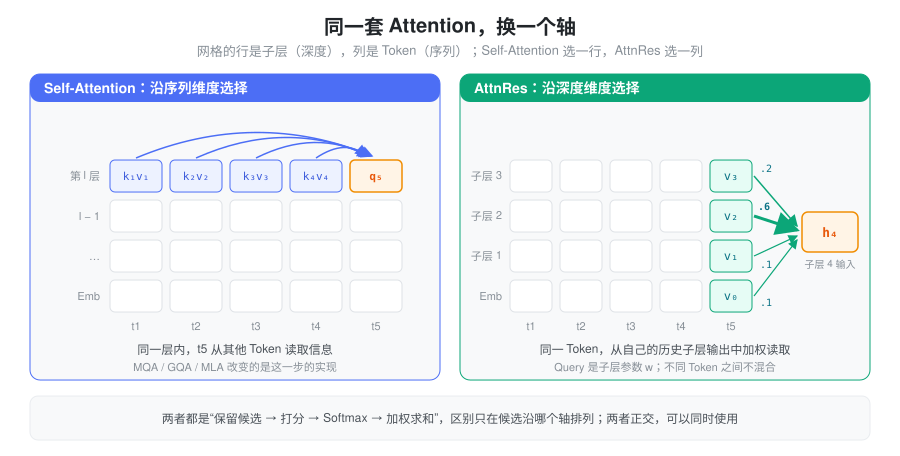
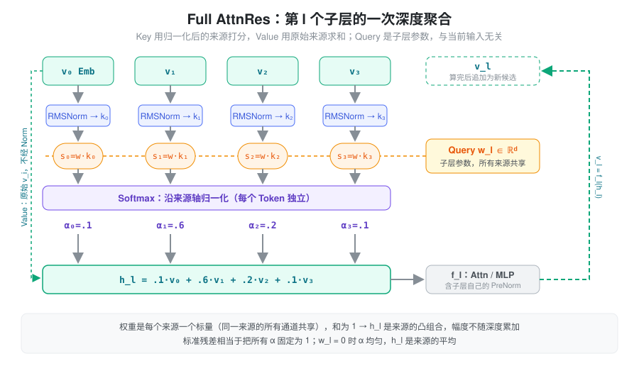
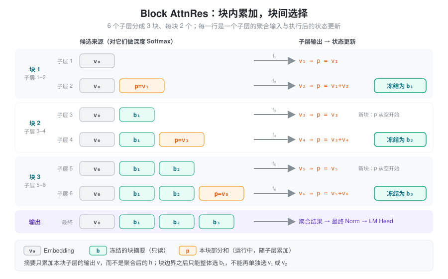
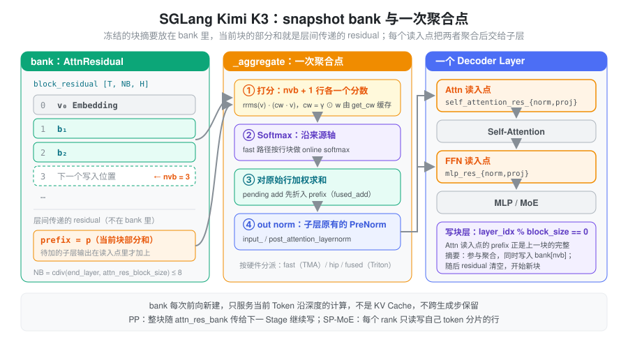

% Attention Residuals

本文介绍 Moonshot / Kimi Team 的 Attention Residuals（AttnRes）：把残差连接从“固定累加”改成“沿深度做 Attention”。概念与公式依据 [原论文第 2–4 节](https://arxiv.org/pdf/2603.15031)，参考实现见 [官方仓库](https://github.com/MoonshotAI/Attention-Residuals)；推理侧的实现对照 SGLang 中的 Kimi K3。

### 问题：残差把所有历史层压成了一个和

一个 PreNorm 子层可以写成：

\[ h_{l+1}=h_l+f_l(\operatorname{Norm}(h_l)) \]

子层可以是 Self-Attention，也可以是 MLP / MoE。为简化符号，把 Norm 并入 \(f_l\)，记子层输出为 \(v_l=f_l(h_l)\)，Embedding 为 \(v_0\)。展开递推：

\[ h_l=v_0+\sum_{i=1}^{l-1}v_i \]

这个式子说明残差同时做了两件事：

| 观察角度 | 残差连接在做什么 | 带来的结果 |
| --- | --- | --- |
| 梯度传播 | 提供绕过子层变换的恒等路径 | 深层网络可以训练 |
| 信息传播 | 累加 Embedding 与历史子层输出 | 后续子层读到的是“所有历史的和” |
| 聚合权重 | 每个历史输出的系数恒为 1 | 无法按来源选择信息 |

第三行是 AttnRes 要解决的问题。假设当前输入是 \(v_0+v_1+v_2\)，即使当前子层其实最需要 \(v_1\)，加法也已经把三个来源混在一起；子层只能从混合结果里间接分离，而不能直接调大 \(v_1\) 的权重。

随着深度增加，累加状态的幅度变大，每个新输出在和中的相对占比变小，这就是 PreNorm Dilution 的入口。幅度的具体增长速度依赖各层输出的相关性，不存在对所有模型都成立的增长公式。

所以问题可以表述为：**残差本身就是一次沿深度方向的聚合，只是权重被写死成了全 1。** 能不能让每个子层自己决定从哪些历史层读多少？

### 核心抽象：把历史层输出当作 Attention 的候选

Self-Attention 解决的是“当前 Token 应该从哪些 Token 读信息”，做法是保留候选、打分、Softmax、加权求和。AttnRes 把同一套思路转 90 度：**候选不再是同一层的其他 Token，而是同一个 Token 在历史各子层的输出。**



| 机制 | 当前计算选择什么 | 聚合方向 | 解决什么问题 |
| --- | --- | --- | --- |
| Self-Attention | 同一层的不同 Token 表示 | 序列维度 | Token 之间的信息交互 |
| Full AttnRes | 同一个 Token 的历史子层输出 | 深度维度 | 历史层信息的选择 |
| Block AttnRes | 同一个 Token 的历史块摘要 | 深度维度 | 降低跨层状态的保存成本 |

AttnRes 的聚合算子不混合不同 Token：不同 Token 可以得到不同的深度权重，但各自只聚合自己位置上的历史表示。因此它与 MQA、GQA、MLA 处在不同位置——后者改变 Token Attention 的实现，AttnRes 改变子层之间的信息聚合，两类设计可以组合。

本文出现三种 Block，需要区分：

- Transformer Block（Decoder Layer）：通常包含 Attention 和 MLP 两个子层。
- AttnRes Block：把一组子层输出压缩成一个摘要的深度分组。
- GPU Thread Block：GPU 执行与线程协作单位。

下文的 \(L\) 统计 Attention / MLP 子层数量，不是 Decoder Layer 数量。

### Full AttnRes：保留来源，再学习如何聚合

对第 \(l\) 个子层，候选来源是所有历史输出 \(V_l=\{v_0,v_1,\ldots,v_{l-1}\}\)。每个子层有一个自己的可学习向量 \(w_l\in\mathbb R^d\)，聚合过程为：

\[
s_{i\to l}=w_l^\top\operatorname{RMSNorm}_l(v_i),\qquad
\alpha_{i\to l}=\frac{\exp(s_{i\to l})}{\sum_{j=0}^{l-1}\exp(s_{j\to l})}
\]

\[ h_l=\sum_{i=0}^{l-1}\alpha_{i\to l}v_i,\qquad v_l=f_l(h_l) \]



与 Self-Attention 对应起来看：

| 组件 | AttnRes 中是什么 | 与 Self-Attention 的区别 |
| --- | --- | --- |
| Query | 子层参数 \(w_l\) | 不是用 \(W_Qh\) 从当前 Token 生成 |
| Key | \(\operatorname{RMSNorm}(v_i)\) | 去掉来源幅度对打分的影响 |
| Value | 原始历史表示 \(v_i\) | 不做投影，保留原始幅度 |
| Softmax | 沿历史来源轴归一化 | 不是沿 Token 轴或 Hidden 轴 |

没有 \(W_Q/W_K/W_V\) 投影，也没有 \(1/\sqrt d\) 缩放；不必机械套用 Self-Attention 的参数化。

#### 固定 Query 为什么能产生动态权重

训练结束后 \(w_l\) 是固定参数，但 Key 来自当前输入产生的历史表示。输入变了，Key 和分数随之变化，所以权重仍然是 Input-dependent 的。可以把 \(w_l\) 理解为这个子层学到的“选择标准”，历史表示是每次推理中被选择的内容。

这个设计的工程意义很大：Query 与当前 Hidden State 无关，意味着**一个子层的 Query 在它的输入算出来之前就已知**。后面的两阶段计算正是利用了这一点。

#### 加权平均与固定累加的区别

假设某个 Token 的三个来源是 \(v_0,v_1,v_2\)，权重为 \((0.1,0.7,0.2)\)，则 \(h_l=0.1v_0+0.7v_1+0.2v_2\)。

- 权重对来源不同，但同一来源的所有 Hidden 通道共享一个标量权重。这不是逐通道门控，也不是 Top-k 选择；有限分数下 Softmax 给每个候选非零权重。
- 权重非负、和为 1，输出是 Value 的凸组合：\(\|h_l\|\leq\max_i\|v_i\|\)。与标准残差相比，聚合本身不再让幅度随深度累加。这个性质只约束聚合；子层 \(f_l\) 仍可能放大输出，不能由此推出整个网络有界或梯度稳定。
- \(w_l=0\) 时所有分数为 0，权重均匀，\(h_l\) 是来源的平均值。它与标准残差相差一个“来源数量”的比例因子，并不数值相同。

### Block AttnRes：用深度分块控制状态数量

Full AttnRes 的代价是要保存全部 \(L\) 个历史输出，并在每个子层上读一遍。Block AttnRes 的折中是：**块内仍用普通残差累加，块与块之间用 Attention 选择。**

把子层分成 \(N\) 组。令 \(B_n\) 为第 \(n\) 个深度块，完成后的块摘要为：

\[ b_n=\sum_{j\in B_n}v_j,\qquad b_0=v_0 \]

当前块执行到一半时，还维护一个本块已完成子层输出的部分和 \(p\)。每次聚合的候选是：

| 所在位置 | 候选来源 |
| --- | --- |
| 网络第一个子层 | Embedding |
| 某块第一个子层 | Embedding 与所有已完成块摘要 |
| 某块后续子层 | 上述来源，加当前块部分和 \(p\) |
| 最终输出聚合 | Embedding 与所有块摘要 |

聚合得到 \(h_l\) 作为子层输入；算出 \(v_l=f_l(h_l)\) 后更新 \(p\leftarrow p+v_l\)。到达块边界时，把 \(p\) 冻结成一个块摘要，再从空开始累加下一块。



两个容易出错的地方：

- 块摘要只包含**本块子层自己的输出**。如果把聚合后的 \(h_l\)（它已经混入了全部历史）加进摘要，历史信息会被重复累加。
- 块边界之后，后续子层只能选择 \(b_1\) 这个整体，不能再分别选择 \(v_1\) 和 \(v_2\)。这就是用状态压缩换来的选择粒度损失。

两个极端可以帮助理解 \(N\) 的含义：每块一个子层时，Block 就是 Full；只有一块时，候选只剩 Embedding 和“全部子层输出之和”两项，选择能力几乎退回标准残差。

### 代价：显存与访存

设当前处理的 Tensor 为 \([B,T,d]\)，每元素 \(e\) 字节。以下只估算前向聚合使用的来源状态，不含模型权重、Token KV Cache 或反向激活。

| 形式 | 历史来源状态 | 直接实现的深度聚合计算量 |
| --- | --- | --- |
| 标准残差 | \(O(BTd)\) | \(O(BTLd)\) 次加法 |
| Full AttnRes | \(O(BTLd)\) | \(O(BTL^2d)\) |
| Block AttnRes | \(O(BTNd)\)，另有当前部分和 | \(O(BTLNd)\) |

Block 的计算量来自“\(L\) 个子层各自访问最多约 \(N+1\) 个来源”，不能因为状态降到 \(N\) 个就说计算与 \(L\) 无关。打分和加权求和都是逐元素的点积与 AXPY，算术强度很低，**瓶颈是把这些来源从 HBM 读出来**，而不是 FLOPs。

以 Kimi K3 的形状估算：\(d=7168\)，实现里断言 bank 最多 8 行（Embedding 加块摘要），bf16 存储。一次 \(T=8192\) 的 Prefill：

\[ M=T\cdot N\cdot d\cdot e=8192\times8\times7168\times2\approx 896\text{ MiB} \]

这块状态只活在一次前向内部；块数不多，长上下文 Prefill 时它仍然是一个不可忽略的临时 Buffer。训练中如果这些输出本来就要为反向保留，它们与来源状态可能重叠；采用重计算或流水线并行时，需要重新分析生命周期和跨 Stage 传输。

### 为什么可以拆开计算：Softmax 的可合并性

Query 是参数、已完成块摘要不再变化，所以同一块内所有子层对历史摘要的打分可以**提前批量算好**，只有当前部分和 \(p\) 需要随子层执行逐个处理。这是论文用来减少重复读取的两阶段计算。注意：被提前的只是深度聚合；Attention 和 MLP 本身仍然依赖前一个子层的输出，不能并行。

能拆开的数学基础，是稳定 Softmax 的三个统计量可以合并。对一组候选保存：

\[ m=\max_i s_i,\quad z=\sum_i e^{s_i-m},\quad u=\sum_i e^{s_i-m}v_i \]

两组合并时令 \(m=\max(m_a,m_b)\)：

\[
z=e^{m_a-m}z_a+e^{m_b-m}z_b,\qquad
u=e^{m_a-m}u_a+e^{m_b-m}u_b,\qquad h=u/z
\]

结果与一次完整 Softmax 数学上相同（浮点舍入可能不同）。不能把两组各自归一化后的输出直接相加，因为分母不同。这与 FlashAttention 的 online softmax 是同一个技巧，只是作用在深度轴上；SGLang 的 TMA kernel 正是按行分块、用 online softmax 流式处理来源的。

### 与其他残差机制的比较

| 机制 | 回答的问题 | 保存的状态与选择方式 |
| --- | --- | --- |
| 标准残差 | 新输出如何加入当前状态？ | 单个累加状态 |
| 缩放 / 门控残差 | 当前更新占多大比例？ | 对递推中的状态和输出调整系数 |
| [mHC](./mhc.md) | 多条残差流如何读、写与混合？ | 多流状态与受约束的混合 |
| Full AttnRes | 当前子层需要哪些历史来源？ | 保存全部历史输出，深度 Softmax |
| Block AttnRes | 怎样降低历史来源的保存成本？ | 块摘要 + 当前部分和 |

这个对比描述设计接口，不代表效果排序；比较实际模型需要控制参数量、数据、训练预算和执行配置。另外，这是模型结构的改变：把已训练模型的残差加法直接替换成加权平均会改变各层输入分布，需要相应训练或验证过的适配。

### 在 SGLang 中的实现

SGLang 只在 Kimi K3 上实现了 Block AttnRes（推理不需要 Full）。代码分三层：

| 位置 | 职责 |
| --- | --- |
| `srt/models/kimi_k3.py` | 每层的打分参数、写块时机、每次前向开关 bank、PP 传递 |
| `srt/layers/layer_boundary/residual/attn_bank.py` | 把“读 bank”挂到层边界的 residual 读写协议上 |
| `srt/layers/attn_residual.py` | bank 张量本身与聚合 kernel 的硬件分派 |

#### 状态：一个 snapshot bank 加一条运行中的残差

`AttnResidual` 在每次模型前向时新建一次，持有：

- `block_residual`：形状 `[T, NB, H]` 的 bank，每行是一个冻结的块摘要，第 0 行是 Embedding；
- `num_valid_blocks`：已写入的行数，即聚合时的 `nvb`；
- 而当前块的部分和 \(p\) 并不在 bank 里，它就是层间传递的普通 residual（代码里叫 prefix / stream head）。

配置项 `attn_res_block_size` 以 **Decoder Layer** 为单位，所以一个 AttnRes Block 含 `2 × attn_res_block_size` 个子层。`layer_idx % attn_res_block_size == 0` 的层是写块层；bank 的行数是 `cdiv(end_layer, attn_res_block_size)`。



每个 Decoder Layer 有两个聚合点，各自一套参数：Attention 输入用 `self_attention_res_norm` + `self_attention_res_proj`，MLP 输入用 `mlp_res_norm` + `mlp_res_proj`；模型末尾还有一个 `output_attn_res_*` 做最终输出聚合（`AttnBankOutputRead`）。`*_res_proj` 是一个 `H → 1` 的 `ReplicatedLinear`，它的权重就是论文里的 \(w_l\)。

写块的时序有一个巧妙之处：在写块层的 Attention 读入点，当前 prefix 恰好是刚结束那一块的完整摘要。`AttnResidual.forward(write=True)` 先把它作为最后一个候选参与聚合，同时把它拷进 bank 的第 `nvb` 行；随后 residual **重置为空**，本层 Attention 的输出单独成为新块的第一项。第 0 层的情况是 `nvb == 0`：只有 Embedding 一个候选，直接做 RMSNorm，并把 Embedding 写成 bank 第 0 行。

#### 一次聚合点做了什么

聚合入口是 `_aggregate`，语义是“score → softmax → mix → norm”：

1. 对 `nvb` 行 bank 加 prefix 共 `nvb + 1` 个来源，各自算 RMS，与 \(w_l\) 点积得到分数；
2. 沿来源轴 Softmax，对原始来源加权求和；
3. 对结果做本子层原有的 PreNorm（`input_layernorm` 或 `post_attention_layernorm`），交给 Attention / MLP。

注意第 3 步：AttnRes 的输出仍要过子层自己的 Norm，所以 kernel 把这个“out norm”一起融合了。另外两个融合点值得知道：

- **Norm 权重折进 Query。** 打分是 \(w^\top(\gamma\odot v\cdot\text{rrms})=(\gamma\odot w)^\top v\cdot\text{rrms}\)，`get_cw` 预先算好并缓存 `norm.weight ⊙ proj.weight`，kernel 每行只需要一次点积加一次平方和。
- **残差加法折进聚合。** 层边界声明更新是 `PLAIN_ADD`，但不单独执行：`_aggregate_fused_add` 把“prefix = residual + 子层输出”和聚合放在一起。因为读出不是普通 Norm，`_BankReadout.is_plain_norm = False`，通用的 add+norm 融合 kernel 不能接管它。

后端按硬件分派：

| 路径 | 条件 | 做法 |
| --- | --- | --- |
| fast | SM100+（除 SM12x），`H = 7168` | warp-specialized TMA kernel：生产者用 `cp.async.bulk` 搬运来源行，消费者对双缓冲的行块做 online softmax，out norm 融合，可顺带写 bank 行 |
| hip | ROCm 且在寄存器预算内 | 单个 Triton kernel，bank 留在寄存器，打分和加权共用一次读取 |
| fused | 其余情况 | 两个 Triton kernel：`_score_kernel` 按 (token, 行) 算分；`_combine_kernel` 按 (token, H 分块) 冗余地重算 ≤16 个元素的 Softmax 后加权，再调用 SGLang 的 RMSNorm |

`aggregate_stream_torch` 是 eager 参考实现，用于测试和 `H` 不是 1024 倍数时的兜底。fast 路径写 bank 行几乎是免费的：prefix 本来就要在打分阶段流过一遍。

#### 并行与周边

- **Pipeline Parallel**：bank 是跨层状态，下一 Stage 需要前面写过的所有行。发送方把 `block_residual` 放进 `pp_proxy_tensors["attn_res_bank"]`，并先把 pending add 折进 hidden states；接收方用 `inherited` 拷入自己的 bank 继续写。
- **Sequence Parallel（SP-MoE）**：每个 rank 只持有自己 Attention-TP 分片的 token 行，bank 也按行切片读写（`_bank_rows`）。聚合可以与 reduce-scatter / all-gather 融合（`forward_sp_reduce_scatter`、`forward_sp_all_gather`）。只写了本地分片后，不能再读全部行，`written_on_slice` 用来拦截这种会读到陈旧数据的情况。
- **投机解码的 hidden state 捕获**：普通模型直接捕获层间残差；K3 层间传递的只是当前块的部分和，不是完整状态，所以 `_dspark_capture_stream` 调用 `aggregate_stream`，算出下一个聚合点会形成的 Pre-norm 混合值作为捕获结果。
- **Decode 与 KV Cache**：bank 只服务于当前 Token 沿深度的计算，每次前向新建，不跨生成步保留；Decode 时 `T` 是 batch 的 token 数，bank 很小。它与服务未来 Token 的 KV Cache 是两回事。

### 最小实现

只实现一个聚合点，省略 Norm 的可学习 Gain 和系统优化。`sources` 可以是 Full 的历史子层输出，也可以是 Block 的 bank 行加 prefix——这正是 `aggregate_stream_torch` 的做法。

```python
import torch


def attention_residual(sources, query, eps=1e-6):
    # sources: 非空列表，每个 [T, D]；query: 当前子层的 w_l，[D]
    values = torch.stack(sources, dim=0).float()          # [R, T, D]
    rrms = torch.rsqrt(values.square().mean(-1, keepdim=True) + eps)
    scores = (values * rrms * query.float()).sum(-1)      # [R, T]，Key = RMSNorm(v)
    weights = torch.softmax(scores, dim=0)                # 沿来源轴归一化
    mixed = (weights.unsqueeze(-1) * values).sum(0)       # Value = 原始 v
    return mixed.to(sources[0].dtype), weights


sources = [torch.randn(3, 8) for _ in range(4)]
mixed, weights = attention_residual(sources, torch.zeros(8))
torch.testing.assert_close(weights.sum(0), torch.ones(3))
torch.testing.assert_close(mixed, torch.stack(sources).mean(0))  # w=0 时为均匀平均
```

`stack` 让 Shape 一目了然，但会多一次 `[R, T, D]` 的分配和读写；生产实现直接按行流式读取 bank，不物化这个张量。

### 小结

标准残差是一次权重写死为 1 的深度聚合；AttnRes 把它换成以子层参数为 Query、以归一化历史输出为 Key、以原始输出为 Value 的深度 Softmax，让每个子层自己决定读哪些历史层、读多少。Full 形式保留全部来源，Block 形式用“块内累加、块间选择”把状态压到 \(N\) 个摘要。由于 Query 与当前输入无关、Softmax 可合并，深度聚合可以流式、分块地计算；SGLang 的 K3 实现据此在 fast 路径上把 bank 读取、打分、混合、残差加法、子层 Norm 和写块融合进一个 kernel，每个聚合点基本只需把 \(N+1\) 行来源从 HBM 流式读一遍。
