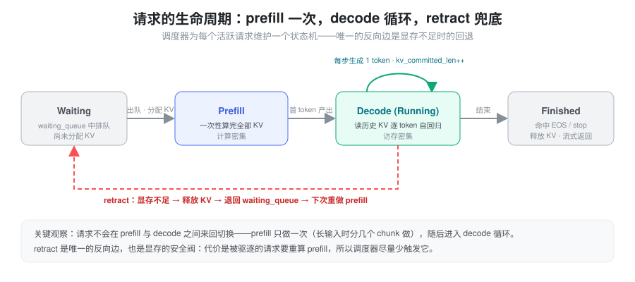
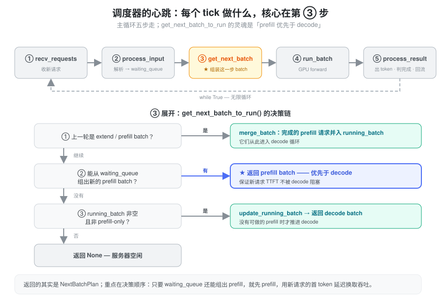
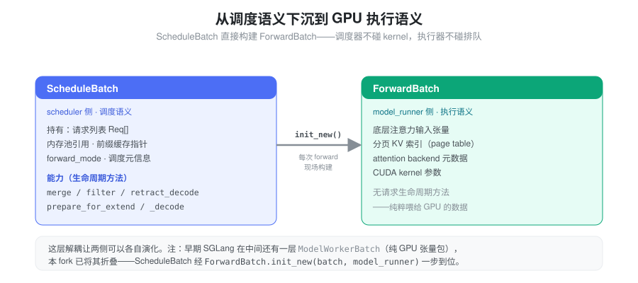
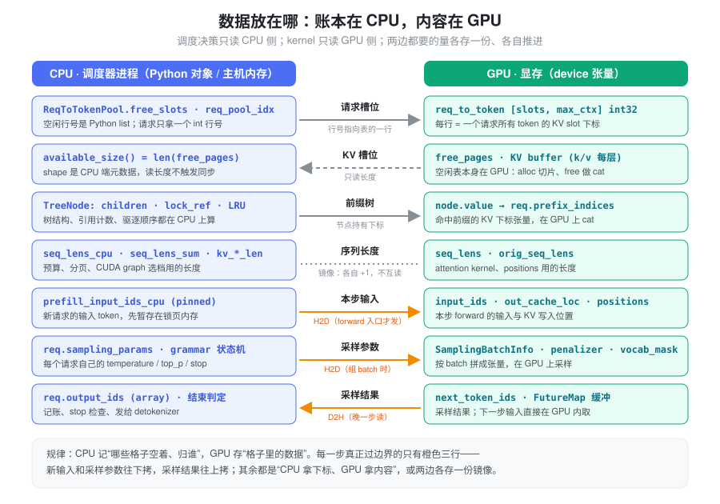
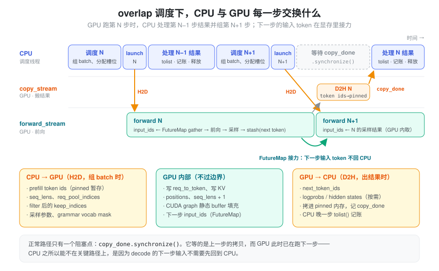
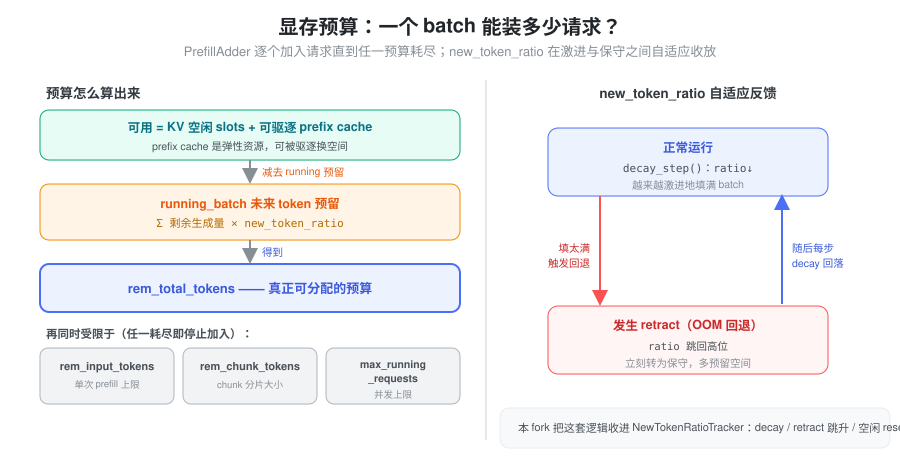
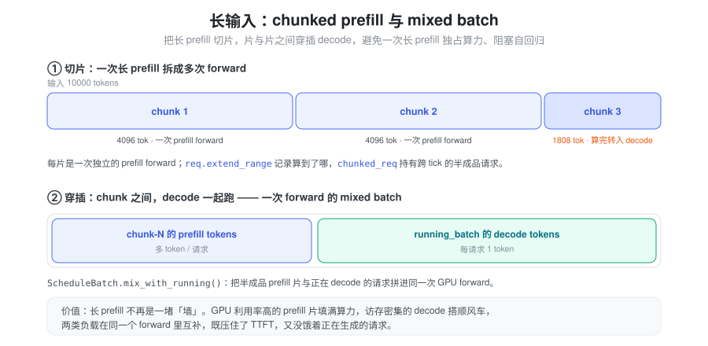

% Batch

### 问题：有限显存里，怎么把不断涌入的请求喂进 GPU

LLM 推理不是一次算完的，它天然分成两个阶段，而且两个阶段的硬件特性截然相反：

- **Prefill（预填充）**：把用户输入的全部 token 一次性送进模型，算出每一层的 KV Cache。token 多、矩阵大，是**计算密集**操作，GPU 算力利用率高。
- **Decode（解码）**：逐个生成新 token，每次只算一个，却要读取之前所有 token 的 KV Cache。是**访存密集**操作，算力大量闲置。

一台在线推理服务要同时面对成百上千个请求：有的刚到达、等着 prefill，有的已经在逐 token 生成。它们都挤在同一块 GPU、同一个固定大小的显存里。于是调度器要回答的核心问题是：

> **在固定的 KV Cache 容量和计算带宽下，怎样把这些请求不断组织成一个个 batch，交替地做 prefill 和 decode，让整体吞吐最大、同时把延迟压在可控范围内？**

难点在于这里的资源既硬又互相挤占：

- **KV Cache 池是硬约束**。每个 token 在每一层都要占一个 KV slot，池子总量固定。装不下，就必须有人让位。
- **Prefix Cache 是弹性资源**。SGLang 用 RadixAttention 把已算过的前缀 KV 缓存起来给后续请求复用；但这些缓存在缺显存时可以被驱逐，是“能借也能收回”的空间。
- **计算带宽是另一道闸**。单次 forward 的 token 数有上限，而 prefill 和 decode 争的是同一块 GPU——一次超长 prefill 会把正在生成的请求全堵住。

后面所有的机制，都是围绕“如何在这三种资源的夹缝里做取舍”展开的。

### 把请求看成一个状态机

理解调度器，先理解它调度的对象。一个请求从进入系统到离开，并不是在 prefill 和 decode 之间自由穿梭，而是走一条几乎单向的路径：

这里有两个容易被忽略、却决定整套设计的观察：

1. **prefill 只做一次，之后就是 decode 循环**。请求排队（waiting）→ 做一次 prefill（长输入时拆成几片）算出首 token → 进入 decode，此后每个 tick 生成一个 token，直到命中 EOS 或 stop。它不会退回去重做 prefill——除非……
2. **retract 是唯一的反向边，也是显存的安全阀**。当 KV Cache 不够给 decode 中的请求再分配下一个 token 时，调度器会把某些请求“踢回” waiting queue、释放它们的 KV。代价是这些请求下次要重新 prefill，所以 retract 既是兜底，也是要尽量少踩的红线。

要支撑这条路径，调度器必须为每个“活跃”请求随身携带一组状态。按用途分类，就能看清一个请求对象到底在记什么：

| 类别 | 记录什么 | 为什么需要 |
|------|---------|-----------|
| 身份 | 请求 ID、原始输入 token | 标识请求；retract 后能从头重做 |
| KV 指针 | req_pool_idx → token 位置映射 | 知道这个请求的 KV 存在物理池的哪些位置 |
| 进度 | 已生成的 output_ids、当前序列长度 | 知道生成到哪了、还要生成多少 |
| KV 长度 | 已确认长度 vs 已分配长度 | 区分“写定的 KV”和“预留但可能被回收的 KV” |
| 前缀命中 | prefix_indices、last_node | 命中了多少 prefix cache、接着从哪算 |
| 采样 | temperature、top_p、stop 条件 | 控制生成行为 |
| 分片 | extend_range | 长输入分段 prefill 的进度游标 |

在代码里，这组状态就是 `Req` 这一个对象。值得一提的是“KV 长度”那一行：本 fork 用 `kv_committed_len`（已确认写入，每 decode 一步 +1）和 `req.kv.kv_allocated_len`（预分配、可能回收）两个量，把“写定”和“预留”分得很清——retract 要回收的正是后者。

### 调度器的心跳：每一步到底做什么

调度器本体是一个无限循环，每个 tick 做五件事；真正的灵魂是第三步——决定“这一步到底跑什么”。

决策链里最重要的一条规则是 **prefill 优先于 decode**：只要 waiting queue 还能组出一个 prefill batch，这一步就先做 prefill，哪怕此时有一堆请求正等着 decode。这是拿“正在生成的请求多等一步”去换“新请求的首 token 延迟（TTFT）不被拖长”。只有实在没有 prefill 可做时，才推进 decode；两边都空，才返回 None 让服务器歇着。

### 从调度语义下沉到执行语义

调度器组好的 batch 不能直接丢给 CUDA kernel——它满是“请求排队”“前缀命中”这类调度概念，而 kernel 只认张量和索引。所以 batch 在上 GPU 前要换一层表示：

这层“调度语义 → 执行语义”的转换是一次刻意的解耦：调度器那侧（`ScheduleBatch`）管请求的合并、过滤、回退；执行器那侧（`ForwardBatch`）只拿到注意力张量、分页 KV 索引和 kernel 参数，完全不知道请求是怎么排进来的。两边各自演化，互不打扰。

### 数据住在哪：CPU 管账本，GPU 存内容

上面那层解耦还有一个物理对应：`ScheduleBatch` 这侧的决策几乎只碰 **CPU 内存**，`ForwardBatch` 这侧的计算几乎只碰 **显存**。想清楚“谁住 CPU、谁住 GPU”，是理解整个调度器为什么快的关键——因为调度器每一步都要做大量判断（谁该进 batch、显存够不够、哪个请求结束了），如果这些判断都要去读显存，就会频繁触发 GPU→CPU 同步，把流水线卡死。

于是整套设计遵循一条朴素的分工：**CPU 持有“账本”——哪些格子空着、归谁、每条序列多长；GPU 持有“格子里的内容”——真正的 token、KV、中间张量。** 账本小、改动频繁、要被 Python 逻辑随时读取，天然属于 CPU；内容大、只被 kernel 读写，天然属于 GPU。

对着这张分工表，几处设计意图就清楚了：

- **请求槽位**：`ReqToTokenPool` 的空闲行号 `free_slots` 是一个普通 Python list，分配就是 `pop`、释放就是 `append`（`memory_pool.py:282`、`alloc`/`free` 在 `291` 起）。请求对象只随身带一个 `req_pool_idx` 整数，指向那张住在显存里的二维表 `req_to_token`（`[slots, max_ctx]` 的 int32，`memory_pool.py:279`）——**行号在 CPU，行的内容在 GPU**。
- **KV 槽位**：token 分配器的空闲页表 `free_pages` 本身是一个 **GPU 张量**（`allocator/token.py:44`），分配是切片 `free_pages[:n]`、释放是 `torch.cat`。但调度器判断“够不够”时读的是 `available_size()`，它只取 `len(free_pages)`——张量的长度是 CPU 侧元数据，读它不触发任何同步（`allocator/token.py:51`）。
- **前缀树**：RadixAttention 的整棵树——`TreeNode` 的孩子、`lock_ref` 引用计数、LRU 驱逐顺序——都在 CPU 上维护和计算（`radix_cache.py:242` 起）；每个节点真正存的 `value` 是一段 **GPU 上的 KV 下标张量**。`match_prefix` 命中后，`req.prefix_indices` 被替换成这些下标在 GPU 上 `torch.cat` 的结果（`radix_cache.py:426`、`577`）——又是一次“CPU 管结构、GPU 存下标”。
- **序列长度的双份镜像**：这是本 fork 里最值得注意的一笔。`seq_lens` 住在 GPU（给 attention kernel 和 positions 用），同时还维护一份 **CPU 镜像** `seq_lens_cpu`（给预算核算、分页计算、CUDA graph 选档用）。decode 推进时，两份各自 `+1`、互不读取（`schedule_batch.py:3077-3079`）；连 `seq_lens_sum` 都是惰性置 `None`、用到才在 GPU 侧重算。这样 CPU 想知道“每条序列多长”时，直接读本地镜像，**永远不用从显存里 D2H 读回来**。

> 一句话：凡是“做决策要用、Python 代码要读”的量，CPU 都自己留一份；凡是“只有 kernel 要用”的量，才独占显存。`req.kv_committed_len`（已写定）与 `req.kv.kv_allocated_len`（已预留）这两个长度账本也在 CPU 上——retract 要回收的正是两者之间那段。

### 一步之内，CPU 和 GPU 交换什么

分工明确之后，真正跨越 CPU/GPU 边界的数据其实很少。把一个调度 tick 展开，边界上只有三类流量：组 batch 时往下拷的输入、出结果时往上拷的采样结果，以及一个刻意保留的同步点。

**CPU → GPU（H2D，发生在组 batch 时）**：新请求的输入 token（先暂存在 pinned 内存 `prefill_input_ids_cpu`，到 forward 入口才真正下拷，`schedule_batch.py:2397`、`overlap_utils.py:92`）、`seq_lens` 与 `req_pool_indices`、`filter` 后保留下来的 `keep_indices`（`schedule_batch.py:3154`）、以及按 batch 拼好的采样参数张量和 grammar 的 vocab mask（`sampling_batch_info.py:93` 起）。

**GPU 内部（根本不过边界）**：写 `req_to_token`（`assign_req_to_token_pool` Triton kernel）、写 KV、算 positions、`seq_lens + 1`、填 CUDA graph 的静态输入 buffer。这些全在显存里完成，CPU 既不读也不写。

**GPU → CPU（D2H，发生在出结果时）**：`next_token_ids`，以及按需的 logprobs / hidden states。它们先被异步拷进 pinned 内存并记一个 `copy_done` 事件（`utils.py:30`、`scheduler.py:3721`），CPU **晚一步**才 `tolist()` 取出来做记账和 stop 判定。

真正精妙的是 overlap 调度怎么把这几股流量藏起来。GPU 跑第 N 步前向时，CPU 并行地处理第 N−1 步的结果、组第 N+1 步的 batch（主循环 `scheduler.py:1754` 起）。正常路径上**只剩一个阻塞点**：处理上一步结果前的 `copy_done.synchronize()`（`batch_result_processor.py:202`）——它等的是上一步那次小小的 D2H 拷贝，而此刻 GPU 早已在跑下一步，等待基本被盖住。

这里有一个前提常被忽略：decode 的下一步输入是上一步刚采样出的 token。如果走“GPU 采样 → D2H 回 CPU → H2D 再送进去”的老路，每步都得同步一次。本 fork 用 **`FutureMap`** 把这条路截在了 GPU 内部：采样结果写进 GPU 上的 `output_tokens_buf`（按 `req_pool_idx` 索引），下一步直接 `output_tokens_buf[req_pool_indices]` 在显存里 gather 出来当输入（`overlap_utils.py:107`、`511`）——**下一步的输入 token 从头到尾不碰 CPU**。CPU 之所以能彻底退出 decode 的关键路径，正是靠这条 GPU 内的 token 接力。

### 显存预算与自适应回退

prefill 优先固然好，但“一个 batch 到底能塞多少请求”得算清楚，否则一上 GPU 就 OOM。构建 prefill batch 时，`PrefillAdder` 像往购物车里逐个加请求，边加边盯着几本预算账，任一账户见底就停：

最精妙的是 `new_token_ratio` 这个**自适应反馈**：它给 running batch 里每个请求“未来还要生成多少 token”打一个折扣系数。正常跑的时候它随每一步缓慢衰减（折扣越打越狠 = 越激进地塞满 batch）；一旦真的发生 retract，立刻跳回高位（变保守、多预留）。于是系统自己在“激进填充”与“安全冗余”之间来回找平衡点，一次 OOM 换来一段保守期。本 fork 把这套逻辑收进了 `NewTokenRatioTracker`。

**retract 的细节**：触发点是 decode 前的 `check_decode_mem()`（`schedule_batch.py:2809`）——它先尝试驱逐 prefix cache 里可回收的条目，再看空闲 slot 够不够放下所有请求的下一个 token；不够就回退。回退谁？默认策略按 **(output_len 降序, input_len 升序)** 排序挑“代价最小”的：已经生成很多 token 的请求占显存最多，踢掉它释放的空间最大、收益最高（而且它要重做的 prefill 反而最短）。

### 前缀缓存如何左右调度顺序

SGLang 的招牌优化 RadixAttention 用一棵 Radix Tree 管理 KV 的前缀共享：相同的系统提示、相同的前缀只存一份，新请求若命中就能跳过那段计算。这不只是存储优化，它反过来改变了“先调度谁”：

- **LPM（最长前缀匹配）**：优先调度与缓存前缀匹配最长的请求，命中最多、省算力最多。
- **DFS-Weight**：按 Radix Tree 的深度优先权重排序，让共享前缀的请求挨在一起调度，缓存局部性更好。
- **In-batch 去重**：如果 waiting queue 里好几个请求共享一大段前缀，先放一个进去把那段缓存“焐热”，后面几个就能直接命中，而不是同时各算一遍。

### 长输入：chunked prefill 与 mixed batch

还剩最后一个资源闸——计算带宽。一次把上万 token 的输入全 prefill，会把 GPU 占满、让所有 decode 请求干等。解法是把长 prefill 切片，并在片与片之间塞进 decode：

两件事叠在一起：**chunked prefill** 把一次长 forward 拆成几次短 forward（进度由 `req.extend_range` 记录，跨 tick 的半成品请求挂在 `chunked_req` 上）；**mixed batch** 则让某次 forward 同时装下“某个 chunk 的 prefill tokens”和“正在 decode 的请求各自的 1 个 token”（`ScheduleBatch.mix_with_running()`）。计算密集的 prefill 片和访存密集的 decode 刚好在同一次 forward 里互补，GPU 两头都不闲着。

### 小结

Batch 调度的本质，是在固定显存和计算带宽的夹缝里，为“计算密集的 prefill”和“访存密集的 decode”持续地做资源分配与取舍。SGLang 的答案是一组相互配合的抽象：把请求建模成几乎单向的状态机（prefill 一次、decode 循环、retract 兜底），用 prefill 优先的主循环压 TTFT，用 `PrefillAdder` 加 `new_token_ratio` 的自适应预算在激进与安全之间自动找平衡，用 RadixAttention 让共享前缀的请求省算力，再用 chunked prefill + mixed batch 把长输入拆开、让两类负载在同一次 forward 里互补。理解了这几个抽象各自化解什么张力，调度器那上千行代码就有了骨架。

