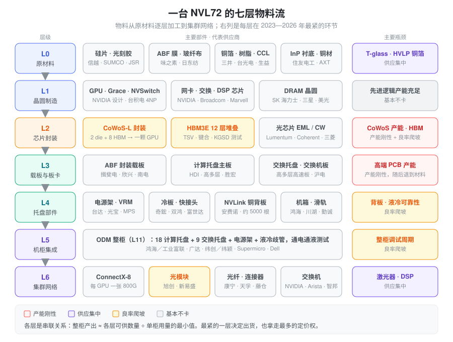
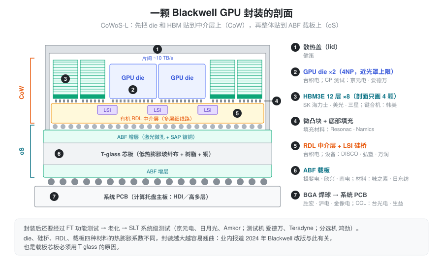
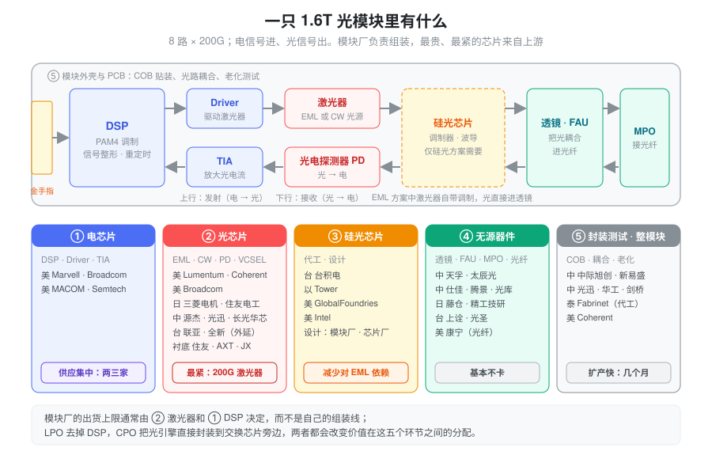
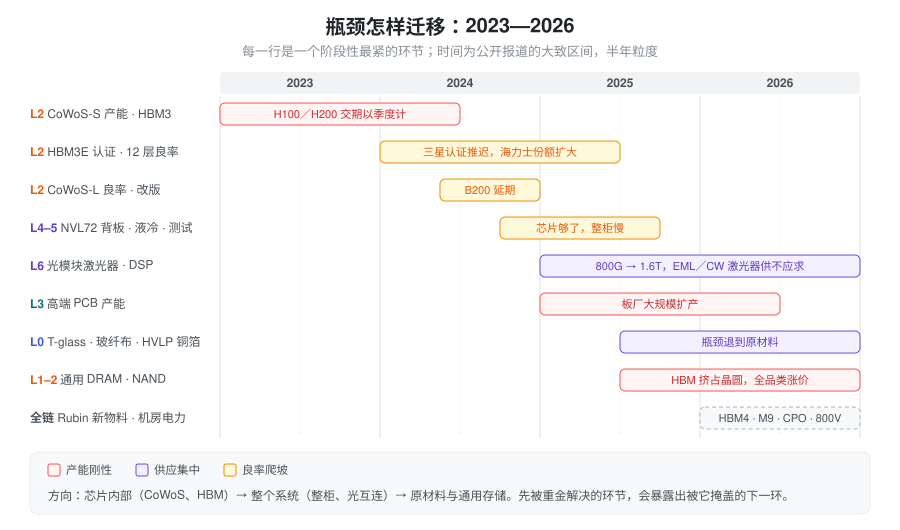
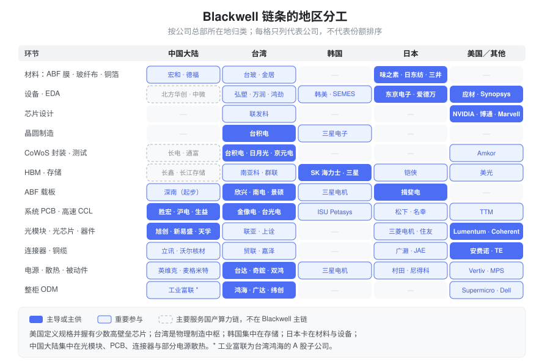

% Blackwell 产业链：从原材料到 NVL72 机柜，扩产卡在哪里

**上一轮 AI 硬件行情里，需求端的增长几乎是一条直线，供给端却是一串首尾相接的环节。一台机柜能交付多少，取决于这一串里当时最慢的那一环；股价和利润率也优先流向这一环。** 2023 年是 CoWoS 和 HBM，2024 年是 CoWoS-L 良率和 Blackwell 改版，2024 年底到 2025 年是整机柜液冷与铜背板调试，2025 年起是 1.6T 光模块的激光器、高端 PCB 的玻纤布和铜箔，2025 年下半年起又轮到通用存储。

本文把一台 GB300 NVL72 拆到原材料，按“材料 → 晶圆 → 封装 → 板卡 → 托盘 → 机柜 → 集群网络”梳理每一层的工序、瓶颈与公司。用户要分析的另一条主线，即 NVIDIA 用资金放大需求周期，本文不展开。

数据边界：本文写作时检索工具不可用，规格数据核对了 [NVIDIA GB300 NVL72 产品页（提取于 2026-11-18）](https://www.nvidia.com/en-us/data-center/gb300-nvl72/)；产能、份额等数字为公开报道与卖方研究的常见量级，标注“约”，不同机构口径差异大，引用前应以公司财报和法说会核对。公司名单说明“谁在这个环节有业务”，不代表其在 NVIDIA 供应链中的份额排序。

### 一、要解决的问题：需求是乘法，供给是串联

先看需求端。一家云厂商决定多买 1 万颗 GPU，订单落到 NVIDIA；NVIDIA 要把它变成约 139 个 NVL72 机柜，每个机柜需要 72 颗 GPU 封装、576 颗 HBM 堆栈、18 颗 NVLink Switch 芯片、几千根铜缆、几十块 PCB、整套液冷回路，机柜外还要配几百只光模块和交换机。**一个 GPU 订单，在供应链里被展开成几十种物料、几百家公司的订单。**

再看供给端。这些物料不是同时可得的：

- **扩产周期不同。** 光模块封装线几个月可以扩，CoWoS 产线约 1 年，HBM 需要新的 DRAM 晶圆产能，晶圆厂 2–3 年，玻纤布的窑炉和织布机、铜箔的生箔机也要 1 年以上。
- **供应商数量不同。** ABF 增层膜基本只有味之素一家，低膨胀 T-glass 玻纤布长期以日东纺为主，高速 EML 激光器集中在少数美日厂商。一个环节只有一两家能做，它的扩产意愿就决定了全链上限。
- **新工艺需要良率爬坡。** Blackwell 换了 CoWoS-L、12 层 HBM3E、1.6T 光模块、更高等级的覆铜板、机柜级液冷，每一项都是第一次大规模量产。

所以产出近似等于 `min(各环节可供数量 / 单机柜用量)`。需求以倍数增长时，总有一环先被顶满；它扩产之后，次慢的那一环变成新的上限。**瓶颈是会迁移的。** 这是本文的核心视角。

“Scale up”在这里有两层意思，需要分开：

- **产能意义上的 scale up**：整个行业把出货量放大，本文主要讨论它。
- **架构意义上的 scale-up**：用 NVLink 把 72 颗 GPU 连成一台“大 GPU”（见 [GPU Interconnect](./gpu_interconnect.md)）。这个架构选择本身也制造了新瓶颈：铜背板、液冷、机柜级测试，都是 8 卡服务器时代不存在的问题。

### 二、建立抽象：七层物料流，三类瓶颈

把一台机柜从下往上看，物料经过七层流转。每一层把下层的产出加工、组装后交给上层：

1. **L0 原材料**：硅片、光刻胶与特种气体、ABF 膜、玻纤布、铜箔、树脂、InP 衬底、铜材与冷却液。
2. **L1 晶圆**：GPU、Grace CPU、NVLink Switch、网卡与交换芯片在台积电流片；DRAM 晶圆在存储厂生产。
3. **L2 芯片封装**：GPU 裸片与 HBM 在 CoWoS-L 中合成一颗 GPU 封装；DRAM 晶圆经 TSV 与堆叠变成 HBM。
4. **L3 载板与板卡**：封装焊到 ABF 载板上，再贴到计算板、交换板等 PCB 上。
5. **L4 托盘部件**：电源、冷板与快接头、连接器与铜缆、机构件，把板卡组成 1U 托盘。
6. **L5 机柜集成**：ODM 把 18 个计算托盘、9 个交换托盘、电源架、铜背板、液冷歧管装成整柜并通电测试。
7. **L6 集群网络**：机柜之间通过网卡、光模块、光纤和交换机组成 scale-out 网络。

每一层的瓶颈可以归为三类，判断方式不同：

| 瓶颈类型 | 形成原因 | 典型环节 | 何时缓解 |
| --- | --- | --- | --- |
| 产能刚性 | 扩产要建厂、买长交期设备，周期长于需求变化 | CoWoS、HBM／DRAM 晶圆、玻纤布、铜箔 | 新产能投产，通常滞后 1–2 年 |
| 供应集中 | 一两家掌握配方、工艺或专利，扩产节奏由它们决定 | ABF 膜、T-glass、EML 激光器、高端 DSP | 第二供应商认证通过，或技术路线绕开 |
| 良率爬坡 | 新工艺第一次量产，产能名义上有、实际可用的少 | CoWoS-L、12 层 HBM、1.6T 模块、整机柜液冷 | 良率稳定，通常需要几个季度 |

这张表也给出一个投资上的读法：**产能刚性型瓶颈带来的超额利润最持久，但新产能一到，价格就会回落；供应集中型最有定价权；良率型瓶颈常表现为“交付延期”的新闻，而不是涨价。**

### 三、一台 GB300 NVL72 里有什么

先把要造的东西列清楚。下表规格来自 NVIDIA 产品页与 [GPU Interconnect](./gpu_interconnect.md) 中的 NVL72 拆解；单柜功耗、铜缆数量为公开报道的量级。

| 部件 | 单柜数量 | 所属层 | 说明 |
| --- | --- | --- | --- |
| Blackwell Ultra GPU 封装 | 72 | L2 | 每颗 2 个 die，CoWoS-L 封装 |
| HBM3E 12 层堆栈 | 576 | L2 | 每 GPU 8 颗，单 GPU 288 GB，全柜约 20 TB |
| Grace CPU | 36 | L1–L2 | 每颗配 LPDDR5X，全柜约 17 TB |
| 计算托盘 | 18 | L4 | 每托盘 2 颗 Grace + 4 颗 GPU |
| NVLink 交换托盘 | 9 | L4 | 每托盘 2 颗 NVLink Switch 芯片，全柜 18 颗 |
| NVLink 铜背板 | 1 套 | L4–L5 | 约 5000 根铜缆，全柜 NVLink 带宽 130 TB/s |
| ConnectX-8 SuperNIC | 72 | L1–L4 | 每 GPU 一张 800 Gb/s 网卡，接 scale-out 网 |
| 电源架、液冷歧管、CDU | 若干 | L4–L5 | 全液冷，单柜功耗约 130–140 kW |
| 机柜外光模块 | 每 GPU 约 2–4 只 | L6 | 取决于网络层数与铜缆替代比例 |

这张表说明一件事：**GPU 只是机柜的一部分。** HBM、NVLink 背板、液冷、网卡和光模块都随 GPU 数量线性增长，任一项供不上，GPU 就只能堆在仓库里等。

### 四、L1：芯片设计与晶圆制造

#### NVIDIA 在链条里做什么

NVIDIA 是无晶圆厂设计公司，但在 Blackwell 这一代，它定义的远不止芯片：GPU、Grace CPU、NVLink Switch、ConnectX 网卡、BlueField DPU、Spectrum／Quantum 交换芯片都由它设计；计算托盘的参考设计（MGX）、NVLink 背板、液冷规格也由它给出。ODM 按图制造，关键物料多由 NVIDIA 指定供应商。分工也在变化：GB200 时代 NVIDIA 向 ODM 交付整块计算板（Bianca 板，含 Grace 与两颗 GPU）；到 GB300，据业内报道改为交付 GPU 模组、Grace 等核心芯片，主板与更多物料交给 ODM 自行采购。**NVIDIA 握住了整条链的产能调度，它的每一次设计变更也会传导到所有下游。**

#### 晶圆制造的工序

B200／B300 的计算 die 在台积电 4NP 工艺上流片，单颗 die 接近光罩面积上限，两颗合计约 2080 亿个晶体管。工序大致是：

1. **设计与验证**：EDA 工具完成逻辑与物理设计，Grace 使用 Arm Neoverse 核心授权。
2. **光罩**：光罩厂制作掩膜，先进节点关键层使用 EUV。
3. **前道工艺**：在 12 英寸硅片上反复光刻、刻蚀、沉积、离子注入、CMP，几个月走完上千道工序。
4. **晶圆测试（CP）**：探针卡逐颗测试 die，标记坏片，为后续封装筛选合格裸片（KGD）。

这一层在 2023—2025 年**通常不是瓶颈**。4 纳米级产能足够，真正卡住的是下一步把 die 封装起来的能力。光罩面积上限反而是 Blackwell 采用双 die 方案、从而依赖 CoWoS-L 的根本原因。

#### 公司

| 环节 | 中国大陆 | 台湾 | 韩国 | 日本 | 美国／其他 |
| --- | --- | --- | --- | --- | --- |
| 芯片设计 | （不在本链条） | 联发科（NVLink Fusion 合作，GB10 等） | — | — | NVIDIA；Arm（英国，CPU 核心授权） |
| EDA／IP | 华大九天等（服务国产芯片） | — | — | — | Synopsys、Cadence |
| 晶圆代工 | — | 台积电 | 三星电子（非本代主供） | — | — |
| 前道设备 | 北方华创、中微公司（服务国内产线） | — | SEMES、PSK | 东京电子、SCREEN、Lasertec、Kokusai | 应用材料、Lam、KLA；ASML（荷兰） |
| 硅片 | 沪硅产业（服务国内产线） | 环球晶 | SK Siltron | 信越化学、SUMCO | Siltronic（德国） |
| 光刻胶、掩膜等材料 | — | — | 东进世美肯 | JSR、东京应化、信越、住友化学；Hoya、Toppan（掩膜基板与掩膜） | — |

大陆公司在这一层基本**不在 Blackwell 链条内**：出口管制下，NVIDIA 先进 GPU 的晶圆制造集中在台积电台湾厂区，设备与材料以美日荷为主。大陆的设备、材料公司对应的是国产算力芯片链条，研究时不应把两条链混在一起。

### 五、L2a：CoWoS-L 先进封装——第一个、也是最长的瓶颈

#### 为什么必须先进封装

单颗 die 已到光罩上限，想要更多算力，只能把两颗 die 拼在一起，并且让它们之间的带宽足够高（约 10 TB/s），对软件看起来仍是一颗 GPU。HBM 也必须放在 GPU 旁边几毫米内，几千根数据线才能跑满约 8 TB/s 的带宽。普通 PCB 和普通封装载板的线宽做不到这个密度，于是需要在 die 和载板之间加一层**中介层**（interposer），在上面做微米级布线。

CoWoS 是台积电对这类 2.5D 封装的统称：Chip on Wafer on Substrate，先把芯片贴到晶圆级中介层上（CoW），再把整体贴到载板上（oS）。H100 用的 CoWoS-S 是一整块硅中介层；Blackwell 的面积更大，整块硅中介层既贵又难做，改用 **CoWoS-L**：中介层主体是有机 RDL（重布线层），只在 die 与 die、die 与 HBM 交界处埋入小块硅桥（LSI，Local Silicon Interconnect）承担最密的连线。

#### 封装内部的工序

1. **中介层制作**：在载体晶圆上做多层 RDL，嵌入预先在硅片上做好的 LSI 硅桥。
2. **CoW 贴片**：把经过 CP 测试的 GPU die 和 HBM 堆栈用微凸块键合到中介层上，再做底部填充（underfill）与塑封。
3. **切割与研磨**：把中介层晶圆切成单个模块。一片 12 英寸晶圆只能切出十几个 Blackwell 级别的模块，这是 CoWoS 产能以“片／月”计却总是不够的原因。
4. **oS 贴装**：模块通过 C4 凸块焊到 ABF 载板上，装散热盖（lid）。
5. **最终测试**：功能测试（FT）、老化测试（burn-in）、系统级测试（SLT）。GPU 功耗上千瓦，测试座和分选机都要带主动散热。

#### 瓶颈在哪里

- **产能刚性**：CoWoS 需要专门的洁净室与键合、研磨、检测设备，设备交期长。台积电 CoWoS 月产能据市场估算从 2023 年底约 1.5 万片，到 2024 年底约 3.5 万片，到 2025 年底约 7 万片量级，2026 年继续扩张；NVIDIA 长期占用其中一半以上。台积电管理层在 2024、2025 年多次表示 CoWoS 产能约逐年翻倍，仍不能满足需求。
- **良率爬坡**：2024 年 Blackwell 量产前出现问题，黄仁勋在 2024 年 10 月公开表示是 NVIDIA 自身的设计缺陷，已与台积电修正。业内报道的原因是 GPU die、LSI 桥、RDL 中介层与载板之间热膨胀系数不匹配，导致翘曲，需要修改顶层金属与凸块设计。大规模出货因此推迟到 2024 年第四季度至 2025 年初。
- **向外分流**：CoW 段主要由台积电自己做，oS 段和部分测试外包给日月光、矽品、Amkor 等，用来缓解后段产能。

#### 公司

| 环节 | 中国大陆 | 台湾 | 韩国 | 日本 | 美国／其他 |
| --- | --- | --- | --- | --- | --- |
| CoWoS 主体 | 长电科技、通富微电、盛合晶微（2.5D，服务国产芯片） | 台积电；日月光、矽品（oS 与部分 CoWoS 类产能） | — | — | Amkor |
| 封装设备 | — | 弘塑、辛耘（湿制程）；万润（点胶、检测）；均华（贴片、分选）；志圣（压力烘箱） | 韩美半导体 | DISCO（切割、研磨）；TOWA（塑封）；东京电子；芝浦机电 | 应用材料、KLA、Onto（检测与光刻）；K&S；ASMPT（香港）；BESI（荷兰，混合键合） |
| 封装材料 | 华海诚科（塑封料，国产链） | — | — | Resonac、Namics（底部填充、塑封）；住友电木；旭化成、东丽（感光聚酰亚胺） | — |
| 测试服务 | — | 京元电（GPU 测试与老化）；日月光 | — | — | Amkor |
| 测试设备与耗材 | — | 鸿劲（分选机）；旺矽、精测（探针卡）；颖崴（测试座） | — | 爱德万（SoC 与存储测试机） | Teradyne、FormFactor、Cohu |
| 散热盖 | — | 健策 | — | — | — |

台湾的优势在这一层最明显：台积电是唯一主供，围绕它形成了一圈本地设备、耗材和测试供应商。台积电扩产时，这些公司的订单会先于台积电营收增长。

### 六、L2b：HBM 与存储——从封装瓶颈蔓延到整个存储周期

#### HBM 怎么做出来

HBM 是把多层 DRAM die 竖着叠起来，用穿过硅片的垂直通孔（TSV）连通，最底下是一颗逻辑基底 die（base die），整体再放到 CoWoS 中介层上，紧贴 GPU。B300 用 12 层 HBM3E，每颗 36 GB。工序是：

1. **DRAM 晶圆**：在 1β（1b）等先进 DRAM 工艺上生产 die。
2. **TSV 与减薄**：在 die 上刻穿孔、填铜，再把晶圆磨薄到几十微米。
3. **堆叠键合**：逐层热压键合（TC bonding）。SK 海力士用 MR-MUF（键合后整体灌注填充），三星和美光以 TC-NCF（每层夹非导电膜）为主。
4. **基底 die**：HBM3E 以前由存储厂自己做；HBM4 起，SK 海力士等把基底 die 交给台积电用逻辑工艺制造，存储与代工的边界开始交叉。
5. **KGSD 测试**：堆栈作为“已知良品”出货给台积电，进入 CoWoS。任何一层坏掉，整个堆栈报废，封装后再坏，连 GPU 一起报废。

#### 瓶颈在哪里

- **吃晶圆**：同样的比特数，HBM 消耗的 DRAM 晶圆约为标准 DDR5 的 3 倍（美光等厂商的公开口径）。die 面积更大、TSV 占面积、堆叠良率损失，三者叠加。
- **良率与认证**：层数从 8 层到 12 层，再到 HBM4 的 12／16 层，每加一层良率都乘一个小于 1 的系数。三星 HBM3E 通过 NVIDIA 认证在 2024—2025 年多次推迟，这让 SK 海力士在 Blackwell 世代占据大部分份额（市场估算一半以上），美光次之。
- **提前锁量**：SK 海力士在 2024 年就表示次年 HBM 产能已售罄，此后多次重复类似表态。HBM 是按年签量的，价格在签约时就基本确定。

#### 蔓延到通用存储

存储厂把新增晶圆产能优先给利润更高的 HBM，传统 DRAM 的扩产就慢下来；同时 AI 推理带来服务器 DDR5、Grace 用的 LPDDR5X、企业级 SSD 的需求增长。两者叠加，**2025 年下半年起 DRAM 与 NAND 合约价大幅上涨**，存储从“HBM 一枝独秀”变成全品类涨价。这是瓶颈从 GPU 封装内部溢出到整个存储行业的例子，周期规律见 [存储周期](./storage_cicle.md)。

#### 公司

| 环节 | 中国大陆 | 台湾 | 韩国 | 日本 | 美国／其他 |
| --- | --- | --- | --- | --- | --- |
| HBM | 长鑫存储（服务国产芯片，未进入本链条） | — | SK 海力士、三星电子 | — | 美光 |
| HBM 基底 die | — | 台积电（HBM4 起） | 三星（自有代工） | — | — |
| 堆叠与测试设备 | — | — | 韩美半导体、韩华 Semitech（TC 键合机）；SEMES | 爱德万（测试机）；DISCO（减薄）；新川／雅马哈（键合机） | 应用材料、Lam（TSV 刻蚀与沉积）；ASMPT（香港） |
| 服务器 DRAM／LPDDR | 长鑫存储（国内） | 南亚科、华邦（利基型 DRAM） | SK 海力士、三星电子 | — | 美光 |
| 企业级 SSD 与控制器 | 长江存储（国内）；江波龙等模组 | 群联、慧荣（控制器） | 三星电子、SK 海力士（含 Solidigm） | 铠侠 | 美光、SanDisk；Marvell（控制器） |

韩国在这一层占主导；HBM 是韩国公司参与 Blackwell 链条最核心的位置。

### 七、L3：载板、PCB 与上游材料——瓶颈从工厂退到原料

#### 两种板，两个位置

GPU 封装下面有两层“板”，处在不同环节，常被混在一起：

- **ABF 封装载板**：在封装内部，承接 CoWoS 模块，把中介层上几万个细间距凸块扇出成 BGA 焊球。结构是中间一层芯板（core），两侧逐层叠 ABF 增层膜，激光钻微孔、半加成法（SAP）镀铜。Blackwell 的载板面积大、层数多，加热后容易翘曲，所以芯板要用低热膨胀的 **T-glass** 玻纤布。
- **系统 PCB**：在封装外部，承载 GPU 模组、Grace、网卡、电源和连接器。计算托盘主板以 HDI 和高多层为主，NVLink 交换托盘、交换机用高多层高速板。PCB 的分类与胜宏、沪电的案例见 [PCB](./pcb.md)。

PCB 的性能主要由**覆铜板（CCL）**决定，CCL 又由三种材料决定：

| CCL 材料 | 作用 | 升级方向 |
| --- | --- | --- |
| 树脂 | 绝缘与介电损耗的主要来源 | 环氧 → PPO（聚苯醚）、碳氢树脂，降低介电损耗 |
| 玻纤布 | 骨架，影响介电常数与尺寸稳定性 | E-glass → 低介电（Low-Dk）一代、二代 → 石英布（Q 布） |
| 铜箔 | 导体，表面越平，高频信号损耗越小 | RTF → HVLP 1／2／3／4 级 |

行业通常用松下 Megtron 的等级命名高速 CCL：M6、M7、M8，Rubin 世代开始讨论 M9（石英布 + HVLP4 + 碳氢树脂）。

#### 瓶颈在哪里

PCB 厂本身能在一年左右扩出新产能，2025 年胜宏、沪电等大规模扩产就是例子。**真正扩不快的是材料：**

- **玻纤布**：低膨胀 T-glass（载板用）和低介电玻纤布（高速 CCL 用）都依赖特种玻璃配方和专用窑炉，日东纺长期占主导。AI 同时拉动载板和高速板，两种需求挤占同一家公司的产能，2025—2026 年 T-glass 短缺被广泛报道，并波及手机、存储用的 BT 载板。
- **高端铜箔**：HVLP4 级铜箔主要由三井金属等日本厂商供应，台湾、大陆厂商正在认证。
- **ABF 膜**：味之素几乎独家，但其扩产总体跟住了需求，成为瓶颈的时间比玻纤布短。
- **加工耗材**：高多层板钻孔多、板厚大，钻针消耗显著增加，钻针和激光钻孔设备也一度供应偏紧。

#### 公司

| 环节 | 中国大陆 | 台湾 | 韩国 | 日本 | 美国／其他 |
| --- | --- | --- | --- | --- | --- |
| ABF 增层膜 | — | — | — | 味之素 | — |
| ABF 载板 | 深南电路、兴森科技（起步阶段） | 欣兴、南电、景硕 | 三星电机、LG Innotek | 揖斐电（NVIDIA 主供）、新光电气 | AT&S（奥地利） |
| 玻璃基板（下一代） | — | — | Absolics（SKC 子公司）、三星电机 | — | 英特尔 |
| 系统 PCB | 胜宏科技、沪电股份、深南电路、生益电子、景旺电子、鹏鼎控股 | 金像电、华通、臻鼎、欣兴、健鼎 | ISU Petasys、大德电子 | 名幸电子 | TTM Technologies |
| 高速 CCL | 生益科技、南亚新材、华正新材 | 台光电、台燿、联茂 | 斗山电子 | 松下（Megtron）、三菱瓦斯化学、Resonac | — |
| 树脂 | 东材科技、圣泉集团 | — | — | 三菱瓦斯化学 | SABIC（沙特） |
| 玻纤布 | 宏和科技、中材科技、菲利华（石英纤维） | 台玻、富乔、德宏 | — | 日东纺、旭化成 | — |
| 高端铜箔 | 德福科技、铜冠铜箔 | 金居、长春集团 | — | 三井金属、古河电工、福田金属 | — |
| 钻针与 PCB 设备 | 鼎泰高科（钻针）；大族数控（钻孔）；东威科技（电镀） | 尖点（钻针） | — | Union Tool（钻针）；三菱电机（激光钻孔） | — |

这一层是大陆公司在 Blackwell 链条里最深的位置之一：系统 PCB 已进入主供，CCL、玻纤布、铜箔在高端规格上处于认证和放量阶段。判断时要分清“已量产供货的规格”和“送样认证的规格”。

### 八、L4／L6：互连——柜内走铜，柜外走光

GPU 之间有两张网（详见 [GPU Interconnect](./gpu_interconnect.md)）：机柜内的 NVLink 用铜缆，72 颗 GPU 两两直达；机柜之间的 scale-out 网经网卡、光模块、光纤、交换机。NVL72 选择“铜能覆盖多远就把 GPU 塞多密”，于是柜内的铜连接件和柜外的光模块成了两个不同性质的瓶颈。

#### 柜内铜连接：NVLink 背板

NVL72 背面约 5000 根铜缆组成 NVLink spine，单通道 224 Gb/s 级 SerDes 信号要在一两米铜缆上低损耗传输，连接器的公差要求极高。GB200 NVL72 在 2024 年底到 2025 年初爬坡时，业内报道过背板连接器、液冷漏液、过热等问题，整柜出货节奏慢于 GPU 芯片供应。这类瓶颈属于**良率与系统调试**，不是材料或产能不足。

#### 柜外光模块：拆开看有五个子环节

一只 800G 光模块内部是 8 路 100G 通道，1.6T 是 8 路 200G。GB300 世代的 ConnectX-8 网卡端口为 800G，交换机侧开始大量使用 1.6T。拆开一只模块：

1. **电芯片**：DSP 负责 PAM4 调制、信号整形与重定时，是模块里最贵的单颗芯片，主要来自 Marvell、Broadcom；另有激光驱动器（Driver）和接收端跨阻放大器（TIA）。去掉 DSP 的方案叫 LPO，功耗更低但对链路要求更严。
2. **光芯片**：发射端有两条路线。EML（电吸收调制激光器）直接在 InP 芯片上完成发光与调制；硅光方案用一颗大功率 CW 激光器做光源，调制交给硅光芯片。多模短距用 GaAs 材料的 VCSEL。接收端用光电探测器（PD）。
3. **硅光芯片**：在台积电、Tower、GlobalFoundries 等代工厂的硅光工艺上制造。硅光减少了对 EML 的依赖，但仍需 CW 激光器。
4. **无源器件**：透镜、隔离器、光纤阵列（FAU）、MPO 连接器、陶瓷插芯，用来把光从芯片耦合进光纤。
5. **封装与测试**：COB 贴装、亚微米级光路耦合对准、老化与测试，人工与设备密集，主要在中国大陆、泰国、马来西亚完成。

#### 瓶颈在哪里

- **光芯片最紧**：200G 每通道的 EML 和大功率 CW 激光器良率低、扩产需要 InP 外延与晶圆产能，供应集中在 Lumentum、Coherent、三菱电机、Broadcom 等少数厂商。InP 衬底本身也只有住友电工、AXT、JX 金属等几家。2025—2026 年 1.6T 放量时，激光器被普遍认为是光模块出货的上限。
- **DSP 次之**：每一代速率都需要新一代先进制程 DSP，供应商只有两三家。
- **模块封装相对不卡**：中国大陆厂商的扩产速度快，瓶颈通常不在组装，而在拿不拿得到光芯片和 DSP。这也解释了为什么模块厂的毛利率会随上游芯片供应松紧而波动。
- **技术路线在变**：CPO（共封装光学）把光引擎封装到交换芯片旁边，去掉可插拔模块。NVIDIA 已发布 Quantum-X／Spectrum-X Photonics CPO 交换机；它若规模化，价值会从模块厂向芯片、硅光代工和光纤连接件转移。

#### 公司

| 环节 | 中国大陆 | 台湾 | 韩国 | 日本 | 美国／其他 |
| --- | --- | --- | --- | --- | --- |
| 光模块整机 | 中际旭创、新易盛、光迅科技、华工科技、剑桥科技、东山精密（索尔思） | — | — | 住友电工、古河电工 | Coherent；Fabrinet（泰国代工，美股上市） |
| 光芯片（EML、CW、VCSEL） | 源杰科技（CW）、长光华芯、光迅科技 | 联亚光电、全新光电（外延）；华星光通；稳懋（GaAs 代工） | — | 三菱电机、住友电工、古河电工 | Lumentum、Coherent、Broadcom |
| InP 衬底 | 北京通美（AXT 子公司） | — | — | 住友电工、JX 金属 | AXT |
| 硅光芯片代工 | — | 台积电（COUPE） | — | — | Tower（以色列）、GlobalFoundries、Intel |
| DSP、Driver、TIA | — | — | — | — | Marvell、Broadcom、MACOM、Semtech |
| 无源器件与光引擎 | 天孚通信、太辰光、仕佳光子、腾景科技、光库科技 | 上诠、波若威、光圣 | — | 藤仓、精工技研 | 康宁（光纤） |
| 柜内铜缆与连接器 | 立讯精密、沃尔核材、神宇股份、兆龙互连、华丰科技 | 贸联、嘉泽；鸿腾精密（鸿海系，港股） | — | 广濑电机、JAE | 安费诺（NVLink 背板主供）、TE、Molex；Credo（AEC） |
| 网卡与交换芯片 | — | — | — | — | NVIDIA、Broadcom、Marvell |
| 交换机整机 | 锐捷网络、紫光股份（新华三） | 智邦、鸿海 | — | — | Arista、Celestica（加拿大）、NVIDIA |

这一层是大陆公司在 Blackwell 链条中**收入规模最大**的位置：中际旭创、新易盛是 800G／1.6T 光模块的主要供应商。但上游的高速光芯片和 DSP 仍主要来自美日，这决定了模块厂的利润率上限。

### 九、L4：电源、散热与机构件——功率密度带来的新环节

一颗 Blackwell Ultra GPU 的功耗上千瓦，整柜约 130–140 kW，是传统风冷服务器机柜的十倍以上。功率密度把三类原本不起眼的部件推到了前台：

- **供电**：机柜电源架把交流电转成 48–54 V 直流，经铜排送到各托盘，板上的电压调节模块（VRM）再降到芯片需要的不到 1 V，并提供上千安培电流。下一代（Rubin Ultra 的 Kyber 机柜）NVIDIA 推动 800 V 高压直流，电源架、固态变压器、功率半导体都要换代。
- **液冷**：每颗 GPU 和 CPU 上压一块冷板，冷却液经快接头、歧管进出托盘，再到机柜或机房级的 CDU（冷却液分配单元）换热。一个机柜有上百个快接头，任何一个渗漏都可能损坏整个托盘。
- **机构件**：机柜、滑轨、托盘机箱都要承受更重的整柜重量和液冷管路。

这一层的瓶颈以**良率与可靠性**为主：GB200 爬坡初期的漏液、过热问题，靠更换快接头规格、调整冷板与歧管设计逐步解决。再往外一层是机房本身：电网接入、变压器、发电机组的交付周期以年计，2025 年起越来越多地成为“GPU 到了却装不上电”的约束，但已超出本文的硬件物料范围。

| 环节 | 中国大陆 | 台湾 | 韩国 | 日本 | 美国／其他 |
| --- | --- | --- | --- | --- | --- |
| 电源架与 PSU | 麦格米特、欧陆通 | 台达、光宝 | — | — | Vertiv、Eaton |
| VRM 与功率半导体 | — | — | — | 瑞萨 | MPS、Vicor、TI；英飞凌（德国） |
| MLCC 等被动件 | 三环集团、风华高科 | 国巨 | 三星电机 | 村田、TDK | — |
| 冷板、歧管 | 英维克、飞荣达 | 奇鋐、双鸿、讯凯、台达 | — | — | Boyd |
| 快接头 | 英维克 | 富世达 | — | — | Parker、CPC；Stäubli（瑞士） |
| CDU 与机房冷却 | 英维克、申菱环境、高澜股份 | 台达、高力 | — | 尼得科 | Vertiv、CoolIT（加拿大）、Motivair（施耐德） |
| 机柜、滑轨、机箱 | — | 川湖（滑轨）、勤诚（机箱）、鸿海 | — | — | — |

### 十、L5：ODM 整机柜集成——最后一道串联

#### 从板到柜的三个层级

服务器制造按集成度分级：L6 是板卡组装（SMT 贴片、插件），L10 是整台托盘（装好 CPU、GPU、内存、硬盘、散热），L11 是整个机柜（托盘、交换托盘、电源架、背板、液冷全部装好，通电跑完测试）。NVL72 必须以 L11 整柜交付，因为 NVLink 背板和液冷回路只有在柜内才能装好、测通。

ODM 在这一层的工作主要是：

1. **板卡与托盘组装**：GPU 模组、Grace、网卡、电源板贴到主板上，装进托盘。
2. **整柜装配**：托盘插入机柜，接上 NVLink 背板、电源铜排、液冷歧管。
3. **整柜测试**：每个机柜要在工厂通电、通液，跑满负载数天，检查 1296 条 NVLink 链路、漏液与温度。测试工位需要上百千瓦供电和液冷设施，工厂的测试能力本身就是产能。

#### 瓶颈在哪里

ODM 的产线扩张比芯片快，瓶颈主要是**整柜调试的良率与周期**。GB200 NVL72 在 2025 年上半年出货节奏低于市场预期，原因多在柜级：背板连接、液冷可靠性、软件与固件成熟度。到 GB300，NVIDIA 把更多物料采购和设计自由度交给 ODM，ODM 的毛利结构与库存风险也随之改变。工业富联的定价变化见 [GYFL](./gyfl.md) 与 [ODM](./2026-ODM.md)。

| 环节 | 中国大陆 | 台湾 | 韩国 | 日本 | 美国／其他 |
| --- | --- | --- | --- | --- | --- |
| 整机柜 ODM | 工业富联（鸿海子公司，A 股）；华勤技术、浪潮信息（主要服务国内与其他平台） | 鸿海、广达（含云达）、纬创、纬颖、英业达、技嘉、华硕 | — | — | Supermicro、Dell、HPE |

### 十一、瓶颈怎样迁移：2023—2026 时间线

把各层的瓶颈按时间排起来，就是上一轮 AI 硬件行情的轮动顺序。

| 时间 | 最紧的环节 | 瓶颈类型 | 对应的产业链变化 |
| --- | --- | --- | --- |
| 2023—2024 上半年 | CoWoS-S 产能、HBM3 | 产能刚性 | H100／H200 交期以季度计；台积电与 SK 海力士扩产，台湾封装设备与测试公司订单先行 |
| 2024 下半年 | CoWoS-L 良率、Blackwell 改版、HBM3E 认证 | 良率爬坡 | Blackwell 大规模出货推迟；三星 HBM3E 认证推迟，SK 海力士份额扩大 |
| 2024 年底—2025 上半年 | NVL72 整柜集成：背板、液冷、测试 | 良率爬坡 | GPU 芯片供应改善，整柜出货反而慢；ODM、液冷、连接器成为焦点 |
| 2025 | 800G→1.6T 光模块的激光器与 DSP | 供应集中 | 光模块出货受光芯片限制；大陆模块厂业绩与股价大幅上升 |
| 2025 下半年—2026 | 高端 PCB 产能、T-glass 与低介电玻纤布、HVLP 铜箔；通用 DRAM／NAND | 产能刚性 + 供应集中 | 瓶颈从工厂退到原材料；存储从 HBM 扩散到全品类涨价 |
| 2026 起 | Rubin 换代：HBM4、M9 材料、CPO、800 V 供电；机房电力 | 混合 | 新一代物料重新进入认证和良率爬坡；电力成为链条之外的上限 |

这条时间线有一个规律：**瓶颈总是沿着“离芯片越来越远、离原料越来越近”或“从单颗芯片到整个系统”两个方向扩散。** 芯片内部的瓶颈先被重金解决，被它掩盖的外围环节随后暴露。

### 十二、按地区看：每个地区卡住了哪几层

把前面各节的公司表合起来，按地区看分工，五个地区的位置差异很大：

- **美国**：掌握设计、EDA、网络芯片、DSP 与高速光芯片，以及 NVLink 背板连接器。它控制的是“定义规格”和少数高壁垒芯片。
- **台湾**：晶圆制造、CoWoS 与测试几乎全部在台湾，整柜 ODM、电源、散热、高速 CCL 也以台厂为主。它是物理制造的中枢。
- **韩国**：集中在 HBM 与存储，另有载板、MLCC 和 HBM 键合设备。份额高但产品单一，受存储周期影响最大。
- **日本**：集中在材料和设备：ABF 膜、T-glass、HVLP 铜箔、光刻胶、硅片、测试机、切割研磨设备、InP 衬底与激光器。单家规模不大，但多个环节几乎没有替代者，是“供应集中型瓶颈”最多的地区。
- **中国大陆**：集中在光模块整机与无源器件、系统 PCB、铜缆与连接器、液冷与电源部分环节，以及鸿海体系内的整柜组装。芯片、封装、HBM 等核心层基本不在 Blackwell 链条内，相关公司服务的是国产算力链。

一个容易忽略的细节是**上市地、公司国籍和生产地不重合**：工业富联是台湾鸿海的 A 股子公司，Fabrinet 在美股上市而产能在泰国，北京通美是美国 AXT 的子公司，很多台厂和大陆厂的 AI 产能正在迁往泰国、越南、马来西亚和墨西哥。按地区归类时应写明依据。

### 十三、用这张图判断瓶颈：几个可观察的信号

回到投资视角，这套框架能落到几类可以跟踪的指标上：

1. **交期与价格**：某个物料的交期从几周拉长到几个季度，供应商开始提价、要求预付款或签长约，说明它正在成为瓶颈。HBM 按年锁量、T-glass 涨价和配额制都属于这类信号。
2. **扩产公告的时间差**：供应商宣布扩产到产能真正释放之间的时间，就是它定价权的持续期。CoWoS、HBM 约 1–2 年，光模块封装只有几个月，所以光模块厂的超额利润更依赖上游芯片的稀缺，而不是自身产能。
3. **第二供应商认证**：三星 HBM 通过认证、大陆厂商的铜箔与玻纤布通过高端认证、新的 EML 厂商量产，都会削弱原有瓶颈方的定价权。
4. **技术路线绕开**：CPO 绕开可插拔光模块，玻璃基板可能绕开 T-glass 芯板，硅光绕开 EML。路线切换不会一次完成，但会改变远期估值。
5. **重复下单**：瓶颈期下游会超额下单、囤货，瓶颈缓解时订单会集中回落，这是 [存储周期](./storage_cicle.md) 里牛鞭效应在 AI 链条上的版本。

需要注意，本文的框架只解释**利润在链条内怎样分配**。整条链的需求斜率有多陡、能持续多久，取决于云厂商资本开支和它背后的融资，这正是另一条主线要回答的问题。

### 小结

一台 GB300 NVL72 是七层物料串联的产物：日本和美国的材料与设备，在台湾变成晶圆和 CoWoS 封装，与韩国的 HBM 合成 GPU，再经台湾、大陆的载板、PCB、电源、液冷，由 ODM 装成整柜，最后用大陆组装、美日供芯的光模块连成集群。需求放大时，产出由当时最慢的一环决定，它获得最强的定价权；它扩产之后，瓶颈迁移到下一环。上一轮行情的轮动顺序，CoWoS、HBM、整柜、光模块、PCB 材料、通用存储，就是这条迁移路径。理解一个环节的投资价值，关键是判断它属于哪类瓶颈、还能维持多久、以及有没有被绕开的可能。
