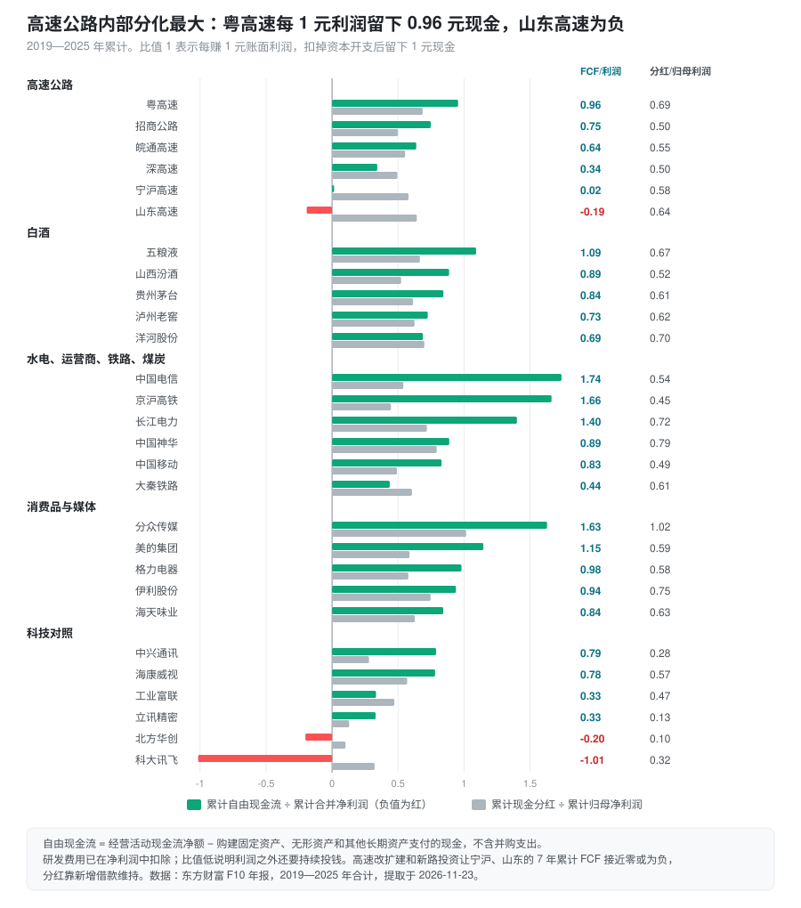
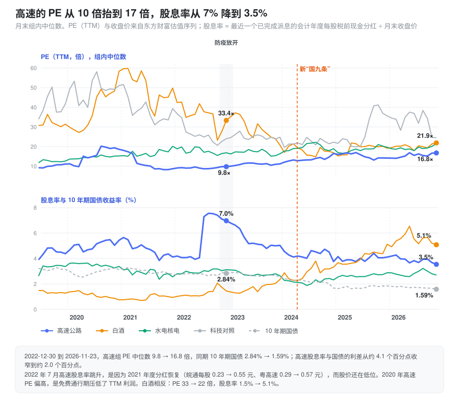

% 能攒下钱的好生意：高速、茅台与 A 股现金牛（2019—2026）

疫情放开以后，高速公路股涨得很好；科技公司常被认为“赚的钱要马上投回研发，攒不下来”。本文用 40 家 A 股公司 2019—2025 年的现金流量表，检验哪些生意真的把利润变成了留在手里、能分给股东的现金，再看 2022 年底以来市场怎样给这些生意定价。

**核心结论：能攒下钱的生意，关键不在于研发费用多少，而在于维持利润要不要持续投入新的资本。按这个标准，品牌消费品、长寿命的垄断基础设施（长江电力、京沪高铁、运营商）最好；高速公路的现金流不错，但收费期有限，要靠改扩建和借钱续命，内部差异很大。2022 年底以来高速股的上涨主要来自估值抬升，利润基本没长。**

- **谁留下了钱。** 2019—2025 年累计自由现金流（经营现金流 − 资本开支）÷ 累计净利润：中国电信 1.74、京沪高铁 1.66、分众传媒 1.63、长江电力 1.40、美的 1.15、五粮液 1.09、茅台 0.84。高速公路从粤高速 0.96 到山东高速 −0.19 不等，宁沪高速只有 0.02。
- **科技不全是“攒不下钱”。** 海康威视研发费用占收入 12.7%，七年累计 FCF/利润仍有 0.78，2025 年分红率 74%。真正攒不下钱的是科大讯飞（−1.01，资本开支是利润的 2.78 倍）和北方华创（−0.20，存货从 2019 年末 36 亿元涨到 2026 年 9 月末 339 亿元）。
- **高速涨的是估值。** 2022-12-30 至 2026-11-23，六家高速含分红总收益 1.11—2.88 倍，同期沪深 300 全收益 1.14 倍、中证红利全收益 1.36 倍。拆开看，TTM 利润多数持平（山东、招商 1.00 倍），PE 中位数从 9.8 倍升到 16.8 倍。同期 10 年期国债收益率从 2.84% 降到 1.59%，高速股息率从 7.0% 降到 3.5%。
- **白酒说明“过去攒钱”不等于“永远攒钱”。** 七年里白酒的现金流最干净，但 2026 年前三季度泸州老窖利润 −47%、洋河 −54%、汾酒 −27%；五粮液 2026-04-30 更正 2025 年收入确认，2025 年归母净利润从 2024 年的 318.5 亿元降到 89.5 亿元。茅台 2026 年前三季度利润持平；2022 年底以来 TTM 利润增长 38%，PE 从 36 倍降到 22 倍，含分红总收益 0.93 倍。
- **当前价格的含义。** 高速 PE 处于 2019 年以来 71%—100% 分位，股息率比国债只高约 2 个百分点。这个价格默认利率长期低位、收费期能持续延长。本文不构成投资建议。

### 研究范围与数据边界

- **样本：** 40 家 A 股，分为高速公路 6 家、白酒 5 家、水电核电 5 家、煤炭 2 家、运营商 2 家、铁路港口 4 家、消费品 7 家、其他 3 家（分众、中免、上海机场）和科技对照 6 家。名单是 2026 年选出的，带有事后选择偏差：今天被视为“好生意”的公司更容易入选。
- **期间：** 财务为 2019—2025 七个完整年度，加 2026 年前三季度。估值与行情从 2019-01-01 到 2026-11-23。“疫情后”以 2022-12-30 为起点（2022 年 12 月防疫政策放开后的最后一个交易日）。提取日 2026-11-23/24，信息截止日 2026-11-23 收盘。
- **财务：** 东方财富 F10 合并报表（现金流量表、利润表、资产负债表、主要指标），年报口径。五粮液 2025 年采用会计差错更正后的数字。
- **口径：**
  - 自由现金流（FCF）= 经营活动现金流量净额 − 购建固定资产、无形资产和其他长期资产支付的现金。**不含**收购子公司和股权投资支出，所以靠收购扩张的公司会被高估，见长江电力一节。
  - FCF 和资本开支除以**合并**净利润（含少数股东），分红和研发除以**归母**净利润。
  - 分红率 = 归属某会计年度的税前现金分红（每股分红 × 当时总股本）÷ 当年归母净利润。
- **估值：** 东方财富估值分析（`RPT_VALUEANALYSIS_DET`）日度 PE（TTM）、PB、总市值、收盘价，本文没有重算。月度组内中位数取每月最后一个交易日，只用正 PE，组内至少 n−1 家有值才计入。
- **股息率：** 最近一个已完成派息的会计年度的每股税前现金分红 ÷ 收盘价。用滚动 365 天的除息日加总时，除息日年年漂移会造成断档，所以图表改用会计年度口径；两种口径在 2022-12-30 和 2026-11-23 两个时点结果相同。
- **总收益：** 不复权收盘价，税前现金分红在除息日按收盘价再投资，送转股计入股数，未扣税费。指数用中证指数公司全收益指数（沪深 300 全收益 H00300、中证红利全收益 H00922、中证 500 全收益 H00905）。
- **利率：** 东方财富中国 10 年期国债收益率（EMM00166466）。
- **外部资料：** 宁沪高速剩余收费期来自华源证券研报的转载，新“国九条”来自国务院文件，链接见正文。
- **未能核验：**
  - 茅台、长江电力、宁沪高速“提质增效重回报”等分红承诺公告的原文。公告存在，但内容接口没有响应，文中只用实际分红率。
  - 2020 年免费通行的交通运输部原文、《收费公路管理条例》修订进展。
  - Wind、Choice 等一致预期。
  - 本文是横截面调研，没有对单只股票逐次整理研报预测和股吧样本。

### 怎样算“攒下钱”

利润表上的研发费用已经从净利润里扣掉了。一家公司研发投入再大，只要扣完研发还有利润，这部分利润就和高速公路的利润一样可以分掉。所以“科技赚了钱马上要花掉”说的其实是另外两件事：

1. **利润之外还要不断掏钱。** 资本开支（盖厂、修路、买设备、资本化的开发支出）和营运资金（存货、应收账款随收入膨胀）不在利润表里，却要占用现金。
2. **不投就会掉队。** 竞争要求持续再投入，否则下一代产品就没有利润。这时账面利润高估了股东真正能拿走的钱。

因此本文用四个指标衡量“攒钱能力”，都取 2019—2025 年七年累计，平滑单年波动：

| 指标 | 含义 | 好生意的特征 |
| --- | --- | --- |
| 经营现金流 ÷ 净利润 | 利润有没有收成现金 | ≥ 1，折旧大的重资产公司会明显大于 1 |
| 资本开支 ÷ 净利润 | 每赚 1 元利润要再投多少 | 越低越好；接近或大于 1 说明利润主要被再投资吃掉 |
| 自由现金流 ÷ 净利润 | 扣掉再投资后真正留下的 | 接近或大于 1 |
| 分红 ÷ 归母净利润 | 留下的钱有没有分给股东 | 持续 50% 以上，且不靠借钱 |

再加两项看“可持续”：最差年份利润变化（经得起冲击吗），以及利润七年间是增长、持平还是萎缩。

### 七年现金账

| 类型 | 公司 | 经营现金流/利润 | 资本开支/利润 | FCF/利润 | 分红/归母利润 | 研发/归母利润 | 平均 ROE | 归母利润 2019→2025（亿元） | 最差年份利润变化 |
| --- | --- | --- | --- | --- | --- | --- | --- | --- | --- |
| 高速 | 粤高速A | 1.57 | 0.62 | 0.96 | 0.69 | 0.00 | 15.2% | 15 → 18 | −40.9% |
| 高速 | 招商公路 | 0.93 | 0.19 | 0.75 | 0.50 | 0.04 | 8.2% | 43 → 46 | −48.9% |
| 高速 | 皖通高速 | 1.63 | 0.99 | 0.64 | 0.55 | 0.00 | 11.7% | 11 → 19 | −20.8% |
| 高速 | 深高速 | 1.55 | 1.21 | 0.34 | 0.50 | 0.02 | 9.5% | 26 → 11 | −50.8% |
| 高速 | 宁沪高速 | 1.38 | 1.36 | 0.02 | 0.58 | 0.00 | 12.5% | 42 → 46 | −41.3% |
| 高速 | 山东高速 | 1.78 | 1.98 | −0.19 | 0.64 | 0.10 | 8.9% | 31 → 32 | −27.0% |
| 白酒 | 贵州茅台 | 0.90 | 0.05 | 0.84 | 0.61 | 0.00 | 32.5% | 412 → 823 | −4.5% |
| 白酒 | 五粮液 | 1.17 | 0.08 | 1.09 | 0.67 | 0.01 | 22.3% | 174 → 90 | −71.9%（2025） |
| 白酒 | 山西汾酒 | 0.95 | 0.07 | 0.89 | 0.52 | 0.01 | 37.9% | 20 → 122 | 未下滑 |
| 白酒 | 泸州老窖 | 0.94 | 0.22 | 0.73 | 0.62 | 0.02 | 29.5% | 46 → 108 | −19.6% |
| 白酒 | 洋河股份 | 0.78 | 0.10 | 0.69 | 0.70 | 0.03 | 16.9% | 74 → 22 | −66.9% |
| 水电核电 | 长江电力 | 1.75 | 0.35 | 1.40 | 0.72 | 0.02 | 14.4% | 215 → 345 | −9.7% |
| 水电核电 | 中国广核 | 2.07 | 1.23 | 0.84 | 0.43 | 0.19 | 10.1% | 95 → 98 | −9.9% |
| 水电核电 | 华能水电 | 2.29 | 1.53 | 0.76 | 0.48 | 0.02 | 10.8% | 55 → 85 | −12.8% |
| 水电核电 | 国投电力 | 2.25 | 1.57 | 0.68 | 0.49 | 0.02 | 10.7% | 48 → 74 | −55.5% |
| 水电核电 | 川投能源 | 0.16 | 0.19 | −0.03 | 0.50 | 0.01 | 11.3% | 29 → 48 | −2.3% |
| 运营商 | 中国电信 | 4.87 | 3.13 | 1.74 | 0.54 | 0.36 | 6.6% | 205 → 332 | 未下滑 |
| 运营商 | 中国移动 | 2.32 | 1.49 | 0.83 | 0.49 | 0.16 | 10.1% | 1,063 → 1,371 | −0.9% |
| 铁路 | 京沪高铁 | 2.18 | 0.52 | 1.66 | 0.45 | 0.00 | 4.1% | 111 → 132 | 2022 年亏损 |
| 铁路 | 大秦铁路 | 1.11 | 0.68 | 0.44 | 0.61 | 0.00 | 8.5% | 137 → 59 | −34.7% |
| 港口 | 唐山港 | 1.06 | 0.29 | 0.77 | 0.64 | 0.03 | 10.1% | 18 → 20 | −19.1% |
| 港口 | 青岛港 | 0.92 | 0.51 | 0.41 | 0.40 | 0.02 | 12.3% | 38 → 53 | 未下滑 |
| 煤炭 | 中国神华 | 1.38 | 0.49 | 0.89 | 0.79 | 0.05 | 13.7% | 432 → 528 | −14.3% |
| 煤炭 | 陕西煤业 | 1.19 | 0.34 | 0.86 | 0.56 | 0.02 | 22.1% | 116 → 168 | −34.4% |
| 消费品 | 美的集团 | 1.35 | 0.21 | 1.15 | 0.59 | 0.41 | 23.0% | 242 → 439 | 未下滑 |
| 消费品 | 格力电器 | 1.15 | 0.17 | 0.98 | 0.58 | 0.24 | 23.2% | 247 → 290 | −10.2% |
| 消费品 | 伊利股份 | 1.63 | 0.69 | 0.94 | 0.75 | 0.08 | 21.9% | 69 → 116 | −18.9% |
| 消费品 | 海天味业 | 1.04 | 0.20 | 0.84 | 0.63 | 0.12 | 27.0% | 54 → 70 | −9.2% |
| 消费品 | 双汇发展 | 1.21 | 0.37 | 0.84 | 0.97 | 0.03 | 27.0% | 54 → 51 | −22.2% |
| 消费品 | 片仔癀 | 0.72 | 0.14 | 0.57 | 0.47 | 0.09 | 22.4% | 14 → 22 | −27.5% |
| 其他 | 分众传媒 | 1.68 | 0.05 | 1.63 | 1.02 | 0.02 | 23.5% | 19 → 29 | −54.0% |
| 其他 | 中国中免 | 0.96 | 0.26 | 0.70 | 0.37 | 0.01 | 19.1% | 46 → 36 | −47.9% |
| 其他 | 上海机场 | 3.62 | 1.95 | 1.67 | 0.95 | 0.01 | 1.8% | 50 → 21 | 2020—2022 年亏损 |
| 科技 | 海康威视 | 1.01 | 0.23 | 0.78 | 0.57 | 0.68 | 22.7% | 124 → 142 | −23.6% |
| 科技 | 中兴通讯 | 1.52 | 0.73 | 0.79 | 0.28 | 2.93 | 13.4% | 51 → 56 | −33.3% |
| 科技 | 工业富联 | 0.71 | 0.38 | 0.33 | 0.47 | 0.48 | 18.4% | 186 → 353 | −6.3% |
| 科技 | 立讯精密 | 1.41 | 1.08 | 0.33 | 0.13 | 0.77 | 23.7% | 47 → 166 | −2.1% |
| 科技 | 北方华创 | 0.25 | 0.45 | −0.20 | 0.10 | 0.83 | 13.8% | 3 → 55 | −1.8% |
| 科技 | 科大讯飞 | 1.76 | 2.78 | −1.01 | 0.32 | 3.40 | 6.5% | 8 → 8 | −63.9% |

注：东方财富 F10，2019—2025 年七年合计。经营现金流、资本开支、FCF 除以合并净利润；分红、研发除以归母净利润。平均 ROE 为七年加权 ROE 的算术平均。“最差年份利润变化”是 2020—2025 年归母净利润同比的最小值。东阿阿胶 2019 年亏损，未列入。上海机场的比值被 2020—2022 年亏损压低了分母，不可直接比较。

读这张表要注意三点：

- **研发多不等于攒不下钱。** 中兴通讯七年研发费用是归母利润的 2.93 倍，FCF/利润仍有 0.79，只是分红率低（28%）。海康威视研发占收入 12.7%，分红率与茅台相当。攒不下钱的科技公司，问题出在资本开支和营运资金：科大讯飞的资本开支是利润的 2.78 倍，其中一部分是资本化的研发；北方华创经营现金流只有利润的 25%，存货七年涨了 8 倍多。
- **重资产也能攒钱，前提是资产寿命长。** 中国电信、移动的资本开支都超过利润，但折旧更大，经营现金流是利润的 2—5 倍，扣完仍有富余。长江电力的大坝折旧完了还能发电。
- **低资本开支不等于利润可持续。** 白酒的资本开支几乎为零，FCF 很干净，但五粮液、洋河的利润在 2025—2026 年腰斩。现金流好只证明“过去收到了钱”，不证明“以后还有这么多钱”。

### 按生意类型分档

把“能攒钱”和“能持续”放在一起看，可以分成五档。档位是对 2019—2026 年证据的归纳，不是对未来的保证。

| 档位 | 类型与代表 | 为什么攒得下钱 | 主要风险 |
| --- | --- | --- | --- |
| 一 | 顶级品牌消费：茅台；稳定日用品：美的、海天、伊利 | 资本开支低，提价或规模效应抵消成本，现金先于收入到账（茅台预收款） | 需求与渠道库存周期；品牌老化；茅台以外的白酒已经出问题 |
| 一 | 长寿命垄断基础设施：长江电力、京沪高铁 | 资产寿命远长于折旧年限，维护开支低，电价、票价受管制但稳定 | 来水波动；电价市场化；收购新电站要再借钱 |
| 二 | 网络型公用事业：中国移动、中国电信、中广核 | 折旧大、经营现金流是利润 2 倍以上，用户粘性高 | 资本开支跟着技术代际走（5G、算力）；ROE 只有 6%—10% |
| 二 | 高速公路：粤高速、招商、皖通 | 现金流稳定，路修好后边际成本低 | 收费期有限；改扩建要重新投钱；靠借钱维持分红 |
| 三 | 资源：神华、陕煤 | 低成本矿、长协价，周期高点现金极多，分红率近 80% | 煤价周期；储量和采矿权年限 |
| 三 | 媒体与平台：分众 | 资本开支几乎为零，FCF 高于利润 | 广告周期，2022 年利润 −54%，2025 年 −43% |
| 四 | 受政策与客流冲击的：中免、上海机场、大秦 | 正常年份现金流尚可 | 政策（免税）、客流、运量结构性下降，利润已低于 2019 年 |
| 五 | 资本开支或营运资金吞掉利润的：宁沪、山东高速、讯飞、北方华创 | — | 每赚 1 元利润，七年里几乎全部或超过全部投了回去 |

### 高速公路：现金流稳，但路有寿命

#### 疫情后涨的是估值

把 2022-12-30 到 2026-11-23 的市值变化拆成 TTM 归母利润和 PE（TTM）两部分（市值 = TTM 利润 × PE）：

| 公司 | 含分红总收益 | 市值倍数 | TTM 利润倍数 | PE 倍数 | PE（TTM） | 股息率 | 现市值（亿元） |
| --- | --- | --- | --- | --- | --- | --- | --- |
| 皖通高速 | 2.88 | 2.49 | 1.48 | 1.68 | 8.4 → 14.1 | 7.5% → 3.7% | 302 |
| 山东高速 | 2.45 | 2.03 | 1.00 | 2.02 | 9.1 → 18.5 | 7.0% → 3.6% | 557 |
| 粤高速A | 2.17 | 1.79 | 1.04 | 1.72 | 10.9 → 18.7 | 7.3% → 4.3% | 293 |
| 宁沪高速 | 2.08 | 1.77 | 1.34 | 1.33 | 12.0 → 15.9 | 5.6% → 3.4% | 735 |
| 招商公路 | 1.63 | 1.53 | 1.00 | 1.53 | 10.4 → 16.0 | 4.5% → 3.4% | 736 |
| 深高速 | 1.11 | 1.10 | 0.46 | 2.42 | 7.3 → 17.6 | 6.9% → 2.9% | 216 |
| 对照：沪深 300 全收益 | 1.14 | | | | | | |
| 对照：中证红利全收益 | 1.36 | | | | | | |

注：2022-12-30 的 TTM 利润是 2021Q4—2022Q3，受 2022 年疫情管控压低，所以宁沪、皖通的“利润增长”有一部分只是恢复。招商公路总股本从 61.78 亿股增加到 67.95 亿股，深高速从 21.81 亿股增加到 25.38 亿股（按东方财富市值 ÷ 收盘价推算，股本变动原因本文未核实），所以这两家的股价涨幅小于市值涨幅。

除深高速外，五家的 TTM 利润倍数在 1.00—1.48 之间，PE 倍数在 1.33—2.02 之间，**股价上涨的大头来自 PE 从 8—12 倍抬到 14—19 倍**。同期发生了三件事：

1. **利率下行。** 10 年期国债从 2.84% 降到 1.59%。高速股息率的中位数从 2022 年 12 月的 7.0% 降到 2026 年 11 月的 3.5%，对国债的利差从约 4.1 个百分点收窄到约 2.0 个百分点。在存款和理财收益率一起下降的环境里，稳定分红的股票被当作债券替代品重新定价。
2. **政策鼓励分红。** 2024-04-12 国务院发布《关于加强监管防范风险推动资本市场高质量发展的若干意见》（新“国九条”，国发〔2024〕10 号），要求强化上市公司现金分红，对多年不分红或分红比例偏低的公司加强约束（[政策文件](https://www.guizhou.gov.cn/zwgk/zcfg/szfwj/qff/202501/t20250115_86628615.html)）。高速是现成的高分红资产。
3. **起点便宜。** 2022 年高速股的 PE 只有 8—11 倍，股息率 7% 左右。价格里应当包含了对疫情期间车流和 2020 年免费通行这类政策风险的折价，但本文没有整理当时的研报和股吧样本，这一点是推断。

所以“高速股疫情后涨得好”更准确的说法是：**一批原本被按 9—10 倍定价的稳定现金流资产，在利率降到 1.6% 后被按 16—19 倍定价。** 这不是生意本身变好了，而是同样的现金流被更低的折现率贴现。

#### 分红有一部分是借来的

高速公路的经营现金流很好看，六家七年累计都是利润的 0.9—1.8 倍。问题在于路要改扩建，新路要投资：

| 公司 | 七年经营现金流（亿元） | 七年资本开支（亿元） | 七年分配股利和偿付利息（亿元） | 七年筹资现金流净额（亿元） | 有息负债 2019-12 → 2026-09（亿元） |
| --- | --- | --- | --- | --- | --- |
| 宁沪高速 | 406 | 401 | 227 | +43 | 145 → 352 |
| 山东高速 | 468 | 518 | 328 | +19 | 366 → 705 |
| 深高速 | 224 | 174 | 174 | −37 | 146 → 305 |
| 招商公路 | 341 | 68 | 288 | −161 | 253 → 504 |
| 皖通高速 | 168 | 102 | 72 | −24 | 23 → 153 |
| 粤高速A | 229 | 90 | 133 | −103 | 64 → 119 |
| 对照：贵州茅台 | 4,182 | 244 | 3,250 | −3,308 | 无有息负债 |

注：有息负债 = 短期借款 + 长期借款 + 应付债券 + 一年内到期的非流动负债。“分配股利和偿付利息”包含利息，不全是给股东的分红。招商公路资本开支低，但另有 85 亿元取得子公司的支出和 216 亿元投资支出，没有算进 FCF。

宁沪高速和山东高速七年赚到的经营现金几乎全部投回了路上，分红和利息靠新增借款支付，有息负债翻了一倍多。宁沪高速 2024 年资本开支 108 亿元、2025 年 76 亿元，是 2019—2023 年平均的两倍左右，主要是改扩建。皖通、深高速的有息负债也在 2022 年后快速上升。

这和茅台的现金账完全不同：茅台七年经营现金流 4,182 亿元，资本开支只用了 244 亿元，3,250 亿元的分红全部来自自有现金，账上没有有息负债，2026 年 9 月末货币资金约 499 亿元。

#### 收费期是有限的

高速公路的特许经营权有年限。经营性公路新项目常见 30 年收费期（例如[贵州省政府公开的项目批复](https://www.guizhou.gov.cn/zwgk/zdlygk/jjgzlfz/jtys/ysgl/202502/t20250207_86732040.html)）。华源证券测算，截至 2024 年末宁沪高速路产的加权平均剩余收费年限为 9.57 年（[研报转载](http://www.aastocks.com/sc/stocks/analysis/stock-aafn-con/00177/GLH/GLH1884165L/hk-stock-news)）。收费期到期后，公司要么接受路产归零，要么通过改扩建获得新的收费期，后者就是上表里资本开支和负债的来源。

所以高速的“攒钱”有个前提：**改扩建投入的回报不低于原来的路。** 改扩建期间车道减少、车流被分流，收入还会先降。皖通高速 2024 年改扩建路段单向施工，影响了通行费收入（[报道](http://www.aastocks.com/sc/cnhk/quote/stock-news-content/600012/GLH1800735L/GLH)）。宁沪高速 2025 年归母净利润 45.94 亿元，同比 −7.13%（[报道](http://www.aastocks.com/sc/stocks/analysis/stock-aafn-con/00177/GLH/GLH5198587N/hk-stock-news)）。摩根大通转述管理层的指引，2026 年通行费收入增长为低至中个位数（[报道](http://www.aastocks.com/sc/stocks/analysis/stock-aafn-con/00177/AAFN/NOW.1516799/hk-stock-news)）。

另一项风险是政策。2020 年疫情期间全国收费公路免收通行费数月（交通运输部原文未核验），粤高速、招商、皖通、宁沪、山东五家 2020 年利润同比下降 21%—49%，都是七年里最差的一年；深高速 2020 年下降 20%，最差的是 2024 年（−51%）。收费标准由地方政府核定，公司无法自主提价。

#### 高速内部的差别

- **粤高速A、招商公路、皖通高速** 更接近“攒钱”：资本开支低于经营现金流，FCF/利润 0.64—0.96，有息负债可控。招商公路的利润主要来自参股路产的投资收益，资本开支低，但把股权投资算进去后自由现金流要打折。
- **宁沪高速、山东高速** 是“高分红 + 高投入”：七年 FCF 接近零或为负，分红靠借钱。只要新投入的回报够高，这种模式能持续，但它更像一个不断再投资的建设公司，而不是只收钱的现金牛。
- **深高速** 利润从 2021 年的 26.1 亿元降到 2024—2025 年的 11.5 亿元，公司还有环保、新能源等非高速业务，利润下滑的具体来源本文未逐项核实。PE 从 7.3 倍升到 17.6 倍，几乎全靠估值支撑，含分红总收益只有 1.11 倍。

### 白酒：最干净的现金账，也最先坏掉

#### 七年里的样子

白酒的资本开支只占利润的 5%—22%，经营现金流和利润基本相当，分红率 50%—70%，几家都没有有息负债压力。按 2019—2025 年的现金账，白酒是样本里最像“印钞机”的行业。

但同一个行业里，利润的轨迹在 2024 年后分岔：

| 公司 | 归母净利润 2019 → 2023 → 2025（亿元） | 2026 年前三季度 / 上年同期（亿元） | 自 2023 年初高点的市值回撤 | 2022-12-30 → 2026-11-23 含分红总收益 |
| --- | --- | --- | --- | --- |
| 贵州茅台 | 412 → 747 → 823 | 644.7 / 646.3（−0.2%） | −25.1%（2023-01-16） | 0.93 |
| 山西汾酒 | 20 → 104 → 122 | 83.4 / 114.0（−26.9%） | −58.6%（2023-01-16） | 0.51 |
| 泸州老窖 | 46 → 133 → 108 | 56.7 / 107.6（−47.3%） | −69.5%（2023-02-13） | 0.42 |
| 五粮液 | 174 → 302 → 90 | 97.1 / 64.7（重述基数） | −66.7%（2023-01-30） | 0.47 |
| 洋河股份 | 74 → 100 → 22 | 18.3 / 39.8（−53.9%） | −81.2%（2023-01-16） | 0.26 |

#### 五粮液的会计差错更正

2026-04-30，五粮液发布《关于前期会计差错更正的公告》（2026-011 号，[公告](https://data.eastmoney.com/notices/detail/000858/AN202604301821851560.html)），称“对 2025 年业务模式进行梳理，基于谨慎性原则，调整 2025 年部分业务收入确认相关核算”。2025 年一季度营业收入从 369.40 亿元更正为 170.86 亿元，归母净利润从 148.60 亿元更正为 44.16 亿元。2025 年年报同日披露，全年营业收入 405.3 亿元、归母净利润 89.5 亿元，2024 年分别是 891.8 亿元、318.5 亿元。

公告没有说明调整的是哪类业务。本文的推断是，被更正的收入与渠道环节有关，即账面确认的销售多于终端实际消化的量，这一点未经核实。无论原因如何，它说明“攒钱能力”的数据只能证明过去收到了钱，证明不了下一年还能收到同样多。五粮液 2025 年度分了两次：2025 年三季度每 10 股派 25.78 元（2025-12-18 除息，更正公告之前），2025 年年度每 10 股派 25.80 元（2026-07-16 除息），按 3,881,608,005 股合计约 200 亿元，是更正后全年利润的 2.2 倍，靠的是过去攒下的现金。

#### 茅台：利润涨了，股价没涨

茅台是另一种教训。2022-12-30 到 2026-11-23，茅台 TTM 利润从 595.9 亿元增长到 821.6 亿元（1.38 倍），PE 从 36.4 倍降到 21.9 倍（0.60 倍），市值反而缩小到 0.83 倍，含分红总收益 0.93 倍。同期高速股的利润基本没长，股价却翻倍。

两者的差别在于**起点估值**。2022 年底茅台按 36 倍 PE、1.3% 股息率定价，市场在为高增长付钱；高速按 9—10 倍 PE、7% 股息率定价，市场几乎没有为增长付钱。之后白酒增长放缓，茅台的估值被压缩；利率下行，高速的估值被抬升。现在两者的股息率都在 3.5% 左右。

白酒组 PE 中位数在 2021 年 2 月达到 59.8 倍的高点，2024 年 8 月最低 14.8 倍，2026 年 11 月为 21.9 倍；股息率中位数从 2022 年 12 月的 1.5% 升到 5.1%。泸州老窖、五粮液的股息率在 7% 以上，但这个数字用的是 2025 年度的分红，而两家 2026 年的利润还在下降，能否维持取决于利润在哪里见底。

### 其他攒得下钱的生意

#### 长江电力：寿命最长的现金资产

长江电力七年经营现金流是合并利润的 1.75 倍，资本开支只占 0.35 倍，FCF/利润 1.40，2025 年分红率 70.9%。利润从 2019 年的 215 亿元增长到 2025 年的 345 亿元，最差的 2022 年（来水偏枯）也只下降 9.7%。

水电站的特点是大坝寿命远长于折旧年限，前期投入巨大，建成后几乎只有维护开支，也没有燃料成本。长江电力目前运营乌东德、白鹤滩、溪洛渡、向家坝、三峡、葛洲坝六座梯级电站，总装机 7,169.5 万千瓦（[人民网](http://j.people.com.cn/n3/2026/0421/c95952-20448721.html)）。

需要扣分的地方：长江的增长主要靠从母公司收购新电站，七年取得子公司的现金支出 273 亿元没有计入上面的 FCF；2022 年后资本开支从每年 30 多亿元升到 125—185 亿元。2026 年 9 月末资产负债率 57%，有息负债约 2,826 亿元（短期借款 84 亿、长期借款 1,798 亿、应付债券 379 亿、一年内到期 565 亿），货币资金只有 95 亿元。它的现价 PE 23.5 倍，处于 2019 年以来 85% 分位，2026-11-20 刚创市值新高。

华能水电、国投电力、川投能源也是水电，但 FCF/利润只有 −0.03—0.76：华能水电、国投电力还在大规模建新电站，资本开支超过利润；川投能源的利润主要来自参股雅砻江水电的投资收益，现金要等分红才能回到上市公司，所以经营现金流只有利润的 16%。

#### 运营商与京沪高铁：重资产，但折旧大于投入

中国电信、中国移动七年累计的资本开支都超过净利润（电信 3.13 倍、移动 1.49 倍），看起来是典型的“挣了钱马上花掉”。但它们的折旧更大，经营现金流是利润的 4.87 倍和 2.32 倍，扣完资本开支 FCF/利润仍有 1.74 和 0.83，2025 年分红率都在 75% 左右。代价是 ROE 只有 6.6% 和 10.1%：资产很重，每元资产赚得不多，但赚得很稳，七年里利润几乎没下降过。

京沪高铁 FCF/利润 1.66，但 2022 年疫情期间亏损，ROE 只有 4.1%，PB 1.22 倍。它的现金流很稳，回报率却低，适合用“债券”而不是“成长股”的眼光看。

#### 中国神华：周期里的高分红

神华的现金账在样本里属于前列：FCF/利润 0.89，七年分红率 79%，最差年份利润只降 14.3%。通常的解释是长协煤价和煤、电、路、港一体化平滑了煤价波动。但它的现金来自开采有限的储量，2022 年后的利润高位也依赖煤价。神华 PE 从 8.0 倍升到 20.3 倍，处于 2019 年以来 99% 分位，与高速一样，市场已经把它当作债券替代品定价。

#### 消费品：美的是另一种“科技”

美的集团七年研发费用是归母利润的 0.41 倍，2025 年研发占收入 3.9%，但 FCF/利润 1.15、2025 年分红率 74.6%，利润从 242 亿元增长到 439 亿元，七年里没有一年下降，2026 年前三季度仍增长 9.3%。家电行业靠规模、渠道和供应链议价，研发是维持竞争力的成本，但不需要像半导体设备那样持续扩产。

伊利、海天、双汇的 FCF/利润在 0.84—0.94，分红率 63%—97%。它们的问题不是攒不下钱，而是增长放缓：伊利 2026 年前三季度利润 −15.6%，双汇 2025 年利润低于 2019 年，海天 PE 29.6 倍却已在 2019 年以来 6% 分位。

#### 分众传媒：最轻的资产，最大的波动

分众传媒七年资本开支只有利润的 5%，FCF/利润 1.63，分红率 102%。但它的利润随广告周期大幅摆动：2021 年 60.6 亿元，2022 年 27.9 亿元，2025 年因资产减值又降到 29.5 亿元。现金好、但利润不稳，适合在周期低点而不是高点评估。

### 科技对照：问题出在资本开支，不在研发

| 公司 | 研发占收入（2025） | 研发/归母利润（七年） | 资本开支/利润 | FCF/利润 | 分红/归母利润 | 2022-12-30 → 2026-11-23 含分红总收益 |
| --- | --- | --- | --- | --- | --- | --- |
| 海康威视 | 12.7% | 0.68 | 0.23 | 0.78 | 0.57 | 1.14 |
| 中兴通讯 | 17.0% | 2.93 | 0.73 | 0.79 | 0.28 | 1.10 |
| 工业富联 | 1.2% | 0.48 | 0.38 | 0.33 | 0.47 | 4.55 |
| 立讯精密 | 3.4% | 0.77 | 1.08 | 0.33 | 0.13 | 1.49 |
| 北方华创 | 13.8% | 0.83 | 0.45 | −0.20 | 0.10 | 3.27 |
| 科大讯飞 | 16.4% | 3.40 | 2.78 | −1.01 | 0.32 | 1.09 |

“科技攒不下钱”的直觉只对一半：样本里确实有攒不下钱的科技公司，但原因各不相同。

- **海康威视、中兴通讯** 研发投入很大，但研发已经在利润里扣掉了，资本开支不高，FCF/利润都在 0.8 左右。海康 2025 年分红率 74.2%，股息率 3.7%，现金账和白酒、高速是同一个级别。它们的风险在竞争和外部限制，而不是“赚了钱要花掉”。
- **立讯精密、工业富联** 是代工制造的扩张模式，留下的现金都只有利润的三分之一，但吃掉现金的地方不同。立讯的资本开支是利润的 1.08 倍，新订单要建新产线，分红率只有 13%。工业富联资本开支只占利润的 0.38 倍，钱被营运资金占用，经营现金流只有利润的 71%；它的分红率 47%，不算低。
- **北方华创** 处在扩张期，存货从 2019 年末的 36 亿元增加到 2026 年 9 月末的 339 亿元，应收票据及账款从 16 亿元增加到 98 亿元，七年经营现金流只有利润的 25%。利润从 3 亿元增长到 55 亿元，股东拿到的是增长，而不是现金。
- **科大讯飞** 是最接近“刚挣了钱马上花出去”的例子：资本开支是利润的 2.78 倍，2023 年一年就有 40.8 亿元，而当年合并净利润只有 6.1 亿元。其中一部分是资本化的研发：资产负债表上的开发支出从 2019 年末 7.4 亿元增加到 2026 年 9 月末 22.3 亿元，无形资产从 20.5 亿元增加到 44.5 亿元，这部分研发先记成资产、以后再摊销，不进当期研发费用。七年 FCF 是利润的 −1.01 倍，归母利润 2019 年和 2025 年都是 8 亿元左右。

另外注意，**攒不下钱不等于股价表现差**。2022 年底以来，工业富联含分红总收益 4.55 倍、北方华创 3.27 倍，都高于高速。市场为增长付钱，FCF 只是其中一种回报方式。

### 定价：市场为“攒钱”付了多少

#### 起点估值决定了疫情后的收益

| 类型 | 2022-12 PE 中位数 | 2026-11 PE 中位数 | 2022-12 股息率中位数 | 2026-11 股息率中位数 |
| --- | --- | --- | --- | --- |
| 高速公路 | 9.8 | 16.8 | 7.0% | 3.5% |
| 水电核电 | 16.9 | 21.6 | 3.1% | 2.7% |
| 白酒 | 33.4 | 21.9 | 1.5% | 5.1% |
| 科技对照 | 24.0 | 24.5 | 0.8% | 1.1% |
| 10 年期国债收益率 | | | 2.84% | 1.59% |

注：每月最后一个交易日的组内中位数。股息率为最近一个已完成派息的会计年度的每股税前现金分红 ÷ 收盘价。

四年里，同样能攒钱的两类生意走出了相反的路：高速被按“类债券”重新估值，PE 从不到 10 倍升到 17 倍；白酒从“高增长”回落成“高股息”，PE 从 33 倍降到 22 倍。**决定收益的不是生意好坏，而是买入时价格里已经包含了多少好。**

#### 现在的价格隐含了什么

截至 2026-11-23，几类现金牛的价格位置（PE 分位为 2019 年以来日度 PE（TTM）中不高于当前值的比例）：

| 公司 | PE（TTM） | PE 分位 | PB | 股息率 | 2025 年分红率 | 2026 年前三季度利润同比 |
| --- | --- | --- | --- | --- | --- | --- |
| 宁沪高速 | 15.9 | 83% | 1.66 | 3.4% | 53.7% | +0.4% |
| 山东高速 | 18.5 | 100% | 1.86 | 3.6% | 63.3% | −7.1% |
| 粤高速A | 18.7 | 93% | 2.64 | 4.3% | 70.1% | −15.5% |
| 皖通高速 | 14.1 | 71% | 2.27 | 3.7% | 60.1% | +18.3% |
| 长江电力 | 23.5 | 85% | 3.36 | 3.2% | 70.9% | −6.6% |
| 中国神华 | 20.3 | 99% | 2.49 | 3.9% | 79.1% | +3.8% |
| 中国移动 | 18.3 | 100% | 1.68 | 4.4% | 74.3% | −7.9% |
| 贵州茅台 | 21.9 | 20% | 6.63 | 3.6% | 79.0% | −0.2% |
| 美的集团 | 15.1 | 60% | 3.23 | 4.0% | 74.6% | +9.3% |
| 海康威视 | 18.1 | 6% | 3.82 | 3.7% | 74.2% | +38.5% |

注：股息率 = 最近一个已完成派息会计年度的每股税前分红 ÷ 2026-11-23 收盘价。

有条件的解读：

- **高速、神华、移动、长江** 的 PE 都在自身 2019 年以来的 71%—100% 分位，股息率 3.2%—4.4%，比 10 年期国债高 1.6—2.8 个百分点。按 3.5% 的股息率和 60% 的分红率倒推，市场相当于给 1 元利润约 17 倍 PE，隐含的假设是：利率长期维持在 2% 以下，利润不下滑，分红率不降。高速还多一个假设：改扩建能换来新的收费期，且回报不低于原来的路。
- **茅台、海康、美的** 的股息率与高速相当，PE 分位却低得多（6%—60%）。市场给这几家的价格里，几乎没有包含增长溢价，反而包含了对增长放缓的担心。
- 这意味着 2026 年底的高速、水电、运营商已经不在自身的低估值区间：同样 3.5% 左右的股息率，一边是多数利润七年基本不增长、部分要靠借钱改扩建的高速，另一边是利润七年间增长、分红不靠借钱的茅台、美的、海康。哪一边更值，取决于未来几年谁的利润更稳，本文不作判断。

#### 值得跟踪的指标

| 指标 | 看什么 | 会否定“现金牛”判断的信号 |
| --- | --- | --- |
| 10 年期国债收益率 | 高速、水电、运营商估值的锚 | 重新回到 2.5% 以上，股息率利差被重新拉大 |
| 高速改扩建资本开支与有息负债 | 分红是否靠借钱 | 资本开支持续高于经营现金流，有息负债继续翻倍 |
| 剩余收费年限与收费政策 | 路产寿命 | 改扩建后收费期延长不及预期；免费通行或降费政策 |
| 白酒批价、渠道库存、合同负债 | 收入里有多少是压货 | 预收款下降、收入确认被更正（五粮液 2026-04） |
| 分红率与“提质增效重回报”承诺 | 留下的钱是否分出来 | 分红率下调，或分红高于自由现金流 |
| 科技公司的资本开支和存货 | 增长是否吞掉现金 | 资本开支和存货增速持续高于收入增速 |

### 小结

1. **能攒下钱的好生意**，在 2019—2025 年的数据里是：资本开支低的品牌消费品（茅台、美的、海天、伊利），资产寿命远长于折旧年限的垄断基础设施（长江电力、京沪高铁、运营商），以及低成本的资源企业（神华）。它们每赚 1 元利润，能留下 0.8—1.7 元自由现金，七年分红率 45%—80%。
2. **高速公路是有条件的现金牛。** 粤高速、招商、皖通符合；宁沪、山东七年的经营现金几乎全部投回了路上，分红部分靠借钱。收费期有限是这个行业和水电、品牌消费品最大的区别。
3. **科技攒不下钱的原因是资本开支和营运资金，不是研发。** 海康、中兴研发投入很大，FCF/利润仍有 0.8 左右；讯飞、北方华创、立讯是因为扩产、资本化研发和存货占用现金。
4. **现金流好不等于利润可持续。** 白酒七年现金账最干净，2025—2026 年除茅台外利润大幅下滑，五粮液还更正了收入确认。
5. **收益取决于起点价格。** 高速疫情后的上涨主要是 PE 从 10 倍升到 17 倍，对应 10 年期国债从 2.84% 降到 1.59%。茅台利润增长 38%，PE 却从 36 倍降到 22 倍，四年含分红总收益 0.93 倍。

本文只解释过去的定价和现金账，不构成任何投资建议。
