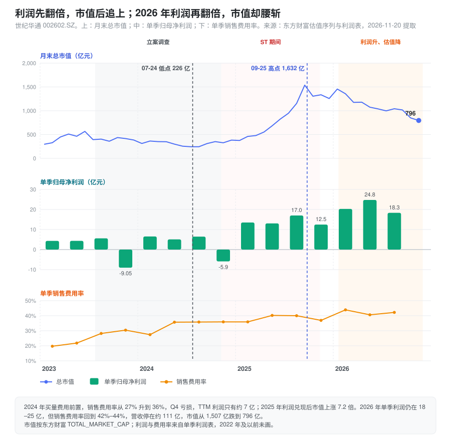
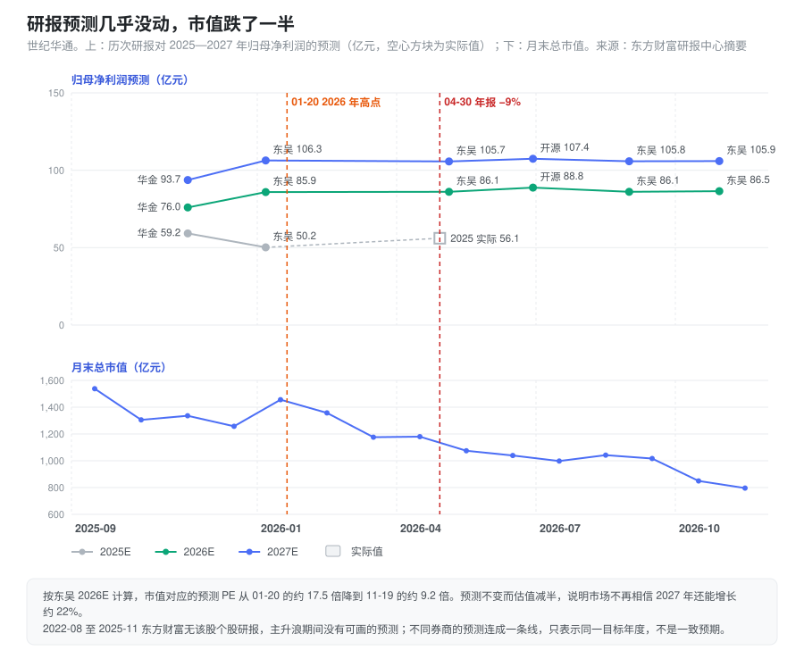
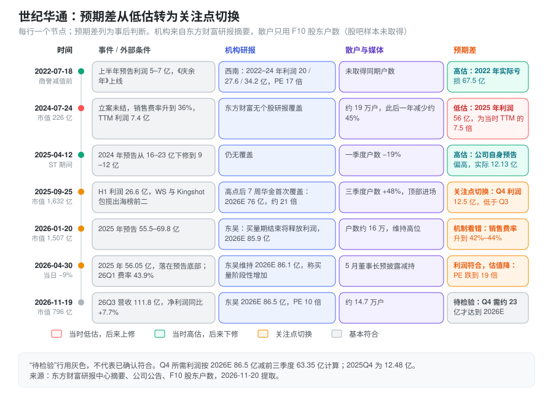
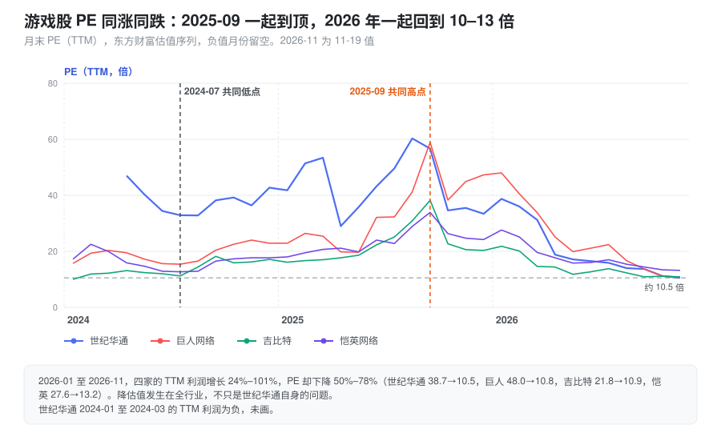

% 世纪华通与游戏股：利润被低估，再到估值切换

**2024 年 7 月到 2025 年 9 月，世纪华通总市值涨了约 7.2 倍：TTM 利润涨了 3.65 倍，PE 扩张约 2 倍。市场当时最大的错误是低估利润，按 7 亿多的滚动利润给它定价，次年它赚了 56 亿。2026 年错误的方向反了过来：利润又翻了一倍，研报预测基本兑现，PE 却从 60 倍落到 10 倍，市场从为“下一年继续高增长”付钱，转向交易“爆款收入见顶、买量费用降不下来”。**

本文研究浙江世纪华通集团股份有限公司，深交所 **002602.SZ**，并以巨人网络（002558）、吉比特（603444）、恺英网络（002517）、三七互娱（002555）、完美世界（002624）作对照。主研究期为 **2020—2025 年**，2019 年作背景，2026 年单列为截至 11 月 19 日的 YTD。资料提取与信息截止日为 **2026-11-20**。

可以先把这段历史分为四个阶段：

- 2019—2023 年：盛趣并表后利润约 20 亿，股价随宅经济、元宇宙、AIGC 题材起落，2022 年商誉减值亏损 67 亿，2023 年被立案。
- 2024 年：出海 SLG 收入快速增长，但买量费用前置、Q4 亏损，叠加 ST 与处罚，市值跌到 226 亿。
- 2024 年 7 月至 2025 年 9 月：双爆款利润兑现，利润与估值一起上行。
- 2025 年 9 月至今：利润继续增长，营收见平台，估值从 60 倍压到 10 倍，同行同步。

## 历史定价与数据边界

### 数据来源与口径

- **行情与估值**：东方财富日线（不复权与前复权）和估值序列 RPT_VALUEANALYSIS_DET 的 PE_TTM、总市值。供应商按当时已披露的财报滚动计算，本文没有用事后利润回填。年度平均 PE 为有效交易日中正值日的算术平均，负值日单独计数后剔除。
- **财务**：东方财富 F10 利润表（单季与累计）。F10 的同比使用重述后的基数，下文自行计算的同比也可能含重述口径。
- **机构**：[东方财富研报中心](https://data.eastmoney.com/report/stock.jshtml)的报告摘要，只引用摘要中可见的字段。
- **公司事件**：[东方财富公告列表](https://data.eastmoney.com/notices/stock/002602.html)中的业绩预告、处罚、回购、减持公告。
- **散户**：[F10 股东研究](https://emweb.securities.eastmoney.com/PC_HSF10/ShareholderResearch/Index?type=web&code=SZ002602)的股东户数。

未取得或未核验的部分：

- **股吧样本没有取到**。抓取历史列表返回的是验证页，本文散户部分只用股东户数，不引用帖子。
- **没有一致预期**。未接入 Wind 或 Choice，只呈现单家券商的预测轨迹。
- **研报覆盖缺口**：东方财富研报中心在 **2022-08-19 至 2025-11-16 之间没有世纪华通的个股报告**，这段时间正好覆盖立案、ST 和主升浪。
- 产品排名、流水来自研报转引的 Sensor Tower 数据，本文未单独核验。
- 行业事件（Genie 3、增值税传闻）来自 CNBC、新华社等媒体报道，只作背景。

本文中的估值区间只用于解释“什么条件下给什么定价”，不构成买卖建议。

## 世纪华通：PE、利润与节点

### 年度 PE 与利润

| 年份 | 平均 PE（TTM，正值日） | 最低 PE / 日期 | 最高 PE / 日期 | 年末 PE |
| --- | ---: | --- | --- | ---: |
| 2019 | 73.2 | 43.4 / 04-18 | 135.0 / 12-25 | 125.7 |
| 2020 | 46.9 | 18.4 / 12-28 | 167.4 / 02-14 | 19.5 |
| 2021 | 21.8 | 15.9 / 08-31 | 28.1 / 06-09 | 26.5 |
| 2022 | 32.5 | 13.9 / 04-28 | 67.3 / 11-17 | 61.5 |
| 2023 | 79.1（剔除 164 个负值日） | 负值 | 111.3 / 04-12 | 负值（−6.4） |
| 2024 | 36.1（剔除 77 个负值日） | 负值 | 47.0 | 42.7 |
| 2025 | 45.6 | 28.8 / 04-29 | 61.4 / 03-17 | 33.4 |
| 2026 YTD | 22.3 | 10.3 / 11-16 | 40.0 / 01-20 | 10.5（11-19） |

2023、2024 年的 TTM 利润在部分时段为负，PE 没有意义；正值日的平均数也会被很小的分母推高，只能说明“利润太低”，不能说明市场乐观。

| 年份 | 归母净利润（亿元） | 同比 | 营收（亿元） | 关键变化 |
| --- | ---: | ---: | ---: | --- |
| 2019 | 22.85 | +78% | — | 盛趣并表 |
| 2020 | 20.78 | −9% | — | 宅经济行情后回落 |
| 2021 | 25.01 | +20% | — | 上半年含约 16.8 亿非经常性收益；版号停发 |
| 2022 | −67.47 | 转亏 | — | Q4 商誉减值，单季 −74.37 |
| 2023 | 5.24 | −92% | 132.85 | 7 月被立案；Q4 亏损 9.05 |
| 2024 | 12.13 | +131% | 226.2 | Whiteout Survival（下称 WS）放量，买量前置，Q4 亏损 5.90 |
| 2025 | 56.05 | +362% | 378.98 | WS 与 Kingshot 双爆款 |
| 2026 年 1—9 月 | 63.35 | +45% | 333.0 | 单季营收停在约 111 亿 |

同比由 F10 数值计算，含可能的重述口径。2025 年 +362% 与公司年报口径一致。

### 节点表：利润先动，估值先回

下表用不复权收盘价。TTM 利润 = 总市值 / PE_TTM，与当时已披露四个季度利润之和一致，例如 2025-09-25 为 24Q3 至 25Q2 之和 27.1 亿。

| 日期 | 节点 | 收盘价（元） | 总市值（亿） | TTM 利润（亿） | PE（TTM） | 最近已披露季度 |
| --- | --- | ---: | ---: | ---: | ---: | --- |
| 2024-07-24 | 板块共同低点，处罚未落地 | 3.03 | 226 | 7.4 | 30.4 | 24Q1：营收 42.6，销售费率 27% |
| 2025-06-30 | Kingshot 上线 4 个月 | 11.08 | 826 | 19.1 | 43.2 | 25Q1：净利润 13.5 |
| 2025-09-25 | 本轮最高收盘 | 21.97 | 1,632 | 27.1 | 60.2 | 25Q2：营收 90.6，净利润 13.1 |
| 2026-01-20 | 2026 年高点 | 20.44 | 1,507 | 37.7 | 40.0 | 25Q3：营收 100.2，净利润 17.0 |
| 2026-04-30 | 年报与一季报，当天 −9% | 16.01 | 1,180 | 62.8 | 18.8 | 26Q1：营收 110.1，销售费率 43.9% |
| 2026-11-19 | 当前 | 10.80 | 796 | 75.8 | 10.5 | 26Q3：营收 111.8，净利润同比 +7.7% |

单季数据：

| 季度 | 营收（亿） | 销售费用（亿） | 销售费用率 | 归母净利润（亿） |
| --- | ---: | ---: | ---: | ---: |
| 2023Q3 | 37.4 | 10.5 | 28.2% | 5.61 |
| 2023Q4 | 35.0 | 10.6 | 30.4% | −9.05 |
| 2024Q1 | 42.6 | 11.7 | 27.4% | 6.52 |
| 2024Q2 | 50.1 | 17.9 | 35.7% | 5.07 |
| 2024Q3 | 62.5 | 22.4 | 35.8% | 6.45 |
| 2024Q4 | 70.9 | 25.5 | 35.9% | −5.90 |
| 2025Q1 | 81.4 | 29.2 | 35.9% | 13.50 |
| 2025Q2 | 90.6 | 36.4 | 40.2% | 13.06 |
| 2025Q3 | 100.2 | 40.0 | 40.0% | 17.01 |
| 2025Q4 | 106.7 | 39.4 | 36.9% | 12.48 |
| 2026Q1 | 110.1 | 48.3 | 43.9% | 20.27 |
| 2026Q2 | 111.1 | 45.1 | 40.6% | 24.75 |
| 2026Q3 | 111.8 | 47.2 | 42.2% | 18.32 |

**涨跌分解**（总市值 = TTM 利润 × PE，期间总股本约 73.7 亿股，基本不变）：

- **2024-07-24 → 2025-09-25**：市值 ×7.23 = 利润 ×3.65 × PE ×1.98。按对数拆分，利润贡献约 65%，估值贡献约 35%。前复权收盘价从 2.89 元到 21.83 元，为 ×7.55，差异来自分红调整。
- **2026-01-20 → 2026-11-19**：市值 ×0.53 = 利润 ×2.01 × PE ×0.26。利润还在翻倍，股价跌了 47%，跌幅全部来自估值。

## 按阶段解释定价

### 2019—2023：题材起落与商誉

2019 年收购盛趣后，利润稳定在 21—25 亿。2020 年 7 月宅经济行情把前复权股价推到 14.86 元，股东户数从 6 月末的 6.65 万增加到 7 月 31 日的 15.03 万。到年末，股价跌回 6.44 元，PE 只剩 19.5 倍。

2021—2022 年，研报的主线是“传奇”IP、Roblox 上的 LiveTopia 和腾讯协同。西南证券 [2022-01-20](https://data.eastmoney.com/report/info/AP202201201541541303.html) 首次覆盖时给出 2022 年 20 倍 PE、目标价 10.80 元。同期版号从 2021 年 7 月停发到 2022 年 4 月，2022 年 Q4 计提商誉减值，全年亏损 67.47 亿，股价在 10 月 25 日跌到 3.41 元，与游戏板块同日见底。

2023 年 6 月 20 日，游戏股在 AIGC 行情中一起见顶，世纪华通到 8.13 元。7 月 25 日公司因信息披露违法违规被证监会立案，Q4 再次亏损 9.05 亿。

### 2024：收入在涨，报表利润和治理都在拖后腿

2024 年 4 月的处罚事先告知书认定，2018—2022 年报的商誉相关信息存在虚假记载：2018 年少计提七酷网络商誉减值 6,236 万元，2019—2022 年虚增盛趣商誉原值 12,206.95 万元，并且没有把点点互动列为单独报告分部。同月，2023 年内部控制被出具非标意见。11 月 7 日处罚决定落地，次日股票变为“ST 华通”，日涨跌幅限制降到 5%。

同一时间，WS 让单季营收从 42.6 亿涨到 70.9 亿。但 SLG 的买量费用在当期全部确认，收入要在之后几年才回来，销售费用率从 27% 升到 36%，Q4 又亏了 5.90 亿。报表上的 TTM 利润因此只有约 7 亿。

**这是被低估得最严重的阶段。** 2024-07-24 市场按 7.4 亿 TTM 利润给 30 倍，再加上治理折价和板块低点，总市值只有 226 亿，约为后来 2025 年实际利润的 4 倍。当时东方财富上没有任何券商的个股报告，散户也在离场：股东户数从 2024 年 6 月的 19.35 万减少到 2025 年 6 月的 10.72 万。

### 2024-07 到 2025-09：利润兑现，估值跟上

2024 年 7 月 10 日公司首次回购，9 月 24 日 A 股整体行情启动。2025 年的几个节点：

- **01-25**：预告 2024 年利润 16—23 亿。**04-12** 下修到 9—12 亿，原因是长霈持有的港股资产，实际 12.13 亿。
- **2 月**：Kingshot 上线，4 个月进入出海手游收入榜前三。
- **Q1**：利润 13.50 亿，比 24Q4 的 −5.90 亿由亏转盈，PE 在 4 月 29 日回落到 28.8 倍的年内低点，之后随利润上修一路扩张。
- **07-15**：预告上半年利润 24—30 亿，实际 26.56 亿。
- **09-25**：总市值 1,632 亿，PE 60.2 倍，本轮最高收盘。吉比特、恺英、三七也在这一天见顶。
- **11-12**：撤销 ST，同时宣布 5—10 亿回购注销。

### 2025-09 以后：利润继续涨，市场改问“还能涨多久”

高点之后，利润没有变坏，变化的是增长的形状：

- **营收见平台**：单季营收 2026 年三个季度分别为 110.1、111.1、111.8 亿，同比增速从 +35% 降到 +23%，再到 +11.6%。
- **买量没有结束**：销售费用率在 2026 年 Q1、Q2、Q3 分别为 43.9%、40.6%、42.2%，高于 2025 年，利润增长主要来自毛利率提升和管理费用下降。
- **业绩落在底部**：2025 年利润 56.05 亿，在预告区间 55.5—69.8 亿的底部；2025Q4 只有 12.48 亿，低于 Q3。4 月 30 日年报与一季报发布当天股价 −9.00%。
- **大股东减持**：5 月 9 日董事长王佶及吉运盛预披露“为偿还债务”合计减持不超过 3%，8 月 14 日提前结束，吉运盛实际减持 0.71%，均价 13.56 元。
- **行业冲击**：1 月 29—30 日 Google Genie 3 世界模型发布，Unity 跌 24%、Roblox 跌 13%，市场开始担心生成式模型改变游戏制作方式；2 月 2—3 日传出游戏增值税可能从 6% 上调，新华社 2 月 3 日辟谣，当天 A 股游戏股普跌，世纪华通 2 月 4 日跌 4.2%。

公司在 10 月 29 日再次公告回购，并在 11 月 20 日首次实施。

## 当时的预期与后来的事实

### 研报预测轨迹

单位为亿元归母净利润，PE 为报告自己给出的倍数。来源均为东方财富研报中心摘要。

| 报告日 | 机构 | 预测年度 | 预测 | 报告 PE | 事后实际 |
| --- | --- | --- | --- | --- | --- |
| [2022-07-18](https://data.eastmoney.com/report/info/AP202207181576268228.html) | 西南 | 2022 / 23 / 24 | 20 / 27.6 / 34.2 | 17 / 12 / 10 | −67.47 / 5.24 / 12.13 |
| 2022-08 至 2025-11 | — | — | 东方财富无个股报告 | — | — |
| [2025-11-16](https://data.eastmoney.com/report/info/AP202511161782417868.html) | 华金，首次覆盖 | 2025 / 26 / 27 | 59.18 / 76.03 / 93.72 | 22.8 / 17.7 / 14.4 | 2025 年 56.05 |
| [2026-01-06](https://data.eastmoney.com/report/info/AP202601051815598413.html) | 东吴，首次覆盖 | 2025 / 26 / 27 | 50.2 / 85.9 / 106.3 | 25.1 / 14.6 / 11.8 | 2025 年 56.05 |
| [2026-05-06](https://data.eastmoney.com/report/info/AP202605061821982883.html) | 东吴 | 2026 / 27 / 28 | 86.1 / 105.7 / 124.0 | 14 / 11 / 10 | — |
| [2026-06-30](https://data.eastmoney.com/report/info/AP202606301826591032.html) | 开源，首次覆盖 | 2026 / 27 / 28 | 88.8 / 107.4 / 118.1 | 11.5 / 9.5 / 8.7 | — |
| [2026-09-01](https://data.eastmoney.com/report/info/AP202609011828856715.html) | 东吴 | 2026 / 27 / 28 | 86.1 / 105.8 / 124.0 | 12 / 10 / 8 | — |
| [2026-10-30](https://data.eastmoney.com/report/info/AP202610301831190025.html) | 东吴 | 2026 / 27 / 28 | 86.5 / 105.9 / 125.0 | 10 / 8 / 7 | 2026 年前三季度 63.35 |

从表里能看出三件事：

1. **2022 年的预测完全没有计入商誉风险。** 西南 2022 年 7 月给出 2022 年 20 亿，实际亏损 67.5 亿；给 2024 年 34.2 亿，实际 12.1 亿。
2. **主升浪期间没有可查的机构预测。** 华金的首次覆盖晚于股价高点 7 周。按它的 2026E 76 亿计算，高点 1,632 亿市值约为 21 倍预测 PE。
3. **2026 年的预测几乎没动，隐含 PE 减半。** 2026E 一直在 76—89 亿之间，东吴的数字从 85.9 亿到 86.5 亿。按东吴 2026E 计算，2026-01-20 的 1,507 亿市值约为 17.5 倍，2026-11-19 的 796 亿约为 9.2 倍。

东吴 2026 年 1 月的核心论据是“随爆款游戏买量期结束逐步释放利润”。5 月它承认 Q1 销售费用率跳升 8.0 个百分点，称为“买量费用阶段性增加”；9 月称 Q2 回落到 40.6% “验证买量效率改善”；Q3 又回到 42.2%。利润预测靠毛利率和管理费用守住了，原来那条“费用率下降、利润弹性释放”的路径没有出现。

### 散户：低位离场，高位进场

| 截止日 | 股东户数 | 环比 | 同期背景 |
| --- | ---: | ---: | --- |
| 2024-03-31 | 210,272 | — | 处罚事先告知前 |
| 2024-06-30 | 193,476 | −8.0% | 股价约 3.5 元 |
| 2024-09-30 | 190,158 | −1.7% | 9·24 行情 |
| 2024-12-31 | 148,973 | −21.7% | 被 ST |
| 2025-03-31 | 120,371 | −19.2% | Kingshot 上线 |
| 2025-06-30 | 107,231 | −10.9% | 股价约 11 元 |
| 2025-09-30 | **159,127** | **+48.4%** | 本轮高点 |
| 2025-12-31 | 164,612 | +3.4% | 摘帽 |
| 2026-03-31 | 156,421 | −5.0% | Genie 3、增值税传闻 |
| 2026-06-30 | 163,255 | +4.4% | 董事长减持期间 |
| 2026-09-30 | 146,704 | −10.1% | 股价约 11 元 |

来源：东方财富 F10 股东研究，2026-11-20 提取；环比按相邻披露期计算。

股价从 3 元涨到 11 元的一年里，股东户数减少了约 45%，筹码向更少的账户集中。大规模进场发生在 2025 年三季度，也就是最后一段上涨和顶部。户数只是间接证据，本文没有取得同期股吧样本，不能据此判断散户当时的具体看法。

### 预期差

| 时点 | 当时的主流定价 | 后来的事实 | 方向 |
| --- | --- | --- | --- |
| 2022 年中 | 研报预计 2022—24 年利润 20—34 亿，不计商誉风险 | 2022 年亏损 67.5 亿，2024 年只有 12.1 亿 | 高估 |
| 2024 年中 | 按 7.4 亿 TTM 利润、治理折价和板块低点给 226 亿市值 | 2025 年利润 56 亿，为当时 TTM 的 7.5 倍；ST 次年 11 月撤销 | **低估**，主升浪的来源 |
| 2025-01 | 公司预告 2024 年利润 16—23 亿 | 4 月下修到 9—12 亿，实际 12.13 亿 | 高估，公司自身预告 |
| 2025-09 高点 | PE 60 倍，为“双爆款继续加速”付钱 | 25Q4 利润 12.48 亿，低于 Q3 的 17.01 亿；全年落在预告底部 | 关注点切换开始 |
| 2026-01 | 研报认为买量期结束，费用下降、利润释放 | 销售费用率升到 42%—44%，营收持平；利润增长来自毛利率和管理费用 | 利润基本符合，机制看错 |
| 2026 全年 | 2026E 86.5 亿 | 前三季度 63.35 亿，Q4 需约 23 亿，2025Q4 只有 12.48 亿 | 待检验，可能偏高 |

最后一行是本文按东吴预测减去已披露利润算出的，不是研报结论。

**预期差在 2025 年 9 月反向。** 之前市场追的是“利润还会被上修多少”，每份预告和季报都在补上 2024 年留下的缺口。高点之后，同一份利润已经被研报写进预测，财报只是“符合预期”，市场开始问 2027 年还能不能增长 22%，而营收平台和费用率给出的答案是“不确定”。

## 同行对照：同一轮行情，不同的涨法

| 公司 | 最大涨幅区间（前复权收盘） | 倍数 | 区间内 TTM 利润 × PE | 驱动 | 后来的修正 | 当前 PE |
| --- | --- | ---: | --- | --- | --- | ---: |
| 世纪华通 | 2024-07-24 → 2025-09-25 | ×7.55 | ×3.65 × ×1.98 | WS、Kingshot 出海 SLG | 2026 年 PE ×0.26 | 10.5 |
| 巨人网络 | 2022-10-11 → 2026-01-20 | ×8.97 | ×1.93 × ×3.45 | 《超自然行动组》，DAU 1,200 万 | 2025E 24.15 亿 vs 实际 17.55 亿 | 10.8 |
| 吉比特 | 2024-07-24 → 2025-09-25 | ×5.77 | ×1.00 × ×4.27 | 《杖剑传说》《问剑长生》 | 2025E 11.55 亿 vs 实际 17.9 亿 | 10.9 |
| 恺英网络 | 2024-07-24 → 2025-09-25 | 市值 ×3.43 | ×1.11 × ×3.10 | 传奇盒子、AI 叙事 | PE 从 35 倍回到 13 倍 | 13.2 |
| 三七互娱 | 2022-10-25 → 2023-06-20 | ×3.23 | 利润持平在 26—29 亿 | AIGC 题材 | 26H1 扣非 −26.7%，26Q3 亏损 3.0 亿 | 15.8 |
| 完美世界 | 2024-07-10 → 2026-02-10 | ×3.43 | 高点时 TTM 为负 | 《异环》上线预期 | 2026E 从 16.18 亿下调到 8.47 亿 | 41.1 |

区间分解用东方财富总市值和 PE_TTM 的期初、期末值；吉比特的复权倍数含高分红（前三季度股利支付率约 75%）。当前 PE 为 2026-11-19 值。

各家的预期差：

- **巨人网络：高估。** 开源 [2025-10-30](https://data.eastmoney.com/report/info/AP202510301771231497.html) 把 2025 年预测上调到 24.15 亿，实际 17.55 亿，原因是间接参股的 Playtika 收购 Superplay 后对价上升、投资收益下降。2026 年前三季度利润 28.86 亿，同比 +104%，但 26Q3 营收环比 −15.4%，国元 [2026-11-03](https://data.eastmoney.com/report/info/AP202611031831344479.html) 按 2026 年 EPS 2.17 元给出 9 倍。
- **吉比特：低估。** 开源 [2025-04-24](https://data.eastmoney.com/report/info/AP202504241661580587.html) 预测 2025 年 11.55 亿，实际 17.9 亿。但到 2025-09-25 见顶时，TTM 利润还停在 10.7 亿，与 2024 年 7 月相同，涨幅全部来自 PE：市场提前为新游付了钱。
- **恺英网络：基本符合。** 利润从 2020 年的 1.8 亿稳步增长到 2025 年的 19.0 亿，2025 年的估值扩张来自传奇盒子（Q3 收入约 5.7 亿）和 SOON、EVE 等 AI 产品叙事。
- **三七互娱：高估。** 2023 年 AI 行情中利润没有增长；2026 年上半年营收 −14.3%，扣非利润 −26.7%，Q3 亏损 3.0 亿，10 月 30 日跌 10.08%。
- **完美世界：高估。** 《异环》截至 10 月 28 日全球流水超 27 亿，但发行费用一次性确认、收入按玩家生命周期递延，东吴 [2026-11-04](https://data.eastmoney.com/report/info/AP202611041831398989.html) 把 2026 年预测从 16.18 亿下调到 8.47 亿。

几家公司的共同规律：

1. **起点和终点高度一致。** 起点都在 2022-10 或 2024-07 的板块低点，PE 在 10—16 倍；终点集中在 2025-09-25 前后。时间如此一致，说明板块情绪和流动性贡献了相当一部分涨幅。
2. **世纪华通是利润贡献最大的一家。** 巨人、吉比特、恺英的涨幅主要来自 PE 扩张，市场为“下一个爆款”提前付钱；世纪华通的涨幅约 65% 来自已经兑现的利润。
3. **2026 年全行业同步降估值。** 2026 年 1 月到 11 月，世纪华通、巨人、吉比特、恺英的 TTM 利润增长 24%—101%，PE 却下降 50%—78%。市场不再为新游预期付溢价，转而按爆款衰减、买量竞争、AI 改变开发方式和政策风险来定价。

## 当前价格隐含了什么

2026-11-19 世纪华通总市值 796 亿，TTM PE 10.5 倍，按东吴 2026E 86.5 亿约 9.2 倍，PB 2.25 倍。这个价格大致假设利润停在 75—85 亿，之后不再增长甚至缓慢下降，研报预测的 2027 年 106 亿基本没有被计入。

| 定价环境 | 市场隐含的假设 | 最容易误判的地方 |
| --- | --- | --- |
| 买量前置期（2024） | 报表利润很低，按 TTM 给估值 | 收入已在增长，费用先于收入确认，TTM 低估了正常利润 |
| 利润兑现期（2025） | 双爆款持续加速，PE 跟着上修 | 高 PE 把下一年的增长一起付掉了 |
| 平台期（2026） | 营收不再增长，费用率居高 | 低 PE 不等于市场认可利润持久；若流水下滑，分母也会缩小 |

能够验证或否定当前定价的指标：

- **单季营收环比**：能否走出约 111 亿的平台。
- **销售费用率**：能否持续降到 40% 以下。这是“买量期结束释放利润”能否成立的直接证据。
- **2026Q4 利润**：能否接近 23 亿，决定 2026E 86.5 亿是否成立。
- **产品**：WS 与 Kingshot 的出海排名；《饥困荒野》（11 月 24 日上线，预约超过 2,000 万）、Lordrush、Top Force 能否放量。
- **非经常性损益**：26Q3 金融资产公允价值变动等损益为 −3.70 亿，金融资产波动会影响表观利润。
- **资本动作**：回购执行进度，以及大股东是否再次减持。

## 尚待验证的问题

**第一，2024 年的低估有多少能事先看到。** 营收逐季增长是公开的，但 2023—2025 年没有可查的券商覆盖，股吧样本也没有取到。本文只能用事后利润说明当时定价偏低，不能证明市场当时“应该”知道。

**第二，补齐一致预期和散户样本。** 后续应取得 Wind 或 Choice 的关键日期一致预期快照，以及 2024-07、2025-09、2026-04 前后的股吧或雪球帖子，检验散户与机构在各节点的分歧。

**第三，流水与收入的关系。** 本文的营收和利润来自报表，产品流水来自研报转引的第三方数据。SLG 的递延确认与买量投放节奏会让报表滞后于流水，需要公司披露的分产品数据才能精确拆分。

世纪华通这几年最关键的分歧始终是：**买量换来的收入，是在建一条可以持续收租的护城河，还是在一款爆款的生命周期里提前花掉利润？** 2024 年市场按后者定价，事实证明是前者；2026 年市场又开始怀疑，答案要看费用率和新品。
