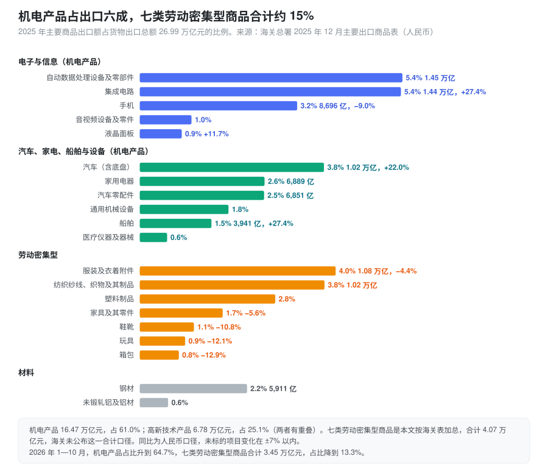
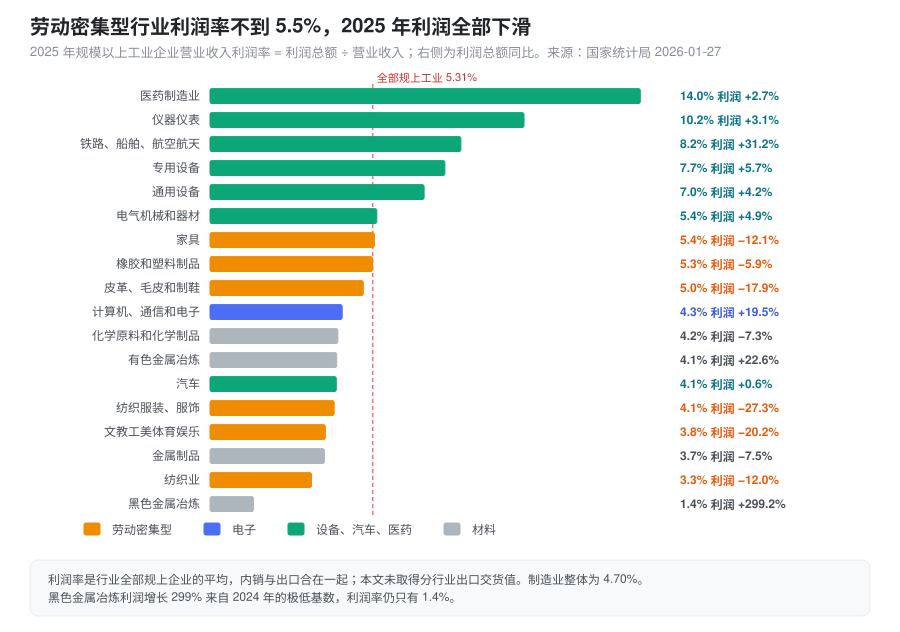
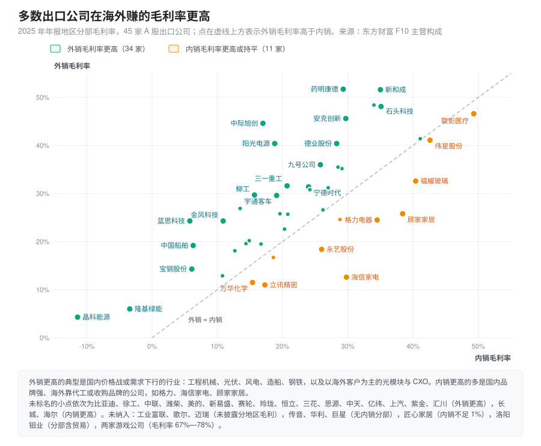

% 中国出口：行业比例、利润率与主要公司

**2025 年中国货物出口 26.99 万亿元，其中机电产品占 61.0%，服装、纺织、塑料制品、家具、鞋、玩具、箱包七类劳动密集型商品合计约 15%。出口规模和利润率是两回事：出口最多的电子行业，规上企业平均利润率只有 4.3%；劳动密集型行业在 3.3%—5.4% 之间，2025 年利润全部下滑；利润率最高的是医药、仪器仪表、船舶航空和专用设备。公司层面，45 家披露分地区毛利率的 A 股出口公司里，有 34 家外销毛利率高于内销，国内价格战越激烈的行业，海外市场越像利润的来源。**

## 数据边界

### 来源与口径

- **出口结构**：海关总署英文统计页的 2025 年 12 月与 2026 年 10 月主要出口商品表（[2025 人民币](http://english.customs.gov.cn/Statics/b36c1066-c6ac-42af-b58a-18c7615f6007.html)、[2025 总值](http://english.customs.gov.cn/Statics/78763e3d-28fd-443a-9ab6-f6075c3d5031.html)、[2026 年 1—10 月商品](http://english.customs.gov.cn/Statics/d02e13c1-18c8-460f-8754-e345940d8ae3.html)、[2026 年 1—10 月总值](http://english.customs.gov.cn/Statics/7ab4e985-5847-4010-b6a5-5e2b191a5737.html)），以及[国家统计局 2025 年统计公报](https://www.stats.gov.cn/sj/zxfb/202602/t20260228_1962662.html)中的贸易方式、企业性质与国别数据。
- **行业利润率**：[国家统计局 2025 年规模以上工业企业利润](https://www.stats.gov.cn/zwfwck/sjfb/202601/t20260127_1962382.html)（2026-01-27 发布）分行业表。利润率 = 利润总额 ÷ 营业收入，由本文计算；统计局只公布了全部工业（5.31%）与制造业（4.70%）的利润率。
- **公司数据**：东方财富 F10 主营构成（按地区）与主要财务指标，2025 年年报与 2026 年三季报；估值为东方财富估值序列 2026-11-19 收盘的 PE（TTM）与总市值。
- 提取日与信息截止日：**2026-11-20**。

未能核验或口径受限的部分：

- **分行业出口交货值没有取到**。统计局只在月度数据中公布全部工业出口交货值（2025 年 15.81 万亿元，+2.2%），数据库页面拒绝访问，所以本文不给“某行业产品有多少比例出口”的官方数字，只给一个用海关出口额估算的粗略比值，并说明偏差方向。
- **劳动密集型产品合计**是海关发布会口径，本文没有取到发布会原文。下文的“七类合计”是按海关商品表自行加总，不等于官方口径。
- “新三样”和锂电池出口来自海关月度表 T13，该表的单位标注与数值不一致，增速也和初步数冲突，只引用金额，不引用增速。
- 公司的“海外收入”是年报按地区披露的主营收入，各家划分标准不同（销售主体所在地、客户总部所在地、发货地都有），不能直接当作出口额。毛利率为 0 的分部按“未披露”处理。
- 港股、美股与未上市公司（申洲国际、泡泡玛特、拼多多旗下 Temu、SHEIN、华为、米哈游、字节跳动等）没有纳入公司表。
- “制造以外的出海”一节沿用原稿数据（服务贸易、游戏、对外投资），本次没有重新核验。

## 出口结构：卖出去的是什么

### 2025 年：机电产品六成

| 类别 | 2025 年出口额 | 占货物出口 | 同比（人民币） |
| --- | ---: | ---: | ---: |
| 货物出口总额 | 26.99 万亿元 | 100% | +6.1% |
| 机电产品 | 16.47 万亿元 | 61.0% | +9.0% |
| 高新技术产品（与机电有重叠） | 6.78 万亿元 | 25.1% | +8.0% |
| 七类劳动密集型商品（本文加总） | 4.07 万亿元 | 15.1% | — |
| 农产品 | 7,451 亿元 | 2.8% | +1.7% |

主要商品如下。海关的商品分类彼此有交叉（集成电路也会装进电脑和手机，但这里只统计单独出口的部分），各行不能相加。

| 商品 | 2025 年出口额 | 占货物出口 | 同比 |
| --- | ---: | ---: | ---: |
| 自动数据处理设备及零部件 | 14,530 亿元 | 5.4% | −0.8% |
| 集成电路 | 14,442 亿元 | 5.4% | +27.4% |
| 服装及衣着附件 | 10,822 亿元 | 4.0% | −4.4% |
| 纺织纱线、织物及其制品 | 10,205 亿元 | 3.8% | +1.0% |
| 汽车（含底盘），832 万辆 | 10,183 亿元 | 3.8% | +22.0% |
| 手机 | 8,696 亿元 | 3.2% | −9.0% |
| 塑料制品 | 7,487 亿元 | 2.8% | −0.8% |
| 家用电器 | 6,889 亿元 | 2.6% | −3.3% |
| 汽车零配件 | 6,851 亿元 | 2.5% | +3.1% |
| 钢材，1.19 亿吨 | 5,911 亿元 | 2.2% | −0.7% |
| 通用机械设备 | 4,875 亿元 | 1.8% | +6.7% |
| 家具及其零件 | 4,559 亿元 | 1.7% | −5.6% |
| 船舶 | 3,941 亿元 | 1.5% | +27.4% |
| 鞋靴 | 2,975 亿元 | 1.1% | −10.8% |
| 玩具 | 2,493 亿元 | 0.9% | −12.1% |
| 液晶面板 | 2,306 亿元 | 0.9% | +11.7% |
| 箱包 | 2,140 亿元 | 0.8% | −12.9% |
| 医疗仪器及器械 | 1,495 亿元 | 0.6% | +6.6% |

“新三样”2025 年出口 1,790.7 亿美元，约占美元口径出口总额 3.77 万亿美元的 4.7%：电动载人汽车 701.6 亿、锂电池 767.5 亿、太阳能电池 282.0 亿美元。

这张表说明两件事：

- 出口增长来自集成电路、汽车、船舶，三者 2025 年都增长 22%—27%。
- 劳动密集型商品的金额仍然很大，服装和纺织品加起来 2.1 万亿元，约占出口的 7.8%；但鞋、玩具、箱包、家具都在负增长。常见的解释是订单转向越南、印尼等地，或由中国企业在当地设厂生产，本文没有对此做量化。

### 2026 年 1—10 月：电子加速，劳动密集型停滞

2026 年 1—10 月货物出口 25.99 万亿元，同比 +17.6%（美元口径 +22.7%）。增长集中在机电产品：

| 指标 | 2025 年全年 | 2026 年 1—10 月 |
| --- | ---: | ---: |
| 机电产品占比 | 61.0% | 64.7%（同比 +25.2%） |
| 高新技术产品占比 | 25.1% | 29.9%（同比 +41.6%） |
| 七类劳动密集型商品占比（本文加总） | 15.1% | 13.3% |

七类劳动密集型商品 1—10 月合计 3.45 万亿元，各类同比在 −5.3% 到 +9.9% 之间：纺织 +2.0%、服装 +1.6%、鞋 −5.3%、家具 +2.7%、玩具 −3.2%、箱包 −1.1%、塑料制品 +9.9%。总出口增长 17.6% 的年份里，它们几乎没有增长，占比比 2025 年全年低 1.8 个百分点。2026 年集成电路出口同比 +101.9%，是拉高高新技术产品占比的主要原因。

### 谁在出口、卖给谁

- **企业性质**（2025 年，美元口径）：私营企业占 64.3%（+6.8%），外资企业 27.1%（+4.5%），国有企业 7.3%（−1.0%）。按统计公报，民营企业出口 17.66 万亿元，占 65.4%。外资企业仍占四分之一以上的出口，外资品牌在华工厂的出货计在这里。
- **目的地**（2025 年）：东盟 4.76 万亿元（17.6%，+14.0%）、欧盟 4.01 万亿元（14.8%，+9.0%）、美国 3.01 万亿元（11.1%，−19.5%）、中国香港 2.40 万亿元（8.9%）、日本 4.2%、韩国 3.8%、印度 3.6%、俄罗斯 2.7%。对美出口下降近两成，对东盟增长 14%。一种常见的解释是零部件先出口到东南亚组装再卖往美国，本文没有核验这一比例。
- **贸易顺差**：2025 年 8.51 万亿元（+20.4%），约 1.19 万亿美元。

### 商品出口不等于企业出海

商品出口与企业出海不完全相同。中国工厂代工外国品牌的服装计入中国出口，但利润的大头可能留在品牌方；反过来，中国企业在墨西哥、越南的工厂出货，不计入中国出口，利润却归中国公司。下文公司表中的工业富联、华利集团就有这种情况：它们的“海外收入”按销售主体或客户所在地划分，并不全是从中国报关出口。

## 行业利润率：出口大户赚得薄

### 规上工业分行业利润率

下表是 2025 年规模以上工业企业的营业收入与利润总额。它是行业内全部规上企业的平均，内销和出口合在一起，但能看出各行业整体的赚钱能力。

| 行业 | 营业收入（亿元） | 收入同比 | 利润总额（亿元） | 利润同比 | 利润率 |
| --- | ---: | ---: | ---: | ---: | ---: |
| 全部规上工业 | 1,391,981 | +1.1% | 73,982 | +0.6% | 5.31% |
| 医药制造业 | 24,870 | −1.2% | 3,490 | +2.7% | 14.0% |
| 仪器仪表 | 11,329 | +4.2% | 1,160 | +3.1% | 10.2% |
| 铁路、船舶、航空航天 | 17,500 | +13.3% | 1,431 | +31.2% | 8.2% |
| 专用设备 | 39,281 | +1.9% | 3,008 | +5.7% | 7.7% |
| 通用设备 | 51,488 | +4.0% | 3,595 | +4.2% | 7.0% |
| 电气机械和器材 | 117,387 | +6.4% | 6,390 | +4.9% | 5.4% |
| 家具 | 6,125 | −10.7% | 328 | −12.1% | 5.4% |
| 橡胶和塑料制品 | 30,201 | −1.4% | 1,601 | −5.9% | 5.3% |
| 皮革、毛皮和制鞋 | 7,311 | −13.2% | 365 | −17.9% | 5.0% |
| 计算机、通信和电子 | 174,052 | +7.4% | 7,509 | +19.5% | 4.3% |
| 化学原料和化学制品 | 90,344 | +0.5% | 3,766 | −7.3% | 4.2% |
| 有色金属冶炼 | 97,734 | +14.0% | 4,036 | +22.6% | 4.1% |
| 汽车 | 111,796 | +7.1% | 4,610 | +0.6% | 4.1% |
| 纺织服装、服饰 | 11,120 | −12.7% | 451 | −27.3% | 4.1% |
| 文教、工美、体育和娱乐用品 | 13,814 | +2.1% | 520 | −20.2% | 3.8% |
| 金属制品 | 46,600 | −1.9% | 1,736 | −7.5% | 3.7% |
| 纺织业 | 22,323 | −6.4% | 738 | −12.0% | 3.3% |
| 黑色金属冶炼 | 77,268 | −4.7% | 1,098 | +299.2% | 1.4% |

几个观察：

- **劳动密集型行业**（纺织、服装、鞋、家具、文教体育用品、塑料制品）利润率在 3.3%—5.4% 之间，2025 年营业收入和利润都在下降，服装利润 −27.3%、玩具所在的文教体育用品 −20.2%。同年这些商品的出口额也多数下降：服装 −4.4%、家具 −5.6%、鞋 −10.8%、玩具 −12.1%。
- **电子行业**收入 17.4 万亿元，是规模最大的制造业，利润率只有 4.3%；2025 年利润增长 19.5%，同年集成电路出口增长 27.4%，公司层面工业富联、中际旭创、新易盛的利润都大幅增长（见下文）。
- **汽车**收入增长 7.1%，利润只增长 0.6%，利润率 4.1%。整车出口数量从 640.5 万辆增至 832.4 万辆（+30%），行业利润却几乎没有增长。
- **利润率最高的是医药、仪器仪表、船舶航空与专用设备**，它们在出口额中占比不大，船舶出口只占 1.5%，但 2025 年利润增长 31.2%。
- **钢铁**利润增长 299% 来自 2024 年的极低基数，利润率仍只有 1.4%。钢材出口 1.19 亿吨、5,911 亿元，量大价低。

### 出口依赖度：一个粗略估算

统计局没有公布分行业出口交货值，下面用海关出口额除以对应行业的规上营业收入，只作数量级参考：

| 行业 | 对应海关商品 | 出口额（亿元） | ÷ 规上营业收入 |
| --- | --- | ---: | ---: |
| 纺织业 + 服装服饰 | 纺织纱线织物 + 服装 | 21,027 | 约 63% |
| 家具 | 家具及其零件 | 4,559 | 约 74% |
| 计算机、通信和电子 | 电脑、手机、集成电路、面板、音视频 | 42,803 | 约 25% |
| 橡胶和塑料制品 | 塑料制品 | 7,487 | 约 25% |
| 铁路、船舶、航空航天 | 船舶 | 3,941 | 约 23% |
| 汽车 | 整车 + 零配件 | 17,034 | 约 15% |
| 黑色金属冶炼 | 钢材 | 5,911 | 约 8% |

这个比值**会高估**出口依赖度：海关出口额包括规模以下小企业生产、外贸公司转手的商品，而分母只有规上企业；海关商品与统计局行业也不是一一对应。它能说明的只是相对高低：纺织服装和家具大半靠海外，钢铁和汽车主要靠国内，电子介于两者之间。全部工业 2025 年出口交货值 15.81 万亿元，约为规上营业收入的 11%。

## 主要出口公司

### 怎么读公司表

下表选取 55 家海外收入较大的 A 股公司，按行业分组。字段口径：

- **海外收入占比**：2025 年年报按地区披露的主营收入中，境外部分的比例。带 * 的需要单独说明：工业富联只按墨西哥、越南、新加坡与“中国大陆及其他”划分，44% 只算前三者；华利集团按客户总部所在地划分，客户都是海外品牌，并非全部从中国出口；紫金矿业、洛阳钼业按内部抵销前的分部收入计算，洛阳钼业的境外包括刚果（金）、巴西矿山与境外贸易。
- **外销 / 内销毛利率**：分地区毛利率，多个境外分部按收入加权；“—”表示未披露。
- **净利率**：2025 年净利润 ÷ 营业总收入。歌尔股份、药明康德、长城汽车、上汽集团的 2025 年归母净利润含较多非经常性收益，扣非后分别约为 14.8、132.4、60.6、74.2 亿元。
- **PE（TTM）**：2026-11-19 收盘，东方财富估值序列。

**电子制造与通信**

| 公司 | 代码 | 2025 营收（亿元） | 海外收入占比 | 外销 / 内销毛利率 | 净利率 | 2025 归母净利（亿元） | 2026 前三季归母同比 | PE（TTM） |
| --- | --- | ---: | ---: | --- | ---: | ---: | ---: | ---: |
| 工业富联 | 601138 | 9,029 | 44%* | — / — | 3.9% | 352.9 | +79.5% | 14.1 |
| 立讯精密 | 002475 | 3,323 | 85% | 11.0% / 17.3% | 5.5% | 166.0 | +13.4% | 20.3 |
| 歌尔股份 | 002241 | 966 | 88% | — / — | 4.0% | 39.4 | +1.2% | 19.8 |
| 蓝思科技 | 300433 | 744 | 55% | 24.3% / 5.8% | 5.4% | 40.2 | −50.1% | 49.0 |
| 传音控股 | 688036 | 656 | 98% | 19.3% / — | 4.0% | 25.8 | +22.4% | 26.4 |
| 中际旭创 | 300308 | 382 | 91% | 44.6% / 17.0% | 30.3% | 108.0 | +211.8% | 18.6 |
| 新易盛 | 300502 | 248 | 96% | 48.4% / 34.0% | 38.5% | 95.3 | +79.7% | 16.0 |

**汽车与零部件**

| 公司 | 代码 | 2025 营收（亿元） | 海外收入占比 | 外销 / 内销毛利率 | 净利率 | 2025 归母净利（亿元） | 2026 前三季归母同比 | PE（TTM） |
| --- | --- | ---: | ---: | --- | ---: | ---: | ---: | ---: |
| 比亚迪 | 002594 | 8,040 | 39% | 19.5% / 16.7% | 4.2% | 326.2 | −4.2% | 23.2 |
| 长城汽车 | 601633 | 2,228 | 41% | 16.7% / 18.6% | 4.4% | 98.7 | −55.7% | 22.2 |
| 上汽集团 | 600104 | 6,562 | 23% | 12.9% / 10.8% | 2.7% | 101.1 | −30.4% | 15.4 |
| 宇通客车 | 600066 | 414 | 51% | 29.6% / 19.1% | 13.6% | 55.5 | −3.3% | 12.9 |
| 福耀玻璃 | 600660 | 458 | 46% | 32.6% / 40.4% | 20.3% | 93.1 | −15.0% | 18.3 |
| 赛轮轮胎 | 601058 | 368 | 77% | 25.7% / 20.8% | 9.8% | 35.2 | −5.6% | 12.4 |
| 玲珑轮胎 | 601966 | 246 | 48% | 19.6% / 14.4% | 5.6% | 13.7 | −94.5% | 56.6 |

**电池、光伏、风电与电力设备**

| 公司 | 代码 | 2025 营收（亿元） | 海外收入占比 | 外销 / 内销毛利率 | 净利率 | 2025 归母净利（亿元） | 2026 前三季归母同比 | PE（TTM） |
| --- | --- | ---: | ---: | --- | ---: | ---: | ---: | ---: |
| 宁德时代 | 300750 | 4,237 | 31% | 31.4% / 24.0% | 18.1% | 722.0 | +31.6% | 12.4 |
| 亿纬锂能 | 300014 | 615 | 24% | 20.2% / 14.9% | 7.0% | 41.3 | +86.1% | 15.4 |
| 阳光电源 | 300274 | 892 | 61% | 40.4% / 18.8% | 15.2% | 134.6 | −44.5% | 18.1 |
| 德业股份 | 605117 | 122 | 80% | 40.4% / 28.3% | 25.9% | 31.7 | +82.0% | 19.8 |
| 隆基绿能 | 601012 | 703 | 45% | 6.0% / −3.4% | −9.3% | −64.2 | 仍亏损 | 亏损 |
| 晶科能源 | 688223 | 655 | 65% | 4.3% / −11.4% | −10.5% | −68.8 | 仍亏损 | 亏损 |
| 金风科技 | 002202 | 730 | 25% | 24.3% / 10.9% | 4.1% | 27.7 | +11.2% | 18.6 |
| 思源电气 | 002028 | 215 | 27% | 35.2% / 29.1% | 15.1% | 31.5 | +9.7% | 25.1 |

**家电与消费电子品牌**

| 公司 | 代码 | 2025 营收（亿元） | 海外收入占比 | 外销 / 内销毛利率 | 净利率 | 2025 归母净利（亿元） | 2026 前三季归母同比 | PE（TTM） |
| --- | --- | ---: | ---: | --- | ---: | ---: | ---: | ---: |
| 美的集团 | 000333 | 4,585 | 43% | 26.6% / 26.2% | 9.8% | 439.5 | +9.3% | 15.3 |
| 海尔智家 | 600690 | 3,023 | 51% | 24.6% / 28.8% | 6.7% | 195.5 | −13.7% | 12.5 |
| 格力电器 | 000651 | 1,711 | 16% | 24.5% / 34.5% | 16.9% | 290.0 | −19.5% | 9.3 |
| 海信家电 | 000921 | 879 | 43% | 12.6% / 29.8% | 5.4% | 31.9 | −34.2% | 16.3 |
| 石头科技 | 688169 | 187 | 56% | 48.1% / 35.1% | 7.3% | 13.6 | +41.2% | 19.8 |
| 安克创新 | 300866 | 305 | 97% | 45.6% / 29.7% | 8.6% | 25.5 | +17.0% | 23.4 |
| 九号公司 | 689009 | 213 | 37% | 36.0% / 25.8% | 8.3% | 17.6 | −24.4% | 19.2 |

**工程机械与装备**

| 公司 | 代码 | 2025 营收（亿元） | 海外收入占比 | 外销 / 内销毛利率 | 净利率 | 2025 归母净利（亿元） | 2026 前三季归母同比 | PE（TTM） |
| --- | --- | ---: | ---: | --- | ---: | ---: | ---: | ---: |
| 三一重工 | 600031 | 897 | 63% | 31.6% / 20.7% | 9.5% | 84.1 | +12.2% | 18.7 |
| 徐工机械 | 000425 | 1,008 | 48% | 25.8% / 19.6% | 6.6% | 65.7 | −6.2% | 12.3 |
| 中联重科 | 000157 | 521 | 59% | 30.8% / 24.2% | 9.8% | 48.6 | −24.5% | 13.2 |
| 柳工 | 000528 | 331 | 48% | 29.7% / 15.7% | 4.3% | 16.1 | −9.1% | 10.9 |
| 潍柴动力 | 000338 | 2,318 | 53% | 22.6% / 20.3% | 5.9% | 109.3 | +20.1% | 12.8 |
| 恒立液压 | 601100 | 109 | 19% | 41.4% / 41.1% | 25.0% | 27.3 | +3.2% | 42.8 |
| 中国船舶 | 600150 | 1,520 | 45% | 19.2% / 6.3% | 6.9% | 78.5 | +129.7% | 16.9 |

**化工、医药与医疗器械**

| 公司 | 代码 | 2025 营收（亿元） | 海外收入占比 | 外销 / 内销毛利率 | 净利率 | 2025 归母净利（亿元） | 2026 前三季归母同比 | PE（TTM） |
| --- | --- | ---: | ---: | --- | ---: | ---: | ---: | ---: |
| 万华化学 | 600309 | 2,032 | 47% | 11.5% / 15.4% | 6.9% | 125.3 | +71.0% | 11.4 |
| 新和成 | 002001 | 223 | 58% | 51.6% / 35.0% | 30.6% | 67.6 | +10.3% | 10.8 |
| 药明康德 | 603259 | 455 | 83% | 51.7% / 29.3% | 42.5% | 191.5 | +60.6% | 16.6 |
| 迈瑞医疗 | 300760 | 333 | 53% | — / — | 25.4% | 81.4 | −5.1% | 28.9 |
| 联影医疗 | 688271 | 138 | 25% | 46.6% / 49.3% | 13.4% | 18.7 | −7.6% | 54.7 |

**劳动密集型：鞋服、家具、工具**

| 公司 | 代码 | 2025 营收（亿元） | 海外收入占比 | 外销 / 内销毛利率 | 净利率 | 2025 归母净利（亿元） | 2026 前三季归母同比 | PE（TTM） |
| --- | --- | ---: | ---: | --- | ---: | ---: | ---: | ---: |
| 华利集团 | 300979 | 250 | 100%* | 21.9% / — | 12.8% | 32.1 | −35.4% | 18.5 |
| 伟星股份 | 002003 | 48 | 36% | 41.1% / 42.6% | 13.5% | 6.4 | +13.7% | 21.8 |
| 顾家家居 | 603816 | 201 | 46% | 25.8% / 38.4% | 9.3% | 17.9 | −9.9% | 15.2 |
| 永艺股份 | 603600 | 49 | 74% | 18.4% / 26.0% | 4.7% | 2.3 | +17.4% | 14.5 |
| 匠心家居 | 301061 | 34 | 100% | 39.3% / 61.1% | 25.4% | 8.6 | −32.4% | 17.7 |
| 巨星科技 | 002444 | 147 | 94% | 30.0% / — | 17.5% | 25.1 | −5.2% | 13.7 |

**资源与材料**

| 公司 | 代码 | 2025 营收（亿元） | 海外收入占比 | 外销 / 内销毛利率 | 净利率 | 2025 归母净利（亿元） | 2026 前三季归母同比 | PE（TTM） |
| --- | --- | ---: | ---: | --- | ---: | ---: | ---: | ---: |
| 紫金矿业 | 601899 | 3,491 | 34%* | 26.9% / 13.5% | 18.3% | 517.8 | +51.9% | 8.9 |
| 洛阳钼业 | 603993 | 2,067 | 74%* | 25.1% / 7.0% | 11.6% | 203.4 | +68.2% | 8.5 |
| 宝钢股份 | 600019 | 3,175 | 14% | 14.3% / 6.1% | 3.6% | 103.5 | −15.3% | 15.0 |

**热管理、线缆与工控**

| 公司 | 代码 | 2025 营收（亿元） | 海外收入占比 | 外销 / 内销毛利率 | 净利率 | 2025 归母净利（亿元） | 2026 前三季归母同比 | PE（TTM） |
| --- | --- | ---: | ---: | --- | ---: | ---: | ---: | ---: |
| 三花智控 | 002050 | 310 | 43% | 31.2% / 27.0% | 13.2% | 40.6 | −5.4% | 35.2 |
| 中天科技 | 600522 | 525 | 17% | 18.1% / 12.7% | 5.6% | 29.0 | +71.1% | 16.7 |
| 汇川技术 | 300124 | 451 | 6% | 35.5% / 28.5% | 11.5% | 50.5 | +3.4% | 27.9 |

**游戏**

| 公司 | 代码 | 2025 营收（亿元） | 海外收入占比 | 外销 / 内销毛利率 | 净利率 | 2025 归母净利（亿元） | 2026 前三季归母同比 | PE（TTM） |
| --- | --- | ---: | ---: | --- | ---: | ---: | ---: | ---: |
| 世纪华通 | 002602 | 379 | 59% | 71.6% / 67.5% | 15.1% | 56.1 | +45.4% | 10.5 |
| 三七互娱 | 002555 | 160 | 34% | 71.9% / 77.9% | 18.2% | 29.0 | −37.3% | 15.8 |

### 从公司表看到什么

**一、规模最大的出口公司，利润率并不高。** 工业富联 2025 年营收 9,029 亿元，净利率 3.9%；立讯精密 5.5%、歌尔股份 4.0%（扣非后约 1.5%）、比亚迪 4.2%、上汽 2.7%、宝钢 3.6%。这和行业统计一致：代工和整车的规模很大，客户和价格竞争拿走了大部分利润。

**二、海外毛利率普遍高于国内。** 图中 45 家公司里，34 家外销毛利率高于内销。图中剔除了 10 家：未披露分地区毛利率的工业富联、歌尔、迈瑞，没有内销分部的传音、华利、巨星，内销不足 1% 的匠心家居，分部含大量贸易的洛阳钼业，以及毛利率超出坐标范围的两家游戏公司。差距最大的是国内需求下行或价格战激烈的行业：阳光电源外销 40.4%、内销 18.8%；柳工 29.7% 对 15.7%；中国船舶 19.2% 对 6.3%；宝钢 14.3% 对 6.1%；光伏两家国内毛利为负，海外仍有 4%—6%。对这些公司来说，出海首先是在找一个价格更好的市场。

内销毛利率更高的 11 家，大多在国内有强势品牌、在海外靠代工或收购的品牌：格力（外销 24.5%、内销 34.5%）、海信家电（12.6% 对 29.8%）、顾家家居（25.8% 对 38.4%）、海尔、长城汽车。立讯精密的外销主要是苹果代工，毛利率 11.0%，低于内销的 17.3%。

**三、高净利率的出口公司集中在几类。**

| 类型 | 公司与 2025 年净利率 | 利润来自什么 |
| --- | --- | --- |
| 面向海外客户的技术服务与部件 | 药明康德 42.5%、新易盛 38.5%、中际旭创 30.3% | 全球药企研发外包；AI 数据中心光模块 |
| 有成本或份额优势的细分龙头 | 新和成 30.6%、德业股份 25.9%、恒立液压 25.0%、福耀玻璃 20.3% | 维生素与香料、储能逆变器、液压件、汽车玻璃 |
| 资源 | 紫金矿业 18.3%、洛阳钼业 11.6% | 海外矿山与金属价格 |
| 品牌与数字产品 | 世纪华通 15.1%、三七互娱 18.2%、安克创新 8.6% | 游戏 IP、跨境消费品牌 |
| 劳动密集型中的少数 | 匠心家居 25.4%、巨星科技 17.5%、华利集团 12.8% | 美国客户与品牌渠道、海外工厂 |

劳动密集型行业平均利润率只有 3%—5%，但表中头部公司的净利率在 12.8%—25.4% 之间。行业平均和头部公司的差距，比行业之间的差距更大。

**四、2026 年分化明显。** 前三季归母净利润同比：中际旭创 +211.8%、中国船舶 +129.7%、亿纬锂能 +86.1%、德业股份 +82.0%、工业富联 +79.5%、万华化学 +71.0%、洛阳钼业 +68.2%；而长城汽车 −55.7%、阳光电源 −44.5%、华利集团 −35.4%、海信家电 −34.2%、玲珑轮胎 −94.5%。光模块、船舶、电池和资源继续增长，汽车、鞋服代工、轮胎和部分家电利润下滑。

**五、多数出口公司的 PE 在 9—20 倍。** 2026-11-19 收盘，宁德时代 12.4 倍、美的 15.3 倍、紫金 8.9 倍、中际旭创 18.6 倍。高于 40 倍的只有恒立液压、蓝思科技、联影医疗和玲珑轮胎；玲珑 2026 年前三季利润下降 94.5%，PE 高是分母变小。本文不对估值是否合理作判断。

## 制造以外的出海

本节沿用原稿数据，本次没有重新核验。原稿引用的来源为商务部（cif.mofcom.gov.cn、hzs.mofcom.gov.cn）与中国音数协游戏工委（gegia.cn）。

### 服务和数字产品

| 服务领域 | 2025 年出口收入 |
| --- | ---: |
| 其他商业服务（专业、技术、咨询等） | 1,220 亿美元 |
| 电信、计算机和信息服务 | 1,131 亿美元 |
| 中国自研游戏海外销售收入 | 205 亿美元 |

前两项是国际收支服务贸易口径，游戏是行业销售统计，三项不能加总。计算机和信息服务出口超过千亿美元，其中包括 IT 外包与技术服务，不能当作中国 SaaS 产品的海外收入。

中国游戏海外收入集中在 SLG（策略类）：2025 年中国自研移动游戏海外收入前 100 名中，策略类占 49.96%。公司表中世纪华通的外销收入 222 亿元，外销毛利率 71.6%，是全表最高；但净利率只有 15.1%，毛利和净利之间的差距主要是买量推广等销售费用。详见[游戏股](./century_huatong.md)。

### 直接在海外经营

紫金矿业在非洲等地经营矿山，中国制造企业在东南亚、墨西哥建厂，这些业务的收入不一定计入中国货物出口。按商务部统计，2024 年中国境外企业合计实现销售收入 3.6 万亿美元。这是中国投资者控制或参与的海外企业营业收入，口径与出口额不同，不能相加。对外直接投资的行业分布中，商务服务业占比较高，其中包含大量海外控股平台，不等于实际的服务业务。

## 出口规模与利润率是两件事

### 四种出海模式

把出海公司按利润来源分成四类：

| 商业模式 | 代表公司（2025 年净利率） | 主要风险 | 利润留在企业手里的条件 |
| --- | --- | --- | --- |
| 商品制造出口 | 工业富联 3.9%、立讯精密 5.5%、华利集团 12.8% | 价格竞争、大客户议价、关税 | 规模与交付能力形成的成本优势 |
| 技术与工艺出口 | 药明康德 42.5%、新和成 30.6%、中际旭创 30.3%、迈瑞医疗 25.4% | 竞争者追赶、海外监管与制裁 | 工艺壁垒、认证周期、客户粘性 |
| 品牌与数字产品 | 世纪华通 15.1%、安克创新 8.6% | 产品周期、获客成本 | 爆款可持续、营销费用下降 |
| 海外资源经营 | 紫金矿业 18.3%、洛阳钼业 11.6% | 商品价格、资源国政策 | 资源品位与成本曲线位置 |

### 结论与待验证问题

本文的数据支持三个判断：

- **出口额大不代表行业赚钱。** 电脑、手机、集成电路、面板、音视频设备五类出口合计 4.28 万亿元，电子行业利润率 4.3%；钢材出口 1.19 亿吨，行业利润率 1.4%；船舶出口只占 1.5%，行业利润率 8.2%，2025 年利润增长 31.2%。
- **海外市场目前比国内更赚钱**，至少在毛利率上。这在光伏、工程机械、造船、钢铁最明显，依赖的是海外价格高于国内，若海外产能跟上或贸易壁垒提高，这个价差可能收窄。
- **劳动密集型出口在萎缩，但头部公司仍有可观利润率。** 2025 年这些商品的出口额和行业利润多数下降，2026 年 1—10 月出口基本持平；表中头部公司的净利率却在 12.8%—25.4% 之间，研究这类行业时，公司选择比行业判断更重要。

尚待验证的问题：

- 外销毛利率的优势有多少来自人民币汇率与海外定价，有多少来自产品结构；可跟踪各公司半年报的分地区毛利率。
- 2026 年机电产品出口 +25% 的增长有多少可以持续，集成电路出口翻倍是否来自一次性的备货；可跟踪海关月度主要商品表。
- 劳动密集型订单向东南亚转移的速度；可跟踪华利集团等公司的海外产能占比与越南、印尼对美出口数据。
- 分行业出口交货值：取得统计局数据库或统计年鉴的出口交货值后，替换上文的粗略估算。
