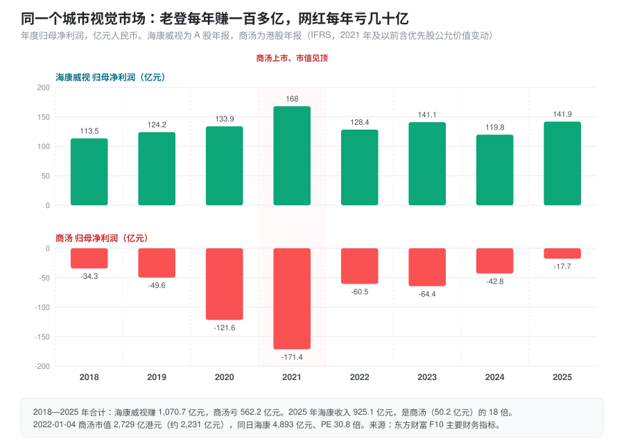
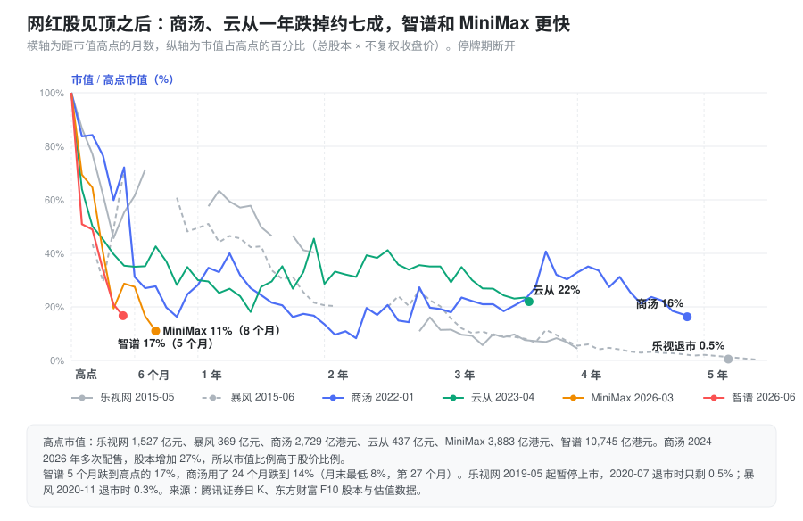
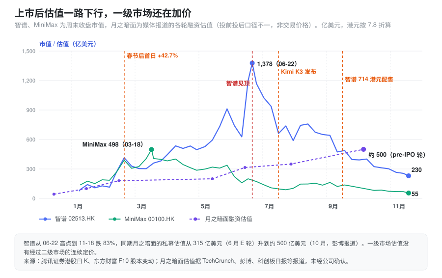
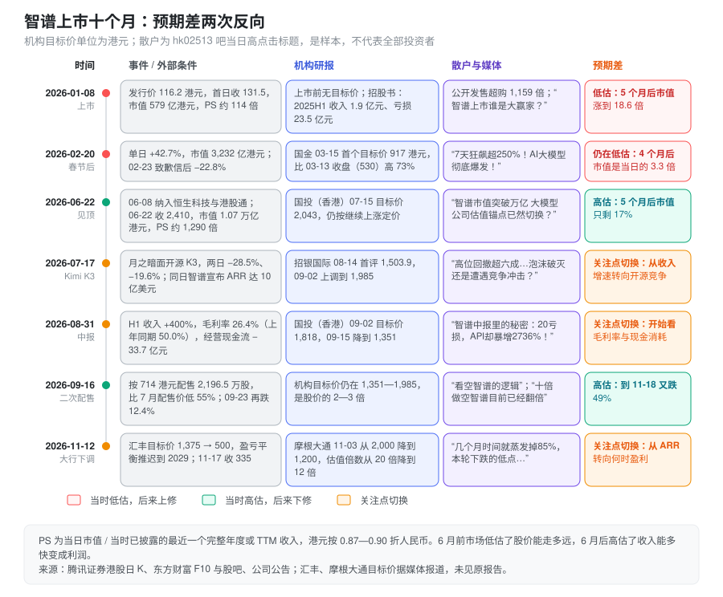

% 网红公司的泡沫与退潮：从乐视、AI 四小龙到智谱和月之暗面

### 核心判断

- 见顶之后的路径很像。乐视网、暴风退市时市值只剩高点的 0.5% 和 0.3%；商汤见顶一年后剩 28%，到截止日剩 16%；云从一年后剩 30%，截止日剩 22%；智谱 5 个月跌到 17%，MiniMax 8 个月跌到 11%。
- 高点时，市场都在为很远的未来给当期利润或收入付高倍数。乐视网高点按上年利润算 PE 约 420 倍，暴风约 880 倍；商汤高点 PS 52.7 倍，云从 83 倍，智谱 2026-06-22 约 1,290 倍。
- AI 这几家的第一刀来自筹码供给，业绩证伪在后面。商汤解禁当天跌 46.8%；MiniMax 解禁后 3 个交易日跌 38.6%；智谱 9 月的配售价比 7 月低 55%。
- 老登一直在赚钱，却很少被当作同一个故事的参照。2018—2025 年海康威视累计赚 1,070.7 亿元，商汤累计亏 562.2 亿元。2022-01-04 商汤 PS 52.7 倍，海康 PS 6.35 倍、PE 30.8 倍。2026-11-18 海康市值 3,234 亿元、PE 18.2 倍，商汤 446 亿港元。
- 寒武纪是反例：上市后市值跌 78%，2025 年开始盈利后，2026-06-30 市值涨到 10,025 亿元。它活下来的条件是利润真的来了，但截止日仍按 PS 52 倍、PE 143 倍定价，离老登的估值很远。
- 智谱与月之暗面走在两条轨道上。智谱市值从 1.07 万亿港元跌到 1,790 亿港元，P/ARR 从 08-31 的约 45 倍降到 14 倍；同期月之暗面的私募估值从 315 亿美元升到约 500 亿美元，是 8 月 ARR 的 50 倍、年底目标 ARR 的 25 倍。按智谱现在的 14.3 倍定价，500 亿美元需要约 35 亿美元 ARR。

### 研究范围与数据边界

- **标的**：
  - 2015 年“互联网+”：乐视网（300104.SZ，已退市）、暴风集团（300431.SZ，已退市）；
  - AI 四小龙：商汤（00020.HK）、云从科技（688327.SH）、旷视（未上市）、依图（未上市）；
  - 大模型：智谱（02513.HK）、MiniMax（00100.HK）、月之暗面（未上市）；
  - 对照：海康威视（002415.SZ）、大华股份（002236.SZ），反例寒武纪（688256.SH）。
- **截止日**：2026-11-18 收盘；提取日 2026-11-19。
- **行情与市值**：腾讯证券日 K，不复权。市值 = 当日总股本 × 不复权收盘价，总股本取东方财富 F10 股本变动。乐视网、云从有转增，商汤、智谱多次配售，所以本文比较市值，不比较股价。港元按当日或当月汇率折人民币（0.82—0.93），折美元按 7.8。
- **估值**：A 股 PE（TTM）用东方财富估值数据的日度序列，全年平均为有效交易日的算术平均。亏损公司改用 PS = 当日市值 / 当时已披露的最近一个完整年度或 TTM 收入，大模型公司另算 P/ARR。没有用事后披露的数据回填当时的估值；凡是用到事后信息的地方单独标注。
- **利润**：A 股取年报归母净利润；港股取 IFRS 年报的公司权益持有人应占利润。商汤、旷视、依图、MiniMax 上市前的 IFRS 亏损含大额优先股公允价值变动，本文同时给出扣除后的数字。
- **旷视、依图**：财务数据取自上交所科创板的注册稿（旷视）和申报稿（依图），没有二级市场价格。
- **机构**：东方财富 F10 机构评级与研报摘要，只看目标价。汇丰、摩根大通对智谱和 MiniMax 的目标价、摩根士丹利对 MiniMax 的目标价来自媒体报道和股吧转载，未见原报告。银河证券 11-02 给智谱的区间 2,070—2,654 港元明显偏离同期其他机构，未采用。**没有取得一致预期**，乐视网、暴风的机构观点也没有取得。
- **散户**：东方财富股吧关键日按点击量排序的帖子标题，含媒体转载，原文照录。**样本，不代表全部投资者。** A 股另看股东户数；港股不披露股东户数。
- **月之暗面**：估值、ARR 与融资轮次全部来自媒体报道（彭博、TechCrunch、科创板日报、中国经营报、21 世纪经济报道等），口径有投前投后之分，公司没有确认。
- **未核验事项**：商汤发行价 3.85 港元；商汤 2026 年上半年首次盈利的原因；MiniMax 03-18 时 2025 年报是否已披露（影响高点 PS）；乐视网、暴风的财务数据可能含后来的追溯调整；乐视网资金链、暴风实控人被调查等事件只作背景，没有逐条核对原始公告。
- 共享单车、P2P 等没有上市的泡沫不在本文范围内。本文只解释“什么条件下给出什么定价”，不构成投资建议。

### 一、2015 年“互联网+”：乐视网与暴风

2015 年上半年创业板的两个代表。乐视网讲“生态化反”（视频、电视、手机、汽车、体育互相导流），暴风讲“DT 大娱乐”（播放器、VR、体育版权）。两家在 2015 年 5—6 月同时见顶。

| 公司 | 高点 | 高点市值（亿元） | 高点 PE（按上年利润） | 退市 | 退市时市值占高点 |
| --- | --- | ---: | ---: | --- | ---: |
| 乐视网 | 2015-05-13 | 1,527 | 约 420 倍（2014 年 3.64 亿元） | 2020-07-20，0.18 元 | 0.5%（约 7 亿元） |
| 暴风集团 | 2015-06-10 | 369 | 约 880 倍（2014 年 0.42 亿元） | 2020-11-09，0.28 元 | 0.3% |

| 年份 | 乐视网归母净利润（亿元） | 暴风归母净利润（亿元） |
| --- | ---: | ---: |
| 2014 | 3.64 | 0.42 |
| 2015 | 5.73 | 1.73（扣非 0.54） |
| 2016 | 5.55 | 0.53 |
| 2017 | −138.78 | 0.55 |
| 2018 | −40.96 | −10.90 |
| 2019 | −112.79 | — |

- **暴风上市就是高点的序章。** 发行价 7.14 元，首日涨 44% 封顶，之后 28 个一字涨停，到 2015-06-10 收 307.56 元，是发行价的 43 倍。上市后到高点共 39 个涨停（不含首日）。高点时 2015 年的利润还没出来，后来出来的 1.73 亿元里扣非只有 0.54 亿元。
- **乐视网的利润在泡沫期是真实增长的。** 2015 年利润 +57%，2016 年收入 219.87 亿元。问题在利润之外：手机、汽车等生态业务在体外烧钱，靠上市公司融资和关联交易输血（背景，未核验）。2017 年收入降到 70.96 亿元，一年亏掉 138.78 亿元，是 2014—2016 年三年合计利润（14.92 亿元）的 9 倍。
- **停牌掩盖了下跌。** 乐视网 2015-12 到 2016-06、2017-04 到 2018-01 两次长期停牌，2019-05 起暂停上市。复牌后集中补跌，所以股价走势在图上是断开的。

这两家的共同点是：高点 PE 是按已经很小的利润算的，市场在为“生态”“平台”的远期价值付钱；利润随后要么归零（暴风），要么被体外亏损吞掉（乐视网）。

### 二、AI 四小龙：一级市场的估值，二级市场的价格

2017—2019 年，商汤、旷视、依图、云从被称为“AI 四小龙”，主要业务都是给城市安防、金融、手机提供视觉算法。一级市场的估值在 2018—2019 年到达顶点（旷视约 40 亿美元，商汤更高），随后四家走了不同的路：两家 IPO 失败，两家上市后崩塌。

**上市失败的两家**

| 项目 | 旷视 | 依图 |
| --- | --- | --- |
| 科创板申报 | 2021 年，注册稿 | 2020-11-04 受理，拟募资 75.05 亿元 |
| 结局 | 2024-11-14 注册程序终止 | 2021-06-30 前后终止 |
| 收入 | 2020 年 13.9 亿元；城市物联网占 66%—72% | 2017 年 0.69 亿元 → 2019 年 7.17 亿元 |
| 归母净利润 | 2018 年—2021H1 合计 −146.3 亿元 | 2017 年—2020H1 合计 −72.68 亿元 |
| 扣除优先股公允价值变动 | 合计 −41.4 亿元 | 扣非合计 −22.98 亿元 |
| 资产负债 | — | 2020-06-30 归母权益 −73.06 亿元，资产负债率 252.28% |

依图 2019 年收入 7.17 亿元，扣非亏损 9.99 亿元，每 1 元收入亏 1.4 元。两家的大部分账面亏损来自优先股估值随融资轮次上涨，真实的经营亏损小一些，但依然大于收入。招股书暴露的问题是收入集中在政府安防项目、毛利依赖硬件、应收账款高，与“平台型 AI 公司”的叙事不符。

**上市后崩塌的商汤**

商汤 2021-12-30 在港股上市，首日收 4.13 港元。下面的 PS 用当时已披露的最近 TTM 收入。

| 日期 | 节点 | 收盘（港元） | 当日涨跌 | 市值（亿港元） | PS |
| --- | --- | ---: | ---: | ---: | ---: |
| 2021-12-30 | 上市首日 | 4.13 | — | 1,375 | 26.5 |
| 2022-01-04 | **高点** | 8.20 | — | 2,729 | 52.7 |
| 2022-06-29 | 解禁前一日 | 5.88 | −5.2% | 1,970 | 35.8 |
| 2022-06-30 | 基石与上市前股东解禁 | 3.13 | −46.8% | 1,049 | 19.1 |
| 2022-07-04 | — | 2.54 | −18.8% | 851 | 15.5 |
| 2022-10-24 | — | 1.17 | −7.1% | 392 | 8.1 |
| 2023-04-06 | “日日新”大模型前 | 3.33 | +2.1% | 1,115 | 25.6 |
| 2023-12-18 | 创始人汤晓鸥去世后首日 | 1.12 | −11.1% | 375 | 8.9 |
| 2024-04-19 | 低点 | 0.58 | −4.9% | 194 | 5.2 |
| 2024-05-02 | 日日新 5.0 后 | 1.66 | +36.1% | 556 | 14.8 |
| 2025-09-30 | — | 2.89 | +5.5% | 1,118 | 23.3 |
| 2026-02-23 | — | 2.77 | +3.0% | 1,120 | 22.4 |
| 2026-11-18 | 截止日 | 1.055 | +0.5% | 446 | 6.9 |

PS 的分母（TTM 收入，亿元）依次为 42.37、47.00、44.63、38.09、38.27、34.06、43.90、55.68。2024—2026 年多次配售，总股本从 332.8 亿股增至 422.9 亿股（+27%）。

- **首周的翻倍和半年后的腰斩都是筹码问题。** 上市时流通盘小，3 个交易日从 4.13 涨到 8.20；解禁当天跌 46.8%，两个交易日跌 57%。同期股吧标题写“两日暴跌65%”，按收盘价算不出这个数（从 06-28 收盘 6.20 算是 −59%），可能用了盘中价。
- **之后的反弹都来自大模型叙事，没有一次来自利润。** 2023-04 日日新、2024-04 日日新 5.0、2025 年下半年的生成式 AI 收入，每次都把 PS 拉回 15—25 倍，又在几个月内回落。
- **收入在萎缩，亏损在收窄。** TTM 收入从 2022 年中的 47.00 亿元降到 2024 年的 34.06 亿元，2026 年回到 55.68 亿元。归母亏损从 2021 年的 171.40 亿元收窄到 2025 年的 17.66 亿元。2026 年上半年录得 IFRS 利润 6.17 亿元，是上市后首次，预告区间 5—7 亿元，盈利原因本文没有核验。截止日市值却是 2026-02 的 40%，市场不认为这次盈利可以持续。

**商汤的机构目标价**：覆盖最连续的是招银国际。目标价跟着股价下修，但每次都比当时股价高 20%—70%。

| 发布日 | 招银国际目标价（港元） | 当日收盘 | 空间 |
| --- | ---: | ---: | ---: |
| 2022-03-04 | 8.08 | 6.86 | +18% |
| 2022-08-26 | 3.07 | 2.29 | +34% |
| 2022-12-05 | 2.10 | 2.13 | −1% |
| 2023-03-29 | 3.45 | 2.62 | +32% |
| 2023-08-29 | 2.30 | 1.54 | +49% |
| 2024-08-28 | 1.36 | 1.12 | +21% |
| 2024-12-09 | 2.00 | 1.85 | +8% |
| 2025-03-27 | 1.85 | 1.49 | +24% |
| 2026-03-25 | 2.50 | 1.88 | +33% |
| 2026-08-27 | 2.45 | 1.425 | +72% |

其他机构的点位：国海 2022-08-30 3.02、2023-09-08 1.94；国金 2023-05-29 3.389；国联 2023-06-19 2.93、2023-08-29 2.2。首个目标价 8.08 港元给出时，股价离高点只跌了 16%；四年后目标价降到 2.45，降幅 70%，股价同期跌 79%。

**上市后崩塌的云从**

云从 2022-05-27 在科创板上市，发行价 15.37 元，首日收 21.40 元。2023 年 ChatGPT 行情中，它成了 A 股“AI 大模型”概念龙头。

| 日期 | 节点 | 收盘（元） | 市值（亿元） | PS | 股东户数（最近一期） |
| --- | --- | ---: | ---: | ---: | --- |
| 2022-05-27 | 上市首日 | 21.40 | 158.5 | 13.7 | 47,995（上市时） |
| 2022-12-30 | ChatGPT 前 | — | 113.4 | 15.1 | 12,618（12-31） |
| 2023-03-31 | — | — | 350.6 | 66.8 | 17,006（+34.8%） |
| 2023-04-07 | **高点** | 58.94 | 436.6 | 83.2 | — |
| 2023-04-10 | 首个跌停 | — | — | — | — |
| 2023-06-30 | — | — | 179.4 | 50.0 | 37,030（+117.7%） |
| 2024-09-18 | 低点 | 7.40 | 76.7 | 13.1 | — |
| 2026-11-18 | 截止日 | 9.25 | 96.2 | 34.9 | 43,353（2026-09-30） |

2023 年转增使总股本从约 7.41 亿股增至 10.37 亿股，不复权股价不能直接比较，看市值即可。2022 年底到高点，市值增至 3.85 倍，当时已披露的 TTM 收入却从约 7.5 亿元降到约 5.2 亿元（2022 年报）。

- **散户在下跌中进场。** 2023 年二季度市值跌 49%，股东户数却增加 117.7%，到 2025-03-31 达到 58,708 户。高点之前的一季度户数只增 34.8%，大部分户数增长发生在高点之后。
- **亏损没有停。** 2019 年到 2026 年前三季度累计亏损 49.5 亿元，截止日市值只有高点的 22%，PS 仍有 34.9 倍，因为收入在萎缩。

**散户与媒体样本**（东方财富 hk00020 吧、688327 吧，按点击量；样本，不代表全部投资者）

| 日期 | 节点 | 标题（点击量） |
| --- | --- | --- |
| 2021-12-30 | 商汤上市 | “AI巨头商汤今日上市！新股发行募资55.52亿港元”（16,796）；“打不死的商汤IPO，挡不住的中国硬科技崛起” |
| 2022-01-04 | 商汤高点 | “一片悲观声中三天翻倍！商汤发生了什么？”（2,644）；“下一个腾讯or快手？…AI赛道或迎来价值重估”（2,091） |
| 2022-06-30 | 商汤解禁 | “暴跌超40%！AI第一股今日巨量解禁！管理层宣布延长股份锁定期”（5,048）；“商汤巨额解禁市值蒸发900亿港元 基石资本大逃亡？”（2,674） |
| 2023-04-07 | 云从高点 | “今年投资主题ＡＩ，无ＡＩ不欢！”（13,019）；“洗盘结束重仓干，不要错过机会” |
| 2023-04-10 | 云从跌停 | “热门大牛股遭遇首个跌停板！TMT板块蒸发市值超5800亿元”（12,970）；“ChatGPT概念股重挫：云从科技跌停”（9,139） |
| 2023-04-10 | 商汤日日新 | “商汤发布‘日日新’大模型体系…”（11,873）；“‘程序员要失业了！’AI大战 商汤入场” |
| 2023-12-18 | 汤晓鸥去世 | “商汤：由汤晓鸥间接持有的69.06亿股A类股份的不同投票权终止”（7,107） |
| 2024-04-24 | 商汤日日新 5.0 | “暴涨超30%后停牌！国内AI巨头爆发！”（75,345）；04-26“港股暴涨 进入技术性牛市！商汤5天翻倍”（64,697） |
| 2024-09-18 | 云从低点 | “云从科技股价创历史新低”；“先杀到40亿市值再说！”；“人工智能第一平台股会无止境下跌，大伙会信，俺偏就不信” |
| 2026-10-08 | 商汤 | “今天商汤-W寸草不生了。我的账户亏近40个点…” |

在抽样的几天里，商汤吧点击量最高的一条出现在 2024-04-24，当天股价 0.80 港元，不到高点的十分之一。高点击帖集中在“暴涨”“翻倍”的日子，下跌日的点击量低得多。

### 三、老登对照：海康威视与大华

四小龙的主要客户是城市安防，这个市场里最大的两家是海康威视和大华。它们卖摄像头、录像机和整套系统，早就在用深度学习算法，只是没有被当作“AI 公司”定价。

**海康威视 PE（TTM）**

| 年份 | 有效交易日 | 平均 PE | 最低 PE / 日期 | 最高 PE / 日期 | 年末 PE |
| --- | ---: | ---: | --- | --- | ---: |
| 2018 | 243 | 32.97 | 20.44 / 10-30 | 45.49 / 02-26 | 22.31 |
| 2019 | 244 | 25.53 | 20.01 / 06-06 | 30.39 / 04-01 | 25.53 |
| 2020 | 243 | 27.22 | 20.49 / 03-23 | 35.78 / 11-06 | 35.34 |
| 2021 | 243 | 37.34 | 27.83 / 12-02 | 50.32 / 01-27 | 30.70 |
| 2022 | 242 | 21.08 | 16.66 / 09-05 | 30.75 / 01-04 | 22.29 |
| 2023 | 242 | 26.34 | 20.99 / 01-12 | 33.85 / 04-12 | 25.21 |
| 2024 | 242 | 20.76 | 16.74 / 09-13 | 24.52 / 01-02 | 21.21 |
| 2025 | 243 | 21.92 | 19.12 / 01-13 | 25.97 / 03-10 | 20.74 |
| 2026 YTD | 211 | 19.88 | 16.66 / 10-21 | 22.27 / 04-30 | 18.18（11-18） |

**海康威视利润与估值**

| 年份 | 收入（亿元） | 归母净利润（亿元） | 同比 | 平均 PE | 年末市值（亿元） | 年末 PS | 同年商汤归母（亿元） |
| --- | ---: | ---: | ---: | ---: | ---: | ---: | ---: |
| 2018 | 498.4 | 113.52 | — | 32.97 | 2,377 | 4.95 | −34.28 |
| 2019 | 576.6 | 124.15 | +9.4% | 25.53 | 3,060 | 5.48 | −49.63 |
| 2020 | 635.0 | 133.86 | +7.8% | 27.22 | 4,532 | 7.57 | −121.58 |
| 2021 | 814.2 | 168.00 | +25.5% | 37.34 | 4,884 | 6.33 | −171.40 |
| 2022 | 831.7 | 128.38 | −23.6% | 21.08 | 3,271 | 3.82 | −60.45 |
| 2023 | 893.4 | 141.08 | +9.9% | 26.34 | 3,240 | 3.82 | −64.40 |
| 2024 | 925.0 | 119.77 | −15.1% | 20.76 | 2,835 | 3.05 | −42.78 |
| 2025 | 925.1 | 141.95 | +18.5% | 21.92 | 2,735 | 2.93 | −17.66 |
| 2026 前三季度 | 740.4 | 129.11 | +38.5% | 19.88 | 3,234（11-18） | 3.21（11-18） | — |

海康的毛利率在 42%—50% 之间。2016—2025 年累计归母净利润 1,239.1 亿元。大华 2018—2025 年累计 294.5 亿元。

同一天的对比最能说明问题：

| 2022-01-04 | 商汤 | 海康威视 | 大华 |
| --- | ---: | ---: | ---: |
| 市值 | 2,729 亿港元（约 2,231 亿元） | 4,893 亿元 | 706 亿元 |
| PE | 亏损 | 30.75 | 20.3 |
| PS | 52.7 | 6.35 | — |
| 当时已披露 TTM 收入（亿元） | 42.37（至 2021H1） | 约 771（至 2021Q3） | — |
| 2020 年归母净利润（亿元） | −121.58 | 133.86 | — |

- **商汤的市值相当于半个海康，收入只有海康的约 5%。** 2025 年海康收入 925.1 亿元，是商汤 50.2 亿元的 18 倍。
- **老登也有估值泡沫，只是幅度小。** 海康 2021-01-27 PE 50.32 倍、市值 6,454 亿元，是它自己的高点。此后 PE 降到 18—22 倍，市值剩约一半，但利润一直为正，没有出现“剩 16%”的情况。
- **老登的利润涨了，估值还在降。** 海康 2024—2025 年收入几乎不增长，市场按成熟公司给 20 倍左右。2026 年前三季度收入 +12.6%、归母净利润 +38.5%，市值年内涨 18%，PE 却从 20.7 倍降到 18.2 倍，利润涨得比股价快。大华前三季度利润 −17.9%，PE 14.6 倍。商汤叙事里的“AI 改变城市视觉”，海康以 900 亿元收入的规模在做，却很少被放进 AI 行情里定价。

### 四、泡沫怎样形成，怎样破

| 公司 | 高点 | 高点市值 | 6 个月后 | 1 年后 | 2 年后 | 截止日或退市 |
| --- | --- | ---: | ---: | ---: | ---: | ---: |
| 乐视网 | 2015-05 | 1,527 亿元 | 62% | 停牌 | 停牌 | 0.5%（退市） |
| 暴风集团 | 2015-06 | 369 亿元 | 停牌 | 50% | 21% | 0.3%（退市） |
| 商汤 | 2022-01 | 2,729 亿港元 | 31% | 28% | 14% | 16% |
| 云从科技 | 2023-04 | 437 亿元 | 35% | 30% | 29% | 22% |
| MiniMax | 2026-03 | 3,883 亿港元 | 28% | — | — | 11%（8 个月） |
| 智谱 | 2026-06 | 10,745 亿港元 | — | — | — | 17%（5 个月） |

数值为距高点整月的月末市值占高点市值的比例。商汤 2024—2026 年配售使股本增加 27%，所以它的市值比例高于股价比例；商汤月末市值最低是第 27 个月的 8%。

把这几家放在一起，泡沫的形成有几个共同环节：

1. **一个比公司大得多的叙事。** 乐视网是“生态”，暴风是“VR + 大娱乐”，四小龙是“AI 改变所有行业”，智谱和 MiniMax 是“中国的 OpenAI / Anthropic”。叙事的单位是行业规模，不是公司的收入。
2. **一个很小的分母。** 高点 PE 和 PS 都是按很小的利润或收入算的：乐视网 420 倍 PE、暴风 880 倍 PE、商汤 52.7 倍 PS、云从 83 倍 PS、智谱约 1,290 倍 PS。分母越小，倍数越没有约束力，股价越容易被资金和情绪推动。
3. **稀缺的流通盘。** 暴风上市后 28 个一字涨停；商汤上市 3 天翻倍；智谱、MiniMax 上市初期是港股仅有的两只独立大模型股。流通筹码少的时候，少量资金就能决定价格。
4. **一级市场估值做锚。** 四小龙上市前的融资估值、月之暗面的私募估值，都给了二级市场一个“已经有人按这个价买过”的参照。旷视、依图招股书里的优先股公允价值损失，本身就是这个锚的会计记录：估值越涨，账面亏损越大。

泡沫破裂也有固定的顺序：

1. **第一刀通常是筹码供给，不是业绩。** 商汤解禁日 −46.8%；MiniMax 解禁后 3 天 −38.6%；智谱 9 月按 714 港元配售，比 7 月的 1,588 港元低 55%。供给一放出来，“稀缺”就没了。
2. **竞争者重新定价“唯一性”。** 云从在 2023-04 的 ChatGPT 行情里冲顶，四天后跌停，因为几乎所有 A 股 AI 公司都在讲同一个故事。智谱在 2026-07-17 Kimi K3 开源当天跌 28.5%，市场意识到开源模型能把 API 价格打下来。
3. **财报把叙事换算成毛利率和现金流。** 智谱 2026 年中报收入增长 400%，毛利率却从 50.0% 降到 26.4%，经营现金流 −33.7 亿元。依图招股书里每 1 元收入扣非亏 1.4 元。叙事阶段没有人看这些数字。
4. **反弹都来自新叙事，不来自利润。** 商汤 2023—2025 年三次反弹分别对应日日新、日日新 5.0 和生成式 AI 收入。每次 PS 回到 15—25 倍，又在几个月内回落。
5. **散户在下跌中进场。** 云从 2023 年二季度市值跌 49%，股东户数增加 117.7%。商汤吧样本里点击量最高的帖子是“暴涨”“翻倍”，出现在股价不到高点十分之一的时候。

### 五、反例：寒武纪活下来了

寒武纪（688256）是同一批 AI 叙事里的另一条路。它在 2020 年上市时也是典型的网红股，后来却涨到了上市时的 10 倍以上。

| 日期 | 节点 | 收盘（元） | 市值（亿元） | PS（TTM） | PE（TTM） |
| --- | --- | ---: | ---: | ---: | ---: |
| 2020-07-20 | 上市首日 | 212.4 | 850 | 192.6 | 亏损 |
| 2022-04-26 | 低点 | 47.3 | 190 | 26.3 | 亏损 |
| 2024-12-31 | — | 658 | 2,747 | 366.8 | 亏损 |
| 2025-08-25 | — | 1,384.93 | 5,794 | 256.3 | 4,464 |
| 2025-12-31 | — | 1,355.55 | 5,716 | 102.1 | 304.6 |
| 2026-05-07 | 转增前最高收盘 | 1,868 | 7,877 | — | — |
| 2026-06-30 | **市值高点** | 1,595.55 | 10,025 | 121.2 | 369.0 |
| 2026-11-18 | 截止日 | 949 | 5,968 | 52.3 | 143.1 |

2026-05-08 转增后总股本从 4.22 亿股增至 6.28 亿股，所以 05-07 的最高股价不是市值高点。

| 年份 | 收入（亿元） | 归母净利润（亿元） |
| --- | ---: | ---: |
| 2024 | 11.74 | −4.52 |
| 2025 | 64.97 | 20.59 |
| 2026 前三季度 | 95.26 | 37.15 |

- **它先跌掉了 78%。** 上市首日市值 850 亿元、PS 192.6 倍；不到两年跌到 190 亿元。这段路和商汤、云从一样。
- **翻身靠的是收入和利润真的来了。** 2025 年收入是上年的 5.5 倍，利润由负转正；2026 年前三季度收入已超过 2025 年全年。原因是国产 AI 芯片需求在出口管制下集中释放，它卖的是硬件，收入能直接对应资本开支。
- **但它没有变成老登的估值。** 截止日 PE 143 倍、PS 52 倍，从市值高点已回撤 40%。按利润看，寒武纪 2026 年前三季度赚 37.15 亿元，海康同期赚 129.11 亿元，是它的 3.5 倍，市值却只有寒武纪的 54%。寒武纪证明了网红股可以活下来，没有证明高点的定价是对的。

### 六、智谱与 MiniMax：上市十个月

智谱 2026-01-08、MiniMax 2026-01-09 先后在港股上市，按港交所 18C 章（特专科技公司）挂牌。两家上市时都是港股仅有的独立大模型公司。

**财务**（东方财富 F10 主要财务指标；MiniMax 以美元报告，此处为 F10 折算后的数字）

| 公司 | 报告期 | 收入（亿元） | 归母净利润（亿元） | 毛利率 | 经营现金流（亿元） | 期末现金（亿元） |
| --- | --- | ---: | ---: | ---: | ---: | ---: |
| 智谱 | 2024 年 | 3.12 | −29.56 | 56.3% | −22.45 | 22.7 |
| 智谱 | 2025H1 | 1.91 | −23.51 | 50.0% | −13.27 | 25.5 |
| 智谱 | 2025 年 | 7.24 | −46.98 | 41.0% | −22.46 | 22.5 |
| 智谱 | 2026H1 | 9.54 | −20.71 | 26.4% | −33.74 | 38.9 |
| MiniMax | 2024 年 | 2.19 | −33.44 | 12.2% | −18.58 | 20.8 |
| MiniMax | 2025 年 | 5.56 | −131.55 | 25.4% | −19.66 | 35.7 |
| MiniMax | 2026H1 | 7.94 | −24.38 | 17.9% | −21.67 | 63.4 |

MiniMax 2025 年的亏损含上市前优先股的公允价值变动。期末现金为现金及现金等价物，不含 7 月、9 月配售的全部所得。

**智谱节点**

| 日期 | 节点 | 收盘（港元） | 当日涨跌 | 市值（亿港元） | PS |
| --- | --- | ---: | ---: | ---: | ---: |
| 01-08 | 上市首日（发行价 116.2） | 131.5 | — | 579 | 114 |
| 01-30 | — | 226.2 | — | 996 | — |
| 02-20 | 春节后首日 | 725 | +42.7% | 3,232 | 620 |
| 02-23 | 公司致歉信 | 560 | −22.8% | 2,497 | — |
| 04-30 | — | 868 | — | 3,870 | — |
| 05-29 | — | 1,595 | — | 7,111 | — |
| 06-22 | **高点** | 2,410 | +15.1% | 10,745 | 1,291 |
| 07-08 | 解禁日 | 1,825 | +13.4% | 8,137 | — |
| 07-17 | Kimi K3 发布 | 1,107 | −28.5% | 5,154 | — |
| 07-20 | — | 890.5 | −19.6% | 4,146 | 498 |
| 08-31 | 中报 | 1,195 | +9.6% | 5,564 | — |
| 09-15 | 连跌 11 个交易日后 | 680 | — | 3,166 | — |
| 09-16 | 宣布 714 港元配售 | 720 | — | 3,511 | — |
| 09-23 | — | 650 | −12.4% | 3,169 | 184 |
| 11-16 | 全面解禁前 | 353.6 | −13.4% | 1,724 | — |
| 11-18 | 截止日 | 367.2 | — | 1,790 | 103 |

PS 的分母依次为当时已披露的 TTM 收入 4.584 亿元（至 2025H1）、2025 年收入 7.243 亿元（3 月起）、TTM 14.873 亿元（至 2026H1，08-31 起）。港元按 0.86—0.90 折人民币。09-01 到 09-15 每天收跌，从 1,179 跌到 680。上市以来总股本增加 10.8%，主要来自 07-13 按 1,588 港元配售 1,980 万股（约 314 亿港元）和 09-16 按 714 港元配售 2,196.5 万股（约 157 亿港元）。

按“市值 = 收入 × PS”拆开看：

| 区间 | 市值 | 收入分母 | PS |
| --- | ---: | ---: | ---: |
| 上市 → 高点（01-08 → 06-22） | ×18.6 | ×1.58 | ×11.3 |
| 高点 → 截止日（06-22 → 11-18） | ×0.17 | ×2.05 | ×0.08 |

上涨几乎全部来自倍数；下跌时收入翻了一倍，PS 跌掉 92%。2026 年上半年的收入增长是真实的，市场换掉的是倍数背后的假设。

**MiniMax 节点**

| 日期 | 节点 | 收盘（港元） | 当日涨跌 | 市值（亿港元） |
| --- | --- | ---: | ---: | ---: |
| 01-09 | 上市首日 | 345 | — | 1,067 |
| 02-20 | 春节后首日 | 970 | — | 3,042 |
| 03-18 | **高点**，宣布与腾讯云合作 | 1,238 | +19.8% | 3,883 |
| 06-22 | 智谱高点当日 | 616.5 | — | 1,934 |
| 07-08 | 解禁前一日 | 362.6 | — | 1,137 |
| 07-09 | 解禁 | 297.4 | −18.0% | 933 |
| 07-13 | 160 亿港元配售与 65 亿港元可转债后 | 222.6 | −17.1% | 698 |
| 08-28 | 中报后 | 300.4 | — | 1,049 |
| 10-22 | 跌破发行价 | 160.7 | — | 566 |
| 11-18 | 截止日 | 121.1 | — | 427 |

MiniMax 上市时 PS 约 207 倍（TTM 收入 4.628 亿元），高点约 610 倍（按 2025 年收入 5.56 亿元；03-18 时年报是否已发布未核验），截止日约 32 倍（TTM 11.317 亿元）。它比智谱早三个月见顶，跌得更深：截止日只剩高点的 11%。

**机构目标价**（港元；空间按发布日或前一交易日收盘计算）

| 公司 | 发布日 | 机构 | 目标价 | 当时收盘 | 空间 |
| --- | --- | --- | ---: | ---: | ---: |
| 智谱 | 03-15 | 国金 | 917 | 530（03-13） | +73% |
| 智谱 | 07-15 | 国投（香港） | 2,043 | 1,707 | +20% |
| 智谱 | 08-14 | 招银国际 | 1,503.9 | 1,270 | +18% |
| 智谱 | 09-02 | 招银国际 | 1,985 | 1,117 | +78% |
| 智谱 | 09-02 | 国投（香港） | 1,818 | 1,117 | +63% |
| 智谱 | 09-15 | 国投（香港） | 1,351 | 680 | +99% |
| 智谱 | 11-03 | 摩根大通（媒体报道） | 2,000 → 1,200 | 442 | +171% |
| 智谱 | 11-12 | 汇丰（媒体报道） | 1,375 → 500 | 454 | +10% |
| MiniMax | 04-19 | 国金 | 1,241 | 859（04-17） | +44% |
| MiniMax | 07-21 | 招银国际 | 570 | 222.4 | +156% |
| MiniMax | 08-27 | 招银国际 | 580 | 314.6 | +84% |
| MiniMax | 10-22 前后 | 摩根士丹利（股吧标题） | 900 | 160.7 | — |
| MiniMax | 11-03 | 摩根大通（媒体报道） | 300 → 200 | 155.7 | +28% |

和商汤一样，机构目标价在下跌中一直高于股价，而且离股价越来越远：智谱 09-15 的目标价是股价的 2 倍，11-03 的摩根大通目标价是股价的 2.7 倍。11-12 汇丰的 500 港元是第一个接近股价的目标价，理由是盈亏平衡推迟到 2029 年。摩根大通把估值倍数从 20 倍降到 12 倍（据媒体报道，倍数的口径未核验）。

**散户与媒体样本**（hk02513 吧、hk00100 吧，按点击量；样本，不代表全部投资者）

| 日期 | 节点 | 标题（点击量） |
| --- | --- | --- |
| 01-08 | 智谱上市 | 当日 217 帖。“智谱上市谁是大赢家？”（8,751） |
| 02-20 | 春节后暴涨 | 当日 1,004 帖。“港股AI、机器人大爆发！智谱飙升21%…”（504,047）；“7天狂飙超250%！AI大模型彻底爆发！”（127,470） |
| 02-23 | 致歉信 | “700多亿港元市值没了！AI大模型龙头股因一封信逆市急跌”（50,164） |
| 06-22 | 智谱高点 | 当日 632 帖。“智谱市值突破万亿 大模型公司估值锚点已然切换？”（46,693）；“为什么同样有大模型，智谱股价比小米高那么多…”（4,074） |
| 07-17 | Kimi K3 | “单日跌28.49%创纪录，市值四周‘蒸发’8100亿，智谱怎么了？”（1,978）；“智谱与MiniMax筹码风暴落地 机构称定价逻辑转向‘基本面验证’” |
| 07-20 | 继续下跌 | “Kimi击穿开源天花板，全球科技股3日蒸发4700亿美元”（3,543）；“高位回撤超六成 智谱跌破1000港元 泡沫破灭还是遭遇竞争冲击？”；“抄一把，麻袋装钱” |
| 09-01 | 中报后 | “智谱中报里的秘密：20亏损，API却暴增2736%！”；“大模型双雄中报分野：一个向上要价，一个向下要量” |
| 09-16 | 配售 | “…配售价714折价近10%，直接砸穿” |
| 09-23 | 继续下跌 | “看空智谱的逻辑”；“十倍做空智谱目前已经翻倍”；“智谱股价三个交易日累计跌逾16%，公司回应ZCode数据上传争议” |
| 11-03 | 摩根大通下调 | “几个月时间就蒸发掉85%…”；“对智谱公司来讲，当前2000亿人民币附近的市值，和DeepSeek刚刚完成的60…” |
| 11-12 | 汇丰下调 | “汇丰…直接腰斩重新定价500元” |
| 11-16/17 | 全面解禁前 | “全解禁在即…”；“智谱MaaS平台开发者数突破1000万” |

按抽样日的标题看，变化很清楚：1—6 月高点击帖讨论的是涨幅和“估值锚点切换”，7 月以后讨论的是开源竞争、配售和做空。抽样日里点击量最高的帖子出现在 02-20（50.4 万），06-22 市值破万亿时最高的一条只有 4.7 万，关注度的高点比价格高点早了四个月。11-03 的帖子开始拿智谱和 DeepSeek 的融资估值比较，一级市场的价格反过来成了衡量二级市场的尺子。

### 七、月之暗面：一级市场还在加价

月之暗面（Kimi）没有上市，下面的估值都是媒体报道的融资估值，投前投后口径不统一，公司没有确认。2026-10 中国经营报采访时，公司称“暂无更多信息可以对外分享”。

| 时间 | 融资 | 估值（亿美元） | 来源 |
| --- | --- | ---: | --- |
| 2023-06 | 天使轮近 20 亿元，红杉中国、真格基金等 | — | 中国经营报 |
| 2024-02 | 超 10 亿美元 | 25 | 同上 |
| 2024-08 | 超 3 亿美元 | 33 | 同上 |
| 2025-12 | C 轮 5 亿美元 | 43 | 同上 |
| 2026-01—02 | 连续三轮 5 亿、7 亿、7 亿美元，阿里、腾讯、五源等加码 | 100 → 180 | 21 世纪经济报道 |
| 2026-05 | 20 亿美元，美团龙珠领投 | 约 200 | 中国经营报 |
| 2026-06 | E 轮 | 315（投前） | 同上 |
| 2026-07 | F 轮 | 350 | 同上 |
| 2026-09-02 | 保密递交港交所 A1，以 500 亿美元投前估值推进 pre-IPO 轮 | 500 | 21 世纪经济报道 |
| 2026-10-06 | 完成 IPO 前最后一轮，计划 2027 年一季度香港上市 | 约 500 | 彭博（东方财富转载） |

一年之内估值从 43 亿美元涨到约 500 亿美元，约 11.6 倍，与智谱上市到高点的 18.6 倍是同一个量级。区别在时间：智谱 06-22 之后跌了 83%，月之暗面最后两轮（7 月、10 月）恰好发生在这段下跌中。

**支撑估值的是 ARR 和 K3。** 据报道，ARR 从 2026-03 的约 1 亿美元升到 06 月中旬的 3 亿美元以上、08 月的 10 亿美元以上，年底目标 20 亿美元。2026-07-17 开源的 Kimi K3（2.8 万亿参数、完整权重开源）发布当天，智谱跌 28.5%、MiniMax 跌 15.6%。11-05 又开放了 K3.1 Pro 的权重。

**和二级市场的同类比**（截止日 11-18，亿美元，港元按 7.8 折算）：

| 公司 | 市值或估值 | ARR（据报道） | P/ARR | 备注 |
| --- | ---: | ---: | ---: | --- |
| 智谱 | 229.5 | 16（08 月末） | 14.3 | 08-31 时约 44.6 倍 |
| MiniMax | 54.7 | 8（08 月） | 6.8 | — |
| 月之暗面 | 约 500 | 10（08 月） | 50 | 按年底 20 亿目标为 25 倍 |
| Anthropic（参照） | 9,650 | 470 | 20.5 | 据 21 世纪经济报道 |

P/ARR 为本文自算，ARR 是公司或媒体口径，各家定义不一定相同。

按这张表可以倒推月之暗面上市后的处境：

- 如果市场按智谱现在的 14.3 倍给它定价，500 亿美元需要约 35 亿美元 ARR，是年底目标的 1.75 倍。按 MiniMax 的 6.8 倍，需要约 73 亿美元。
- 如果它的 ARR 到上市时达到 20 亿美元目标，500 亿美元的估值相当于 25 倍，高于 Anthropic 的 20.5 倍和智谱现在的 14.3 倍，低于智谱 08-31 的约 44.6 倍。
- 它的估值是智谱市值的 2.2 倍，ARR 只有智谱的约 0.6 倍。私募投资者的出价包含了两个判断：K3 带来的增长会持续，以及上市时二级市场会恢复对大模型的溢价。

智谱、MiniMax 的经历说明，后一个判断在 2026 年下半年并不成立：两家上市时也有一级市场的估值做锚，解禁和配售之后，二级市场给的价格分别只剩高点的 17% 和 11%。月之暗面如果在 2027 年一季度上市，港股的独立大模型标的会从两只变成三只，“稀缺性”这部分溢价会进一步收缩。

### 八、事件与预期差

预期差 = 当时的主流预期 − 后来的事实。“当时的主流预期”用当时的价格、机构目标价和股吧样本近似；“后来的事实”用此后的股价和财报。下面先列历史案例，再细看智谱。

| 日期 | 公司 | 事件 | 当时的定价 | 事后检验 | 方向 |
| --- | --- | --- | --- | --- | --- |
| 2015-05-13 | 乐视网 | 市值高点 | 按 2014 年利润 PE 约 420 倍 | 2015—2016 年利润 +57%、−3%；2017 年亏 138.78 亿元 | 高估 |
| 2015-06-10 | 暴风 | 39 个涨停后见顶 | 按 2014 年利润 PE 约 880 倍 | 2015 年扣非 0.54 亿元，2018 年亏 10.90 亿元 | 高估 |
| 2020-11 至 2021-06 | 依图 | 科创板申报 | 拟募资 75.05 亿元 | 归母权益 −73.06 亿元，申报终止 | 高估 |
| 2022-01-04 | 商汤 | 上市 3 天翻倍 | PS 52.7 倍，招银首个目标价 8.08 | TTM 收入两年后降到 34.06 亿元；股价跌到 0.58 | 高估 |
| 2022-06-30 | 商汤 | 解禁 −46.8% | PS 从 35.8 倍降到 19.1 倍 | 此后 4 个月再跌 63% | 关注点切换：从叙事转向筹码 |
| 2022-04-26 | 寒武纪 | 上市后低点 | PS 26.3 倍，亏损 | 2025 年利润 20.59 亿元，市值到 2026-06 增至 53 倍 | 低估 |
| 2023-04-07 | 云从 | ChatGPT 行情见顶 | PS 83.2 倍，TTM 收入在下降 | 一年后市值剩 30% | 高估 |
| 2024-04-19 | 商汤 | 低点 0.58 港元 | PS 5.2 倍 | 两周后 1.66 港元；2026H1 首次盈利 | 低估 |
| 2026-11-18 | 海康 | 截止日 | PE 18.2 倍，接近历史底部 | 尚待检验 | — |

| 日期 | 事件与市场反应 | 当时的定价 | 事后检验 | 方向 |
| --- | --- | --- | --- | --- |
| 01-08 | 上市，发行价 116.2 港元，首日收 131.5；公开发售超购 1,159 倍 | 市值 579 亿港元，PS 约 114 倍 | 5 个月后市值涨到 18.6 倍 | 低估 |
| 02-20 | 春节后首日 +42.7%，02-23 致歉信后 −22.8% | 市值 3,232 亿港元，PS 约 620 倍；国金 03-15 首个目标价 917，比 03-13 收盘高 73% | 4 个月后市值是当日的 3.3 倍 | 低估 |
| 06-22 | 06-08 纳入恒生科技指数与港股通；06-22 收 2,410 | 市值 1.07 万亿港元，PS 约 1,291 倍；国投（香港）07-15 仍给 2,043 | 5 个月后市值剩 17%；收入翻倍，PS 跌 92% | 高估 |
| 07-17 | Kimi K3 开源，两日 −28.5%、−19.6%；同日智谱宣布 ARR 达 10 亿美元 | 招银国际 08-14 首评 1,503.9，09-02 上调到 1,985 | 定价变量从收入增速换成开源竞争 | 关注点切换 |
| 08-31 | 中报：收入 +400%，毛利率 26.4%（上年同期 50.0%），经营现金流 −33.7 亿元 | P/ARR 约 44.6 倍 | 市场开始看毛利率和现金消耗；09-01 起连跌 11 天 | 关注点切换 |
| 09-16 | 按 714 港元配售，比 7 月配售价低 55% | 机构目标价 1,351—1,985，是股价的 2—3 倍 | 到 11-18 又跌 49% | 高估 |
| 11-12 | 汇丰目标价 1,375 → 500，盈亏平衡推迟到 2029 年 | P/ARR 约 14 倍 | 尚待检验 | 关注点切换：从 ARR 转向何时盈利 |

智谱的预期差反向了两次。上市后五个月，市场低估了股价能走多远：机构首个目标价 917 港元，四个月后股价到了 2,410。06-22 以后，市场高估了收入能多快变成利润：收入确实翻倍了，但毛利率减半、现金流出扩大，配售价腰斩。到 11 月，机构开始按盈亏平衡的时间定价，这是第三个定价变量。

### 九、定价阶段

几轮网红行情的阶段可以对齐：

| 阶段 | 乐视网、暴风 | 商汤、云从 | 智谱、MiniMax | 市场在为什么付钱 | 结束信号 |
| --- | --- | --- | --- | --- | --- |
| 1. 一级市场造锚 | 2010—2014 年创业板高成长 | 2017—2019 年四小龙融资，旷视约 40 亿美元 | 2025—2026 年初融资与 IPO | 行业规模和“唯一标的” | 上市 |
| 2. 稀缺流通盘 | 暴风上市后 28 个一字涨停 | 商汤上市 3 天翻倍 | 智谱 5 个月 ×18.6 | 流通筹码少，指数与港股通纳入 | 解禁、配售 |
| 3. 叙事扩张 | “生态化反”“VR” | 2023 年 ChatGPT | 2026-02 春节后 AI 行情 | 比公司大得多的故事 | 竞争者出现、叙事被所有公司共享 |
| 4. 供给与竞争 | 2015 年股灾、停牌 | 商汤解禁 −46.8%；云从跌停 | Kimi K3、两次配售 | 定价从“唯一”转向“之一” | 财报 |
| 5. 财报证伪 | 乐视网 2017 年亏 138.78 亿元 | 收入萎缩，持续亏损 | 毛利率 50.0% → 26.4% | 毛利率、现金流、盈亏平衡时间 | 利润转正或资金链断裂 |
| 6. 结局 | 退市（0.5%、0.3%） | 截止日 16%、22% | 截止日 17%、11%，尚未结束 | — | — |

寒武纪走到第 5 阶段时，利润真的来了，所以从第 5 阶段跳回了第 3 阶段。商汤 2026 年上半年也首次盈利，但市场没有给它同样的待遇。

### 十、当前价格隐含了什么

用截止日的价格倒推几种假设（只说明条件，不作为买卖依据）：

| 公司 | 截止日市值 | 假设 | 隐含条件 |
| --- | ---: | --- | --- |
| 智谱 | 1,790 亿港元（约 1,530 亿元） | 成熟期 PE 25 倍、净利率 20% | 需要净利润约 61 亿元、收入约 306 亿元，是当前 TTM 收入（14.87 亿元）的约 21 倍 |
| 智谱 | 同上 | 按 MiniMax 的 P/ARR 6.8 倍 | 市值应为约 108 亿美元，比现在低 53% |
| MiniMax | 427 亿港元 | 按智谱的 P/ARR 14.3 倍 | 市值应为约 114 亿美元，是现在的 2.1 倍 |
| 商汤 | 446 亿港元（约 381 亿元） | 把 2026H1 利润 6.07 亿元简单年化为 12.1 亿元 | 对应 PE 约 31 倍；截止日 PS 6.9 倍，说明市场不认为这次盈利能持续 |
| 月之暗面 | 约 500 亿美元（私募） | 按智谱 14.3 倍 P/ARR 上市 | 需要约 35 亿美元 ARR |
| 海康威视 | 3,234 亿元 | 按 TTM 归母净利润约 178 亿元 | PE 18.2 倍；前三季度利润 +38.5%，市场没有按增长股定价 |

智谱的 21 倍收入差距是最关键的一行。即使收入保持 2026 年上半年的增速（同比 +400%），也需要两到三年；而增速越高，毛利率越低的情况已经在中报里出现了。汇丰把盈亏平衡推到 2029 年，意味着在那之前公司仍要靠融资补现金流，配售的稀释还会继续。

### 十一、跟踪指标

1. **智谱和 MiniMax 的毛利率。** 2026H1 分别为 26.4% 和 17.9%。如果收入继续翻倍而毛利率继续下降，P/ARR 还会向更低的倍数收敛。
2. **经营现金流和配售节奏。** 智谱 2026H1 经营现金流 −33.7 亿元，两次配售共募约 471 亿港元。下一次配售的价格相对上一次的折让，是二级市场对它的最直接定价。
3. **ARR 的口径和增长。** 智谱 16 亿美元、MiniMax 8 亿美元、月之暗面 10 亿美元都是 2026-08 附近的数字，口径未统一。年底月之暗面能否达到 20 亿美元目标，直接决定它的上市定价。
4. **开源模型的价格冲击。** K3 发布当天智谱跌 28.5%。下一次开源模型（月之暗面、DeepSeek、阿里等）的发布是否再压低 API 价格。
5. **解禁时间表。** 智谱 11 月中旬的全面解禁、月之暗面上市后的基石与上市前股东解禁。商汤、MiniMax 的解禁日跌幅分别是 46.8% 和 18.0%。
6. **老登的利润与估值。** 海康 2026 年前三季度利润 +38.5%，PE 仍降到 18.2 倍，接近区间底部；大华利润 −17.9%，PE 14.6 倍。海康的利润增长能否延续到 2027 年，市场会不会因此重新给它增长股的倍数，是“老登被忽视”能否被验证的地方。

### 结论

乐视网、暴风、商汤、云从、智谱、MiniMax 的路径几乎一样：一级市场或稀缺流通盘先给出一个锚，叙事把倍数推到几百甚至上千倍，解禁、配售和竞争者把“唯一”变成“之一”，财报把叙事换算成毛利率和现金流，最后市值剩下高点的一到两成，或者退市。差别只在速度：乐视网用了五年，商汤用了两年，智谱用了五个月。

同一段时间里，海康每年赚 110—170 亿元，八年累计 1,070.7 亿元，估值从 30 多倍降到 18 倍；2026 年前三季度利润增长 38.5%，PE 反而降了。它在做商汤叙事里的同一件事，只是没人把它当作“AI 公司”定价。新公司的估值来自“未来可能有多大”，老登的估值来自“现在赚多少”，前者的倍数没有约束，所以涨得多、跌得也多。

寒武纪说明网红股也能活下来，条件是利润真的来了；商汤 2026 年上半年的盈利说明，只有一次盈利还不够。智谱现在 PS 约 103 倍、P/ARR 约 14 倍，收入要再涨约 20 倍才能撑住成熟期估值。月之暗面在一级市场按 50 倍 ARR 定价，它上市后的价格取决于 ARR 能否在 2027 年追上 35 亿美元左右，以及港股是否还愿意为第三只大模型股付稀缺溢价。本文只解释这些条件，不构成投资建议。
