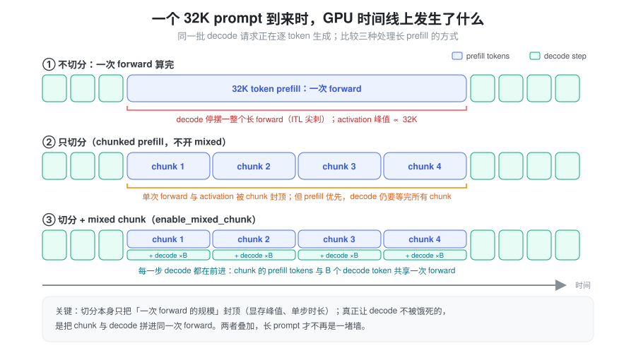
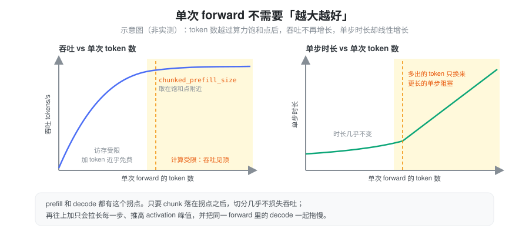
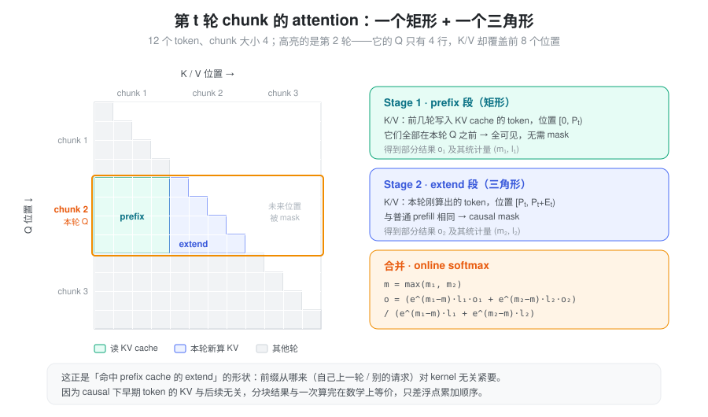
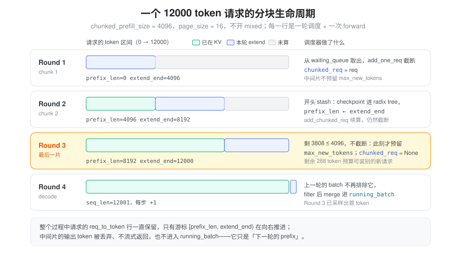

% Chunked Prefill

### 问题：长 prompt 的 prefill 是一堵墙

prefill 要把整个 prompt 一次送进模型、算出每一层的 KV，是计算密集的阶段。真实业务里 prompt 动辄 4K、32K 甚至更长，最直觉的做法是“一次 forward 全算完”。这么做有三个问题：

1. **阻塞 decode。** 一次 32K 的 forward 要跑很久，GPU 上正在逐 token 生成的请求在这段时间里一个 token 也出不来，表现为 ITL（token 间延迟）突然拉长、尾延迟失控。
2. **显存峰值失控。** prefill 的 activation（MLP 中间层、logits 等）与本次 forward 的 token 数成正比，prompt 越长峰值越高（详见 [运行时显存](./vram_runtime.md)）。
3. **收益递减。** 单次 forward 的 token 数超过某个量级后，GPU 已经算力饱和，再多塞 token 吞吐也不会涨。

图里第 ② 行有一个容易被忽略的事实：**只切分并不能让 decode 插进来。** SGLang 的调度是 prefill 优先，只要还有 chunk 没算完，下一轮仍然会组 prefill batch，decode 照样要等。切分本身解决的是第 2、3 个问题，也就是把单次 forward 的规模封顶；第 1 个问题要靠 mixed chunk（第 ③ 行）把 chunk 和 decode 拼进同一次 forward 才能解决。

### 关键观察：单次 forward 有一个“够用”的规模

切分之所以几乎不损失吞吐，是因为单次 forward 的效率存在饱和点：

- **prefill**：线性层的算术强度大致随 token 数增长。token 少时受访存限制，多塞 token 几乎“免费”；越过 roofline 的拐点后变成计算受限，吞吐见顶。以 FlashAttention 3 在 H200 上的定长测试为例，序列足够长时，继续增大 batch size 不会再提升 attention kernel 的 FLOPS，甚至会略有下降，只会推高 TTFT。
- **模型越大，饱和需要的 token 反而越少。** hidden size 越大，每个 token 的计算量越大，算术强度更早逼近上限。所以只要 chunk 取得合理，大模型上就足以吃满算力。
- **decode** 也一样：总 decode token 数增长到几百（经验上约 512）后同样进入 compute-bound，再加 batch 帮助不大。

结论是：**prefill 和 decode 都不需要“越大越好”的计算单元。** 把单次 forward 的 token 数封在饱和点附近，吞吐几乎不变，单步时长和显存峰值却都被控制住了。这个上限就是 `chunked_prefill_size`。

### 抽象：把一次 prefill 变成若干次可续算的 extend

切分在数学上是精确的，根本原因在于 causal attention：位置 \(i\) 的输出只依赖 \(\le i\) 的 token。所以第一片算完之后，它的 KV 就是最终值，不会被后面的 token 改写。后面每一片要做的，只是“带着已有前缀继续往后算”。

这正是 **extend** 的形状。命中 prefix cache 的请求也是“前缀已在 KV cache 中，只算剩下的部分”。从 kernel 的视角看，前缀是别的请求留下的，还是自己上一轮算的，没有任何区别。于是 chunked prefill 不需要新的 attention kernel，也不需要新的执行路径，只需要在请求上维护一个**游标**：

> 本轮计算区间 = `[prefix_len, extend_end)`；算完后令 `prefix_len ← extend_end`，下一轮继续。

设请求总长 \(N\)，`chunked_prefill_size` 为 \(C\)，共 \(\lceil N/C \rceil\) 轮。第 \(t\) 轮（\(t = 0, 1, \dots\)）：

- 前缀长度 \(P_t = \min(tC, N)\)，extend 长度 \(E_t = \min(C, N - P_t)\)，本轮 seq_len \(S_t = P_t + E_t\)
- Query 只包含位置 \([P_t, P_t + E_t)\)。extend 中第 \(i\) 个 token（全局位置 \(P_t + i\)）的输出为

\[o_i = \frac{\sum_{j=0}^{P_t + i} \exp(q_i \cdot k_j / \sqrt{d}) \cdot v_j}{\sum_{j=0}^{P_t + i} \exp(q_i \cdot k_j / \sqrt{d})}\]

其中 \(j \in [0, P_t)\) 的 \(k_j, v_j\) 来自 KV cache（前几轮已算好），\(j \in [P_t, P_t + i]\) 的来自本轮新算的 KV。这两段在 attention 矩阵上恰好是一个矩形加一个三角形：

\[o_i^{(1)} = \text{Attn}(q_i, K_{\text{prefix}}, V_{\text{prefix}}) \quad \text{(Stage 1：整段 prefix，无 mask)}\]

\[o_i^{(2)} = \text{CausalAttn}(q_i, K_{\text{extend}}[:i+1], V_{\text{extend}}[:i+1]) \quad \text{(Stage 2：extend 内 causal)}\]

两段各自带着 log-sum-exp 统计量 \((m_1, l_1)\)、\((m_2, l_2)\)，用 online softmax 合并：

\[m = \max(m_1, m_2), \quad o_i = \frac{e^{m_1 - m} \cdot l_1 \cdot o_i^{(1)} + e^{m_2 - m} \cdot l_2 \cdot o_i^{(2)}}{e^{m_1 - m} \cdot l_1 + e^{m_2 - m} \cdot l_2}\]

合并结果与一次算完在数学上等价，差别只在浮点累加顺序（这也是 [推理非确定性](./nondeterminism.md) 的来源之一）。

### 调度：同一时刻只有一个“半成品”

有了游标，调度器只需要再回答一个问题：**谁来持有跨轮次的半成品请求？** SGLang 的答案很克制：每个调度进程最多只有一个半成品，记在 `Scheduler.chunked_req` 上。

为什么只要一个？因为一轮里能被截断的请求本来就最多一个：截断意味着这一轮的 chunk 预算已经用完，后面的请求根本排不进来。调度器每轮又**优先续算**已有的半成品，所以它总能尽快算完，不会出现一堆请求各算了一半、各自占着 KV 却都出不了首 token 的局面。

每一轮调度围绕这个半成品做四件事：

1. **stash**：把上一轮算出的 KV 交给 prefix cache 保管，并推进游标（`prefix_len ← extend_end`）。
2. **排除**：上一轮的 prefill batch 中，已经算完 prefill 的请求合并进 `running_batch` 开始 decode；半成品被排除在外，不进入 decode。
3. **组新 batch**：先给半成品续一片，再从 waiting queue 里按剩余预算装新请求；装不下的那个被截断，成为新的半成品。
4. **prefill 优先**：组出了 prefill batch 就跑 prefill，否则才跑 decode。

组 batch 时由 `PrefillAdder` 同时管三份预算，任何一份耗尽就停止加请求：

| 预算 | 含义 | 来源 |
|------|------|------|
| `rem_total_tokens` | KV pool 剩余可用 slot（含可驱逐的 prefix cache），扣除 running 请求未来 decode 的预留 | `memory_budget`（`PrefillBudget`） |
| `rem_input_tokens` | 本轮 prefill batch 的总输入 token 上限 | `max_prefill_tokens`，默认 16384 |
| `rem_chunk_tokens` | 本轮 prefill 最多算多少 token，即 chunk 大小 | `chunked_prefill_size` |

还有一条与切分直接相关的规则：**只有最后一片才预留 `max_new_tokens` 的 decode 空间**，中间片的预留记为 0，避免过早占住 KV。但这条规则只管记账。新请求第一次被接纳时，准入检查仍会按“剩余全部 prompt + `max_new_tokens`”判断装不装得下，保证接进来的请求最终能算完，而不是半路卡死。

Round 3 是关键的一轮：剩余 3808 token 已经不超过 chunk 大小，于是这一片不再截断，此时才预留 decode 空间，`chunked_req` 清空。这一轮剩下的 288 token 预算，还可以装进 waiting queue 里的其他短请求。

### Mixed chunk：让 decode 搭上 chunk 的车

开启 `--enable-mixed-chunk` 后，组出的 prefill batch 会和当前的 decode batch **合并成一次 forward**（`ForwardMode.MIXED`），这正是第一张图第 ③ 行的形态。chunk 是计算密集的，decode 是访存密集的，两者在同一次 forward 里正好互补（见 [Batch](./batch_design.md) 中的 mixed batch 一节）。

为了给 decode 腾位置，构造 `PrefillAdder` 时会把 running 请求数 `running_bs`（每个 decode 请求 1 个 token）从 `rem_chunk_tokens`、`rem_input_tokens` 和显存预算中预先扣掉。所以开了 mixed 之后，一片的实际大小是 `chunked_prefill_size − running_bs`。mixed 有前提条件：本轮不能要求 logprob、不能带 `input_embeds`、running batch 里不能有 beam search，否则退回单独 prefill；部分投机解码算法也会在启动时把它关掉。即使条件满足，如果 prefill 接纳之后 KV 已经不够给 decode 行分配，这些 decode 行也只是本步缺席、下一步再 decode，不会因此被 retract。

另一个相关的新开关是 `--prefill-decode-interval`：每次 extend 之后强制插入 N 轮 decode，用“拉长 TTFT”换“decode 不断流”。它与 mixed 的思路不同，默认关闭，只对 Hopper 上 profiling 过的 Qwen3-VL 配置自动启用。

### 实现：代码落点与几个细节

以下路径均相对于 `python/sglang/`（本 fork 相对 upstream 改动较大，旧版的 `is_chunked`、`cache_unfinished_req`、`prefix_indices`、`extend_input_len` 已不在主路径上）。

| 概念 | 代码 |
|------|------|
| 半成品请求 | `Scheduler.chunked_req`，`init_chunked_prefill()` 初始化（`srt/managers/scheduler.py`） |
| 每轮 stash / 排除 / 合并 | `Scheduler.get_next_batch_to_run()`、`stash_chunked_request()` |
| 组 prefill batch | `Scheduler._get_new_batch_prefill_raw()` |
| 三份预算、续算、截断 | `PrefillAdder.add_chunked_req()` / `add_one_req()` / `_select_prefill_admission()`（`srt/managers/schedule_policy.py`） |
| 游标 | `Req.prefix_len`、`Req.extend_end`、`Req.extend_len`、`Req.get_fill_ids()`（`srt/managers/schedule_batch.py`） |
| KV 交给 prefix cache | `checkpoint_kv_cache()`（`srt/mem_cache/common.py`）→ `RadixCache.checkpoint()` |
| 与 decode 合并 | `ScheduleBatch.mix_with_running()` |

#### 半成品的 KV 放在哪

请求的 `req_to_token` 行在各片之间**一直保留**，不会每片释放再重新申请。stash 时，`checkpoint_kv_cache()` 调用 `tree_cache.checkpoint(req, up_to=req.extend_end)`：把已算部分按 page 对齐插入 radix tree，用树里的 KV 索引改写这一行（与树中已有重复的 slot 会被释放），再把请求的 lock 挪到新的 `last_node`；不满一页的尾巴留在请求自己的行里，不进树。之后令 `prefix_len = extend_end`。

这样做有两个好处：半成品的 KV 被 lock 保护，不会在等下一片时被驱逐；共享同一前缀的其他请求也可以直接命中它。续算时，`init_next_round_input()` 是**不带 `tree_cache`** 调用的，只刷新 `fill_ids`、不重新做前缀匹配，游标从 `prefix_len` 直接接着走。

#### 用计数器而不是布尔值标记“还在切”

“这个请求是否还没完成 prefill”由 `Req.inflight_middle_chunks` 表示：每次以中间片身份被调度时 `+= 1`（`scheduler.py`），中间片的结果处理完时 `-= 1`（`scheduler_components/batch_result_processor.py`），`<= 0` 才算完成 prefill。用计数器是为了适配 overlap 调度：下一轮在上一轮结果返回之前就已经开始组 batch，同一请求可能有不止一个中间片在路上。中间片采样出的 token 会被丢弃，也不流式返回；需要 input logprob 时则按片增量累积。

#### page 对齐只保证在第一刀

新请求第一次被截断时（`_select_prefill_admission`），会把**绝对结束位置**对齐到 `page_size`（以及可选的 `truncation_align_size`），保证进树的部分都是整页。续算走的是 `add_chunked_req`，片长取 `min(rem_chunk_tokens, 剩余显存)`，不再重新对齐。例如开了 mixed、扣掉 `running_bs` 之后，片长就未必是整页；这也是 `checkpoint` 要允许“尾巴留在行里”的原因。

#### 参数

| 参数 | 默认 | 说明 |
|------|------|------|
| `--chunked-prefill-size` | 按显存自动选 | <20GB 为 2048；<60GB 为 4096；<160GB（H100、H20、H200 等）为 8192；≥160GB（B200、MI300）为 16384；探测不到显存时为 4096（`srt/arg_groups/memory_hook.py`）。开 DP attention 时再除以 `attn_dp_size`。`-1` 表示关闭切分，部分模型会被强制设为 `-1` |
| `--max-prefill-tokens` | 16384 | 一个 prefill batch 的总输入 token 上限 |
| `--enable-mixed-chunk` | False | chunk 与 decode 合并为一次 forward |
| `--enable-dynamic-chunking` | False | 仅 PP：按 profiling 拟合的耗时模型，随已有前缀长度动态调整片长，让各片耗时接近（前缀越长，同样的片越贵） |

PD 分离的 prefill 实例上，每算完一片，就把这一片的 KV 通过 `send_kv_chunk` 先发给 decode 实例，不必等整条 prompt 算完再传；具体见 [PD 分离](./disaggregation_design.md)。

### 小结

Chunked prefill 的核心只有一句话：**一个请求的 prefill，可以拆成若干次“前缀恰好是自己”的 extend。** causal attention 保证了拆分是精确的；prefix cache 和 extend kernel 早已能处理“前缀在 cache、只算剩下部分”的情形，于是切分几乎不需要新机制，只需要一个 `[prefix_len, extend_end)` 游标，加上调度器里“至多一个半成品、优先续算、最后一片才预留 decode 空间”的规则。它把单次 forward 的规模封在算力饱和点附近，吞吐几乎不变，显存峰值和单步时长却有了上限；再叠加 mixed chunk，让 decode 搭上每一片的车，长 prompt 才真正不再阻塞正在生成的请求。
