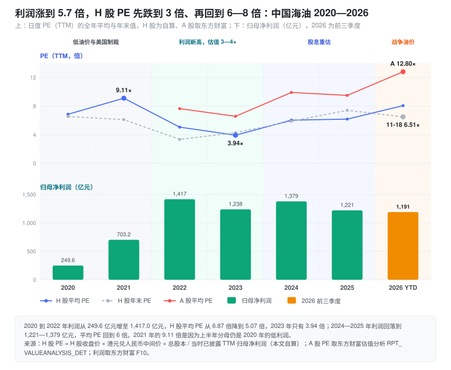
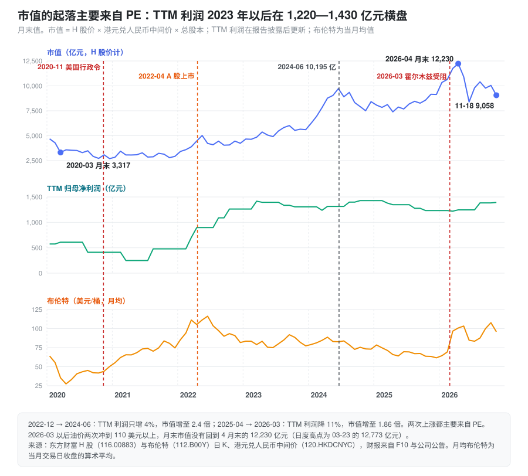
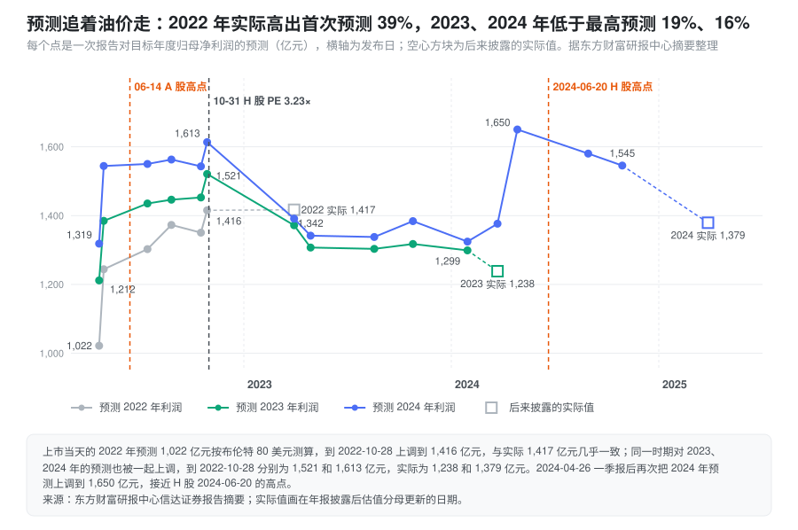
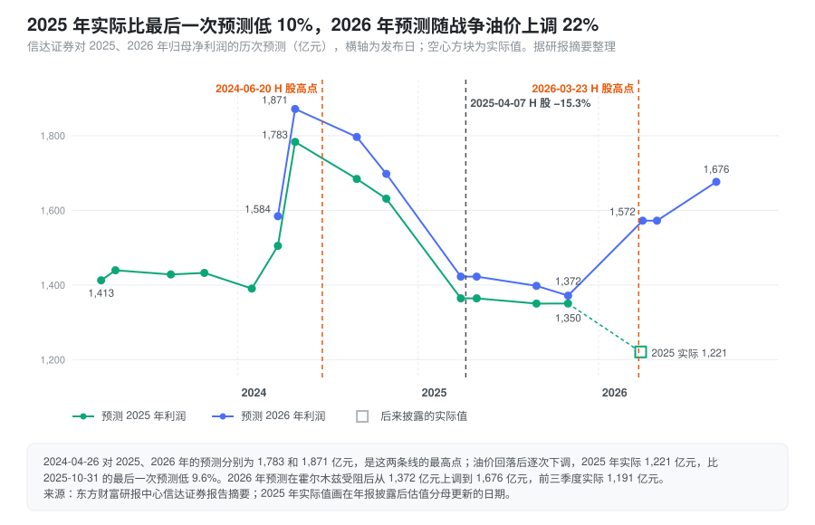
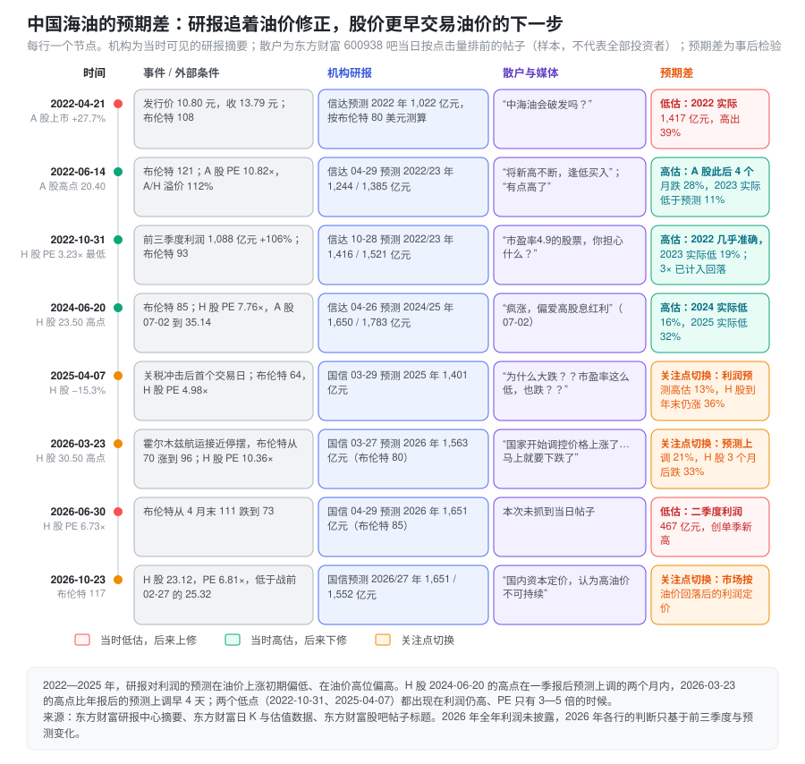

% 中国海油：2020—2026 年历史定价、油价与预期差

**核心判断：2020—2026 年，中国海油的利润由油价决定，市值的起落却主要来自 PE。** 2020 年归母净利润 249.6 亿元，2022 年增至 1,417.0 亿元（5.7 倍），之后在 1,221—1,379 亿元之间横盘。H 股 PE（TTM）在利润最高的 2022—2023 年只有 3—4 倍，2024 年以后才回到 6—8 倍。2022-12-30 到 2026-11-18，H 股口径市值从 4,241 亿元增至 9,058 亿元（×2.14），其中 TTM 利润只贡献 ×1.10，PE 贡献 ×1.94。

沿时间线看，市场对这家公司提过四个不同的问题：

- **2020—2021：油价会不会长期低迷，美国制裁会把公司排除到什么程度。** 2020-03-19 布伦特跌到 29.97 美元，H 股 PE 4.51 倍；2020-11 美国行政令把公司列入限制名单，2021 年公司从纽约、多伦多退市。
- **2022—2023：高油价能维持多久。** 利润翻倍，研报逐次上调预测，H 股 PE 却在 2022-10-31 跌到 3.23 倍，2023 年全年平均 3.94 倍。市场按“利润是峰值”给倍数。
- **2024—2025：股息能不能当债券看。** TTM 利润基本不变，分红率稳定在 43%—45%，H 股 PE 回到 6 倍，A 股 PE 到 10 倍上下。2025-04-07 关税冲击下 H 股单日跌 15.3%，年末仍比当日高 36%。
- **2026：战争油价会持续多久。** 霍尔木兹航运受阻后，H 股在 2026-03-23 涨到 30.50 港元，PE 10.36 倍，比研报上调预测早 4 天。之后布伦特两次回到 110 美元以上，二季度利润创单季新高，H 股 PE 却回到 6.5 倍。

机构研报的利润预测跟着油价修正：油价上涨初期偏低（2022 年实际比首次预测高 39%），油价高位偏高（2023、2024、2025 年实际分别比最高预测低 19%、16%、32%）。股价的转折比研报的修正更早。

2026 年全年业绩尚未披露。本文不预测全年结果，也不提供买卖价格。

### 研究范围与数据边界

- **标的**：中国海洋石油有限公司。H 股 **00883.HK** 是研究期内唯一完整的交易序列，作为估值主线；A 股 **600938.SH** 于 2022-04-21 上市，单列 A 股 PE 与 A/H 溢价。纽约 ADS 于 2021 年退市，不纳入。
- **期间**：2020—2025 六个完整年度，加上 2026 年截至 11-18 的 YTD。数据提取日与信息截止日均为 **2026-11-18**（收盘后）。
- **H 股 PE（TTM），本文自算**：H 股收盘价 × 当日港元兑人民币中间价 × 总股本 / 当时已披露的最近四期归母净利润。2022 年 A 股上市前公司只披露半年报和年报利润，TTM 由半年度数据拼接，分母在 2020-03-26、2020-08-20、2021-03-26、2021-08-20、2022-03-31 更新；2022-04-29 起按季度更新。分母一律在披露次一交易日或当日更新，不用事后利润回填。2020-01-02 至 2026-11-18 共 1,693 个 H 股交易日，没有非正 PE。
- **股本**：A 股上市前 446.47 亿股；2022-04-21 上市后 472.47 亿股；2022-05-20 超额配售后 476.37 亿股；之后小额回购注销，2024-09-23 起 475.30 亿股。“市值”指 H 股收盘价换算成人民币后乘以全部股本，即假设 A 股也按 H 股价格计价。跨期比较用市值，不用股价。
- **A 股估值**：东方财富估值分析（`RPT_VALUEANALYSIS_DET`），2022-04-21 至 2026-11-18 共 1,110 个交易日。A/H 溢价 = A 股收盘 / (H 股收盘 × 中间价) − 1。
- **价格与回报**：价格不复权、不含分红。含分红的总回报单独计算，H 股分红按除息日收盘价再投资，不扣税。
- **财务**：东方财富 F10 主要财务指标与现金流量表，人民币亿元；单季利润由累计值相减得到。资本开支取“购建固定资产、无形资产和其他长期资产支付的现金”，与公司公布的资本支出口径不同。
- **产量、实现油价、桶油成本**：取自券商年报点评摘要中引用的公司数据，每项注明报告编号。
- **油价**：东方财富布伦特原油连续（`112.B00Y`）日 K。这个序列与新闻中引用的期货结算价有差距（例如 2026 年 3 月末，界面新闻引用的期货价 118.35 美元，本序列 03-30 为 108.89 美元），只用于判断方向和量级。
- **研报**：东方财富研报中心 600938 的 149 篇报告摘要，链接格式为 `https://data.eastmoney.com/report/info/<编号>.html`。只引用摘要中能看到的字段，统一注明“据摘要整理”。
- **散户与媒体**：F10 股东户数（A 股，2022 年中起）；东方财富 600938 吧在关键日期按点击量排序的帖子标题，链接格式为 `https://guba.eastmoney.com/news,600938,<帖子编号>.html`。**样本，不代表全部投资者。** H 股没有可比的散户数据。
- **未能核验**：
  - 没有取得 Wind、Choice 等一致预期快照，只呈现信达、国信两条单家轨迹和 2026 年三季报后的几家对照。
  - 2020 年实现油价；2020-11-10 H 股 +14%、2026 年 1 月 A 股上涨（01-26 +6.66%、01-28 +6.98%）、2026 年 5—6 月布伦特从 114 美元跌到 73 美元、2026-11-05 A 股 −6.55% 的原因，本文都没有找到可引用的说明，不做归因。
  - 股吧标题中提到的“民生限价政策”、关税与 OPEC+ 增产等外部消息，标为“据股吧标题，未核实”。
  - 美国制裁后，海外指数公司是否把股票剔除、剔除带来多少被动卖出，本文未核实。

### 年度 PE 与利润：利润涨到 5.7 倍，PE 先跌到 3 倍、再回到 6—8 倍

PE 单位为倍。全年平均为当年全部有效交易日日度 PE（TTM）的算术平均，极值附日期，年末值取最后一个交易日。

| 年份 | H 股交易日 | H 股平均 PE | 最低 PE / 日期 | 最高 PE / 日期 | 年末 PE | H 股年末收盘（港元） | 年末市值（亿元） |
| --- | ---: | ---: | --- | --- | ---: | ---: | ---: |
| 2020 | 248 | 6.87 | 4.51 / 03-19 | 9.55 / 01-06 | 6.56 | 7.18 | 2,698 |
| 2021 | 247 | 9.11 | 5.84 / 11-30 | 13.73 / 06-25 | 6.12 | 8.03 | 2,931 |
| 2022 | 246 | 5.07 | **3.23 / 10-31** | 8.42 / 03-30 | 3.36 | 9.98 | 4,241 |
| 2023 | 243 | **3.94** | 3.25 / 01-10 | 4.58 / 09-06 | 4.29 | 13.00 | 5,604 |
| 2024 | 246 | 6.04 | 4.30 / 01-03 | 7.76 / 06-20 | 5.89 | 19.12 | 8,415 |
| 2025 | 246 | 6.19 | 4.98 / 04-07 | 8.06 / 11-12 | 7.42 | 21.30 | 9,144 |
| 2026 YTD | 217 | 8.07 | 6.51 / 11-18 | **10.36 / 03-23** | 6.51（11-18） | 22.28 | 9,058 |

| 年份 | A 股交易日 | A 股平均 PE | 最低 PE / 日期 | 最高 PE / 日期 | 年末 PE | A 股年末收盘（元） | A/H 溢价：平均 / 最低 / 最高 / 年末 |
| --- | ---: | ---: | --- | --- | ---: | ---: | --- |
| 2022（04-21 起） | 172 | 7.65 | 5.54 / 10-31 | 10.82 / 06-14 | 5.73 | 15.20 | 80% / 55%（04-21）/ 112%（06-14）/ 70% |
| 2023 | 242 | 6.58 | 5.72 / 03-31 | 7.64 / 12-29 | 7.64 | 20.97 | 67% / 53%（09-06）/ 81%（06-16）/ 78% |
| 2024 | 242 | 9.91 | 7.45 / 01-22 | 12.72 / 07-02 | 9.82 | 29.51 | 64% / 46%（09-03）/ 88%（03-08）/ 67% |
| 2025 | 243 | 9.50 | 8.00 / 04-07 | 11.64 / 12-31 | 11.64 | 30.18 | 54% / 41%（11-17）/ 66%（01-08）/ 57% |
| 2026 YTD | 211 | 12.80 | 10.20 / 07-02 | 16.74 / 03-03 | 10.42（11-18） | 30.53 | 58% / 46%（07-16）/ 79%（03-04）/ 60% |

来源：H 股 PE 为本文自算（东方财富 H 股日 K、港元兑人民币中间价、F10 利润）；A 股 PE 取东方财富估值分析日度数据，2026-11-18 提取。

| 年份 | 归母净利润（亿元） | 同比 | 扣非净利润（亿元） | 毛利率 | 经营现金流（亿元） | 资本开支（亿元） | 加权 ROE | 布伦特均价（美元） | H 股平均 PE |
| --- | ---: | ---: | ---: | ---: | ---: | ---: | ---: | ---: | ---: |
| 2020 | 249.57 | −59.1% | 213.70 | 37.3% | 823.4 | 754.2 | 5.66% | 43.6 | 6.87 |
| 2021 | 703.20 | +181.8% | 681.71 | 50.6% | 1,478.9 | 824.4 | 15.36% | 70.7 | 9.11 |
| **2022** | **1,417.00** | **+101.5%** | 1,402.50 | 53.1% | 2,055.7 | 947.5 | 26.00% | 98.4 | 5.07 |
| 2023 | 1,238.43 | −12.6% | 1,251.88 | 49.9% | 2,097.4 | 1,208.8 | 19.55% | 81.9 | 3.94 |
| 2024 | 1,379.36 | +11.4% | 1,333.97 | 53.6% | 2,208.9 | 1,233.6 | 19.36% | 79.7 | 6.04 |
| 2025 | 1,220.82 | −11.5% | 1,203.79 | 51.5% | 2,090.4 | 1,115.5 | 15.64% | 68.0 | 6.19 |
| 2026 前三季度 | 1,191.18 | +16.8% | 1,189.25 | 53.9% | 1,995.9 | 817.0 | 14.12% | 90.3（YTD） | 8.07（YTD） |

财务数据取自东方财富 F10，布伦特均价为 `112.B00Y` 当年交易日收盘的算术平均。2026 年前三季度的对比口径：2025 年前三季度经营现金流 1,717.5 亿元，资本开支 777.9 亿元。资产负债率从 2020 年末的 39.8% 降到 2025 年末的 26.7%，2026 年三季度末为 29.8%。

表中有四个统计特征：

**第一，2021 年的高 PE 是分母造成的。** 2021-03-26 起 TTM 分母换成 2020 年全年的 249.6 亿元，H 股 PE 在 06-25 升到 13.73 倍；08-20 半年报把分母更新到 479.0 亿元后，PE 立刻回到 7 倍以下。2021 年的平均 9.11 倍不代表市场给了更高的倍数，H 股全年平均价 8.34 港元，比 2020 年的 9.02 港元还低。

**第二，利润最高的两年，PE 最低。** 2022 年利润 1,417.0 亿元，2023 年 1,238.4 亿元，H 股平均 PE 5.07 倍和 3.94 倍，是研究期最低的两年。2022-10-31 的 3.23 倍出现在三季报（10-28 披露）之后，前三季度利润同比增长 106%。

**第三，2024—2025 年的重估与利润无关。** 两年利润分别为 1,379.4 亿元和 1,220.8 亿元，与 2023 年相差不到 12%，布伦特均价从 81.9 美元降到 68.0 美元；H 股平均 PE 却从 3.94 倍升到 6.04 倍和 6.19 倍，年末市值从 5,604 亿元增至 9,144 亿元。

**第四，A 股的倍数一直比 H 股高 40%—110%。** 同一份利润，A 股 2023 年平均 6.58 倍、2026 年平均 12.80 倍。溢价最高的两个时点（2022-06-14 的 112%、2026-03-04 的 79%）都在油价冲高、A 股连续上涨的时候；溢价最低的时点（2025-11-17 的 41%）在油价低位。A/H 溢价可以当作 A 股资金情绪的一把尺子，下文“散户与媒体”一节再讨论。

### 产量、实现油价与分红：量在稳定增长，价决定利润

| 年份 | 油气净产量（百万桶油当量） | 同比 | 实现油价（美元/桶） | 较布伦特折价 | 桶油主要成本（美元） | 全年每股股息（港元） | 派息率 |
| --- | ---: | ---: | ---: | ---: | ---: | ---: | ---: |
| 2020 | 约 528 | — | 未核验 | — | — | — | — |
| 2021 | 573 | 约 +8.5% | 约 67.9（倒推） | — | 29.49（倒推） | 1.48（含特别 0.68） | 超过 80% |
| 2022 | 623.8 | +8.9% | 96.59 | — | 30.39 | 1.45 | 42.7% |
| 2023 | 678 | +8.7% | 77.96 | 4.53 | 28.83 | 1.25 | 43.6% |
| 2024 | 726.8 | +7.2% | 76.75 | 3.11 | 28.52 | 1.40 | 44.7% |
| 2025 | 777.3 | +7.0% | 66.47 | 1.42 | 27.90 | 1.28 | 45% |
| 2026 | 目标 780—800 | — | Q1 75.92，Q2 95.48，前三季度 88.0 | Q3 3.35 | 上半年 29.70，前三季度 30.57 | 中期 0.94 | 承诺不低于 45% |

来源（均据摘要整理）：2020 年产量据公司 2021 年经营策略公告（[AN202102041458654458](https://pdf.dfcfw.com/pdf/H2_AN202102041458654458_1.pdf)）中的约数；2021 年产量与股息据信达 [AP202204291562297918](https://data.eastmoney.com/report/info/AP202204291562297918.html)；2022 年据信达 [AP202303301584684213](https://data.eastmoney.com/report/info/AP202303301584684213.html)，2021 年的实现油价与桶油成本由 2022 年的同比数倒推；2023 年据信达 [AP202403221627604113](https://data.eastmoney.com/report/info/AP202403221627604113.html)；2024 年据信达 [AP202503281648674034](https://data.eastmoney.com/report/info/AP202503281648674034.html)；2025 年据信达 [AP202603311820889482](https://data.eastmoney.com/report/info/AP202603311820889482.html) 与国信 [AP202603271820811382](https://data.eastmoney.com/report/info/AP202603271820811382.html)；2026 年据信达 [AP202604291821725467](https://data.eastmoney.com/report/info/AP202604291821725467.html)、[AP202608271828556190](https://data.eastmoney.com/report/info/AP202608271828556190.html) 与国信 [AP202611021831303773](https://data.eastmoney.com/report/info/AP202611021831303773.html)。

三个观察：

- **产量每年增长 7%—9%，而且每年都完成或超出目标。** 2022 年 4 月公司给出的 2023、2024 年目标为 640—650 和 680—690 百万桶，实际为 678 和 726.8；2025 年的目标 730 百万桶，实际为 777.3。产量不是预期差的来源。
- **利润的波动几乎全部来自实现油价。** 2022 到 2025 年产量增长 25%，实现油价下降 31%（96.59 → 66.47），利润下降 14%。桶油主要成本稳定在 28—30 美元，2026 年前三季度因为油价上涨带来的税金增加升到 30.57 美元。
- **派息率稳定在 43%—45%，股息额随利润变化。** 2021 年有 0.68 港元特别股息，2022 财年起没有再派特别股息，派息率稳定在 43%—45%。信达 2025-03-28 的年报点评提到，公司承诺 2025—2027 年派息率不低于 45%。

按除息日计算的 H 股现金分红与股息率：

| 除息年份 | 每股现金分红（港元） | 年末收盘 | 按年末价 | 按全年均价 |
| --- | ---: | ---: | ---: | ---: |
| 2020 | 0.65 | 7.18 | 9.1% | 7.2% |
| 2021 | 0.55 | 8.03 | 6.8% | 6.6% |
| 2022 | 1.88（含特别 1.18） | 9.98 | 18.8% | 18.5% |
| 2023 | 1.34 | 13.00 | 10.3% | 10.9% |
| 2024 | 1.40 | 19.12 | 7.3% | 7.5% |
| 2025 | 1.39 | 21.30 | 6.5% | 7.3% |
| 2026 YTD | 1.49 | 22.28（11-18） | 6.7% | 6.0% |

来源：东方财富港股分红数据（00883.HK），2026-11-18 提取。除息年的分红合计包括上一财年的末期股息与当年中期股息，与上表的“全年每股股息”口径不同。

分红改变了这只股票的回报结构。下表用 H 股收盘价与除息日再投资计算：

| 起点 | 起点收盘（港元） | 到 2026-11-18 的价格倍数 | 含分红再投资的倍数 |
| --- | ---: | ---: | ---: |
| 2020-01-02 | 12.98 | ×1.72 | ×3.16 |
| 2020-12-31 | 7.18 | ×3.10 | ×5.32 |
| 2022-12-30 | 9.98 | ×2.23 | ×3.03 |
| 2024-06-20（高点） | 23.50 | ×0.95 | ×1.12 |
| 2025-12-31 | 21.30 | ×1.05 | ×1.11 |

同期恒生指数从 2020-12-31 的 27,231 点降到 2026-11-18 的 23,295 点。2022—2023 年股息率在 10%—19% 之间，股价不涨也能给出很高的回报；这是 2024 年“股息重估”的起点。

### 节点表：股价先动还是利润先动

年度表会掩盖一年内的转折。下表按关键日期列出 H 股价格、市值、当时的 TTM 利润与 PE，以及当日布伦特和 A 股。“TTM 利润”为当日已披露的最近四期归母净利润。

| 日期 | 节点 | H 股（港元） | 市值（亿元） | TTM 利润（亿元） | H 股 PE | 布伦特 | A 股（元） | A 股 PE | A/H 溢价 |
| --- | --- | ---: | ---: | ---: | ---: | ---: | ---: | ---: | ---: |
| 2020-01-02 | 研究期起点 | 12.98 | 5,177 | 574.9 | 9.01 | 66.34 | | | |
| 2020-03-19 | 疫情油价低点 | 6.40 | 2,595 | 574.9 | 4.51 | 29.97 | | | |
| 2020-12-31 | 美国行政令后 | 7.18 | 2,698 | 411.4 | 6.56 | 51.72 | | | |
| 2021-02-23 | 退市前反弹 | 10.40 | 3,864 | 411.4 | 9.39 | 64.22 | | | |
| 2021-12-31 | 年末 | 8.03 | 2,931 | 479.0 | 6.12 | 77.94 | | | |
| 2022-03-08 | 俄乌冲突油价高点 | 10.18 | 3,673 | 479.0 | 7.67 | 129.47 | | | |
| 2022-04-21 | A 股上市 | 10.88 | 4,201 | 703.2 | 5.97 | 108.40 | 13.79 | 9.27 | 55% |
| 2022-06-14 | A 股高点 | 11.18 | 4,579 | 898.1 | 5.10 | 121.09 | 20.40 | 10.82 | 112% |
| 2022-10-31 | H 股 PE 最低 | 9.36 | 4,073 | 1,262.5 | **3.23** | 92.85 | 14.70 | 5.54 | 72% |
| 2022-12-30 | 年末 | 9.98 | 4,241 | 1,262.5 | 3.36 | 85.99 | 15.20 | 5.73 | 70% |
| 2023-12-29 | 年末 | 13.00 | 5,604 | 1,305.8 | 4.29 | 77.08 | 20.97 | 7.64 | 78% |
| 2024-06-20 | H 股高点 | 23.50 | 10,195 | 1,314.5 | 7.76 | 84.80 | 32.04 | 11.59 | 49% |
| 2024-12-31 | 年末 | 19.12 | 8,415 | 1,428.6 | 5.89 | 74.83 | 29.51 | 9.82 | 67% |
| 2025-04-07 | 关税冲击 | 15.62 | 6,876 | 1,379.4 | 4.98 | 64.36 | 23.23 | 8.00 | 61% |
| 2025-12-31 | 年末 | 21.30 | 9,144 | 1,232.5 | 7.42 | 60.91 | 30.18 | 11.64 | 57% |
| 2026-02-27 | 战前 | 25.32 | — | 1,232.5 | 8.64 | 73.21 | 35.87 | 13.83 | — |
| 2026-03-23 | H 股高点 | 30.50 | **12,773** | 1,232.5 | **10.36** | 96.07 | 42.10 | 16.24 | 57% |
| 2026-06-30 | H 股 2026 年低点 | 20.32 | 8,389 | 1,246.6 | 6.73 | 73.43 | 27.15 | 10.35 | 54% |
| 2026-10-23 | 布伦特 2026 年高点 | 23.12 | 9,418 | 1,383.7 | 6.81 | 117.38 | 33.72 | 11.58 | 70% |
| 2026-11-18 | 截止日 | 22.28 | 9,058 | 1,392.3 | 6.51 | 91.30 | 30.53 | 10.42 | 60% |

来源：东方财富 H 股、A 股、布伦特日 K 与估值数据，H 股 PE 为本文自算。2026-02-27 的市值与溢价未单列。

季末 H 股 PE 与季度布伦特均价：

| 年份 | Q1 末 PE | Q2 末 PE | Q3 末 PE | Q4 末 PE | Q1 布伦特 | Q2 布伦特 | Q3 布伦特 | Q4 布伦特 |
| --- | ---: | ---: | ---: | ---: | ---: | ---: | ---: | ---: |
| 2022 | 5.53 | 4.70 | 3.72 | 3.36 | 97.5 | 111.2 | 97.0 | 88.6 |
| 2023 | 3.43 | 3.52 | 4.50 | 4.29 | 81.7 | 77.7 | 85.6 | 82.6 |
| 2024 | 6.31 | 7.40 | 5.95 | 5.89 | 81.6 | 84.8 | 78.5 | 74.0 |
| 2025 | 5.89 | 5.70 | 6.47 | 7.42 | 74.7 | 66.6 | 68.0 | 62.9 |
| 2026 | 9.63 | 6.73 | 7.06 | 6.51（11-18） | 77.6 | 96.1 | 90.2 | 103.2（至 11-18） |

单季归母净利润（亿元，由累计值相减）：

| 年份 | Q1 | Q2 | Q3 | Q4 | 全年 |
| --- | ---: | ---: | ---: | ---: | ---: |
| 2022 | 343.01 | 375.86 | 368.81 | 329.32 | 1,417.00 |
| 2023 | 321.13 | 316.48 | 338.84 | 261.98 | 1,238.43 |
| 2024 | 397.19 | 400.12 | 369.28 | 212.77 | 1,379.36 |
| 2025 | 365.63 | 329.70 | 324.38 | 201.11 | 1,220.82 |
| 2026 | 391.44 | **466.74** | 333.00 | — | 1,191.18（前三季度） |

四季度利润每年都是全年最低，2024、2025 年只有前三季度均值的约 55%—60%，与减值、费用在年末集中确认有关（国信 [AP202603271820811382](https://data.eastmoney.com/report/info/AP202603271820811382.html) 摘要列出 2025 年四季度的原因为“实现油价下降、资产减值、人民币升值、费用及税金增加”）。2026 年三季度布伦特均价 90.2 美元，单季利润却从 466.74 亿元降到 333.00 亿元，国信 11-02 的摘要提到当季资产减值 72.43 亿元，原因写作“资产经营环境发生变化”，实现油价较布伦特的折价扩大到 3.35 美元。

从节点表能直接读出股价与利润的先后：

- **2022 年，股价先于利润见顶。** A 股 06-14 见顶时 TTM 利润 898.1 亿元，之后两次更新到 1,262.5 亿元（10-28），同期 A 股从 20.40 元跌到 14.70 元。单季利润的高点在 2022 年二季度（375.86 亿元），A 股高点正好出现在二季度内。
- **2023—2024 年，股价上涨没有利润配合。** 2022-12-30 到 2024-06-20，TTM 利润从 1,262.5 亿元增至 1,314.5 亿元，H 股从 9.98 港元涨到 23.50 港元。季末 PE 从 3.36 倍升到 7.40 倍。
- **2026 年，股价比利润早三个月见顶。** H 股 03-23 见顶时，一季度还没结束；二季度利润 466.74 亿元创单季新高，在 08-27 披露，这时 H 股已经从 30.50 港元跌到 25 港元附近。季末 PE 从 9.63 倍降到 6.73 倍，几乎全部发生在利润披露以前。

#### 乘法分解：市值 = TTM 利润 × PE

研究期内股本变动较大（A 股发行增加约 6.7%），所以用市值和 TTM 利润分解，不用股价和 EPS。市值倍数 = TTM 利润倍数 × PE 倍数；H 股价格与汇率的变化单列，作为对照。

| 区间 | 市值 | TTM 利润 | PE | H 股价格 | 港元兑人民币 | 主导因素 |
| --- | ---: | ---: | ---: | ---: | ---: | --- |
| 2020-01-02 → 2020-03-19 | ×0.50 | ×1.00 | ×0.50 | −51% | | 全部来自 PE：油价从 66 美元跌到 30 美元 |
| 2020-03-19 → 2021-12-31 | ×1.13 | ×0.83 | ×1.36 | +25% | −10.0% | PE 修复，但港元贬值抵消了一部分 |
| 2021-12-31 → 2022-12-30 | ×1.45 | ×2.64 | ×0.55 | +24% | +9.3% | 利润增长被 PE 压缩抵消近一半；另有 A 股发行增加股本 |
| 2022-12-30 → 2024-06-20 | ×2.40 | ×1.04 | ×2.31 | +135% | | 几乎全部来自 PE |
| 2024-06-20 → 2025-04-07 | ×0.67 | ×1.05 | ×0.64 | −34% | | 全部来自 PE |
| 2025-04-07 → 2026-03-23 | ×1.86 | ×0.89 | ×2.08 | +95% | −4.9% | PE 上升，TTM 利润下降 |
| 2026-03-23 → 2026-11-18 | ×0.71 | ×1.13 | ×0.63 | −27% | | 利润上升，PE 压缩更多 |
| **2020-12-31 → 2025-12-31** | ×3.39 | ×3.00 | ×1.13 | +197% | | 五年看主要来自利润 |
| **2022-12-30 → 2026-11-18** | ×2.14 | ×1.10 | ×1.94 | +123% | | A 股上市以来主要来自 PE |

“港元兑人民币”一列为人民币中间价的变化，正数表示港元升值；空白表示变化较小，未单列。

分解有两个结论。

**第一，长期看利润，短期看 PE，两个时间尺度给出相反的答案。** 2020 年末到 2025 年末，市值增至 3.39 倍，其中利润 ×3.00、PE 只 ×1.13，看上去是“利润驱动”；但这是把 2020 年的低谷利润当基数。A 股上市以后，TTM 利润在 1,220—1,430 亿元横盘，市值的每一次大起大落（×2.40、×0.67、×1.86、×0.71）都来自 PE。

**第二，PE 的方向通常与“油价的下一步”有关，而不是与当期利润有关。** 2022 年油价高、利润高、PE 被压缩；2023—2024 年油价在 75—85 美元横盘、利润不变、PE 翻倍；2026 年油价再次冲高、利润增长，PE 又被压缩。PE 低的时候，市场认为当期利润高于可持续水平；PE 高的时候，市场认为油价至少不会更低。

### 机构研报：预测追着油价修正

#### 信达证券：A 股上市以来最连续的一条线

信达证券 2022-04 至 2026-08 共 23 篇报告，评级始终为“买入”，口径为归母净利润。下表据研报摘要整理，摘要中没有目标价。“隐含 PE”= 报告日 H 股口径市值 / 该报告对当年或次年的利润预测；当日 TTM PE 为本文自算的 H 股 PE。A 股口径的隐含 PE 约为 H 股的 1.5—1.8 倍。

| 发布日 | 预测（亿元） | 当日 TTM PE | 当年隐含 PE | 次年隐含 PE | 摘要要点 |
| --- | --- | ---: | ---: | ---: | --- |
| [2022-04-21](https://data.eastmoney.com/report/info/AP202204211560564277.html) | 2022/23/24：1,022 / 1,212 / 1,319 | 5.97 | 4.11 | 3.47 | 上市首日深度报告；按布伦特 80 美元测算；“H股 2011-2021 年 PE 区间为 9-12 倍” |
| [2022-04-29](https://data.eastmoney.com/report/info/AP202204291562297918.html) | 1,244 / 1,385 / 1,544 | 4.98 | 3.59 | 3.23 | 一季报超预期，2021 年特别派息 |
| [2022-07-15](https://data.eastmoney.com/report/info/AP202207141576151073.html) | 1,303 / 1,435 / 1,550 | 4.25 | 2.93 | 2.66 | “高油价+低成本+扩产量，助力估值修复” |
| [2022-08-26](https://data.eastmoney.com/report/info/AP202208261577666633.html) | 1,373 / 1,446 / 1,563 | 4.09 | 3.24 | 3.08 | 半年报 |
| [2022-10-17](https://data.eastmoney.com/report/info/AP202210171579208317.html) | 1,351 / 1,453 / 1,543 | 3.90 | 3.14 | 2.92 | 三季度业绩预增 |
| [2022-10-28](https://data.eastmoney.com/report/info/AP202210271579554490.html) | 1,416 / 1,521 / 1,613 | 3.36 | 3.00 | **2.79** | 三季报；次年隐含 PE 研究期最低 |
| [2023-03-30](https://data.eastmoney.com/report/info/AP202303301584684213.html) | 2023/24/25：1,372 / 1,391 / 1,413 | 3.46 | 3.57 | 3.52 | 年报，“估值修复空间凸显”；首次下调 |
| [2023-04-28](https://data.eastmoney.com/report/info/AP202304281586042223.html) | 1,307 / 1,342 / 1,439 | 3.85 | 4.11 | 4.00 | 一季报 |
| [2023-08-18](https://data.eastmoney.com/report/info/AP202308181595069051.html) | 1,303 / 1,338 / 1,428 | 4.18 | 4.28 | 4.17 | “产量增长对冲油价波动” |
| [2023-10-25](https://data.eastmoney.com/report/info/AP202310251603399505.html) | 1,318 / 1,384 / 1,432 | 4.36 | 4.32 | 4.11 | 三季报，上调资本开支 |
| [2024-01-29](https://data.eastmoney.com/report/info/AP202401261618379490.html) | 1,299 / 1,325 / 1,391 | 4.87 | 4.80 | 4.57 | 年度策略，产量目标上调 |
| [2024-03-22](https://data.eastmoney.com/report/info/AP202403221627604113.html) | 2024/25/26：1,377 / 1,505 / 1,584 | 6.18 | 5.56 | 5.09 | 年报，分红比例提升到 43.6% |
| [2024-04-26](https://data.eastmoney.com/report/info/AP202404261631378814.html) | **1,650 / 1,783 / 1,871** | 6.46 | 5.15 | 4.77 | 一季报超预期；三个年度的预测都到最高 |
| [2024-08-29](https://data.eastmoney.com/report/info/AP202408291639556273.html) | 1,580 / 1,684 / 1,797 | 6.59 | 5.83 | 5.47 | 半年报 |
| [2024-10-28](https://data.eastmoney.com/report/info/AP202410281640553338.html) | 1,545 / 1,631 / 1,698 | 5.83 | 5.28 | 5.00 | “油价下行利润仍增” |
| [2025-03-28](https://data.eastmoney.com/report/info/AP202503281648674034.html) | 2025/26：1,364 / 1,422 | 5.87 | 5.93 | 5.69 | 年报；2024 年实际 1,379 |
| [2025-04-29](https://data.eastmoney.com/report/info/AP202504291664641531.html) | 1,364 / 1,422 | 5.36 | 5.41 | 5.19 | 一季报，“更显逆境下投资价值” |
| [2025-08-28](https://data.eastmoney.com/report/info/AP202508281736006160.html) | 1,350 / 1,398 | 6.59 | 6.23 | 6.02 | 半年报，折价收窄 |
| [2025-10-31](https://data.eastmoney.com/report/info/AP202510311772558221.html) | 1,350 / 1,372 | 6.96 | 6.35 | 6.25 | 三季报，台风影响 |
| [2026-03-31](https://data.eastmoney.com/report/info/AP202603311820889482.html) | 2026：1,572 | 9.63 | 7.47 | — | 年报；2025 年实际 1,221 |
| [2026-04-29](https://data.eastmoney.com/report/info/AP202604291821725467.html) | 1,572 | 9.81 | 7.78 | — | 一季报，实现油价 75.92 美元 |
| [2026-08-27](https://data.eastmoney.com/report/info/AP202608271828556190.html) | 1,676 | 7.47 | 6.16 | — | “油价拉动利润，产量短期承压” |

2026 年各篇摘要中没有能直接读出的 2027、2028 年预测，次年隐含 PE 留空。2022-04-22 的《[中海油怎么给估值？](https://data.eastmoney.com/report/info/AP202204221560810459.html)》按 2022 年预测 1,022 亿元计算，H 股股息率约 10%，“创下历史新高”。

这条线有三个规律：

**1. 每个目标年度的预测都先上调、后下调，拐点跟着油价。** 2022 年 4—10 月，布伦特在 90—120 美元之间，信达对 2022、2023、2024 年的预测同时上调 39%、26%、22%。2023-03 起油价回到 80 美元附近，到 2024-01-29，对 2023、2024 年的预测比 2022-10-28 下调 15%、18%。2024-04-26 一季报超预期后，对 2024—2026 年的预测再次一起上调到最高点，之后随布伦特从 85 美元降到 65 美元逐次下调。最后一次预测都接近实际，误差主要出在一年以前的预测上：2023 年实际比最高预测低 19%，2024 年低 16%，2025 年比 2024-04 的最高预测低 32%、比最后一次预测低 9.6%。

**2. 隐含 PE 在 2022—2023 年只有 3—4 倍，说明市场根本不信这些预测。** 2022-10-28 的次年隐含 PE 2.79 倍，意味着按信达对 2023 年 1,521 亿元的预测，市值不到三年利润。事后看，2023 年实际 1,238 亿元，按实际利润计算 2022-10-28 的市值也只有 3.3 倍。市场的折价比研报的下修更大。

**3. 2024 年以后，隐含 PE 从 3—4 倍升到 6 倍，预测本身并没有更乐观。** 2023-10-25 的次年隐含 PE 4.11 倍，2025-10-31 是 6.25 倍；两篇报告对次年利润的预测分别是 1,384 和 1,372 亿元，几乎相同。对同样的利润预测，市场多付了约一半。这一段市场付钱的对象从“下一年的利润”换成了“稳定的股息”，下一节国信的轨迹也是这样。

#### 国信证券与三季报后的对照：油价假设写在预测里

国信证券 2023-09 起覆盖，摘要中直接写出布伦特假设，可以看出预测修正的来源。下表据摘要整理，隐含 PE 为报告日（非交易日取前一交易日）H 股口径市值 / 对应年度预测。

| 发布日 | 评级 | 预测（亿元） | 布伦特假设（美元） | 当日 TTM PE | 隐含 PE（三个年度） | 摘要要点 |
| --- | --- | --- | --- | ---: | --- | --- |
| [2023-09-20](https://data.eastmoney.com/report/info/AP202309201599451246.html) | 买入 | 2023/24/25：1,318 / 1,422 / 1,519 | — | 4.52 | 4.58 / 4.25 / 3.98 | 首次覆盖，“经营管理优异的海上油气巨头” |
| [2024-01-26](https://data.eastmoney.com/report/info/AP202401261618319937.html) | 买入 | 1,349 / 1,545 / 1,783 | — | 4.83 | 4.67 / 4.08 / 3.54 | 对 2025 年的预测是研究期内同年度最高 |
| [2024-03-22](https://data.eastmoney.com/report/info/AP202403221627608249.html) | 买入 | 2024/25/26：1,468 / 1,564 / 1,633 | 85 | 6.18 | 5.21 / 4.89 / 4.69 | 年报后下调 2024—25 年 |
| [2024-04-30](https://data.eastmoney.com/report/info/AP202404301631738398.html) | 买入 | 1,498 / 1,564 / 1,633 | — | 6.67 | 5.85 / 5.61 / 5.37 | 一季报后小幅上调 2024 年 |
| [2024-06-10](https://data.eastmoney.com/report/info/AP202406101635915057.html) | 优于大市 | 维持 | — | 7.00 | 6.14 / 5.88 / 5.64 | 摘要写“维持‘优于大市’评级”；此前为“买入” |
| [2025-03-29](https://data.eastmoney.com/report/info/AP202503291649115170.html) | 优于大市 | 2025/26/27：1,401 / 1,437 / 1,494 | 75（据 07-18 摘要的原值） | 5.87 | 5.78 / 5.63 / 5.42 | “由于油价下跌”下调 |
| [2025-07-18](https://data.eastmoney.com/report/info/AP202507181710994092.html) | 优于大市 | 1,263 / 1,297 / 1,350 | 68 | 5.95 | 6.35 / 6.18 / 5.94 | 布伦特假设从 75 下调到 68 |
| [2025-12-25](https://data.eastmoney.com/report/info/AP202512251808052919.html) | 优于大市 | 维持 | — | 7.20 | 7.03 / 6.84 / 6.57 | 渤海亿吨级油田发现 |
| [2026-03-27](https://data.eastmoney.com/report/info/AP202603271820811382.html) | 优于大市 | 2026/27/28：1,563 / 1,470 / 1,485 | 80 / 75 / 75 | 10.00 | 7.81 / 8.30 / 8.22 | “中东地缘冲突带来油价大幅上行”，2026 年从 1,297 上调 21% |
| [2026-04-29](https://data.eastmoney.com/report/info/AP202604291821727979.html) | 优于大市 | 1,651 / 1,552 / 1,487 | 85 / 80 / 75 | 9.81 | 7.41 / 7.88 / 8.22 | 再次上调；2027、2028 年预测低于 2026 年 |
| [2026-08-27](https://data.eastmoney.com/report/info/AP202608271828521501.html) | 优于大市 | 维持 | — | 7.47 | 6.26 / 6.66 / 6.95 | 上半年利润 +23% |
| [2026-11-02](https://data.eastmoney.com/report/info/AP202611021831303773.html) | 优于大市 | 维持 | — | 7.17 | 6.04 / 6.43 / 6.71 | 三季度减值 72.43 亿元；前三季度实现油价 88.0 美元 |

东方财富把“优于大市”归为“增持”。国信 2024-06-10 的摘要写的是“维持”，评级字段从“买入”变为“优于大市”可能是评级体系更名，本文未核实，不当作下调处理。

2026 年三季报后各家对 2026—2028 年的预测（亿元，据摘要整理）：

| 券商 | 发布日 | 2026 / 2027 / 2028 | H 股隐含 PE | A 股隐含 PE | 摘要要点 |
| --- | --- | --- | --- | --- | --- |
| 国金 | [2026-10-31](https://data.eastmoney.com/report/info/AP202610311831278966.html) | 1,457 / 1,706 / 1,977 | 6.90 / 5.89 / 5.08 | 11.73 / 10.02 / 8.65 | 唯一预测 2027—28 年继续增长；2026 年产量目标 780—800 |
| 国信 | 2026-11-02 | 1,651 / 1,552 / 1,487 | 6.04 / 6.43 / 6.71 | 10.15 / 10.80 / 11.27 | 维持，预测逐年下降 |
| 华安 | [2026-11-05](https://data.eastmoney.com/report/info/AP202611051831457353.html) | 1,571.87 / 1,579.34 / 1,588.31 | 6.03 / 6.00 / 5.96 | 9.37 / 9.32 / 9.27 | 因三季度减值下调（原值 1,616.93 / 1,701.54 / 1,805.81） |

前三季度利润 1,191.18 亿元，四季度如果与 2025 年四季度相近（约 200 亿元），全年约 1,390 亿元，低于所有券商的 2026 年预测。四季度布伦特均价（至 11-18）103.2 美元，高于三季度，但四季度利润每年都是全年最低，减值和费用集中在年末。

国信的轨迹补充了两个信息：

- **研报只是把油价假设换算成利润。** 2025-07 布伦特假设从 75 美元降到 68 美元，2025 年预测降 10%；2026-03 和 04 假设从 68 美元升到 80、85 美元，2026 年预测升 21% 和 27%。2026 年的三个年度预测逐年下降（1,651 → 1,552 → 1,487），对应的布伦特假设也是逐年下降。研报已经把“战争油价不可持续”写进了预测。
- **隐含 PE 的抬升发生在预测下调的时候。** 2025-03-29 到 2025-12-25，国信两次维持或下调，对 2026 年的预测从 1,437 降到 1,297 亿元，次年隐含 PE 却从 5.63 倍升到 6.84 倍。这段时间 H 股从 18 港元涨到 21 港元，市场在油价下跌、预测下调中继续抬高倍数。

### 散户与媒体

#### 股东户数

A 股 2022-04 上市，户数从 2022 年中报开始可比。H 股没有可比的散户数据，以下只反映 A 股。

| 截止日 | A 股股东户数 | 较上期 | A 股收盘（元） | A 股 PE |
| --- | ---: | ---: | ---: | ---: |
| 2022-06-30 | 214,019 | — | 17.45 | 9.26 |
| 2022-09-30 | 182,808 | −14.6% | 15.83 | 6.92 |
| 2022-12-31 | 177,686 | −2.8% | 15.20 | 5.73 |
| 2023-02-28 | 172,477 | −2.9% | 15.97 | 6.02 |
| 2023-03-31 | 170,611 | −1.1% | 17.04 | 5.72 |
| 2023-06-30 | 146,401 | −14.2% | 18.12 | 6.18 |
| 2023-09-30 | 122,601 | −16.3% | 21.14 | 7.53 |
| 2023-12-31 | **118,407** | −3.4% | 20.97 | 7.64 |
| 2024-02-29 | 129,219 | +9.1% | 25.27 | 9.21 |
| 2024-03-31 | 151,765 | +17.4% | 28.15 | 10.81 |
| 2024-06-30 | 147,275 | −3.0% | 33.00 | 11.94 |
| 2024-09-30 | 170,141 | +15.5% | 30.05 | 10.22 |
| 2024-12-31 | 181,598 | +6.7% | 29.51 | 9.82 |
| 2025-02-28 | 225,538 | +24.2% | 25.85 | 8.60 |
| 2025-03-31 | **233,407** | +3.5% | 25.97 | 8.95 |
| 2025-06-30 | 232,820 | −0.3% | 26.11 | 9.21 |
| 2025-09-30 | 216,486 | −7.0% | 26.13 | 9.72 |
| 2025-12-31 | 185,906 | −14.1% | 30.18 | 11.64 |
| 2026-02-28 | 224,003 | +20.5% | 35.87 | 13.83 |
| 2026-03-31 | 217,916 | −2.7% | 40.00 | 15.57 |
| 2026-06-30 | 213,020 | −2.2% | 27.15 | 10.35 |
| 2026-09-30 | 206,974 | −2.8% | 33.42 | 11.48 |

来源：东方财富 F10 股东研究。收盘价和 PE 取截止日或之前最近一个交易日。

户数与股价的关系和多数股票相反：

- **2023 年，户数下降 33%，股价上涨 38%。** 2022 年末到 2023 年末，户数从 17.8 万降到 11.8 万，A 股从 15.20 元涨到 20.97 元。散户在低估值阶段离场，接手的是其他资金（本文没有取得机构持仓数据）。
- **2024 年下半年到 2025 年一季度，户数增加 58%，股价下跌 21%。** 户数从 2024-06-30 的 14.7 万增至 2025-03-31 的 23.3 万，A 股从 33.00 元跌到 25.97 元。散户在股价回落中买入，这段时间 A 股 PE 从 11.94 倍降到 8.95 倍。
- **2026 年 2 月，户数单月增加 20.5%。** 这时 A 股已经从 2025 年末的 30.18 元涨到 35.87 元，PE 13.83 倍。这个户数统计在 2 月末，早于 3 月初的油价跳涨；霍尔木兹受阻后的 3 月末户数反而小幅下降。

户数只能说明散户进出的方向，不能说明资金规模。

#### 股吧样本

东方财富 600938 吧，在每个关键日期按点击量排序，取当日发帖中点击最高的几条原创观点帖，跳过纯新闻转载。标题照录，不改写。**样本，不代表全部投资者。**

| 日期 | 当日帖子数 | 点击 | 标题 |
| --- | ---: | ---: | --- |
| 2022-04-21（上市） | 5,048 | 3,621 | [首日就涨20%？？？？闹呢？？一般不都是44%？](https://guba.eastmoney.com/news,600938,1170048078.html) |
| | | 3,007 | [中海油会破发吗？](https://guba.eastmoney.com/news,600938,1170021073.html) |
| 2022-06-14（A 股高点） | 222 | 1,147 | [将新高不断，逢低买入](https://guba.eastmoney.com/news,600938,1192655097.html) |
| | | 464 | [有点高了](https://guba.eastmoney.com/news,600938,1192845895.html) |
| 2022-10-31（H 股 PE 最低） | 136 | 705 | [当你们恐惧的时候，我今天又吃进两笔，市盈率4.9的股票，你担心什么？](https://guba.eastmoney.com/news,600938,1241030788.html) |
| | | 434 | [业绩那么好，为什么股票还一直跌，搞不懂了](https://guba.eastmoney.com/news,600938,1241100025.html) |
| | | 401 | [海油应该在7元以下，目前严重高估](https://guba.eastmoney.com/news,600938,1241197522.html) |
| 2024-07-02（A 股高点） | 3 | 2,680 | [国际原油的大涨，助推中国海油奔向更高的目标位置。](https://guba.eastmoney.com/news,600938,1441189987.html) |
| | | 205 | [疯涨，偏爱高股息红利](https://guba.eastmoney.com/news,600938,1441253944.html) |
| | | 184 | [是不是应该从农行转过来买这个？](https://guba.eastmoney.com/news,600938,1441324432.html) |
| 2025-04-07（关税冲击） | 160 | 3,900 | [中海油的底线思维面对着关税战和原油暴跌…](https://guba.eastmoney.com/news,600938,1536876251.html) |
| | | 607 | [刚才割了一半肉，好痛啊！…怕明天还要跌停。](https://guba.eastmoney.com/news,600938,1536660549.html) |
| | | 338 | [短线的跑路长线的可以加仓像2020年油价也就那么几个月便宜2021就回升了](https://guba.eastmoney.com/news,600938,1536290497.html) |
| | | 291 | [为什么大跌？？市盈率这么低，也跌？？](https://guba.eastmoney.com/news,600938,1536507416.html) |
| 2026-03-03（第二个涨停） | 510 | 3,830 | [如果股票涨停是情绪，那么期货涨停应该能反映客观事实。见识过48元的中石油](https://guba.eastmoney.com/news,600938,1674042517.html) |
| | | 953 | [希望更多人看到，不要被套。](https://guba.eastmoney.com/news,600938,1673361147.html) |
| 2026-03-23（H 股高点） | 202 | 693 | [民生限价政策出台，化肥、石油和天然气的避风港还在吗？](https://guba.eastmoney.com/news,600938,1683470697.html) |
| | | 265 | [国家开始调控价格上涨了，这个没有拿的理由了，马上就要下跌了。](https://guba.eastmoney.com/news,600938,1683459753.html) |
| | | 255 | [原油都涨疯了，国内油价也涨疯了，你是纹丝不动，配合大盘下跌吗？](https://guba.eastmoney.com/news,600938,1683394758.html) |
| 2026-10-23（布伦特高点） | 134 | 887 | [布伦特原油如果说涨到140以上的话合理的对应中国海油的股价应该是50元](https://guba.eastmoney.com/news,600938,1786720118.html) |
| | | 91 | [国内资本定价，认为高油价不可持续，高油价只要保持一个星期以上这波人可能就改变立场](https://guba.eastmoney.com/news,600938,1786298733.html) |
| | | 81 | [山顶44接盘时，布油119，现在布油回到了117，你居然比美伊战争开打前还低](https://guba.eastmoney.com/news,600938,1786778848.html) |
| 2026-11-18（截止日） | 53 | 109 | [为什么今天原油跌，海油还能涨？？？不科学啊](https://guba.eastmoney.com/news,600938,1797995568.html) |
| | | 56 | [油价今年涨上天，油股不跟涨反跟跌，全球股市独有，真是牛。](https://guba.eastmoney.com/news,600938,1797710406.html) |
| | | 32 | [等回到25元，再逐步建仓比较合适，油价下来过后，明年的分红会跟随调整](https://guba.eastmoney.com/news,600938,1798015459.html) |

抽样说明：2024-07-02 当日只抓到 3 条帖子，2026-06-30（H 股 2026 年低点）没有抓到帖子，这两个节点的样本很薄或缺失。2026-03-03 点击最高的是新闻转载，如“A股‘三桶油’再度集体涨停”（14,772 次点击）和“2连板中国海油：公司生产经营活动正常 短期油价波动存在较大不确定性”，表中没有列入。帖子中的“民生限价政策”“关税战”“美伊战争”等外部信息据标题照录，本文未核实。

样本里有三个反复出现的问题：

- **“市盈率这么低，为什么还跌？”** 2022-10-31 和 2025-04-07 两次低点都出现这类问题，发帖人用 PE 判断便宜，市场却在按油价的下一步定价。
- **“油价涨了，股价为什么不跟？”** 2026-03-23、10-23、11-18 都有。布伦特 10-23 到 117 美元时，H 股比战前 02-27 低 9%，A 股比 03-03 的高点 43.41 元低 22%。
- **把中国海油当高股息资产比较。** 2024-07-02 的“是不是应该从农行转过来买这个？”和 11-18 的“明年的分红会跟随调整”，说明一部分散户用股息率而不是油价给它定价。

### 事件与预期差

#### 节点

| 日期 | 类别 | 发生了什么 | 股价与估值反应 | 看法有没有改变 |
| --- | --- | --- | --- | --- |
| 2020-03-19 | 外部 | 布伦特跌到 29.97 美元（年初 66.34 美元）；背景为疫情需求下滑与 OPEC+ 减产谈判破裂，本文未逐项引用来源 | H 股 6.40 港元，PE 4.51 倍，市值比年初减半 | 本文未取得 2020 年的研报样本 |
| 2020-11-12 至 2021-01 | 外部 | 美国行政令限制投资部分中国公司，公司于 11-30、12-04、2021-01-11 发布相关公告；2021-01-27 OFAC 发布通用许可 GL1A | 2020-11-30 到 12-31，布伦特从 47.76 美元涨到 51.72 美元，H 股从 8.13 港元跌到 7.18 港元 | — |
| 2021-02-26 至 2021-10-22 | 外部 | 纽交所启动退市程序（[公司公告](https://pdf.dfcfw.com/pdf/H2_AN202102281466489629_1.pdf)：ADS 成交约占公司全部日均成交量的 14.5%，ADS 约占股本 0.5%）；03-09 停牌；公司申请复核（[公告](https://pdf.dfcfw.com/pdf/H2_AN202103111470692078_1.pdf)），10-08 复核维持原决定（[公告](https://pdf.dfcfw.com/pdf/H2_AN202110101521809422_1.pdf)），10-22 收盘后退市；12-31 多伦多退市；2022-01-05 终止 ADS 计划（[公告](https://pdf.dfcfw.com/pdf/H2_AN202201051538623865_1.pdf)） | 2021-02-23 H 股 10.40 港元后回落，2021 年末 8.03 港元，PE 6.12 倍；同期布伦特从 64 美元涨到 78 美元 | 公司同期公布 2021 年产量目标 545—555 百万桶，实际 573 |
| 2022-03-08 | 外部 | 俄乌冲突后布伦特到 129.47 美元，研究期最高 | H 股 10.18 港元，PE 7.67 倍；03-31 分母更新为 703.2 亿元后 PE 降到 5.5 倍附近 | — |
| 2022-04-21 | 公司 | A 股上市，发行价 10.80 元（据信达摘要），首日收 13.79 元（+27.7%）；募资投向圭亚那、流花等 8 个油气田项目 | A 股 PE 9.27 倍，A/H 溢价 55% | 信达首份报告按布伦特 80 美元预测 2022 年 1,022 亿元 |
| 2022-06-14 | 市场结构 | A 股上市后高点 20.40 元，A/H 溢价 112% | 此后 4 个月 A 股跌 28%，H 股跌 16% | 信达 07-15 仍在上调预测 |
| 2022-10-28 | 公司 | 三季报：前三季度利润 1,087.68 亿元（+106%） | 10-31 H 股 PE 3.23 倍、A 股 5.54 倍，均为研究期最低 | 信达把 2022 年预测上调到 1,416 亿元，次年隐含 PE 2.79 倍 |
| 2023-03-30 | 公司 | 2022 年报：利润 1,417.0 亿元，全年股息 1.45 港元，派息率 42.7% | H 股 PE 3.46 倍 | 信达首次下调 2023 年预测（1,521 → 1,372） |
| 2024-04-26 | 公司 | 一季报：单季利润 397.19 亿元，创当时新高 | 当日 H 股 PE 6.46 倍，06-20 到 7.76 倍 | 信达把 2024—2026 年预测上调到 1,650 / 1,783 / 1,871 亿元 |
| 2024-06-20 | 市场结构 | H 股高点 23.50 港元，市值 10,195 亿元；A 股 07-02 高点 35.14 元 | 此后到 2025-04-07，H 股跌 34% | 国信评级字段从“买入”变为“优于大市” |
| 2025-01-23 | 公司 | 公司承诺 2025—2027 年全年股息支付率不低于 45%（据国信 [AP202501231642475116](https://data.eastmoney.com/report/info/AP202501231642475116.html) 标题） | 当日 H 股 18.62 港元，PE 5.71 倍 | — |
| 2025-04-07 | 外部 | 关税冲击后的首个交易日，布伦特 64.36 美元；股吧标题同时提到 OPEC+ 增产，未核实 | H 股 −15.3%，PE 4.98 倍，2025 年最低；A 股 PE 8.00 倍 | 国信 03-29 刚因油价下跌把 2025 年预测下调到 1,401 亿元 |
| 2026-01 | 未核实 | A 股 01-26 +6.66%、01-28 +6.98%，月内从 30.18 元涨到 36.42 元；布伦特从约 61 美元涨到 70 美元 | A 股 PE 01-29 到 14.05 倍 | 原因未核实；2 月末户数 +20.5% |
| 2026-03-02 至 03-23 | 外部 | 霍尔木兹航运受阻，3 月全球供应减少约 1,000 万桶/日（据[财联社](http://finance.eastmoney.com/a/202611123929992281.html)）；布伦特从 02-27 的 73.21 美元涨到 03-30 的 108.89 美元 | A 股 03-02、03-03 连续涨停到 43.41 元；H 股 03-23 到 30.50 港元，PE 10.36 倍，均为研究期最高 | 国信 03-27 才把布伦特假设上调到 80 美元 |
| 2026-03-27 | 公司 | 2025 年报：利润 1,220.82 亿元（−11.5%），每股股息 1.28 港元 | 分母更新，H 股 PE 降到 10.00 倍 | 国信、信达上调 2026 年预测 21%、15% |
| 2026-05 至 06-30 | 外部 | 布伦特从 05-04 的 114.06 美元跌到 06-24 的 73.38 美元；原因未核实 | H 股 06-30 跌到 20.32 港元，PE 6.73 倍，2026 年最低 | 信达、国信在 04-29 到 08-27 之间没有发布下调 |
| 2026-08-27 | 公司 | 半年报：二季度利润 466.74 亿元，单季新高；实现油价 95.48 美元 | H 股 PE 7.47 倍 | 信达上调到 1,676 亿元；摘要提到“产量短期承压”，推测海湾地区部分油田减产 |
| 2026-10-23 至 11-02 | 外部 + 公司 | 布伦特 10-23 到 117.38 美元，2026 年最高；三季报（10-31 披露）：三季度利润 333.00 亿元，减值 72.43 亿元 | 10-23 H 股 PE 6.81 倍，低于战前；11-05 A 股 −6.55%，原因未核实 | 华安因减值下调；国信维持 1,651 亿元 |
| 2026-11-18 | 外部 | 布伦特 91.30 美元；海湾出口仍比战前低约 20%，标普全球的基准情景是 2027 年恢复（据[界面新闻](http://finance.eastmoney.com/a/202611183933815288.html)） | H 股 22.28 港元，PE 6.51 倍 | 股吧“油价下来过后，明年的分红会跟随调整” |

财联社和界面新闻两篇文章引用的是期货结算价，与本文使用的东方财富布伦特连续序列有差距，正文中的布伦特数字一律取本文序列。两篇文章还提到美联储 9 月开始加息，以及荷兰合作银行（年末约 120 或约 70 美元两种情景）、高盛（12 月布伦特 105 美元）对油价的判断，本文只作背景，不用于计算。

#### 预期差：当时预期与事后检验

预期差 = 当时可见的预测 − 后来的事实。下表的“当时预测”取节点前最近一次信达或国信的报告；“事后”是后来披露的年报。

| 节点 | 当时预测（亿元） | 事后实际（亿元） | 误差 | 方向 | 证据 |
| --- | --- | --- | ---: | --- | --- |
| 2022-04-21 | 信达：2022 年 1,022 | 2022 年 1,417.00 | +39% | 低估 | 按布伦特 80 美元测算，全年均价 98.4 美元；H 股 PE 当时 5.97 倍，年末 3.36 倍，利润超预期没有换来市值 |
| 2022-06-14 | 信达 04-29：2023 年 1,385 | 2023 年 1,238.43 | −11% | 高估 | A 股此后 4 个月跌 28%；股价在预测下调前 9 个月见顶 |
| 2022-10-31 | 信达 10-28：2022 年 1,416 / 2023 年 1,521 | 1,417.00 / 1,238.43 | +0.1% / −19% | 高估（2023 年） | 当年预测几乎准确，次年高估；3.23 倍的 PE 已经计入了次年回落，而且回落得比实际更多 |
| 2024-06-20 | 信达 04-26：2024 年 1,650 / 2025 年 1,783 | 1,379.36 / 1,220.82 | −16% / −32% | 高估 | 一季报后的上调与 H 股高点相隔不到两个月；之后布伦特从 85 美元降到 65 美元 |
| 2025-04-07 | 国信 03-29：2025 年 1,401 | 2025 年 1,220.82 | −13% | 关注点切换 | 利润预测仍偏高，H 股到年末却涨 36%；市场按股息而不是利润定价 |
| 2026-03-23 | 国信 2025-12-25：2026 年 1,297；信达 2025-10-31：1,372 | 前三季度 1,191.18，全年未披露 | — | 关注点切换 | 4 天后国信上调 21%，H 股 3 个月后跌 33%；市场在研报上调之前就开始交易战争结束 |
| 2026-06-30 | 国信 04-29：2026 年 1,651 | 二季度 466.74，单季新高 | — | 低估 | H 股 PE 6.73 倍，按的是油价已经回落后的利润；二季度利润在 08-27 披露 |
| 2026-10-23 | 国信：2026 / 2027 年 1,651 / 1,552 | 全年未披露 | — | 关注点切换 | 布伦特 117 美元，H 股比战前低 9%；市场按油价回落后的利润定价 |

误差 = 实际 / 当时预测 − 1。“低估”“高估”指研报或市场当时的预期相对后来事实的方向；2026-06-30 一行指的是市场价格隐含的预期，研报的预测在当时并不低。

这张表说明了两件事。

**第一，研报的误差方向几乎都与油价方向一致，市场的方向则领先研报。** 2022 年油价上涨，预测偏低；2023—2025 年油价回落，预测偏高。研报很少提前判断油价，利润预期差的根源是油价预期差。H 股的两个高点（2024-06-20、2026-03-23）出现在预测上调的前后两个月内，两个低点（2022-10-31、2025-04-07）出现在利润仍高、PE 只有 3—5 倍的时候。股价交易的是油价的下一步，研报修正的是油价的上一步。

**第二，预期差在 2024 年以后不再只由油价决定。** 2022—2023 年，“利润被高估”的判断和 PE 压缩是一致的：市场比研报更早、更多地计入了利润回落。2024—2025 年，利润预测仍然偏高（−16%、−32%、−13%），PE 却从 4 倍升到 7 倍。市场在利润预期落空的同时抬高了倍数，定价的变量从“明年赚多少”换成了“股息能不能持续”。2026 年，变量又换回油价：利润和预测同时上升，PE 被压缩。

事后检验也有当时合理但后来错了的判断：

- 2022-10-31 股吧的“海油应该在7元以下，目前严重高估”，当时有油价回落、研报即将下调的支撑；2023 年利润也确实下降了 13%，但 A 股 10-31 收的 14.70 元就是上市以来的最低收盘价，2023 年末收 20.97 元。
- 2022-06-14 的“将新高不断，逢低买入”，对之后 4 个月是错的（A 股跌 28%），对两年后是对的（2024-07-02 到 35.14 元）。
- 2025-04-07 的“像2020年油价也就那么几个月便宜2021就回升了”，对股价是对的（年末涨 36%），对油价是错的：布伦特年末 60.91 美元，比当日更低。股价回升的原因不是油价。
- 2026-03-23 的“国家开始调控价格上涨了…马上就要下跌了”，方向对了（H 股 3 个月跌 33%），但帖子给的理由（国内限价）本文未核实，03-23 到 05-31 布伦特仍在 92—114 美元，H 股主要的跌幅出现在 6 月油价回落时。

### 定价阶段

| 阶段 | 利润在变什么 | 估值在变什么 | 市场在为什么付钱 | 什么结束了这一阶段 |
| --- | --- | --- | --- | --- |
| 2020—2021：低油价与制裁 | TTM 利润从 574.9 亿元降到 249.6 亿元，2021 年末回到 479.0 亿元 | H 股 PE 从 9.0 倍降到 4.5 倍，2021 年末 6.1 倍（年中 13.7 倍是低分母造成的） | 油价能否回升；美国制裁和退市的折价。2021 年布伦特从 52 美元涨到 78 美元，H 股只涨 12% | 2022 年油价冲到 129 美元，A 股上市 |
| 2022—2023：利润峰值折价 | TTM 利润从 479.0 亿元增至 1,417.0 亿元，2023 年末 1,305.8 亿元 | H 股 PE 从 6.1 倍降到 3.23 倍，2023 年末 4.29 倍 | 市场认定当期利润是峰值，只按两三年的利润给市值；H 股股息率 10%—19% | 2023 年利润只降 13%，2024 年初 PE 在利润不变的情况下开始上升 |
| 2024—2025：股息重估 | TTM 利润在 1,232—1,429 亿元横盘 | H 股 PE 从 4.3 倍升到 7.76 倍（2024-06-20），2025-04-07 回到 4.98 倍，年末 7.42 倍 | 派息率不低于 45% 的承诺、每年 7% 的产量增长、6%—7% 的股息率；中间一次被油价下跌和关税冲击打断 | 2026 年初 A 股上涨，3 月霍尔木兹受阻 |
| 2026-01—03-23：战争油价 | TTM 利润 1,232.5 亿元，未变 | H 股 PE 从 7.42 倍升到 10.36 倍，A 股到 16.74 倍 | 布伦特从 61 美元涨到 96 美元以上，市场按更高的油价给更高的倍数 | 03-23 H 股见顶，比研报上调早 4 天 |
| 2026-03-23 以后：交易战争结束 | TTM 利润从 1,232.5 亿元增至 1,392.3 亿元，二季度单季新高 | H 股 PE 从 10.36 倍降到 6.51 倍，A 股降到 10.42 倍 | 市场按油价回落后的利润定价；布伦特两次回到 110 美元以上，PE 没有跟着回升 | 尚未结束 |

阶段之间的外部条件有两条主线：

- **油价的位置与方向。** 高油价的阶段（2022、2026）PE 被压缩，油价横盘或低位企稳的阶段（2023—2025）PE 修复。市场给的倍数与油价的位置反向，与油价能否维持的判断同向。
- **公司从“周期股”变成“类债券”。** 2022 财年起不再派特别股息，派息率稳定在 43%—45%；2025 年初公司承诺 2025—2027 年派息率不低于 45%；产量每年完成目标。这让 2024—2025 年在利润不增长的情况下获得了更高的倍数。A/H 溢价从 2022 年的平均 80% 降到 2025 年的 54%，说明 H 股的重估比 A 股更多。

### 当前价格隐含了什么

以 2026-11-18 的 H 股口径市值 9,058 亿元和 A 股市值 14,511 亿元为准，换几种利润假设：

| 利润假设 | 利润（亿元） | H 股隐含 PE | A 股隐含 PE | 对照 |
| --- | ---: | ---: | ---: | --- |
| 当前 TTM | 1,392.3 | 6.51 | 10.42 | 与 2024—2025 年平均（6.04、6.19 倍）接近 |
| 2026 年按前三季度 + 四季度约 200 亿元 | 约 1,390 | 约 6.5 | 约 10.4 | 四季度假设参考 2024、2025 年的 212.77、201.11 亿元 |
| 券商 2026 年预测 | 1,457—1,676 | 5.4—6.2 | 8.7—10.0 | 国金、华安、国信、信达 |
| 券商 2027 年预测 | 1,552—1,706 | 5.3—5.8 | 8.5—9.3 | 国信、华安、国金 |
| 回到 2025 年全年 | 1,220.82 | 7.42 | 11.89 | 2025 年末的 H 股 PE 正是 7.42 倍 |
| 按 2024—2025 年平均 PE 反推 | 约 1,480—1,500 | 6.1 | 9.7 | H 股、A 股两个口径给出相近的结果 |

把“约 1,480—1,500 亿元的可持续利润”换算成油价，是一个粗略对照：2024 年实现油价 76.75 美元、产量 726.8 百万桶时利润 1,379.36 亿元；按 2026 年目标产量约 790 百万桶等比例放大，约 1,499 亿元。也就是说，当前价格大致对应 **实现油价在 75—80 美元之间、市场继续给 2024—2025 年的倍数**。按 2025 年 1.42 美元到 2026 年三季度 3.35 美元的折价，对应布伦特约 77—83 美元。这个换算没有考虑桶油成本上升（2026 年前三季度 30.57 美元，2024 年 28.52 美元）、税金随油价的变化、汇率和减值，只用于说明条件，不作为买卖依据。

股息口径的粗略对照：如果 2026 年利润约 1,390 亿元、派息率 45%，全年股息约 626 亿元，按 11-18 的港元中间价折合每股约 1.54 港元（中期已派 0.94 港元），按 22.28 港元的收盘价约 6.9%，与 2024—2025 年按年末价计算的 6.5%—7.3% 相近。

### 尚待验证的问题

| 问题 | 看什么 | 什么时候 |
| --- | --- | --- |
| 海湾出口恢复多快 | 布伦特；海湾出口相对战前的缺口（11 月约 20%）；标普全球“2027 年恢复”的基准情景是否兑现 | 2026-12 起 |
| 四季度利润会不会再次大幅低于前三季度 | 2026 年年报中的单季利润、资产减值、实现油价相对布伦特的折价（三季度 3.35 美元） | 2027-03 |
| 桶油成本能否回到 28 美元附近 | 年报中的桶油主要成本；除所得税外其他税金随油价的变化 | 2027-03 |
| 派息率是否维持在 45% 以上 | 2026 年末期股息；2027 年后的股息政策（现有承诺到 2027 年） | 2027-03 |
| 产量增长是否放缓 | 2027 年经营策略中的产量目标与资本开支（2026 年为 780—800 百万桶、1,120—1,220 亿元）；海外产量是否恢复 | 2027-01 |
| A 股资金是否继续离场 | 2026-12-31 股东户数（三季度末 20.7 万）；A/H 溢价（11-18 为 60%） | 年报 |

### 最终判断

中国海油的历史定价可以归结为一句话：**利润由油价决定，倍数由市场对“油价能否维持”的判断决定，两者经常反向。** 2022 年利润最高时 H 股 PE 只有 3 倍；2024—2025 年利润横盘、研报预测持续落空，PE 却回到 6—7 倍；2026 年利润和预测再次上升，PE 又被压缩。研报的预测跟着油价修正，股价的转折通常比研报的修正更早。

当前约 6.5 倍的 H 股 PE 与 2024—2025 年的平均相近，意味着市场既没有为战争油价付钱，也没有按 2022—2023 年那样给峰值折价，而是按“实现油价回到 75—80 美元、股息维持”定价。这个判断是否成立，主要取决于海湾供应恢复的速度和 2027 年的油价，其次是四季度减值、桶油成本和派息率。如果油价回落得比这个假设更低，或者派息率下调，2025-04 那种 5 倍以下的 PE 可能重现；如果油价长期维持在 90 美元以上而利润持续兑现，当前价格隐含的利润假设就偏保守。

本文不提供买卖建议。2026 年全年业绩以 2027 年 3 月的年报为准。
