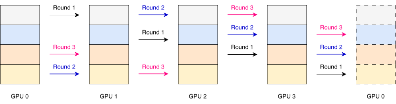
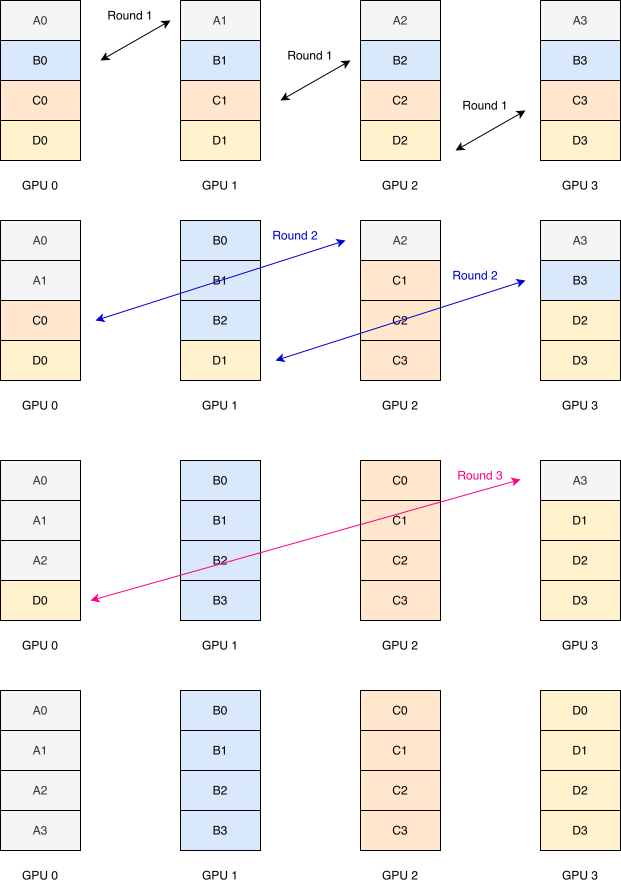

% Communication

集合通信（AllReduce/AllGather/...）在库里是“一行 API”，但底层要用一堆点对点的 `send`/`recv` 拼出来。**Ring（环）** 是最经典的拼法：把 \(P\) 张 GPU 逻辑上首尾相连成一个环，每张卡只和左右两个邻居通信，数据像接力一样绕环传递。

## 为什么用 ring：带宽最优

Ring 之所以成为大数据量集合通信的默认算法，核心原因是它**带宽最优（bandwidth-optimal）**：

- 每张卡在每一步只发送 \(M/P\) 大小的分片，同时从上游收到 \(M/P\)，**发送和接收各自占用一条独立链路，双工满载**。
- 经过 \(P-1\) 步，每张卡累计只发送了 \(\frac{P-1}{P}M\) 的数据——这已经是集合通信的理论下界，与 \(P\) 无关地逼近“只传一份数据”。

代价是**延迟随 \(P\) 线性增长**（要走满 \(P-1\) 跳），所以 ring 适合大 message、卡数不太多（如节点内 8 卡）的场景。


**Ring vs Tree —— NCCL 是怎么选的？**

| 算法 | 步数（延迟） | 单卡数据量（带宽） | 擅长 |
|---|---|---|---|
| **Ring** | \(O(P)\) | 最优，\(\frac{P-1}{P}M\) | 大 message、大数据量 |
| **Tree**（double-binary tree） | \(O(\log P)\) | 略差 | 小 message、大规模节点、延迟敏感 |

NCCL 会在运行时根据 message 大小、GPU 数、拓扑**自动切换** ring 与 tree（可用 `NCCL_ALGO` 强制）。此外 Hopper/Blackwell 上还有 **NVLS**（NVLink SHARP），把归约卸载到 NVSwitch 芯片里做，进一步降低 AllReduce 的链路往返。


## 通信原语

### all gather ring

AllGather 可以基于 ring 或者 tree 的通信方式实现：

### reduce scatter ring

ReduceScatter 是 AllGather 的“镜像”：数据同样分成 \(P\) 份绕环传 \(P-1\) 步，但每一跳除了转发还会**就地累加（reduce）**，最终每张卡只保留其中一个分片的完整归约结果。

以 TP4 为例，在 3 轮 ring 通信过后，假设完整数据分为 4 个 Shard A, B, C, D：

- GPU 3 持有 A 的 reduce 结果
- GPU 2 持有 B 的 reduce 结果
- GPU 1 持有 C 的 reduce 结果
- GPU 0 持有 D 的 reduce 结果

这也解释了开头的等式：**AllReduce = ReduceScatter（先各自归约出一片）+ AllGather（再把各片广播回全体）**，因此 AllReduce 的通信量恰好是单个原语的 2 倍。

### all2all ring

All2All 中每张卡都要把自己的第 \(j\) 块数据发给第 \(j\) 张卡，是 **MoE 的 Expert Parallel** 里最核心的通信模式——token 按照路由结果被分发到持有对应 expert 的卡上，算完再 All2All 收回。它没有归约，只有数据的重新分布，因此单卡通信量与 AllGather/ReduceScatter 同阶。

### latency estimate

#### AllGather, ReduceScatter, All2All 估算

**AllGather, ReduceScatter, All2All 的 ring 机制都类似**

\[\boxed{T_{\text{AllGather}} = T_{\text{All2All}} = T_{\text{ReduceScatter}} = (P-1) \times \frac{\text{local\_bytes}}{\text{BW\_unidirectional}}}\]

#### AllReduce 估算

**系数 2 来自 AllReduce**，它分两个阶段：

\[\boxed{T_{\text{AllReduce}} = 2(P-1) \times \frac{\text{local\_bytes}}{\text{BW\_unidirectional}}}\]

- Phase 1（ReduceScatter）：\((P-1)\) 步，每步传 \(M/P\)
- Phase 2（AllGather）：\((P-1)\) 步，每步传 \(M/P\)
- 合计乘 2

公式中的 **2 代表 AllReduce 的两个阶段**，不是 send/recv 双向。

**一个细节：BW 用单向还是双向？**

ring 上每个 GPU 同时在 send（到右邻居）和 recv（从左邻居），用的是两条**独立**链路，所以 `BW` 填的是**单向链路带宽**（unidirectional），不需要除以 2。NVLink 的 `600 GB/s` 是双向总带宽，单向是 `300 GB/s`，填公式时要用 `300`。
