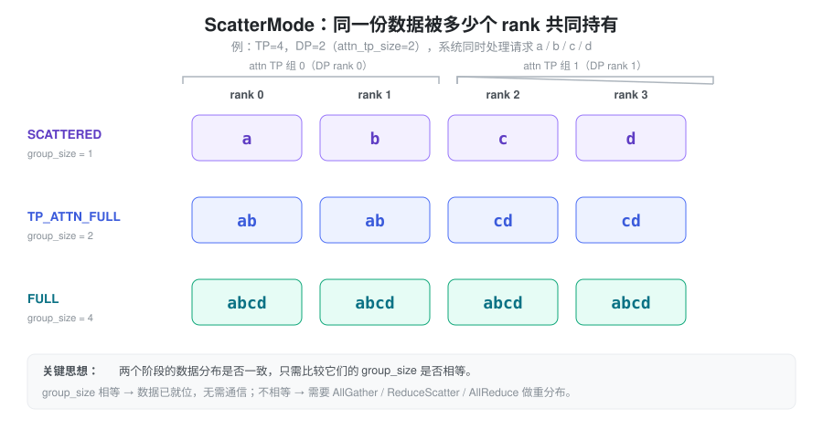
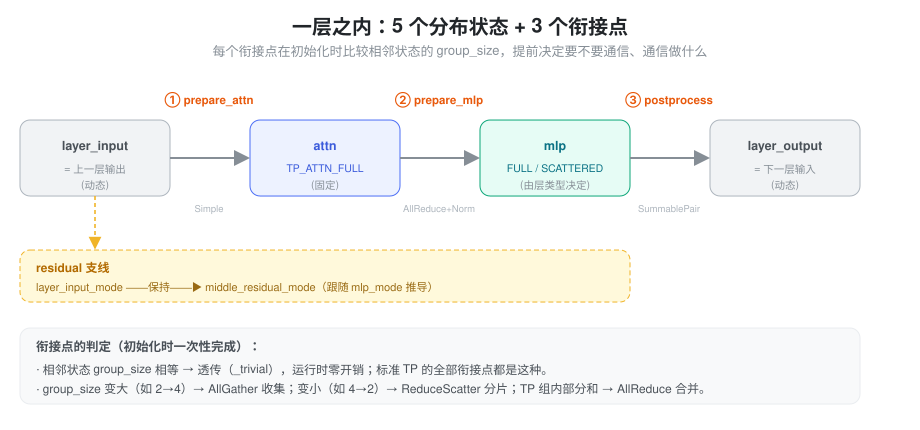
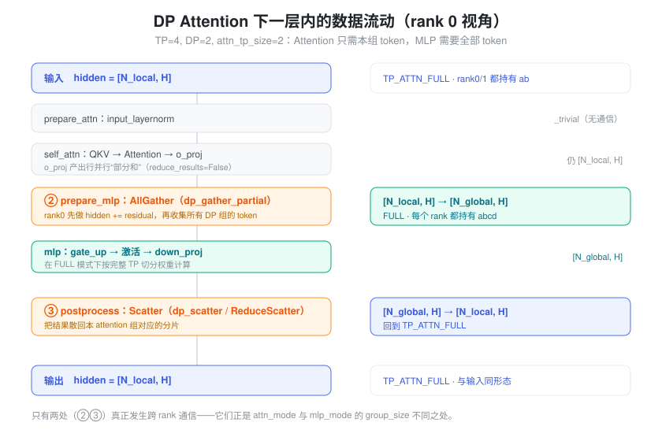

% Communicator

### 一、问题：数据在层内会处于不同的「分布状态」

一个 Transformer 层由 **Attention** 和 **MLP** 两个子模块串联而成。在张量并行（TP）下，两个子模块内部都用「列并行 → 行并行」的方式切分线性层，行并行线性层算完后得到的是各 rank 的**部分和**，需要一次 AllReduce 才能合并成完整结果。这就是经典的 Megatron-LM 范式：每层固定两次 AllReduce，所有 rank 自始至终持有相同的完整 token 序列，逻辑非常简单。

真正的复杂性来自 **DP Attention**：同一个 TP 组内，不同 rank 负责不同请求的注意力计算（数据并行地切分 token），但 MLP 的权重仍按完整 TP 切分、需要看到所有 token。于是同一份 hidden_states 在一层的不同阶段，处于**不同的分布状态**：

- Attention 阶段：每个 attention 子组只持有自己那部分 token
- MLP 阶段：需要把所有子组的 token 聚齐

要让计算正确，就必须在「阶段切换」的位置插入恰当的集合通信（AllGather / ReduceScatter / AllReduce），把数据从一种分布状态搬到另一种。

难点在于：这些通信**不是固定的**。它取决于并行配置（TP、DP、是否 DP Attention）、层的类型（dense 还是 MoE）、乃至具体的后端优化开关。如果在每个 forward 里用一堆 `if/else` 判断"现在该不该通信、该做哪种通信"，代码会迅速失控，而且每次 forward 都在重复做同样的判断，白白浪费时间。

`LayerCommunicator`（`layers/communicator.py`）就是为解决这个问题而生：**用一套统一的抽象描述"数据在层内各阶段的分布状态"，并在模型初始化时就把每个衔接点需要的通信操作推导好、绑定好**；运行时只管执行，不再判断。

---

### 二、抽象：用「分布状态」描述数据，用「状态差异」推导通信

#### 2.1 ScatterMode：同一份数据被几个 rank 共同持有

整套抽象的基石是一个很克制的概念 —— `ScatterMode`。它描述的不是"数据在哪个 rank 上"，而是一个更本质的量：**同一份数据，被多少个 rank 共同完整持有**。

以 TP=4、DP=2（因此每个 attention 子组 `attn_tp_size=2`）、系统同时处理请求 a/b/c/d 为例，三种核心状态是：

- **SCATTERED**：每个 rank 只独占一个分片（a、b、c、d 各一份），对应「持有者数量」= 1
- **TP_ATTN_FULL**：一个 attention TP 组内的 rank 持有本组完整数据（rank0/1 都有 ab，rank2/3 都有 cd），持有者数量 = `attn_tp_size` = 2
- **FULL**：所有 rank 都持有全部数据（abcd），持有者数量 = `tp_size` = 4

把「持有者数量」记为 `group_size`，抽象的精髓就浮现了：**判断两个阶段的数据分布是否一致，只需比较它们的 `group_size` 是否相等**。相等，说明数据已经在对的分布上，什么都不用做；不相等，就需要一次通信把它搬过去。至于搬的方向：

- `group_size` 变大（如 2 → 4）：数据要"铺开"给更多 rank → **AllGather**
- `group_size` 变小（如 4 → 2）：数据要"收拢"并顺带归约 → **ReduceScatter**
- 同一 `group_size` 内还是部分和：需要就地合并 → **AllReduce**

一个本来需要枚举各种配置组合的问题，被压缩成了「比较两个整数」。

#### 2.2 把一层拆成五个状态、三个衔接点

有了 `ScatterMode`，就可以给一个 Transformer 层标注出它内部的**五个分布状态**，以及状态之间的**三个衔接点**：

- 五个状态：`layer_input` → `attn` → `mlp` → `layer_output`，外加一条与它们并行的 `middle_residual`（残差支线）
- 三个衔接点：`prepare_attn`（进入注意力前）、`prepare_mlp`（注意力到 MLP 之间）、`postprocess_layer`（层末）

其中 `attn` 状态**固定为 `TP_ATTN_FULL`**（注意力计算要求 TP 组内看到相同的完整 token 序列），是整套推导的锚点。`mlp` 状态则是真正的"自由变量"，由层的类型决定（dense 还是 MoE、是否全 DP 等）；其余状态再由这两者向两端推导出来。

这样一来，是否需要通信就一目了然。举两个极端：

**标准 TP（无 DP Attention）**：此时 `attn_tp_size == tp_size`，意味着 `TP_ATTN_FULL` 和 `FULL` 的 `group_size` 相等。于是五个状态的 `group_size` 全都一样 —— 相邻状态之间没有任何重分布需求，三个衔接点全是"透传"。唯一的通信来自 attention 和 MLP 内部行并行层的 AllReduce，退化回经典 Megatron 范式。

**TP=4 + DP=2**：`attn` 的 `group_size` 是 2，`mlp`（FULL）是 4。于是 `attn(2) → mlp(4)` 要 AllGather，`mlp(4) → layer_output(2)` 要 Scatter。两处 group_size 不等的地方，恰好就是两处真正发生跨 rank 通信的地方。

#### 2.3 判定前移：初始化时推导，运行时零判断

抽象带来的最大收益是**把"要不要通信、通信做什么"的判断从运行时搬到了初始化时**。

模型构建时，`LayerScatterModes` 为每一层算好五个状态，`LayerCommunicator` 再据此为三个衔接点各**绑定一个静态函数**（透传、AllGather、ReduceScatter……）。此后每次 forward 直接调用绑定好的函数，不再有任何 `if/else`。这既消除了热路径上的分支开销，也让「不同配置 / 不同层类型自动得到不同通信方案」成为初始化期的自然结果，而不是散落在 forward 里的特判。

---

### 三、落到实现：三个衔接点各做什么

三个衔接点由三个策略类负责，每个类在初始化时根据相邻状态的组合选出一个具体实现。下面结合 Qwen3 + DP Attention（TP=4, DP=2）追踪 hidden_states 在一层中的形态变化，看这三处分别发生了什么：

**衔接点① `prepare_attn`（CommunicateSimpleFn）**　目标状态是固定的 `TP_ATTN_FULL`，所以只有两种可能：输入已经是 `TP_ATTN_FULL` → 直接透传（标准 TP、以及上一层输出就是 TP_ATTN_FULL 的情形）；输入是 `SCATTERED`（典型见于 MoE 的 all-to-all 场景，上一层输出是分片的）→ 做一次 **AllGather**，把各 rank 的分片拼回组内完整序列。

**衔接点② `prepare_mlp`（CommunicateWithAllReduceAndLayerNormFn）**　这是最关键也最复杂的衔接点，因为它要同时完成三件交织在一起的事：合并 attention 行并行层（o_proj）的部分和、把数据重分布到 MLP 需要的状态、以及应用 LayerNorm。三者的顺序正是性能优化的着力点：

- **标准 TP**：o_proj 的部分和在此处做 **AllReduce** 合并，然后 LayerNorm。在支持的架构上（如 SM90/SM100、batch 不过大），AllReduce 与 RMSNorm 会**融合成一个 kernel**，省掉中间一轮显存读写。
- **DP Attention**：各 attention 组只有部分 token，需要 **AllGather** 聚齐（`attn(2) → mlp(4)`）。一个常见优化是：当每个 rank 本就独立处理不同 token 时，先在小数据量上做 LayerNorm，再 AllGather，从而缩小 LayerNorm 的计算量。
- **MoE + all-to-all**：目标是 `SCATTERED`，于是用 **ReduceScatter** 替代 AllReduce —— 合并部分和的同时直接完成分片。由于省掉了 AllReduce 里"再 AllGather 回去"的那一半，通信量减半，后续 LayerNorm 的计算量也按 `attn_tp_size` 缩小。

**衔接点③ `postprocess_layer`（CommunicateSummableTensorPairFn）**　把 MLP 的结果送回下一层需要的状态。它的特点是 hidden_states 与 residual 是「可相加的」—— 需要时先相加再通信，只传一份数据。常见三种：group_size 不变 → 透传（标准 TP）；`FULL → TP_ATTN_FULL` → **Scatter** 把全局结果散回本 attention 组（若开启 padding 且允许，还可用 ReduceScatter 顺带完成 MLP down_proj 省下的那次归约）；`SCATTERED → TP_ATTN_FULL` → **AllGather**（MoE 场景的反向操作）。

对照上面的数据流图可以看到：**标准 TP 下三个衔接点几乎全是透传**，复杂度完全退化；只有 DP Attention / MoE 才会真正触发②③处的通信。这正是抽象想要的效果 —— 简单场景零负担，复杂场景也不需要上层写一行通信代码。

---

### 四、两个值得一提的设计细节

#### 4.1 mlp_mode 驱动的自动推导：混合模型自动适配

五个状态的推导核心是 `mlp_mode`：dense 层通常是 `FULL`（完全 DP 计算时才是 `SCATTERED`）；MoE 层在使用 all-to-all 后端时是 `SCATTERED`（token 的 dispatch/combine 由 MoE 层自理），否则 `FULL`。其余状态向两端跟随，`layer_input_mode` 则等于上一层的 `layer_output_mode`。

这个链式推导带来一个很优雅的性质：**对于 dense 层和 MoE 层混合的模型（如 Qwen3-MoE），每种层会自动得到各自的状态组合，衔接处的通信也随之自动适配**。比如 dense 层输出 `TP_ATTN_FULL`、下一个 MoE 层输入就是 `TP_ATTN_FULL`，衔接点①退化为透传；而若 MoE 层输出 `SCATTERED`、下一个 dense 层输入就是 `SCATTERED`，衔接点①自动变为 AllGather。整个过程在初始化时一次算完，运行时没有任何分支。

#### 4.2 attn_tp_input_scattered：prefill 阶段的 ReduceScatter 优化

除了 `LayerScatterModes` 驱动的主干，`communicator.py` 里还有一条独立的优化路径。思路是：prefill（extend）阶段 token 很多，如果 TP 组内每个 rank 都对全部 token 做 LayerNorm 和 QKV 投影，计算是冗余的。于是把上一层输出用 **ReduceScatter**（而非 AllReduce）分片到各 rank，每个 rank 只在 `1/tp_size` 的 token 上做 LayerNorm 和 QKV 投影，等到真正算 attention 之前再 AllGather 补齐。

由于 `AllReduce = ReduceScatter + AllGather`，通信总量不变，但 **LayerNorm 与 QKV 投影的计算量缩小了 `tp_size` 倍** —— 对 prefill 的长序列尤其划算。该优化目前限定在特定条件下启用（CUDA、带 `q_lora_rank`、非 DP Attention、非 MoE all-to-all 等）。

---

### 五、通信操作的最终落地：GroupCoordinator

无论抽象层选出的是 AllReduce、AllGather 还是 ReduceScatter，它们最终都落到 `GroupCoordinator`（`parallel_state.py`）执行。`GroupCoordinator` 不是对 `torch.distributed` 的简单封装，而是一个**多后端路由器**，按场景挑选最优实现：

- **AllReduce**：优先 CustomAllreduce（NVLink 上基于 IPC 共享内存，适合小 tensor）→ PyNccl（直调 `ncclAllReduce`）→ `torch.distributed`；CUDA Graph 模式下另走 out-of-place 实现。
- **AllGather / ReduceScatter**：优先 PyNccl 的 `ncclAllGather` / `ncclReduceScatter`，fallback 到 `torch.distributed`。

这些通信全部在 GPU 上经 NCCL 完成，走的是 GPU 间高速互联（NVLink/NVSwitch 或 PCIe）。它与 Scheduler 之间用 Gloo 走 CPU 传递请求元数据的通道，是**完全独立的两条链路**。

---

**小结**：`LayerCommunicator` 的价值不在于某个通信 kernel，而在于那层抽象 —— 把"层内数据分布"统一建模为 `ScatterMode`，把"要不要通信"化简为比较 `group_size`，并把全部判定前移到初始化。于是上层模型代码只需声明"这里是 prepare_attn / prepare_mlp / postprocess"，不必关心当前是标准 TP、DP Attention 还是 MoE —— 正确且高效的通信会被自动织入。
