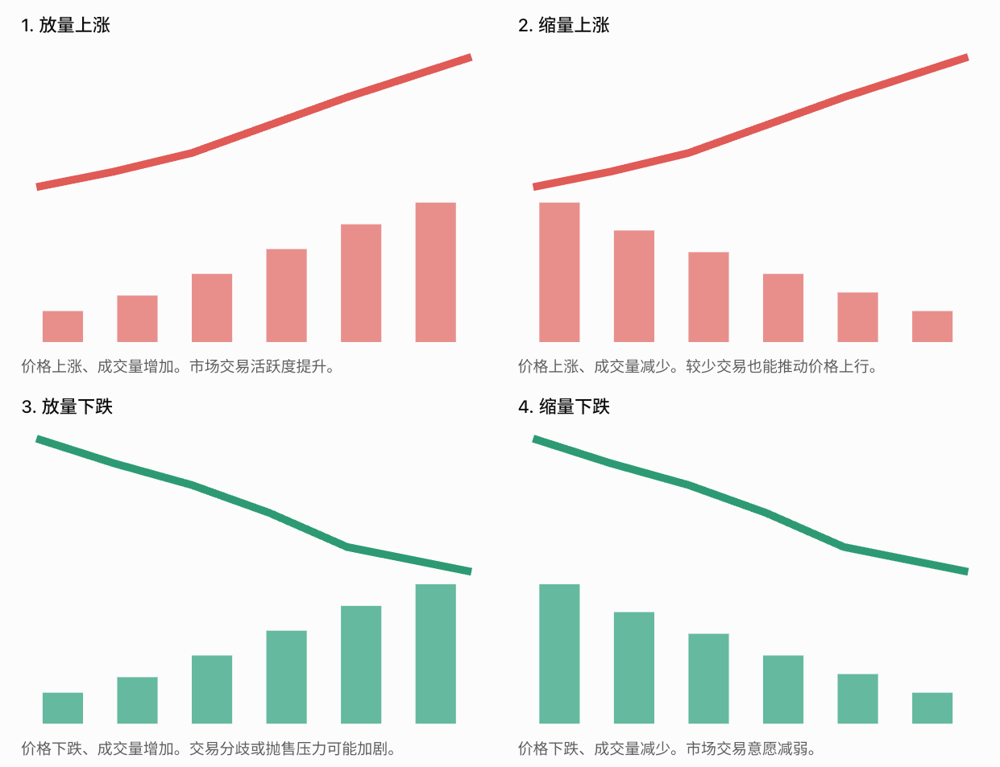

% 财务与技术分析基础

本页前半部分是基本面指标，回答公司赚钱的能力、质量和价格；从 VOL 开始是技术指标，回答交易行为和价格趋势。文中的数字示例都是为说明计算而虚构的，不对应具体公司。

### PE

PE（TTM）不是通常所说的静态 PE，而是滚动市盈率。 两者都使用已经实现的历史利润，但计算的时间范围不同。

| 类型                | 计算方式                    | 特点       |
| ----------------- | ----------------------- | -------- |
| 静态 PE（LYR）        | 当前总市值 ÷ 上一完整会计年度归母净利润   | 利润数据更新较慢 |
| 滚动 PE（TTM）        | 当前总市值 ÷ 最近连续 12 个月归母净利润 | 每季度随财报更新 |
| 动态 PE（Forward PE） | 当前总市值 ÷ 未来预计年度归母净利润     | 依赖盈利预测   |

实战要点：

- 股价可以拆成 \(P = EPS \times PE\)。股价上涨要么来自每股利润增长，要么来自估值扩张，复盘时先分清是哪一项。
- PE 用的是归母净利润。卖资产、公允价值变动等一次性收益会压低 PE，让公司看起来便宜，这时改用扣非净利润重算（见下文扣非净利润一节）。
- 强周期股的 PE 往往要反着看：利润在顶峰时 PE 最低，利润在谷底时 PE 很高甚至为负。这类公司改看 PB、EV/EBITDA 或周期平均利润（正常化盈利）。
- 利润为负或接近零时，PE 没有意义，不要拿来比较。

### PEG

PEG 把估值和增速放在一起看：

\[ PEG=\frac{PE}{\text{净利润年增速}\times 100} \]

例如 PE 为 30 倍、预期利润年均增长 30%，PEG = 30 / 30 = 1。

彼得·林奇常把 PEG ≈ 1 当作合理估值的参考，但这只是经验值：

- 增速必须是可持续的多年增速。用一年的高增速（尤其是低基数上的反弹）算出的 PEG 会严重偏低。
- 增速通常来自预测，PEG 的可靠性取决于预测的可靠性。
- 不适用于周期股（增速大起大落），也不适用于低增长的高分红公司（PEG 天然偏高，但股东回报主要来自分红）。

### PB、PS 与 EV/EBITDA

PE 失真时，常用三个替代指标：

| 指标         | 计算方式            | 适用场景                | 主要缺陷                         |
| ---------- | --------------- | ------------------- | ---------------------------- |
| PB（市净率）    | 总市值 ÷ 归母净资产     | 银行、保险、券商、强周期股       | 商誉、无形资产和资产减值会让净资产失真          |
| PS（市销率）    | 总市值 ÷ 营业收入      | 亏损或利润率尚未稳定的成长公司     | 忽略利润率，不同商业模式之间不可比            |
| EV/EBITDA  | 企业价值 ÷ 息税折旧摊销前利润 | 重资产、负债结构差异大的公司      | EBITDA 不扣资本开支，会高估重资产公司的现金回报 |

三者和 PE 之间有简单的换算关系（分子用同一时点的市值，分母取同一期间）：

\[ PB = PE \times ROE \qquad PS = PE \times \text{净利率} \]

所以 PB 高可能只是因为 ROE 高，PS 低可能只是因为净利率低。只看一个倍数判断贵贱，容易得出错误结论。

企业价值 EV 站在全体资本提供者（股东和债权人）的角度：

\[ EV = \text{总市值} + \text{有息负债} + \text{少数股东权益} - \text{现金及等价物} \]

EBITDA = EBIT + 折旧 + 摊销，EBIT 是息税前利润。分子分母的口径要对应：EV 属于全体资本提供者，对应扣利息之前的 EBITDA；市值只属于股东，对应扣利息之后的净利润。少数股东权益要加进 EV，因为合并报表的 EBITDA 包含了子公司的全部利润。
### ROE

ROE（Return on Equity，净资产收益率）衡量股东投入的每一元净资产，一年能赚多少利润：

\[ ROE=\frac{\text{归母净利润}}{\text{平均归母净资产}} \]

分母取期初和期末的平均值。A 股年报披露的“加权平均净资产收益率”还会按增发、分红发生的时间加权。季度 ROE 不能直接和年度 ROE 比较，要年化或改用 TTM 利润。

**1. 杜邦分解**

\[ ROE=\underbrace{\frac{\text{净利润}}{\text{营收}}}_{\text{净利率}}\times\underbrace{\frac{\text{营收}}{\text{总资产}}}_{\text{总资产周转率}}\times\underbrace{\frac{\text{总资产}}{\text{净资产}}}_{\text{权益乘数}} \]

ROE 的来源可能完全不同（数字为示意）：

| 类型   | 净利率 | 总资产周转率 | 权益乘数 | ROE   | 典型行业     |
| ---- | --- | ------ | ---- | ----- | -------- |
| 高利润率 | 40% | 0.4    | 1.25 | 20%   | 高端白酒、软件  |
| 高周转  | 4%  | 2.5    | 2.0  | 20%   | 零售、物流    |
| 高杠杆  | 35% | 0.03   | 12   | 12.6% | 银行       |

三种来源的风险不同：利润率依赖定价权，周转依赖运营效率，杠杆放大收益的同时也放大亏损。看到 ROE 上升时，先拆开看是哪一项在变。

**2. ROE 与长期回报**

公司把利润留存下来再投资，在不借新债、不增发的前提下，能支撑的增速是：

\[ g = ROE \times (1-\text{分红率}) \]

这叫可持续增长率。例如 ROE 为 20%、分红率为 50% 的公司，净资产和利润大约能以 10% 的速度增长。

常听到“长期持有的回报趋近 ROE”，这句话有前提。股东的长期回报 = 净资产增速 + 股息率 + 估值变化，买入价格决定了你实际拿到的收益率：

\[ \frac{E}{P}=\frac{ROE}{PB} \]

以 5 倍 PB 买入 ROE 为 20% 的公司，盈利收益率只有 4%。只有 ROE 长期稳定、留存利润能按同样的 ROE 再投资、并且估值不收缩时，回报才会接近 ROE。

**3. 常见陷阱**

- 回购和高分红会减少净资产，把 ROE 抬高，这不代表经营变好。
- 净资产接近零或为负时（长期大额回购、累计亏损），ROE 会变得极大或失去意义。
- 一次性收益会抬高当年 ROE，用扣非净利润计算更能反映主业。
- 大额资产减值会同时压低当年利润和净资产，减值之后几年的 ROE 会显得更好看。
### ROIC

ROIC（Return on Invested Capital，投入资本回报率）衡量经营业务占用的全部资本的回报，不论这些资本来自股东还是债权人：

\[ ROIC=\frac{NOPAT}{\text{投入资本}},\qquad NOPAT = EBIT\times(1-\text{税率}) \]

NOPAT 是税后经营利润。投入资本有两种算法，结果应大致相等：

- 融资角度：有息负债 + 股东权益（含少数股东权益） − 超额现金
- 经营角度：净营运资本 + 固定资产 + 无形资产 + 商誉等经营性长期资产

**1. 和 ROE 的区别**

ROE 受资本结构影响，同一门生意多借债，ROE 就会升高。ROIC 把债务和股权放在一起算，只反映生意本身的回报。

| 情况              | ROE | ROIC | 说明                  |
| --------------- | --- | ---- | ------------------- |
| 高杠杆             | 高   | 一般   | ROE 的高来自借债，不来自生意    |
| 账上大量闲置现金        | 偏低  | 高    | 现金拖累了 ROE，主业其实很赚钱   |
| 占用上下游资金（负营运资本） | 高   | 很高   | 投入资本小，供应商和客户在替公司出钱 |

**2. ROIC 与 WACC：增长什么时候创造价值**

WACC 是加权平均资本成本，即股东和债权人要求的综合回报率，是一个取决于利率和风险的假设值。只有 ROIC 高于 WACC，增长才创造价值。McKinsey《价值评估》中的价值驱动公式把这一点写得很清楚：

\[ \text{价值}=\frac{NOPAT\times\left(1-\dfrac{g}{ROIC}\right)}{WACC-g} \]

其中 NOPAT 取下一年的值，\(g/ROIC\) 是再投资率，即为了实现增速 g 需要把多少比例的利润再投入，剩下的才是自由现金流。假设 NOPAT = 100、WACC = 8%、永续增速 g = 5%：

| ROIC | 再投资率  | 自由现金流 | 价值   |
| ---- | ----- | ----- | ---- |
| 20%  | 25%   | 75    | 2500 |
| 8%   | 62.5% | 37.5  | 1250 |
| 5%   | 100%  | 0     | 0    |

不增长时的价值是 100 / 8% = 1250。ROIC 等于 WACC 时，增长没有增加任何价值；ROIC 低于 WACC 时，增长反而在毁掉价值。这就是同样的增速下，高 ROIC 公司值更高估值的原因。

**3. 实战注意**

- 不同数据库的 ROIC 口径差别很大（是否扣除现金、是否含商誉、用期初还是平均资本），横向比较要用同一来源，最好自己按同一口径算。
- 并购形成大额商誉时，含商誉的 ROIC 反映这笔收购是否划算，不含商誉的 ROIC 反映被收购业务本身的质量。
- 趋势比单年数值重要。ROIC 长期稳定在高位，通常意味着有竞争壁垒；扩产期 ROIC 下降，要看新产能投产后能否回升。
### 扣非净利润

扣非净利润是扣除非经常性损益之后的归母净利润，是 A 股特有的披露口径。非经常性损益的常见项目有：与正常经营无关的政府补助、资产处置损益、金融资产的公允价值变动和处置收益、单独减值测试的应收款项减值准备转回。

- 先算非经常性损益占归母净利润的比例。比例高或者每年波动大时，用扣非净利润重算 PE 和 ROE。
- 扣非也会误伤：投资控股类公司的投资收益就是主业，某些行业的补贴长期稳定存在。
- 商誉、存货等资产减值通常不算非经常性损益，会同时拉低扣非净利润。判断主业时，要单独看减值的规模和是否会反复发生。

### 现金流与盈利质量

利润按权责发生制计算，现金流是实际收付的钱。两者长期背离，往往说明利润质量有问题。

\[ \text{净现比}=\frac{\text{经营活动现金流量净额}}{\text{净利润}} \]

\[ FCF=\text{经营活动现金流量净额}-\text{资本开支} \]

资本开支通常取现金流量表中的“购建固定资产、无形资产和其他长期资产支付的现金”。

- 净现比长期大于 1 比较健康，因为折旧摊销计入了成本却不需要付现金。连续多年小于 1 时，先查应收账款和存货是否在膨胀。
- FCF 为负不一定是坏事。扩产期资本开支大，只要新投资的 ROIC 高，负 FCF 就是在为未来增长付钱。要区分维持性资本开支（不花就会萎缩）和扩张性资本开支。
- FCF 收益率 = FCF ÷ 总市值，可以理解为买下整家公司后每年能拿回多少现金，适合和国债收益率、股息率对照。
- 美股科技公司大量使用股权激励（SBC）。SBC 是费用但不付现金，会被加回经营现金流，比较时用 FCF − SBC 更保守。
- 银行、保险等金融企业的经营现金流包含存贷款、保费等资金往来，不适用这套分析。

### 现金转换周期

\[
\begin{aligned}
\text{应收周转天数 DSO} &= \frac{\text{应收}}{\text{营收}}\times 365\\
\text{存货周转天数 DIO} &= \frac{\text{存货}}{\text{营业成本}}\times 365\\
\text{应付周转天数 DPO} &= \frac{\text{应付}}{\text{营业成本}}\times 365\\
\text{现金转换周期 CCC} &= DSO + DIO - DPO
\end{aligned}
\]

CCC 是公司从付钱给供应商到从客户收回钱之间隔了多少天。CCC 越短，增长需要垫付的营运资本越少。CCC 为负，说明供应商和客户在替公司提供资金，规模越大，账上沉淀的现金越多，强势的龙头制造企业和预收款模式的消费品公司常见这种情况。

A 股实战注意：

- 应收要合并看：应收账款 + 应收票据 + 应收款项融资 + 合同资产。只看应收账款会漏掉票据，也会漏掉已确认收入但尚未结算的部分。
- 应付同理：应付账款 + 应付票据。合同负债是客户预付的钱，不计入 DPO，但它的增长通常说明下游需求旺盛。
- 警示信号：应收增速持续高于营收增速，说明可能在放宽信用换增长；存货大增而毛利率下降，说明产品可能卖不动或要降价。
- 分子用期初和期末的平均值更准确。用季度数据时，365 要换成 91，或先把营收和成本年化。
### 负债与偿债能力

| 指标          | 计算方式                  | 看什么                          |
| ----------- | --------------------- | ---------------------------- |
| 资产负债率       | 总负债 ÷ 总资产             | 总体杠杆，但包含应付账款、合同负债等无息负债       |
| 有息负债率       | 有息负债 ÷ 总资产            | 真正需要付息还本的债务                  |
| 净负债 / EBITDA | （有息负债 − 现金）÷ EBITDA   | 用经营利润还清净债务需要几年               |
| 利息保障倍数      | EBIT ÷ 利息费用           | 利润能覆盖几倍利息                    |
| 流动比率 / 速动比率 | 流动资产（速动比率扣除存货）÷ 流动负债 | 短期偿债能力                       |

有息负债一般包括短期借款、长期借款、应付债券、一年内到期的非流动负债和租赁负债。

- 资产负债率高不一定危险。占用上下游资金的公司，负债大多是应付账款和合同负债，这反而体现了议价能力。看有息负债更准确。
- 按常见经验，净负债 / EBITDA 超过 3 到 4 倍属于高杠杆，周期下行时风险大。
- A 股要警惕“存贷双高”：账上现金很多，有息负债也很多，利息收入却很低。这可能意味着现金受限甚至不真实。

### 股息率与股东回报

\[ \text{股息率}=\frac{\text{近 12 个月每股分红}}{\text{股价}},\qquad \text{分红率}=\frac{\text{分红总额}}{\text{归母净利润}} \]

股东回报除了分红还有回购：

\[ \text{股东收益率}=\text{股息率}+\frac{\text{回购金额}-\text{新股发行金额}}{\text{总市值}} \]

- 回购后注销才会真正减少股本、提高每股收益。用于员工持股计划的回购股份，最终会重新流通。
- 分红率和 ROE 一起决定增长，留存部分按 ROE 再投资（见 ROE 一节的可持续增长率）。成长期公司低分红是合理的；成熟期公司 ROE 已经下降却不提高分红，说明资本配置有问题。
- 高股息率可能是价值陷阱：股价因利润下滑而下跌，抬高了按历史分红算出的股息率。要看利润和现金流能否持续覆盖分红。
### ARR 与订阅业务指标

订阅制公司（SaaS、云服务）前期获客成本高，利润常为负，PE 不适用。市场主要看收入的规模、持续性和扩张效率，估值常用 EV / ARR 或 EV / 下一年收入，倍数高低主要由增速和留存率决定。

**1. ARR**

ARR（Annual Recurring Revenue，年度经常性收入）是某一时点上所有有效订阅合同折算成一年的收入：

\[ ARR = \text{期末 MRR} \times 12 \]

MRR 是月度经常性收入。ARR 和财报收入的区别：

- ARR 是时点值（存量），收入是期间值（流量）。ARR 的增长领先于收入，因为新签合同要在之后几个季度里逐步确认收入。
- ARR 不是会计准则指标，各公司定义不同。是否包含按用量计费、一次性服务费，多年合同怎样折算，都要看公司自己的口径。
- AI 公司常说的 run-rate revenue（年化收入）通常是最近一个月的收入乘以 12。它包含按调用量计费的部分，没有合同锁定，波动比订阅 ARR 大得多，不能和传统 SaaS 的 ARR 直接比较。

**2. 留存率**

\[ NRR=\frac{\text{期初 ARR}+\text{扩容}-\text{降级}-\text{流失}}{\text{期初 ARR}} \]

\[ GRR=\frac{\text{期初 ARR}-\text{降级}-\text{流失}}{\text{期初 ARR}} \]

两者都只统计 12 个月前就已存在的老客户，不含新客户。

- NRR（净收入留存率，也叫 NDR）大于 100%，表示即使一个新客户都不签，老客户贡献的收入也在增长。
- GRR（总收入留存率）不会超过 100%，反映产品黏性。NRR 高而 GRR 低，说明少数大客户的扩容掩盖了大量客户流失。

**3. 增长效率**

- Rule of 40：收入增速 + 利润率（常用 FCF 利润率）≥ 40%，被视为增长与盈利平衡得较好。例如收入增长 30%、FCF 利润率 10%，合计正好 40。
- CAC 回收期：获取客户花掉的销售和营销费用，需要多少个月的毛利才能收回。

\[ \text{CAC 回收期（月）}=\frac{\text{销售和营销费用}}{\text{新增 ARR}\times\text{毛利率}}\times 12 \]

例如一年的销售和营销费用为 120，同期新增 ARR 为 100，毛利率 80%，回收期为 120 ÷ (100 × 80%) × 12 = 18 个月。

- RPO（剩余履约义务）是已签合同中尚未确认为收入的金额，cRPO 是其中未来 12 个月内将确认的部分。对云计算和算力租赁公司，RPO（积压订单）是比 ARR 更前瞻的指标，但要同时看客户集中度和合同的可取消条款。
### 指标的选择与组合

不同类型的公司，定价看的变量不同：

| 公司类型                | 主要估值指标              | 重点经营指标                |
| ------------------- | ------------------- | --------------------- |
| 消费、成熟制造             | PE、FCF 收益率、股息率      | ROE、毛利率、净现比           |
| 银行                  | PB、股息率              | ROE、不良率、拨备覆盖率、净息差     |
| 保险                  | PEV（市值 ÷ 内含价值）、PB   | 新业务价值、投资收益率           |
| 强周期（有色、化工、航运）       | PB、EV/EBITDA、正常化盈利  | 产品价格、库存、产能投放          |
| 重资产运营（电力、通信运营商、算力租赁） | EV/EBITDA           | ROIC、净负债 / EBITDA、利用率 |
| 订阅软件、云服务            | EV/ARR、EV/收入        | NRR、Rule of 40、RPO   |
| 未盈利的高成长（创新药、早期科技）   | PS、管线或分部估值          | 现金消耗速度、现金能支撑的月数       |

一个指标只回答一个问题。分析一家公司时，可以按这个顺序检查：

1. 赚不赚钱：ROE、ROIC 的水平和趋势，用杜邦分解看来源。
2. 赚的是不是真钱：扣非净利润、净现比、FCF、应收和存货的变化。
3. 会不会出事：有息负债、净负债 / EBITDA、有没有存贷双高。
4. 给股东多少：分红率、股东收益率。
5. 价格贵不贵：选和行业匹配的估值指标，用 \(P = EPS \times PE\) 拆开看价格变化来自利润还是估值。

### VOL

VOL（Volume，成交量）是股票技术分析中最基础、也最值得理解的指标之一。

\[ 成交额=\sum_i 成交价格_i\times 成交股数_i \]

\[ 换手率=\frac{当日成交股数}{流通股数}\times100\% \]

### MA

MA（Moving Average，移动平均线），也就是股票 K 线图中的均线，反应过去 N 个交易日收盘价的平均值。

- MA5：一周左右的短期趋势
- MA20：约一个月的趋势
- MA60：约一个季度的趋势
- MA120：约半年的趋势
- MA250：约一年的趋势

### EMA

EMA（Exponential Moving Average，指数移动平均线）是 MA 的一种变体。

它与普通 MA（通常指 SMA，简单移动平均线）的核心区别是：

- SMA：计算窗口内，每一天的价格权重相同。
- EMA：越近的价格权重越高，越久远的价格权重越低。

因此，EMA 通常比相同周期的 SMA 对近期股价变化更敏感。

**1. EMA 如何计算？**

EMA 使用递推公式：

\[ \boxed{\text{EMA}_t=\alpha \text{P}_t+(1-\alpha)\text{EMA}_{t-1}} \]

其中：

- \(\text{P}_t\)：今天的收盘价
- \(\text{EMA}_{t-1}\)：昨天的 EMA
- \(\alpha\)：平滑系数

**2. 为什么叫指数移动平均？**

把 EMA 递推公式展开：

\[ \text{EMA}_t=\alpha \text{P}_t+\alpha(1-\alpha)\text{P}_{t-1} +\alpha(1-\alpha)^2\text{P}_{t-2}+\cdots \]

可以看到，历史价格的权重按照等比数列衰减。

**3. 为什么 MACD 使用 EMA 而不是 SMA？**

因为 MACD 希望 **衡量短期与长期价格趋势的差异及其变化。**

其核心公式：

\[ \text{DIF}=\text{EMA}_{12}-\text{EMA}_{26} \]

EMA12 对近期价格变化更敏感，而 EMA26 变化较慢。

当股价开始加速上涨时，EMA12 通常会更快上升，导致 DIF 增大。

当上涨动量减弱时，DIF 可能开始下降，即使股价仍然上涨。

这就是 MACD 能够反映一定程度的趋势动量变化的数学原因。

总结：SMA 是固定窗口的等权平均，EMA 是历史权重指数衰减的平均。MACD 则进一步利用快慢 EMA 的差值及其平滑结果，观察价格趋势和动量的变化。

### MACD

MACD 指标中的三个缩写：

| 缩写   | 英文全称                                  | 中文含义           |
| ---- | ------------------------------------- | -------------- |
| DIF  | Difference                            | 差离值（快慢 EMA 之差） |
| DEA  | Difference Exponential Average        | DIF 的指数平滑平均值   |
| MACD | Moving Average Convergence Divergence | 移动平均收敛发散指标     |

需要注意：DIF 和 DEA 的英文展开并不像 MACD 那样具有完全统一的国际命名，尤其 DEA 主要见于国内行情软件。

在东方财富等国内软件中，常见公式为：

\[
\begin{aligned} \text{DIF} &= \text{EMA}_{12}-\text{EMA}_{26}\\
\text{DEA} &= \text{EMA}_9(\text{DIF})\\
\text{MACD} &= 2(\text{DIF}-\text{DEA})
\end{aligned}
\]

其中，最后一个 MACD 指的是柱状图的数值，而 MACD 也可以指整个指标体系。

国际上通常将柱状图称为 MACD Histogram，一般采用 \(\text{DIF}-\text{DEA}\)，不乘以 2。

记忆时可以理解为：

- DIF：快慢均线的差距。
- DEA：这个差距的平滑趋势。
- MACD 柱：当前差距相对于其平滑趋势的偏离程度。

因此，MACD 本质上是在研究均线差值及其变化。

### RSI

RSI 全称 Relative Strength Index，相对强弱指数，由 J. Welles Wilder 提出。

它并不直接衡量股票涨了多少钱，而是衡量一段时间内上涨幅度与下跌幅度的相对关系。

以 RSI(14) 为例：

1. 统计最近 14 个交易日每天的价格变化。
2. 将上涨日的涨幅和下跌日的跌幅分别处理。
3. 分别计算平滑后的平均上涨幅度、平均下跌幅度。
4. 根据二者的比例计算 RSI。

公式：

\[ RS=\frac{\text{平均上涨幅度}}{\text{平均下跌幅度}} \]

\[ RSI=100-\frac{100}{1+RS} \]

这里的平均值，标准 RSI 使用 Wilder 平滑方法，不是简单地每次只计算最近 14 天的算术平均。

RSI 和 MACD 都被称为动量指标（Momentum Indicators），但它们衡量的并不是同一种动量。

- RSI：衡量近期上涨与下跌的相对强度。 关注的是最近一段时间，多头与空头谁更占优势。
- MACD：衡量短期与长期价格趋势之间的差异。 关注的是价格趋势的强弱及其变化。

一个重要区别是：RSI 是有界的相对强弱指标（0～100），MACD 是无固定上下界的趋势差指标。

