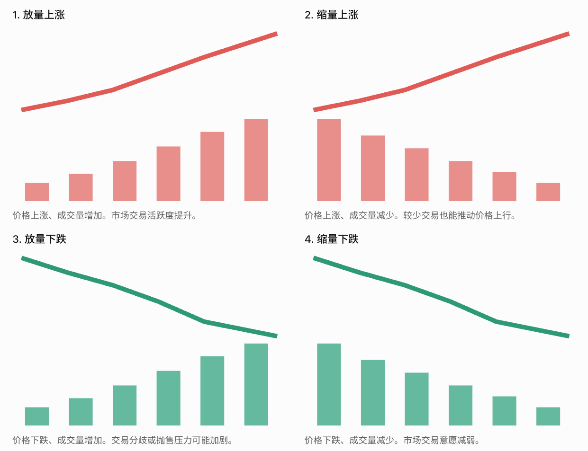

% 技术分析基础

### PE

PE（TTM）不是通常所说的静态 PE，而是滚动市盈率。 两者都使用已经实现的历史利润，但计算的时间范围不同。

| 类型                | 计算方式                    | 特点       |
| ----------------- | ----------------------- | -------- |
| 静态 PE（LYR）        | 当前总市值 ÷ 上一完整会计年度归母净利润   | 利润数据更新较慢 |
| 滚动 PE（TTM）        | 当前总市值 ÷ 最近连续 12 个月归母净利润 | 每季度随财报更新 |
| 动态 PE（Forward PE） | 当前总市值 ÷ 未来预计年度归母净利润     | 依赖盈利预测   |

### VOL

VOL（Volume，成交量）是股票技术分析中最基础、也最值得理解的指标之一。

\[ 成交额=\sum_i 成交价格_i\times 成交股数_i \]

\[ 换手率=\frac{当日成交股数}{流通股数}\times100\\% \]

### MA

MA（Moving Average，移动平均线），也就是股票 K 线图中的均线，反应过去 N 个交易日收盘价的平均值。

- MA5：一周左右的短期趋势
- MA20：约一个月的趋势
- MA60：约一个季度的趋势
- MA120：约半年的趋势
- MA250：约一年的趋势

### EMA

EMA（Exponential Moving Average，指数移动平均线）是 MA 的一种变体。

它与普通 MA（通常指 SMA，简单移动平均线）的核心区别是：

- SMA：计算窗口内，每一天的价格权重相同。
- EMA：越近的价格权重越高，越久远的价格权重越低。

因此，EMA 通常比相同周期的 SMA 对近期股价变化更敏感。

**1. EMA 如何计算？**

EMA 使用递推公式：

\[ \boxed{\text{EMA}_t=\alpha \text{P}_t+(1-\alpha)\text{EMA}_{t-1}} \]

其中：

- \(\text{P}_t\)：今天的收盘价
- \(\text{EMA}_{t-1}\)：昨天的 EMA
- \(\alpha\)：平滑系数

**2. 为什么叫指数移动平均？**

把 EMA 递推公式展开：

\[ \text{EMA}_t=\alpha \text{P}_t+\alpha(1-\alpha)\text{P}_{t-1} +\alpha(1-\alpha)^2\text{P}_{t-2}+\cdots \]

可以看到，历史价格的权重按照等比数列衰减。

**3. 为什么 MACD 使用 EMA 而不是 SMA？**

因为 MACD 希望 **衡量短期与长期价格趋势的差异及其变化。**

其核心公式：

\[ \text{DIF}=\text{EMA}_{12}-\text{EMA}_{26} \]

EMA12 对近期价格变化更敏感，而 EMA26 变化较慢。

当股价开始加速上涨时，EMA12 通常会更快上升，导致 DIF 增大。

当上涨动量减弱时，DIF 可能开始下降，即使股价仍然上涨。

这就是 MACD 能够反映一定程度的趋势动量变化的数学原因。

总结：SMA 是固定窗口的等权平均，EMA 是历史权重指数衰减的平均。MACD 则进一步利用快慢 EMA 的差值及其平滑结果，观察价格趋势和动量的变化。

### MACD

MACD 指标中的三个缩写：

| 缩写   | 英文全称                                  | 中文含义           |
| ---- | ------------------------------------- | -------------- |
| DIF  | Difference                            | 差离值（快慢 EMA 之差） |
| DEA  | Difference Exponential Average        | DIF 的指数平滑平均值   |
| MACD | Moving Average Convergence Divergence | 移动平均收敛发散指标     |

需要注意：DIF 和 DEA 的英文展开并不像 MACD 那样具有完全统一的国际命名，尤其 DEA 主要见于国内行情软件。

在东方财富等国内软件中，常见公式为：

\[
\begin{aligned} \text{DIF} &= \text{EMA}_{12}-\text{EMA}_{26}\\
\text{DEA} &= \text{EMA}_9(\text{DIF})\\
\text{MACD} &= 2(\text{DIF}-\text{DEA})
\end{aligned}
\]

其中，最后一个 MACD 指的是柱状图的数值，而 MACD 也可以指整个指标体系。

国际上通常将柱状图称为 MACD Histogram，一般采用 \(\text{DIF}-\text{DEA}\)，不乘以 2。

记忆时可以理解为：

- DIF：快慢均线的差距。
- DEA：这个差距的平滑趋势。
- MACD 柱：当前差距相对于其平滑趋势的偏离程度。

因此，MACD 本质上是在研究均线差值及其变化。

### RSI

RSI 全称 Relative Strength Index，相对强弱指数，由 J. Welles Wilder 提出。

它并不直接衡量股票涨了多少钱，而是衡量一段时间内上涨幅度与下跌幅度的相对关系。

以 RSI(14) 为例：

1. 统计最近 14 个交易日每天的价格变化。
2. 将上涨日的涨幅和下跌日的跌幅分别处理。
3. 分别计算平滑后的平均上涨幅度、平均下跌幅度。
4. 根据二者的比例计算 RSI。

公式：

\[ RS=\frac{\text{平均上涨幅度}}{\text{平均下跌幅度}} \]

\[ RSI=100-\frac{100}{1+RS} \]

这里的平均值，标准 RSI 使用 Wilder 平滑方法，不是简单地每次只计算最近 14 天的算术平均。

RSI 和 MACD 都被称为动量指标（Momentum Indicators），但它们衡量的并不是同一种动量。

- RSI：衡量近期上涨与下跌的相对强度。 关注的是最近一段时间，多头与空头谁更占优势。
- MACD：衡量短期与长期价格趋势之间的差异。 关注的是价格趋势的强弱及其变化。

一个重要区别是：RSI 是有界的相对强弱指标（0～100），MACD 是无固定上下界的趋势差指标。

