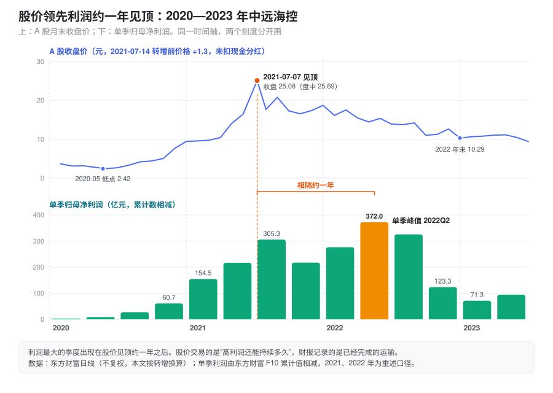
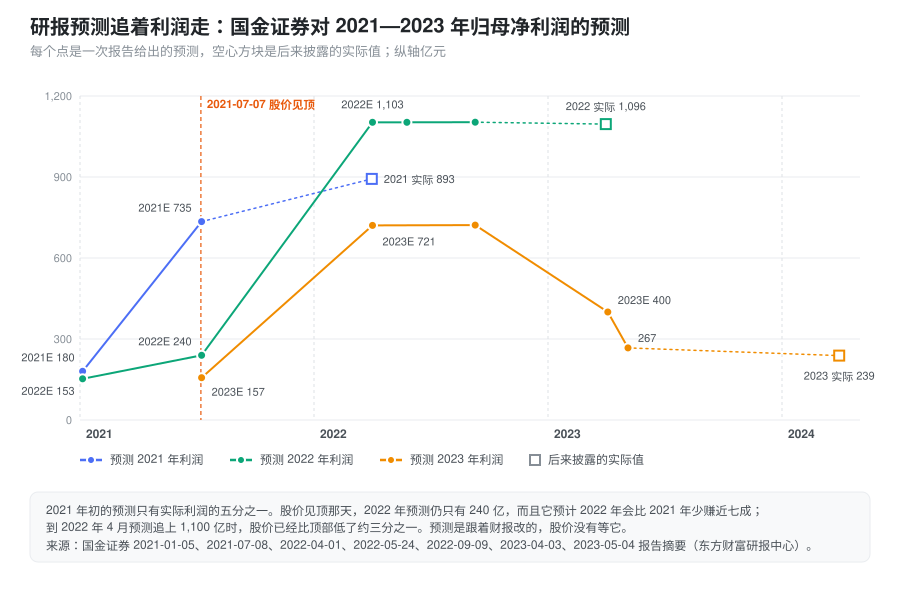

% 中远海控：股价、运价与盈利周期复盘

**中远海控过去几轮行情的核心，是市场对“高运价能持续多久、赚到的钱能留下多少、又能分出多少”的反复修正。利润增长最快的时候，未必是股价最有空间的时候；最低的表观 PE，也可能对应最高、最不可持续的利润。**

本文研究中远海运控股股份有限公司，A 股为上交所 **601919.SH**，H 股为港交所 **01919.HK**；股价以 A 股人民币价格为主。用户所称“中海远控”按“中远海控”理解。主研究期为最近六个完整自然年 **2020—2025 年**，补充早期周期作为背景，2026 年单列。资料提取与信息截止日为 **2026-11-17**；可核验的行情页面仅更新至 **2026-10-16**，财报更新至 2026 年三季报，两者不视为同日快照。

可以先把这段历史分为四个阶段：

- 疫情前：长期供给压力、盈利脆弱，规模优势尚未稳定转化为资本回报。
- 2020—2022 年：供应链拥堵推高运价，利润爆发；股价先上行，又提前交易正常化。
- 2023 年：运价与利润回落，市场重新评估现金、资产负债表与分红价值。
- 2024—2026 年：绕航等供给扰动带来新一轮盈利波动，判断重点变为正常利润中枢是否提高。

## 历史定价与数据边界

### 先区分成交价格、复权价格和股东回报

下表仅列行情源可读取的**不复权成交价格**，用于定位阶段，不能直接据此计算跨年投资收益。年内高低点取盘中价格，不等于收盘价极值。

| 年份 | 年末收盘价（元） | 可核验的阶段价格锚点 |
| --- | ---: | --- |
| 2020 | 12.21 | 年内盘中低点 3.14 元，5 月 22 日 |
| 2021 | 18.69 | 7 月 7 日盘中高点 33.40 元，发生在转增前 |
| 2022 | 10.29 | 疫情超级周期后的价格回落阶段 |
| 2023 | 9.58 | 年内盘中低点 9.30 元，6 月 29 日 |
| 2024 | 15.50 | 年内盘中高点 17.58 元，6 月 6 日 |
| 2025 | 15.18 | 年内盘中高点 16.89 元，5 月 23 日 |
| 2026 YTD，截至 10 月 16 日 | 16.88（阶段末） | 不代表 11 月 17 日价格或全年表现 |

价格来源：[青柠量化历年行情页](https://www.zpyztech.com/stock/601919/fupan/)，页面标注数据截至 2026-10-16。2020 年数值及下文“按时间线复盘”一节的 2020—2023 年价格，取自东方财富 A 股不复权日线（2026-11-18 提取），与上述供应商在重叠日期一致。

**2021 年的 33.40 元不能直接与后来的 15 元比较。** 公司于 2021 年 7 月 14 日实施每 10 股转增 3 股。只考虑这次转增，33.40 元对应的新股数口径价格约为 **25.69 元**；其后现金分红还需继续调整。转增本身不创造收益，也不导致相同比例的财富损失。依据：[2020 年度权益分派实施公告](https://pdf.dfcfw.com/pdf/H2_AN202107071502359554_1.pdf)，公告日 2021-07-08。

现金分红也有相同的比较问题。2022 年度归属的利润分配，不等于 2022 自然年实际收到的全部股息；跨期收益应使用逐次除权信息重建复权序列，或明确采用现金持有、股息再投资中的一种总回报口径。行情页对 2022 年部分分红的分类存在疑点，本文不沿用其含分红年收益、历史回撤和“回本日期”统计。

### 为什么没有照搬完整的年度 PE 表

本次未取得可核验的、同供应商且遵循当时披露日的日度 PE（TTM）序列；因此 **2020—2025 年的全年平均、最低及日期、最高及日期、年末 PE 均暂缺**，2026 YTD 同样未统计。不能用当年年末价格除以后来公布的全年 EPS，冒充当时的 TTM PE。

多地上市还会引入另一项差异：A 股价格乘全部股本，是把 H 股也假设按 A 股定价的等价市值；实际合计市值则应为 A 股价格乘 A 股股数，加 H 股价格乘 H 股股数并换算币种。两种口径不能混接。本文不引用来源不清的 PE 历史分位，也不把不同网站的极值拼成年度统计。

## 结合利润增长，理解股价为什么提前转向

金额单位为人民币亿元。2020—2022 年采用各年年报**首次披露值**，2023—2025 年采用 2025 年报所列可比值；同比采用相应报告的可比口径，不能把相邻两行跨版本相除代替。所有全年利润都是事后验证数据，不代表当年每个交易日市场已经知道。

| 报告期 | 营业收入 | 归母净利润 | 归母同比 | 经营现金流净额 | 周期含义 |
| --- | ---: | ---: | ---: | ---: | --- |
| 2020 | 1,712.59 | 99.27 | +46.76% | 450.31 | 下半年供需错配开始体现 |
| 2021 | 3,336.94 | 892.96 | +799.52% | 1,709.48 | 运价上涨显著放大利润 |
| 2022 | 3,910.58 | 1,095.95 | +22.66% | 1,967.99 | 全年利润创新高，下半年行业转弱 |
| 2023 | 1,754.53 | 238.60 | -78.25% | 225.84 | 超级周期退潮 |
| 2024 | 2,338.59 | 491.00 | +105.78% | 693.13 | 运价反弹带来盈利恢复 |
| 2025 | 2,195.04 | 308.68 | -37.13% | 455.46 | 利润再次回落 |
| 2026 年 1—9 月 | 1,876.14 | 306.49 | +13.22% | 479.09 | 三季度回升，不能年化为全年结论 |

来源与披露日期：

- [2020 年报](https://www.hkexnews.hk/listedco/listconews/sehk/2021/0330/2021033003364_c.pdf)，2021-03-30，主要财务数据及经营讨论。
- [2021 年报](https://dataclouds.cninfo.com.cn/shgonggao/2022/2022-03-31/e8219322b03811ec945cfa163e26e5de.pdf)，2022-03-31，主要财务数据及经营讨论。
- [2022 年报](https://www.hkexnews.hk/listedco/listconews/sehk/2023/0331/2023033100387_c.pdf)，2023-03-31，主要财务数据及现金流。
- [2024 年报摘要](https://static.cninfo.com.cn/finalpage/2025-03-22/1222870536.PDF)，2025-03-22，近三年数据；[2025 年报](https://static.cninfo.com.cn/finalpage/2026-03-20/1225019947.PDF)，2026-03-20，第 7 页起，2023—2025 年可比数据。
- [2026 年三季报](https://static.cninfo.com.cn/finalpage/2026-10-30/1225642417.PDF)，2026-10-30，第 2 页；报告未经审计。

2022 年首次披露的归母净利润为 1,095.95 亿元，2024 年报摘要所列重述值为 **1,097.03 亿元**。差异涉及会计政策及后续比较报表调整，不能解释成经营利润新增。2022 年报所列 2021 年可比利润已调整为 893.49 亿元，因此其 +22.66% 不以表中首次披露的 892.96 亿元为分母。2023 年的 -78.25% 同样以重述后的上年数计算。[2023 年度业绩预减公告](https://hold.coscoshipping.com/cms_files/filemanager/1631/attach/202312/9d7b414bc5bd45b3a7da5d0e5ca95c31.pdf)明确说明执行《企业会计准则解释第 16 号》引起的重述；公告落款 2024-01-10。

### 早期背景：不能把原中国远洋的全部历史当成今天的集运周期

早期公司包含干散货业务。2015 年底启动的重大重组剥离干散货、整合集运与港口资产，改变了盈利来源；2018 年东方海外收购完成，又扩大了双品牌经营范围。因此，早期的宏观航运周期、A 股市场行情与今天的集运运价周期，不能只凭同一证券代码直接类比。

这一点也决定了指标选择：今天观察集运应以 **CCFI、SCFI、公司单箱收入、箱量和有效运力**为重点，不能拿干散货 BDI 直接解释全部利润。重组范围依据：[2017 年非公开发行 A 股预案](https://www.hkexnews.hk/listedco/listconews/sehk/2017/1031/ltn20171031025_c.pdf)，2017-10-31；东方海外于 2018-08-07 完成交割，见[2021 年报并购重组持续信息披露](https://money.finance.sina.com.cn/corp/view/vCB_AllBulletinDetail.php?id=7946371&stockid=601919)。

早期行情有价值的启示，是资本密集行业在低运价下可能长期无法取得足够回报。旧有亏损记录不能直接作为今天的盈利底线，后来赚到的大量现金也不能自动证明周期已经消失。

### 2020—2021：从衰退担忧到供应链瓶颈定价

疫情初期首先冲击需求，随后货物需求恢复与港口、箱源、内陆运输效率受损同时发生。船舶数量没有骤减，但完成一次运输所需时间变长，能够实际提供的运输服务减少，供需矛盾转化为运价上涨。

当时的报道以调整后的价格描述，2020 年 5 月末约 2.41 元，至 2021 年 7 月高点约 25.69 元，价格约为原来的 **10.66 倍**，涨幅约 **966%**。这是报道口径下的阶段量级，未取得其复权因子，不能视作本文独立复算的精确投资收益。[澎湃转载的同期复盘](https://m.thepaper.cn/baijiahao_13707310)也已讨论长协价格对盈利兑现节奏的影响，以及瓶颈消退后的持续性问题。

2021 年 CCFI 均值同比上涨 **165.69%**，公司利润增幅远高于收入增幅。机制可以理解为：收入随运价上升，而折旧、人员和部分船舶成本短期难以同比例增长，新增收入大幅转为利润；公司网络和船队规模因此表现为盈利弹性。此阶段的利润跃升有真实经营基础，也包含强烈的外部供给约束。[2021 年报经营讨论](https://money.finance.sina.com.cn/corp/view/vCB_AllBulletinDetail.php?id=7946371&stockid=601919)给出了供应链瓶颈与 CCFI 数据。

### 2021 年中—2022：股价先回落，全年利润仍创新高

价格锚点显示股价在 2021 年 7 月见到阶段高位，而 2022 年归母利润仍超过千亿元。两者并不矛盾：股价评估的是未来利润流，报表记录的是已经完成的运输业务。

2022 年年报摘要记载，下半年需求疲软、市场运价持续下滑。集运业务当年毛利率仍达 **44.26%**，说明全年累计盈利很强，却不能据此判断年末运价仍处高景气。[2022 年报摘要原文](https://epaper.stcn.com/att/202303/31/39db53d2-3630-4b8a-bd9d-4670e87fa6dc.pdf)，2023-03-31。

**本文推断：这一阶段的定价更接近对盈利持续时间的下修。** 市场可以同时相信“今年很赚钱”和“以后赚不了这么多”。滚动四季度分母还包含大量高景气利润时，PE 会显得特别低；若分母随后大幅缩水，低倍数提供的保护会明显弱于直觉。这里不对股价回落作盈利、估值的精确比例分解，因为缺少两个时点一致的 TTM EPS 和复权数据。

资本回报也开始成为独立议题。2021 年度拟分红约占归母利润 **15.6%**，公司解释需要增厚权益资本；2022 年度分红方案则约占当年利润 **50%**。分红承诺的变化影响股东能兑现的现金比例，但不能让未来利润保持高点水平。依据：[公司在股东大会上的说明](https://www.cs.com.cn/ssgs/gsxw/202205/t20220527_6272722.html)，2022-05-27；[2022 年年报公告全文](https://vip.stock.finance.sina.com.cn/corp/view/vCB_AllBulletinDetail.php?id=8939849)，2023-03-31。

### 按时间线复盘：这一波暴涨的预期差

上面两节按年份讲了经营和股价，这一节只回答一个问题：**2020 年中到 2022 年末，市场的预期在每个时点比后来的事实低多少、高多少，股价又在跟哪一个预期走。** 结论先放在前面：

- 2021 年上半年的暴涨，来自研报和市场对 2021、2022 两年利润的系统性低估。每一份业绩预告都比预期高出一截，预期差被一次次补上。
- 2021 年 7 月股价见顶时，研报已把 2021 年利润上调到七百多亿，但仍预计 2022 年会回落约七成。市场开始交易“明年会掉多少”。
- 2022 年利润比 2021 年再增 23%，却已经被研报提前写进预测，财报只是“符合预期”。剩下的预期差转到了 2023 年，方向也反了过来：这一次研报高估了未来。

价格口径：2021-07-14 实施每 10 股转增 3 股，下文凡写“折算”的价格都已除以 1.3，与后来的成交价可比；现金分红未扣除。2022 年两次派息合计每股 2.88 元，因此 2022 年的不复权跌幅会夸大股东实际损失。按东方财富日线自行加回转增和四次现金分红计算，股息再投资口径的回报为：2020-05-22 至 2021-07-07 约 **+938%**，2021-07-07 至 2022-12-30 约 **−48%**，期间最低点 2022-10-10 约 −54%。

#### 研报怎样低估前后两年的利润

东方财富研报中心能读到的 2021—2023 年中远海控 A 股研报不多，其中国金证券覆盖最连续，下面用它的历次预测做主线，再用同期其他机构的预测做对照。这只是一家机构的轨迹，不等于一致预期，但它的方向与同期其他报告一致。

| 报告日 | 机构 | 2021 年预测 | 2022 年预测 | 2023 年预测 | 当日收盘（元，不复权） |
| --- | --- | ---: | ---: | ---: | ---: |
| 2021-01-05 | 国金，首次覆盖 | 180.4 | 152.6 | — | 13.85 |
| 2021-07-08 | 国金，H1 预告后 | 734.8 | 239.6 | 156.7 | 31.03 |
| 2022-04-01 | 国金，2021 年报后 | 实际 892.96 | 1,102.6 | 720.7 | 17.05 |
| 2022-04-10 | 太平洋 | — | EPS 6.02 元，约 970 | EPS 4.71 元，约 760 | 15.00（4 月 11 日） |
| 2022-07-11 | 国信，首次覆盖 | — | 1,006.1 | 669.3 | 14.71 |
| 2022-09-09 | 国金，中报后 | — | 1,102.8 | 721.7 | 13.29 |
| 2023-04-03 | 国信 / 国金，2022 年报后 | — | 实际 1,095.95 | 222.9 / 400 | 10.79 |
| 实际值 | 年报首次披露 | 892.96 | 1,095.95 | 238.60 | — |

单位为亿元归母净利润。太平洋只给了 EPS，按约 161 亿股换算，仅作量级参考。来源均为东方财富研报中心的报告摘要：[国金 2021-01-05](https://data.eastmoney.com/report/info/AP202101051447329936.html)、[国金 2021-07-08](https://data.eastmoney.com/report/info/AP202107081502491633.html)、[国金 2022-04-01](https://data.eastmoney.com/report/info/AP202204011556570276.html)、[太平洋 2022-04-10](https://data.eastmoney.com/report/info/AP202204101558430857.html)、[国信 2022-07-11](https://data.eastmoney.com/report/info/AP202207111576048339.html)、[国金 2022-09-09](https://data.eastmoney.com/report/info/AP202209091578184880.html)、[国信 2023-04-03](https://data.eastmoney.com/report/info/AP202304031585030254.html)、[国金 2023-04-03](https://data.eastmoney.com/report/info/AP202304031585039573.html)。2023 年实际值取 [2025 年报](https://static.cninfo.com.cn/finalpage/2026-03-20/1225019947.PDF)所列可比值 238.60 亿元，与东方财富 F10 汇总一致。

低估不是某一个数字报错，而是同一种推演方式反复出错：

1. **用当季利润外推全年，再假设很快回落。** 2021-01-05 的首次覆盖认为高运价“或持续至 21Q3”，之后“回落节奏预计缓和”，于是给出 2021 年 180 亿元、2022 年 153 亿元。这个 2021 年预测甚至低于 2020Q4 单季 60.7 亿元乘以 4。三个月后，2021Q1 一个季度就赚了 154.5 亿元。
2. **每次上调只追当年，下一年继续按回落处理。** 2021-07-08 把 2021 年预测上调 307% 到 735 亿元，2022 年却只给 240 亿元，相当于预计 2022 年少赚约七成。实际 2022 年是 1,096 亿元，是这次预测的 4.6 倍。拥堵一直持续到 2022 年上半年，2022 年春季续签长协时，研报也提到运价和期限都有望上调；这些在 2021 年 7 月的模型里都没有体现。
3. **经营杠杆把运价的小误差放大成利润的大误差。** 船舶折旧、人工和租船成本短期基本固定，运价多出来的部分几乎全部变成利润。运价判断稍有偏差，利润预测就可能差出几倍。
4. **追上之后，滞后方向反了过来。** 2022 年 4 月研报把 2022 年预测提到 1,100 亿元，2023 年也给到 720 亿元。实际 2023 年只有 239 亿元，预测是实际的三倍，直到 2022 年年报发布后才下调。

把这些预测换算成估值，能看清当时市场面对的是什么。下面按 A 股价格乘全部股本估算，只用于看量级：

- 2021-01-05 的市值约 1,700 亿元，按研报的 2021 年预测约 9.5 倍 PE，看上去是普通周期股估值；按后来的实际利润只有 1.9 倍。
- 2021-07-07 盘中高点对应约 4,100 亿元。按 2021 年预测 735 亿元约 5.6 倍，按研报给的 2022 年预测 240 亿元则约 17 倍。见顶那天，**用研报对下一年的预测看，股价已经不便宜**；按后来 2022 年的实际利润算，又只有约 3.8 倍。

#### 散户和媒体在每个节点怎么看

散户的看法没有系统的历史问卷，这里用两类可核验的痕迹：东方财富 F10 披露的股东户数，以及中远海控股吧在三个节点的帖子标题。股吧的历史列表在抓取约三页后触发了身份验证，所以只取到 2021-04-08 下午、2022-07-16 至 18 日、2023-03-31 晚间三个时段，下文按点击量摘录。这是样本，不代表全体投资者。

| 截止日 | 股东户数 | 环比 | 同期价格（折算，元） |
| --- | ---: | ---: | --- |
| 2020-06-30 | 257,833 | −0.3% | 2.67 |
| 2020-12-31 | 240,754 | +1.2% | 9.39 |
| 2021-03-31 | 279,854 | −2.0% | 10.40 |
| 2021-04-09 | 346,291 | +23.7% | Q1 预告后 |
| 2021-06-30 | 452,180 | +30.6% | 23.49 |
| 2021-09-30 | **644,430** | +42.5% | 17.28 |
| 2021-12-31 | 548,081 | −15.0% | 18.69 |
| 2022-06-30 | 572,605 | +5.3% | 13.90 |
| 2022-09-30 | 583,053 | +1.8% | 11.02 |
| 2023-03-31 | 562,671 | −3.1% | 11.03 |

来源：[东方财富 F10 股东研究](https://emweb.securities.eastmoney.com/PC_HSF10/ShareholderResearch/Index?type=web&code=SH601919)，2026-11-18 提取；同期价格为该日或该月最后一个交易日收盘价。环比按数据源相邻披露期计算。

**2020 年下半年：涨的时候散户并不多。** 股价从 5 月低点折算 2.42 元涨到年末 9.39 元，股东户数却从约 25.8 万降到 24.1 万。第一段上涨主要发生在关注度还低的时候，市场普遍把中远海控看成长期亏损的周期股：按上文市界复盘的统计，2010—2019 年累计归母净利润为 −116 亿元。

**2021-04-07 至 04-08：一季报预告，散户涌入。** 公司预告 2021Q1 归母净利润约 154.5 亿元，一个季度超过 2020 年全年的 99.27 亿元。4 月 7 日股价一字涨停，4 月 8 日高开到 17.37 元后回落，收 16.00 元。两天之后股东户数比 3 月末多了 6.6 万户。当天下午股吧点击最多的帖子以追高被套和怀疑为主：“今天被套牢的都是”“我只想知道，早上62万手有没有散户打板进去的”“高位放利好典型的出货”“154亿，你以为都是业务赚的？”。这时的普遍看法是“利润真高，但已经涨过头了”，很少有人认为全年利润会到八九百亿元。

**2021-07-07：半年报预告当天见顶。** 公司预告上半年归母净利润约 370.9 亿元，股价当天盘中到 33.40 元（折算 25.69 元），这是这一轮的最高点。次日研报把 2021 年预测上调到 735 亿元，同时预计 2022 年只有 240 亿元。媒体的主流判断也是“好景不长”：澎湃转载的[市界复盘](https://m.thepaper.cn/baijiahao_13707310)（2021-07-23）写道，“当近期推高股价的几个偶然因素影响逐渐消失，中远海控的业绩回落，可能是必然的”。

**2021 年三季度：股价跌，散户最多。** 股东户数在 9 月末达到 64.4 万户，是这一轮的最高值，比 6 月末再增 42.5%；同期折算价格从 23.49 元跌到 17.28 元。人数最多的时候不在顶部，而在顶部之后的第一段下跌里，说明不少人是在回调中按“利润还在暴增”买入的。

**2022 年：低 PE 抄底。** 2022 年中股东户数又回升到 57 万以上，股吧的主线变成“这么赚钱为什么不涨”。2022-07-17 点击最高的帖子包括：“破产清算后的中远海控，每股也要净赚8.3元”“人家业绩大增，股票肯定会大好，你这个勒色，就微涨两天，然后五连阴”。同一天也有人写出了后来应验的看法：“大航海时代以来最暴利的周期已经快要结束了，后面一大堆新船交付”，以及“公司赚的时候股票提前就涨起来了，等散户知道公司效益好的时候庄家都在慢慢派发了”。

**2023-03-31：千亿年报之后的失望。** 2022 年报披露全年 1,096 亿元利润后，股价次日从 11.43 元跌到 11.03 元。股吧里的代表性说法是“一个年利润1100亿，年度分红30%的股票居然被不及预期打败了，要每年赚多少钱才……”（实际 2022 年度分红约为利润的 50%），以及“11块钱的股价，你还能跌到哪里去？”。散户在这时仍主要用已经发生的利润和分红给股票定价。

#### 第二年利润兑现，股价为什么没有再涨

2022 年归母净利润 1,095.95 亿元，比 2021 年多 23%，单季利润在 2022Q2 达到 372 亿元的峰值。同一年 A 股不复权价格从 18.69 元跌到 10.29 元，跌 45%；加回当年两次派息后，股息再投资口径仍跌约 31%。原因可以拆成四点：

1. **利润在兑现前已经被预期覆盖。** 2022 年 4 月起，研报对 2022 年的预测已在 1,000—1,100 亿元之间。国金 2022 年 5 月、9 月对一季报和中报的点评都写“符合预期”，最后实际值与它的预测相差不到 1%。股价上涨靠的是预期差，到 2022 年这一年的预期差已经是零。
2. **市场交易的是 2023 年，而 2023 年在变坏。** 国信 2023-04-03 的报告统计，2022 年下半年 SCFI 均值环比下跌 46.7%，到 2023 年一季度末运价已基本回到疫情前水平；2023、2024 年行业运力预计分别增长 8.2%、8.9%。股价跟着运价往下走，没有等财报。
3. **低 PE 来自高峰期的分母。** 2022 年报于 2023-03-30 晚间披露，当天收盘时 A 股价格乘全部股本约 1,850 亿元，约为 2022 年利润的 1.7 倍；用后来 2023 年的实际利润 239 亿元算，约 7.7 倍。“两倍市盈率”只在用过去利润算的时候成立。
4. **一部分跌幅是现金分给了股东。** 2022 年每股派息合计 2.88 元，约为年初股价的 15%。不复权跌 45% 和含息跌 31% 之间的差距就来自这里。

预期差在 2022 年换了方向。2021 年是研报和市场把未来想得太差，股价因此大涨；2022 年研报对 2023 年的预测仍在 700 亿元左右，比实际高出两倍，股价下跌反而比研报更早反映了正常化。

#### 这一段复盘留下的结论

周期股的主升浪发生在**利润被低估、并且正被事实推着上修**的阶段，不在利润最高的阶段。判断位置时，看上修还在不在发生、上修落在哪一年，比看当期 PE 有用：2021 年上半年，每份业绩预告都远超研报，股价上涨；2021 年 7 月之后，上修集中在即将结束的 2021 年，对下一年仍预计大幅回落，股价见顶；2022 年的财报只是符合预期，运价却已经在跌，股价先于研报的下修开始交易 2023 年。

### 2023：利润正常化，现金价值与运价风险同时存在

2023 年 CCFI 均值为 **937.29 点，同比下降 66.43%**。公司在次年业绩预告中将利润下降归因于需求走弱、运力供给增加和运价下降；这支持“外部景气退潮”解释，不能仅归结为公司竞争力突然恶化。[业绩预减公告](https://hold.coscoshipping.com/cms_files/filemanager/1631/attach/202312/9d7b414bc5bd45b3a7da5d0e5ca95c31.pdf)，2024-01-10。

公司仍有盈利，但经营现金流随利润明显下降。对股价而言，问题变成：超级周期留下的资产能否长期支持股东回报？分红、回购能返还多少？多少资金又需要投入新船、码头和绿色改造？不能把账面现金全当成可以立刻分配的多余资金。

这也是低 PE 失效最容易被看见的阶段：滚动利润随着高景气季度退出而下降，即使股价稳定，PE 也可能上升。**PE 上升不一定代表市场变乐观，可能只是分母正常化。**

### 2024：红海绕航带来的再上行，和疫情周期有何不同

2024 年的再上行同样与有效运力有关，但不能简单称作疫情行情重演。公司披露：全球新船交付约 **300 万 TEU、同比增幅超过 10%**，红海绕航与港口拥堵吸收了部分供给，CCFI 全年均值同比上涨约 **65%**。这说明账面运力增长和可用运输能力紧张可以同时发生。[2024 年报行业讨论](https://money.finance.sina.com.cn/corp/view/vCB_AllBulletinDetail.php?id=10800703&stockid=601919)，2025-03-22。

归母利润恢复至 491.00 亿元，年末成交价格也高于上年。本文将其理解为运价回升、盈利恢复与股东回报预期共同影响定价，现有证据不能给三者分配精确贡献。

绕航不是没有代价的涨价：航程增长同时增加燃油、船期和周转成本，最终应检查公司单箱收入与单箱成本之差。若红海恢复通航，原先被绕航占用的运力可能重新释放，这是本轮利润持续性的重要变量。

### 2025—2026：再次波动，尚不能宣布进入稳定高盈利时代

2025 年营收同比下降 6.14%，归母利润下降 37.13%，利润降幅明显更大。扣非归母利润 **307.27 亿元**，接近归母利润，表明主要波动并非由少量一次性损益造成。经营现金流仍为正，但不能直接等同自由现金流，后者还需考虑资本支出。[2025 年报](https://static.cninfo.com.cn/finalpage/2026-03-20/1225019947.PDF)，2026-03-20。

2026 年上半年归母利润为 **134.19 亿元，同比下降 23.48%**；三季度单季则为 **172.30 亿元，同比增长 80.73%**，使前三季度累计恢复增长。两段数据说明单季景气变化足以显著改变全年叙事，不能把某一季乘四当作正常利润。[2026 年半年报](https://vip.stock.finance.sina.com.cn/corp/view/vCB_AllBulletinDetail.php?id=12571262)，公告日期 2026-08-29；[2026 年三季报](https://static.cninfo.com.cn/finalpage/2026-10-30/1225642417.PDF)，2026-10-30。

三季报还披露前三季度 CCFI 均值同比上涨 19.46%，箱量增长 6.47%，为盈利恢复提供经营层面的证据。由于本文行情截止早于三季报，**不能据此声称已验证三季报发布后的股价反应**。

## 不同定价环境，分别隐含什么预期

日度估值分布尚未核验，以下只归纳定价机制，不给出缺乏证据的 PE 数字档位，也不称为历史分位或合理买卖区间。

| 定价环境 | 市场可能隐含的假设 | 最容易误判的地方 |
| --- | --- | --- |
| 衰退与低运价 | 运价接近成本，资产回报低、资本占用大 | 高 PE 可能来自低利润，亏损期 PE 则无意义 |
| 景气拐点 | 运价开始上行，未来利润尚未完整进入 TTM | 只看后视利润容易低估经营杠杆 |
| 超级周期高利润 | 当期现金很强，但高利润持续期有限 | 低 PE 不等于市场认可利润永久化 |
| 周期正常化 | 超额利润退潮，资产和分红成为估值支点 | 利润分母下降也会让 PE 被动上升 |
| 外部扰动再上行 | 绕航、拥堵支撑运价，持续时间尚不确定 | 不能把阶段性供给约束永久资本化 |

对中远海控，比“历史最低 PE 是几倍”更有用的，是把三种估值互相校验：

1. **正常化盈利估值**：用一段可说明依据的中周期单箱利润与箱量估计常态归母利润，再检验市值需要多长盈利持续期。2022 年高点和 2023 年回落都不能自动代表常态。
2. **PB 与可持续 ROE**：重资产公司需要检验净资产能创造多少回报。船舶账面价值受购置时点和折旧影响，低 PB 本身不能排除资产减值与低回报风险。
3. **现金回报与资本开支**：先扣除债务、租赁负债、营运资金及必要投资，再讨论多余现金。若使用 EV/EBITDA，应匹配租赁和少数股东口径，避免把子公司全部 EBITDA 与母公司归母价值直接比较。

这些是后续估值的计算框架，本文未将其包装成已经完成的合理股价测算。

## 尚待验证的问题

**第一，正常化利润中枢是否提高。** 双品牌、全球网络、港航协同和供应链延伸有可能改善经营质量，但需要观察低运价环境下的单箱利润、现金流和资本回报。业务规模扩张不能代替这项验证；还需拆分航线、长协与即期客户结构，判断客户议价和航线组合的贡献。

**第二，新增运力和恢复通航怎样改变供需。** 应把新船交付、拆船、航速、港口拥堵与绕航距离放在一起看；名义 TEU 增速不能单独解释供需紧张程度。

**第三，高分红能否穿越完整周期。** 应比较实际派现、回购注销、维护和增长资本开支，区分每股收益因经营增长改善与因股数下降改善。判断股息率必须先判断利润和派息基数是否可持续。

**第四，补齐可复现的行情与估值序列。** 后续应取得逐日收盘价、现金分红、2021 年转增、历次股本变动及财报实际披露日期，重建一致的 TTM PE，再计算有效交易日均值、带日期的极值、年末值和税前总回报；亏损期 PE 留空，停牌日不重复填充。当前证据支持阶段机制分析，尚不足以支持完整的历史估值分布和精确涨跌归因。

中远海控历史上最关键的分歧始终是：**眼前的利润究竟属于可持续经营能力，还是只能维持有限时间的周期租金？** 只有把运价持续性、正常资本回报和股东实际收到的现金连起来，才能解释为什么相近的股价，可以对应完全不同的投资预期。
