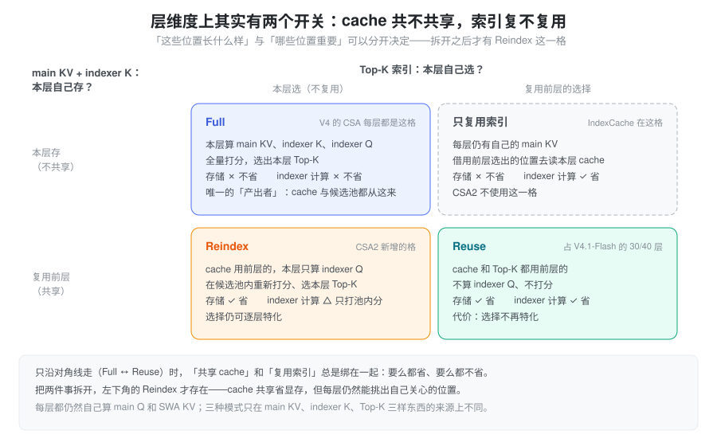
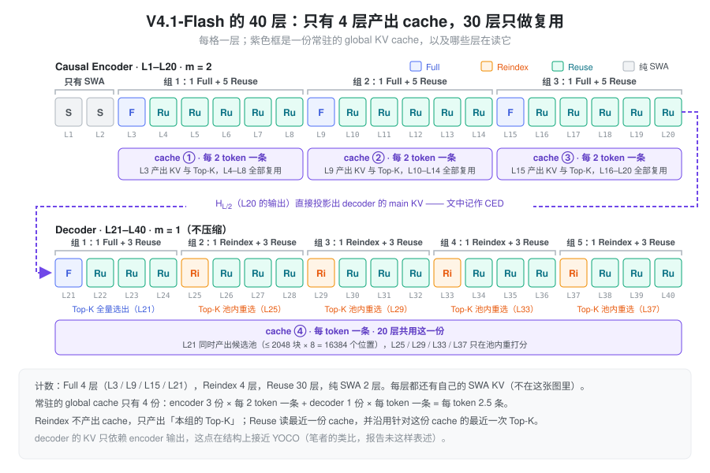
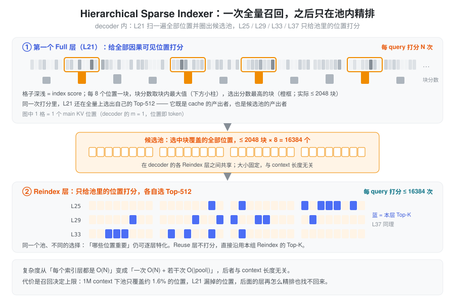

% CSA2

**CSA2 = 会跨层复用的 CSA + 两级稀疏检索。**

DeepSeek-V4.1 的全局 attention 分支。前置知识见 [CSA HCA](./hca_csa.md)：V4 的 CSA 已经在**序列方向**把 KV 压成"每 \(m\) 个 token 一条"，CSA2 接着在**层方向**压——让大部分层不再持有自己的一份 cache，也不再自己跑 indexer。下文先讲为什么要往层维度压，再讲把"共享"拆成两个开关的核心设计，然后是三种模式、层次化 indexer 和 V4.1-Flash 的实际排布，最后讨论代价、训练侧支撑与 SGLang 的落点。

### 问题：前两个维度已经压过了，剩下的是层

长上下文的 KV 成本沿三个**相乘**的维度增长：

\[
\text{cost} \;\propto\; \underbrace{(\text{entry size})}_{\text{每条 KV 多大}} \times \underbrace{\frac{N}{m}}_{\text{序列方向条目数}} \times \underbrace{\#\text{layers keeping their own}}_{\text{层方向份数}} \times \text{bits}
\]

1. **entry size**：一条 KV 有多宽——GQA / MLA 已经做过；
2. **sequence**：隔多少个 token 记一条 KV——V4 的 CSA / HCA 已经做过；
3. **layer**：有多少层各自持有一份——**还没人系统地压过**。

因为是乘法，第三维上每砍一半，总成本就砍一半，与前两维已经压到多狠无关。V4 里每个 CSA/HCA 层都有自己的一份压缩 KV 和 indexer K，indexer 也每层都跑一遍——层维度是剩下最大的空间。

前人工作在层维度上各有缺口：

| 工作 | 做法 | 缺口 |
| --- | --- | --- |
| IndexCache | 跨层复用 Top-K 索引 | 省的是 indexer 计算，**省不了 main KV 存储** |
| YOIO | 一次算完 sparse routing，全层共享 | 全网共享一份 routing，**限制性能** |
| HySparse | sparse 层复用 dense 层 KV | **仍保留全量 attention 层** |

论文的概括是：*index reuse alone saves no main KV storage, network-wide routing sharing limits performance, and hybrid designs still retain full attention layers*——**没有一种方法同时覆盖三个维度**。

还有一个跨层复用本身带来的新问题：复用减少了 indexer 被执行的**次数**，但剩下那几次执行时，indexer 仍要给**整段**因果可见 context 打分。百万级 context 下，这几次全量打分会成为新瓶颈。CSA2 的两项设计分别回答这两个问题：解耦的跨层复用管"份数"，层次化 indexer 管"每次打分的范围"。

### 设计：把 cache 共享与索引复用拆开

"层与层之间共享"其实包含两件不同的事：

- **cache 共享**——main KV 与 indexer K 跨层共享。它回答"**这些位置长什么样**"，省的是显存与存储；
- **索引复用**——Top-K 结果跨层复用。它回答"**哪些位置重要**"，省的是 indexer 计算。

关键的观察是：这两件事**可以独立决定**。如果把它们绑在一起，只有"全都自己来"和"全都用别人的"两种选择；拆开之后就是一个 2×2 的格子：

- **Full**（左上）：cache 和索引都自己产出，就是 V4 里每个 CSA 层的样子；
- **Reuse**（右下）：两样都用前层的，最便宜；
- **只复用索引**（右上）：IndexCache 所在的格子，省算力不省显存——CSA2 不用它；
- **Reindex**（左下）：**cache 共享，但本层重新选**。这是拆开之后才出现的新格子，也是这套设计里最有意思的一格——"这些位置长什么样"被省掉了，"哪些位置重要"仍允许逐层特化。

CSA2 用的就是 Full / Reindex / Reuse 这三格，并且是**静态**分配到每一层的，不是学出来的路由。

### 相比 V4 的 CSA，改了什么

| 维度 | CSA（DeepSeek-V4） | CSA2（DeepSeek-V4.1） |
| --- | --- | --- |
| 压缩窗口 | 一条压缩条目由 \(2m\) 个原始 entry 产生，相邻条目**重叠** | **去掉 overlap**，一条由 \(m\) 个 entry 产生 |
| 位置编码 | 压缩时用 absolute positional embedding（`ape`）标注这 \(2m\) 个位置 | **去掉** |
| indexer K 的来源 | 从 hidden state 走**独立的压缩路径** | 由 main KV **投影**得到 |
| 全局分支结构 | CSA + HCA 混合 | **纯 CSA2**（HCA 取消），\(m=1\) 作为不压缩特例 |
| 与其它层的关系 | 每层各自持有自己的 cache 与索引 | Full / Reindex / Reuse 三模式跨层复用 |
| 深层 indexer 的打分域 | 每层都在全量可见范围打分 | Hierarchical Sparse Indexer：只在前层给出的候选池内打分（仅 decoder） |

前三行都是**减法**，论文给的理由是 *simplify the implementation and increase the training efficiency*。从结构上看：

- **去掉 overlap 是顺理成章的**。V4 需要 overlap，是因为 \(m=4\) 时块太短，一个语义单元容易被块边界切开（见 [CSA HCA](./hca_csa.md) 中"CSA 的重叠窗口"一节）。V4.1 里 encoder 用 \(m=2\)、decoder 直接用 \(m=1\)，重叠的收益明显下降，而它的代价——约 2 倍的投影参数与 kernel 带宽、要回看上一块的双倍 state ring——一点没少，所以砍掉；
- **indexer K 改为从 main KV 投影**，省掉了一整条独立的压缩路径。V4 里 indexer 有自己的一套 `Compressor`（`head_dim=128`、独立的 gate 与 state），现在从 main KV 投影即可：既省参数，也让 indexer K 与 main KV **天然一一对应**——这正是"cache 共享"能把两者打包一起复用的前提；
- **去掉 APE** 与上面两条同源：压缩窗口变成恰好划分、\(m\) 又很小之后，块内位置先验这类显式参数的收益变薄。（去 APE 后位置信息仍由压缩之后统一施加的 RoPE 承担——这一句是笔者的推断，报告只写了"remove"。）

### 三种模式

**三种模式共享的部分**：每层都自己计算 main Q 和 SWA KV，都用「选中的 main KV 条目 + 本层 SWA KV」拼接后做 core attention。**差别只在三样东西从哪来**：main KV、indexer K、Top-K 索引。

| 模式 | main KV | indexer K | indexer Q | Top-K 索引 |
| --- | --- | --- | --- | --- |
| **Full** | 本层算 | 由本层 main KV 投影 | 本层算 | 本层全量打分后选出 |
| **Reindex** | 复用最近可用的 | 随 main KV 一起复用 | 本层算 | 本层**在候选池内**重新选出 |
| **Reuse** | 复用最近可用的 | 随 main KV 一起复用 | 不算 | 直接复用（针对同一份 main KV 的最近一次选择） |

放到 V4.1-Flash 的 40 层上，每层的角色和它读哪份 cache 如下：

几点从图里能直接读出来：

- **Full 是唯一的产出者**：cache 只在 Full 层产生，40 层里只有 4 份常驻的 global cache；
- **Reindex 不产出 cache，只产出 Top-K**：decoder 的 5 组共用同一份 cache，但每组开头的那一层都会重新选一次；
- **Reuse 是绝大多数**：30 层既不写 cache 也不跑 indexer。论文给的数字是，一个 Reuse 层 prefill 只需要 **15 个 kernel**、decode 只需要 **11 个**。

**decoder 的 cache 从哪来**：结合 encoder–decoder 结构时（文中记作 CED），decoder 里那个 Full 层的 global KV 不是从本层 hidden state 算的，而是从第 \(L/2\) 层——causal encoder 最后一层——的 hidden state 投影出来：

\[
C_l = H_{L/2}\,W^{KV}_l, \qquad Z_l = H_{L/2}\,W^{Z}_l, \qquad l > \frac{L}{2}
\]

\(C, Z\) 分别是 KV 条目及其压缩打分，\(W^{KV}_l, W^{Z}_l\) 是逐层不同的投影。Reindex 与 Reuse 不受影响——它们本来就只负责复用。笔者的理解：这样一来，decoder 全部 20 层读的 global KV 只依赖 encoder 的输出，结构上接近 [YOCO](./yoco.md) 的"self-decoder 产出一份 KV、cross-decoder 全部共用"；区别是 CSA2 的 decoder 每层仍有自己的 SWA，且 Top-K 还会在 Reindex 层更新。

### Hierarchical Sparse Indexer

**问题**：跨层复用把 indexer 的执行次数降到了每组一次，但每次执行仍要给**整段**因果可见 context 打分。decoder 的 \(m=1\)，候选数没有被序列压缩稀释过，1M context 就是 1M 个位置——剩下的几次全量打分成了瓶颈。

**做法是"召回 + 精排"两级**：

1. **第一个 Full 层做全量召回**：对所有因果可见的 main KV 位置打分，选出自己的 Top-K；**同一次打分里**再做块级选择——每 8 个位置一块，块分数取块内最大的 index score，选出分数最高的块，把它们覆盖的位置收集成**候选池**。报告给的规模是至多 2,048 块 × 8 = 16,384 个候选位置；
2. **后续 Reindex 层只做池内精排**：只给池里的位置打分，在池内选自己的 Top-K；Reuse 层完全不索引。

候选池在索引层之间**共享**，但每层最终的 Top-K 可以不同。池的大小固定之后，**后续 indexer 每 query 要打分的位置数与 context 长度无关**，只有第一个 Full 层还在扫描全量。复杂度从"每次都是 \(O(N)\)"变成了"**一次 \(O(N)\) + 若干次 \(O(1)\)**"。

**训练一致性**：这个机制是 *training-aware* 的，在 post-training 阶段引入，训练与推理使用完全相同的候选域。否则深层 indexer 训练时见过全量位置、推理时只看得到池子，会产生明显的 domain shift。

### V4.1-Flash 的实际配置

| 项 | 取值 |
| --- | --- |
| 总层数 / 结构 | 40 层 = 20 层 causal encoder + 20 层 decoder，\(d = 5120\) |
| encoder 前 2 层 | 纯 SWA（无 global attention） |
| encoder 其余 18 层 | CSA2，压缩率 \(m = 2\)；分 3 组、每组 6 层：**1 Full + 5 Reuse** |
| decoder 20 层 | CSA2，压缩率 \(m = 1\)；分 5 组、每组 4 层：第 1 组 **1 Full + 3 Reuse**，其余 4 组 **1 Reindex + 3 Reuse** |
| indexer | 32 个 indexer query head，head dim 128，attention top-k = 512 |
| main attention | 64 个 query head，head dim 512，query 压缩维度 1280 |
| Hierarchical Indexer | 最多 2,048 个 block × 8 个位置 = 最多 16,384 个候选位置 |
| 输出投影 | 8 组，每组中间维度 1024 |
| SWA | 窗口 \(n_{\text{win}} = 128\) |
| MoE / mHC | 1 shared + 384 routed experts，每 token 激活 6 个；mHC 扩展因子 4、Sinkhorn 20 次迭代 |

两件事值得单独指出来。

**decoder 的压缩率是 1，也就是不压缩。** CSA2 在 decoder 里只做"跨层复用 + Top-K 稀疏"，序列方向的压缩（\(m=2\)）只发生在 encoder。让 decoder 变便宜的是两件事：top-k 固定为 512（decode 时每 token 只读 512 个 main KV 条目），以及大部分层复用前层的 cache 与索引。这也解释了层次化 indexer 为什么只用在 decoder——那里的候选数最多。

**模式分配的比例很激进**：encoder 1:5、decoder 1:3。40 层里只有 4 层（3 个 encoder Full + 1 个 decoder Full）产出全局 cache，4 层做 Reindex，其余 30 层都是 Reuse。按条目数粗算，每个 token 常驻的 global KV 条目是 \(3 \times \tfrac12 + 1 \times 1 = 2.5\) 条；对比 V4-Flash 约 20 个 CSA 层 × \(\tfrac14\) + 20 个 HCA 层 × \(\tfrac{1}{128}\) ≈ 5.2 条（按 [CSA HCA](./hca_csa.md) 中的层数估算，非报告数字），条目数大约减半，剩下的差距来自 FP4 等精度优化。

### 收益与代价

**收益**（报告给出的数字）：

| 指标 | 结果 |
| --- | --- |
| global KV cache（常驻 HBM） | **890 bytes / token**，约为 V4-Flash 的 \(1/4\)；相对 V1 是 437 倍 |
| persistent KV cache（SSD / host memory） | 约为 V4-Flash 的 \(1/8\) |
| 单 token decode FLOPs | context 从 4K 扩到 1M（256 倍）只增加约 \(1/4\)（论文用词是 "nearly constant"） |

\(1/8\) 是两件事相乘的结果：

\[
\underbrace{\frac{1}{2}}_{\text{不再持久化 SWA KV}} \;\times\; \underbrace{\frac{1}{4}}_{\text{global KV 架构 + 精度优化}} \;=\; \frac{1}{8}
\]

- **SWA KV 移出持久化缓存**：V4 的持久化缓存里 SWA KV 占了近一半，但它的访问是"会话内分钟级"的，和持久缓存的 72 小时保留策略不匹配。V4.1 把它挪到 host DRAM 上的分布式内存池（每台机器 10% 的 DRAM），TTL 只有分钟级，靠高周转覆盖并发会话；
- **global KV 再压到 \(1/4\)**：架构上是 CSA2 的跨层复用，精度上是 FP4 global KV cache（报告称训练时就用 FP4，性能损失 marginal）。

**代价**：

- **miss 的恢复变成近似**。SWA KV 被逐出后，精确重建需要 replay \(L \times n_{\text{win}}\) 个 token 的前向；V4.1 改成 **SWA Bounded Replay**——只 replay 最近的 \(n_{\text{win}}\) 个 token，并把 SWA 截断到 replay 段，接受一个近似状态。论文认为这种"把灾难性 miss 换成有界的轻微退化"是这条路线成立的前提；
- **量测口径要分清**：890 bytes/token 说的是常驻 HBM 的 global KV，\(1/8\) 说的是持久化部分，SWA KV 是另一条账（host DRAM 池 + replay 重算）。三者混在一起谈会得出错误结论；
- **选择错误无法挽回**。候选池是后续所有 Reindex 层的搜索上界，第一个 Full 层漏掉的位置，后面的层再精排也找不回来。报告在 limitations 里明确写了：*Potential selection errors in CSA2 and approximate state reconstruction in SWA Bounded Replay may still cause capability degradation in untested boundary cases*。

### 训练侧怎么支撑 CSA2

共享组件的产出层与消费层可能被切在**不同的 pipeline stage** 上，"直接复用模块对象"在传统的 stage-local 执行模型下不成立。报告给了三个设计：

- **Shadow indexer**：在每个参与 stage 上放一份轻量的**可执行副本**，共享参数保留唯一的逻辑 owner——owner 负责优化器与 checkpoint，副本之间靠参数同步与梯度聚合保持一致。pipeline scheduler 因此不必把"共享层"当成特殊执行单元；
- **Pipeline payload extension**：产出方与消费方跨 pipeline 边界时，把下游需要的中间表示和 sparse routing 信息塞进已有的 p2p 通信路径，并**按 context parallel 的方式分区**，避免重复传输，同时保持梯度流；
- **Micro-batch 级共享状态管理**：跟踪并发 micro-batch 的共享状态生命周期，跨越前向、activation 重算与反向，直到最后一个消费者用完才释放，避免额外占用显存。

再加上 optimizer、checkpointing、warm-up、计算图追踪的适配，CSA2 才能在原有分布式训练接口和 pipeline 调度下"透明"运行。

### 落到 SGLang：从 V4 的实现看要改哪里

**当前本地的 SGLang 代码里没有 CSA2 / V4.1 的实现。** 仓库中 `deepseek_v4_dspark.py` 是投机解码的 draft 模型，代码里的 "reindex" 只出现在 context parallel 的 `apply_cp_reindex`，"hierarchical sparse" 指的是 HiSparse 的 host/device 分层——都与本文无关。所以本节不是"代码在哪"，而是**以 V4 的现有结构为参照，指出 CSA2 会动到的地方**。以下改法都是笔者的推断：

| V4 的现状（已核对代码） | CSA2 需要的变化（推断） |
| --- | --- |
| `MqaAttentionBase`（`srt/models/deepseek_v4.py`）断言 `compress_ratio in (0, 4, 128)` | 支持 \(m = 1, 2\)，并为每层增加一个 Full / Reindex / Reuse 的模式字段 |
| `Compressor`（`srt/layers/attention/dsv4/compressor.py`）：`overlap = ratio == 4`，`ape` 形状 `[ratio, coff·head_dim]` | 去 overlap、去 `ape`；ring 只需 \(m\) 槽而不是 \(2m\)。\(m=1\) 时压缩退化为直接投影，ring 可以省掉 |
| `C4Indexer` 内部自带一个 `Compressor(ratio=4, head_dim=128, rotate=True)`，从 hidden 独立压出 indexer K | 改为从 main KV 投影；只有 Full 层写 indexer K，Reindex 层只算 indexer Q |
| `DeepSeekV4TokenToKVPool._init_compressed_layer_mapping`（`srt/mem_cache/deepseek_v4_memory_pool.py`）给每个 c4 / c128 层分配一个独立的 `compress_layer_id` | 只有 Full 层分配 slot，Reindex / Reuse 层的 `layer_mapping` 指向 owner 层的同一个 id |
| `DSV4PoolConfigurator._get_bytes_per_full_token` 按 `num_layers_ca4`、`num_layers_ca128` 累加 | 按 Full 层数累加；Reindex / Reuse 层对显存的贡献只剩 SWA |
| `DeepseekV4AttnBackend` 每层用 indexer 的 Top-K 填 `extra_indices_in_kvcache` | Reuse 层直接沿用前层的下标张量；Reindex 层需要一个"候选池内 top-k"的新 kernel |

有两处是 V4 里没有对应物的新东西：

- **跨层传递的状态**。Top-K 下标和候选池要在一次 forward 里从产出层传到消费层。V4 的每层 attention 是自包含的，CSA2 需要在 forward batch 上挂一份"最近一次 Full / Reindex 的结果"；
- **decoder 的 KV 来自 \(H_{L/2}\)**。这让 decoder 那份 cache 的写入时机落在 encoder 跑完之后，与逐层写 cache 的现有流程不同。

### 笔者的分析与开放问题

以下不属于报告的结论：

- **层次化索引本质是"召回 + 精排"两阶段检索**。这和搜索/推荐系统的两阶段结构同构——差别在于这里的"召回"用的是 main KV 自身的 indexer 打分，而不是独立的向量索引。这个类比也直接指出了它的失效模式：**召回率决定上限**，精排再准也补不回漏召；
- **压缩的重心从序列轴搬到了层轴**。V4 的主线是"每 \(m\) 个 token 压成一条"，V4.1 的主线变成"每 4~6 层共用一份"。序列轴的压缩率从 4 降到 2 甚至 1，层轴的复用率却做到 3/4 ~ 5/6。取舍方向很明确：**复用已有计算结果，比设计更激进的压缩算子更容易训练和维护**；
- **去掉 overlap 与 APE 是一次"用表达力换工程简洁"的下注**。V4 专门设计了 overlap 来处理块边界，V4.1 直接砍掉；在 \(m \le 2\) 的设定下这个取舍看起来合理，但如果后续把 \(m\) 调大，重新引入 overlap 的收益可能会回来；
- **静态模式分配便宜且稳**。静态分配省掉了可学路由的不稳定性和负载均衡问题，也让 kernel 形状、显存规划和 pipeline 切分都能在编译期定下来。代价是失去逐样本自适应：无论输入多难，都是同几层做全量检索；
- **值得追问的问题**：
    - 30 层 Reuse 共享同一份 top-512 选择，会不会削弱层的特化能力？报告用"选择错误"承认了风险，但没有给出 Reuse 层与 Full 层的表示差异分析；
    - 候选池（2048 × 8 = 16384）对 1M context 只有约 1.6% 的覆盖率，这个比例如何随 context 长度和任务类型伸缩？
    - encoder 用 \(m=2\)、decoder 用 \(m=1\) 的分工，是否意味着"压缩只在 prefill 阶段划算"——prefill 是吞吐问题、decode 是延迟问题，两者的最优压缩率本来就不同？

### 与 CSA/HCA 的关系

| | V4 的 CSA / HCA | V4.1 的 CSA2 |
| --- | --- | --- |
| 压缩的轴 | 序列轴（每 \(m\) 个 token 一条） | 层轴（跨层复用）+ 序列轴（\(m=1\) 或 \(2\)） |
| 核心算子 | 逐通道 softmax 的软池化 | **没变**，压缩器本身被简化（去 overlap、去 APE） |
| 稀疏选择 | Lightning Indexer + Top-K | Top-K 保留，新增层次化候选池，把后续 indexer 的打分域压到 \(O(1)\) |
| 省的是 | KV cache 条目数 | KV cache 的**份数**（层维度）与 indexer 计算 |

### 小结

CSA2 没有换掉压缩算子——仍是 [CSA HCA](./hca_csa.md) 里那套逐通道 softmax 的软池化——而是改变了"**谁来压缩、压缩结果给谁用**"。它的核心一步是把层间共享拆成两个开关：cache 共享回答"这些位置长什么样"，省显存；索引复用回答"哪些位置重要"，省算力。拆开之后才有 Reindex 这一格，让 V4.1-Flash 能只用 4 份 global cache 服务 40 层，同时保留逐组重新选择的能力；层次化 indexer 再把剩下的全量打分收敛成一次召回加若干次常数规模的精排。代价是召回决定上限、SWA miss 只能近似恢复——这就是 CSA2 名字里那个 "2"：变的是算子的复用拓扑，不是算子本身。
