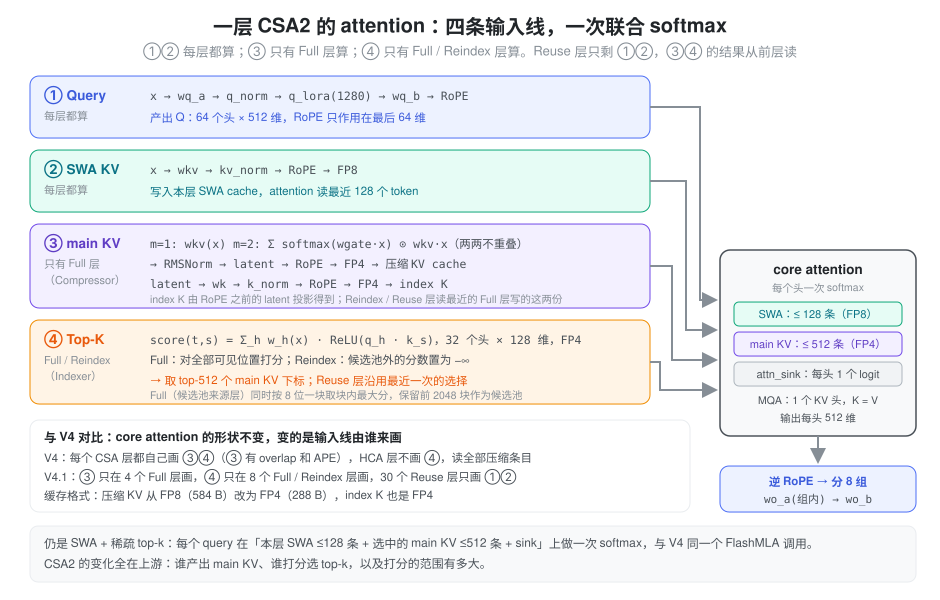
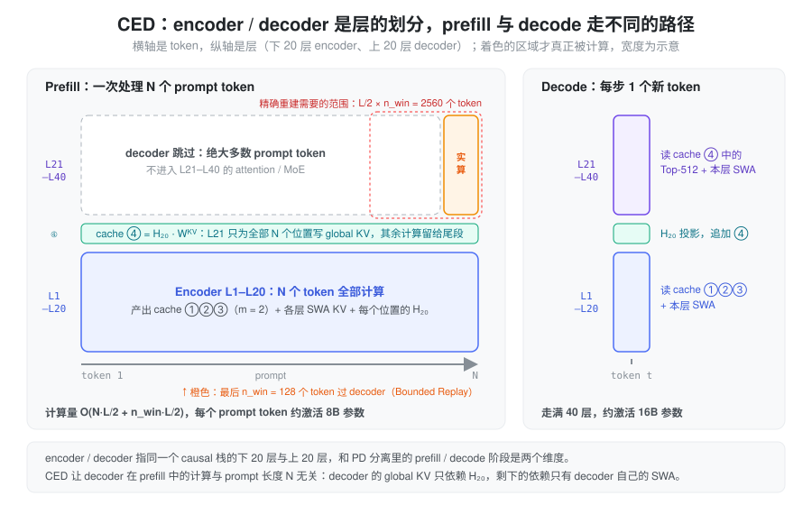

% CSA2

**CSA2 = 会跨层复用的 CSA + 两级稀疏检索。**

DeepSeek-V4.1 的全局 attention 分支。前置知识见 [CSA HCA](./hca_csa.md)：V4 的 CSA 已经在**序列方向**把 KV 压成"每 \(m\) 个 token 一条"，CSA2 接着在**层方向**压——让大部分层不再持有自己的一份 cache，也不再自己跑 indexer。下文先讲为什么要往层维度压，再讲把"共享"拆成两个开关的核心设计，然后是三种模式、一层 attention 的具体计算、与 CED 的配合、层次化 indexer 和 V4.1-Flash 的实际排布，最后讨论代价、训练侧支撑与 SGLang 的落点。

### 问题：前两个维度已经压过了，剩下的是层

长上下文的 KV 成本沿三个**相乘**的维度增长：

\[
\text{cost} \;\propto\; \underbrace{(\text{entry size})}_{\text{每条 KV 多大}} \times \underbrace{\frac{N}{m}}_{\text{序列方向条目数}} \times \underbrace{\#\text{layers keeping their own}}_{\text{层方向份数}} \times \text{bits}
\]

1. **entry size**：一条 KV 有多宽——GQA / MLA 已经做过；
2. **sequence**：隔多少个 token 记一条 KV——V4 的 CSA / HCA 已经做过；
3. **layer**：有多少层各自持有一份——**还没人系统地压过**。

因为是乘法，第三维上每砍一半，总成本就砍一半，与前两维已经压到多狠无关。V4 里每个 CSA/HCA 层都有自己的一份压缩 KV 和 indexer K，indexer 也每层都跑一遍——层维度是剩下最大的空间。

前人工作在层维度上各有缺口：

| 工作 | 做法 | 缺口 |
| --- | --- | --- |
| IndexCache | 跨层复用 Top-K 索引 | 省的是 indexer 计算，**省不了 main KV 存储** |
| YOIO | 一次算完 sparse routing，全层共享 | 全网共享一份 routing，**限制性能** |
| HySparse | sparse 层复用 dense 层 KV | **仍保留全量 attention 层** |

论文的概括是：*index reuse alone saves no main KV storage, network-wide routing sharing limits performance, and hybrid designs still retain full attention layers*——**没有一种方法同时覆盖三个维度**。

还有一个跨层复用本身带来的新问题：复用减少了 indexer 被执行的**次数**，但剩下那几次执行时，indexer 仍要给**整段**因果可见 context 打分。百万级 context 下，这几次全量打分会成为新瓶颈。CSA2 的两项设计分别回答这两个问题：解耦的跨层复用管"份数"，层次化 indexer 管"每次打分的范围"。

### 设计：把 cache 共享与索引复用拆开

"层与层之间共享"其实包含两件不同的事：

- **cache 共享**——main KV 与 indexer K 跨层共享。它回答"**这些位置长什么样**"，省的是显存与存储；
- **索引复用**——Top-K 结果跨层复用。它回答"**哪些位置重要**"，省的是 indexer 计算。

关键的观察是：这两件事**可以独立决定**。如果把它们绑在一起，只有"全都自己来"和"全都用别人的"两种选择；拆开之后就是一个 2×2 的格子：


- **Full**（左上）：cache 和索引都自己产出，就是 V4 里每个 CSA 层的样子；
- **Reuse**（右下）：两样都用前层的，最便宜；
- **只复用索引**（右上）：IndexCache 所在的格子，省算力不省显存——CSA2 不用它；
- **Reindex**（左下）：**cache 共享，但本层重新选**。这是拆开之后才出现的新格子，也是这套设计里最有意思的一格——"这些位置长什么样"被省掉了，"哪些位置重要"仍允许逐层特化。

CSA2 用的就是 Full / Reindex / Reuse 这三格，并且是**静态**分配到每一层的，不是学出来的路由。

### 相比 V4 的 CSA，改了什么

| 维度 | CSA（DeepSeek-V4） | CSA2（DeepSeek-V4.1） |
| --- | --- | --- |
| 压缩窗口 | 一条压缩条目由 \(2m\) 个原始 entry 产生，相邻条目**重叠** | **去掉 overlap**，一条由 \(m\) 个 entry 产生 |
| 位置编码 | 压缩时用 absolute positional embedding（`ape`）标注这 \(2m\) 个位置 | **去掉** |
| indexer K 的来源 | 从 hidden state 走**独立的压缩路径** | 由 main KV **投影**得到 |
| 全局分支结构 | CSA + HCA 混合 | **纯 CSA2**（HCA 取消），\(m=1\) 作为不压缩特例 |
| 与其它层的关系 | 每层各自持有自己的 cache 与索引 | Full / Reindex / Reuse 三模式跨层复用 |
| 深层 indexer 的打分域 | 每层都在全量可见范围打分 | Hierarchical Sparse Indexer：只在前层给出的候选池内打分（仅 decoder） |

前三行都是**减法**，论文给的理由是 *simplify the implementation and increase the training efficiency*。从结构上看：

- **去掉 overlap 是顺理成章的**。V4 需要 overlap，是因为 \(m=4\) 时块太短，一个语义单元容易被块边界切开（见 [CSA HCA](./hca_csa.md) 中"CSA 的重叠窗口"一节）。V4.1 里 encoder 用 \(m=2\)、decoder 直接用 \(m=1\)，重叠的收益明显下降，而它的代价——约 2 倍的投影参数与 kernel 带宽、要回看上一块的双倍 state ring——一点没少，所以砍掉；
- **indexer K 改为从 main KV 投影**，省掉了一整条独立的压缩路径。V4 里 indexer 有自己的一套 `Compressor`（`head_dim=128`、独立的 gate 与 state），现在从 main KV 投影即可：既省参数，也让 indexer K 与 main KV **天然一一对应**——这正是"cache 共享"能把两者打包一起复用的前提；
- **去掉 APE** 与上面两条同源：压缩窗口变成恰好划分、\(m\) 又很小之后，块内位置先验这类显式参数的收益变薄。（去 APE 后位置信息仍由压缩之后统一施加的 RoPE 承担——这一句是笔者的推断，报告只写了"remove"。）

### 三种模式

**三种模式共享的部分**：每层都自己计算 main Q 和 SWA KV，都用「选中的 main KV 条目 + 本层 SWA KV」拼接后做 core attention。**差别只在三样东西从哪来**：main KV、indexer K、Top-K 索引。

| 模式 | main KV | indexer K | indexer Q | Top-K 索引 |
| --- | --- | --- | --- | --- |
| **Full** | 本层算 | 由本层 main KV 投影 | 本层算 | 本层全量打分后选出 |
| **Reindex** | 复用最近可用的 | 随 main KV 一起复用 | 本层算 | 本层**在候选池内**重新选出 |
| **Reuse** | 复用最近可用的 | 随 main KV 一起复用 | 不算 | 直接复用（针对同一份 main KV 的最近一次选择） |

放到 V4.1-Flash 的 40 层上，每层的角色和它读哪份 cache 如下：


几点从图里能直接读出来：

- **Full 是唯一的产出者**：cache 只在 Full 层产生，40 层里只有 4 份常驻的 global cache；
- **Reindex 不产出 cache，只产出 Top-K**：decoder 的 5 组共用同一份 cache，但每组开头的那一层都会重新选一次；
- **Reuse 是绝大多数**：30 层既不写 cache 也不跑 indexer。论文给的数字是，一个 Reuse 层 prefill 只需要 **15 个 kernel**、decode 只需要 **11 个**。

### 一层 CSA2 的 attention 具体怎么算

**结论：core attention 本身和 V4 的 CSA 层是同一个形状，仍是"SWA + 稀疏 top-k"。** 每个 query head 在三段 key 上做**一次联合 softmax**：本层 SWA 的最近 128 条、indexer 选中的至多 512 条 main KV，以及一个只进分母的 `attn_sink`：

\[
\mathbf{o}_{t,i} = \mathrm{softmax}\!\left(\frac{\mathbf{q}_{t,i}\,\big[\,K^{\text{swa}}_t \,\Vert\, K^{\text{main}}_{\text{top-}k}\,\big]^{\top}}{\sqrt{d}} \;\Vert\; s_i\right) \cdot \big[\,V^{\text{swa}}_t \,\Vert\, V^{\text{main}}_{\text{top-}k} \,\Vert\, 0\,\big]
\]

其余部分也和 V4 一样：MQA（1 个 KV 头，K 与 V 共用同一个 512 维向量）、MLA 风格的低秩 Q、RoPE 只作用在最后 64 维、输出先逆 RoPE 再走 Grouped Output Projection。公式各项的含义见 [CSA HCA](./hca_csa.md)。

**变的是喂给它的四条输入线由谁来算。** 把一层 attention 拆开看：



1. **Query**：每层都算，`x → wq_a → q_norm → wq_b`，64 个头 × 512 维；
2. **SWA KV**：每层都算，来自本层 hidden state 的 `wkv → kv_norm → RoPE`，以 FP8 写入本层的 SWA cache。这是层私有的部分，所以 CED 下 decoder 仍然要 replay（见下一节）；
3. **main KV**：只有 Full 层算。\(m=1\) 时就是一次线性投影，没有池化；\(m=2\) 时是相邻两个 token 的逐通道 softmax 加权和，两两不重叠、没有 APE。结果过 RMSNorm 得到一个 **RoPE 之前的 latent**，它分两路：加 RoPE 后量化成 FP4，写进压缩 KV cache；再过 `wk → k_norm → RoPE → FP4`，得到 index K。"indexer K 由 main KV 投影"具体指的就是这一步；
4. **Top-K**：只有 Full / Reindex 层算。打分公式与 V4 的 Lightning Indexer 相同，\(I_{t,s} = \sum_h w_{t,h}\,\mathrm{ReLU}(q_{t,h}\cdot k_s)\)，32 个头 × 128 维，取 top-512。Full 层对全部可见位置打分；Reindex 层先把候选池以外的分数置为 \(-\infty\)，再走同样的 top-k。

| 层类型 | ① Q | ② SWA KV | ③ main KV | ④ Top-K |
| --- | --- | --- | --- | --- |
| Full | 本层 | 本层 | 本层 | 本层，全量打分 |
| Reindex | 本层 | 本层 | 读最近的 Full | 本层，只在候选池内打分 |
| Reuse | 本层 | 本层 | 读最近的 Full | 沿用最近一次 |
| 纯 SWA（L1、L2） | 本层 | 本层 | 无 | 无，只有 SWA + sink |

和 V4 相比，core attention 之外的差别有四处：

- **HCA 消失了**。V4 里 HCA 层不做选择、读全部 \(n/128\) 条压缩 KV；V4.1 里所有带 global 分支的层都是 top-k 稀疏；
- **\(m=1\) 时同一个 token 有两份 KV**：一份是本层的 SWA KV（层私有、FP8），一份是 Full 层投影出的 main KV（跨层共享、FP4）。两者来自不同的投影矩阵，不是同一个向量存了两次；
- **index K 不再有自己的压缩路径**，直接从 main KV 的 latent 投影，因此和 main KV 一一对应，可以一起被 Reindex / Reuse 层共享；
- **缓存格式更窄**：main KV 和 index K 都是 FP4。报告说训练时就用 FP4，所以存成 FP4 不会再多一次舍入。

CSA2 本身只规定层与层之间怎么共享，至于 decoder 那份 cache ④ 从哪来、prefill 要算多少层，要看 V4.1 的另一半设计：CED。

### CED：encoder / decoder 是层的划分，不是推理阶段

**先澄清名字。** V4.1 的 Causal Encoder-Decoder（CED）里的 "encoder / decoder"，指的是**同一个 causal Transformer 栈的下 20 层和上 20 层**。两半都是因果的、都是 decoder-only 意义上的自回归层，没有 T5 那种双向 encoder，也没有 cross-attention 的另一路输入。它和 PD 分离里的 prefill / decode 是**两个正交的维度**：

- encoder / decoder 是**层**的划分（纵轴）；
- prefill / decode 是**推理阶段**（横轴上处理的是 prompt 还是新 token）。

两者的联系只有一条：CED 的划分让 prefill 阶段可以**不让大多数 prompt token 进入 decoder 层**，decode 阶段仍然走满 40 层。报告给出的数字是 prefill 每 token 激活约 8B 参数，decode 每 token 激活约 16B 参数。

**问题：prompt token 为什么要过上半栈？** 普通 decoder-only 模型的 prefill 必须让每个 prompt token 走完全部 \(L\) 层，因为第 \(l\) 层的 KV 来自第 \(l\) 层自己的 hidden state，decode 时每一层都要读这份 KV。如果能让上半栈的 KV 不依赖上半栈自己的计算，prompt token 就可以在 encoder 顶部停下。

**设计：让 decoder 的 global KV 只依赖 \(H_{L/2}\)。** CED 规定 decoder 层的 global KV 不从本层 hidden state 算，而是从第 \(L/2\) 层（encoder 最后一层）的输出投影：

\[
C_l = H_{L/2}\,W^{KV}_l, \qquad Z_l = H_{L/2}\,W^{Z}_l, \qquad l > \frac{L}{2}
\]

\(C, Z\) 分别是 KV 条目及其压缩打分，\(W^{KV}_l, W^{Z}_l\) 是逐层不同的投影。和 CSA2 合起来看，这个约束在 V4.1-Flash 上几乎是"免费"满足的：decoder 只有 L21 一个 Full 层，它的输入恰好就是 \(H_{20}\)；Reindex 与 Reuse 层本来就只复用 cache ④，不产出 KV。于是 decoder 全部 20 层读的 global KV 只依赖 encoder 的输出，结构上接近 [YOCO](./yoco.md) 的"self-decoder 产出一份 KV、cross-decoder 全部共用"。

**剩下的依赖是 SWA。** CED 只改了 global 分支；SWA 仍然**逐层计算**，每个 decoder 层都有自己的 SWA KV，而它来自本层自己的 hidden state。decode 第一步要读每个 decoder 层最近 \(n_{\text{win}}=128\) 个位置的 SWA KV，所以 prefill 不能完全停在 encoder。精确算出这 128 个位置的 SWA KV 需要它们在上一层的 hidden state，而那又依赖再往前 128 个位置。感受野每层向前扩 128，20 层就是 \(L/2 \times n_{\text{win}} = 2560\) 个 token。对短的多轮追加 prompt，这部分开销不可忽略。

**Decoder SWA Bounded Replay** 的做法是只让 prompt 的**最后 \(n_{\text{win}}\) 个 token** 过 decoder，并把这段的 SWA 截断在段内：位置 \(i\) 的 query 只看 \([\max(s,\, i-W+1),\, i]\) 的 SWA key，\(s\) 是这一段的起点。这样得到的 decoder SWA KV 是近似值，只供后续 decode 使用，不进 prefix cache。报告称对回答质量的影响可以忽略，并在 post-training 中模拟了同样的 replay 做训练适配。prefill 的复杂度因此从 \(O(NL)\) 降到 \(O(NL/2 + n_{\text{win}}\cdot L/2) \approx O(NL/2)\)。



所以回答"prefill 是否要算完整的 40 层"：**深度上仍然穿过 40 层，宽度上不是**。encoder 20 层处理全部 \(N\) 个 token；decoder 20 层只处理最后 128 个 token。这条尾段有两个用途，一是写出 decode 要用的 decoder SWA KV，二是产生最后一个 prompt token 的 logits，也就是第一个输出 token。decoder 的 global KV（cache ④）覆盖全部 \(N\) 个位置，但它只需要 \(H_{20}\) 的一次投影，不需要 decoder 层的 attention 与 MoE。

放回 PD 分离的语境：prefill 节点跑"encoder 全量 + decoder 尾段"，把 4 份 global cache 和各层最后一个窗口的 SWA KV 交给 decode 节点；decode 节点对每个新 token 走满 40 层，decoder 层读 cache ④ 的 Top-512 加本层 SWA。CED 改变的是 prefill 节点要算多少，PD 的交接对象（global KV + 最后一窗 SWA）和普通 SWA 混合模型没有本质区别。

### Hierarchical Sparse Indexer

**问题**：跨层复用把 indexer 的执行次数降到了每组一次，但每次执行仍要给**整段**因果可见 context 打分。decoder 的 \(m=1\)，候选数没有被序列压缩稀释过，1M context 就是 1M 个位置——剩下的几次全量打分成了瓶颈。

**做法是"召回 + 精排"两级**：

1. **第一个 Full 层做全量召回**：对所有因果可见的 main KV 位置打分，选出自己的 Top-K；**同一次打分里**再做块级选择——每 8 个位置一块，块分数取块内最大的 index score，选出分数最高的块，把它们覆盖的位置收集成**候选池**。报告给的规模是至多 2,048 块 × 8 = 16,384 个候选位置；
2. **后续 Reindex 层只做池内精排**：只给池里的位置打分，在池内选自己的 Top-K；Reuse 层完全不索引。


候选池在索引层之间**共享**，但每层最终的 Top-K 可以不同。池的大小固定之后，**后续 indexer 每 query 要打分的位置数与 context 长度无关**，只有第一个 Full 层还在扫描全量。复杂度从"每次都是 \(O(N)\)"变成了"**一次 \(O(N)\) + 若干次 \(O(1)\)**"。

#### 分块不是压缩

"每 8 个位置一块"容易和压缩率 \(m\) 混在一起，两者其实是不同粒度上的事：

- **压缩率 \(m\) 是存储粒度**：决定一条 main KV 由几个 token 池化而来。encoder 的 \(m=2\) 会合并 KV，decoder 的 \(m=1\) 不合并，一条 main KV 就是一个 token；
- **block size 8 是检索粒度**：决定后续层可以在哪些 main KV 里挑。它只对 L21 的分数行做 max-pool，产出一个"哪些位置可以打分"的 mask，**不产生新的 KV**，attention 读的仍然是一条条独立的 main KV。

L21 的一次打分因此有两个产物：

```
分数行（decoder 里每格 = 一个位置 = 一个 token）
| 0.1 0.3 0.2 0.9 0.1 0.0 0.2 0.1 | 0.1 0.1 0.2 0.1 0.0 0.1 0.2 0.1 | 0.4 0.8 0.7 ...
└────────── 块 0：max = 0.9 ──────┘ └────────── 块 1：max = 0.2 ──────┘ └── 块 2：max = 0.8

产物 A：L21 自己的 top-512 个位置     → 本层 attention 用
产物 B：按块分数取前 2048 块           → 候选池，交给后面的 Reindex 层
```

块分数取**最大值**而不是均值，是因为一个块里只要有一个位置重要，这个块就该留下；取均值的话，一个 0.9 配七个 0.1 的块会输给一块全是 0.3 的平庸区域。由此还能推出一个性质（笔者的推导，报告未写）：不考虑同分，**池子一定包含 L21 自己的 top-512**。这 512 个位置最多落在 512 个块里，这些块的 max 都不低于第 512 名的分数，而其余块的 max 都比它低，所以它们必然排进前 2048 块。

至于为什么按块召回、而不是直接取分数最高的 16384 个位置，报告没有解释。笔者的理解有两点：一是把重要位置的邻居一起带进池子，后面的层用自己的 Q 可能更需要这些邻居；二是候选集合用 2048 个块号就能表示，同一块的 8 条 KV 在内存里连续，打分时读取更规整。

#### 池里的 16384 个位置是哪些

16384 是池子的**容量上限**，不是序列里固定的某一段：

- **序列不超过 16384**：块数 \(\lceil N/8 \rceil \le 2048\)，所有块都进池，候选池就是全部可见位置，池内打分与全量打分没有区别；
- **序列超过 16384**：只保留块分数最高的 2048 块。这些块可以散落在整段序列的任何地方，此外最新位置所在的块总会被保留。以 1M context 为例：

```
位置:  0 ─────────────────────────────────────────────────────── 1M
块:   [b0][b1][b2] ...                    共 125,000 块           ... [b124999]

池子（举例）:  b37  b38  b2051  b9000  ...  b88123  ...  b124999
              └ 开头的指令      └ 中间被引用的代码        └ 最近的内容（强制保留）
              2048 块 × 8 = 16384 个位置，约占全部位置的 1.6%
```

池子是**每个 query 一份、每步重选**的。decode 时每生成一个新 token，L21 都用这个 token 的 Q 重新对全部历史打分、重新选块，所以第 \(t\) 步和第 \(t+1\) 步的池子可以完全不同；prefill 时每个 prompt token 也各有一份池子，只从它因果可见的位置里选。Reindex 层（L25 / L29 / L33 / L37）在这份池子里各自打分、各自取 top-512，结果可以互不相同，但都出不了 L21 圈定的范围。这就是"召回决定上限"的具体含义。

#### encoder 没有候选池

候选池只存在于 decoder，所以上面的 16384 指的是 decoder 里**未压缩**的位置，一个位置就是一个 token，与 encoder 的 \(m=2\) 压缩无关。encoder 里也没有 Reindex 层：它的 3 组都是 1 Full + 5 Reuse，只有 L3 / L9 / L15 这 3 个 Full 层打分。每个 Full 层都对本层可见的**全部** \(N/2\) 条压缩条目打分，直接选出 top-512（1M context 下约 50 万条），后面的 5 个 Reuse 层沿用这次选择，中间没有候选池这一级。

| | encoder（L1–L20） | decoder（L21–L40） |
| --- | --- | --- |
| 压缩率 | \(m=2\)，一条 = 2 个 token | \(m=1\)，一条 = 1 个 token |
| 打分的层 | 3 个 Full，各自全量打分 | 1 个 Full 全量打分，4 个 Reindex 只在池内打分 |
| 每次打分的范围 | 全部 \(N/2\) 条 | Full：全部 \(N\) 个；Reindex：≤ 16384 个 |
| 候选池 | 无 | 有，由 L21 产出 |

只在 decoder 用候选池，是因为那里收益最大：encoder 每组只打一次分，\(m=2\) 又把条目数减半；decoder 不压缩，候选数最多，并且还有 4 次 Reindex 要打分。代码里的判断是 `DeepseekV41Indexer` 的 `uses_candidates = 0 <= candidate_source_layer_id < layer_id`，只有候选池来源层（L21）之后的 index source 层才使用候选池，encoder 层的编号都在它之前。

#### 候选池不减少存储：存多少、打分多少、读多少

候选池容易被误读成"decoder 只保留 16384 条 main KV"。实际上 L21 为全部 \(N\) 个位置都写 main KV，cache ④ 始终有 \(N\) 条，一条也不删。候选池只是**每个 query 的一个 mask**，标出这一步 Reindex 层可以在哪些位置里挑。它必须是 mask 而不是删除：池子每步都重选，第 \(t\) 步没进池子的位置，第 \(t+1\) 步可能就进了；如果真的只保留 16384 条，被丢掉的内容就再也找不回来，模型等于只剩一个有限窗口。

一个 decode step 里的几个数字要分开看：

| | encoder Full（L3 / L9 / L15） | decoder Full（L21） | decoder Reindex |
| --- | --- | --- | --- |
| cache 里存多少条 main KV | \(\lfloor N/2 \rfloor\)，3 份各存一份 | \(N\)，一份，20 层共用 | 不存，读 L21 那份 |
| 每个 query 给多少条打分 | 全部 \(\lfloor N/2 \rfloor\) | 全部 \(N\) | 池内 ≤ 16384 |
| attention 实际读多少条 | top-512 | top-512 | top-512 |

encoder 是 \(\lfloor N/2 \rfloor\) 而不是 \(N/2\)：\(m=2\) 时两个 token 凑齐才写一条（代码里只在 `seq_len % 2 == 0` 时写入）。\(N\) 为奇数时，最后一个 token 暂时没有 main KV，只能靠 SWA 看到，等下一个 token 到来凑成一对才写入。可见条目数在代码里就是 `(pos + 1) // ratio`。

由此也能分清 CSA2 各部分分别省了什么：

- **省显存靠"40 层只存 4 份"**：每 token 常驻 \(3 \times \tfrac12 + 1 \times 1 = 2.5\) 条 global KV，与候选池无关；
- **省打分靠候选池**：只缩小 Reindex 层的打分范围。本地 SGLang 默认的 torch 路径仍是先全量打分再遮掉池外，这部分计算只有在 DeepGEMM 候选 indexer 路径下才真正省下（见"attention 计算的落点"）；
- **省 attention 读取靠 top-512**：无论存了多少、打分了多少，每层每个 query 最终只读 512 条 main KV 加 128 条 SWA。

**训练一致性**：这个机制是 *training-aware* 的，在 post-training 阶段引入，训练与推理使用完全相同的候选域。否则深层 indexer 训练时见过全量位置、推理时只看得到池子，会产生明显的 domain shift。

### V4.1-Flash 的实际配置

| 项 | 取值 |
| --- | --- |
| 总层数 / 结构 | 40 层 = 20 层 causal encoder + 20 层 decoder，\(d = 5120\) |
| encoder 前 2 层 | 纯 SWA（无 global attention） |
| encoder 其余 18 层 | CSA2，压缩率 \(m = 2\)；分 3 组、每组 6 层：**1 Full + 5 Reuse** |
| decoder 20 层 | CSA2，压缩率 \(m = 1\)；分 5 组、每组 4 层：第 1 组 **1 Full + 3 Reuse**，其余 4 组 **1 Reindex + 3 Reuse** |
| indexer | 32 个 indexer query head，head dim 128，attention top-k = 512 |
| main attention | 64 个 query head，head dim 512，query 压缩维度 1280 |
| Hierarchical Indexer | 最多 2,048 个 block × 8 个位置 = 最多 16,384 个候选位置 |
| 输出投影 | 8 组，每组中间维度 1024 |
| SWA | 窗口 \(n_{\text{win}} = 128\) |
| MoE / mHC | 1 shared + 384 routed experts，每 token 激活 6 个；mHC 扩展因子 4、Sinkhorn 20 次迭代 |

两件事值得单独指出来。

**decoder 的压缩率是 1，也就是不压缩。** CSA2 在 decoder 里只做"跨层复用 + Top-K 稀疏"，序列方向的压缩（\(m=2\)）只发生在 encoder。让 decoder 变便宜的是两件事：top-k 固定为 512（decode 时每 token 只读 512 个 main KV 条目），以及大部分层复用前层的 cache 与索引。这也解释了层次化 indexer 为什么只用在 decoder——那里的候选数最多。

**模式分配的比例很激进**：encoder 1:5、decoder 1:3。40 层里只有 4 层（3 个 encoder Full + 1 个 decoder Full）产出全局 cache，4 层做 Reindex，其余 30 层都是 Reuse。按条目数粗算，每个 token 常驻的 global KV 条目是 \(3 \times \tfrac12 + 1 \times 1 = 2.5\) 条；对比 V4-Flash 约 20 个 CSA 层 × \(\tfrac14\) + 20 个 HCA 层 × \(\tfrac{1}{128}\) ≈ 5.2 条（按 [CSA HCA](./hca_csa.md) 中的层数估算，非报告数字），条目数大约减半，剩下的差距来自 FP4 等精度优化。

### 收益与代价

**收益**（报告给出的数字）：

| 指标 | 结果 |
| --- | --- |
| global KV cache（常驻 HBM） | **890 bytes / token**，约为 V4-Flash 的 \(1/4\)；相对 V1 是 437 倍 |
| persistent KV cache（SSD / host memory） | 约为 V4-Flash 的 \(1/8\) |
| 单 token decode FLOPs | context 从 4K 扩到 1M（256 倍）只增加约 \(1/4\)（论文用词是 "nearly constant"） |

\(1/8\) 是两件事相乘的结果：

\[
\underbrace{\frac{1}{2}}_{\text{不再持久化 SWA KV}} \;\times\; \underbrace{\frac{1}{4}}_{\text{global KV 架构 + 精度优化}} \;=\; \frac{1}{8}
\]

- **SWA KV 移出持久化缓存**：V4 的持久化缓存里 SWA KV 占了近一半，但它的访问是"会话内分钟级"的，和持久缓存的 72 小时保留策略不匹配。V4.1 把它挪到 host DRAM 上的分布式内存池（每台机器 10% 的 DRAM），TTL 只有分钟级，靠高周转覆盖并发会话；
- **global KV 再压到 \(1/4\)**：架构上是 CSA2 的跨层复用，精度上是 FP4 global KV cache（报告称训练时就用 FP4，性能损失 marginal）。

**代价**：

- **miss 的恢复变成近似**。SWA KV 被逐出后，精确重建需要 replay \(L \times n_{\text{win}}\) 个 token 的前向；V4.1 改成 **SWA Bounded Replay**——只 replay 最近的 \(n_{\text{win}}\) 个 token，并把 SWA 截断到 replay 段，接受一个近似状态。论文认为这种"把灾难性 miss 换成有界的轻微退化"是这条路线成立的前提；
- **量测口径要分清**：890 bytes/token 说的是常驻 HBM 的 global KV，\(1/8\) 说的是持久化部分，SWA KV 是另一条账（host DRAM 池 + replay 重算）。三者混在一起谈会得出错误结论；
- **选择错误无法挽回**。候选池是后续所有 Reindex 层的搜索上界，第一个 Full 层漏掉的位置，后面的层再精排也找不回来。报告在 limitations 里明确写了：*Potential selection errors in CSA2 and approximate state reconstruction in SWA Bounded Replay may still cause capability degradation in untested boundary cases*。

### 训练侧怎么支撑 CSA2

共享组件的产出层与消费层可能被切在**不同的 pipeline stage** 上，"直接复用模块对象"在传统的 stage-local 执行模型下不成立。报告给了三个设计：

- **Shadow indexer**：在每个参与 stage 上放一份轻量的**可执行副本**，共享参数保留唯一的逻辑 owner——owner 负责优化器与 checkpoint，副本之间靠参数同步与梯度聚合保持一致。pipeline scheduler 因此不必把"共享层"当成特殊执行单元；
- **Pipeline payload extension**：产出方与消费方跨 pipeline 边界时，把下游需要的中间表示和 sparse routing 信息塞进已有的 p2p 通信路径，并**按 context parallel 的方式分区**，避免重复传输，同时保持梯度流；
- **Micro-batch 级共享状态管理**：跟踪并发 micro-batch 的共享状态生命周期，跨越前向、activation 重算与反向，直到最后一个消费者用完才释放，避免额外占用显存。

再加上 optimizer、checkpointing、warm-up、计算图追踪的适配，CSA2 才能在原有分布式训练接口和 pipeline 调度下"透明"运行。

### 落到 SGLang：从 V4 的实现看要改哪里

**本地 SGLang 已经有 V4.1（代码里记作 `dsv41`）的实现**：`DeepseekV41Config`（`srt/configs/deepseek_v41.py`），`DeepseekV41Compressor` / `DeepseekV41Indexer`（`srt/layers/attention/dsv4/dsv41_sparse.py`），以及候选池 indexer（`candidate_indexer.py`）。本页早先版本写的"没有实现"已经过时。下表是实现落地之前，以 V4 结构为参照做的推断，保留作对照；表后的"attention 计算的落点"一小节已对照 `dsv41` 代码核对：

| V4 的现状（已核对代码） | CSA2 需要的变化（推断） |
| --- | --- |
| `MqaAttentionBase`（`srt/models/deepseek_v4.py`）断言 `compress_ratio in (0, 4, 128)` | 支持 \(m = 1, 2\)，并为每层增加一个 Full / Reindex / Reuse 的模式字段 |
| `Compressor`（`srt/layers/attention/dsv4/compressor.py`）：`overlap = ratio == 4`，`ape` 形状 `[ratio, coff·head_dim]` | 去 overlap、去 `ape`；ring 只需 \(m\) 槽而不是 \(2m\)。\(m=1\) 时压缩退化为直接投影，ring 可以省掉 |
| `C4Indexer` 内部自带一个 `Compressor(ratio=4, head_dim=128, rotate=True)`，从 hidden 独立压出 indexer K | 改为从 main KV 投影；只有 Full 层写 indexer K，Reindex 层只算 indexer Q |
| `DeepSeekV4TokenToKVPool._init_compressed_layer_mapping`（`srt/mem_cache/deepseek_v4_memory_pool.py`）给每个 c4 / c128 层分配一个独立的 `compress_layer_id` | 只有 Full 层分配 slot，Reindex / Reuse 层的 `layer_mapping` 指向 owner 层的同一个 id |
| `DSV4PoolConfigurator._get_bytes_per_full_token` 按 `num_layers_ca4`、`num_layers_ca128` 累加 | 按 Full 层数累加；Reindex / Reuse 层对显存的贡献只剩 SWA |
| `DeepseekV4AttnBackend` 每层用 indexer 的 Top-K 填 `extra_indices_in_kvcache` | Reuse 层直接沿用前层的下标张量；Reindex 层需要一个"候选池内 top-k"的新 kernel |

有两处是 V4 里没有对应物的新东西：

- **跨层传递的状态**。Top-K 下标和候选池要在一次 forward 里从产出层传到消费层。V4 的每层 attention 是自包含的，CSA2 需要在 forward batch 上挂一份"最近一次 Full / Reindex 的结果"；
- **decoder 的 KV 来自 \(H_{L/2}\)**。这让 decoder 那份 cache 的写入时机落在 encoder 跑完之后，与逐层写 cache 的现有流程不同。

#### attention 计算的落点（已核对代码）

推断表的方向大体成立，但实现比"新增模式字段"更隐式：代码里**没有 Full / Reindex / Reuse 的枚举**，层的角色由 hf config 的列表决定。`MqaAttentionBase` 构造时，只有 `kv_source_layer_ids` 里的层挂 `DeepseekV41Compressor`，只有 `index_source_layer_ids` 里的层挂 `DeepseekV41Indexer`。两样都没有的层就是 Reuse，它通过内存池的 `source_layer_of` 读最近一个 kv_source 层的压缩 KV 与 index K。Q、SWA KV、`attn_sink` 在 `MqaAttentionBase` 里每层都有。

- **Reindex 没有专门的 kernel**（默认路径）：`candidate_source_layer_id` 指定的层打完分后，用 `select_candidate_blocks`（`dsv4/candidate_indexer.py`）按 `candidate_block_size` 取块内最大分，保留前 `candidate_topk_blocks` 块，并强制保留最新位置所在的块。之后的 index source 层把池外分数 `masked_fill` 成 \(-\infty\)，再走普通 `topk`。要注意，这条默认的 torch 路径是**先对全部可见位置算出分数再遮掉池外**，所以 Reindex 层打分的计算量仍是 \(O(N)\)，候选池只限制了选择范围。真正"只算池内"的是 `SGLANG_DSV41_DEEP_GEMM_CANDIDATE_INDEXER`（默认关，需要 SM100 和带 `fp8_fp4_paged_sparse_mqa_logits` 的 DeepGEMM），它只对候选块计算 logits。所有请求都短到放得下时（`_every_request_fits`），decode 会跳过候选池；
- **decode 与小 prefill**：仍是 V4 那一个 `flash_mla_with_kvcache` 调用。SWA 下标走 `indices`，top-k 下标走 `extra_indices_in_kvcache`，分别指向两份 cache，在 kernel 里拼接；
- **大 prefill**：`flash_mla_sparse_fwd` 需要单一 KV 序列，所以先把压缩 KV 和 SWA KV 反量化进同一块 bf16 workspace，再用 `combine_topk_swa_indices`（`dsv4/sparse_prefill_utils.py`）把两组下标合成一张表。`SGLANG_OPT_DSV41_PREFILL_KV_REUSE` 让读同一 kv_source 的后续层跳过重复 gather，并在 top-k 没变时复用这张合并下标表；
- **FP4 缓存有硬件前提**：`KVLayout.V41_FP4`（256 B 数据 + 32 B scale = 288 B/条）只在 SM100 / SM103 且 FlashMLA 支持时启用，此时 SWA cache 用 `KVLayout.V41`（528 B 的 FP8）。SM90 / SM120 会退回 V4 的 584 B 布局。

64 头、`q_lora` 1280、32 个 indexer 头、2048 块 × 8 这些数字来自报告的配置表，代码只从 checkpoint 的 config 读入，`DeepseekV41Config` 里的默认值都是 0 或 −1。

### 笔者的分析与开放问题

以下不属于报告的结论：

- **层次化索引本质是"召回 + 精排"两阶段检索**。这和搜索/推荐系统的两阶段结构同构——差别在于这里的"召回"用的是 main KV 自身的 indexer 打分，而不是独立的向量索引。这个类比也直接指出了它的失效模式：**召回率决定上限**，精排再准也补不回漏召；
- **压缩的重心从序列轴搬到了层轴**。V4 的主线是"每 \(m\) 个 token 压成一条"，V4.1 的主线变成"每 4~6 层共用一份"。序列轴的压缩率从 4 降到 2 甚至 1，层轴的复用率却做到 3/4 ~ 5/6。取舍方向很明确：**复用已有计算结果，比设计更激进的压缩算子更容易训练和维护**；
- **去掉 overlap 与 APE 是一次"用表达力换工程简洁"的下注**。V4 专门设计了 overlap 来处理块边界，V4.1 直接砍掉；在 \(m \le 2\) 的设定下这个取舍看起来合理，但如果后续把 \(m\) 调大，重新引入 overlap 的收益可能会回来；
- **静态模式分配便宜且稳**。静态分配省掉了可学路由的不稳定性和负载均衡问题，也让 kernel 形状、显存规划和 pipeline 切分都能在编译期定下来。代价是失去逐样本自适应：无论输入多难，都是同几层做全量检索；
- **值得追问的问题**：
    - 30 层 Reuse 共享同一份 top-512 选择，会不会削弱层的特化能力？报告用"选择错误"承认了风险，但没有给出 Reuse 层与 Full 层的表示差异分析；
    - 候选池（2048 × 8 = 16384）对 1M context 只有约 1.6% 的覆盖率，这个比例如何随 context 长度和任务类型伸缩？
    - encoder 用 \(m=2\)、decoder 用 \(m=1\) 的分工，是否意味着"压缩只在 prefill 阶段划算"——prefill 是吞吐问题、decode 是延迟问题，两者的最优压缩率本来就不同？

### 与 CSA/HCA 的关系

| | V4 的 CSA / HCA | V4.1 的 CSA2 |
| --- | --- | --- |
| 压缩的轴 | 序列轴（每 \(m\) 个 token 一条） | 层轴（跨层复用）+ 序列轴（\(m=1\) 或 \(2\)） |
| 核心算子 | 逐通道 softmax 的软池化 | **没变**，压缩器本身被简化（去 overlap、去 APE） |
| 稀疏选择 | Lightning Indexer + Top-K | Top-K 保留，新增层次化候选池，把后续 indexer 的打分域压到 \(O(1)\) |
| 省的是 | KV cache 条目数 | KV cache 的**份数**（层维度）与 indexer 计算 |

### 小结

CSA2 没有换掉压缩算子——仍是 [CSA HCA](./hca_csa.md) 里那套逐通道 softmax 的软池化——而是改变了"**谁来压缩、压缩结果给谁用**"。它的核心一步是把层间共享拆成两个开关：cache 共享回答"这些位置长什么样"，省显存；索引复用回答"哪些位置重要"，省算力。拆开之后才有 Reindex 这一格，让 V4.1-Flash 能只用 4 份 global cache 服务 40 层，同时保留逐组重新选择的能力；层次化 indexer 再把剩下的全量打分收敛成一次召回加若干次常数规模的精排。代价是召回决定上限、SWA miss 只能近似恢复——这就是 CSA2 名字里那个 "2"：变的是算子的复用拓扑，不是算子本身。
