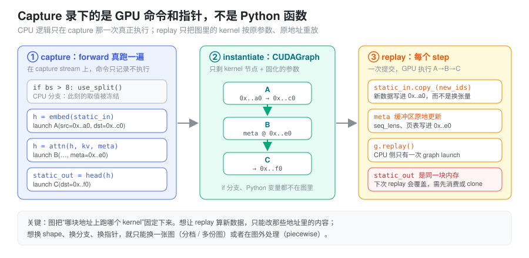
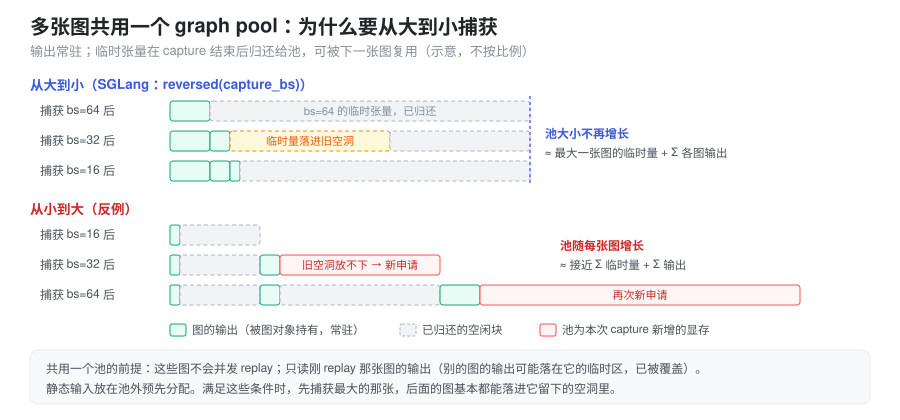

% Cuda Graph

- decode 一步只算一个 token，GPU 利用率却上不去，profiler 里 kernel 之间全是空隙——慢的到底是谁？
- 开了 CUDA Graph 之后，`static_in = new_tensor` 为什么不生效？为什么上一步拿到的 logits 下一步“自己变了”？
- 启动时 “Capturing batches” 要跑很久、吃掉好几个 GB 显存，这些显存花在了哪里？

这些问题都指向同一个模型：**CUDA Graph 录下的是一串 GPU 命令和它们引用的地址，之后只重放这串命令。** 本篇先讲它要解决的问题和抽象，再讲由此产生的两条硬约束（静态地址、私有内存池），最后对照 SGLang decode 路径的实现。CUDA Graph 与 `torch.compile`、算子融合分别优化哪类成本，见 [kernel 与编译执行](./torch_kernel_compile.md)。

### 问题：decode 为什么被 CPU 卡住

GPU kernel 是异步提交的：CPU 把命令写进 stream 队列后立刻返回，GPU 再按顺序消费（见 [CUDA 异步执行](./torch_cuda_execution.md)）。单次提交的 CPU 侧成本（Python 解释、dispatcher、参数打包、驱动调用）通常在几微秒量级，而一次 kernel 的 GPU 执行时间可能只有一两微秒。

设第 \(i\) 个 kernel 的 CPU 提交时间是 \(t^{\text{cpu}}_i\)，GPU 执行时间是 \(t^{\text{gpu}}_i\)，一共有 \(N\) 个 kernel。在 CPU 能持续提前排队的理想情况下：

\[
T_{\text{wall}} \approx \max\left(\sum_{i=1}^{N} t^{\text{cpu}}_i,\ \sum_{i=1}^{N} t^{\text{gpu}}_i\right)
\]

当 \(\sum_i t^{\text{cpu}}_i > \sum_i t^{\text{gpu}}_i\) 时，GPU 会在两次 kernel 之间空转等待命令，流水线出现断档（bubble），这称为 **launch-bound**。decode 阶段每个 step 要跑几十层、每层若干个小 kernel，batch 又小，正是这种典型场景。

CUDA Graph 的做法是：把一整段固定的命令序列**录制**成一张 DAG，之后每次执行只需提交一次：

\[
\Delta T \approx \sum_{i=1}^{N} t^{\text{cpu}}_i - t^{\text{cpu}}_{\text{graph}}
\]

其中 \(t^{\text{cpu}}_{\text{graph}}\) 是单次 graph launch 的成本，与 \(N\) 基本无关。这就是它把 \(N\) 次提交压缩成 \(1\) 次的意义。

#### 它不改变什么

CUDA Graph 只优化「CPU 提交命令」这一段：

- 不减少 GPU 的计算量，不减少 kernel 数量；
- 不做算子融合，图里本来就是那些 kernel；
- 不改变 stream/event 的同步语义；
- kernel 总时间远大于 CPU 提交时间时（大 GEMM、大 batch、prefill 的 compute-bound 区间），收益接近零。

### 抽象：录下的是 GPU 命令和指针，不是 Python 函数

最容易产生的误解是把 CUDA Graph 当成“把 forward 编译成一个 GPU 程序”。更准确的心智模型是**录音机**：capture 时 Python 照常执行一遍 forward，所有 Python 逻辑、dispatcher、shape 推导、`if` 分支都真实地跑了一次；但提交到 capture stream 上的 kernel 并不执行，只被记录下来——连同每个 kernel 的 grid/block 和**参数里的设备指针**。replay 时 Python 一行都不跑，GPU 直接按记录的参数、在记录的地址上执行这串 kernel。



由此可以直接推出后面所有的约束：

- 图里**没有** CPU 逻辑。capture 时 `if bs > 8` 走了哪条分支，这张图就永远是那条分支；
- 图里的地址是**固定**的。想让 replay 算新数据，只能把新数据写进那些地址；
- 图里的 kernel 参数是**固定**的。shape 一变，grid 就变，只能换一张图。

三个阶段各自的语义：

| 阶段 | 做什么 | 关键点 |
| --- | --- | --- |
| capture | 把 stream 上的命令记录成 DAG，**不真正执行** | 期间禁止 CPU 侧阻塞同步和依赖 GPU 值的控制流 |
| instantiate | 校验拓扑、生成可执行的 `cudaGraphExec_t` | 一次性成本，不要放进热路径 |
| replay | 一次提交，GPU 按 DAG 执行 | 参数被固化，输入必须写回 capture 时的同一地址 |

用 CUDA Runtime 写出来就是三段：

```cpp
cudaStreamBeginCapture(stream, cudaStreamCaptureModeGlobal);
launch_kernel_a<<<grid_a, block, 0, stream>>>(d_a, d_b);   // 只记录，不执行
launch_kernel_b<<<grid_b, block, 0, stream>>>(d_b, d_c);
cudaStreamEndCapture(stream, &graph);

cudaGraphInstantiate(&graph_exec, graph, nullptr, nullptr, 0);

for (int step = 0; step < steps; ++step) {
    update_static_inputs();                 // 往 d_a 里写新数据
    cudaGraphLaunch(graph_exec, stream);    // 一次提交，内部 N 个 kernel
}
```

PyTorch 把它包成 `torch.cuda.CUDAGraph` 与 `torch.cuda.graph` 上下文：进入上下文时调用 `capture_begin()`，退出时 `capture_end()` 一并完成 end capture 与 instantiate；不传 `stream` 时它会换到一条内部的 side stream 上捕获（capture 不能在 legacy 默认 stream 上进行）。

```python
g = torch.cuda.CUDAGraph()
static_in = torch.empty_like(x)

# warmup：在 side stream 上先跑几次，让 cuBLAS 句柄、autotune、JIT、懒初始化都发生在图外
s = torch.cuda.Stream()
s.wait_stream(torch.cuda.current_stream())
with torch.cuda.stream(s):
    for _ in range(3):
        model(static_in)
torch.cuda.current_stream().wait_stream(s)

with torch.cuda.graph(g):           # capture + instantiate
    static_out = model(static_in)   # static_out 的内存来自这张图的私有池

for step in range(steps):
    static_in.copy_(next_input())   # 写回同一块 buffer
    g.replay()
    consume(static_out)             # 下一次 replay 前用完
```

warmup 不可省略：第一次调用里的一次性动作（库句柄创建、kernel autotune、编译缓存、懒分配）如果发生在 capture 中，要么直接报错，要么被录成一个只该执行一次却每次重放的动作。

#### capture 期间不能做什么

判据只有一条：**这个动作需要 CPU 在此刻看到 GPU 的结果吗？** capture 期间 GPU 什么都没算，所以凡是要等 GPU 的动作都不成立：

- **显式同步**：`torch.cuda.synchronize()`、`stream.synchronize()`、`event.synchronize()`，capture 会直接报 `operation not permitted when stream is capturing` 一类错误；
- **隐式同步**：`.item()`、`.cpu()`、`.tolist()`、打印张量值、非 pinned 的 D2H 拷贝（见 [CUDA 异步执行](./torch_cuda_execution.md) 的“隐式同步”）；
- **依赖 GPU 值的 CPU 控制流**：`if mask.any():`、`torch.nonzero` 产生的动态 shape、按 GPU 结果决定的 `torch.empty(n)`——即使侥幸没报错，取值也被冻结在 capture 那一刻；
- **不受控的其他 stream**：图内可以 fork 到别的 stream，但必须用 `wait_stream`/event 从 capture stream 分叉、再汇合回来，否则 capture 失败；
- **其他线程的“不安全”调用**：默认 `capture_error_mode="global"` 时，capture 期间别的线程调用某些 CUDA API（如部分同步、分配接口）也会触发错误，这在多线程服务里是常见的偶发失败来源。

随机数是一个例外：PyTorch 对默认 CUDA generator 做了特殊处理，每次 replay 会推进 philox offset，所以图里的 dropout/采样不会每步重复同一组随机数；自定义 generator 需要额外注册。

### 约束一：静态地址——输入写进去，输出读出来就要用

图记录的是指针，所以“给图换输入”只有一种写法：**原地写入 capture 时用的那块 buffer**。

```python
static_in.copy_(new_ids)   # 正确：0x..a0 里的内容变了，图读到新数据
static_in = new_ids        # 错误：只是 Python 名字换绑，图仍然读 0x..a0 的旧数据
```

第二种写法不会报错，replay 结果只是“悄悄地”用了旧输入，这是 CUDA Graph 最典型的静默 bug。同理，所有在 capture 时被 kernel 读取的东西——attention 的 `seq_lens`、`kv_indices`/页表、`out_cache_loc`、采样参数——都必须是预分配的静态 tensor，每步原地更新内容。真实 batch 比档位小时，只写前 `raw_bs` 行，剩下的 padding 行填成“无害值”（例如 seq_len 填 1、写 KV 的位置指向一个 dummy slot），保证 padding 不越界、不污染真实请求。

输出方向有一个对称的陷阱：`static_out` 也是图私有池里的一块固定内存，**下一次 replay 会原地覆盖它**。

```python
g.replay(); logits_a = static_out          # 只是别名
g.replay(); logits_b = static_out          # logits_a 也“变成”了第二步的结果
```

如果输出要跨 step 保留（比如 overlap 调度里下一步才读上一步的 logits），需要先 `clone()` 或拷进自己的 buffer；或者保证在下次 replay 之前，所有读取输出的 kernel 已经在同一 stream 上排在 replay 之前。反过来，因为 replay 是异步的，CPU 侧在 replay 后立刻读输出也必须先等 stream。

### 约束二：Graph Pool——私有内存池与显存账

普通 eager 下，caching allocator 会把释放的块交给后续任意分配复用（见 [显存管理与生命周期](./torch_memory_management.md)）。这对图是致命的：图里的 kernel 在 replay 时还会写 capture 时拿到的那些地址，如果这块内存在图外被别人复用，replay 就会踩坏别人的数据。

所以 `torch.cuda.graph` capture 期间的所有分配都走一个**私有内存池**（graph pool）：

- 池里的块只给图用，eager 分配不会拿到它们；capture 结束后图对象持有这个池，直到图被销毁（`g.reset()` 或对象释放）才归还；
- capture 中途释放的临时张量（层与层之间的中间激活）会在**同一个池内**被后续分配复用，图记录下来的就是复用后的地址——这是正确的，因为 replay 时 kernel 的顺序与 capture 时一致；
- 图的输出张量在 Python 侧仍被引用，所以一直占着池里的块。

多张图可以共享一个池：`torch.cuda.graph(g2, pool=g1.pool())` 或 `pool=torch.cuda.graph_pool_handle()`。共享的前提是：

1. 这些图**不会并发 replay**（同一条 stream 上串行执行，或保证互斥）。否则 g1 的临时区和 g2 的临时区可能是同一块内存；
2. 读输出时只读刚 replay 的那张图。别的图的输出块可能被这张图当作临时区复用，内容已被覆盖；
3. 静态输入放在池外预分配（或所有图共用同一组静态输入），不依赖某张图的临时区。

在满足这些条件时，**捕获顺序决定池有多大**：



先捕获最大 batch 的图，它的临时量在池里留下一大片空闲块；后续小 batch 的临时量基本都能落进这些空洞，池的大小约等于“最大一张图的临时峰值 + 各图常驻输出之和”。反过来从小到大捕获，每张更大的图都放不下之前的空洞，只能向驱动新申请，池会接近“所有图临时量之和”。这正是 SGLang 倒序捕获的原因。

graph 显存的账因此可以这样记：

| 项 | 由什么决定 | 是否随档位数增长 |
| --- | --- | --- |
| 静态输入 buffer | 最大档位 × 每 token 元数据 | 否，所有档位共用前缀切片 |
| 池内临时激活 | 最大档位的单步峰值 | 基本否（倒序捕获时） |
| 各图输出 | 每档位的 logits / hidden | 是，档位越多越大 |
| 图对象本身 | kernel 节点数 × 档位数 | 是（通常较小） |

这部分显存在启动时就被占住，并且在 KV cache 容量规划之外，所以档位开得越大、越密，留给 KV cache 的空间越少。

### 图能复用的条件

把“图只认地址和参数”换成可检查的条件，一段代码能被同一张图反复 replay，需要四个「一致」：

1. **kernel 数量一致**；
2. **执行顺序（DAG 拓扑）一致**；
3. **grid / block 与标量参数一致**；
4. **所有 tensor 地址一致**。

逐条对照 decode 阶段的 attention：

| 条件 | decode 的情况 | 结果 |
| --- | --- | --- |
| kernel 数量 | 每个 step 固定 | 满足 |
| 执行顺序 | 固定 | 满足 |
| grid / block | \(q\_len\) 固定，batch padding 到固定档位 | 满足 |
| tensor 地址 | KV cache、Q buffer、metadata、workspace 全部预分配 | 满足 |

真正决定图能不能复用的，不是「shape 变不变」，而是「**launch topology 变不变**」。只要 block 数量、每个 block 处理多少 query、kernel 数量保持一致，kernel 内部循环次数变化是无所谓的——前提是这个循环次数是 kernel 从显存里读出来的（如 `seq_lens[i]`），而不是作为标量参数在 launch 时传进去的。后者会被固化在图里。

### Attention 为什么通常不把 kv_len 放进 grid

以 FlashAttention / paged attention 为例，decode 阶段：

```text
Q: [bs, 1, n_heads, head_dim]
K: [bs, kv_len, n_heads, head_dim]
```

attention 的核心计算是

\[
\mathrm{softmax}\!\left(\frac{QK^{\mathsf T}}{\sqrt{d}}\right)V
\]

每个 query token 都要算一整行 attention。大多数实现的并行策略是

\[
\text{grid.x} \approx \frac{bs \times n\_heads \times q\_len}{\text{queries per block}}
\]

也就是「一个 thread block 负责一个 query block」。decode 时 \(q\_len = 1\)，所以 grid 规模只和 \(bs \times n\_heads\) 有关，与 kv_len 无关：

- \(q\_len\) 从 1 变成 8，grid 会扩大约 8 倍，launch 参数改变，图失效；
- \(kv\_len\) 从 1k 涨到 32k，grid 不变。

为什么 grid 不依赖 kv_len？因为 kv_len 可以到几千甚至几万，如果写成 `grid.x = kv_len`，grid 会直接爆炸。更常见的做法是每个 block 处理一个 query，在 block 内部循环 kv_len 并分 tile 读 K/V：

```cpp
int kv_len = seq_lens[batch_idx];        // 从显存读，replay 时取到新值
for (int i = 0; i < kv_len; i += TILE) {
    load K tile;
    load V tile;
    accumulate;
}
```

这里 kv_len 是从静态 buffer 里读出的循环上界，不是 grid 维度，也不是 launch 参数。于是只要 KV cache 和 metadata buffer 的地址不变，grid 就固定，图就可以 replay。

需要强调的是：**GPU kernel 的并行维度由「怎么分配工作」决定，不由数学维度决定**。attention 在数学上是四维张量 \((bs, q\_len, kv\_len, hidden)\)，工程上可以选择并行在 q 上、并行在 kv 上（split-KV / flash-decoding）或混合。split-KV 实现会让 grid 依赖“切几段”，图友好的做法是把切分数按最大长度或按档位固定下来。decode 实现不把 kv_len 放进 grid，是为了图友好与 occupancy 稳定，这是设计选择，不是理论必然。

### Prefill 为什么难 graph

prefill 阶段：

```text
Q: [num_tokens, hidden]     # 一个 batch 里所有请求的 prompt token 拼在一起
```

此时 \(q\_len\) 由用户 prompt 决定、天然可变，一个 batch 里各请求的长度分布也在变：

- token 总数变 \(\rightarrow\) GEMM 的 M 维和 attention 的 grid 变 \(\rightarrow\) launch 参数变 \(\rightarrow\) 图失效；
- 即使把总 token 数 pad 到档位，attention 还要知道每个请求的边界，这部分 metadata 的形状同样在变。

所以 prefill 的图复用问题出在 \(q\_len\)，不是 kv_len。实践中处理不定长输入有几条路线：

| 方案 | 做法 | 代价 |
| --- | --- | --- |
| 不做 graph | prefill 走 eager，只对 decode 用图 | 放弃 prefill 的 launch 收益 |
| padding 到固定档位 | 把总 token 数 pad 到预先定义的 bucket | 浪费算力，短 prompt 被拉长 |
| 分段 graph | 只把与序列长度无关的子图 capture，attention 留在图外 | 图覆盖不完整，边界仍有 launch 开销 |
| shape 特化 | 对每个 bucket 各 capture 一张图 | 图数量随桶数增长，显存与管理成本上升 |

大 prefill 本身是 compute-bound（大 GEMM 占主导），CPU 提交时间占比低；但 chunked prefill 切出的小块、以及混合 batch 里的短 prompt 仍可能 launch-bound。这也是为什么较新的框架开始对 prefill 做“按 token 数分档 + 分段捕获”，而不是简单关掉（SGLang 的做法见后文）。

### Batch size 分档

decode 能 graph 的前提是 grid 固定，但线上的 batch size 是动态的。解决办法是预先 capture 若干 batch size 档位（bucket），运行时把真实 batch pad 到不小于它的最小档位：

\[
b_k = \min\left\{\, b_m \in \mathcal{B} \;\middle|\; b_m \ge b \,\right\}
\]

其中 \(\mathcal{B}\) 是预先 capture 的档位集合，例如 \(1, 2, 4, 8, 16, \ldots\)。padding 带来的算力浪费比例为

\[
\eta = 1 - \frac{b}{b_k}
\]

档位越密，\(\eta\) 越小，但要维护的图越多，capture 时间与常驻显存也越高（见上文显存账）。常见策略是在小 batch 区间用密集档位（1、2、4、8），大 batch 区间用固定步长或几何增长；超过最大档位的 batch 直接走 eager。

一个容易被忽略的副作用是 MoE：pad 出来的 dummy token 如果参与路由统计，会污染 expert 的负载均衡。实现上通常要保证 dummy token 只占位、不参与统计与通信。

### Piecewise CUDA Graph

整图 graph 化有一个硬前提：从入口到出口，中间不能有需要 CPU 参与决策的地方。真实推理图往往不满足：

- MoE 的动态路由结果可能需要在 host 侧做后续调度；
- attention backend 的选择、metadata 的构造依赖运行时状态；
- prefill 的请求边界、变长 shape 无法固定；
- 某些通信或自定义算子本身不可捕获。

**piecewise CUDA Graph** 的思路是把计算图切成若干段，每段单独 capture 成一张子图，段与段之间保留普通的 kernel launch 和 CPU 逻辑：

```text
eager:  [op A]  [op B]  [attention]  [op C]  [op D]
graph : [--- graph 1 ---]  eager  [--- graph 2 ---]
                          ^ CPU 在这里做决策、选 backend、改 block table
```

- 收益来自段内的批量提交，段数越少、段越长，收益越大；
- 段边界仍然是普通 launch，存在开销，段太碎会抵消收益；
- 每张子图仍然要求段内 launch topology 固定，所以通常还要叠加按 token 数分档；
- 段与段之间传递的激活也必须落在静态地址上，所以各段同样共享一个 graph pool。

vLLM V1 的 `CUDAGraphMode` 提供了 `NONE` / `PIECEWISE` / `FULL` 等模式，其中 piecewise 模式就是按 attention 这类动态算子把图切开。PyTorch 侧 `torch.compile(mode="reduce-overhead")` 会在 Inductor 生成的代码外自动套 CUDA Graph（CUDA Graph Trees）并管理静态输入，它在 graph break 处天然就是分段的。

### 在 SGLang 中：decode 的捕获与重放

以下基于本地 SGLang 代码 `python/sglang/srt/`。decode 默认使用整图后端，每个档位一张 `torch.cuda.CUDAGraph`；它把前面的概念一一落地。

**一个 runner，可插拔的后端。** `model_executor/runner/decode_cuda_graph_runner.py` 的 `DecodeCudaGraphRunner` 负责档位、静态 buffer 与 metadata，具体怎么捕获交给 `model_executor/runner_backend/` 下的后端：`resolve_decode_backend()` 按 `cuda_graph_config.decode.backend` 选择，默认 `full` 即 `FullCudaGraphBackend`，`breakable`（分段捕获）为实验选项，`tc_piecewise` 对 decode 尚未实现、会回退到 `full`。prefill 由 `PrefillCudaGraphRunner` 处理，按聚合 token 数分档，CUDA 上默认用 `breakable`，其他平台默认 `tc_piecewise`——即上一节的分段思路。

**档位与倒序捕获。** `base_cuda_graph_runner.py` 的 `get_batch_sizes_to_capture()` 从 `cuda_graph_config.decode.bs` 取档位，过滤掉超过请求池容量的值并排序，得到 `capture_bs`（以及可选的 `torch.compile` 档位 `compile_bs`，见 [kernel 与编译执行](./torch_kernel_compile.md)）。`capture()` 先 `warmup()`，再在 `_capture_one_stream()` 里按 `reversed(self.capture_bs)` 从大到小逐档捕获——源码注释写的就是 “Reverse so cuda graphs share memory better”，也就是上一节 graph pool 那张图的结论。

**全进程共享一个池。** `FullCudaGraphBackend.capture_session()` 调用 `runner_utils/pool.py` 的 `get_or_create_global_graph_memory_pool()`：第一次调用时用 `graph_pool_handle()` 创建池，存进进程级的 `get_resources().graph_memory_pool`，之后 decode、prefill 以及其他后端都拿同一个句柄。这成立的前提正是“不会并发 replay”：同一时刻一个 worker 只跑一个 forward。

**每档一次 capture。** `capture_one_shape()` 先用 `capture_prepare()` 构造一个指向静态 buffer 的 dummy `ForwardBatch`，然后交给 `FullCudaGraphBackend.capture_one()`：

- 先 warmup 两次，每次前做 `synchronize()` 与 TP `barrier()`，让一次性初始化和 autotune 发生在图外；
- 再 `torch.cuda.CUDAGraph()` + `device_module.graph(cuda_graph=graph, pool=self._pool, stream=self._capture_stream)` 捕获一次 forward；
- 把图与**输出对象**分别存进 `_graphs[shape_key]`、`_outputs[shape_key]`；`replay()` 只做 `graph.replay()` 并返回那份输出。

capture stream 来自 `distributed/parallel_state.py` 的 `graph_capture()` 上下文，它同时让 TP/PP/EP 各通信组切换到可捕获的模式；整个过程包在 `freeze_gc()` 里，减少 capture 期间 Python GC 的干扰。

**attention metadata 被拆成“图外”与“图内”两半。** 这是 attention backend 适配 CUDA Graph 的核心契约，定义在 `layers/attention/base_attn_backend.py` 的 `AttentionBackend`：

- `init_forward_metadata_out_graph(fb, in_capture=False)`：在图外执行，capture 前与每次 replay 前都调用。需要 host 计算、动态 shape、`.item()` 之类不可捕获的工作放这里，产物写进静态 metadata buffer；
- `init_forward_metadata_in_graph(fb)`：在 `run_once()` 内执行，会被录进图，每次 replay 自动重放；约束是不得调用 `.item()`/`.cpu()`/`.tolist()` 或动态 shape 的 `torch.empty()`。

旧版的 `init_forward_metadata_capture_cuda_graph` / `init_forward_metadata_replay_cuda_graph` 已从基类移除，旧笔记或外部 backend 里看到这两个名字时要按新契约理解。

**replay：pad、原地写、重放、切片。** `execute()` → `load_batch()`：用 `_pad_to_bucket(raw_bs, self.capture_bs)` 选档位，`buffer_registry.fill_from(...)` 把真实 batch 的 `input_ids`、`positions`、`seq_lens` 等写进静态 buffer 的前 `raw_bs` 行（快速路径里就是 `self.buffers.input_ids[: self.raw_num_token].copy_(forward_batch.input_ids)`），再对 padding 后的 batch 视图调用 `init_forward_metadata_out_graph()`，最后 `self.backend.replay(...)`。返回的 `next_token_logits` 等是 `output.next_token_logits[: self.raw_num_token]`——**一个静态输出 buffer 的切片 view**。它在下一次 replay 时会被覆盖，所以下游采样必须在此之前消费完，这就是“约束一”在真实代码里的样子。

几个可直接用来排查的开关（`server_args.py`）：`--cuda-graph-max-bs-decode` / `--cuda-graph-bs-decode` 控制 decode 档位（旧的 `--cuda-graph-max-bs`、`--cuda-graph-bs` 仍作为已弃用别名保留）；`--cuda-graph-backend-decode` / `--cuda-graph-backend-prefill` 选择后端，取 `disabled` 即关闭对应阶段的图（旧的 `--disable-cuda-graph` 已弃用）；`--debug-cuda-graph` 需配合 `breakable` 后端使用，便于在分段边界定位问题。启动日志里 capture 结束时会打印 `mem usage=... GB`，就是上文“graph 显存账”的实测值。

### 与其它机制的关系

| 机制 | 交互点 |
| --- | --- |
| stream / event | capture 支持多 stream 的 fork/join，图内部会保留这些依赖边；replay 发生在调用时的当前 stream 上 |
| CPU-GPU 同步 | capture 期间禁止 CPU 阻塞同步；replay 本身是异步的，读输出前仍需按 stream 顺序或显式等待 |
| 通信库 | NCCL 的 collective 可以被捕获；CustomAllreduce 这类基于 IPC 共享内存的实现需要在 capture 时登记 buffer 地址，或切换到可捕获的路径 |
| 显存管理 | graph pool 是 caching allocator 里的一个私有池；它的显存不受 `empty_cache()` 影响，直到图被销毁 |
| 计算图 / 编译器 | CUDA Graph 是执行层的「静态化」，与编译器做算子融合是两个正交维度，见 [kernel 与编译执行](./torch_kernel_compile.md) |

### 常见坑

- **warmup 不足**：第一次调用中的库初始化、autotune、JIT 编译发生在 capture 中，导致 capture 失败或 replay 行为异常。
- **换绑而不是写入**：`static_in = new_tensor` 不报错，图读的仍是旧地址。所有被 kernel 读的输入和 metadata 都要 `copy_`/`fill_` 进静态 buffer。
- **输出被覆盖**：持有 `static_out`（或它的切片 view）跨过下一次 replay，读到的是新一步的结果。需要保留就 `clone()`。
- **标量参数被固化**：kernel 的 launch 参数里如果直接传了 `max_seq_len`、`num_splits` 这类 Python int，图会永远用 capture 时的值；应改为从显存读取，或把它纳入档位。
- **图内出现同步**：`synchronize()`、`.item()`、依赖 GPU 值的分支，capture 会直接失败或录出错误结果。
- **共享池的图被并发 replay**：多 stream / 多线程同时 replay 共享一个池的图，会互相踩临时区。
- **档位与图数量爆炸**：batch 档位乘以 LoRA / 变体数再乘以分段数，图的数量和常驻显存会迅速失控。
- **参数更新**：权重指针变化（重新加载权重、LoRA 切换）后旧图读的仍是旧地址，需要原地更新权重内容，或重新 capture。
- **报错难定位**：graph 内部 kernel 的错误堆栈不友好，调试时先关掉图跑 eager 复现；SGLang 里也可改用 `breakable` 后端缩小范围。

### 小结

CUDA Graph 的价值在于把 decode 这类 launch-bound 场景里的 \(N\) 次 CPU 提交压缩成一次，它不改变 GPU 计算量。理解它只需要一个模型：**capture 录下的是 kernel、参数和地址，replay 只重放它们，CPU 逻辑不再参与。** 由此推出全部约束——输入必须原地写进静态 buffer，输出会被下一次 replay 覆盖，shape 变化只能靠分档或分段，capture 期间不能等 GPU；为了让地址在 replay 之间保持有效，分配必须走私有 graph pool，而多张图共享一个池时，从大到小捕获能把显存压到“最大一张图的峰值”。SGLang decode 把这些落成了 `capture_bs` 倒序捕获、全进程共享的 `graph_memory_pool`、`copy_` 写入静态 buffer，以及 attention backend 的 `out_graph` / `in_graph` 两段式 metadata。
