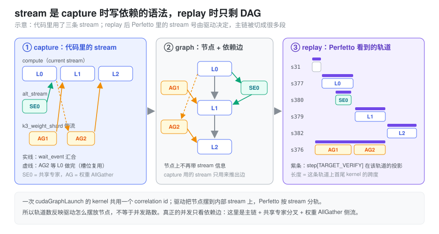
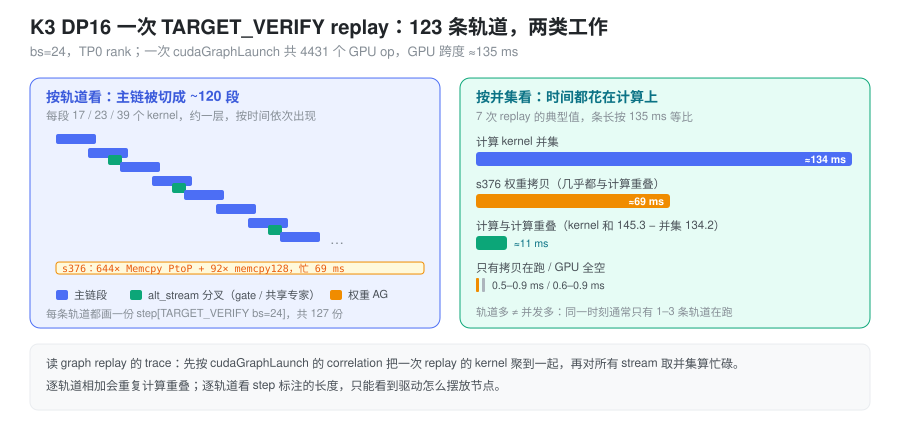

% CUDA Graph 在 Perfetto 中的 Stream

- decode 阶段开了 CUDA Graph，为什么 Perfetto 里一个 `step[TARGET_VERIFY bs=24]` 会出现在上百条 stream 上？
- CUDA Graph 不是把所有 kernel 压到一条 stream 里了吗？
- 这么多 stream，意味着有这么多路并发吗？应该怎么读这种 trace？

### 问题：开了 graph，stream 反而变多了

一个常见的理解是：decode 阶段用 CUDA Graph 把一次 forward 的所有 kernel 打包成一个 `cudaGraphLaunch`，所以 GPU 上应该只看到一条 stream，kernel 一个接一个排下去。

打开 Kimi K3 DP16 decode（bs=24，TP0 rank）的 torch profiler trace，看到的却是另一番景象：一次 `TARGET_VERIFY` 的 replay 里，4431 个 GPU op 分布在 123 条 stream 上；`step[TARGET_VERIFY bs=24]` 这个 GPU 标注在 127 条轨道上各画了一份，有的长 0.07 ms，有的长 116 ms。同一份 trace 里，graph 之外的 eager kernel 只落在 stream 31 和 87 两条上。

这里有两个问题要分开回答：

1. 为什么 replay 出来的 kernel 会落到这么多 stream 上？
2. 这么多 stream 是不是意味着这么多路并发，性能上要不要担心？

第一个问题的答案在 CUDA Graph 本身的模型里；第二个问题要回到 trace 上量。

### 抽象：stream 是 capture 时写依赖的语法，replay 时只剩 DAG

CUDA Graph 对“压缩”的那部分理解没错：它把 N 次 kernel 提交合成一次 `cudaGraphLaunch`，省掉的是 CPU 侧逐个 launch 的成本（见 [Cuda Graph](./cuda_graph.md)）。但它压缩的是**提交**，不是**执行顺序**。

capture 的时候，代码照常往 stream 上提交 kernel，并用 `wait_stream` / `record_event` / `wait_event` 在 stream 之间分叉、汇合。graph 从这些操作里推出的是一张 DAG：

- 同一条 stream 上的前后两个 kernel 之间连一条边；
- 一次 `wait_event`，在被等待的 kernel 和后续 kernel 之间连一条边。

推完之后，节点上就不再带 stream 信息了。capture 用的 stream 只是用来表达依赖的语法。NVIDIA 论坛上的回答说得很直接：用 stream 1 和 stream 2 capture 出来的图，执行时“永远不会真的跑在 stream 1 和 stream 2 上，这两条 stream 只用来抽取节点之间的依赖”（[NVIDIA Developer Forums](https://forums.developer.nvidia.com/t/what-will-happen-when-i-replay-a-cuda-graph-with-two-streams-in-a-new-stream/293965)）。

replay 的时候，驱动把 DAG 的节点摆到自己管理的内部 stream 上执行，只要求满足依赖边。CUPTI 记录的是 kernel 实际所在的内部 stream，Perfetto 又按 stream 分轨，于是：

- **一条没有分叉的链**，通常留在同一条内部 stream 上；
- **遇到分叉或汇合**，后面的节点可能被摆到另一条 stream 上。一条串行的主链因此被切成很多段，每段一条轨道。

第二条是在 trace 里观察到的规律，CUDA 文档没有承诺具体怎么摆放。可以依赖的只有一点：**轨道数反映的是驱动怎么摆放节点，不等于并发路数。真正的并发由依赖边决定。**



### Perfetto 里的轨道和标注是怎么来的

torch profiler 导出的 trace 里，GPU 侧有三类和这个问题相关的记录：

| 记录 | 分轨依据 | 在 graph replay 下的表现 |
|---|---|---|
| `kernel` / `gpu_memcpy` | `args.stream`，也就是 kernel 实际所在的 stream | 落在驱动选的内部 stream 上，不是 capture 时的 stream |
| `cuda_runtime` 的 `cudaGraphLaunch` | CPU 线程 | 一次 replay 只有一条；它的 `correlation` 被这次 replay 的**所有** kernel 共用 |
| `gpu_user_annotation` | 每条有 kernel 的 GPU stream 各一份 | CPU 上的 `record_function` 范围投影到 GPU，每条轨道上从这段时间里第一个 kernel 画到最后一个 kernel |

最后一行解释了“上百个 `step[TARGET_VERIFY bs=24]`”：step 只有一个，但它在每条轨道上各投影一份。在 K3 这份 trace 里核对过，每份标注的两端都正好贴着该轨道上首尾 kernel 的起止时间。所以标注的长度没有“这个 step 在这条 stream 上花了多久”的含义：

- 只跑了 17 个 kernel 的短轨道，标注长约 2 ms；
- 权重拷贝轨道从头忙到尾，标注长 116 ms；
- 有一条轨道上的 24 个 RMSNorm 从 3.4 ms 一直散落到 131 ms，标注也跟着拉到 108 ms，中间大部分时间这条轨道是空的。

要把一次 replay 的 kernel 聚到一起，应该用第二行的 `correlation`：先找到 `cudaGraphLaunch`，再取所有同 `correlation` 的 kernel。不要按轨道或按标注聚。

### 实测：K3 DP16 一次 TARGET_VERIFY replay

数据来自 `profile_dp16/d_bs24_100k`（DP16，单卡 bs=24，全局 384），按 `correlation` 取出 7 次 4431-op 的 replay 统计。

**轨道上有什么。** 按每条 stream 上的 kernel 数分组，结构很清楚：

| 轨道 | 数量 | 内容 |
|---|---|---|
| stream 376 | 1 | 644 次 `Memcpy PtoP (Device -> Device)` + 92 次 `memcpy128`，忙约 69 ms。每次 PtoP 约 78 MB、约 715 GB/s，是权重 AllGather |
| 主链段 | 约 120 | 每段 17、23 或 39 个 kernel，按时间依次出现。例如 stream 413 上依次是 quant、gemm、`situ_and_mul`、`add3`、`attn_res`、RMSNorm、`mla_prepare`，最后是 1247 us 的 MLA decode。一段大约一层的量，但段的边界不在层的边界上 |
| 其他 | 少量 | 开头的 embedding、AllReduce，以及上面那条散落的 RMSNorm 轨道 |

**有多少真正的并发。** 把这次 replay 的所有 op 按时间扫一遍，统计同一时刻有几个 op 在跑：1 个占 46.4%，2 个占 48.0%，3 个占 4.1%，4 个占 0.9%，0 个占 0.6%。123 条轨道里，任意时刻只有一到三条在干活。

**时间花在哪。** 每次 replay 的 GPU 跨度约 135 ms：

| 指标 | 时间 | 含义 |
|---|---|---|
| 计算 kernel 的并集 | ≈134 ms | 除权重拷贝外，任意 kernel 在跑的时间 |
| 计算 kernel 时长之和 | 145.3 ms | 比并集多 11 ms，是计算与计算的重叠（alt_stream 分叉） |
| stream 376 的权重拷贝 | ≈69 ms | 几乎全部与计算重叠 |
| 只有拷贝在跑 | 0.5–0.9 ms | 拷贝没被计算盖住的部分 |
| GPU 全空 | 0.6–0.9 ms | |

所以，并发有两类：一类是主链和权重 AllGather 侧流，另一类是主链和 MoE 里的 alt_stream 分叉。轨道数本身对性能没有影响，权重拷贝也基本藏住了。一步的时间由主链计算决定，和 stream 怎么摆放无关。



### 在 SGLang 中：分叉和汇合从哪来

K3 的 decode forward 里，有两处代码在 capture 时制造分叉。它们是轨道被切碎的来源，也正好对应上面两类并发。

**权重 AllGather 侧流。** 开了 `SGLANG_ENABLE_K3_WEIGHT_SHARD=1` 后，DP16 每张卡只存非专家权重的 1/8，每层前要从同节点的 8 张卡把完整权重拼回来（`srt/sharding.py`）。几个关键点：

- AllGather 跑在一条单独的侧流上，由 `get_weight_sharding_side_stream()` 从 RuntimeContext 租用，名字是 `k3_weight_shard`；
- 走的是 NCCL 的 Copy Engine 算法，通信组限制在一个 NVLink 域内的 8 张卡（`_K3_CE_GROUP_SIZE = 8`）。所以在 trace 里它显示为 `Memcpy PtoP (Device -> Device)`，而不是 `ncclDevKernel_*`；
- `WeightShardForwardPlanner` 做深度为 1 的预取：`kimi_k3.py` 的层循环在跑第 i 层前调用 `maybe_dispatch(i + 1)`，提前发出下一层的 AllGather，并用上一层的 `_weight_shard_done_event` 作为 gate，保证 staging 槽位不会被提前覆盖。

`FlatAGScheduler.launch()` 里的分叉和汇合，就是图里的依赖边：

```python
stream.wait_stream(cur)              # 分叉：侧流等主链已提交的工作
with torch.cuda.stream(stream):
    dist.all_gather_into_tensor(...)
    self._shared_event.record(stream)
# 用到这一层权重前，prepare_layer_weight_shard_forward() -> wait_ready_once():
torch.cuda.current_stream().wait_event(self._shared_event)   # 汇合
```

每个做了 weight shard 的层，主链都要等一次这个 event。主链段的数量和层数同一量级，推测这些汇合点就是主链换轨道的地方。

**MoE 的 alt_stream。** `kimi_k3.py` 的 MoE 层在两处用 `alt_stream`：

- front overlap：router gate 和 TopK 放到 `alt_stream`，主链同时算 latent down-proj（`routed_expert_down_proj`），然后 `current_stream.wait_stream(self.alt_stream)` 汇合；
- shared expert overlap（`_sbo_shared_overlap`）：共享专家放到 `alt_stream` 上，与 routed 专家的 DeepEP 通信和 GEMM 重叠，在尾部汇合。

trace 里 7.1 ms 附近能直接看到这种重叠：一条轨道在跑 `deep_ep::internode_ll::dispatch`，另一条同时在跑 quant、gemm、`situ_and_mul`。11 ms 的计算重叠应该主要来自这类分叉，没有逐个核对。

**对照 eager。** 同样的代码不进 graph 时，kernel 落在 Python 实际提交的 stream 上，Perfetto 只会显示主 stream、`alt_stream`、`k3_weight_shard` 这几条。这份 trace 里的 eager kernel 只出现在 stream 31 和 87 上，可以作为对照。

### 怎么读 graph replay 的 trace

- **按 `correlation` 聚合一次 replay。** 找到 `cudaGraphLaunch`，取所有同 `correlation` 的 GPU op，不要按轨道或 step 标注去圈。
- **忙碌时间取所有 stream 的并集。** 把各轨道的 kernel 时长相加，会把重叠部分算两次。上面的例子里，相加是 145.3 ms，并集是 134.2 ms。
- **看并发，就看同一时刻有几条轨道在跑**，不要看轨道总数。
- **step 标注的长度只说明这条轨道上首尾 kernel 隔了多远。** 想知道一步多长，看这次 replay 首个 kernel 到最后一个 kernel 的跨度。
- **拷贝藏没藏住，看“只有拷贝在跑”的时间**，不要看拷贝流本身有多忙。69 ms 的拷贝只露出不到 1 ms。

### 小结

CUDA Graph 合并的是提交，不是执行顺序。capture 时代码里的 stream 和 event 只用来推出依赖边，replay 时驱动按 DAG 把节点摆到自己的内部 stream 上，Perfetto 照实分轨，于是一条主链会在每个汇合点换一次轨道，最终散成上百条，每条都带一份 step 标注。读这种 trace 时，把轨道当作驱动的摆放结果：按 `correlation` 圈出一次 replay，对所有 stream 取并集算时间，用同一时刻的并发数来判断有没有并行。K3 DP16 decode 里的 123 条 stream 对应的只是两类真实的并发，权重 AllGather 侧流和 MoE 的 alt_stream 分叉，一步的时间几乎全花在主链计算上。
