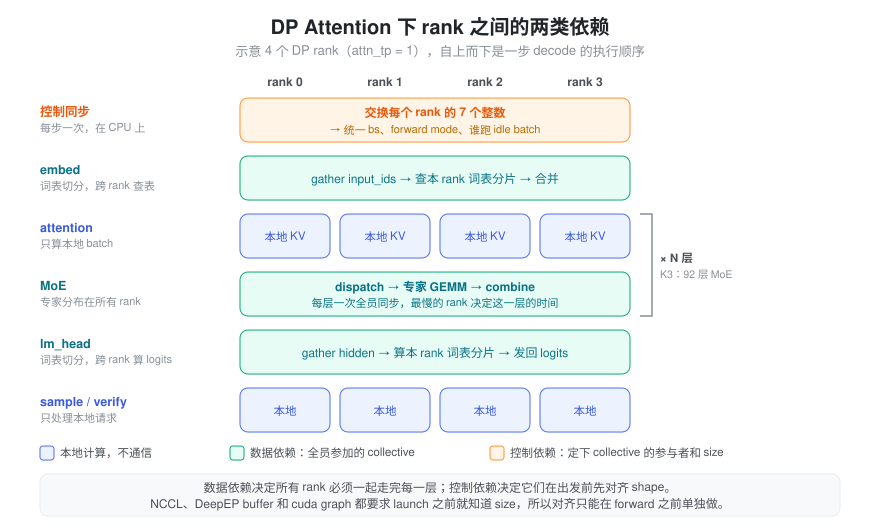
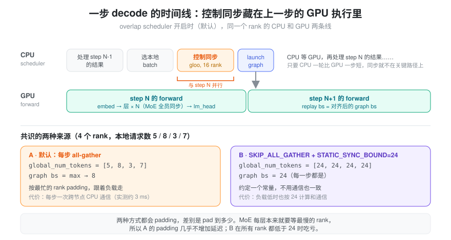

% DP

## DP 对比 TP

- TP
    - 优势
        - weight 可以切分
            - QKVProj, OProj
    - 劣势
        - 面对 MLA, GQA 可能存储 replicate KV cache，浪费显存
        - 可能存在重复计算
            - MLA q_a_and_kv_a_proj
- DP

### TP Size 选取

在 Prefill 阶段使用不同 TP Size 最后对极限性能会有怎样的影响？

#### Normal MoE

**那么 dp attention 何时有收益呢？**

首先，这个需要看你是否使用的是正常 MoE，如果是正常的 MoE，损耗会比较大，因为在 TP4, TP8 的 attention 之后需要增加一个 ReduceScatter，然后再运行 dispatch/combine 的 EP 模式的 MoE，这一步是额外的损耗。

如果使用 FusedMoE，那个差别其实不那么大，因为 TP1, TP4, TP8 在 attention 过后，fused moe 之前，都需要做一个 AllReduce。

> 注意在 sglang 的 TP8 DP8 的时候是通过 AllReduce 操作来模拟 AllGather，这样可以统一 DP1, DP2, DP4, DP8 的代码逻辑。

#### Fused MoE

这一节来讨论 dp attention 对于 prefill 阶段极限吞吐的影响。

首先控制变量，保证单卡 attention / moe  计算量一致的情况下 TP1 / TP4 进行对比。

后文给出三种 TP 情况下 Kimi k25 一层的时间（使用 Fused MoE + 不同 tp size 的 attention）进行性能对比。

- TP1: chunk size = 8k
- TP4: chunk size = 32k
- TP8: chunk size = 64k

三种情况下都是用 8k 的请求打满，保证每张卡的 attention 和 moe 计算量一致。

在该场景下，TP1 极限吞吐相比 TP4 提升约 7%，相比 TP8 提升约 12%

---

观察数据分析可知：

* attention MHA 和 moe 的 w13/w2 算子时间基本一致
* 通信时间基本一致
    * 由于使用 fused moe，TP1 的 attention 之后也要做 all gather，TP4/TP8 的 attention 之后直接做 8 卡的 all reduce，这个步骤两者通信量一致。当然 sglang 的实现逻辑，在 dp_gather 中使用 all_reduce 模拟了 all_gather。
* 差异在于小算子，TP4 的一些小算子需要额外计算：
    * q_a_and_kv_a_proj：在 MHA 的 qkv head 切分之前，每个 rank 重复计算，4 倍差距
    * norm
        * q_norm和 k_norm：4 倍差距
        * attention 之后的 fused_add_norm：8 倍差距。
        * MoE 之后的 fused_add_norm：4 倍差距。
    * 一些其他小算子也存在额外计算
        * set_mla_kv_buffer
        * dp_scatter 中的 trtion_mem_cpy 和 local_tokens.fill_(0)

### 不同 Attention 冗余显存分析

在 decode 阶段 dp attention 需要根据场景分析，如果不开启 dp attention，那么你不同卡的显存可能没有办法充分利用，导致 bs 打不上去，从而导致吞吐不高。

#### MLA & MQA

首先，MLA 在 decode 阶段使用 mqa，kv heads 数量为 1，在只有 1 个 dp 的情况下，相当于每张卡都要保存相同的 kv cache。

所以显存实际利用率不高，你的实际 bs 打不上去。

#### GQA

所以如果想要提升 decode 阶段的吞吐，需要保证不同卡能存储不同 kv head 的 cache，这样不重复存储相同的 kv cache，显存利用率才高。

考虑到现在一般大模型的 kv heads 数量都为 2 或 4，所以在这种情况下设置 decode attn 阶段的 dp_size = 8 // kv_heads，吞吐相比于 dp8 的模式不会明显下滑。

#### 其他损耗

其实损耗就是跟 prefill 阶段分析一致了：

- 小算子是否有重复计算
- 是否会额外 ReduceScatter 的通信（后面是正常 MoE 还是 FusedMoE）

## DP Attention 下 rank 之间的依赖

### 问题：名义上独立的 DP rank，为什么每步都要互相等

开了 DP attention 之后，每个 DP rank 有自己的 scheduler、自己的请求和自己的 KV cache，看起来像 N 个独立实例。但模型只有 attention 是按 DP 切开的，MoE、切分过的词表这些部分仍然跨 rank 共享。一步 forward 里，所有 rank 要一起参加上百次 collective。

这就带来两个问题：

- 某个 rank 这一步没有请求，它能不能直接跳过这一步？
- 各 rank 的 batch 大小不同时，collective 的 buffer 应该开多大，每个 rank 的数据写在什么位置？

两个问题的答案都依赖其他 rank 的状态，而每个 rank 的 scheduler 只知道自己的。

### 抽象：数据依赖和控制依赖

rank 之间的依赖可以分成两类。

**数据依赖**是计算本身需要的：本 rank 的 token 要用到其他 rank 上的权重。以 Kimi K3 decode DP16 为例：

| 环节 | 跨 rank 做什么 |
| :--- | :--- |
| embed（词表按 `SGLANG_VOCAB_TP_SIZE` 切分） | 每个 rank 只存一段词表，要替其他 rank 查表 |
| 每个 MoE 层 | 专家分布在所有 rank 上，token 要 dispatch 出去，算完再 combine 回来 |
| lm_head（词表切分） | 收集其他 rank 的 hidden，算本 rank 那段词表的 logits，再发回去 |
| attention、sample、spec verify | 只处理本地请求，不通信 |

数据依赖的结果是：所有 rank 必须一起走完每一层，每个 MoE 层都要等最慢的 rank 到齐。一个 rank 即使没有请求，也得跑一个空的 idle batch 去参加 collective，否则其他 rank 会卡住。

**控制依赖**是为了让这些 collective 能正确执行。所有 rank 在 launch 之前要对三件事达成一致：

1. **谁参加。** 没有请求的 rank 要补一个 idle batch。
2. **跑什么模式。** decode、extend、idle 的 kernel 序列和 collective 序列不同，必须统一；是否走 cuda graph 也要统一，只要有一个 rank 不能走 graph，所有 rank 都不走。
3. **shape 多大。** NCCL collective 要求每个 rank 贡献的长度相同；gather 到 buffer 时每个 rank 的 offset 等于前面 rank 的 token 数之和；cuda graph 在 capture 时就固定了 shape，所有 rank 必须 replay 同一个 bs 的 graph。

关键在于：这些 size 必须在 kernel launch 之前确定，不能在 forward 里边算边商量。所以控制依赖要在 forward 之前单独解决一次，这就是 scheduler 每步做的「MLP sync」。它交换的不是激活，只是每个 rank 的几个整数。



### 整体流程：一步 decode 里的控制同步

每个 rank 的 scheduler 选好本地 batch 后，把 7 个整数放进一个小 tensor，在所有 rank 之间做一次 all-gather：

```
num_tokens, num_tokens_for_logprob, can_cuda_graph,
is_extend_in_batch, can_run_tbo, forward_mode, can_run_breakable_cuda_graph
```

收到所有 rank 的数据后，每个 rank 用同样的规则各自推导，得到相同的结论：

- `global_num_tokens`：每个 rank 的请求数列表。后面的 DP gather、dense MLP、词表切分的 embed 和 lm_head、DSpark 的 row 布局都按它来算 buffer 长度和 offset。
- graph bs：取 `max(global_num_tokens)`，再向上取到最近一档 capture 过的 bs。
- `can_cuda_graph`：所有 rank 取 min。
- `need_idle_batch`：只要有任何一个 rank 有 token，没有请求的 rank 就补 idle batch。

decode 阶段 `global_num_tokens` 里是请求数，进入 forward 后再乘上每个请求的 token 数（投机解码时是 draft + 1），换算成 token 数。

这次通信的代价取决于它在不在关键路径上。开了 overlap scheduler（默认）时，它走的是 CPU 上的 gloo 通信组，不走 NCCL。原因是 GPU 这时还在跑上一步，如果用 NCCL，它就得排在上一步的 kernel 后面。所以这次同步和上一步的 GPU 执行是并行的。

在 K3 decode DP2（16 个 rank 跨 2 个节点）的 trace 里，`prepare_mlp_sync_batch` 每步中位数 3.07 ms、p90 3.35 ms，但 GPU 在相邻两步之间的空闲是 0。只要 CPU 一轮的总耗时小于 GPU 一步的时间，这 3 ms 就被完全藏住。它会暴露出来的情况是：关掉 overlap schedule、GPU 一步很短导致 CPU 成为瓶颈，或者 gloo 出现长尾。



### 跳过同步：用约定代替通信

如果不想要这次通信，也可以让所有 rank 事先约定一个常量。`SGLANG_SCHEDULER_SKIP_ALL_GATHER=1` 跳过 all-gather，`SGLANG_DP_STATIC_SYNC_BOUND=B` 让每个 rank 都假设所有 rank 的请求数都是 B，于是 `global_num_tokens = [B] * dp_size`，offset 就是 `rank * B`，不需要通信也能算出相同的布局。

这两个开关必须一起用。只开 `SKIP_ALL_GATHER` 不设 bound 时，`global_num_tokens` 里只有本 rank 自己的数，这是给 DWDP（各 rank 完全独立运行）用的模式；DP attention 下各 rank 的布局会对不上，词表切分的 embed 会直接报错，collective 的 size 不一致还可能导致 hang。

两种方式都会 padding，差别是 pad 到多少：

| | 默认 all-gather | SKIP_ALL_GATHER + STATIC_SYNC_BOUND |
| :--- | :--- | :--- |
| 共识从哪来 | 每步交换一次 | 启动时约定的常量 |
| padding 到 | 当步所有 rank 的最大值 | 永远是 B |
| 每步开销 | 一次跨节点 CPU 通信，通常被 overlap 藏住 | 没有 |
| 负载低时 | 跟着变小 | 仍按 B 计算和通信 |
| 限制 | 无 | B ≥ 每个 rank 可能的最大请求数，否则 scheduler 报错；所有 rank 每步必须处于同一 forward mode，因为模式不再被同步 |

因为每个 MoE 层本来就要等最慢的 rank，默认方式 pad 到最大值几乎不增加延迟。静态 bound 只在所有 rank 都低于 B 时吃亏。K3 decode DP16 的启动脚本设了 `B = 24`，结果每 rank bs 4、8、24 的三份 profile 墙钟都在 136~138 ms，trace 里 KDA 和 MLA kernel 的 grid 也完全相同，都是按 24 跑的。详见 [K3 Decode：DP16 vs DP2×DCP8](./kimi_k3_decode_dp16_vs_dp2.md)。

### 源码定位

路径相对 `python/sglang/srt/`：

- `managers/scheduler_components/dp_attn.py`
    - `prepare_mlp_sync_batch_raw()`：一步同步的入口，决定用哪个通信组、是否跳过 all-gather、是否补 idle batch。
    - `MLPSyncBatchInfo.all_gather()`：打包 7 个整数并 all-gather，推导出 `global_num_tokens`、`can_cuda_graph` 等。
    - `_fill_static_sync_values()`：静态 bound 路径，用 `[bound] * dp_size` 代替通信结果。
- `environ.py`：`SGLANG_SCHEDULER_SKIP_ALL_GATHER`、`SGLANG_DP_STATIC_SYNC_BOUND` 的定义和注释。
- `layers/dp_attention.py`：`get_dp_padding_mode()` 根据 `global_num_tokens` 选择 MAX_LEN（每个 rank 都 pad 到最大值）或 SUM_LEN（紧凑排布）的 gather 布局；cuda graph 内固定用 MAX_LEN。
- `model_executor/runner/decode_cuda_graph_runner.py`：graph bs 取 `max(original_global_num_tokens_cpu)`。
- `speculative/spec_info.py`：`spec_scale_global_num_tokens()` 把请求数换算成 token 数。

每层 attention 和 MLP 之间具体怎么 gather 和 scatter，见 [Communicator](./communicator.md)。

### 小结

DP attention 让 attention 部分各 rank 独立，但 MoE 和词表切分把所有 rank 绑在每一层上，这是数据依赖。为了让这些 collective 能用固定的 shape 和 cuda graph 执行，所有 rank 在每步 forward 前必须对参与者、模式和 size 达成一致，这是控制依赖。默认实现每步交换几个整数来达成一致，代价通常被 overlap scheduler 藏住；静态 bound 用约定代替通信，省掉这次同步，代价是负载低时也按上限计算。

## Fake-DP：一个入口下的多组独立模型副本

SGLang 当前仓库中的 `--fake-dp N`（字段名 `fake_dp_size`，默认 1）表示：在同一个 DataParallelController / HTTP 服务入口后面，启动 N 组独立模型实例。**`--fake-dp 2` 就是两组完整模型副本，每组可以再用 TP / CP / EP 组织自己的 GPU。** “完整”指每组 GPU 合起来包含完整模型，而非每张 GPU 都保存完整权重。

这里的 fake 指外层用 controller 做类似 DP 的请求分发，内部保持独立实例的执行方式；模型副本和 GPU 资源分配都是真实的。

### 部署示例：8 卡运行两套 TP4

单机、PP=1、默认连续 GPU 编号时：

```bash
--fake-dp 2 --tp-size 4
```

```text
                    一个 HTTP 服务入口
                            │
                   DataParallelController
                      请求分发 / 路由
                      ┌─────┴─────┐
                      ▼           ▼
                 Replica 0    Replica 1
                 GPU 0～3     GPU 4～7
                 完整模型 A    完整模型 B
                 独立 TP4     独立 TP4
                 独立 KV      独立 KV
```

两组会分别加载模型权重，分别维护 scheduler、batch、GPU KV cache 和通信组。两组之间不进行模型 forward 的 collective。一个请求通常路由到其中一组，由该组执行；该请求不会因为 fake-DP=2 自动使用全部 8 张 GPU。PD 分离部署时，Prefill 与 Decode 各自仍按其部署拓扑执行和传输 KV。

在上述 PP=1 场景，总 GPU 数为 `fake_dp_size × tp_size`。每个 TP4 副本都必须独立容纳完整模型及运行资源，不能依靠另一个副本补足权重或显存。若每组同时配置 CP4 / EP4，这些通常是在同一组 4 张卡上组织不同算子的并行维度，不是再将 GPU 数乘以 4 和 4。

### 与 DP-attention 的区别

| 项目 | Fake-DP，例如 fake-DP2 × TP4 | DP-attention，例如全局 TP8 / attention DP2 |
|---|---|---|
| 模型组织 | 两组完整且独立的模型副本 | 同一全局模型通信世界中划分 attention DP 组 |
| 内部 DP | 预期每个副本使用实际 DP=1 的路径 | attention 按配置划分 DP 组 |
| 通信范围 | TP / CP / EP 各自在副本内部 | attention 分组执行；MoE 等部分仍可能跨 attention DP 组通信 |
| 调度与 GPU KV | 每个副本独立维护 | 随 attention DP 组及算子布局组织 |
| 请求分发 | 外层 controller 选择一个副本 | controller 向相应 DP worker 分发 |
| 主要用途 | 多副本扩容，同时保留单实例执行路径 | 调整 attention 与 MoE 等模块的并行布局、计算和 KV 冗余 |

这里比较的是 **fake-DP 与开启 DP-attention 的部署**；普通 DP 多副本本身也可以是独立实例，不能把所有 `--dp-size` 用法都理解为同一个全局通信世界。

Fake-DP 的配置意图是保持实际 `dp_size=1`，由 `fake_dp_size` 决定外层副本数。它不是把 `--fake-dp 2` 和 `--dp-size 2` 相乘得到四组副本；当前 controller 使用两者的最大值计算副本数。评估该功能时，应按其预期独立副本配置使用。

### 启动和请求路由

启动时，engine 发现 `fake_dp_size > 1` 后创建 DataParallelController。controller 走独立副本启动路径，为每组分配独立的分布式通信端口和 GPU 区间，再分别启动组内 scheduler 进程、加载模型。对外仍共用服务入口和 tokenizer / detokenizer IPC 通道。

请求分发取决于负载均衡配置，可以轮询、按请求数或 token 负载选择副本。在 PD 分离的 `follow_bootstrap_room` 模式下，controller 按 `bootstrap_room % 副本数` 选择目标，以匹配 KV bootstrap 的副本路由。当前 fake-DP 路径会忽略外部 `routed_dp_rank` 的直接指定，避免外部默认 rank=0 导致所有请求都落到副本 0。

GPU KV 池彼此独立；如果启用 AttentionStore 等外部缓存，仍可能复用同一外部缓存服务或命名空间。当前实现用副本 dp_id 区分注册信息，因此“独立 GPU KV”不代表外部缓存服务也必须部署两套。

### 性能含义

Fake-DP 提供多组模型并行服务的能力，主要影响总吞吐、请求排队和并发容量。它不会直接把一个请求分摊给两个副本，也不能保证吞吐线性翻倍。是否优于单组 TP8，取决于 TP4 的单组执行效率、模型能否装下、KV 容量、请求负载和路由均衡。

例如 TP4 能装下模型且单组效率较高时，两组 TP4 可能比单组 TP8 更适合处理大量独立请求；若权重或运行资源必须使用 8 卡才能容纳，则不能用两组 TP4 替代。

### 源码定位

以上基于分析时的本地仓库实现：

- `python/sglang/srt/arg_groups/fields/parallel.py`：`fake_dp_size` 定义与 `--fake-dp` 别名。
- `python/sglang/srt/entrypoints/engine.py`：`_launch_scheduler_processes()` 判断是否创建 controller。
- `python/sglang/srt/managers/data_parallel_controller.py`：副本数计算、`launch_dp_schedulers()`、GPU 分配和请求分发。
- `python/sglang/srt/disaggregation/common/conn.py`：对外公布 fake-DP 副本数，供 KV bootstrap 路由使用。
- `python/sglang/srt/managers/scheduler.py`：AttentionStore 注册时使用 controller 分配的副本 dp_id。

相关概念：[TP](./tensor_parallelism.md)、[EP](./expert_parallelism.md)、[PD 分离](./disaggregation.md)、[KV Cache](./kv_cache_size.md)。
