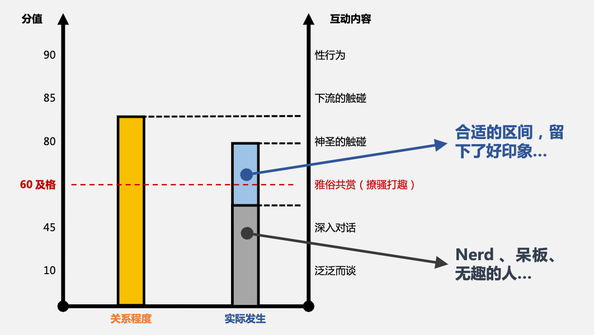

% 两步走

## 线下三阶段

**一阶段 平等交流阶段：**

对话内容主要为日常生活、工作、兴趣爱好等；主要目的是为了寒暄、降低对方的戒备心，让对方感觉轻松、有表达欲；姿态方面可延续之前的不卑不亢、平常心；常见开场比如“来的路上可真够堵的...” “想不到今天比预想的还要热...”之类，随意、轻松即可

**二阶段 深入交流阶段：**

对话内容需结合一阶段搜集的信息、整合提问；提出具有特质化、甚至 **“侵略性”** 的话题，主要目的为了加深了解、突出个人特色、完整“尽调”及人物画像、进行筛选；姿态方面要展现出 **“专业度”**，适时的给出认可或怀疑，但要做到有理有据、自...

**三阶段 决策阶段：**

大的决策可以是继续推进或者放弃，小的决策可以是聊骚、展现情人特质或者继续扮演“绅士”；在这个阶段你要根据她的人物画像，结合你自己的框架和能力，去决定推进的节奏（速通 or 两步走）、关系的性质（不排他 or 独占、浪漫 or 严肃、短期 or 长期）、二人的相对地位等问题

## 信号识别

**女生对你是否有兴趣？女生对你是否生理接受？你的行为是否过火？**

**初阶指标：**

* 女生同意和你**见面**是否存在**附加要求**？比如礼物、转账、请客吃饭、让你远途奔波去找她...
* 女生是否**主动**发问、开启话题、引申话题？态度是否敷衍？
* 对话能否进入二阶段？**眼神**、**动作**、**神态**、**语气**是否刻意和你保持距离感？把你生硬的摆在朋友的位置上...
* **小**要求是否配合？是否愿意为你更改框架？迎合你？

**进阶指标 - 生理接受（注意区分吸引）：**

* 和女生换到同一侧坐，是否顺利？物理距离决定心理距离
* 躯干接触、牵手、搂肩、摸脸、（摸腿、咬耳朵）、亲吻是否顺利？阻挠出现在哪一步？

**指标的首要目的，是为了客观判断自己和女生的互动程度、关系状态：**

* 客观很重要，躬身入局的时候，完全的相信感觉，感官会被麻痹、思维将不再清晰；
* 欲速则不达、在什么阶段办什么事儿；对话要蓄势待发、出手要一鼓作气、一战而定；
* 如果出现越位行为、要及时后撤，重新上分；冒险虽然可能会取得收益，但我们这里强调的是稳妥的策略；

**指标的次要目的，升温口诀：**

* 话题可以由浅及深，说明对方愿意继续开放社交窗口；
* 话题可以聊深，接下来可以聊俗；话题可以聊俗，接下来可以上手；
* 上手建议从神圣的地方开始，向下流的方式过度；如果你在第一次就完成了下流的接触，那么不排除速通的可能

## 节奏把控及重点事项

“两步走” 节奏的关键：**可以做、但不做；拿不准，就不做；留下好印象**

【升温口诀】

*   **话题由浅及深 → 对方愿意开放社交窗口**
    *   判断依据：对话能否从平等交流过渡到深入交流
    *   核心信号：对方持续释放信息、投入价值
    *   底层逻辑：信息即价值；关系粘性源于让对方说出不愿对他人讲的话

*   **话题由深及俗 → 从友谊升级为亲密关系**
    *   前提：深聊后好感与安全感达峰值
    *   操作：借安全感及时聊俗
    *   范围界定：风月、私人、隐秘、性话题（非下三路直白话）

*   **话题由俗及上手 → 肢体接触**
    *   判断前提：对方有信号、有好感、生理接受
    *   核心原则：从神圣处开始，向下流方式过渡
        *   心理学依据：牵手、接吻的接受度远高于性生活（心理层面接受）
        *   性本身有价值：多巴胺分泌（人与海豚特有）
    *   操作路径：摸头、牵手、胳膊、肩膀、脸 → 氛围好且对方含情脉脉 → 腿、胸等
    *   话术示例：“要不要检查我的腿部训练？”、“你平常也练腿吗？”

*   **速通可能：首次见面完成下流接触 → 不排除当晚带走**
