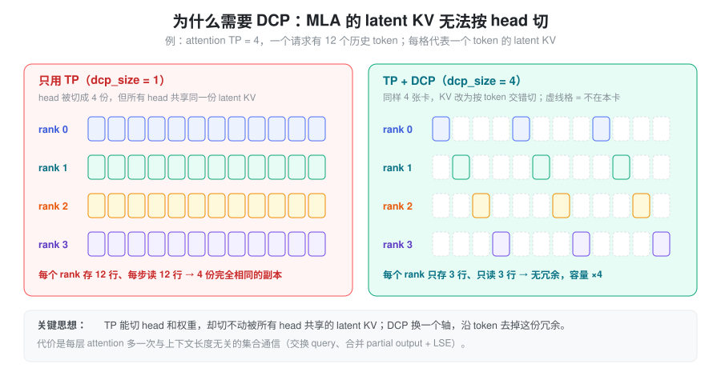
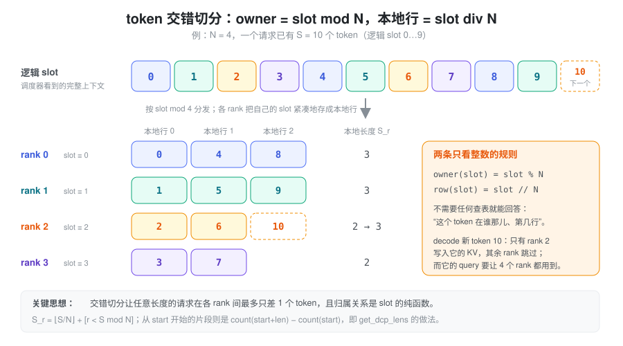
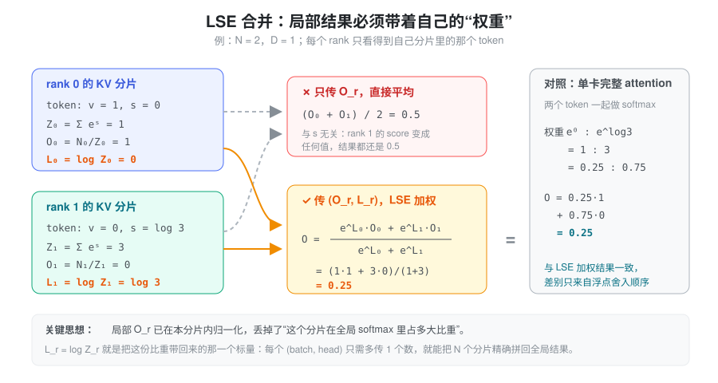
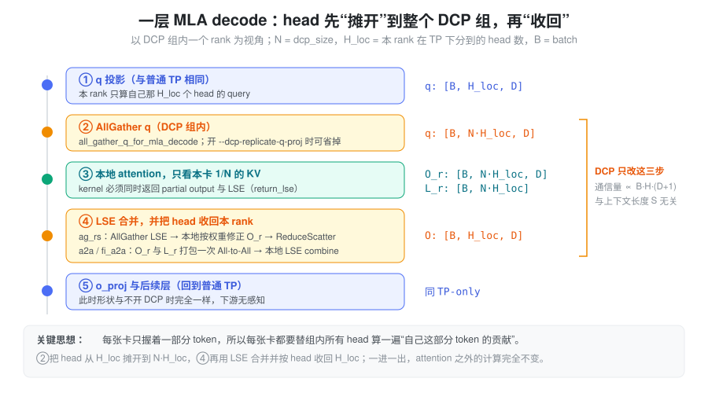
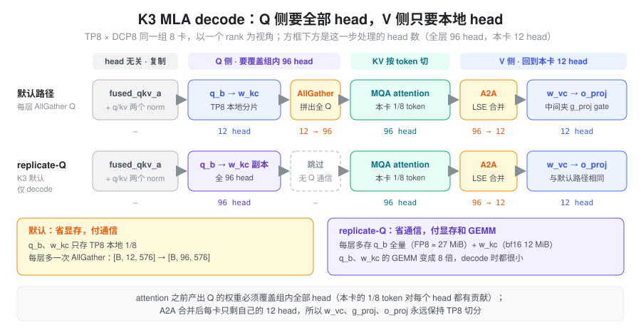

% DCP

Decode Context Parallelism（DCP，解码上下文并行）是一种面向大模型推理 decode 阶段的并行策略。它沿着上下文长度，也就是 KV cache 的 token 维度切分工作，而不是沿 attention head、请求或网络层切分。每个 rank 只保存、只读取一部分历史 token 的 KV，最后再通过少量通信把各自的局部 attention 精确拼回全局结果。

### 问题：decode 卡在哪里

#### decode 天然是访存受限的

自回归生成的每一步只有一个（或少量）新 query token，却要读取整段历史 KV cache。设 batch 为 \(B\)，head 数为 \(H\)，head dim 为 \(D\)，上下文长度为 \(S\)。一次 decode attention 的主要计算是 \(QK^{\mathsf T}\) 与概率乘 \(V\) 两次矩阵乘，约 \(4BHSD\) FLOPs；需要读取的 KV 约 \(2BSHD\) 个元素。若每个元素占 \(b\) 字节，算术强度为

\[
I = \frac{4BHSD}{2BSHD \cdot b} = \frac{2}{b}\ \text{FLOP/byte},
\]

与 \(S\) 无关。fp16 下 \(I = 1\)，而现代 GPU 的 ridge point 在 \(10^2 \sim 10^3\) FLOP/byte 量级。原因是每个 KV 元素在一步里只被 1 个 query 用到：上下文越长，要搬的字节越多，复用率却不会提高。

缓解只有两条路：提高 query 侧的复用（更大的 batch、多 query token），或者把“读 KV”这件事分摊到更多设备上。DCP 走的是后一条。

#### MLA + TP：KV cache 被原样复制了 TP 份

对普通 MHA/GQA，TP 按 head 切分时 KV 也跟着 head 一起被切开，每个 rank 只存自己那几个 KV head。MLA 不同：经过权重吸收（absorbed MLA）之后，所有 query head 共享**同一份** latent KV（`kv_lora_rank + rope_dim` 维）。TP 能切 head、切权重，却切不动这份被所有 head 共享的 cache，结果是 attention TP 组里的每个 rank 都存着、每步都读着完全相同的上下文。



这是两个问题叠加在一起：

- **容量**：TP=8 时，8 张卡的 KV 显存实际上只装得下一份上下文，能并发的请求数和最大上下文长度都被这份冗余吃掉；
- **带宽**：每张卡每步都要从 HBM 读完整的 \(S\) 个 token，而 decode 恰恰卡在这里。

DCP 要解决的就是：**在不改变模型数学语义的前提下，让组内的 \(N\) 张卡各自只存、只读 \(1/N\) 的 token。**

### 核心抽象：按 token 切 KV，只交换“摘要”

DCP 的设计建立在两个想法上。第一个回答“KV 怎么放”，第二个回答“结果怎么合”。

#### 想法一：token 的归属是 slot 的纯函数

把上下文中的每个 token 看成一个逻辑 slot \(p\)。DCP 规定

\[
\operatorname{owner}(p) = p \bmod N, \qquad \operatorname{row}(p) = \lfloor p / N \rfloor .
\]

rank \(r\) 持有 \(\mathcal{P}_r = \{p \mid p \bmod N = r\}\)，并把它们在本地紧凑地存成第 0、1、2…行。



选交错（round-robin）而不是连续切块，有三个好处：

- **负载天然均衡**：任何长度的请求在各 rank 之间最多相差 1 个 token，\(S_r = \lfloor S/N \rfloor + \mathbf{1}[r < S \bmod N]\)；连续切块则会让请求后半段全压在最后一个 rank 上，decode 时只有它在增长；
- **增长是均匀的**：decode 每生成一个 token，owner 依次轮转，没有哪个 rank 的 KV 长期领先；
- **无需查表**：“某个 token 在谁那儿、第几行”只靠两次整数运算就能回答，不需要额外维护映射表。这一点让分配器、写入 kernel、读取索引都可以各自独立算出同一个答案。

对于从全局位置 \(a\) 开始、长度为 \(L\) 的片段（例如 chunked prefill 的一个 chunk），本 rank 的份额不能简单用 \(L/N\)，而要算 \(\operatorname{count}(a+L) - \operatorname{count}(a)\)，其中 \(\operatorname{count}(x)\) 是 \([0, x)\) 内属于 rank \(r\) 的位置数。

#### 想法二：每个分片只交出 (O_r, L_r) 这对摘要

每个 rank 用完整的 query 对自己那 \(1/N\) 的 KV 做 attention，得到局部结果

\[
O_r = \operatorname{softmax}_{\text{local}}\left(\frac{QK_r^{\mathsf T}}{\sqrt{D}}\right)V_r,
\qquad
L_r = \log\sum_{p\in\mathcal{P}_r} \exp\left(\frac{q^{\mathsf T}k_p}{\sqrt{D}}\right).
\]

\(O_r\) 已经在本分片内归一化，丢掉了“这个分片在全局 softmax 里占多大比重”；\(L_r\)（log-sum-exp，LSE）正是把这份比重带回来的那个标量。拿到所有 rank 的 \((O_r, L_r)\) 后，全局结果是

\[
O = \frac{\sum_{r=0}^{N-1}\exp(L_r)\,O_r}{\sum_{r=0}^{N-1}\exp(L_r)} .
\]



这两个想法合起来就是 DCP 的全部：**KV 留在拥有它的 rank 上不动，跨卡流动的只有 query 和每个 (batch, head) 的 \(D+1\) 个数**。通信量与上下文长度 \(S\) 无关，而节省的 KV 读取与 \(S\) 成正比，这就是 DCP 适合长上下文的根本原因。

### 理论基础：合并为什么精确

本节回答三个问题：合并公式为什么成立；局部结果里最少需要传什么；这套合并对哪些 attention 变体仍然成立。

#### 合并恒等式的推导

设当前 query 可见的 KV 位置集合为 \(\mathcal{I}\)，DCP 把它划分成 \(N\) 个互不相交的子集

\[
\mathcal{I} = \mathcal{P}_0 \cup \mathcal{P}_1 \cup \cdots \cup \mathcal{P}_{N-1},
\qquad
\mathcal{P}_r \cap \mathcal{P}_s = \varnothing \quad (r \ne s).
\]

记 score \(s_p = q^{\mathsf T} k_p / \sqrt{D}\)，全局 attention 拆成分子与分母：

\[
O = \frac{\sum_{p \in \mathcal{I}} \exp(s_p) v_p}{\sum_{p \in \mathcal{I}} \exp(s_p)}
= \frac{\mathcal{N}}{\mathcal{Z}}.
\]

rank \(r\) 在本地对同一个公式求值，只是求和范围换成 \(\mathcal{P}_r\)：

\[
\mathcal{Z}_r = \sum_{p \in \mathcal{P}_r} \exp(s_p),
\qquad
\mathcal{N}_r = \sum_{p \in \mathcal{P}_r} \exp(s_p) v_p,
\qquad
O_r = \frac{\mathcal{N}_r}{\mathcal{Z}_r}.
\]

因为 \(\mathcal{I}\) 是这些分片的不交并，求和直接拆分：\(\mathcal{Z} = \sum_r \mathcal{Z}_r\)，\(\mathcal{N} = \sum_r \mathcal{N}_r\)。把 \(\mathcal{N}_r = \mathcal{Z}_r O_r\) 与 \(\mathcal{Z}_r = \exp(L_r)\) 代回去，就得到合并公式：

\[
O = \frac{\mathcal{N}}{\mathcal{Z}}
= \frac{\sum_{r=0}^{N-1} \exp(L_r) O_r}{\sum_{r=0}^{N-1} \exp(L_r)}.
\]

所以 LSE 加权合并不是经验公式，而是 softmax 的分子和分母都可以按 KV 分片相加的直接结果。推导的前提也随之清楚：每个位置对 score 的贡献只依赖它自己。

#### 只传局部 output 为什么不够

上图的反例可以再推一步：两个 token 的 \(v\) 分别是 1 和 0 时，无论 \(s_1\) 取什么值，局部 output 永远是 \((1, 0)\)，平均值永远是 \(0.5\)，而真实结果可以从 0 连续变化到 1。也就是说，只传 \(O_r\) 时全局结果在数学上**不可辨识**——信息已经丢了，不是算法不够聪明。

\(L_r\) 与 \(\mathcal{Z}_r\) 携带同样的信息。对一个 batch、一个 head，每个 rank 至少要贡献“一个权重 + 一个 \(D\) 维加权向量”，即约 \(D+1\) 个量。

#### 合并算子与数值稳定

把每个 rank 的局部结果记为二元组 \((\mathcal{Z}_r, \mathcal{N}_r)\)，合并算子

\[
(\mathcal{Z}_a, \mathcal{N}_a) \oplus (\mathcal{Z}_b, \mathcal{N}_b)
= (\mathcal{Z}_a + \mathcal{Z}_b,\; \mathcal{N}_a + \mathcal{N}_b)
\]

满足结合律与交换律，单位元是 \((0, 0)\)。因此 \(N\) 个分片可以按任意归约树合并：顺序累加、二叉树、ring、`AllReduce`、`All-to-All` 后本地合并，都得到同一个精确结果，差异只来自浮点舍入顺序。选哪种 collective 只是调度问题，不是数学问题——这正是 SGLang 能提供多种通信后端的理论依据。

直接算 \(\exp(L_r)\) 可能溢出。实际实现先减去 \(m = \max_r L_r\)：

\[
O = \frac{\sum_{r}\exp(L_r-m)O_r}{\sum_{r}\exp(L_r-m)},
\qquad
L = m + \log\sum_{r}\exp(L_r-m).
\]

此时所有指数输入都不大于零。不同 attention kernel 返回的 LSE 底数可能不同（有的是自然对数，有的是 \(\log_2\)），合并时必须用配对的 \(\exp/\log\) 或 \(2^x/\log_2\)，否则权重全错。

#### 与 online softmax 的统一

FlashAttention 在单卡上把长序列切块，维护 running max 与 running sum（等价于 LSE），逐块合并局部结果。DCP 把同样的分块放到不同设备上并行：

- FlashAttention 沿时间维度分块，块之间顺序合并；
- DCP 沿设备维度分片，分片之间按归约合并。

两者是同一个代数结构在不同并行轴上的展开。这也解释了 DCP 为什么能直接复用现有 attention kernel：只要 kernel 能把局部 LSE 暴露出来，而不是在返回前把它丢掉。

#### 合并成立的条件与失效边界

推导只依赖两件事：可见位置集合被划分为互不相交的分片；每个位置对 score 的贡献只由它自己决定。据此可以判断：

| 变体 | 是否保持可合并 | 原因 |
| --- | --- | --- |
| causal mask、滑动窗口 | 是 | mask 只是缩小可见集合，分片仍是可见集合的划分 |
| attention sink、位置偏置 | 是 | 等价于在某个分片里增加一个额外的 logit 项 |
| softcap 等逐元素 logit 变换 | 是 | 变换作用在每个 score 上，不引入位置之间的耦合 |
| 稀疏 attention（如 DSA 的 top-k） | 是 | 只要 top-k 选择在全局做，每个 rank 只对自己拥有的被选 token 算 attention |
| 线性注意力、状态空间模型（如 KDA、Gated DeltaNet） | 否，需单独设计 | 输出由状态递推决定，不是 softmax 加权 |

失效的共同点是“某个位置的权重依赖其他位置的 score”。只要 softmax 之前引入了跨位置的耦合，就必须重新推导合并算子。

### 一次 decode 的执行流程

DCP 并不新建一套独立的卡，而是在已有的 attention TP 组里再划出大小为 \(N\) 的 DCP 组：组内的 rank 在 TP 意义下仍然各自负责 \(H_{\text{loc}}\) 个 head，在 DCP 意义下各自负责 \(1/N\) 的 token。两种切分在 attention 这一步发生了冲突——“我只有部分 head 的 query”和“我只有部分 token 的 KV”——DCP 的执行流程就是在解决这个冲突。



1. **q 投影**：与普通 TP 一样，本 rank 只算 \(H_{\text{loc}}\) 个 head 的 query；
2. **摊开 head**：在 DCP 组内 AllGather query，每个 rank 拿到组内全部 \(N \cdot H_{\text{loc}}\) 个 head 的 query——因为本卡的 KV 分片对所有 head 都有贡献；
3. **本地 attention**：用这 \(N \cdot H_{\text{loc}}\) 个 head 对本卡 \(1/N\) 的 KV 做 attention，得到 \(O_r\) 与 \(L_r\)；
4. **合并并收回 head**：按 LSE 合并所有 rank 的 partial 结果，同时把 head 重新分回去，每个 rank 只留下自己的 \(H_{\text{loc}}\) 个 head；
5. **o_proj 及之后**：形状与不开 DCP 时完全一致，下游无感知。

第 2 步和第 4 步是一对“一进一出”的 head 重分布。合并（第 4 步）恰好可以和“收回 head”融为同一次 collective，这是 DCP 通信开销能压得很低的原因。

DCP 只改变 attention 的上下文访问方式，不改变模型的数学结构。对于相同的 query、KV 和 mask，DCP 的输出应与单设备完整 attention 一致，差别只来自浮点计算顺序和归约顺序。

### 通信策略

#### 合并：AllGather + ReduceScatter

最直接的做法分三步：AllGather 所有 rank 的 LSE（每个 (batch, head) 一个标量，很小）；每个 rank 本地算出全局 \(L\)，把自己的 partial output 修正为 \(\widetilde{O}_r = \exp(L_r - L)\,O_r\)；最后对 \(\widetilde{O}_r\) 做 ReduceScatter——求和完成合并，scatter 顺便按 head 把结果分回各 rank。

这种方案概念清晰、只依赖最常见的 collective，代价是每层两次 collective，并且 ReduceScatter 的输入是 fp32 的完整 head 维 output。

#### 合并：All-to-All

另一种做法是先把 \(O_r\) 按 head 切成 \(N\) 份，连同对应的 LSE 一起用一次 All-to-All 直接发给“最终负责这些 head 的 rank”；收到后，每个 rank 手里正好是自己 \(H_{\text{loc}}\) 个 head 在 \(N\) 个分片上的 partial 结果，本地做一次 LSE combine 即可。

它的优点是：每层只有一次 collective；LSE 可以和 output 打包进同一个 buffer；不需要先修正再求和。是否更快取决于 All-to-All 在当前互联上的实现效率——在 NVLink/MNNVL 这类高带宽低延迟域里通常占优。

#### Query：AllGather 还是复制投影

第 2 步的 query AllGather 也可以省掉：把 q 投影权重在 DCP 组内复制，每个 rank 直接算出全部 \(N \cdot H_{\text{loc}}\) 个 head 的 query。这把一次运行时通信换成了少量冗余 GEMM 和更多常驻权重，不能笼统说哪个更好，要看 q 投影的大小和互联的延迟。

### 计算量、显存与通信分析

#### 计算与 KV 读取

每个 rank 处理约 \(S/N\) 个 KV token，局部 attention 计算量与 KV 读取量都降为原来的约 \(1/N\)：

\[
\operatorname{FLOPs}_{\text{local}} \approx \frac{4BHSD}{N},
\qquad
\operatorname{Bytes}_{\text{local}} \approx \frac{BSM_{KV}}{N},
\]

其中 \(M_{KV}\) 是单个 token 的 KV 字节数。注意 DCP 不改变局部算术强度，它改变的是“一个 rank 需要读多少字节”，相当于把一部分 HBM 带宽压力换成了互联上的归约通信。

#### KV 容量

容量是否增加取决于开 DCP 之前 KV 是否被复制：

- **MLA + TP**（以及 KV head 数少于 TP size 的 GQA）：开 DCP 前组内每个 rank 存的是完全相同的副本，开 DCP 后各存 \(1/N\)，同样的显存能装下 \(N\) 倍的 token。这是 DCP 在这类模型上最直接的收益；
- **KV 本来就按 head 切开的情况**：系统总 KV 量不变，DCP 只是换了一种切法，收益只剩带宽与局部工作集。

#### 通信量

每层 decode 的归约数据规模约为

\[
\operatorname{Bytes}_{\text{reduce}} \propto B H (D\, b_O + b_L),
\]

加上 query AllGather 的 \(\propto B H D_Q b_Q\)。两者都与 \(S\) 无关，而节省的 KV 读取与 \(S\) 成正比。粗略的收益判据是

\[
T_{\text{attn}}(S) - T_{\text{attn}}(S/N) > T_{\text{comm}} .
\]

上下文越长，左边越大，右边基本不变；短上下文或小 batch 时，固定的通信延迟可能吃掉全部收益。

### 在 SGLang 中的实现

以下路径均相对于 `python/sglang/`。DCP 的公共原语集中在 `srt/layers/dcp/`：`layout.py` 是纯索引数学，`comm.py` 是各种 collective 与 LSE 合并，`planner.py` 构造每次 forward 的元数据，Triton kernel 在 `kernels/ops/attention/dcp_kernels.py`。

#### 启用与约束

| 参数 | 默认值 | 含义 |
| --- | --- | --- |
| `--dcp-size`（别名 `--decode-context-parallel-size`） | 1 | DCP 组大小 \(N\) |
| `--dcp-comm-backend` | 自动 | `ag_rs` / `a2a` / `fi_a2a`；未设置时优先 `fi_a2a`，否则 CUDA/ROCm/XPU 上用 `a2a`，其余 `ag_rs` |
| `--dcp-replicate-q-proj` | 按模型 | 复制 q 投影、省掉 query AllGather，只在 a2a 类后端下可用 |

参数定义在 `srt/arg_groups/fields/parallel.py`，后端的自动选择在 `srt/arg_groups/overrides.py` 的 `_dcp_comm_backend_default`。主要约束：`tp_size` 必须能被 `dcp_size` 整除；不能与 prefill CP 同时开启；`fi_a2a` 需要 Blackwell 且 DCP 组位于同一个 MNNVL 域。上游文档 `docs/docs/advanced_features/dcp.mdx` 指出，真正需要的是更强的 `attn_tp_size % dcp_size == 0`，启动时目前只检查了前者，开 DP attention 时需要自己保证。

#### 进程组：TP 组里的连续切片

`srt/distributed/parallel_state.py` 把每个 TP 组按连续切片切成若干 DCP 组，即 `tp_group[start : start + dcp_size]`；`srt/runtime_context.py` 中相应地有 `dcp_rank = tp_rank % dcp_size`。连续切片意味着 DCP 组内的 rank 在 TP 下负责的是相邻的几段 head，第 2 步 AllGather 拼出的就是一段连续的 head。

#### KV cache：在 slot 编号里“加宽”

“token 归属是 slot 的纯函数”这个抽象，在 SGLang 里落在分配器上，代码中称为 **WIDENED** 编号：

- 分配器在一个放大了 \(N\) 倍的逻辑编号空间里分配 slot：总容量是 `max_total_num_tokens * attn_dcp_size`，页大小也是 `page_size * attn_dcp_size`（`srt/mem_cache/kv_cache_configurator.py`）。每个 rank 的物理行数不变，每个物理行对应 \(N\) 个逻辑编号；
- 因为一页对齐到 \(N\) 的倍数、同一请求的 token 在页内连续分配，`slot % N` 就等于 `position % N`，交错切分自然成立；
- **写**：MLA 的写 kernel（`kernels/ops/kvcache/mla_buffer.py`）对每个 slot 判断 `loc % DCP_WORLD_SIZE == DCP_RANK`，只有 owner 写入第 `loc // DCP_WORLD_SIZE` 行，其余 rank 直接跳过；
- **读**：`layout.py` 的 `filter_dcp_local_kv_indices` 从一个请求的全部 slot 中挑出本 rank 拥有的那部分（仍是加宽编号），再由 `srt/mem_cache/kv_index_translator.py` 的 `translate_dcp_read_ids` 统一做 `widened // dcp_size` 换算成物理行。

这样调度器、radix cache、`req_to_token` 看到的始终是一个“看起来没有切分”的完整逻辑空间，只有最底层的读写 kernel 知道自己只负责其中 \(1/N\)。容量收益也直接体现在这里：`logical_token_capacity` 返回的是物理行数乘以 `attn_dcp_size`。

#### decode 路径：以 Kimi K3 的 MLA 为例

K3 的 MLA 层有 96 个 head，部署形态是 attention TP8 × DCP8，两个组是同一组 8 卡。同一张卡因此同时属于两种切分：按 head 它只负责 12 个 head，按 token 它只持有 1/8 的 KV。每个权重该存多少 head，取决于它在 attention 的哪一侧：

- **Q 侧（attention 之前）要全部 96 head**。本卡的 1/8 token 对每个 head 都有贡献，所以送进 attention 的 query 必须覆盖整个组的 head。产出 query 的 `q_b_proj` 和 `w_kc` 要么每层 AllGather 结果，要么常驻一份全 head 副本。
- **V 侧（A2A 合并之后）只要本卡 12 head**。All-to-All 在合并 LSE 的同时把 head 分回各卡，所以 `w_vc`、`g_proj`、`o_proj` 始终按 TP8 切分，从不需要全 head 副本。
- **与 head 无关的权重整份复制**：`fused_qkv_a_proj_with_mqa` 与两个 RMSNorm 的输出是 q_lora 和 latent，不带 head 维。
- **KV cache 按 token 切**，与 head 无关。



下表是每张卡常驻的形状（BF16 大小按单层计）。K3 的 checkpoint 是 FP8，`kv_b_proj` 在加载后被反量化成 bf16 再拆成 `w_kc` / `w_vc`。

| 权重 | 本卡常驻 | 切分方式 | 说明 |
| :--- | :--- | :--- | :--- |
| `fused_qkv_a_proj_with_mqa` | 7168 → 1536 + 512 + 64 | 整份复制 | `ReplicatedLinear`，输出 q_lora 与 latent（含 64 维 rope 部分） |
| `q_a_layernorm` / `kv_a_layernorm` | 1536 / 512 | 整份复制 | |
| `q_b_proj` | 1536 → 12 × 192 | TP8 按 head | extend 仍走这一份 |
| `q_b_proj_qrep_*` | 1536 → 96 × 192 | 全 head 副本 | 仅 replicate-Q；保持 block-FP8 并带 gather 后的 scale，约 27 MiB |
| `w_kc` | [12, 128, 512] | TP8 按 head | 来自 `kv_b_proj` 的 K 部分 |
| `w_kc_qrep` | [96, 128, 512] | 全 head 副本 | 仅 replicate-Q；必须是 bf16/fp16，约 12 MiB |
| `w_vc` | [12, 512, 128] | TP8 按 head | 来自 `kv_b_proj` 的 V 部分 |
| `g_proj` | 7168 → 1536 | TP8 列切 | 输出门 `x · sigmoid(g)`，作用在 o_proj 的输入上 |
| `o_proj` | 1536 → 7168 | TP8 行切 | 输出是部分和 |
| KV cache | 每卡 1/8 的 token | 按 token 交错 | latent 576 维，所有 head 共享 |

所以“replicate-Q 下 q_b / w_kc 不切”并不准确：每张卡仍按 TP8 建了本地分片，replicate-Q 是在它旁边**多加**一份全 head 副本。开 `SGLANG_K3_DEL_MLA_KVB_DCP` 后，`kv_b_proj` 拆完 `w_kc` / `w_vc` 就被清空；若 q 投影是 16 位的，本地 `q_b_proj` 和 `w_kc` 也会被删掉。K3 的 q 投影是 block-FP8，本地分片要留给 extend 使用，删不掉。

**默认路径（不复制 Q）**。下面以一张卡为视角，B 是本 DP 分组的 decode batch，8 卡输入相同：

```text
hidden [B, 7168]
 → fused_qkv_a_proj_with_mqa（整份）     q_lora [B, 1536]，latent [B, 512 + 64]
 → q_a_layernorm / kv_a_layernorm
 → q_b_proj（本卡 12 head）              q [B, 12, 192] → q_nope [B, 12, 128]、q_pe [B, 12, 64]
 → Q 侧 absorb：bmm(q_nope, w_kc)        q_nope_out [B, 12, 512]
 → AllGather（DCP 组）                   [B, 96, 512]、[B, 96, 64]
 → MQA attention（latent 空间，KV 只有 1 个 576 维的 head）
     96 head × 本卡 1/8 的 token；新 token 的 latent 只写进 owner rank
     O [B, 96, 512]、LSE [B, 96]，都只是部分结果
 → A2A + LSE 合并（DCP 组）              每卡收回自己 12 head 在 8 张卡上的 (O, LSE)，O [B, 12, 512]
 → V 侧 absorb：bmm(O, w_vc)             [B, 12, 128] → [B, 1536]
 → 输出门：x · sigmoid(g_proj(hidden))   [B, 1536]
 → o_proj（本卡 1536 行）                部分和 [B, 7168]
 → reduce-scatter（SP-MoE）              每卡 B/8 行进 MoE
```

K3 的 MLA 以 `skip_rope=True` 构建，`rotary_emb` 为 None，q_pe 和 k_pe 原样进入 attention，不做旋转。64 维 rope 部分仍保留在 latent 里，只是不再携带位置信息。DeepSeek 一类模型会在 absorb 之后对 q_pe、k_pe 做 RoPE。

**打开 `--dcp-replicate-q-proj`（K3 默认）**。只有 Q 侧两步换成全 head 副本，其余不变：

```text
 → q_b_proj_qrep（全 96 head，block-FP8）  q [B, 96, 192] → q_nope [B, 96, 128]、q_pe [B, 96, 64]
 → Q 侧 absorb：bmm(q_nope, w_kc_qrep)     q_nope_out [B, 96, 512]
 → （跳过 Q AllGather）
 → attention → A2A + LSE 合并 → w_vc（12 head）→ 输出门 → o_proj，与默认路径相同
```

这是一笔显存换通信的交易：每层省掉一次 [B, 12, 576] → [B, 96, 576] 的 AllGather，代价是每层多存约 27 MiB（FP8 的 `q_b`）+ 12 MiB（bf16 的 `w_kc`），q 投影和 Q 侧 bmm 的计算量变成 8 倍。decode 的 B 很小，这两步的 GEMM 本来就很轻，多算的部分通常比一次跨卡 collective 的延迟便宜。

实现上有几处约束：

- **只在 decode 生效**。`forward_mla.py` 里的 `q_replicate_active` 要求 `_is_dcp_mla_decode_phase(forward_batch)` 成立，且副本已经就绪；extend 仍用本地 `q_b_proj`。这一路径还会关掉 bmm 与 attention 的融合，好让全 head 的 `w_kc_qrep` bmm 单独执行。
- **副本在 graph capture 前一次性准备**。`ModelRunner._prepare_replicated_q_proj` 在 DCP 组内 AllGather 每层的 `q_b_proj` 和 `w_kc`；block-FP8 的 q 投影交给 `_gather_block_fp8_q_proj`，权重和 scale 一起 gather，运行期由 `_project_q_replicated` 按 block-FP8 GEMM 计算。`w_kc` 不是 bf16/fp16 的层会被跳过，退回每层 AllGather Q。
- **K3 默认打开**。`srt/arg_groups/overrides.py` 的 `_kimi_k3_overrides` 在用户未显式设置时把 `dcp_replicate_q_proj` 置为 True。
- **与上游的差别**。社区 v0.5.22 同样按 attn TP 构建 MLA 权重，但 replicate-Q 只支持 16 位 q 投影，量化的 q 投影直接跳过；它也不会释放 `kv_b_proj` 和本地分片。block-FP8 副本和 `SGLANG_K3_DEL_MLA_KVB_DCP` 都是本 fork 加的。

#### 其他配套

- **CUDA graph**：`fi_a2a` 的 MNNVL workspace 初始化会同步 stream、做跨卡 barrier，无法被 capture，因此必须在 capture 之前调用 `init_fi_a2a_workspace`（`srt/model_executor/runner/base_runner.py`）；decode graph 会把 DCP 后的本地长度与索引写进 capture buffer。
- **PD 分离**：prefill 侧 DCP=1、decode 侧 DCP>1 时，`srt/disaggregation/common/dcp_pack.py` 先把属于目标 rank 的 KV 行聚到一块已注册的 staging buffer 再整体传输，避免逐 token RDMA；两侧 DCP 大小相同时要求 rank 一一对应，其他组合直接拒绝。
- **NPU 与 DSA**：`get_dcp_lens` 等函数带 `interleave_size` 参数。CUDA 路径默认 1（逐 token 轮转）；Ascend 上传入 KV page size，以整页为单位轮转，每个 rank 持有完整的物理页，从而能直接沿用普通的分页 block table。
- **测试**：`test/registered/dcp/` 下有布局单测（`test_dcp_layout_unit`）以及 DeepSeek V3.1、GLM、Kimi Linear、Qwen3.5 等端到端用例；合并 kernel 的单测在 `test_dcp_lse_combine`。

### DCP 与其他并行策略的区别

| 策略 | 主要切分维度 | 主要目标 | KV cache 视角 | 典型通信 |
| --- | --- | --- | --- | --- |
| TP | head、权重或 hidden | 分摊模型计算和权重 | 按 KV head 切；MLA 下无法切 | `AllReduce`、`AllGather` |
| DP | 请求或 batch | 提高请求吞吐 | 请求之间相互独立 | 基本无 attention 通信 |
| PP | 网络层 | 降低单卡模型驻留 | 不同 stage 持有不同层 | activation 传递 |
| SP/CP（prefill） | 输入序列 | 分摊长序列 prefill 的计算 | 切的是本次输入的 token | `AllGather`、Ring、`All-to-All` |
| DCP | 历史 KV 的 token | 降低单步 KV 读取、消除 KV 冗余 | 每个 rank 持有 KV 的 token 子集 | query AllGather、LSE/output 归约 |

DCP 与 prefill 阶段的 context parallelism 思想相近，都沿上下文维度切分；区别在于 prefill CP 切的是“本次要算的 query”，DCP 切的是“已经存下来的 KV”。前者的瓶颈是计算，后者的瓶颈是存储与带宽，所以 DCP 交换的是 attention 的摘要而不是 KV 本身。

DCP 也不同于 MQA、GQA 和 MLA：后者减少的是**单个 token** 的 KV 大小，DCP 减少的是**单个 rank** 要碰的 token 数。两者正交，而且 MLA 恰恰是最需要 DCP 的那一类——它把单 token 的 KV 压到了极小，代价是这份 KV 再也无法按 head 切分。

### DCP 对比 DP

优势：

- **切分 decode 阶段静态权重，减少显存压力**
    - MLA: `q_b_proj`, `g_proj`, `kv_b_proj`, `o_proj`
    - MQA/GQA/MHA: `q_proj`, `g_proj`, `o_proj`
- **消除 MLA 下的 KV 冗余**：同样的显存装下约 \(N\) 倍的 token，直接提升并发与可支持的上下文长度；
- **单卡 KV 读取降为约 \(1/N\)**：正好打在 decode 的带宽瓶颈上，上下文越长收益越大；
- **负载天然均衡**：交错切分让各 rank 最多相差 1 个 token；
- **对上层透明**：调度器、radix cache 看到的仍是完整的逻辑 slot 空间，o_proj 之后的计算完全不变。

代价：

- **每层多一到两次 collective**：query AllGather 与结果合并，固定开销与 \(S\) 无关，短上下文、小 batch 时可能不划算；
- **对 kernel 有要求**：attention backend 必须返回 LSE，且合并时要用对底数；
- **索引与分配更复杂**：逻辑 slot、owner rank、物理行三者必须在分配器、写 kernel、读索引、CUDA graph buffer、PD 传输之间保持一致；
- **不是所有 attention 都能直接合并**：线性注意力等跨位置耦合的结构需要另行设计；
- **故障面扩大**：DCP 组内任一 rank 出问题，组内所有请求的 attention 都会受影响。

### 小结

DCP 的价值在于换了一个切分轴：TP 切 head，而 MLA 的 latent KV 被所有 head 共享、切不动，于是 DCP 沿 token 维度把它切开。支撑这一点的是两个简单的抽象——token 的归属是 slot 的纯函数（`slot % N` 定 owner、`slot // N` 定行），以及每个分片只需交出 \((O_r, L_r)\) 这对摘要就能被精确合并。前者让 SGLang 只需在分配器里“加宽”编号空间，上层调度完全无感；后者让跨卡通信量与上下文长度无关。最终效果是用每层一次左右、与 \(S\) 无关的小通信，换来 \(N\) 倍的 KV 容量和 \(1/N\) 的单卡 KV 读取——上下文越长，这笔交易越划算。
