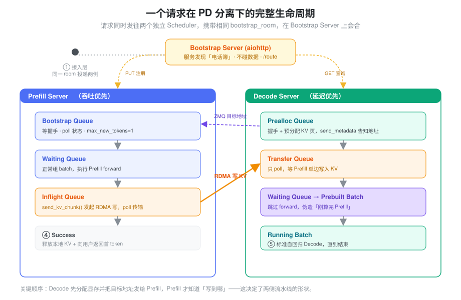
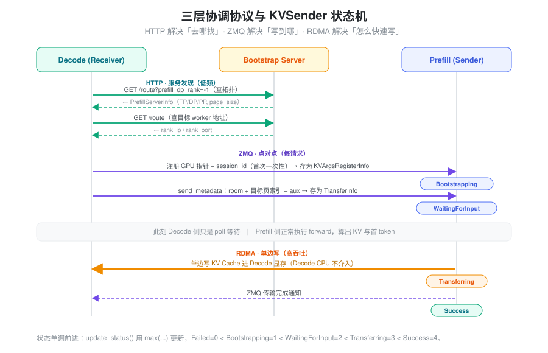
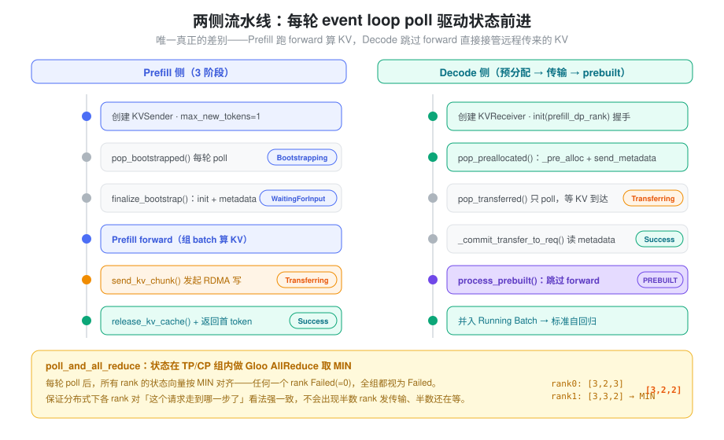
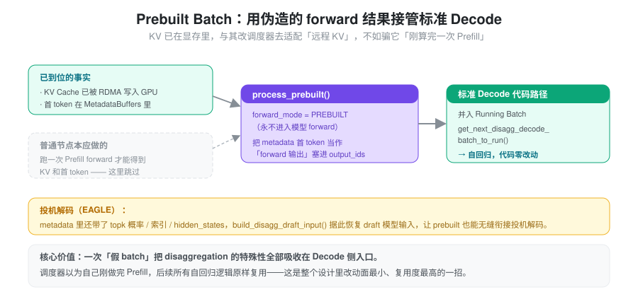
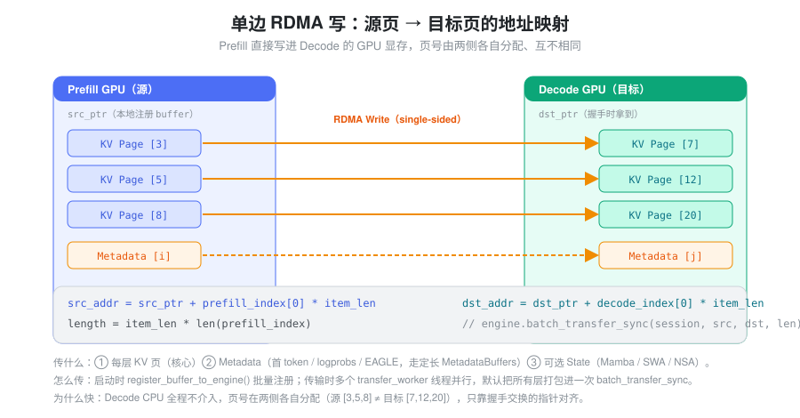

% PD Design

### 要解决的问题：Prefill 和 Decode 互相拖累

一次 LLM 推理分两个阶段，它们的性格截然相反：

- **Prefill**：一次性处理整段 prompt，是计算密集（compute-bound）的大 batch，吃满算力。
- **Decode**：逐个 token 自回归生成，是访存密集（memory-bound）的小步快跑，吃满显存带宽。

把两者放在同一组 GPU 上调度，会互相伤害：一个长 prompt 的 Prefill 占满算力，正在生成的 Decode 请求就被卡住，首 token 延迟（TTFT）和 token 间延迟（ITL）彼此牵连，谁都做不到最优。

**Disaggregation（PD 分离）的思路**是把两个阶段拆到不同的 GPU 集群上，各自独立调度：Prefill 集群专注吞吐，Decode 集群专注延迟。好处很直接：

1. **消除干扰**：Prefill 不再阻塞 Decode，两个阶段各自背独立的 SLO。
2. **异构部署**：Prefill 用计算型卡，Decode 用带宽型卡，资源更匹配。
3. **独立扩缩容**：按流量特征分别调整两类实例的数量。

但拆开也立刻带来一个新问题：**Prefill 算出来的 KV Cache 在 Prefill 的显存里，而后续 Decode 要在另一台机器上读它**。于是整个设计的核心任务就变成一句话——*把一段 KV Cache 从 Prefill 的 GPU 高效搬到 Decode 的 GPU*，并且要让两个互不相识的进程知道「搬给谁、搬到哪、搬完了没」。

---

### 核心抽象：两个独立调度器，靠一个 room 号会合

最朴素的想法是让 Prefill 算完以后「把 KV 发给 Decode」。但 Prefill 和 Decode 是两个独立进程、在不同机器上，发之前要先解决三件事：**找到对方、约定目标地址、确认完成**。SGLang 的抽象把这三件事拆开，用三层协议分别承担：

- **请求同时发往两侧**。接入层把同一个请求*同时*投递给一个 Prefill worker 和一个 Decode worker，两边各自带上相同的 `bootstrap_room`（一个随机生成的唯一 ID）。这个 room 号就是两侧的「暗号」——后续所有协调都围绕它展开。
- **一个 Bootstrap Server 当电话簿**。Prefill 启动时把自己的地址登记进去，Decode 收到请求时按 room 去查目标 Prefill 的地址。它只做服务发现，不碰数据。
- **点对点交换「写到哪」**。真正关键的洞察是：**必须由 Decode 先分配好显存，再把目标地址告诉 Prefill**——因为只有 Decode 知道自己 GPU 上哪些页是空的。于是 Decode 预分配 KV 页、算出目标地址，通过 ZMQ 发给 Prefill。
- **单边 RDMA 搬数据**。Prefill 拿到目标地址后，用单边 RDMA 写（one-sided write）直接把 KV Cache 写进 Decode 的显存，Decode 的 CPU 全程不介入。

三层协议各司其职：**HTTP 解决「去哪找」，ZMQ 解决「写到哪」，RDMA 解决「怎么快速写」**。下图是一个请求的完整生命周期——注意 Prefill 和 Decode 是两个独立的 Scheduler 进程，各自维护一套队列，只通过 room 号会合。



还有一个更精妙的抽象藏在 Decode 侧：KV 已经被 RDMA 写进显存后，Decode **不需要再跑一次 Prefill forward**。它构造一个假的 "Prebuilt Batch"，让调度器误以为自己刚算完 Prefill，从而无缝接入后续标准的自回归 Decode 流程。这一步后面单独讲。

---

### 三层协调协议：两端如何找到对方、约定写到哪里

#### Bootstrap Server：轻量级注册中心

Bootstrap Server 是一个 aiohttp HTTP 服务（`CommonKVBootstrapServer`，Mooncake 后端下为 `MooncakeKVBootstrapServer`），角色就是服务发现。核心接口是 `/route`：

- **Prefill 启动时**：`HTTP PUT /route` 注册自己的 `rank_ip`、ZMQ 端口和 attn-tp/cp/dp/pp 的 rank 信息。
- **Decode 收到请求时**：`HTTP GET /route` 按目标 dp_rank 查询对应 Prefill worker 的地址。
- **查询拓扑**：Decode 还要先知道 Prefill 侧的并行拓扑（TP/CP/DP/PP sizes、page_size、dtype）。这里有个小技巧——复用同一个 `/route` GET，用哨兵参数 `prefill_dp_rank=-1` 请求，服务端返回一个 `PrefillServerInfo` 而不是地址。

Bootstrap Server 不参与数据传输，只是一本「电话簿」。

#### 握手：从服务发现到地址交换

Decode 侧查到地址后，走 ZMQ 点对点通道完成握手。握手分两层，交换的东西不一样：

- **一次性注册（首次连接）**：Decode 把自己所有 GPU buffer 的原始指针（`kv_data_ptrs`、`aux_data_ptrs`、state 指针）和 `session_id` 发给 Prefill。Prefill 把它存进 `decode_kv_args_table[session_id]`，封装为 `KVArgsRegisterInfo`。这些地址对一条连接只发一次。
- **每请求发送（逐请求）**：Decode 预分配好 KV 页后，把 `bootstrap_room` + 本请求的目标页索引 + aux 索引发给 Prefill，Prefill 存成一个 `TransferInfo`。这才是「写到哪」。



传输过程中 sender 的状态由 `KVPoll` 描述（它是一个普通的整型常量类，不是 enum）：

```
Failed = 0, Bootstrapping = 1, WaitingForInput = 2, Transferring = 3, Success = 4
```

状态只会单调前进——`update_status()` 用 `max(...)` 更新，保证不会倒退。

注意三个层面的通信各自的频率：

- **HTTP**（Bootstrap Server）：服务发现，低频。
- **ZMQ**（点对点 PUSH/PULL）：地址交换 + 状态通知，每请求。
- **RDMA**（Mooncake 引擎）：KV Cache 数据搬运，高吞吐。

---

### 两侧的流水线

Prefill 和 Decode 各自维护一套队列系统，分别对应请求在本侧的几个生命阶段。所有 poll 结果都会通过 `poll_and_all_reduce`（在 TP/CP 组内做 Gloo AllReduce 取 **MIN**）在各 rank 间对齐——任何一个 rank 失败，所有 rank 都视为失败，状态强一致。



#### Prefill 侧：三阶段

对应三个队列：`disagg_prefill_bootstrap_queue`（`PrefillBootstrapQueue`）→ 共享的 `waiting_queue` → `disagg_prefill_inflight_queue`。

1. **Bootstrap Queue —— 等待握手**。请求进入时，`create_sender()` 创建 `KVSender` 并把请求放入队列；同时 `_process_req()` 把 `sampling_params.max_new_tokens` 设成 **1**（Prefill 只需算出 KV 和第一个 token，不做自回归，这样内存估算才准）。每轮 event loop 调用 `pop_bootstrapped()` poll 状态：`Bootstrapping` 继续等，`WaitingForInput` 则 `finalize_bootstrap()`（分配 metadata buffer 槽位、调 `sender.init(num_pages, metadata_buffer_index)`）后移入 `waiting_queue`，`Failed` 则 abort。
2. **Waiting Queue —— 正常 Prefill 调度**。和普通请求一样参与 batch 调度，`get_next_disagg_prefill_batch_to_run()` 取出组 batch 执行 forward。
3. **Inflight Queue —— KV 传输中**。forward 完成后调用 `send_kv_chunk()` 发起传输：从 `req_to_token_pool` 读 KV 的物理位置 → `kv_to_page_indices()` 转页索引 → 最后一个 chunk 时 `disagg_metadata_buffers.set_buf(req)` 写入首 token/logprobs → `disagg_kv_sender.send(page_indices, state_indices, num_kv_tokens=...)`。请求移入 Inflight Queue，poll 到 `Success` 后 `release_kv_cache()` 释放本地 KV 并 `sender.clear()`，首 token 随流式输出返回给用户。

```python
# send_kv_chunk 核心逻辑（prefill.py，简化）
def send_kv_chunk(self, req, last_chunk=False, end_idx=None):
    kv_indices = self.req_to_token_pool.req_to_token[req.req_pool_idx, start:end]
    page_indices = kv_to_page_indices(kv_indices, page_size)   # token 级 → page 级
    if last_chunk:
        self.disagg_metadata_buffers.set_buf(req)              # 写首 token、logprobs
    req.disagg_kv_sender.send(page_indices, state_indices, num_kv_tokens=end - start)
```

#### Decode 侧：预分配 → 传输 → prebuilt

Decode 侧更复杂，因为它必须**先分配内存**才能告诉 Prefill「写到哪」。只有两个专用队列 `disagg_decode_prealloc_queue`（`DecodePreallocQueue`）和 `disagg_decode_transfer_queue`（`DecodeTransferQueue`），第三阶段复用调度器通用的 `waiting_queue`，整个流程由 `SchedulerDisaggregationDecodeMixin.process_decode_queue()` 驱动。

1. **Prealloc Queue —— 握手 + 内存预分配**。创建 `KVReceiver`，先 `init(prefill_dp_rank)` 完成握手。然后 `pop_preallocated()` 做预分配：用 `_allocatable_token_budgets()` 检查空间 → `_pre_alloc()` 分配 req 槽位和 KV 页 → `kv_to_page_indices()` 算出页索引 → `kv_receiver.send_metadata(page_indices, metadata_buffer_index, state_indices, ...)` 把目标地址发给 Prefill。
2. **Transfer Queue —— 等待 KV 数据**。这里 Decode 只需 poll（`pop_transferred()`），数据是 Prefill 单边 RDMA 推过来的。poll 到 `Success` 后 `_commit_transfer_to_req()` 从 `metadata_buffers.get_buf(idx)` 读出 Prefill 写入的首 token、cached_tokens、logprobs，并用 `bootstrap_room` 校验 buffer 没串台。
3. **Waiting Queue —— 构造 Prebuilt Batch**。KV 已在 GPU 上，**不再跑 Prefill forward**，而是构造 `ForwardMode.PREBUILT` 的假 batch 接入标准 Decode（下一节详述）。
4. **Running Batch —— 正常 Decode**。prebuilt batch 并入 running batch，后续就是标准自回归，不再有 disaggregation 的特殊逻辑。

**关键设计**：`DecodeReqToTokenPool` 有一块独立的 `pre_alloc_size` 预留池（池子被撑大到 `size + pre_alloc_size + 1`），使预分配的内存不挤占正在运行的 Decode 请求。因为预分配的页可能要等较久才被用上（取决于 Prefill 何时算完），若和 running batch 共享，会直接拖垮 Decode 吞吐。

---

### Prebuilt Batch：整个设计里最精妙的一步

KV 到达后，Decode 侧面临一个尴尬：KV Cache 已经在显存里了，但调度器的所有后续逻辑（自回归 Decode）都假设「刚刚跑完一次 forward，拿到了上一步的 KV 和输出 token」。要么改一大片调度代码去适配「KV 是远程传来的」这种特殊情况，要么——**伪造一次 forward 的结果**。

SGLang 选了后者。它构造一个 `ForwardMode.PREBUILT` 的特殊 batch：

- `prepare_for_prebuilt()`：和 `prepare_for_extend()` 类似地准备 batch，但把 `forward_mode` 设为 `PREBUILT`——这种 batch **永远不会进入模型 forward**。KV Cache 位置直接从 `req_to_token_pool` 读（已被 RDMA 写入）。
- `process_prebuilt()`：把从 metadata buffer 拿到的首 token 当作「forward 的输出」塞进 `output_ids`。如果开了 EAGLE 投机解码，还要用 `build_disagg_draft_input()` 从传来的 `output_topk_p`/`output_topk_index`/`hidden_states` 恢复 draft 模型的输入。



精妙之处在于：**Prebuilt Batch 让 Decode 调度器以为自己刚做完一次 Prefill，而真相是 KV Cache 从远端传来的**。于是后续 `get_next_disagg_decode_batch_to_run()` 把它并入 running batch，所有标准 Decode 代码路径原样复用，一行都不用改。这两个方法混入在 `ScheduleBatchDisaggregationDecodeMixin`（`decode_schedule_batch_mixin.py`）。

---

### KV Cache 传输：传了什么、怎么传

#### 传输的内容

传输分三类数据，走同一条 RDMA 通道但逻辑独立：

| 类别 | 内容 | 用途 |
|------|------|------|
| **KV Data** | 每层 Attention 的 Key/Value Cache 页 | Decode 推理的核心输入 |
| **Metadata** | 首 output token、cached_tokens、logprobs、EAGLE 的 topk 概率/索引/hidden states、`bootstrap_room` | 让 Decode 构造 Prebuilt Batch 并校验 |
| **State**（可选） | Mamba SSM state、SWA 滑动窗口 KV、NSA 索引 | 混合架构模型（Mamba+Attention）需要 |

Metadata 走一块预分配的定长 buffer（`MetadataBuffers`，由 `ReqToMetadataIdxAllocator` 按请求分配槽位），Prefill 侧 `set_buf(req)` 写、Decode 侧 `get_buf(idx)` 读；里面冗余存了 `bootstrap_room` 用来防止 buffer 串台。

#### 单边 RDMA 写（Mooncake 后端）

传输引擎的核心是**单边 RDMA 写**：Prefill 直接把数据写进 Decode 的 GPU 显存，Decode 的 CPU 不参与。地址按页算：



```python
# set_transfer_blocks（mooncake/conn.py，简化）
src_addr = src_ptr + int(prefill_index[0]) * item_len   # 本地 KV 页
dst_addr = dst_ptr + int(decode_index[0]) * item_len    # 远端目标页（握手时拿到的指针）
length   = item_len * len(prefill_index)
```

实现要点：

1. **启动时**：`MooncakeKVManager.register_buffer_to_engine()` 把所有 GPU buffer 批量注册进 RDMA 引擎（`engine.batch_register(...)`）。
2. **握手时**：Decode 通过 ZMQ 发来 `kv_data_ptrs`（GPU 原始指针），Prefill 存为 `KVArgsRegisterInfo`。
3. **传输时**：若干 `transfer_worker` 守护线程从 `FastQueue` 取 `TransferKVChunk` 任务，调用 `engine.batch_transfer_sync(session_id, src_addrs, dst_addrs, lengths)`。**默认把所有层打包进一次 `batch_transfer_sync`**；只有开启 `enable_custom_mem_pool` 时才改成逐层提交。

传输是**异步流水线化**的——多请求、多线程并行推进。

#### Page 索引转换

KV Cache 按页（page）管理，一页含 `page_size` 个 token 的 KV。传输前把 token 级索引转成 page 级（`kv_to_page_indices`，实现在 `mem_cache/common.py`）：

```python
def kv_to_page_indices(kv_indices, page_size):
    return (kv_indices[::page_size] // page_size).cpu().numpy()
```

---

### 与 Scheduler 的集成：Mixin 模式

Disaggregation 通过 **Mixin** 注入 Scheduler，而不改 Scheduler 核心逻辑。`Scheduler.init_disaggregation()` 按 `disaggregation_mode` 创建组件：

```
DisaggregationMode.PREFILL:
    → MetadataBuffers + ReqToMetadataIdxAllocator
    → PrefillBootstrapQueue
    → disagg_prefill_inflight_queue (list)

DisaggregationMode.DECODE:
    → MetadataBuffers + ReqToMetadataIdxAllocator
    → DecodePreallocQueue + DecodeTransferQueue
    （Waiting 阶段复用通用 waiting_queue）
```

`Scheduler._add_request_to_queue()` 按模式分流：`NULL → waiting_queue`（标准路径）、`PREFILL → disagg_prefill_bootstrap_queue.add()`、`DECODE → disagg_decode_prealloc_queue.add()`。

最核心的差异在 event loop，启动时按模式选择不同循环函数：

| 模式 | 事件循环 | 核心差异 |
|------|----------|----------|
| NULL | `event_loop_normal` | 标准 prefill + decode |
| PREFILL | `event_loop_normal_disagg_prefill` | 多了 bootstrap poll + inflight poll，forward 后发起 KV 传输 |
| DECODE | `event_loop_normal_disagg_decode` | 多了 prealloc + transfer poll，用 Prebuilt Batch 替代 prefill forward |

（两侧都另有 `event_loop_overlap_*` 的 overlap 变体。）Mixin 的好处是：**disaggregation 的逻辑都在独立文件里**（`prefill.py` 的 `SchedulerDisaggregationPrefillMixin`、`decode.py` 的 `SchedulerDisaggregationDecodeMixin`、`decode_schedule_batch_mixin.py`），不污染主循环。这也让新后端（Mooncake、Nixl、Mori、Ascend）只需实现 `BaseKVManager/Sender/Receiver` 接口即可接入。

---

### 代码地图

关键抽象关系

```
BaseKVManager (每个 worker 一个)
 ├── 持有 KVArgs（所有 GPU buffer 地址、拓扑信息）
 ├── 创建 Sender/Receiver（每请求一个）
 └── 管理 transfer worker 线程池

BaseKVSender (Prefill 侧, 每请求)
 ├── init(num_kv_indices, aux_index)         → 设置传输参数
 ├── send(kv_indices, state_indices, num_kv_tokens) → 发起 RDMA 写
 └── poll() / clear() / abort()

BaseKVReceiver (Decode 侧, 每请求)
 ├── init(prefill_dp_rank)                    → 握手
 ├── send_metadata(kv_indices, aux_index, state_indices) → 告知目标地址
 └── poll() / clear() / abort()

MetadataBuffers (两侧各一份)
 ├── set_buf(req)  → Prefill 写首 token、logprobs、EAGLE 等
 └── get_buf(idx)  → Decode 读
```

---

### 小结

PD 分离把一次推理里性格相反的两个阶段彻底解耦到独立集群，换来消除干扰、异构部署和独立扩缩容。它的全部复杂度都压在一件事上：**把 KV Cache 从 Prefill 的显存可靠、高效地搬到 Decode 的显存**。SGLang 的解法是一套清晰的分层抽象——用 `bootstrap_room` 让两个独立进程会合，用 HTTP/ZMQ/RDMA 三层协议分别承担「找谁/写哪/怎么写」，用「Decode 先分配、Prefill 后单边写」的顺序绕开地址协商，再用 Prebuilt Batch 这一记巧劲让远程传来的 KV 无缝接入既有的 Decode 代码路径。真正的工程价值不在任何单点，而在这套抽象让新的传输后端只需实现三个接口就能接入。
