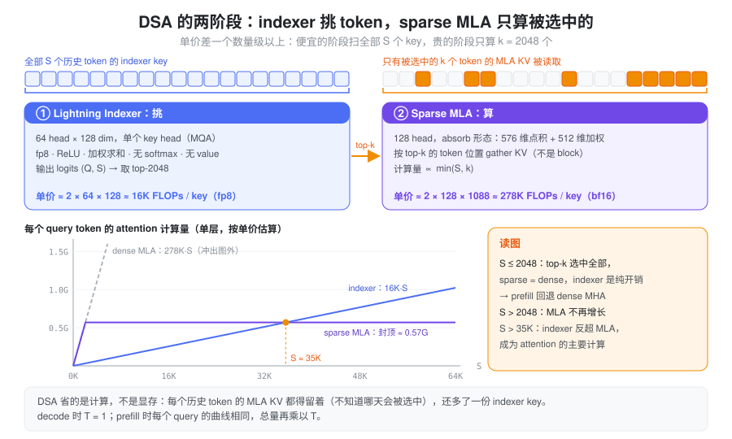
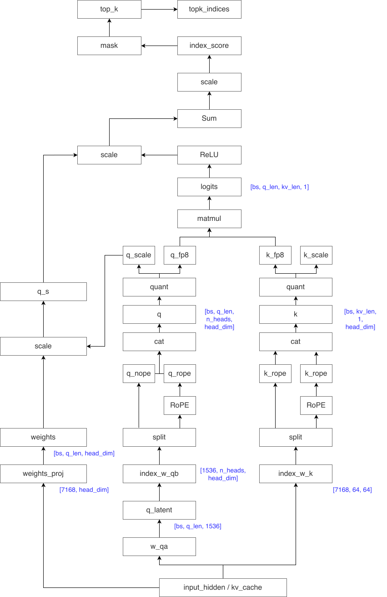
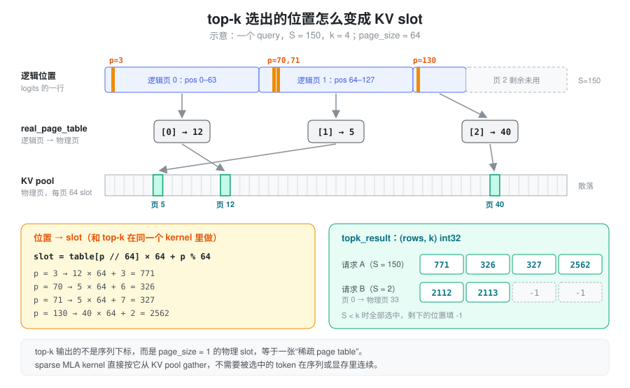
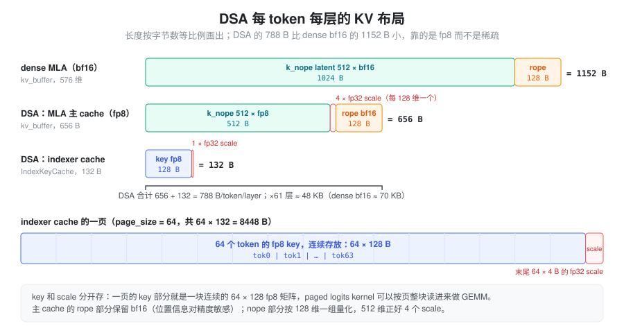
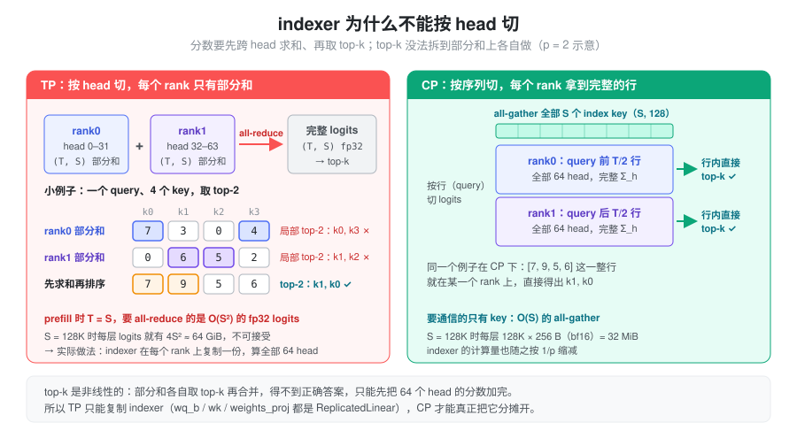
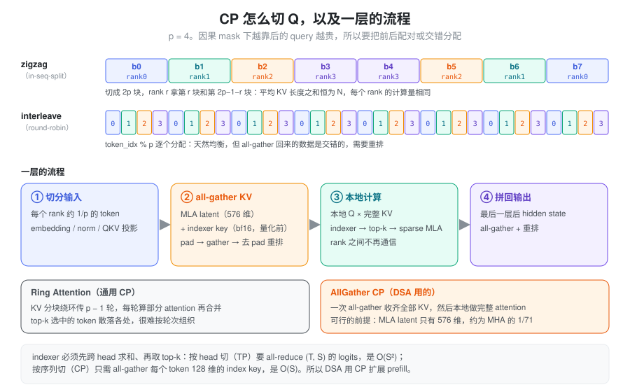

% DSA

**DSA（DeepSeek Sparse Attention）= 先用一个极便宜的打分器给所有历史 token 排序，再只对 top-k 个 token 做真正的 attention。** DeepSeek-V3.2 和 GLM-5 都用它，\(k = 2048\)。它省下的是长上下文的**计算量**，KV cache 一条都没少，反而多存了一份 indexer 的 key。下文先讲要解决的问题和设计，再讲 indexer、两份 KV cache、并行方式，最后对照 SGLang 的实现。

### 问题：MLA 省了显存，没省计算

MLA 把每个 token 的 KV 压成 576 维的 latent，KV cache 已经很小了（见 [MLA](./mla.md)）。但 attention 的**计算量**仍然随上下文长度 \(S\) 线性增长：absorb 形态下每个 query head 要和 \(S\) 个 latent 做 576 维的点积，再对 512 维的 value 做加权和。

V3 有 128 个 query head，所以 decode 时每多一个历史 token，每个 query 大约多出

\[
2 \times 128 \times (576 + 512) \approx 278\text{K FLOPs}
\]

上下文到 128K 时，attention 的计算会超过 MLP，成为 decode 的主要开销；prefill 则是 \(O(S^2)\)。

能不能只算一部分 token？softmax 的权重本来就高度集中，大部分 token 的贡献接近 0。难点在于**怎么知道该算哪些**：用真 attention 打分再挑，等于已经把账全算了一遍。

### 设计：两阶段，先挑后算



DSA 把 attention 拆成两个阶段：

1. **Lightning Indexer（挑）**：对全部 \(S\) 个历史 token 打一个相关性分数。它就是一个极简的 attention 前半段：少量 head、单个 key head（MQA）、fp8 低精度、没有 softmax、没有 value。
2. **Sparse MLA（算）**：只对分数最高的 \(k\) 个 token 做原本的 MLA attention，计算量从 \(\propto S\) 变成 \(\propto \min(S, k)\)。

整个设计成立的关键是两个阶段**单价差了一个数量级以上**。indexer 每个 key 的代价是 \(2 \times 64 \times 128 \approx 16\text{K}\) 次 fp8 乘加，比 MLA 的 278K 次 bf16 便宜约 17 倍（算上 fp8 的吞吐优势还要更多）。所以 indexer 虽然仍要扫一遍全部历史，斜率却很小；真正贵的 MLA 被截断在 \(k\) 个 token 上。

代价有两个：

- **KV cache 不减反增**。哪个 token 会被选中事先不知道，所以每个历史 token 的 MLA KV 都得留着，还要额外存一份 indexer key。这也是后来 V4 的 [CSA / HCA](./hca_csa.md) 要解决的问题。另一条路是利用"每步只读 \(k\) 个"这一点，把完整 KV 放到 host 内存，只把选中的换进显存（SGLang 的 HiSparse，见文末）。
- **短序列没收益**。当 \(S \le k\) 时 top-k 会选中全部 token，sparse 等于 dense，indexer 纯属额外开销。

### Lightning Indexer：一个极简的 attention 前半段

#### 打分公式

对 query token \(t\) 和历史 token \(s\)，indexer 的分数是

\[
I_{t,s} = \sum_{j=1}^{H^I} w_{t,j} \cdot \mathrm{ReLU}\!\left(q_{t,j} \cdot k_s\right)
\]

- \(H^I = 64\)：indexer 的 head 数，head dim 为 128（V3.2 的配置，取自模型 config 的 `index_n_heads` / `index_head_dim`）；
- \(q_{t,j}\)：由 MLA 的 q latent（`q_lora_rank` 维）经 `wq_b` 投影得到，每个 head 一个；
- \(k_s\)：由 hidden state 经 `wk` 投影、再过一个 norm 得到，**所有 head 共用一个 key**（MQA），所以 cache 里每个 token 只存一条 128 维的 key；
- \(w_{t,j}\)：由 hidden state 经 `weights_proj` 得到的 per-head 门控，按 query 自适应地决定每个 head 的话语权。

和真 attention 相比，它少了三样东西：没有 softmax（只需要排序，不需要归一化）、没有 value 聚合、ReLU 把负相关直接截成 0。q 和 k 的前 64 维会加 RoPE，所以分数也带位置信息。

#### fp8 与 scale 的吸收

为了让扫全部历史足够便宜，q 和 k 都量化成 fp8（block size 128，即每个 head 一个 scale；scale 格式为 ue8m0）。计算流程如下：

\[
\begin{aligned}
q_{\text{fp8}} &: (Q, H, d) && k_{\text{fp8}} : (K, d), \quad \text{weights} : (Q, H) \\
\text{GEMM} &: (Q \cdot H, d) \; @ \; (K, d)^\top \rightarrow (Q \cdot H, K) && \text{每个 head 的点积} \\
\mathrm{ReLU},\ \times\,\text{weight},\ \textstyle\sum_h &: (Q \cdot H, K) \rightarrow (Q, K) && \text{截断、加权、跨 head 求和} \\
\times\, k_{\text{scale}} &: (Q, K) && \text{乘 key 的反量化 scale} \\
\text{输出} &: \text{logits}\ (Q, K)\ \text{fp32}
\end{aligned}
\]



这里有个小技巧：q 的反量化 scale、\(1/\sqrt{d}\) 和 \(1/\sqrt{H}\) 都和 \((q, h)\) 绑定，可以提前乘进 per-head 门控里，GEMM 输出直接就是加权后的 logit。实现（`_get_logits_head_gate`）只有三行：

```python
weights = self._weights_proj_bf16_in_fp32_out(x)               # (T, H)
weights = weights * self.n_heads**-0.5                         # 1/√H
weights = weights.unsqueeze(-1) * q_scale * self.softmax_scale # q 反量化 scale、1/√d
```

于是

\[
\text{logit}[q, k]
= \sum_h \text{weight}[q,h] \cdot \mathrm{ReLU}\!\left(q_{\text{fp8}}[q,h] \cdot k_{\text{fp8}}[k]\right) \cdot k_{\text{scale}}[k]
= \sum_h \frac{g[q,h]}{\sqrt{H}} \cdot \mathrm{ReLU}\!\left(\frac{q[q,h] \cdot k[k]}{\sqrt{d}}\right)
\]

其中 \(g\) 是 `weights_proj` 的原始输出。第二个等号成立，是因为反量化 scale 和 \(1/\sqrt{d}\) 都是正数，\(\mathrm{ReLU}(a x) = a\,\mathrm{ReLU}(x)\)（\(a>0\)），可以自由地移进移出 ReLU。\(k_{\text{scale}}\) 是 per-key 的，不能并进门控，只能在求和之后再乘。

另外，q 和 k 在量化前会做一次 Hadamard 旋转（`rotate_activation`），把离群值摊到各个维度上，降低 fp8 的量化误差。由于 q 和 k 做了同一个正交变换，点积不变。

#### Top-k：选的是 token，不是 block

indexer 对每个 query 输出 \((Q, K)\) 的 logits，再取 top-2048。选出的是 **token 级**的位置，不是 block。这和 NSA 论文里按 block 选择不同：token 粒度的选择更精确，但要求 sparse attention kernel 能处理完全不连续的 KV 访问。

位置本身还不能直接用：KV cache 是分页的，序列里相邻的 token 可能落在相距很远的物理页上。所以 top-k 之后还要把每个位置 \(p\) 经 page table 翻译成物理 slot：



翻译之后的结果是一张 \((\text{rows}, k)\) 的 int32 表，每个元素就是一个物理 slot，相当于 **page size 为 1 的稀疏 page table**；上下文不足 \(k\) 时，空位填 \(-1\)。sparse MLA kernel 拿到的就是这张表，按 slot 去 gather KV，它完全不需要知道这些 token 原来在序列的哪里。

这一步翻译是逐元素的整数运算，所以实现上直接**并进 top-k 的 kernel**，选出来就是 slot，省掉一次单独的 index 转换。

### 两份 KV cache

indexer 的 key 和 MLA 的 latent 是两套独立的东西，所以 DSA 模型的每一层要存两份 cache：



| | MLA 主 cache（bf16） | MLA 主 cache（fp8） | Indexer cache |
|---|---|---|---|
| 存什么 | \(k_{\text{nope}}\) latent + \(k_{\text{rope}}\) | 同左，nope 部分量化 | indexer key（旋转后量化） |
| 布局 | 512 + 64 维，全 bf16 | 512 fp8 + 4 个 fp32 scale + 64 维 bf16 rope | 128 fp8 + 1 个 fp32 scale |
| 每 token 每层 | 1152 B | 656 B | 132 B |

fp8 主 cache 里 rope 部分保留 bf16，是因为位置信息对精度更敏感；nope 部分按 128 维一组量化，512 维正好 4 个 scale。这是 FlashMLA 这类 kernel 要的"带 scale"布局；trtllm、tilelang 等 kernel 用的是不带 scale 的原始布局，576 维全部 fp8，每 token 每层 576 B。具体用哪种布局取决于选中的 attention kernel，见文末实现部分。

按 61 层估算，每个 token 的显存开销约为：

- dense MLA（bf16）：\(1152 \times 61 \approx 70\text{KB}\)；
- DSA 的 MLA 部分（fp8）：\(656 \times 61 \approx 40\text{KB}\)；
- DSA 总计（fp8 MLA + indexer）：\(788 \times 61 \approx 48\text{KB}\)。

也就是说，indexer cache 只占 DSA 总 KV 的约 17%。DSA 相比 dense 能省显存，靠的是主 cache 的 fp8 量化，而不是稀疏本身。

### 为什么 DSA 用 MQA

关键在于：DSA（DeepSeek Sparse Attention）改变了 Prefill 阶段 Attention 的计算形态，使得 MLA 原先采用 MHA 计算路径的优势不再那么明显，而 MQA 形式的 KV 共享反而更有利于实现细粒度稀疏计算。

不过，需要先澄清一个容易混淆的地方：

MLA 的 MHA / MQA 是计算实现形式的区别，并不意味着 Prefill 和 Decode 使用了两套不同的模型参数或注意力语义。

在 MLA 中：

- Prefill：倾向于把低秩 KV 展开、吸收到 MHA 形式，利用 Tensor Core 执行大规模矩阵乘法。
- Decode：倾向于将 Query 变换到 latent 空间，让所有 Query Heads 共享压缩 KV，以减少 KV Cache 的 HBM 读取。

为什么这样设计？因为两阶段的瓶颈不同。

|                | MLA Prefill    | MLA Decode   |
| -------------- | -------------- | ------------ |
| Query Token 数量 | 大量             | 每个序列通常 1 个   |
| 主要计算形态         | 大规模矩阵乘法        | 矩阵向量乘法或小矩阵乘法 |
| 主要优化目标         | Tensor Core 吞吐 | KV Cache 访存  |
| 常用实现           | MHA 形式         | MQA 形式       |

DSA 的关键变化是引入了 Top-k Token Selection，从而改变了这个权衡。

**1. DSA 的稀疏性破坏了原来 MHA 的主要优势**

Dense MLA Prefill 可以进行这样的计算：

\[ Q_h\in\mathbb{R}^{T\times192},\qquad K_h\in\mathbb{R}^{L\times192} \]

\[ Q_hK_h^\top\in\mathbb{R}^{T\times L} \]

其中 \(T\) 是本次 Prefill 的 Query 数量，\(L\) 是可见的 KV 数量。

对于每个 Head，都是规则、连续的大矩阵乘法，因此 Tensor Core 利用率很高。

但 DSA 中，每个 Query Token 都有自己的 Top-k 集合：

\[ S_t=\operatorname{TopK}(\operatorname{Indexer}(q_t,K)) \]

注意，通常：

\[ S_1\neq S_2\neq \cdots\neq S_T \]

所以原来的规则矩阵乘法变成：

\[ o_{t,h}=\operatorname{Attention}(q_{t,h},K_{S_t},V_{S_t}) \]

虽然 Prefill 有很多 Query Token，但每个 Query Token 访问的 KV 位置不同。

这意味着无法直接使用传统 Dense MHA 的大 GEMM 组织方式，高效跳过未选中的 Token。

当然，可以继续使用 MHA 表示，然后通过 gather 和稀疏 kernel 计算，但其规则性和数据复用优势会明显减弱。

**2. MQA 恰好能在另一个维度恢复矩阵乘法**

DSA 采用 MQA 模式后，对于一个 Query Token，128 个 Query Heads 可以共享同一份 Top-k KV。

DeepSeek-V3.2 的典型形状为：

\[ Q_t\in\mathbb{R}^{128\times576} \]

\[ K_{S_t}\in\mathbb{R}^{2048\times576} \]

因此 QK 计算可以组织为：

\[ \underbrace{(128\times576)}_{Q} \underbrace{(576\times2048)}_{K^\top} \]

相应地，PV 计算是：

\[ (128\times2048)(2048\times512) \]

你会发现一个很巧妙的地方：

原来的 Dense Prefill 是利用 Sequence 维度提供大 GEMM；DSA MQA 则利用 Head 维度提供大 GEMM。

这就是 MQA 不仅适合 Decode，而且也适合 Sparse Prefill 的原因。

**3. MQA 还避免了 MHA 模式下的 KV 展开**

在 MLA 中，MHA 形式需要将 latent KV 投影为各个 Head 的 K/V 表示。

而 MQA 形式则直接在压缩 latent 空间进行 Attention，通过 Query 侧的权重吸收保持等价计算。

对于 Dense Prefill，展开 KV 的开销可以被高效 GEMM 和后续规则 Attention 计算摊薄。

但在 DSA 中，如果每个 Query Token 都有不同的 Top-k 集合，那么展开后的 KV 要么提前为所有 Token 生成，要么在稀疏访问时按需生成。

前者产生额外计算和存储，后者使数据访问与计算组织更加复杂。

相比之下，MQA 可以直接：

1. Lightning Indexer：为每个 Query Token 生成 Top-k 索引
2. Gather latent KV：仅加载被选中的 2048 个 KV
3. MQA Sparse Attention：128 个 Query Heads 共享选中的 KV

DeepSeek-V3.2 论文明确指出，出于 kernel 计算效率考虑，每个 KV 条目需要被多个 Query 共享，因此选择基于 MLA 的 MQA 模式实现 DSA。

**4. 一个值得注意的细节**

并不是说 DSA 在数学上必须使用 MQA。

理论上完全可以实现 MHA Sparse Prefill，也可以对所有 KV 进行 MHA 展开后再使用稀疏索引。

但它可能失去 DSA 最重要的工程收益：低成本的细粒度随机 KV 访问和跨 Head 复用。

而且，MQA 不等于所有 Query Heads 使用相同的 Attention 权重。它们共享 KV 和 Top-k 位置，但每个 Head 有不同的 Query，因此计算出来的 Attention Scores 和输出仍然不同。

总结一下：

|        | Dense MLA Prefill | DSA Sparse Prefill |
| ------ | ----------------- | ------------------ |
| 计算模式   | MHA               | MQA                |
| KV 访问  | 规则、连续             | Top-k 随机访问         |
| 主要并行维度 | Sequence × Head   | Head × Selected KV |
| KV 形式  | 展开为每 Head K/V     | 共享 latent KV       |
| 核心优势   | 大 GEMM 高吞吐        | 稀疏访问 + KV 复用       |

DeepSeek 官方 FlashMLA 也明确将 Dense Prefill 标记为 MHA 模式，而 Sparse Prefill 标记为 MQA 模式。

最值得记住的一句话：Dense Attention 依靠 Sequence 维度获得计算效率，Sparse Attention 在失去规则 Sequence 结构后，可以利用 MQA 的 Head 维度重新获得计算效率。

这不是 MQA 在所有情况下优于 MHA，而是 DSA 改变了最优 kernel 设计的约束条件。

### 计算量：哪一部分还在随长度增长

记 query 长度为 \(T\)（decode 时为 1），上下文长度为 \(S\)，query head 数为 \(N = 128\)。absorb 形态下：

\[
\begin{aligned}
\text{dense MLA} &: 2BTS \cdot N (576 + 512) \\
\text{sparse MLA} &: 2BT \cdot \min(S, k) \cdot N (576 + 512) \\
\text{indexer} &: 2BTS \cdot H^I d^I = 2BTS \cdot 64 \cdot 128
\end{aligned}
\]

sparse MLA 在 \(S > k = 2048\) 之后就不再增长，增长的只剩 indexer。按单价算，indexer 每个 key 约 16K FLOPs，sparse MLA 封顶在 \(2048 \times 278\text{K} \approx 570\text{M}\) FLOPs，两者在 \(S \approx 35\text{K}\) 时持平。更长的上下文里，**indexer 反而成了 attention 的主要计算**，只是它跑在 fp8 上，吞吐约是 bf16 的 2 倍。

这一点直接影响并行方式的选择：indexer 的 64 个 head 在 TP 下不切分（原因见下一节），MLA 的 128 个 head 却会被 TP 切掉。TP=8 时每个 rank 只剩 16 个 MLA head，indexer 的相对占比还要再大 8 倍。

### 再省 indexer：跨层复用与 kpool

既然长上下文下 indexer 成了大头，后续模型从两个方向继续压它，思路都是"挑得粗一点，换取扫得少一点"。

**跨层复用 top-k**。相邻层选中的 token 往往高度重合，于是可以让一部分层**不建 indexer**，直接沿用上一层的 top-k 结果。这样这些层的 indexer 计算和 indexer cache 都省掉了，sparse MLA 照常做。哪些层复用由模型 config 决定（逐层标记、每隔几层算一次等几种写法），代码里统一叫 skip-topk 层。

**kpool：把相邻 token 的 key 池化**。把每 \(c\) 个相邻 token 的 index key 用一个学习到的 softmax 门控加权合成**一个**池化 key（\(c\) 即 config 里的 `index_kpool`）。indexer 只对池化 key 打分，扫描量和 indexer cache 都降为 \(1/c\)；top-k 选的是 \(k/c\) 个组，再展开回 \(k\) 个 token 交给 sparse MLA。最后一个组还没攒满 \(c\) 个 token，无法池化，所以这个"尾巴"总是被直接选中。这其实是向 NSA 的 block 选择退回了一步：indexer 的选择粒度变粗，MLA 侧仍按 token 读 KV。

### 并行：为什么 DSA 偏爱 CP

#### indexer 不能按 head 切

TP 的常规做法是按 head 切分。但 indexer 的分数要**先跨 head 求和，再取 top-k**，而 top-k 是非线性的：各 rank 对自己的部分和各取 top-k 再合并，得不到正确答案。



如果按 head 切，就必须先把 \((T, S)\) 的 fp32 logits 做一次 all-reduce 才能排序。prefill 时 \(T = S\)，这次通信是 \(O(S^2)\) 的，完全不可接受。所以在 TP 下，indexer 在每个 rank 上**复制**一份，各自算完整的 64 个 head。

CP（context parallel）按序列切分则没有这个问题：每个 rank 只负责自己那段 query，只需要拿到**全部**历史 token 的 indexer key，也就是做一次 all-gather，通信量是 \(O(S)\)。

#### 通信量对比

记并行度为 \(p\)、隐藏维度为 7168，下表是 prefill（\(T = S\)）时每个 rank 每层大约收到的数据量：

| | TP（切 head） | CP（切序列） |
|---|---|---|
| indexer | logits all-reduce：\(\frac{2(p-1)}{p} \cdot 4S^2\) | index key all-gather：\(\frac{p-1}{p} \cdot 256\,S\) |
| sparse MLA | o_proj all-reduce：\(\frac{2(p-1)}{p} \cdot 2 \cdot 7168\,S\) | latent all-gather：\(\frac{p-1}{p} \cdot 1152\,S\) |

indexer 一行是 \(O(S^2)\) 对 \(O(S)\)；MLA 一行两边都是 \(O(S)\)，但 CP 小约 25 倍。计算上的差别同样明显：

| | TP（切 head） | CP（切序列） |
|---|---|---|
| indexer 计算 | 不减少（复制） | 按 \(1/p\) 缩减 |
| QKV 投影 | 按 head 缩减 | 按 token 缩减 |
| attention | Q 的 head 数缩减，KV 长度不变 | Q 的长度缩减，KV 全量 |

#### AllGather CP：一次收齐，而不是绕环

通用的 CP 方案是 [Ring Attention](./sequence_parallelism.md)：KV 分块绕环传递 \(p-1\) 轮，每轮算一部分 attention，最后合并。DSA 的 CP 更简单，**一次 all-gather 收齐全部 KV**，然后每个 rank 用本地 Q 对完整 KV 做一次完整的 attention：

| | Ring Attention | AllGather CP |
|---|---|---|
| 通信方式 | P2P send/recv，KV 绕环 | 一次 all-gather |
| 通信轮次 | \(p - 1\) 轮 | 1 轮 |
| 计算 | 每轮算部分 attention，最后合并 | 收齐后做完整 attention |

能这么做，是因为 MLA 的 KV 足够小。如果把 V3 的 128 个 head 展开成普通 MHA，每个 token 的 K/V 是 \(128 \times (192 + 128) = 40960\) 维，是 576 维 latent 的约 71 倍，all-gather 全量 KV 就不现实了。对 DSA 来说还有一个额外的理由：top-k 选中的 token 可能散落在整个序列的任何位置，ring 方式很难提前知道某一轮的 KV 块里有没有被选中的 token。

#### 怎么切 Q：zigzag 与 interleave

因果 mask 下，越靠后的 query 要看的 KV 越多。如果把序列直接切成 \(p\) 段，最后一个 rank 的计算量约是第一个的 \(2p-1\) 倍。有两种负载均衡的切法：



- **zigzag**（原名 in-seq-split）：先切成 \(2p\) 块，rank \(r\) 拿第 \(r\) 块和第 \(2p-1-r\) 块，一头一尾配对。以 8000 个 token、\(p=4\)、每块 1000 个 token 为例：rank0 拿 b0（平均看约 500 个 KV）和 b7（约 7500），rank3 拿 b3（约 3500）和 b4（约 4500）。每个 rank 的总量都是 \(1000 \times 8000 = 8\text{M}\)，因为配对两块的平均 KV 长度之和恒为 \(N\)。
- **interleave**（原名 round-robin-split）：按 `token_idx % p` 逐个分配，每个 rank 的 token 均匀散布在整个序列里，天然均衡。代价是 all-gather 回来的数据是交错的，要做一次重排才能恢复原始顺序。

严格来说，DSA 的 sparse 部分每个 query 最多只看 \(k\) 个 token，负载不均主要来自 indexer：它仍然要对 \(S\) 个 key 全量打分，因果 mask 下的计算量分布和 dense attention 一样。

两种切法在概念上都成立，但目前 SGLang 里 DeepSeek-V3.2 的 prefill CP 只支持 interleave：indexer key 的 all-gather 只在 interleave 策略里实现，选 zigzag 会在启动时直接报错。

#### 一层的流程

1. **切分输入**：每个 rank 只拿到约 \(1/p\) 的 token，独立做 embedding、norm 和 QKV 投影。
2. **all-gather KV**：每个 rank 算出自己那部分 token 的 MLA latent（\(k_{\text{nope}}\) + \(k_{\text{pe}}\)）和 indexer key，各做一次 all-gather 并重排回原始顺序。之后每个 rank 都持有整条序列的 KV，并写入自己的 cache。
3. **本地计算**：用本地的 Q 对完整 KV 跑 indexer、top-k 和 sparse MLA，各 rank 之间不需要再通信。
4. **拼回输出**：最后一层结束后，各 rank 的 hidden state 再 all-gather 并重排，得到完整序列。

all-gather 要求各 rank 的 shape 相同，所以发送前先把本地数据 pad 到统一长度，收到后再去掉 padding 并按切分方式逆序重排。

### 实现

以下路径都相对于 `python/sglang/srt/`。这个 fork 已经把代码里的 NSA 统一改名为 DSA：`layers/attention/nsa/` 只剩带 DeprecationWarning 的转发 shim，`--attention-backend nsa` 也只是 `dsa` 的别名。

#### 模型与 indexer

- **哪些模型**：由 `configs/model_config.py` 的 `is_deepseek_dsa` 判定，条件是架构在白名单里（DeepSeek-V3/V3.2、GLM-5 的 `GlmMoeDsaForCausalLM`、LongCat-Flash 等，以及它们的 NextN 草稿模型），**并且** config 里有 `index_topk`。`DeepseekV32ForCausalLM` 只是 `DeepseekV2ForCausalLM` 的空子类。
- **indexer**：`layers/attention/dsa/dsa_indexer.py` 中的 `Indexer`。`wq_b`、`wk`、`weights_proj` 都是 `ReplicatedLinear`，对应"indexer 在 TP 下复制"。CUDA 的 fused 路径会把 `wk` 和 `weights_proj` 合并成一个 `wk_weights_proj`，一次 GEMM 同时得到 key 和 per-head 门控。head 数、head dim、top-k 由 `models/deepseek_v2.py` 从 config 读出后传给构造函数。
- **Hadamard**：fused 路径上 `_maybe_rotate` 对 q 和 k **同时**跳过旋转，只要写 cache 和读 cache 两侧一致，点积就不变，差别只在量化误差。
- **跨层复用**：`dsa_layer_skips_topk`（`configs/model_config.py`）判定哪些层是 skip-topk 层，依次看 `indexer_types == "shared"`、LongCat 的 `cli_factor`、`index_topk_pattern`、`index_topk_freq`。这些层不建 `Indexer`，indexer cache 也只分配 0 行。
- **kpool**：config 的 `index_kpool > 1` 时换成 `dsa_indexer_kpool.py` 的 `IndexerKPool`。池化写 cache、取组级 top-k、展开成 token、追加尾巴这些步骤的 kernel 在 `kpool_fp8_index.py`。

#### logits 与 top-k

- **logits kernel**：prefill 走 ragged 路径（`_get_topk_ragged`），调用 DeepGEMM 的 `fp8_mqa_logits`，长序列按显存预算分块；decode / verify / draft-extend 走 paged 路径（`_get_topk_paged`），调用 `fp8_paged_mqa_logits`，直接读 paged indexer cache。paged 这一步可以用 `--dsa-paged-mqa-logits-backend` 换成 CuTe DSL（仅 SM100）或 aiter。ReLU 在 kernel 内部完成，Python 侧看不到。
- **top-k 与 slot 翻译**：入口是 `DSAIndexerMetadata.topk_transform`（`dsa_indexer_metadata.py`），实现在 `dsa_topk_backend.py`，`--dsa-topk-backend` 可选 `sgl-kernel`（默认）、`torch`、`flashinfer`。上图的翻译有两种做法：
  - 默认的 v2 kernel（`_topk_transform_v2_paged`）用每页 64 个 slot 的紧凑 `real_page_table`，按 `table[p // 64] * 64 + p % 64` 现算；
  - 旧路径直接查 `page_table_1`，即从 `req_to_token` 切出的 page size 为 1 的宽表，形状是 `[rows, max_ctx]`。v2 的好处是不用物化这张宽表，CUDA graph 下可以省掉对应的静态 buffer。
- **ragged extend 是例外**：prefill 用 FlashMLA sparse 等 kernel、且 KV 为 fp8 时，sparse MLA 读的是本次先 gather 出来的连续 KV，top-k 输出加上 `cu_seqlens_k` 的偏移，指向这块连续 buffer，而不是 pool 里的 slot。

#### KV pool

- `mem_cache/memory_pool.py` 中的 `DSATokenToKVPool` 继承 `MLATokenToKVPool`，断言 `index_head_dim == 128`。CUDA 上要求的是 **indexer 的页大小** `page_size // index_kpool` 为 64，所以不开 kpool 时 `page_size` 就是 64，开了 kpool 则是 \(64 \times\) `index_kpool`。
- indexer cache 的实际存储在 `mem_cache/index_key_cache.py` 的 `IndexKeyCache` 中，每页 \(64 \times 132 = 8448\) 字节：前 \(64 \times 128\) 字节是 fp8 key，后 \(64 \times 4\) 字节是 fp32 scale。key 和 scale 分开存，一页里的 key 部分就是一块连续的 \(64 \times 128\) 矩阵，paged logits kernel 可以按页整块读取。
- MLA 主 cache 的每 token 维度由 `mem_cache/kv_cache_configurator.py` 的 `calculate_mla_kv_cache_dim` 决定：fp8 加带 scale 布局时是 656 字节；trtllm、CUDA 上两侧都用 tilelang、HIP 上的 tilelang / triton / aiter 用不带 scale 的原始 576 维布局。
- KV dtype 为 `auto` 时（`arg_groups/overrides.py` 的 `_dsa_kv_cache_dtype_default`），SM100 及以上默认 fp8（带 learnable sink 的模型除外），其他默认 bf16。注意 Blackwell 上 fp8 默认的 kernel 又是 trtllm，所以那里默认用的其实是 576 B 的原始布局，656 B 的布局主要出现在 Hopper fp8（`flashmla_kv`）上。

#### Backend 与 prefill 的 dense 回退

`layers/attention/dsa_backend.py` 中的 `DeepseekSparseAttnBackend` 负责 sparse MLA，kernel 由 `--dsa-prefill-backend` / `--dsa-decode-backend` 指定。默认值由 `arg_groups/overrides.py` 的 `_dsa_split_backend_resolution` 按硬件和 KV dtype 推出：HIP 用 triton；fp8 时 SM100 及以上用 trtllm，Hopper 用 flashmla_kv；bf16 时 prefill 用 flashmla_sparse，decode 在 SM100 及以上用 trtllm、否则用 fa3。learnable sink、SM12x 上的 GLM、HiSparse 另有特例。

前面说过 \(S \le k\) 时 sparse 等于 dense。backend 的 `set_dsa_prefill_impl` 据此在 prefill 时决定要不要直接走 dense MHA（`MHA_ONE_SHOT`）：

```python
self.use_mha = (
    self.supports_mha_one_shot          # 未开 DCP
    and (device_sm == 90 or (device_sm >= 100 and device_sm < 110) or _IS_GFX95)
    and max_kv_len <= envs.SGLANG_DSA_PREFILL_DENSE_ATTN_KV_LEN_THRESHOLD.get()
    and self.token_to_kv_pool.dtype in [torch.bfloat16, torch.float8_e4m3fn]
    and sum_seq_lens <= forward_batch.get_max_chunk_capacity()
    and (not is_dsa_enable_prefill_cp())
    and (self.hisparse_coordinator is None)
)
```

- **长度阈值**：环境变量默认 2048，但如果用户没有显式设置，启动时 `arg_groups/model_hook.py` 会把它改成模型的 `index_topk`。所以阈值的本意就是"sparse 是否等于 dense"。
- **chunk 容量**：`MHA_ONE_SHOT` 把整个 batch 的 Q 和 KV 一次性放进一块连续工作区。每条请求都短但请求很多时，总 token 数可能超出容量，此时退回 sparse MLA（它走 paged KV cache，没有这个限制）。
- **其他情况**：开启 prefill CP 或 DCP、启用 HiSparse、处在 piecewise / breakable CUDA graph 里（replay 时没法按 `seq_lens` 分支），或者是 decode / verify 阶段，一律走 sparse MLA。

经验上，dense MHA 在短序列上本来就比 sparse MQA 更高效：absorb 形态的 MQA 每个 head 要做 576 维点积和 512 维加权和，而 MHA 只有 192 + 128 维，计算量约是前者的 1/3。所以即使上下文到 6K，dense MHA 也常常快过"2K sparse MQA + indexer"，这个阈值偏保守。

decode 一侧没有这种回退。decode 跑在 CUDA graph 里，同样不能按长度分支，所以 CUDA 上 decode 总是完整地跑一遍 indexer 和 top-k，即使 \(S \le k\)。graph 用到的 top-k 计划和 paged logits 的调度元数据在每次 replay 前原地刷新。
#### Context parallel

- **参数**：`--enable-prefill-cp` 开启，`--cp-strategy {zigzag, interleave}` 选择切分方式。旧名 in-seq-split / round-robin-split 只剩 `layers/cp/base.py` 里的一行注释，旧参数已经删除。DeepSeek-V3.2 只接受 interleave，`arg_groups/parallel_hook.py` 会拒绝 zigzag。
- **策略抽象**：`layers/cp/base.py` 的基类定义切分元数据和"把本地 KV 补全成整条序列"的接口，`layers/cp/interleave.py` 的 `InterleaveCPStrategy` 与 `layers/cp/zigzag.py` 的 `ZigzagCPStrategy` 各自实现，kpool 模型另有 `interleave_kpool.py`。
- **KV all-gather**：MLA latent 由 `dsa_backend.py` 的 `prepare_kv_for_attention` 交给 `strategy.materialize_full_mla_kv` 补全；indexer key 在 `dsa_indexer.py` 的 `_get_q_k_bf16` 中以 bf16（旋转后、量化前）调用 `materialize_full_indexer_k_cache`，放在另一条 stream 上和 q 的计算重叠。基类的这个方法直接抛 `NotImplementedError`，只有 interleave 实现了它，这就是 V3.2 不能用 zigzag 的原因。
- **层间通信**：attention 与 MLP 之间 hidden state 的切分和重组归入 `layers/layer_boundary/` 的通用框架，CP 是其中的 `BatchVariant.CONTEXT_PARALLEL`。

#### decode 侧：DCP 与 HiSparse

前面的设计都假设每个 rank 在显存里放着完整 KV。decode 侧有两个扩展，各自打破这个假设：

- **DCP**（[decode context parallel](./decode_context_parallelism.md)，`layers/attention/dsa/dsa_dcp.py`）：KV 分散在 DCP 组的各个 rank 上。top-k 照常产出全局 slot 表，`localize_dcp_page_table` 把它翻成本 rank 持有的那部分 slot；各 rank 用 trtllm decode kernel 算出局部结果和 LSE，再跨 rank 合并。skip-topk 层的 top-k 和上一层是同一个 tensor，翻译结果直接缓存复用。
- **HiSparse**（`--enable-hisparse`，`managers/hisparse_coordinator.py` 的 `HiSparseCoordinator`）：完整 KV 放在 host 内存，GPU 上只留一块小的 device buffer。每层 top-k 之后，`swap_in_selected_pages` 把被选中的 token 换进 device buffer，返回 device 上的 slot，作为 sparse MLA 的稀疏 page table。它利用的正是"每步只读 \(k\) 个 token"，也就是把开头说的"KV cache 不减反增"换成了"显存里只放工作集"。开启后 dense 回退和 fused top-k 都会关掉。

### 小结

DSA 的核心是一个"先挑后算"的两阶段抽象：用单价低一个数量级的 lightning indexer（64 个 head、单 key head、fp8、无 softmax）给全部历史打分，再只对 top-2048 个 token 做真正的 MLA，于是贵的那部分计算不再随上下文增长。选出的位置直接被翻译成 page size 为 1 的稀疏 page table，sparse kernel 按 slot gather，不要求被选 token 连续。它没有减少 KV cache，反而多存了一份每 token 132 字节的 indexer key；长上下文下增长的只剩 indexer，于是后续又有跨层复用 top-k 和 kpool 池化来继续压缩它。indexer 必须先跨 head 求和再排序，不能按 head 切分，这决定了 DSA 更适合用 CP 而不是 TP 扩展 prefill；MLA 的小 latent 又让 CP 可以用一次 all-gather 收齐 KV，而不必绕环。SGLang 的实现对应地分成 indexer（含 top-k 与 slot 翻译）、两份 cache 的 pool、sparse backend 三块，在 prefill 的 \(S \le k\) 时直接回退到 dense MHA，并在 decode 侧用 DCP / HiSparse 进一步摊薄或卸载 KV。
