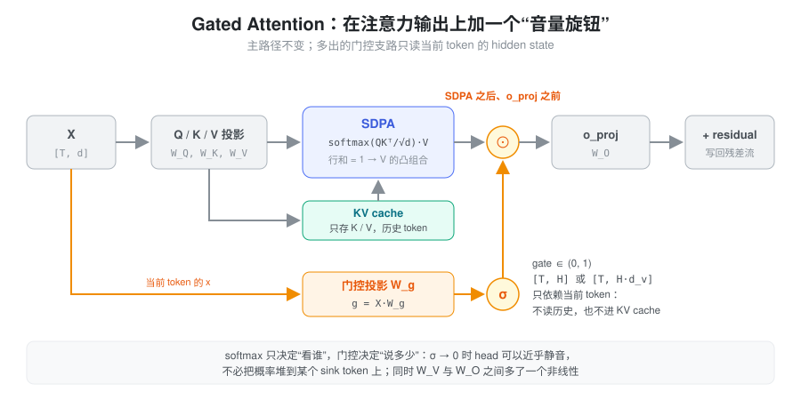
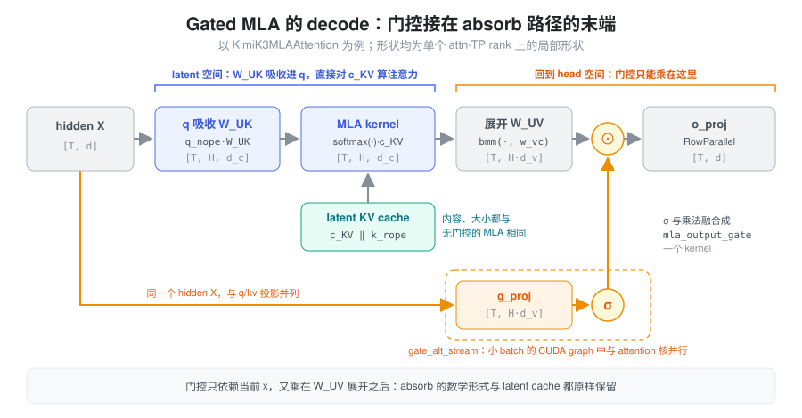
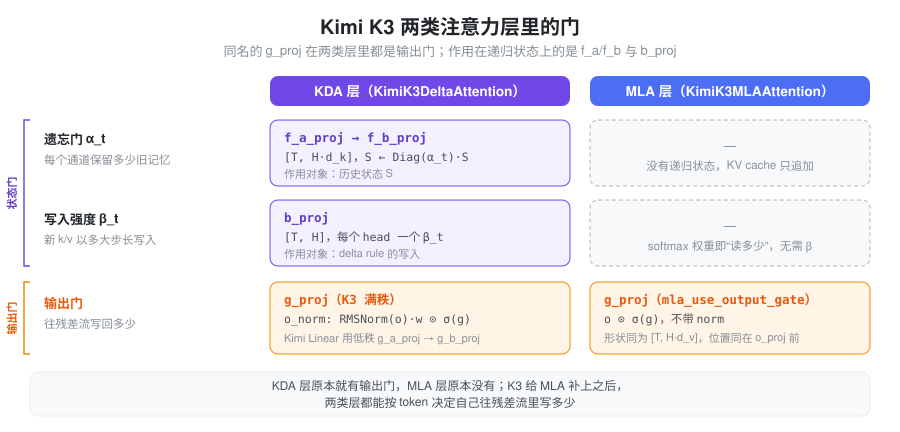

% Gated Attention

### 问题：softmax 只能决定“看谁”，不能决定“说多少”

标准注意力里，每个 head 的输出是 value 的加权平均：

\[
o_i=\sum_j p_{ij}\,v_j,\qquad \sum_j p_{ij}=1
\]

权重 \(p_{ij}\) 来自 softmax，行和恒为 1，所以输出永远是历史 value 的**凸组合**。这带来几个结构性的问题：

- **head 没法“不说话”**。当某个 head 对当前 token 没什么有用信息时，它也必须把 1 的概率分出去。模型学到的办法是把概率堆到一个固定位置（通常是第一个 token），让那里的 value 接近无害——这就是 **attention sink**。为了配合 sink，残差流里还会长出个别数值极大的通道（**massive activation**），给量化和训练稳定性都添麻烦。
- **value 到输出是一条纯线性路径**。把 \(v_j=x_jW_V^h\) 代进去，单个 head 的贡献是 \(\big(\sum_j p_{ij}x_j\big)W_V^hW_O^h\)：softmax 之后，\(W_V^h\) 和 \(W_O^h\) 之间没有任何非线性，两者合起来只相当于一个秩不超过 \(d_h\) 的线性映射。
- **输出强度不随当前 token 变化**。softmax 决定了“从哪里读”，但“读出来的东西写回残差流时乘多大”只能交给固定的 \(W_O\)，当前 token 无法调节。

### 核心抽象：一个由当前 token 决定的输出门

Gated Attention 的做法很直接：在注意力输出上乘一个由当前 hidden state 生成的 sigmoid 门。

\[
\tilde{\boldsymbol{O}} =
\Big(\operatorname{softmax}\!\Big(\frac{\boldsymbol{Q}\boldsymbol{K}^{\mathsf T}}{\sqrt{d_h}}+M\Big)\boldsymbol{V}\Big)
\odot
\sigma\!\left(\boldsymbol{X}\boldsymbol{W}_g\right)
\]

可以把它想成一个“音量旋钮”：softmax 决定**看谁**，门控决定**说多少**。几个性质一起，正好对应上面的三个问题：

1. **\(\sigma\in(0,1)\)，可以接近 0。** head 没用时直接把门关小，不必再借 sink token 来“空转”。
2. **在 \(W_V\) 与 \(W_O\) 之间插了一个非线性。** 门本身是输入的函数，\(O\odot\sigma(XW_g)\) 已经不是一个固定的低秩线性映射能表达的。
3. **门只依赖当前 token 的 \(x\)。** 它和 Q 一样属于“查询侧”，不读历史、不进 KV cache，decode 时不增加任何 cache 读写。



Qwen 团队的 *Gated Attention for Large Language Models: Non-linearity, Sparsity, and Attention-Sink-Free*（2025）系统比较了门控的位置与形式，结论是：**加在 SDPA 输出之后、按 head 区分的 sigmoid 门效果最好**。学到的门值大多很小（稀疏、随 query 变化），attention sink 与 massive activation 明显减弱，训练能承受更大的学习率，长上下文外推也更好。Qwen3-Next 的 full attention 层就采用了这种设计。

#### 门控的粒度

粒度由 \(\boldsymbol{W}_g\) 的输出宽度决定：

| \(\boldsymbol{W}_g\) 输出宽度 | 门控形状 | 粒度 |
| --- | --- | --- |
| \(H\) | \([B,S,H]\) | head-wise：每个 head 一个标量 |
| \(H d_v\) | \([B,S,H,d_v]\) | element-wise：每个 head 的每个 value 通道一个门 |
| \(d\) | \([B,S,d]\) | 与 head 结构无关的 hidden 通道门 |

主流实现取 \(H d_v\)，让门控宽度与 `o_proj` 的输入宽度一致：门可以直接与注意力输出逐元素相乘、不需要广播，kernel 融合最简单；粒度也比 head 级标量更细，同时保留了 head 之间的区分。

#### 门控加在哪里

| 位置 | 门控结构 | 说明 |
| --- | --- | --- |
| SDPA 之后、`o_proj` 之前 | \([B,S,H,d_v]\) | 最常见，能区分 head，与 `o_proj` 输入对齐 |
| `o_proj` 之后 | \([B,S,d]\) | 退化为 hidden 通道级，失去 head 维度，也不再位于 \(W_V\) 与 \(W_O\) 之间 |
| 乘在 value（或 MLA 的 latent \(c_{KV}\)）上 | \([B,S,\cdot]\) | 门进入了被缓存的历史状态，语义变成“写入时的强度”，属于另一类设计 |

### Gated MLA

MLA 和 Gated Attention 解决的是两个不同的问题：

- MLA 改变的是**状态**：用共享 latent \(c_{KV}\) 压缩每个 token 的 K/V，让 KV cache 与读取成本大幅下降；
- Gated Attention 改变的是**输出**：在注意力结果上乘一个随 token 变化的门。

Gated MLA 就是把后者接到前者的输出上。**压缩路径、KV cache 结构、MQA absorb 全部不变，只在注意力输出之后多一条门控支路。** 它不是新的压缩方案，而是对 MLA 表达能力与训练稳定性的一次低成本补强。

把 MLA 的压缩写开：

\[
c_{KV}=XW^{DKV},\qquad
K=c_{KV}W^{UK},\qquad
V=c_{KV}W^{UV}
\]

门控的输入是当前层的 \(X\in\mathbb{R}^{T\times d}\)，与 Q、KV 的投影并列；宽度取 \(Hd_v\)，作用在 \(W^{UV}\) 展开之后、`o_proj` 之前。以 Kimi K3 的 MLA 层为例，checkpoint 里 `g_proj.weight` 的形状是 \(12288\times 7168\)，`o_proj.weight` 是 \(7168\times 12288\)，两者恰好互为转置：\(12288=Hd_v\) 是全部 head 拼起来的注意力输出宽度，说明门控作用在带 head 结构的 value 空间上，而不是 hidden 通道上。

#### decode：门控不碰 absorb

MLA 在 decode 时走 **MQA absorb 路径**：把 \(W^{UK}\) 吸收进 Q，直接在 latent 空间对 \(c_{KV}\) 做注意力，最后再用 \(W^{UV}\) 展开：

\[
\Big(\operatorname{softmax}\!\Big(\frac{(q_{\text{nope}}W^{UK\,\mathsf T})\,c_{KV}^{\mathsf T}}{\sqrt{d_h}}\Big)c_{KV}\Big)W^{UV}
\]

门控乘在这一步**之后**。它只依赖 \(X\)，既不参与 \(W^{UK}\)、\(W^{UV}\) 的吸收变换，也不改变 latent 的缓存内容，MLA 的 decode 优化可以原样保留。反过来，如果把门乘在 \(c_{KV}\) 上，它就进入了 cache，absorb 也要跟着改——这正是“门控加在哪里”表格里第三行属于另一类设计的原因。



#### 为什么 MLA 特别需要门控

除了上面的通用收益，MLA 还有两个自身原因：

- **value 方向的自由度本来就被压缩过**：所有 head 的 \(V\) 都由同一个 \(d_c\) 维 latent 经 \(W^{UV}\) 展开，\(d_c\ll Hd_v\)。门控不能改变 \(W^{UV}\) 的秩，但它提供了随 token 变化的乘性调制，相当于在不增加 cache 的前提下补回一部分区分度。
- **MLA 常与线性注意力层混用**：在 KDA + MLA 这类混合架构里，KDA 层本来就有一个输出门（门控 RMSNorm），而 MLA 层没有，两类层控制“往残差流写多少”的能力不对等。给 MLA 补上输出门后，两类层对称了，层间分工更容易平衡（见下文）。

### 代价

门控不是“零成本的一行乘法”，它的开销与一张独立投影矩阵相当：

| 项目 | 代价 |
| --- | --- |
| 参数量 | \(d\times Hd_v\)。K3 中为 \(7168\times 12288\approx 88\text{M}\)，BF16 约 176 MB（168 MiB）/ 层 |
| Prefill 计算 | 每 token \(d\cdot Hd_v\) 次乘加，与一次 `o_proj` 的 GEMM 同量级 |
| Decode 成本 | 每个 step 都要完整读一遍这张权重，是**显存带宽**开销而非 cache 开销 |
| KV cache | 完全不受影响，门控只依赖当前 hidden state |
| 数值 | 训练时 sigmoid 饱和区梯度很小；推理侧不同模型做法不同，见实现部分 |

因此在显存与通信预算里，`g_proj` 必须和 `q_proj`、`o_proj` 一样被当作主矩阵统计，不能因为它是“门控”就按小参数处理。

### KDA 层里的门：别把 g_proj 认错

K3 的 KDA 层里也有一张 `g_proj`，名字和形状（\(Hd_v\times d\)）都和 MLA 层的一样。容易误以为它是 KDA 的“遗忘门”，但读代码可以确认：**KDA 的 `g_proj` 同样是输出门**，作用在 `o_proj` 之前；真正作用在递归状态 \(S\) 上的是另外两组投影：

- `f_a_proj → f_b_proj` 产生逐通道的遗忘门 \(\alpha_t\)，衰减历史状态；
- `b_proj` 产生每个 head 的写入强度 \(\beta_t\)，控制 delta rule 写入新 k/v 的步长。

两类层的输出门只有一处差别：KDA 先对每个 head 的输出做 RMSNorm 再乘门（`o_norm = FusedRMSNormGated(head_dim, activation="sigmoid")`，即 \(\mathrm{RMSNorm}(o)\cdot w\odot\sigma(g)\)），MLA 直接乘 \(o\odot\sigma(g)\)。K3 的 KDA 用满秩 `g_proj`（`use_full_rank_gate`），Kimi Linear 用的是低秩 `g_a_proj → g_b_proj`。



所以读权重表或做显存分析时，两张 `g_proj` 可以按同一类矩阵（输出门）统计；KDA 的状态门要去看 `f_*` 和 `b_proj`。遗忘门的细节见 [Linear Attention](./linear_attention.md)。

### 在 SGLang 中的实现

各模型的门控公式几乎一样，差别在于**门从哪个投影里来、在哪里乘、怎么融合**。

#### Qwen3-Next：门是 Q 投影的另一半

`python/sglang/srt/models/qwen3_next.py` 的 full attention 层（`Qwen3HybridAttentionDecoderLayer`，config 中 `attn_output_gate`）不单独建 `g_proj`，而是把 `qkv_proj` 的 Q 头数翻倍：`total_num_heads * (1 + attn_output_gate)`。前向时按 head 把这段输出 view 成 \([T,H,2d_h]\) 再 `chunk` 成 `q` 和 `gate`，所以门和 Q 来自同一次 GEMM，宽度为 \(Hd_h\)（element-wise）。注意力算完后 `attn_output * sigmoid(gate)` 再进 `o_proj`；ROCm 上走融合的 `sigmoid_gate_mul` Triton kernel。

这种写法把“门属于查询侧”体现得很直白：它就是 Q 投影多出来的一半通道。

#### MLA 的通用挂点

DeepSeek 系 MLA 的公共前向在 `python/sglang/srt/models/deepseek_common/attention_forward_methods/forward_mla.py`。absorb 路径里留了两个可选 hook：

- `forward_absorb_prepare` 开头调用模型的 `prepare_attention_output_gate(hidden_states)` 准备门；
- 注意力核输出经 `torch.bmm(·, w_vc)` 展开成 \([T, H\cdot d_v]\) 后、`o_proj` 之前，调用 `_apply_attention_output_gate`，它再分派给模型的 `apply_attention_output_gate` 或 `_apply_gated`。

这正好对应图里“门控只能乘在 W_UV 展开之后”的位置。复用这套 hook 的模型各有取舍：

- Hunyuan V4（`HYV4Attention.linear_gate`，宽度 \(H\cdot d_v\)）：在 hpc 后端下 prepare 阶段直接把 hidden state 交出去，由 `gated_mla_gemm` 把门控投影的 GEMM 和门控乘法放进同一个 kernel；其他后端仍是先投影、再 sigmoid 相乘。
- Bailing（`DsV3MLA`）：用 `gated_attention_proj_granularity_type` 在 `head_wise`（宽度 \(H\)，乘法时广播到 \(d_v\)）和 `element_wise`（宽度 \(H\cdot d_v\)）之间切换，sigmoid 先升到 fp32 再算。

#### Kimi K3：包住 o_proj

`python/sglang/srt/models/kimi_k3.py` 的 `KimiK3MLAAttention` 继承 `DeepseekV2AttentionMLA`，由 `mla_use_output_gate` 打开门控。几个值得知道的工程细节：

- **按 attn-TP 切列**。`g_proj` 是 `ColumnParallelLinear(hidden_size, num_attention_heads * v_head_dim, parallel_group="attn_tp")`。MLA 的 head 本来就在 attention-TP 组内切分，门按同样的方式切列，本地门的列与本地 head 的输出一一对齐，乘法不需要任何通信。
- **在实例上包 `o_proj.forward`**。`o_proj` 在父类各条前向路径的深处被调用，K3 没有改这些路径，而是在 `__init__` 里把 `self.o_proj.forward` 换成 `_gated_o_proj_forward`：`forward` 先把 hidden state 存进 `_gate_hidden_states`，等 `o_proj` 被调用时再算门、乘门、调用原始 forward。权重加载、`reduce_results` 都不受影响。
- **门控 GEMM 与 attention 并行**。CUDA graph capture 时，若 token 数不超过 `_gate_bs_limit`（Blackwell 128，其他 64），`_fork_output_gate` 在前向开头就把 `gate_alt_stream` fork 出来，`_compute_output_gate` 在旁路 stream 上跑 `g_proj`，再由主 stream 等待。小 batch 时 attention 核占不满 SM，这张 \(Hd_v\times d\) 的 GEMM 可以藏进去；batch 更大时 overlap 只剩同步开销，就退回串行。
- **sigmoid 与乘法融合**。`mla_output_gate.kimi_k3_mla_output_gate` 在 bf16、同形状、连续的条件下（`covered()`）用一个 kernel 完成 `x * sigmoid(gate)`，并刻意保留两次 bf16 舍入，与未融合的 `torch.sigmoid` + 乘法逐位一致；条件不满足时回退到 PyTorch 写法。

### 最小实现

下面省略 RoPE、KV cache 与 MQA absorb，只保留 latent 压缩与输出门控的位置：

```python
class GatedMLA(nn.Module):
    def __init__(self, d_model, n_heads, d_qk, d_v, d_c):
        super().__init__()
        self.n_heads, self.d_qk, self.d_v = n_heads, d_qk, d_v

        # MLA 的 latent 压缩：低秩 Q 与共享的 KV latent
        self.q_a_proj = nn.Linear(d_model, d_c, bias=False)
        self.q_b_proj = nn.Linear(d_c, n_heads * d_qk, bias=False)
        self.kv_a_proj = nn.Linear(d_model, d_c, bias=False)
        self.kv_b_proj = nn.Linear(d_c, n_heads * (d_qk + d_v), bias=False)

        # 门控宽度取 H * d_v，与 o_proj 的输入宽度一致
        self.g_proj = nn.Linear(d_model, n_heads * d_v, bias=False)
        self.o_proj = nn.Linear(n_heads * d_v, d_model, bias=False)

    def forward(self, x):
        B, S, _ = x.shape

        q = self.q_b_proj(self.q_a_proj(x)).view(B, S, self.n_heads, self.d_qk)
        kv = self.kv_b_proj(self.kv_a_proj(x)).view(
            B, S, self.n_heads, self.d_qk + self.d_v
        )
        k, v = kv.split([self.d_qk, self.d_v], dim=-1)
        q, k, v = (t.transpose(1, 2) for t in (q, k, v))  # [B, H, S, *]

        scores = (q @ k.transpose(-1, -2)) * self.d_qk ** -0.5
        out = scores.softmax(dim=-1) @ v  # [B, H, S, d_v]，真实实现需先加 causal mask

        # [B, S, H, d_v]，每个 head 的每个 value 通道单独门控
        gate = torch.sigmoid(self.g_proj(x)).view(B, S, self.n_heads, self.d_v)
        out = out.transpose(1, 2) * gate

        return self.o_proj(out.reshape(B, S, -1))
```

### 常见面试问题

- Gated Attention 解决什么问题？softmax 输出是 value 的凸组合，head 无法“静音”，于是出现 attention sink 和 massive activation；门控提供了随 token 变化的输出强度和 \(W_V\)、\(W_O\) 之间的非线性。
- 门控能不能提高 MLA 的压缩率、减少 KV cache？不能。压缩发生在 token 状态维度，门控作用在输出维度，且门只依赖当前 hidden state，不进 cache。
- 为什么门控要加在 `o_proj` 之前？那里还保留 head 与 value channel 的结构，能按 head 区分，也恰好位于 \(W_V\) 与 \(W_O\) 之间；过了 `o_proj` 就只剩 hidden 通道。
- 为什么 decode 阶段的门控不破坏权重吸收？门乘在 \(W^{UV}\) 展开之后，不参与 \(W^{UK}\)、\(W^{UV}\) 的吸收变换。
- Gated MLA 的代价是什么？一张与 `o_proj` 同量级的 \(d\times Hd_v\) 矩阵，prefill 多一次 GEMM，decode 多一份权重读取带宽。
- K3 的 KDA 层也有 `g_proj`，它是遗忘门吗？不是，它同样是 `o_proj` 前的输出门（带 RMSNorm）；KDA 的遗忘门来自 `f_a_proj → f_b_proj`，写入强度来自 `b_proj`。

### 小结

Gated Attention 把“看谁”和“说多少”拆开：softmax 继续负责从历史里读什么，一个由当前 token 生成的 sigmoid 门负责读出来的东西写回残差流时乘多大。门只依赖当前 hidden state，因此不进 KV cache；放在 SDPA 之后、`o_proj` 之前，既能按 head 区分，又给 \(W_V\)、\(W_O\) 之间补上了非线性，从而缓解 attention sink、massive activation 与训练不稳定。接到 MLA 上时，门乘在 \(W^{UV}\) 展开之后，latent cache 和 absorb 路径都原样保留，代价是一张与 `o_proj` 同量级的主矩阵及其 decode 带宽。
