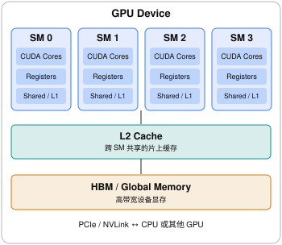
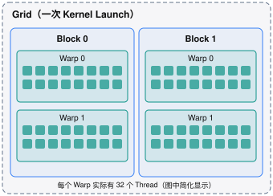
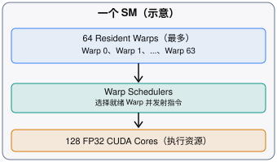
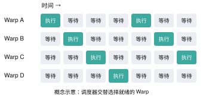

% GPU Arch

从 GPU 编程模型（Programming Model） 的角度理解 GPU 架构，最重要的不是了解 GPU 有多少晶体管、多少 CUDA Core，而是理解：

1. 计算如何组织：Thread、Warp、Block、SM、Grid 之间是什么关系？
2. 数据存在哪里：Register、Shared Memory、L1/L2 Cache、HBM 的层次是什么？
3. 指令如何执行：SIMT、Warp Scheduler、指令发射、分支分歧如何工作？
4. 性能受什么约束：Occupancy、Memory Coalescing、Bandwidth、Latency、Roofline。
5. 如何映射实际算子：GEMM、Attention、Reduction、MoE 如何利用 GPU 架构？

下面以 NVIDIA CUDA 架构为主，按照从硬件到编程模型的顺序讲解。对于 PyTorch、Triton、CUDA Kernel 和 LLM Inference，这套知识基本是共通的。

## 一、GPU 整体架构



首先建立几个硬件概念。

| 硬件组件                          | 核心职责             | 编程时需要理解什么          |
| ----------------------------- | ---------------- | ------------------ |
| GPU Device                    | 整块 GPU           | Kernel launch、显存管理 |
| SM (Streaming Multiprocessor) | GPU 的主要计算与线程执行单元 | Block 调度、资源限制      |
| CUDA Core                     | 标量算术执行单元         | FP32/INT 运算吞吐      |
| Tensor Core                   | 矩阵乘加专用单元         | GEMM、Tensor 运算     |
| Warp Scheduler                | 选择就绪 Warp 发射指令   | 延迟隐藏、并行度           |
| Register File                 | 保存线程私有工作数据       | 寄存器压力              |
| Shared Memory                 | Block 内可编程的片上存储  | 数据复用、线程协作          |
| L1 / L2 Cache                 | 硬件管理的缓存          | 访问局部性              |
| HBM                           | 大容量高带宽显存         | 带宽瓶颈、数据搬运          |

要注意：SM 是硬件执行资源，Block 是软件调度单位，Warp 是线程执行组织单位。 三者不是同一个层次的东西。

## 二、GPU 线程层次：Grid、Block、Warp、Thread




```
Grid
 ├── Block 0
 │    ├── Warp 0
 │    │    ├── Thread 0
 │    │    ├── Thread 1
 │    │    └── ... Thread 31
 │    ├── Warp 1
 │    └── ...
 ├── Block 1
 └── ...
```

### 1. Thread

CUDA Thread 是程序员看到的最小逻辑执行单位。

每个线程有自己的：

- Thread ID
- 寄存器状态
- 程序计数器与执行状态
- 私有局部变量

例如：

```
__global__ void add(float* a, float* b, float* c) {
    int i = blockIdx.x * blockDim.x + threadIdx.x;
    c[i] = a[i] + b[i];
}
```

这里每个 Thread 负责一个元素。

### 2. Warp

NVIDIA CUDA 中，一个 Warp 通常固定为 32 个 Thread。**Warp 是硬件线程执行调度单位**。

Warp 是理解 GPU 执行效率的关键。

GPU 并非像 CPU 那样主要依靠少量复杂核心执行独立指令流，而是利用 SIMT（Single Instruction, Multiple Threads）组织大量线程。

同一个 Warp 内的线程通常执行相同的指令，但各自处理不同的数据。

例如：

```
c[i] = a[i] + b[i];
```

32 个 Thread 可以同时处理 32 个不同元素。

不过需要区分：Warp 是执行调度分组，不意味着任何指令都必然在单周期内完成 32 个元素的运算。

### 3. Block

Block 是 CUDA 中线程协作与资源分配的重要单位。

- 一个 Block 包含若干 Warp。
- Block 通常被分配给一个 SM 执行。
- 一个 SM 可以同时驻留多个 Block。
- 同一个 Block 内的线程可以使用 Shared Memory 和 Block 级同步。
- 普通 CUDA Kernel 不保证不同 Block 之间的执行顺序。

例如：

```
kernel<<<80, 256>>>();
```

意味着：

- 80 个 Blocks
- 每个 Block 256 个 Threads
- 每个 Block 8 个 Warps
- 总共 20,480 个 Threads

这些 Blocks 由 GPU 分配到各个 SM，可能分批执行，而不是同时运行。

### 4. SM

SM 是承载 Block 和 Warp 的实际硬件。

一个 SM 内有多个 Warp Scheduler、执行单元、Register File 和 Shared Memory。



假设某 SM：

- 有 128 个 FP32 CUDA Core
- 最多驻留 64 个 Warp
- 每个 Warp 有 32 个 Thread

那么它最多可以保留 \(64 \times 32 = 2048\) 个 Thread 的执行上下文

但是，这不代表 2048 个 Thread 的算术指令都在同一个周期完成。这些 Warp 共享 SM 的 CUDA Core。

例如：

- Warp 0 发出内存读取指令，随后等待数据。
- Warp 1 执行 FP32 加法。
- Warp 2 执行乘法。
- Warp 3 执行其他指令。

Warp Scheduler 不断选择可执行的 Warp，使算术单元尽可能保持忙碌。这就是 GPU 通过 大量驻留 Warp 隐藏延迟（Latency Hiding） 的基本机制。

## 三、多级存储：GPU 编程最重要的性能基础

GPU 的存储层次不仅有容量、速度差异，更重要的是 作用域、访问方式、是否可编程 的差异。

| 存储层次                | 位置       | 可见范围             | 管理方式          | 主要用途               |
| ------------------- | -------- | ---------------- | ------------- | ------------------ |
| Register            | SM 内     | 单 Thread         | 编译器分配         | 临时变量、累加器           |
| Shared Memory       | SM 内     | Block 内线程        | 程序员显式控制       | Tile 缓存、线程协作       |
| L1 Cache            | SM 附近    | 硬件缓存域            | 硬件管理          | 缓存访存数据             |
| L2 Cache            | GPU 片上   | 跨 SM             | 硬件管理          | 共享数据缓存             |
| HBM / Global Memory | GPU 外部显存 | 跨 Block、跨 SM     | 程序显式分配、硬件访问   | Tensor、KV Cache、权重 |
| Host Memory         | CPU 侧    | CPU，部分模式 GPU 可访问 | CPU / Runtime | 数据加载、交换            |

大致规律：

\[ \text{Register} \rightarrow \text{Shared/L1} \rightarrow \text{L2} \rightarrow \text{HBM} \]

越往右通常容量越大，访问延迟越高。

但 Shared Memory 和 L1 并非严格上下级关系，它们在不少 NVIDIA 架构上共享或分配部分片上物理资源。

### 1. Register

Register 是线程私有、低延迟的存储资源。

```
float x = a[i];
float y = x * 2.0f;
```

理想情况下，`x`、`y` 都保存在 Register 中。

但是 Register 数量有限。

如果每个 Thread 使用过多 Register，可能导致：

- SM 同时驻留的 Warps 减少。
- Occupancy 下降。
- 寄存器溢出（Spilling）到 Local Memory。

这里有个容易误解的地方：

CUDA Local Memory 不是 SM 内的高速本地 SRAM。 它是线程私有的地址空间，通常以设备显存为后备，并经过缓存层次访问。

### 2. Shared Memory

Shared Memory 是 CUDA 程序员能够显式管理的片上存储。

```
__shared__ float tile[256];
```

同一个 Block 内的线程可以共享 `tile`。

最典型的用途是矩阵乘法。

如果每个线程都直接从 HBM 重复读取相同的数据，会浪费带宽。

因此：

1. 从 Global Memory 加载一个 Tile。
2. 将 Tile 放入 Shared Memory。
3. 多个 Thread 复用这个 Tile。
4. 完成计算后再加载下一块。

这就是 Tiling（分块）。

但 Shared Memory 还有 Bank Conflict 问题：不同线程访问落在同一个 Bank 的不同地址时，可能发生访问序列化。

### 3. L1 / L2 Cache

L1、L2 主要由硬件管理。

对于 PyTorch 或 Triton 程序员，通常不需要手动控制每次缓存填充，但需要理解：

- 数据是否具有时间局部性？
- 多个 CTA 是否重复访问同一块数据？
- 数据集能否部分留在 L2？
- 不同访问模式是否导致 Cache Thrashing？

例如 LLM Decode 时，大量权重数据可能远超 L2 容量，因而整体性能高度依赖 HBM 带宽。

### 4. HBM

HBM 是 GPU 的主显存。

例如模型权重、Activation、KV Cache 通常都存放在 HBM 中。

HBM 带宽非常高，但和 Register、Shared Memory 相比，延迟仍然很大。

这也是为什么 GPU 优化经常不是减少 FLOPs，而是减少 HBM 访问量。

典型例子就是 FlashAttention：利用片上存储和分块计算，避免将完整的 \(N\times N\) Attention Score 矩阵写回 HBM。

## 四、GPU 的执行模型：SIMT、Warp Scheduling 与延迟隐藏

这一部分是理解 GPU 为什么需要大量线程的核心。

### 1. SIMT 与 SIMD

CPU 中常见 SIMD，例如 AVX：

一条向量指令处理多个数据元素。

GPU 的 SIMT 则让程序员编写标量线程逻辑，再由硬件以 Warp 为单位组织执行。

二者在硬件数据并行上存在相似性，但抽象层次不同。

### 2. Warp Divergence

例如：

```
if (threadIdx.x % 2 == 0) {
    do_A();
} else {
    do_B();
}
```

同一个 Warp 中，一半线程执行 A，另一半执行 B。

这可能导致两条路径被分别执行，并通过 Active Mask 控制哪些线程生效。

因此：

Warp 内控制流分歧可能降低执行效率。

需要注意，Volta 之后 NVIDIA 引入 Independent Thread Scheduling，线程状态管理更灵活，但这并不意味着分支分歧的性能代价消失。

### 3. Warp Scheduler 与 Latency Hiding

假设 Warp A 发起一次 HBM Load，需要等待很长时间。

GPU 不一定让计算单元空闲，而是调度其他已经就绪的 Warp。



这就是 Latency Hiding。

GPU 不一定需要把单次内存访问的延迟降得很低，而是通过大量并发 Warp 隐藏等待时间。

所以 GPU 性能优化有两个不同目标：

- 降低延迟：一次操作尽快完成。
- 提高吞吐：让执行单元持续有工作可做。

对于 LLM Inference，Prefill 和 Decode 在这两个目标上的侧重点往往不同。

## 五、Occupancy：为什么线程越多不一定越快？

Occupancy 通常定义为：

\[ \text{Occupancy} = \frac{\text{Active Warps}}{\text{Max Resident Warps}} \]

一个 SM 能驻留多少 Warp，受到以下资源约束：

- Register 数量
- Shared Memory 容量
- 最大驻留 Thread 数
- 最大驻留 Block 数
- Block Size

例如，某 Kernel 每个 Thread 使用大量 Register，那么即使 SM 有足够算力，也无法同时容纳很多 Warp。

但是：

高 Occupancy 不等于高性能。

如果增加 Occupancy 的代价是减少 Register、引发 Spilling，反而可能变慢。

对于 GEMM、Attention 等算子，经常需要在以下目标之间权衡：

\[ \text{Tile Size} \leftrightarrow \text{Register Usage} \leftrightarrow \text{Occupancy} \]

这也是 Triton 的 `num_warps`、`num_stages` 和 Tile Size 会明显影响性能的原因之一。

## 六、Memory Coalescing：线程如何访问 HBM

假设一个 Warp 的 32 个线程需要读取 32 个 `float32`。


连续访问：

```
x = A[threadIdx.x];
```

跨步访问：

```
x = A[threadIdx.x * 32];
```

前者通常能够将多个线程的访问合并成较少的内存事务。

后者可能需要更多内存事务，造成带宽利用率下降。

这和 PyTorch 中的 `stride`、`contiguous` 是直接相关的。

但是要区分：

- PyTorch Tensor 是否 Contiguous：描述张量的内存布局。
- GPU Memory Coalescing：描述同一 Warp 中各个线程访问地址的分布。

二者有关联，但并不等价。

## 七、Tensor Core：GPU 为什么擅长矩阵乘法？

CUDA Core 主要执行标量或普通算术指令。

Tensor Core 则针对矩阵乘加进行专门设计。

其核心数学形式是：

\[ D=A\times B+C \]

例如：

\[ A\_{M\times K}\times B\_{K\times N} \]

Tensor Core 指令对输入矩阵的形状、数据类型、布局、对齐方式有一定要求。

不同 GPU 架构支持的 MMA 指令和矩阵形状也不同。

需要理解的几个概念：

| 概念                    | 意义                              |
| --------------------- | ------------------------------- |
| MMA                   | Matrix Multiply Accumulate      |
| WMMA                  | CUDA Warp 级矩阵运算 API             |
| Tensor Fragment       | 参与矩阵运算的分布式数据片段                  |
| Tile                  | 分块计算的数据区域                       |
| Pipeline              | 数据加载与计算重叠                       |
| Tensor Core Precision | FP16、BF16、TF32、FP8、FP4 等支持因架构而异 |

以 Triton 为例：

```
acc = tl.dot(a, b, acc)
```

这看似只是矩阵乘法，但编译器需要决定：

- 数据如何从 Global Memory 加载？
- 如何组织 Shared Memory / Register？
- 数据如何分配给 Warp？
- 使用什么矩阵乘法指令？
- 如何进行流水线调度？

所以，Triton 的重要价值是让程序员表达 Tile 级计算，而由编译器承担大量底层映射工作。

## 八、GPU 异步执行与同步模型

除了线程和存储，GPU 编程还必须理解同步。

| 概念                | 作用             |
| ----------------- | -------------- |
| Kernel Launch     | CPU 向 GPU 提交计算 |
| CUDA Stream       | 组织 GPU 工作的执行队列 |
| CUDA Event        | 标记进度、同步、计时     |
| `__syncthreads()` | Block 内线程同步    |
| `__syncwarp()`    | Warp 范围内同步     |
| Memory Fence      | 保证特定范围内的内存操作顺序 |
| Async Copy        | 异步数据搬运         |
| CUDA Graph        | 捕获并重放 GPU 工作图  |

这里最容易混淆的是：

执行同步和内存可见性不是一回事。

例如，Memory Fence 主要约束内存操作顺序和可见性，不等于让所有线程都到达同一个执行点。

对于现代 NVIDIA GPU，还需要进一步了解：

- `cp.async`
- TMA（Tensor Memory Accelerator）
- Barrier / MBarrier
- Warp Specialization
- Producer–Consumer Pipeline

这些机制对高性能 GEMM、FlashAttention 和新架构上的 Triton Kernel 很重要。

## 九、GPU 性能模型

掌握前面的硬件概念之后，就需要建立性能分析框架。

### 1. Compute Bound 与 Memory Bound

最常用的是 Roofline Model。

定义 Arithmetic Intensity：

\[ AI=\frac{\text{FLOPs}}{\text{Bytes Transferred}} \]

可达到的计算吞吐上限近似为：

\[ P \leq \min(P\_{\text{peak}},AI\times BW) \]

对于 LLM：

- 大 Batch Prefill：通常矩阵运算密集，容易达到较高的计算利用率。
- 小 Batch Decode：模型权重读取量大，相对 FLOPs 少，容易受 HBM 带宽限制。
- Attention：还受到序列长度、KV Cache 访问、算子实现的影响。
- MoE：除矩阵运算外，还有 Token Routing、Grouped GEMM、跨 GPU 通信。

### 2. 其他性能概念

还应该理解：

- Memory Bandwidth Utilization
- SM Utilization
- Tensor Core Utilization
- Instruction-Level Parallelism（ILP）
- Thread-Level Parallelism（TLP）
- Register Pressure
- Launch Overhead
- Synchronization Overhead
- Pipeline Bubble
- Compute–Communication Overlap

特别要注意，GPU Utilization 很高并不意味着计算效率很高。它可能在等待访存，也可能运行大量低效率指令。

## 十、把 GPU 架构映射到 LLM Inference

对于 LLM 推理工程，可以把知识和实际算子联系起来。

| 推理场景                     | 重点 GPU 概念                                     |
| ------------------------ | --------------------------------------------- |
| GEMM / Linear            | Tensor Core、Tiling、Shared Memory、Register     |
| FlashAttention           | IO Awareness、SRAM、Online Softmax、Pipeline     |
| Paged Attention          | KV Cache 布局、非连续访存、Gather                      |
| Decode                   | HBM Bandwidth、Arithmetic Intensity、Batch Size |
| MoE                      | Token Dispatch、Grouped GEMM、负载均衡              |
| FP8 / FP4 Quantization   | Tensor Core、数据布局、Scale、数值精度                   |
| CUDA Graph               | Launch Overhead、Graph Replay                  |
| Kernel Fusion            | 减少 HBM 读写、Launch Overhead                     |
| Prefill / Decode Overlap | Streams、Events、同步与资源竞争                        |
| Multi-GPU Inference      | NVLink、PCIe、NCCL、通信拓扑                         |

例如，分析一个 FlashAttention Kernel 为什么慢，可能需要连续追问：

1. HBM 访问量是否过大？
2. Shared Memory 的 Tile 是否合适？
3. Register Pressure 是否过高？
4. Occupancy 是否不足？
5. Tensor Core 是否充分利用？
6. 是否存在 Shared Memory Bank Conflict？
7. 数据搬运与计算是否重叠？
8. 是否存在 Warp 或 CTA 间负载不均？

这些问题都能对应到具体的 GPU 架构知识。

## 十一、建议建立的 GPU 编程知识体系

如果目的是系统掌握 GPU 编程模型，而不是研究 GPU 微架构设计，我建议按下面的顺序学习。

| 阶段 | Topic                                     | 重要程度   |
| -- | ----------------------------------------- | ------ |
| 1  | CPU vs GPU、吞吐与延迟、SIMT                     | 必须     |
| 2  | Thread、Warp、Block、Grid、SM                 | 必须     |
| 3  | Register、Shared、L1、L2、HBM                 | 必须     |
| 4  | Tensor Layout、Stride、Alignment            | 必须     |
| 5  | Coalescing、Bank Conflict、Tiling           | 必须     |
| 6  | Warp Scheduling、Latency Hiding、Divergence | 必须     |
| 7  | Occupancy、Register Pressure、Spilling      | 必须     |
| 8  | Tensor Core、MMA、数据类型                      | 必须     |
| 9  | Roofline、Arithmetic Intensity             | 必须     |
| 10 | Streams、Events、Synchronization            | 必须     |
| 11 | Async Copy、TMA、Software Pipeline          | 进阶     |
| 12 | PTX、SASS、指令调度                             | 进阶     |
| 13 | NVLink、PCIe、NCCL、GPU Topology             | 多卡推理必备 |
| 14 | Nsight Compute、Nsight Systems、性能计数器       | 性能优化必备 |

我会把整个知识体系进一步归纳成四个相互关联的模型：

执行模型

SM、Warp、SIMT、Scheduler、Occupancy

存储模型

Register、Shared、Cache、HBM、Layout

并发与同步模型

Stream、Barrier、Async Copy、Pipeline

性能模型

Roofline、Bandwidth、Latency、Utilization

这四个模型建立以后，再学习 CUDA、Triton、FlashAttention、DeepGEMM，就不会只是记忆 API，而是能够理解为什么某种 Kernel 实现更快。

我认为其中最值得深入的是：GPU 的线程层次与硬件 SM 如何映射、数据如何在 HBM/Shared/Register 之间移动，以及 Warp 如何通过并发隐藏延迟。 这三个问题构成了绝大多数 GPU Kernel 性能优化的基础。
