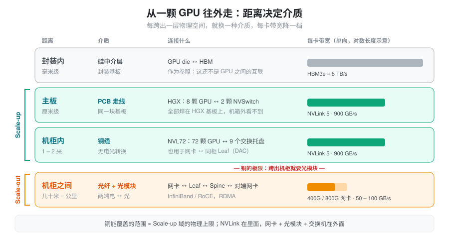
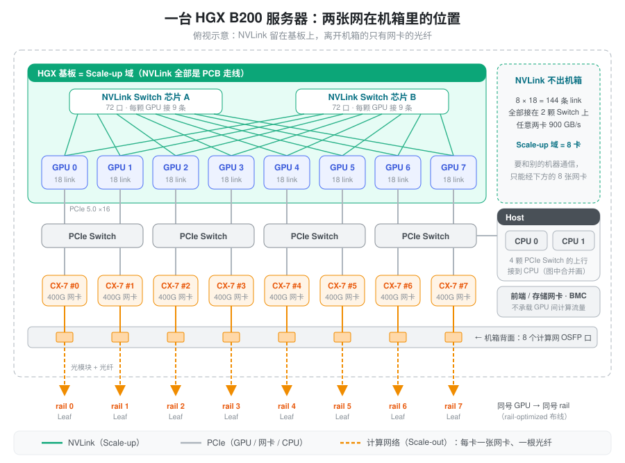
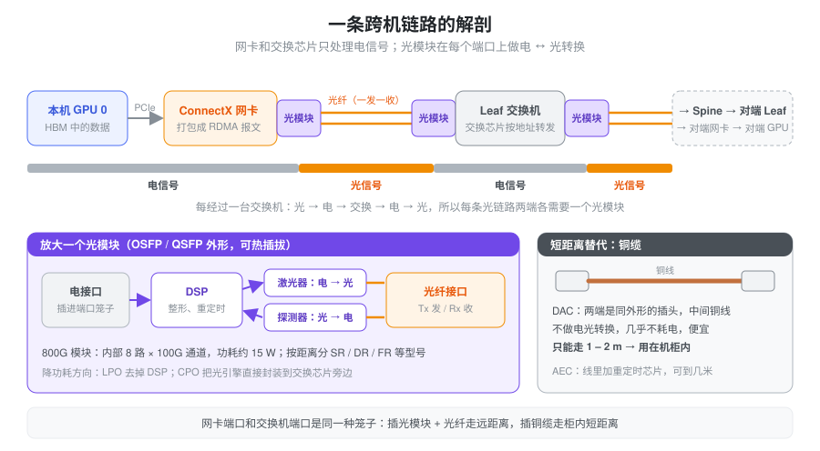
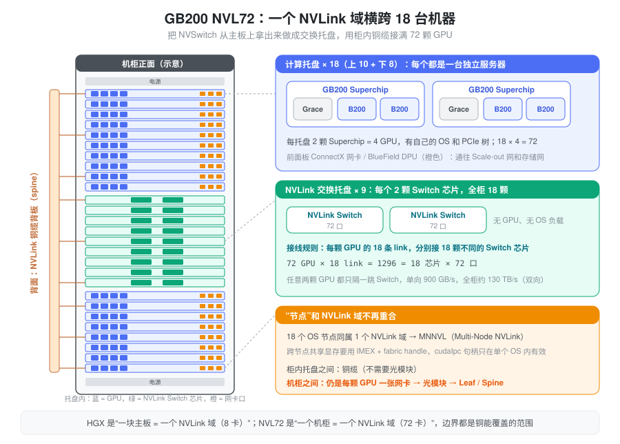

% GPU Interconnect

### 要解决的问题：几千张 GPU 怎么连成一台“机器”

一个大模型的权重、KV Cache 和计算量放不进一张卡，只能拆到几张、几十张乃至上万张 GPU 上。每一步前向，这些卡都要交换数据：TP 的 AllReduce、EP 的 All2All、PP 的激活传递、PD 分离的 KV 搬运。

围绕“卡与卡之间怎么传数据”，会冒出一大堆名词：NVLink、NVSwitch、NVL72、PCIe Switch、网卡、ConnectX、InfiniBand、RoCE、光模块、DAC、Leaf、Spine。它们混在一起很难理清，原因是缺一张空间上的图：这些东西分别装在哪里，一条数据从一颗 GPU 出发，要经过哪些东西才到另一颗 GPU。

本页先给出两条组织原则：

1. Scale-up 和 Scale-out 是两张物理上独立的网，它们的“语义”不同。
2. 距离决定介质：PCB 走线、铜缆、光纤各管一段距离，这也决定了每张网能做多大。

然后从一颗 GPU 开始往外走，依次看一台 8 卡服务器、一条跨机链路、一个 NVL72 机柜在空间上长什么样，最后回到 SGLang 里能看到的对应代码。

### 核心抽象：两张网，按距离选介质

#### 两张网

**Scale-up 网**的目标是把多张 GPU 拼成一张“更大的卡”。在这张网里，另一张卡的显存就是一个地址，本卡的 SM 可以直接对它 load / store，硬件负责把访存请求送过去。NVIDIA 的实现是 NVLink + NVSwitch；AMD 的对应物是 Infinity Fabric（xGMI）。这张网带宽极高（B200 每卡单向 900 GB/s），但规模有限：一台 HGX 服务器是 8 卡，一个 GB200 NVL72 机柜是 72 卡。

**Scale-out 网**的目标是把很多台机器连成集群。在这张网里，另一张卡是网络另一端的一块缓冲区，数据要先交给**网卡**，由网卡打包成网络报文，经交换机转发到对端网卡，再写进对端显存。协议是 InfiniBand 或以太网上的 RoCE，两者都支持 RDMA。这张网可以连到上万卡，但每卡带宽只有 400–800 Gb/s，也就是 50–100 GB/s，比 scale-up 低一个数量级。

此外每台服务器还有一张**前端网**（存储、调度请求、管理），通常走单独的网卡和交换机，和 GPU 间的计算流量分开。本页不展开它。

#### 距离决定介质

两张网的规模差异，根源在物理距离。高速电信号在铜上衰减很快，速率越高，能走的距离越短：

- **毫米到厘米级**（芯片封装内、主板上）：硅中介层和 PCB 走线，带宽最高、最便宜。
- **一到两米**（一个机柜内）：铜缆，不需要电光转换，功耗低，但长度受限。
- **几十米到几公里**（机柜之间、机房之间）：只能用光纤。网卡和交换芯片只处理电信号，所以链路两端各插一个**光模块**，把电信号转成光，到对端再转回电。

由此得到全页最重要的一个判断：**Scale-up 网的规模上限，大致就是铜能覆盖的范围**。HGX 把 NVLink 做在一块主板上，NVL72 用铜缆背板把它扩到一个机柜。一旦要跨出机柜，就进入了网卡 + 光模块 + 交换机的 scale-out 世界。

图里的带宽条按对数长度示意。每往外走一层，可用带宽降一档，而成本和功耗按“每比特”算却越来越高。所以并行策略的放置原则是：通信最重的放在最里层，见 [Topology](./topology.md) 的“拓扑如何映射到并行”。

### 一台 8 卡服务器里有什么

以 HGX B200 服务器为例（DGX B200 是 NVIDIA 自己按这个方案组装的整机）。把机箱盖打开从上往下看，里面有三组东西：GPU 基板、PCIe 与网卡、CPU。

#### NVLink：GPU 上的一组高速端口

NVLink 是 GPU 芯片自带的一组点对点高速串行端口。“一条 NVLink” 指一个端口（link），里面是若干对差分信号线（lane）：NVLink 5 每条 link 每方向 2 条 200 Gb/s lane，合 50 GB/s。B200 有 18 条 link，所以每卡单向 900 GB/s、双向 1.8 TB/s；H100 也是 18 条，但每条只有一半速率（NVLink 4，单向合计 450 GB/s）。

NVLink 本身只是“线”，一颗 GPU 18 个口不可能和其他 7 张卡两两直连还都跑满。早期的 mesh 直连正是卡在这里，见 [Topology](./topology.md) 的 NVLink mesh 一节。

#### NVSwitch：基板上的交换芯片

NVSwitch 是一颗专门转发 NVLink 流量的交换芯片，作用和网络交换机一样，只是它转发的是 GPU 的访存事务。它和 GPU 焊在同一块 HGX 基板上，用 PCB 走线连接，机箱外看不到。

- **HGX B200**：2 颗 NVLink 5 Switch 芯片，每颗 72 个端口。每颗 GPU 的 18 条 link 一半接一颗：8 × 9 = 72，正好用满。
- **HGX H100**：4 颗第三代 NVSwitch，每颗 GPU 的 18 条 link 按 5 / 4 / 4 / 5 分到 4 颗芯片上。

有了 NVSwitch，任意两张卡之间都能用满单卡的全部 NVLink 带宽，8 张卡同时 All2All 也不会互相挤占。这是“8 卡 = 一个无阻塞的 scale-up 域”的硬件基础。NVSwitch 还能在交换芯片内部做归约和组播（NVLink SHARP，NCCL 里叫 NVLS），AllReduce 的一部分加法可以在交换机里完成，减少 GPU 侧的读写量。

#### PCIe Switch 与网卡：通向 scale-out 网的出口

GPU 除了 NVLink，还有一个 PCIe 5.0 ×16 接口。它不用于 GPU 之间的通信，而是连接 Host 和网卡。机箱里有若干颗 PCIe Switch，常见的布局是每颗下面挂两张 GPU 和两张网卡，上行接 CPU。PCIe 拓扑的细节、为什么 GPU 和网卡要挂在同一个 Switch 下，见 [Host Device Interconnect](./host_device_interconnect.md)。

**网卡**（NIC，Network Interface Card）是一块插在 PCIe 上的卡，负责把内存里的数据打包成网络报文发出去，以及把收到的报文写回内存。GPU 集群用的是支持 RDMA 的网卡（NVIDIA ConnectX 系列，B200 机型配 ConnectX-7 400 Gb/s，B300 机型配 ConnectX-8 800 Gb/s）。RDMA 网卡自己就能读写注册过的内存，不需要 CPU 参与拷贝；配合 GPUDirect RDMA，网卡可以经 PCIe 直接读写 GPU 显存。

计算网络是**每张 GPU 配一张网卡**，8 卡机器就是 8 张。这样第 \(i\) 号 GPU 用第 \(i\) 号网卡，接到第 \(i\) 条 rail 的交换机上（rail-optimized，见 [Topology](./topology.md)）。另外还有 BlueField DPU 之类的网卡接前端 / 存储网络，以及 BMC 管理口。

从机箱背面看，离开这台机器的线有三类：8 根计算网的光纤（每张 ConnectX 一根），几根存储 / 前端网的线，一根管理网线。**NVLink 一根也不出机箱**。这就是 HGX 机型的 scale-up 域只有 8 卡的原因。

### 一条跨机链路：网卡、光模块、光纤、交换机

现在跟着一份数据离开机器。GPU 0 要把一块数据写到另一台机器的 GPU 0 上，路径是：GPU 显存 → PCIe → 网卡 → 光模块 → 光纤 → 光模块 → 交换机 → …… → 对端网卡 → 对端 GPU 显存。

#### 网卡端口与光模块

网卡的对外接口是一个金属“笼子”（cage），规格叫 OSFP 或 QSFP112。笼子本身不发光，里面要插一个东西才能连线：

- **光模块**（optical transceiver）：一个可热插拔的小盒子，一端插进笼子接电信号，另一端接光纤。里面有 DSP（把高速电信号整形、重定时）、激光器（电 → 光，发送方向）和光电探测器（光 → 电，接收方向）。一个 800G 光模块内部通常是 8 路 100G 通道，功耗在 15 W 量级。
- **铜缆**（DAC，Direct Attach Copper）：两端是和光模块同样外形的插头，中间直接是铜线，不做电光转换，几乎不耗电，也便宜，但只能走一两米，适合同一机柜内网卡到柜顶交换机。带重定时芯片的有源铜缆（AEC）能再远几米。

链路的另一端，交换机的每个端口也是同样的笼子，同样插光模块或铜缆。所以**每条光链路两端各需要一个光模块**。

#### 光模块的规格和数量

光模块按传输距离分档，常见的有：

| 类型 | 光纤 | 典型距离 | 用在哪 |
| --- | --- | --- | --- |
| SR | 多模 | 约 50–100 m | 同一排机柜内 |
| DR | 单模 | 约 500 m | 机房内跨排 |
| FR / LR | 单模 | 2 km / 10 km | 跨楼、园区 |

光模块的数量随网络层数增长。按 1:1 无阻塞、每段都走光纤粗算：两层胖树里每张 GPU 对应一条网卡 → Leaf 链路和一条 Leaf → Spine 链路，每条链路两端各一个，共 4 个光模块；三层胖树再加一层，约 6 个。实际部署中网卡到同柜 Leaf 的那段常用铜缆，数量会少一些。万卡集群的光模块因此以数万只计，它们的功耗和故障率是集群运维的重要部分。为了降功耗，业界在推 LPO（去掉模块里的 DSP）和 CPO（把光引擎直接封装进交换芯片，NVIDIA 在 2025 年发布了 Quantum-X / Spectrum-X Photonics 交换机）。

#### 交换机与协议

报文到达的第一台交换机叫 **Leaf**（传统部署放在柜顶，也叫 ToR，Top of Rack），Leaf 之间再经 **Spine** 互联。它们和 NVSwitch 是完全不同的设备：独立的 1U / 2U 盒子，几十到上百个端口（例如 Quantum-2 InfiniBand 交换机有 64 个 400G 端口），按网络地址转发报文。胖树、收敛比、rail-optimized 布线见 [Topology](./topology.md)。

这一层有两种协议：

- **InfiniBand**：专为 HPC 设计的网络，网卡、交换机、子网管理器自成一套，原生无损、延迟低。
- **RoCE**（RDMA over Converged Ethernet）：在以太网上跑 RDMA。交换机是以太网交换机，需要配置 PFC / ECN 等流控让网络接近无损。

两者对上层暴露的都是 RDMA 编程接口（verbs），NCCL 和 Mooncake 都能在两者上运行。同一块 ConnectX 网卡往往两种模式都支持。

### 把 Scale-up 扩到一个机柜：GB200 NVL72

HGX 的 scale-up 域只有 8 卡，因为 NVSwitch 和 GPU 必须在同一块主板上。GB200 NVL72 把 NVSwitch 从主板上拿出来，做成独立的交换托盘，再用铜缆把一个机柜里的 72 颗 GPU 全部接上去。

机柜里从上到下插着两种托盘（tray，1U 高的抽屉）：

- **18 个计算托盘**：每个托盘是一台独立的“服务器”，有自己的操作系统，装 2 颗 GB200 Superchip（每颗 = 1 个 Grace CPU + 2 颗 Blackwell GPU），即每托盘 4 GPU。托盘前面板还有 ConnectX 网卡和 BlueField DPU，用于 scale-out 网和存储网。
- **9 个 NVLink 交换托盘**：每个托盘里 2 颗 NVLink Switch 芯片，全柜共 18 颗。

接线规则很整齐：每颗 GPU 有 18 条 NVLink，**每条接到一颗不同的 Switch 芯片**。72 × 18 = 1296 条 link，18 颗芯片 × 72 个端口 = 1296 个端口，正好对上。机柜背面是一组铜缆背板（NVLink spine，约 5000 根铜缆），把托盘的后端连接器两两接通，托盘插进去就完成了接线。全柜 NVLink 总带宽约 72 × 1.8 TB/s ≈ 130 TB/s。

为什么能做到 72 卡而不更多？铜缆。机柜内的距离在一两米以内，铜缆能跑满 NVLink 速率；如果要把 NVLink 拉到隔壁机柜，就需要光模块，功耗和成本会急剧上升。NVL72 用的是“把尽可能多的 GPU 塞进一个铜能覆盖的空间”的思路，这也是这台机柜需要液冷、单柜功耗达 120 kW 量级的原因。

这个机柜带来一个新的空间概念：**操作系统意义上的“节点”和 NVLink 域不再重合**。18 个计算托盘是 18 个节点，各自有一套 OS 和 PCIe 树，却同属一个 NVLink 域。这被称为 MNNVL（Multi-Node NVLink）。一个进程想直接访问另一个节点上 GPU 的显存，需要跨 OS 共享显存句柄，这由 IMEX 服务和 CUDA 的 fabric handle（`CU_MEM_HANDLE_TYPE_FABRIC`）完成；HGX 节点内用的 `cudaIpcOpenMemHandle` 只在同一个 OS 内有效。

多个 NVL72 机柜之间仍然走 scale-out 网：每颗 GPU 对应一张 ConnectX 网卡，经光模块接到 Leaf / Spine。

### Scale-up 与 Scale-out 的本质区别

带宽差一个数量级只是表象。两张网的根本区别在于“对端在程序眼里是什么”：

| | Scale-up（NVLink / NVSwitch） | Scale-out（RDMA 网卡 / IB / RoCE） |
| --- | --- | --- |
| 对端是什么 | 一段可访存的地址 | 网络另一端的一块注册内存 |
| 谁搬数据 | 本卡 SM 直接 load / store，或 Copy Engine | 网卡的 DMA 引擎 |
| 一次传输的粒度 | 一次访存，几十到几百字节 | 一个 RDMA 请求，KB 到 MB |
| 是否要软件协议 | 不要，硬件路由访存事务 | 要建 QP、注册内存、发 work request |
| 带宽（B200 每卡单向） | 900 GB/s | 50 GB/s（400G）/ 100 GB/s（800G） |
| 规模 | 8 卡（HGX）/ 72 卡（NVL72） | 数千到数万卡 |
| 物理介质 | PCB 走线、柜内铜缆 | 光纤 + 光模块（柜内可用铜缆） |

“对端是一段地址”带来的后果很实际：在 scale-up 域里，一个 kernel 可以边算边把结果写进别的卡的显存，通信可以做到细粒度、和计算融合；custom AllReduce、DeepEP 的节点内 dispatch、各种 fused AllReduce + RMSNorm kernel 都依赖这一点。在 scale-out 网里，数据必须攒成块交给网卡，延迟以微秒计，这是 EP 跨机 All2All 和 PD 分离 KV 传输的成本所在。

业界正在把 scale-up 的语义推到更大的范围：NVLink Fusion 向第三方芯片开放 NVLink，UALink 和基于以太网的 scale-up 方案试图提供开放的替代。它们要解决的都是同一个问题：在更大的物理范围内保留“对端是一段地址”的语义。

### 在 SGLang 里看到这两张网

SGLang 不需要知道光模块或交换机的存在，但它在几个地方要判断“这几张卡之间是哪张网”，并据此选择通信实现。

**判断是否全 NVLink 互连。** `python/sglang/srt/distributed/device_communicators/custom_all_reduce_utils.py` 里的 `is_full_nvlink()` 用 NVML 对 TP 组里每一对 GPU 查询 `nvmlDeviceGetP2PStatus(..., NVML_P2P_CAPS_INDEX_NVLINK)`，只要有一对不是 NVLink 直达就返回 False。`can_use_custom_all_reduce_with_nvlink()` 据此决定：超过 2 卡且不是全 NVLink 时，直接禁用 custom AllReduce，回退到 NCCL。原因就是上一节的语义差别：custom AllReduce 让每张卡直接读写别的卡的显存，这在 PCIe 上没有收益。

**判断是否处在 MNNVL 机柜里。** `python/sglang/srt/utils/common.py` 的 `is_mnnvl_fabric_device()` 按设备名判断是否是 GB200 / GB300。`python/sglang/srt/entrypoints/engine.py` 的 `_set_envs_and_config()` 在 `nnodes > 1` 且处在 MNNVL 上时默认打开 `NCCL_CUMEM_ENABLE` 和 `NCCL_MNNVL_ENABLE`，让 NCCL 在跨节点时仍走 NVLink 而不是网卡。`SGLANG_ENABLE_CUSTOM_ALL_REDUCE_V2_MULTINODE` 同理，允许 custom AllReduce v2 跨节点（依赖 fabric handle + IMEX）。

**DeepEP 的两块缓冲区。** `python/sglang/srt/layers/moe/token_dispatcher/deepep.py` 给 DeepEP 分配 `num_nvl_bytes` 和 `num_rdma_bytes` 两块缓冲：前者给节点内 NVLink 转发用，后者给跨节点 RDMA 用。这正是两张网在代码里的投影：normal 模式下，token 先经 RDMA 发到目标节点上同号 rail 的 GPU，再由它经 NVLink 转给目标 GPU。在 MNNVL 硬件上，`allow_mnnvl` / `use_fabric` 让 EP 组里跨托盘的 GPU 也通过 NVLink 互访。

**PD 分离选网卡。** `--disaggregation-ib-device` 支持按 GPU 指定网卡，例如 `'{"0": "mlx5_0", "1": "mlx5_1"}'`。按 rail 让第 \(i\) 号 GPU 用和它挂在同一个 PCIe Switch 下的第 \(i\) 号网卡，KV 传输才走最短路径。

排查硬件时常用的几条命令：`nvidia-smi topo -m` 看 GPU、网卡之间的 PCIe / NVLink 关系（`NV18` 表示 18 条 NVLink），`nvidia-smi nvlink -s` 看每条 link 的速率，`ibv_devices` / `ibstat` 看 RDMA 网卡和端口状态。

### 小结

GPU 互联可以归结为一张由内向外的同心图。最里层是 scale-up 网：NVLink 是 GPU 自带的端口，NVSwitch 是转发这些端口的交换芯片，在 HGX 上焊在主板里（8 卡），在 NVL72 上做成交换托盘并用铜缆背板连满整个机柜（72 卡）；在这个范围内，别的卡的显存就是一个地址。往外是 scale-out 网：每张 GPU 配一张 RDMA 网卡，网卡把数据打包成报文，经光模块变成光信号，走光纤到 Leaf / Spine 交换机，可以连到上万卡，但带宽低一个数量级，而且必须走“交给网卡发送”的消息语义。决定一张网能做多大的，主要是铜能覆盖多远的距离；决定并行策略怎么摆的，是每一层的带宽。
