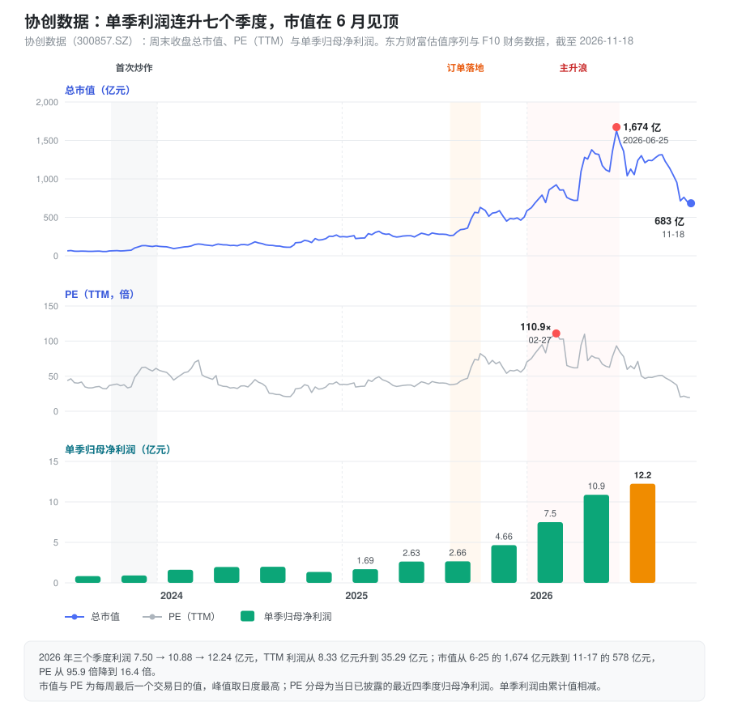
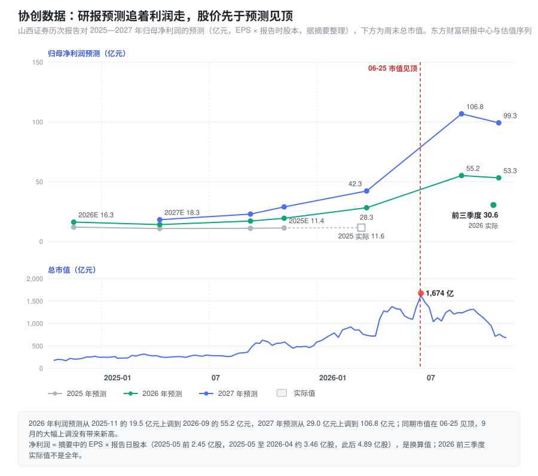
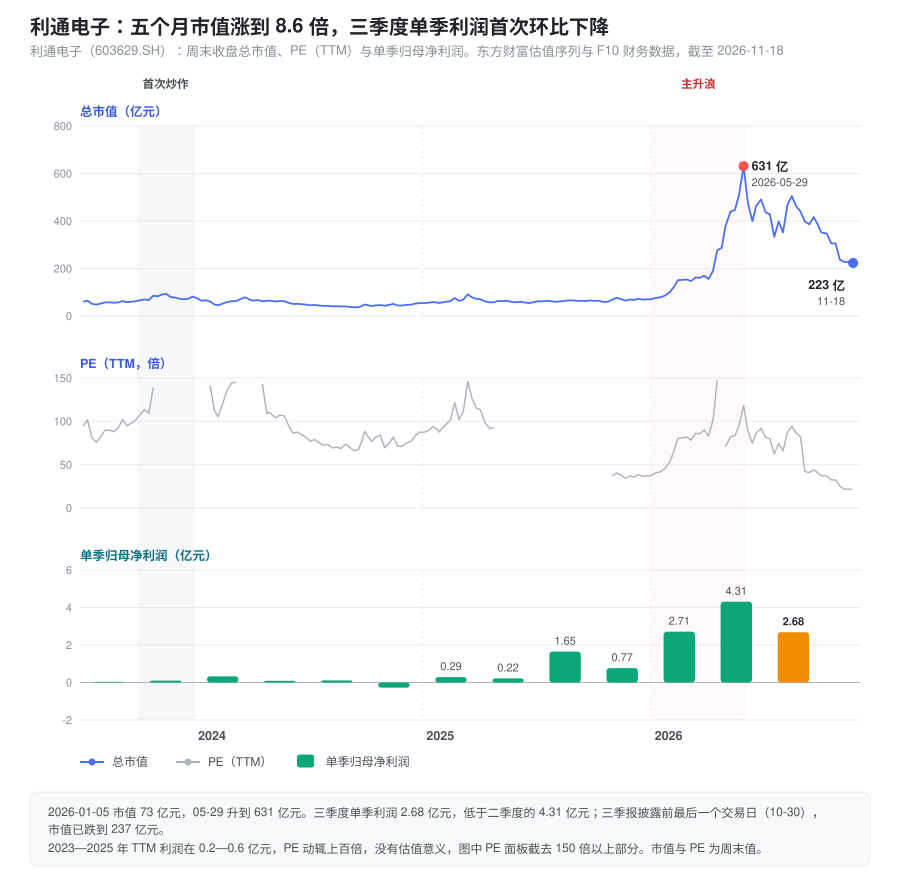
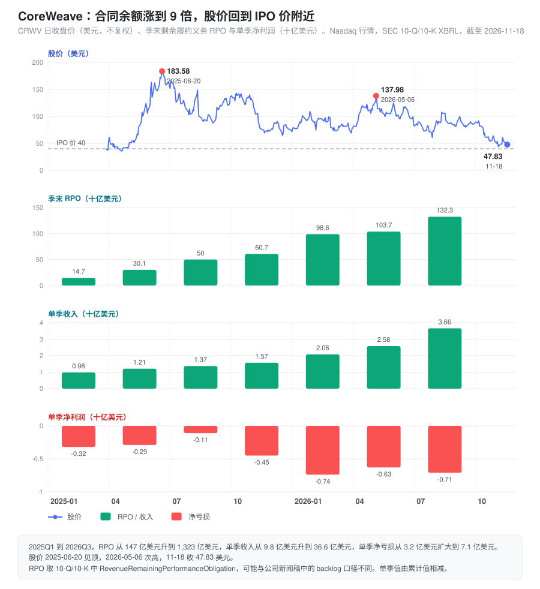
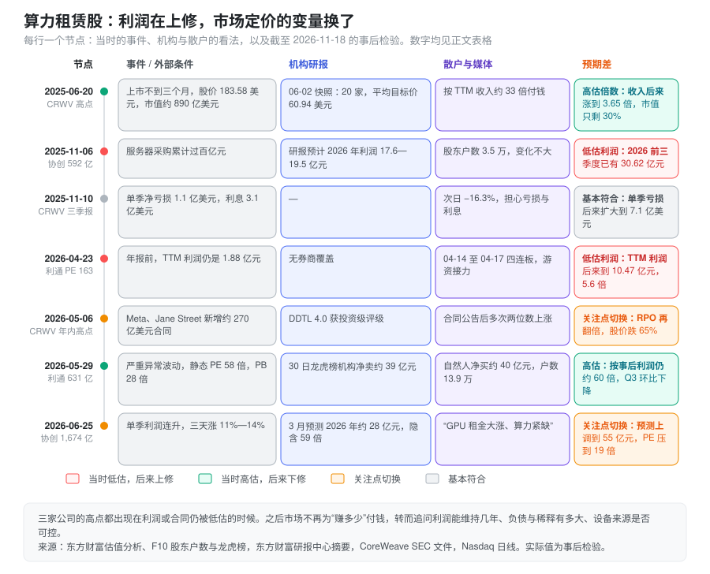

% 算力租赁股：CoreWeave、协创数据与利通电子的历史定价

**2026 年，三只算力租赁股都经历了同一个过程：利润或订单还在加速，股价却先见顶，随后跌掉六到七成。协创数据前三季度利润已是 2025 全年的 2.6 倍，PE 从 2 月的 111 倍降到 11 月的 19 倍；利通电子从 2026 年初的 73 亿元市值涨到 631 亿元，又跌回 223 亿元；CoreWeave 的剩余履约义务（RPO）一年半里涨到 9 倍，股价却回到 IPO 价附近。市场在上半年为“算力稀缺能持续多久”付钱，下半年转而追问“这门生意靠借来的钱撑起，回报能否覆盖资金成本与折旧”。**

本文是 [算力租赁](./gpu_rent.md) 一文的个股补充：那篇讨论这门生意的结构性机会，这篇只看市场在不同阶段怎样给它定价。

### 数据边界

- **研究对象**：协创数据（300857.SZ，深交所创业板）、利通电子（603629.SH，上交所主板）、CoreWeave（CRWV，纳斯达克 A 类普通股）。Nebius（NBIS）与 IREN 只作对照。
- **研究期间**：两只 A 股取 2023-07 至今。两家公司都在 2023 年下半年出现第一轮大幅重估，更早的年份只列年度表作背景。CoreWeave 于 2025-03-28 上市，期间从上市起算。
- **信息截止日**：2026-11-18 收盘，资料提取日 2026-11-19。
- **A 股估值**：东方财富估值分析（[协创](https://data.eastmoney.com/gzfx/detail/300857.html)、[利通](https://data.eastmoney.com/gzfx/detail/603629.html)）的日度 PE（TTM）与总市值。抽查确认分母随财报披露日切换，不存在用事后利润回填的问题。年度平均 PE 为有效交易日 PE 的算术平均，所有 PE 均为正值，没有剔除样本。
- **A 股财务**：东方财富 F10 主要财务指标（[协创](https://emweb.securities.eastmoney.com/PC_HSF10/NewFinanceAnalysis/Index?type=web&code=SZ300857)、[利通](https://emweb.securities.eastmoney.com/PC_HSF10/NewFinanceAnalysis/Index?type=web&code=SH603629)），单季值由累计值相减得到。股东户数取自 F10 股东研究。
- **股本变动**：两家公司 2025—2026 年都实施过资本公积转增，不复权股价跨期不可比，本文一律用**总市值**比较。协创总股本在 2025-05-12 从 2.45 亿股增至 3.43 亿股，2026-04-22 从 3.46 亿股增至 4.85 亿股；利通在 2026-07-07 从 2.62 亿股增至 3.67 亿股。比例约为每 10 股转增 4 股，具体方案未逐一核对公告。
- **CoreWeave**：日收盘价取自 [Nasdaq 历史行情](https://www.nasdaq.com/market-activity/stocks/crwv/historical)，不复权，公司未分红。财务取自 SEC 10-Q/10-K 的 XBRL 数据，股本取各期 10-Q 封面披露的 A、B 类合计数。CoreWeave 一直亏损，PE 无意义，本文改用市销率（PS）和企业价值 / 收入（EV/S）。
- **研报**：东方财富研报中心的报告摘要，只引用摘要可见的字段，均为“据摘要整理”。没有取得 Wind、Choice 等一致预期，单家机构的轨迹不代表市场共识。
- **未能核验**：利通电子 2018 年 IPO 以后没有券商覆盖，缺研报轨迹；美股一致预期只取得 Internet Archive 存档的 StockAnalysis、MarketBeat 页面快照，2025-06 以前缺失，各家网站口径不同；美股新闻多数只核对了标题、媒体和日期；股吧、媒体样本的覆盖范围见各节说明。

### 协创数据：利润追上了估值

#### 年度 PE 与利润

| 年份 | 平均 PE（TTM） | 最低 PE / 日期 | 最高 PE / 日期 | 年末 PE | 年末总市值（亿元） |
| --- | ---: | --- | --- | ---: | ---: |
| 2020（07-27 上市起，108 个交易日） | 59.3 | 22.2 / 07-27 | 76.6 / 08-13 | 50.8 | 61 |
| 2021 | 52.7 | 39.4 / 10-29 | 74.1 / 07-15 | 47.8 | 60 |
| 2022 | 34.3 | 25.0 / 10-10 | 58.7 / 02-07 | 28.7 | 40 |
| 2023 | 41.6 | 28.9 / 01-11 | 68.5 / 12-06 | 61.3 | 129 |
| 2024 | 39.9 | 20.6 / 09-19 | 74.8 / 03-18 | 40.4 | 262 |
| 2025 | 48.1 | 32.2 / 04-08 | 82.2 / 09-30 | 70.1 | 584 |
| 2026 YTD（至 11-18，211 个交易日） | 67.3 | 16.4 / 11-17 | 110.9 / 02-27 | 19.3 | 683 |

| 年份 | 归母净利润（亿元） | 同比 | 营业收入（亿元） | 毛利率 | 关键业务变化 |
| --- | ---: | ---: | ---: | ---: | --- |
| 2020 | 1.00 | +5.2% | 22.49 | 11.5% | 物联网智能终端与存储产品为主 |
| 2021 | 1.26 | +26.0% | 29.60 | 11.6% | 同上 |
| 2022 | 1.31 | +3.7% | 31.48 | 11.2% | 同上 |
| 2023 | 2.87 | +119.5% | 46.58 | 13.6% | 服务器再制造起量 |
| 2024 | 6.92 | +140.8% | 74.10 | 17.4% | 服务器业务与算力服务扩张 |
| 2025 | 11.64 | +68.3% | 122.36 | 19.2% | 算力租赁收入大幅增长 |
| 2026 前三季度 | 30.62 | +338.8% | 196.10 | 27.7% | 单季利润 7.50 → 10.88 → 12.24 亿元 |

2026 年前三季度扣非归母净利润 30.68 亿元，与归母利润基本一致，利润增长不是来自一次性损益。毛利率从 2023 年的 13.6% 升到 27.7%，这与高毛利的算力服务占比上升一致。代价是杠杆：资产负债率从 2025 年末的 81.5% 升到三季度末的 85.8%，加权 ROE 达到 52.4%。业务变化一列根据券商报告标题与财报科目归纳，未逐项核对年报分部数据。

#### 节点表：股价先动还是利润先动

| 日期 | 总市值（亿元） | 当时 TTM 利润（亿元） | PE（TTM） | 说明 |
| --- | ---: | ---: | ---: | --- |
| 2023-10-31 | 67 | 2.11 | 31.9 | 第一轮重估前 |
| 2023-12-06 | 145 | 2.11 | 68.5 | 五周市值 ×2.15，分母未变，全部来自 PE |
| 2024-02-05 | 84 | 2.11 | 39.7 | 回吐大半 |
| 2024-12-23 | 271 | 6.48 | 41.8 | 利润追上来，PE 回到 40 倍附近 |
| 2025-04-08 | 223 | 6.92 | 32.2 | 2025 年最低 PE |
| 2025-08-29 | 347 | 7.66 | 45.3 | 中报后 |
| 2025-09-30 | 630 | 7.66 | 82.2 | 一个月市值 ×1.82，全部来自 PE |
| 2025-11-21 | 450 | 8.33 | 54.0 | 当日 −9.4% |
| 2026-02-27 | 923 | 8.33 | 110.9 | 全期最高 PE |
| 2026-03-17 | 803 | 11.64 | 69.0 | 年报披露，分母切换 |
| 2026-03-31 | 724 | 11.64 | 62.2 | 03-20 单日 −14.9% |
| 2026-06-25 | 1,674 | 17.46 | 95.9 | 全期最高市值 |
| 2026-07-31 | 1,056 | 17.46 | 60.5 | 07-02、07-17、07-28 单日跌 9%—12% |
| 2026-08-28 | 1,242 | 25.71 | 48.3 | 中报披露 |
| 2026-10-27 | 835 | 35.29 | 23.7 | 三季报披露日 −10.2% |
| 2026-11-17 | 578 | 35.29 | 16.4 | 全期最低 PE |
| 2026-11-18 | 683 | 35.29 | 19.3 | 当日 +18.0% |

从节点表能直接读出两点。第一，**每一轮上涨都先由 PE 完成**：2023 年 12 月、2025 年 9 月、2026 年 2 月三次市值跳升时，TTM 利润都还没变，利润要等一到两个季度才追上来。第二，**2026 年下半年是反过来的**：利润每季都在超预期，市值却从高点跌掉六成，PE 被压缩了八成。

#### 涨跌分解

用总市值 = TTM 归母净利润 × PE 分解（总市值不受转增影响；2026 年限制性股票激励约占股本 1%，忽略不计）：

| 区间 | 总市值 | TTM 利润 | PE | 读法 |
| --- | ---: | ---: | ---: | --- |
| 2025-12-31 → 2026-06-25 | ×2.87（584 → 1,674） | ×2.10（8.33 → 17.46） | ×1.37（70.1 → 95.9） | 利润与估值同时扩张 |
| 2026-06-25 → 2026-11-18 | ×0.41（1,674 → 683） | ×2.02（17.46 → 35.29） | ×0.20（95.9 → 19.3） | 利润翻倍，估值缩到五分之一 |
| 2025-12-31 → 2026-11-18 | ×1.17 | ×4.24 | ×0.28 | 全年看，利润增长几乎全被估值压缩抵消 |

#### 研报预测怎样被修正

东方财富研报中心能读到 2024—2026 年协创数据的研报 19 篇，覆盖最连续的是山西证券与太平洋证券，下面以这两家为主线。山西只给 EPS，按报告日的总股本换算成利润：2025-05 转增前 2.45 亿股，2025-05 至 2026-04 约 3.46 亿股，之后 4.89 亿股。换算值只看量级。

| 报告日 | 机构 | 当时总市值（亿元） | 2025 年预测 | 2026 年预测 | 2027 年预测 |
| --- | --- | ---: | ---: | ---: | ---: |
| 2024-04-29 | 太平洋 | 153 | 9.88 | 11.91 | — |
| 2024-11-01 | 太平洋 | 173 | 11.16 | 13.72 | — |
| 2024-11-14 | 山西，首次覆盖 | 210 | EPS 4.95，约 12.1 | EPS 6.66，约 16.3 | — |
| 2025-04-08/09 | 太平洋 / 山西 | 223 / 225 | 10.87 / 约 10.9 | 15.53 / 约 14.2 | 20.57 / 约 18.3 |
| 2025-09-05/10 | 太平洋 / 山西 | 360 / 443 | 10.87 / 约 11.1 | 15.78 / 约 17.2 | 20.82 / 约 23.0 |
| 2025-11-06 | 太平洋 / 山西 | 592 | 11.19 / 约 11.4 | 17.56 / 约 19.5 | 24.84 / 约 29.0 |
| 2026-02-05 | 华鑫，首次覆盖 | 713 | EPS 3.41，约 11.8 | EPS 5.48，约 19.0 | EPS 7.56，约 26.2 |
| 2026-03-26 | 太平洋 / 山西 | 745 | 实际 11.64 | 20.84 / 约 28.3 | 29.75 / 约 42.3 |
| 2026-09-03 | 山西 | 1,282（09-02） | — | 约 55.2 | 约 106.8 |
| 2026-11-05 | 山西 | 803 | — | 约 53.3 | 约 99.3 |

单位为亿元归母净利润。“当时总市值”取报告发布日收盘的东方财富总市值，山西 2026-09-03 报告引用的是 09-02 收盘价，按该日取值。来源为东方财富研报中心的报告摘要：[太平洋 2024-04-29](https://data.eastmoney.com/report/info/AP202404291631568376.html)、[太平洋 2024-11-01](https://data.eastmoney.com/report/info/AP202411011640662720.html)、[山西 2024-11-14](https://data.eastmoney.com/report/info/AP202411141640883397.html)、[太平洋 2025-04-08](https://data.eastmoney.com/report/info/AP202504081653354570.html)、[山西 2025-04-09](https://data.eastmoney.com/report/info/AP202504091653770958.html)、[太平洋 2025-09-05](https://data.eastmoney.com/report/info/AP202509051739088825.html)、[山西 2025-09-10](https://data.eastmoney.com/report/info/AP202509101741015795.html)、2025-11-06 两篇（[1](https://data.eastmoney.com/report/info/AP202511061776058410.html)、[2](https://data.eastmoney.com/report/info/AP202511061776216223.html)）、[华鑫 2026-02-05](https://data.eastmoney.com/report/info/AP202602051819786071.html)、[太平洋 2026-03-26](https://data.eastmoney.com/report/info/AP202603261820758346.html)、[山西 2026-03-26](https://data.eastmoney.com/report/info/AP202603261820772931.html)、[山西 2026-09-03](https://data.eastmoney.com/report/info/AP202609031828945699.html)、[山西 2026-11-05](https://data.eastmoney.com/report/info/AP202611051831450711.html)。另有东吴 2024-08-30 预测 2024—2026 年 7.89 / 10.88 / 14.36 亿元，中航 2025-11-07 预测 2025—2027 年 11.35 / 16.47 / 21.20 亿元，方向与上表一致。

研报的轨迹有两段，方向相反。

1. **2024-11 到 2025-11：预测几乎不动，股价先走。** 一年里，山西对 2026 年的预测只从 16.3 亿元升到 19.5 亿元，太平洋从 13.72 亿元升到 17.56 亿元。同期市值从 210 亿元涨到 592 亿元，按当时对 2026 年的预测算，隐含 PE 从约 13 倍升到约 30 倍。市场已经在为预测之外的东西付钱。2025 年的预测则相当准确：发布时 10.9—12.1 亿元，实际 11.64 亿元。
2. **2026-03 到 2026-09：预测追着单季利润大幅上调。** 2026 年一季度单季利润 7.50 亿元，已是 2025 全年的 64%。山西对 2026 年的预测从 3 月的约 28 亿元提到 9 月的约 55 亿元，对 2027 年从约 42 亿元提到约 107 亿元。市值在 06-25 见顶，9 月的大幅上调没有带来新高。

用当时的市值和当时的预测算**预测隐含 PE**，对比实际 TTM PE：

| 日期 | 总市值（亿元） | 实际 TTM PE | 按当时 2026 年预测 | 按当时 2027 年预测 |
| --- | ---: | ---: | ---: | ---: |
| 2025-11-06 | 592 | 71.1 | 30（山西 19.5） | 20（山西 29.0） |
| 2026-03-26 | 745 | 64.0 | 26（山西 28.3）/ 36（太平洋 20.84） | 18 / 25 |
| 2026-06-25（市值峰值） | 1,674 | 95.9 | 59（山西 3 月的 28.3） | 40（山西 3 月的 42.3） |
| 2026-09-02 | 1,282 | 49.9 | 23（山西 55.2） | 12（山西 106.8） |
| 2026-11-18 | 683 | 19.3 | 13（山西 11 月的 53.3） | 6.9（山西 99.3） |

6 月峰值时，市值相对研报最新的 2026 年预测约 59 倍，比 3 月高出一倍多，说明股价跑到了研报前面。到 11 月，按山西对 2027 年的预测只有约 7 倍。这时的分歧已经不在“明年能赚多少”，而在于“这些利润能维持几年、要背多少负债”，下文再讨论。2026 年全年实际利润要到 2027 年 3—4 月才披露；前三季度已有 30.62 亿元，超过 3 月时两家机构对全年的预测。

#### 股东户数

| 截止日 | 股东户数 | 环比 | 截止日或之前最后一个交易日的总市值（亿元） |
| --- | ---: | ---: | ---: |
| 2023-09-30 | 21,255 | — | 63 |
| 2023-12-31 | 19,634 | −7.6% | 129 |
| 2024-03-31 | 20,041 | +2.1% | 149 |
| 2024-06-30 | 18,495 | −7.7% | 140 |
| 2024-09-30 | 25,242 | +36.5% | 169 |
| 2024-12-31 | 24,540 | −2.8% | 262 |
| 2025-03-31 | 30,875 | +25.8% | 286 |
| 2025-06-30 | 29,344 | −5.0% | 295 |
| 2025-09-30 | 34,988 | +19.2% | 630 |
| 2025-12-31 | 38,112 | +8.9% | 584 |
| 2026-02-28 | 31,965 | −16.1% | 923（02-27） |
| 2026-03-31 | 36,816 | +15.2% | 724 |
| 2026-06-30 | **82,493** | +124.1% | 1,663 |
| 2026-09-30 | 77,050 | −6.6% | 1,229 |

来源：[东方财富 F10 股东研究](https://emweb.securities.eastmoney.com/PC_HSF10/ShareholderResearch/Index?type=web&code=SZ300857)，2026-11-19 提取。2026 年二季度股东户数翻倍，正好覆盖市值从 724 亿元到 1,674 亿元的主升段；PE 最高的 2026-02-27 前后，户数反而比年末少了 16%。第一段估值扩张主要由机构与存量资金完成，散户大规模进场发生在后段。

### 利通电子：估值先行四倍，利润后到

#### 年度 PE 与利润

| 年份 | 平均 PE（TTM） | 最低 PE / 日期 | 最高 PE / 日期 | 年末 PE | 年末总市值（亿元） |
| --- | ---: | --- | --- | ---: | ---: |
| 2020 | 50.9 | 29.4 / 03-23 | 81.9 / 12-11 | 72.5 | 34 |
| 2021 | 51.0 | 35.1 / 10-28 | 78.5 / 03-19 | 48.3 | 22 |
| 2022 | 50.8 | 35.3 / 05-06 | 71.4 / 01-17 | 40.5 | 32 |
| 2023 | 91.6 | 39.0 / 03-30 | 232.9 / 11-14 | 188.4 | 81 |
| 2024 | 100.6 | 65.5 / 09-18 | 186.6 / 01-03 | 83.1 | 52 |
| 2025 | 171.4 | 34.3 / 11-21 | 317.4 / 08-28 | 37.2 | 70 |
| 2026 YTD（至 11-18） | 70.1 | 19.4 / 11-17 | 162.6 / 04-23 | 21.3 | 223 |

| 年份 | 归母净利润（亿元） | 同比 | 扣非净利润（亿元） | 营业收入（亿元） | 毛利率 |
| --- | ---: | ---: | ---: | ---: | ---: |
| 2020 | 0.46 | −26.9% | 0.41 | 16.48 | 15.7% |
| 2021 | 0.58 | +24.5% | 0.33 | 18.04 | 15.9% |
| 2022 | 0.66 | +14.2% | 0.35 | 20.25 | 16.3% |
| 2023 | 0.40 | −39.0% | 0.20 | 18.93 | 15.8% |
| 2024 | 0.25 | −38.8% | 0.06 | 22.48 | 18.4% |
| 2025 | 2.93 | +1,088.6% | 2.36 | 33.07 | 24.8% |
| 2026 前三季度 | 9.71 | +349.4% | 9.16 | 32.28 | 46.7% |

单季归母净利润（亿元，括号内为扣非）：

| 年份 | Q1 | Q2 | Q3 | Q4 |
| --- | ---: | ---: | ---: | ---: |
| 2025 | 0.29 | 0.22 | 1.65（0.92） | 0.77（0.92） |
| 2026 | 2.71（2.78） | 4.31（3.37） | 2.68（3.02） | — |

利通原本是液晶电视金属结构件和精密冲压件厂商，2014—2024 年利润始终在 0.25—0.92 亿元之间。2025 年三季度起，算力服务收入开始体现：2026 年前三季度营收只增长 31%，毛利率却从 2025 年的 24.8% 升到 46.7%，利润增长几乎全部来自业务结构变化。2026 年三季度单季利润 2.68 亿元，是转型以来**第一次环比下降**；二季度 4.31 亿元中约 0.94 亿元是非经常性损益。资产负债率 67.2%。“转型”的业务口径来自财报毛利率与利润结构，未取得算力业务的分部披露。

#### 节点表

| 日期 | 总市值（亿元） | 当时 TTM 利润（亿元） | PE（TTM） | 说明 |
| --- | ---: | ---: | ---: | --- |
| 2023-03-30 | 30 | 0.78 | 39.0 | 第一轮炒作前 |
| 2023-11-14 | 101 | 0.43 | 232.9 | 利润在降，市值 ×3.4 |
| 2024-09-18 | 36 | 0.55 | 65.5 | 回到起点 |
| 2025-10-31 | 70 | 1.88 | 37.0 | 三季报首次体现算力利润 |
| 2026-01-05 | 73 | 1.88 | 38.6 | 2026 年市值最低点 |
| 2026-04-23 | 306 | 1.88 | 162.6 | 分母未变，市值 ×4.2 全部来自 PE |
| 2026-04-28 | 313 | 5.34 | 58.6 | 年报与一季报同日披露 |
| 2026-05-29 | 631 | 5.34 | 118.2 | 全期最高市值，一个月再 ×2.0 |
| 2026-06-18 | 463 | 5.34 | 86.7 | 6 月上旬五个交易日跌停，随后反弹 |
| 2026-07-31 | 352 | 5.34 | 65.9 | 7 月有七个交易日市值跌约 10%（跌停） |
| 2026-08-31 | 448 | 9.44 | 47.5 | 中报披露后首个交易日 |
| 2026-10-30 | 237 | 9.44 | 25.1 | 三季报披露前最后一个交易日 |
| 2026-11-17 | 203 | 10.47 | 19.4 | 全期最低 PE |
| 2026-11-18 | 223 | 10.47 | 21.3 | |

分解 2026 年的两段：

| 区间 | 总市值 | TTM 利润 | PE | 读法 |
| --- | ---: | ---: | ---: | --- |
| 2026-01-05 → 05-29 | ×8.6（73 → 631） | ×2.84（1.88 → 5.34） | ×3.06（38.6 → 118.2） | 估值与利润共同推动，PE 贡献更大 |
| 2026-05-29 → 11-18 | ×0.35（631 → 223） | ×1.96（5.34 → 10.47） | ×0.18（118.2 → 21.3） | 利润翻倍，估值缩到不足两成 |

#### 没有研报的定价：谁在买

东方财富研报中心 2023—2026 年没有利通电子的个股报告，只有 2018 年 IPO 时的两篇。这只股票的定价没有机构盈利预测作锚，下面只能用公司公告、股东户数和龙虎榜还原当时的预期。

公司公告给出的业务信息很有限：

- **入局方式**：2023-06 以 4.5 亿元增资取得上海世纪利通 90% 股权，业务是“购买服务器相关设备后出租”。公告自己写明与原有业务“不存在协同效应”“行业技术壁垒不高”，同日收到上交所监管工作函。
- **规模与客户**：公司在互动平台称 2025 年算力业务收入约 12.0 亿元、净利润约 3.38 亿元，直接运营算力约 38,000P；客户名称从未披露，2026-06 公司称客户集中度较高、自有设备已全部出租。2026 年一季度末合同负债 21.72 亿元，同比增长约 61 倍。
- **融资**：2026-04 把一批已出租设备以 4.20 亿元售后回租；2026-08 公告定增不超过 50 亿元，其中 40 亿元用于 GPU 服务器，可行性报告称“算力长期租赁服务已排至 2030 年以后，现有算力利用率接近 100%”。2026 年一季度末资产负债率 75.1%。

来源：[2023-06-17 增资协议公告](https://data.eastmoney.com/notices/detail/603629/AN202306161591030296.html)、[2026-04-28 售后回租公告](https://data.eastmoney.com/notices/detail/603629/AN202604271821636411.html)、[2026-08-20 定增预案](https://data.eastmoney.com/notices/detail/603629/AN202608191828163169.html)；互动平台口径据[财闻 2026-05-06](https://finance.sina.com.cn/jjxw/2026-05-06/doc-inhwycsi5785627.shtml)与[2026-06-23 报道](https://finance.sina.com.cn/jjxw/2026-06-23/doc-iniekzkp6417431.shtml)。

| 截止日 | 股东户数 | 环比 | 截止日或之前最后一个交易日的总市值（亿元） |
| --- | ---: | ---: | ---: |
| 2025-12-31 | 33,129 | — | 70 |
| 2026-01-09 | 32,948 | −0.5% | 76 |
| 2026-03-31 | 50,812 | +54.2% | 169 |
| 2026-04-30 | 83,490 | +64.3% | 379 |
| 2026-05-29 | **139,090** | +66.6% | 631 |
| 2026-06-10 | 134,400 | −3.4% | 379 |
| 2026-06-18 | 159,600 | +18.8% | 463 |
| 2026-06-30 | 150,070 | −6.0% | 469 |
| 2026-09-30 | 175,689 | +17.1% | 352 |

来源：[东方财富 F10 股东研究](https://emweb.securities.eastmoney.com/PC_HSF10/ShareholderResearch/Index?type=web&code=SH603629)。股东户数在五个月里增加到 4.2 倍，和市值同步；但市值从高点跌掉 44% 之后，9 月末的户数比 5 月末还多 26%。下跌段里散户仍在净进场。

05-29 触发严重异常波动时，交易所公布了 04-14 至 05-29 共 30 个交易日的龙虎榜累计数据：自然人买入 1,149 亿元、卖出 1,109 亿元，净买约 40 亿元；机构买入 368 亿元、卖出 407 亿元，净卖约 39 亿元；沪股通基本持平。金额单位按“亿元”理解是根据数据量级推断的。同期的公司方面，实控人邵培生、邵秋萍在 2—3 月分别减持套现约 1.49 亿元和 2.21 亿元，董高 05-26 减持完毕。同一份异常波动公告提示静态市盈率 58.2 倍、市净率 28.1 倍，30 个交易日平均换手率约 14%。来源：[异常波动公告](https://data.eastmoney.com/notices/detail/603629/AN202605291823031880.html)、[东方财富龙虎榜](https://data.eastmoney.com/stock/lhb/603629.html)、减持据[新浪 2026-02-27](https://finance.sina.com.cn/stock/aigc/zjchg/2026-02-27/doc-inhphqny6489263.shtml)与[2026-03-03](https://finance.sina.com.cn/roll/2026-03-03/doc-inhpsttp0811251.shtml)。

**媒体与自媒体标题样本**（新浪个股资讯列表中按日期抽取，样本，不代表全部投资者）：

- 上涨段：“订单狂飙6000%，利通电子，一战成名！”（05-25）
- 见顶后：“8倍算力大牛股，一字跌停！8万股民受波及”（06-01）；“悔！满仓利通电子 6天吃4跌停……6月已亏11万”（06-08，自媒体）；“8倍牛股利通电子8天跌超200亿，全是‘小作文’的祸吗？”（06-14）
- 反弹段：“利通电子4天3板”（08-05）；“封单超43万手，‘算力味精’涨停”（11-18，中证）

股吧帖子没有取到：东方财富股吧对脚本请求返回身份核实页面。

### CoreWeave：订单涨了九倍，估值倍数缩到十二分之一

#### 收入、亏损与合同余额

CoreWeave 没有一个季度实现 GAAP 净盈利，PE 无法使用。下表列出季度经营数据，估值改用 PS 与 EV/EBITDA。

| 季度 | 收入 | 经营利润 | 利息费用（净） | 净利润 | 调整后 EBITDA | 期末 RPO | 期末在运电力 |
| --- | ---: | ---: | ---: | ---: | ---: | ---: | --- |
| 2025Q1 | 0.98 | −0.03 | 0.26 | −0.32 | 0.61 | 14.7 | — |
| 2025Q2 | 1.21 | 0.02 | 0.27 | −0.29 | 0.75 | 30.1 | — |
| 2025Q3 | 1.36 | 0.05 | 0.31 | −0.11 | 0.84 | 50.0 | 约 590 MW |
| 2025Q4 | 1.57 | −0.09 | 0.39 | −0.45 | 0.90 | 60.7 | 超过 850 MW |
| 2026Q1 | 2.08 | −0.14 | 0.54 | −0.74 | 1.16 | 98.8 | 超过 1 GW |
| 2026Q2 | 2.58 | −0.05 | 0.64 | −0.63 | 1.51 | 103.7 | 1.5 GW |
| 2026Q3 | 3.66 | 0.21 | 0.85 | −0.71 | 2.26 | 132.3 | 超过 1.7 GW |

单位为十亿美元。RPO 取 10-Q/10-K 中的 RevenueRemainingPerformanceObligation；公司新闻稿另报“收入积压”（backlog），口径略宽，2026Q3 为约 1,325 亿美元。全年数据：2024 年收入 19.15 亿美元、净亏损 8.63 亿美元；2025 年收入 51.31 亿美元、净亏损 11.67 亿美元。来源：各季度业绩新闻稿（8-K 附件，[2025Q3](https://www.sec.gov/Archives/edgar/data/1769628/000176962825000059/coreweave3q25earningspress.htm)、[2025Q4](https://www.sec.gov/Archives/edgar/data/1769628/000176962826000094/coreweave4q25earningspress.htm)、[2026Q1](https://www.sec.gov/Archives/edgar/data/1769628/000176962826000220/coreweave1q26earningspress.htm)、[2026Q2](https://www.sec.gov/Archives/edgar/data/1769628/000176962826000362/coreweave2q26earningspress.htm)、[2026Q3](https://www.sec.gov/Archives/edgar/data/1769628/000176962826000461/coreweave3q26earningspress.htm)）与 [SEC XBRL 数据](https://data.sec.gov/api/xbrl/companyfacts/CIK0001769628.json)。

收入一年多翻了近四倍，亏损却在扩大。原因在利息和折旧：2026 年三季度单季利息费用 8.46 亿美元，是经营利润 2.07 亿美元的四倍；前三季度折旧摊销 44.3 亿美元。2026 年前三季度资本开支 235.6 亿美元，经营现金流 56.4 亿美元，缺口靠借债填补。截至 2026-09-30，债务本金 475.1 亿美元，其中 2027 年到期 109.7 亿美元。

融资成本可以直接从公告里读出：2025 年发行的无担保票据利率 9.0%，2026 年 4 月 9.75%，6 月美元票据 9.625%、欧元票据 8.5%；以客户合同作抵押的延迟提款贷款（DDTL）利率更低，DDTL 4.0 获得投资级评级。可转债票息低（2025-12 为 1.75%，2026-09 为 2.875%），代价是未来的股本稀释。

#### 股价与估值

| 日期 | 收盘价（美元） | 总股本（百万股） | 市值（十亿美元） | 当时已披露的 TTM 收入 | PS（TTM） | 说明 |
| --- | ---: | ---: | ---: | ---: | ---: | --- |
| 2025-03-28 | 40 | 约 480 | 约 19 | 1.92（2024 年） | 约 10 | IPO 发行价 |
| 2025-06-20 | 183.58 | 约 485 | 约 89 | 2.71 | 约 33 | 全期最高收盘价 |
| 2025-12-31 | 71.61 | 约 510 | 约 37 | 4.31 | 约 8.5 | |
| 2026-05-06 | 137.98 | 545.6 | 75.3 | 5.13 | 14.7 | 2026 年最高收盘价，一季报前一天 |
| 2026-11-18 | 47.83 | 556.1 | 26.6 | 9.89 | 2.7 | |

总股本取最近一期 10-Q/10-K 封面披露的 A、B 类合计：2025-05-07 为 4.80 亿股，2025-08-05 为 4.89 亿股，2025 年 11 月为 4.98 亿股，2026-01-31 为 5.26 亿股，2026 年 5 月为 5.46 亿股，2026-10-30 为 5.56 亿股；“约”表示在两次披露之间插值。不含期权、RSU 与可转债的潜在稀释。TTM 收入只用当日已披露的季度。

2026-11-18 的企业价值约为 26.6 + 47.5（债务本金）− 4.1（现金）≈ 700 亿美元。EV / TTM 收入约 7.1 倍；EV / TTM 调整后 EBITDA（58.2 亿美元）约 12 倍，按三季度年化（90.2 亿美元）约 7.8 倍。调整后 EBITDA 是公司口径，不扣除利息和折旧，而这两项正是 CoreWeave 的主要成本。

用总市值 = TTM 收入 × PS 分解：

| 区间 | 市值 | TTM 收入 | PS | 读法 |
| --- | ---: | ---: | ---: | --- |
| 2025-06-20 → 2026-11-18 | ×0.30 | ×3.65 | ×0.08 | 收入增长被倍数压缩完全抵消 |
| 2026-05-06 → 2026-11-18 | ×0.35 | ×1.93 | ×0.18 | 与协创、利通同期的分解几乎相同 |

#### 美国同类公司

| 公司 | 2026 年高点 / 日期 | 2026-11-18 收盘 | 自高点 |
| --- | --- | ---: | ---: |
| CoreWeave（CRWV） | 137.98 / 05-06 | 47.83 | −65% |
| Nebius（NBIS） | 286.69 / 06-18 | 106.96 | −63% |
| IREN | 67.84 / 05-27 | 15.24 | −78% |

单位为美元，日收盘价，来源 Nasdaq。Nebius 的季度数据来自 6-K 附件：2025 年收入 5.30 亿美元；2026 年三季度单季收入 9.81 亿美元，调整后 EBITDA 4.66 亿美元，持续经营净亏损 0.38 亿美元，单季资本开支约 73 亿美元，经营现金流 −2.73 亿美元。2025Q2、2026Q1 的净利润为正，来自一次性收益，调整后仍为亏损。三季报同时把 70—90 亿美元 ARR 目标推迟到约 2027 年 2 月，并预计 2027 年四季度才实现税前盈亏平衡、2027 年资本开支 400—450 亿美元。期末股本从 2025Q1 的 2.38 亿股增至 2026Q3 的 2.93 亿股，一年半稀释约 23%。来源：[Nebius SEC 文件](https://www.sec.gov/cgi-bin/browse-edgar?action=getcompany&CIK=0001513845&type=6-K)。IREN 未取得季度财务，只比较股价。

#### 事件与股价反应

下表只列有 SEC 公告可核对的事件，股价反应为公告后第一个交易日的收盘涨跌。原因无法从公告核实的大跌日单独列出，不做归因。

| 日期 | 事件（据 8-K / 10-Q） | 次一交易日 CRWV | 同日 NBIS |
| --- | --- | ---: | ---: |
| 2025-03-28 | 以 40 美元上市 | — | — |
| 2025-09-09 | 与 NVIDIA 签订初始价值 63 亿美元的订单：NVIDIA 承接未售出的剩余算力 | +16.9%（09-10） | +49.4%（09-09，原因未核实） |
| 2025-09-23/25 | OpenAI 追加最多约 65 亿美元订单；Meta 签订最多约 142 亿美元订单 | +11.7%（09-30） | — |
| 2025-10-31 | 收购 Core Scientific 的全股票交易被对方股东否决 | +2.0%（当日） | — |
| 2025-11-10 | 2025Q3 业绩：收入 13.65 亿美元，净亏损 1.10 亿美元，积压 556 亿美元 | −16.3% | — |
| 2026-01-26 | NVIDIA 以每股 87.20 美元认购 20 亿美元 A 类股 | +5.7%，次日 +10.7% | — |
| 2026-02-26 | 2025Q4 业绩：单季净亏损 4.52 亿美元，利息费用 3.88 亿美元 | −18.5%（02-27） | −13.1% |
| 2026-03-31 | 85 亿美元 DDTL 4.0 完成，获投资级评级 | +12.0% | — |
| 2026-04-09/15 | Meta 新增约 210 亿美元合同（至 2032 年）；Jane Street 承诺约 60 亿美元 | +10.9%（04-10） | — |
| 2026-05-07 | 2026Q1 业绩：收入 20.78 亿美元，净亏损 7.40 亿美元，积压 994 亿美元 | −11.4%（05-08） | — |
| 2026-06-11/18 | 发行 12.5 亿美元 9.625% 与 20 亿欧元 8.5% 优先票据，2032 年到期 | +5.0% | — |
| 2026-08-11 | 2026Q2 业绩：积压约 1,040 亿美元，另称三季度初新增超过 250 亿美元承诺 | +19.3%（08-12） | +34.1% |
| 2026-09-17/18 | 发行 37 亿美元 2.875% 可转债，2033 年到期 | −4.2% / +1.9% | — |
| 2026-11-10 | 2026Q3 业绩：上调全年收入指引到 130—133 亿美元，资本开支 370—390 亿美元，预计四季度利息 10.5—11.5 亿美元 | +24.7%（11-11，收 60.77），11-16 回到 49.88 | −16.8%（11-12） |

原因未核实的同步大跌：2025-08-13（−20.8%）、2026-07-01（CRWV −13.9%、NBIS −17.0%）、2026-10-14（CRWV −15.5%、NBIS −10.1%、IREN −12.2%）、2026-10-16（三家均跌约 12%）。2026 年 7 月，纽约州州长发布行政令，暂停 50MW 以上新建或扩建数据中心的州环境许可最长一年（据 2026Q3 10-Q 风险因素，未核对具体日期）。

两个特征值得记下：

1. **合同公告推高股价，财报压低股价。** 2025-09、2026-04 的大单都带来两位数上涨；2025Q3、2025Q4、2026Q1 三份财报后都是两位数下跌。只有 2026Q2、2026Q3 两次财报后上涨，而且 Q3 的涨幅三天内全部回吐。市场对“收入积压”愿意付钱，对“利息与折旧吃掉利润”不愿意。
2. **融资成本是定价的一部分。** 2026 年 4 月和 6 月发行的无担保票据利率在 8.5%—9.75%。新增产能里靠无担保债务支撑的部分，要先覆盖接近两位数的资金成本才轮到股东。

### 两只 A 股：事件怎样改变预期

下面两张表的涨跌幅为前复权口径（转增除权日按复权后计算），来自东方财富日 K 线；公告链接格式为 `data.eastmoney.com/notices/detail/<代码>/<公告编号>.html`。“当时的解读”一栏只写当时的公告、报道或交易数据，事后检验放到下一节。

#### 协创数据

| 日期 | 事件 | 股价反应 | 当时的解读 |
| --- | --- | ---: | --- |
| 2025-03-08 至 2026-02-13 | 六次公告采购服务器，上限合计 322 亿元（30、40、12、40、90、110 亿元），交易对方均豁免披露 | +3.3%、+11.9%、—、−1.4%、+1.9%、−0.1% | 前两次被当作扩产信号；后几次反应变小。110 亿元那次在公告前一天已涨 15.7% |
| 2026-03-20 | 市场流传服务器采购合规问题的“小作文”，公司称与海外厂商非法交易无关 | −14.9% | 第一次出现“货从哪来”的疑问 |
| 2026-04-10 / 04-13 | 澄清与超微电脑无业务关系；一季度预告利润 6.5—8.5 亿元，增长 284%—402% | −9.9%；随后三天 +20.0%、+12.5%、+13.7% | 新浪标题“GPU 租金大幅上涨，高端算力持续紧缺”。公司异常波动公告提示“热点概念型炒作” |
| 2026-04-17 | 股东 PCL 以 172.16 元询价转让 3%，套现 25.0 亿元 | — | 老股东在主升段前段减持 |
| 2026-06-17 至 06-25 | 三天涨 12.4%、14.1%、11.0%，06-25 市值见顶 1,674 亿元 | — | 未找到对应的公司公告或报道 |
| 2026-06-27 | 定增预案，募资不超过 80 亿元，其中 46.86 亿元买 GPU 服务器 | — | 从“订单驱动”转向“融资驱动” |
| 2026-07-31 | 发改委称“十五五”算力网将新增直接投资 4 万亿元 | +15.1% | 政策托底 |
| 2026-10-08 | 财联社：“算力大单上演‘纸面狂欢’！多数合同‘爽约’” | — | 媒体开始质疑大单兑现 |
| 2026-10-19 | 与未披露客户签订不超过 374.9 亿元、60 个月的算力云服务协议；验收不通过客户可终止 | 次日 −7.1%，10-22 −8.4% | 大单不再推高股价；蓝鲸标题“高杠杆扩张藏兑现风险” |
| 2026-10-26 | 三季报：单季利润 12.24 亿元，前三季度财务费用同比 +479% | 次日 −10.2% | 每经：“股价较年内高点近乎腰斩” |
| 2026-11-02 | 控股股东计划 6 个月内增持 5—10 亿元；11-03 有 152 家机构调研 | 11-04 +13.5% | — |
| 2026-11-16 | 美国 BIS 新规：中资母公司通过海外数据中心使用超过 12M TPP 的算力需许可证，存量服务商 90 天过渡期 | −12.6%，创业板指同日 −4.4% | 担心海外算力和设备来源受限 |
| 2026-11-18 | 公告 374.9 亿元协议已生效、全部用境内合规服务器履约；同日英伟达电话会称 Hopper 续租价最高翻倍 | +18.0%；龙虎榜上榜席位净卖出 2.67 亿元 | 板块集体涨停，但上榜资金借涨停离场 |

来源：服务器采购公告（[2025-03-08](https://data.eastmoney.com/notices/detail/300857/AN202503071644159181.html)、[2025-05-28](https://data.eastmoney.com/notices/detail/300857/AN202505271680111763.html)、[2025-12-17](https://data.eastmoney.com/notices/detail/300857/AN202512161801755803.html)、[2026-02-13](https://data.eastmoney.com/notices/detail/300857/AN202602121819904152.html)）、[财闻 2026-03-20](https://finance.sina.com.cn/jjxw/2026-03-20/doc-inhrrkwy0793092.shtml)、[2026-04-13 一季度预告](https://data.eastmoney.com/notices/detail/300857/AN202604131821160157.html)、[新浪 2026-04-14](https://finance.sina.com.cn/roll/2026-04-14/doc-inhunavw4810728.shtml)、[询价转让结果](https://data.eastmoney.com/notices/detail/300857/AN202604241821559018.html)、[定增预案](https://data.eastmoney.com/notices/detail/300857/AN202606261824946909.html)、[证券日报 2026-07-31](https://finance.sina.com.cn/jjxw/2026-07-31/doc-iniksnxm4531739.shtml)、[财联社 2026-10-08](http://finance.eastmoney.com/a/202610083889582118.html)、[374.9 亿元协议](https://data.eastmoney.com/notices/detail/300857/AN202610191830687130.html)、[蓝鲸 2026-10-20](http://finance.eastmoney.com/a/202610203901710788.html)、[财联社 2026-10-26](http://finance.eastmoney.com/a/202610263908643254.html)、[每经 2026-10-26](http://finance.eastmoney.com/a/202610263908608416.html)、[增持计划](https://data.eastmoney.com/notices/detail/300857/AN202611021831331541.html)、[南都 2026-11-18](http://finance.eastmoney.com/a/202611183933790424.html)、[合同进展公告](https://data.eastmoney.com/notices/detail/300857/AN202611181831815441.html)、[东方财富 2026-11-18 板块复盘](http://finance.eastmoney.com/a/202611183934115732.html)、[第一财经 2026-11-18 龙虎榜](http://finance.eastmoney.com/a/202611183934071028.html)。

杠杆数字同样来自公告：2026-09 新增综合授信不超过 400 亿元，对外担保余额 187.53 亿元，为经审计净资产的 427%；2026-11-05 又与两家租赁公司签 57.2 亿元服务器直租。来源：[新浪 2026-09-17](https://cj.sina.cn/articles/view/7317133861/1b4229a2502001hxmy)、[财联社 2026-11-05](http://finance.eastmoney.com/a/202611053923495458.html)。

#### 利通电子

| 日期 | 事件 | 股价反应 | 当时的解读 |
| --- | --- | ---: | --- |
| 2026-01-26 | 2025 年业绩预告：利润增长 997%—1,241% | 01-27 +6.3%，01-30 涨停 | 屠文斌家族 1 月进场，三人合计 4.96%，成本约 30 元（据华夏时报） |
| 2026-02-27 至 03-03 | 实控人邵培生、邵秋萍合计减持套现约 3.7 亿元；02-27 “中国 AI 调用量首超美国” | 02-27 涨停 | 边涨边减持 |
| 2026-03-20 | 传闻“走私英伟达服务器售卖给利通”，公司称不属实 | 跌停 | 与协创同日下跌 |
| 2026-04-14 至 04-17 | “3 月日均词元调用量突破 140 万亿” | 四连板 | 题材是需求爆发 |
| 2026-04-28 | 年报与一季报同日披露，2026Q1 利润 2.71 亿元（+821%），推出 10 转 4 | 三连板，05-06 再涨停 | 04-29 公司提示“若未来芯片断供将对业务产生重要不利影响” |
| 2026-05-29 | 严重异常波动公告，静态 PE 58.2 倍，PB 28.1 倍 | +9.4%，全期最高市值 | 30 日龙虎榜自然人净买约 40 亿元，机构净卖约 39 亿元 |
| 2026-06-01 至 06-10 | 5-31 BIS 新规收紧中资实体经海外子公司采购高端芯片；06-02 业绩说明会只答“合法合规采购” | 五个跌停 | “8 倍算力大牛股，一字跌停！8 万股民受波及” |
| 2026-06-26 | 财闻：“算力租金雪崩、机柜大面积空置”，国内 H100 月租从 1.3 万元降到 6,000 元 | 跌停 | 第一次有媒体质疑租金本身 |
| 2026-07-14 | 半年度预告利润 6.5—7.5 亿元，增长 1,172%—1,368% | 7 月仍有七个跌停 | 07-22 财联社：“算力业务客户相对集中” |
| 2026-07-31 至 08-06 | 发改委“4 万亿”表态 | 07-31 一字涨停；08-06 龙虎榜净买 11.08 亿元，沪股通买入 12.73 亿元 | 外资席位在反弹中买入 |
| 2026-08-20 | 定增不超过 50 亿元，称“算力长期租赁服务已排至 2030 年以后” | 连续三日跌 3%—4% | 融资需求压过订单表述 |
| 2026-10-30 | 三季报：单季利润 2.68 亿元，第一次环比下降 | 10-29 −8%，11-03 −9.1% | — |
| 2026-11-16 / 11-18 | BIS 远程算力许可新规；11-18 公司称算力资源来自合法渠道 | −9.9%；涨停，中证称“封单超 43 万手” | 和协创同步 |

来源：[新浪 2026-01-26](https://finance.sina.com.cn/jjxw/2026-01-26/doc-inhirqax9022644.shtml)、[华夏时报转载 2026-06-13](https://finance.sina.com.cn/roll/2026-06-13/doc-inichssf2545817.shtml)、[财闻 2026-02-27](https://finance.sina.com.cn/jjxw/2026-02-27/doc-inhpfnzn6765327.shtml)、[证券时报 2026-03-20](https://finance.sina.com.cn/jjxw/2026-03-20/doc-inhrrrex6813080.shtml)、[新浪 2026-04-17](https://finance.sina.com.cn/jjxw/2026-04-17/doc-inhuuptn1054041.shtml)、[2026-04-30 芯片断供提示](https://finance.sina.com.cn/stock/hkstock/ggscyd/2026-04-30/doc-inhwfpqm0447987.shtml)、[新浪 2026-06-01](https://finance.sina.com.cn/jjxw/2026-06-01/doc-inhzwyqr2383172.shtml)、[业绩说明会报道](https://cj.sina.cn/articles/view/2853016445/aa0d937d020014yws)、[财闻 2026-06-26](https://finance.sina.com.cn/jjxw/2026-06-26/doc-inietnfw1924787.shtml)、[证券时报网 2026-07-14](http://finance.eastmoney.com/a/202607143805628646.html)、[财联社 2026-07-22](http://finance.eastmoney.com/a/202607223817378868.html)、[定增预案](https://data.eastmoney.com/notices/detail/603629/AN202608191828163169.html)、[第一财经 2026-11-18](http://finance.eastmoney.com/a/202611183933840892.html)、[中证 2026-11-18](http://finance.eastmoney.com/a/202611183933939546.html)。06-26 那篇报道的租金数字是媒体转述，未找到一手报价。

#### 中美的大跌并不同步

| 日期 | CRWV | NBIS | IREN | 协创 | 利通 | 可核实的原因 |
| --- | ---: | ---: | ---: | ---: | ---: | --- |
| 2026-02-27 | −18.5% | −13.1% | −7.4% | +7.2% | +10.0% | CoreWeave 四季报 |
| 2026-03-20 | +1.0% | — | — | −14.9% | −10.0% | A 股采购合规传闻 |
| 2026-07-02 | −4.6% | −5.9% | −10.4% | −11.4% | −10.0% | 未找到 |
| 2026-07-28 | −4.9% | −9.7% | −6.5% | −12.3% | −10.0% | 未找到 |
| 2026-10-14 | −15.5% | −10.1% | −12.2% | −3.6% | −2.0% | 未找到 |
| 2026-11-16 | −6.1% | −7.6% | −9.8% | −12.6% | −9.9% | BIS 远程算力新规 |
| 2026-11-18 | −4.1% | +0.9% | −3.6% | +18.0% | +10.0% | A 股合同进展与英伟达电话会 |

A 股两家的大跌多数来自本土的供给与合规传闻和美国出口管制，美股三家的大跌多数来自财报里的亏损与利息。两边同时见顶回落（CRWV 05-06、利通 05-29、协创 06-25），但单日冲击很少同步。这说明市场在两边担心的是不同的东西：A 股担心“卡能不能继续拿到”，美股担心“借钱买卡能不能赚回来”。

#### 机构与散户各自在为什么付钱

**协创数据的研报**（据摘要整理）一直是“买入”，论据几乎没变：2024 年是“存储顺周期、服务器再制造带来的业绩弹性”；2026-02 华鑫首次覆盖写“随着 AI 算力通胀趋势的延续”；2026-03 到 2026-11 的三篇山西证券报告用的是同一句“考虑到公司在手订单充沛及毛利率持续改善”。11 月的市值比 9 月低约 37%，这句理由和“买入-A”评级都没变，只把 2026 年 EPS 从 11.28 元下调到 10.89 元。研报在跟踪利润，不讨论负债和设备来源。

**协创数据的媒体样本**（样本，不代表全部投资者）：

- 主升段：“GPU租金大幅上涨 高端算力持续紧缺 龙头业绩大增引爆算力概念集体走强 协创数据20%涨停”（新浪，04-14）。
- 见顶后：“利通电子、协创数据加码算力租赁业绩暴涨，跨界玩家为何难入局？”（21 世纪，06-29）；“算力大单上演‘纸面狂欢’！”（财联社，10-08）；“总资产翻近2倍 回撤48%”（读创，10-27）。
- 11-18 反弹后有自媒体写“板块里少数真在赚钱的公司，374.9亿大单是里程碑”。

来源：[21 世纪](http://finance.eastmoney.com/a/202606293786893744.html)、[读创](http://finance.eastmoney.com/a/202610273909459111.html)、[新浪自媒体](https://k.sina.cn/article_7879996580_1d5af34a402001xqno.html)，其余见上表。新浪个股资讯列表只能回溯到 2026-07，东方财富资讯只返回最近约两个月，上半年的样本因此偏少；股吧没有取到。

两边的分歧可以各用一句话概括：

- **机构**：利润每个季度都在超预期，按明年的预测只有十几倍 PE，便宜。
- **散户与媒体**：前半段相信“算力紧缺、租金上涨”，后半段转向“合同能不能兑现、卡从哪里来、负债能不能撑住”。

谁对谁错下一节检验。利通没有研报，市场里只剩散户和游资一方的声音；协创有研报作锚，回撤（−59%）却和利通（−65%）差不多，说明这一轮下跌不是因为缺少盈利预测。

### 预期差

预期差 = 当时的主流预期 − 后来的事实。下表左边三列只用当时可见的信息，右边两列是到 2026-11-18 为止的事后检验。“未定”表示事实还没出来。

| 节点 | 当时的主流预期 | 当时的定价 | 后来的事实 | 方向 |
| --- | --- | --- | --- | --- |
| 协创 2025-11-06 | 研报预计 2026 年利润 17.6—19.5 亿元 | 592 亿元，按预测约 30 倍 | 2026 年前三季度已有 30.62 亿元，山西把全年上调到约 53 亿元 | **低估**：前三季度已是全年预测的 1.6—1.7 倍 |
| 协创 2026-02-27 | 研报预计 2026 年约 19 亿元（华鑫） | 923 亿元，TTM PE 110.9 倍 | 市场的利润判断对了：TTM 利润到 11 月是 35.29 亿元。但 11-18 市值只有 683 亿元 | **低估**，股价却没有因此更高 |
| 协创 2026-06-25 | 3 月研报预计 2026 年约 28 亿元，市场按 59 倍付钱 | 1,674 亿元，全期最高 | 9 月研报上调到约 55 亿元，股价没有新高；PE 压缩到 19 倍 | **关注点切换**：从“赚多少”转到“能赚几年、靠多少负债” |
| 利通 2026-04-23 | 无研报；市场用 1.88 亿元的 TTM 利润给出 162.6 倍 PE | 306 亿元 | TTM 利润到 11 月是 10.47 亿元，为当时的 5.6 倍 | **低估**：市场赌对了利润的方向和量级 |
| 利通 2026-05-29 | 散户净买约 40 亿元，机构净卖约 39 亿元 | 631 亿元，静态 PE 58 倍 | 用事后的 10.47 亿元利润算仍约 60 倍；三季度利润环比下降 | **高估**：利润涨了，但没涨到撑住这个价 |
| 利通 2026-06-26 | 媒体称 H100 租金腰斩、机柜空置 | 跌停 | 三季度扣非利润 3.02 亿元，低于二季度 3.37 亿元；11 月英伟达称 Hopper 续租价上涨 | **基本符合**于“增速放缓”，**未定**于“租金雪崩” |
| 协创 2026-10-19 | 财联社质疑大单“爽约”，蓝鲸称“兑现风险” | 次日 −7.1% | 11-18 公告协议已生效、订单已下给供应商；收入尚未确认 | **未定** |

CoreWeave 的分析师一致预期取自 Internet Archive 存档的页面快照（据快照整理，各网站覆盖家数不同）：

| 快照日 | 来源 | 覆盖家数 / 评级 | 平均目标价（美元） | 2026 年收入预测 | 2027 年收入预测 | 2027 年 EPS 预测 | 收盘价（美元） |
| --- | --- | --- | ---: | ---: | ---: | ---: | ---: |
| 2025-09-13 | StockAnalysis | 17 / 买入 | 109.18 | 121.5 亿美元 | — | — | 111.96（09-12） |
| 2026-06-09 | StockAnalysis | 25 / 买入 | 132.68 | 126.7 亿美元 | 249.2 亿美元 | −0.81 | 98.45 |
| 2026-10-03 | StockAnalysis | 41 / 买入 | 141.58 | 128.7 亿美元 | 262.6 亿美元 | −1.81 | 89.62（10-02） |
| 2026-11-17（现页面） | StockAnalysis | 41 / 买入 | 115.34 | 131.1 亿美元 | 271.0 亿美元 | −1.77 | 49.88（11-16） |

快照：[MarketBeat 2025-06-02](https://web.archive.org/web/20250602135344/https://www.marketbeat.com/stocks/NASDAQ/CRWV/forecast/)、[2025-09-13](https://web.archive.org/web/20250913124211/https://stockanalysis.com/stocks/crwv/forecast/)、[2026-06-09](https://web.archive.org/web/20260609130652/https://stockanalysis.com/stocks/crwv/forecast/)、[2026-10-03](https://web.archive.org/web/20261003034913/https://stockanalysis.com/stocks/crwv/forecast/)、[当前页面](https://stockanalysis.com/stocks/crwv/forecast/)。股价为快照日或前一交易日的 Nasdaq 收盘价。

这张表和协创的研报轨迹是同一个形状：2026 年下半年，收入预测从 249 亿美元上调到 271 亿美元，平均目标价 10 月还在上调，股价却从 98 美元跌到 50 美元以下。唯一往坏方向走的是 2027 年 EPS，从 −0.81 美元降到 −1.77 美元，也就是利息和折旧。10-20 CNBC 报道 HSBC 维持“减持”、目标价 39 美元，理由是 2026—2030 年预计 ROIC 8.9%，低于借款成本；同日 LSEG 统计 45 位分析师中 32 位仍为“买入”（[CNBC](https://www.cnbc.com/2026/10/20/coreweave-hsbc-debt-risks.html)）。

下表的“当时的主流预期”用上述快照、公司指引和股价反应：

| 节点 | 当时的预期或指引 | 当时的定价 | 后来的事实 | 方向 |
| --- | --- | --- | --- | --- |
| 2025-03-28 IPO | 招股书披露 2024 年收入 19.15 亿美元、净亏损 8.63 亿美元 | 40 美元，PS 约 10 | TTM 收入到 98.9 亿美元，是 IPO 时的 5 倍多；RPO 从 2025-03-31 的 147 亿美元涨到 1,323 亿美元 | **低估**：业务规模被严重低估 |
| 2025-06-20 | MarketBeat 06-02 快照：20 位分析师平均目标价 60.94 美元，评级“持有”；市场按 TTM 收入 33 倍付钱 | 183.58 美元，市值约 890 亿美元 | 收入后来涨到 3.65 倍，市值只剩 30% | **高估**：倍数里预支了多年增长 |
| 2025-11-10 | 三季报后股价 −16.3%，市场担心亏损与利息 | 88.39 美元（11-11） | 单季净亏损从 1.1 亿美元扩大到 7.1 亿美元，利息从 3.1 亿美元升到 8.5 亿美元 | **基本符合**：担心的事发生了 |
| 2026-05-06 | Meta、Jane Street 新增约 270 亿美元合同，DDTL 获投资级 | 137.98 美元，PS 14.7 | 当时最近一期 RPO 607 亿美元，后来涨到 1,323 亿美元；股价跌 65% | **关注点切换**：从“合同多大”转到“融资成本与折旧” |
| 2026-11-10 | 上调全年收入指引到 130—133 亿美元 | 三天内涨幅全部回吐 | 指引能否兑现要看 2027 年 2 月的年报 | **未定** |

**当时合理、后来错了的判断**：协创研报 2024—2025 年把利润预测压得很保守，按当时的订单可见度这是谨慎的，结果低估了一倍多；2026-06 媒体称“H100 租金雪崩”，按当时的报价也说得通，但 11 月英伟达称 Hopper 续租价上涨。**当时被嘲笑、后来对了的判断**：利通 4 月按 1.88 亿元利润给 160 倍 PE，事后看利润确实涨了五倍多。**押对了利润、仍然亏钱**：在协创 6 月、利通 5 月、CoreWeave 5 月的高点买入，后来的利润或合同都超过了当时的预期，股价仍跌了六成以上。

### 定价阶段

| 阶段 | 利润在变什么 | 估值在变什么 | 市场在为哪种未来付钱 | 结束这一阶段的事件 |
| --- | --- | --- | --- | --- |
| 一、题材期（2023-06 至 2024） | 利通利润在降，协创利润刚起步 | 利通 PE 冲到 233 倍；协创 PE 五周翻倍 | “能不能沾上算力” | 没有利润跟上，2024 年利通市值回到起点 |
| 二、订单期（2024-12 至 2026-02） | 协创利润每年增长七成到一倍半，研报预测几乎不动 | 协创 PE 从 32 倍升到 111 倍；CoreWeave IPO 后 PS 冲到 33 倍再回落 | 服务器采购公告与合同金额 | CoreWeave 2025-06 先见顶；A 股在 2026-03 的合规传闻后中断 |
| 三、兑现期（2026-03 至 2026-06） | 一季度利润：协创预告增长 284%—402%，利通增长 821%；GPU 租金上涨 | A 股 PE 再扩张：利通到 118 倍，协创到 96 倍；股东户数翻倍 | “算力紧缺会持续，利润还会再翻倍” | 5-31 美国 BIS 新规、6 月“租金雪崩”报道、6-27 起的大额定增 |
| 四、压缩期（2026-06 至今） | 利润继续增长：协创 TTM 翻倍，利通 TTM 近翻倍，CoreWeave 收入接近翻倍 | PE 压到约 20 倍，CoreWeave PS 压到 2.7 倍 | 利润能维持几年、负债和稀释要吃掉多少、设备来源是否可控 | 尚未结束；11-16 的 BIS 新规与 11-18 的板块涨停说明分歧还很大 |

第四阶段是这轮复盘的核心。三家公司的利润或收入都在增长，市值却按同一个比例下跌（区间分解里市值都是 ×0.35—0.41），说明市场下调的不是哪一家公司的预测，而是给整个“借钱买 GPU 再出租”模式的倍数。

### 当前价格隐含了什么

以下用 2026-11-18 收盘数据推算，只用于说明“什么条件下给什么定价”，不构成买卖建议。

**协创数据（683 亿元）**：按三季度单季利润 12.24 亿元年化约 49 亿元，对应约 14 倍 PE。股权激励的 2027 年目标值是净利润比 2025 年增长 340%，即约 51 亿元，市值约为它的 13 倍；山西证券对 2027 年的预测约 99 亿元，市值只有它的约 7 倍。当前价格接近于假设“利润停在三季度的水平”，没有为研报预测的再翻倍付钱。如果 374.9 亿元协议按 60 个月平均确认，每年约 75 亿元含税收入，约为 2025 年智算收入 27.61 亿元的 2.7 倍；但这需要再买一大批服务器，资金来自 80 亿元定增、400 亿元授信和融资租赁，资产负债率已是 85.8%。

**利通电子（223 亿元）**：三季度单季利润年化约 10.7 亿元，扣非年化约 12.1 亿元，对应 18—21 倍 PE。这已经是三家里“假设最少”的定价：只要利润不下滑就站得住，但三季度正是第一次环比下滑。50 亿元定增约为当前市值的 22%，按现价发行会摊薄约五分之一。

**CoreWeave（市值 266 亿美元，EV 约 700 亿美元）**：按全年收入指引 130—133 亿美元，EV / 2026 年收入约 5.3 倍；隐含的四季度收入约 46.8—49.8 亿美元，四季度利息指引 10.5—11.5 亿美元，约占收入的 21%—25%。2026 年前三季度的结构是：调整后 EBITDA 率约 59%（49.3 / 83.2），折旧摊销约占收入的 53%（44.3 / 83.2），利息约占 24%（20.3 / 83.2），合计已经超过 EBITDA，所以 GAAP 亏损。股价要回升，需要至少一项改善：DDTL 等低息合同融资替换高息票据、新集群上线后折旧占比下降，或者续租价格高于原先的折旧假设（公司按 6 年折旧技术设备）。

### 跟踪指标

| 指标 | 验证哪个假设 | 数据来源 |
| --- | --- | --- |
| H100、H200、B200、B300 的租赁与续租价格 | 租金能否覆盖折旧；“租金雪崩”还是“续租涨价” | 英伟达与 CoreWeave 电话会、云厂商报价、第三方租赁价格指数 |
| 美国 BIS 规则的许可证发放情况（90 天过渡期截至 2027 年 2 月中旬） | A 股公司的海外算力和设备来源 | BIS 公告、公司互动平台 |
| 协创 374.9 亿元协议的验收与收入确认 | 大单能否兑现 | 季报中智算收入与合同负债 |
| 协创担保余额 / 净资产、财务费用；利通资产负债率 | 杠杆能否撑住扩张 | 季报、担保公告 |
| 协创、利通单季扣非利润环比 | 利润是否已到平台期 | 季报 |
| CoreWeave 利息费用、资本开支、2027 年到期的 109.7 亿美元债务 | 融资成本和再融资能力 | 10-Q、8-K |
| CoreWeave RPO 转为收入的速度、前两大客户占比 | 合同质量与集中度 | 10-Q 收入确认与客户集中度披露 |
| 定增发行价格与可转债转股 | 股东稀释 | 交易所与 SEC 公告 |

BIS 过渡期的结束日按 11-16 加 90 天推算，具体以规则生效日为准。

