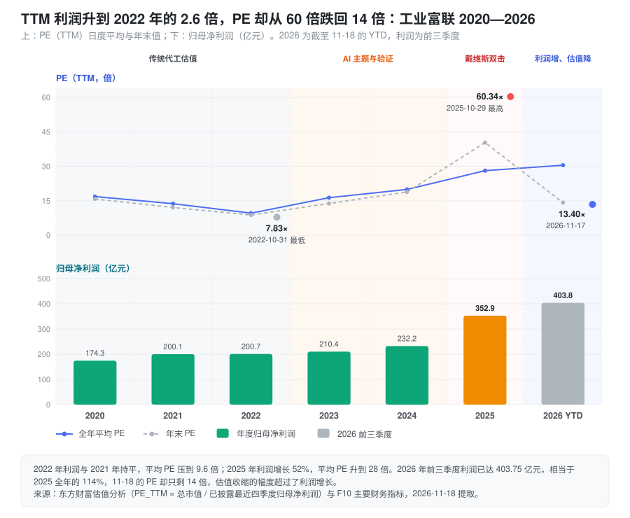
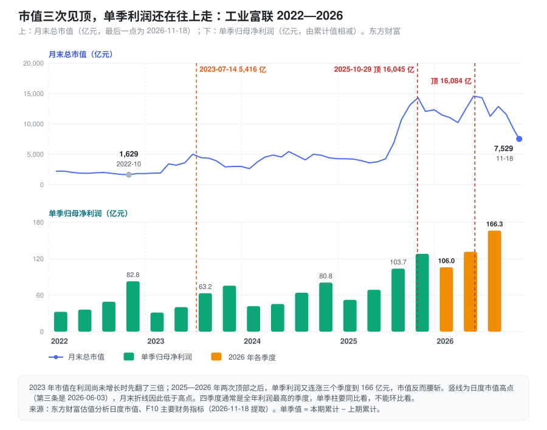
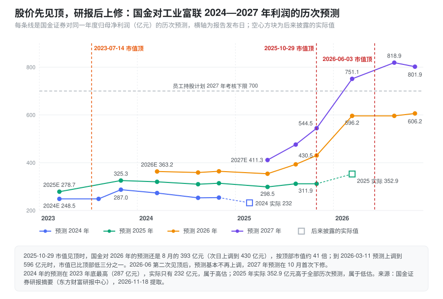
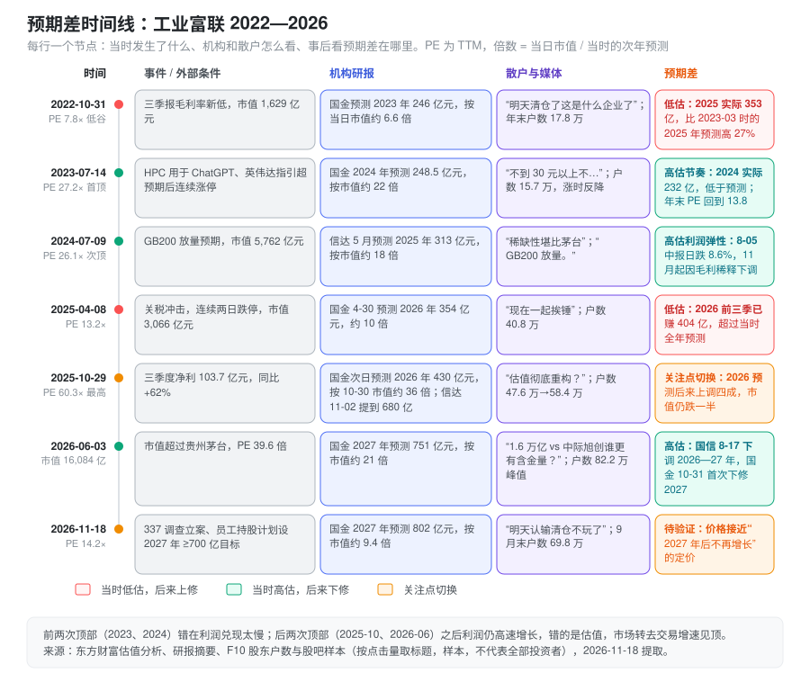

% 工业富联：2020—2026 年历史定价与预期差

工业富联（601138.SH）过去六年的估值变化，并不是简单的科技股牛熊轮回，而是市场对其商业模式、盈利能力和长期增长预期的反复修正。

**核心结论：工业富联经历了四次定价范式转换：传统电子代工企业 → AI 算力产业链的主题标的 → 全球 AI 基础设施资本开支的高弹性受益者 → 利润高增长、但估值按“增速见顶”收缩的周期成长股。**

几轮行情的驱动力不同：

- **2023 年是预期驱动的估值重估。** 市值从 2022-10-31 的 1,629 亿元涨到 2023-07-14 的 5,416 亿元，TTM 利润却下降了 4%，涨幅全部来自 PE。
- **2024 年是业绩逐步验证的阶段。** AI 服务器收入增长超过 150%，但归母净利润只增长 10.3%，市场在“AI 成长股”和“低毛利 ODM”之间来回定价。
- **2025 年是利润增长和估值扩张共同驱动的戴维斯双击。** 2025-04-08 到 2025-10-29，市值涨到 5.2 倍，其中 TTM 利润贡献 1.15 倍，PE 贡献 4.6 倍。
- **2026 年利润与估值背离。** 前三季度归母净利润 403.75 亿元，同比增长 79.6%，TTM 利润从 305.6 亿元升到 531.7 亿元；PE 却从 1 月 6 日的 41.6 倍降到 11-18 的 14.2 倍，市值比 6 月高点低 53%。

### 研究范围与数据边界

- **标的与期间：** 工业富联 A 股（601138.SH，上交所）。研究期间为 2020—2025 六个完整年度，加上 2026 年截至 11-18 的 YTD。信息截止日与提取日均为 2026-11-18（收盘后）。
- **估值：** 东方财富估值分析（`RPT_VALUEANALYSIS_DET`）日度序列，PE（TTM）= 当日总市值 / 已披露的最近四季度归母净利润。分母在财报披露日更新，不存在用事后利润回填的问题。2018-06-08 至 2026-11-18 共 2,049 个交易日，没有缺失，也没有非正 PE。
- **价格：** 东方财富不复权日 K。收盘价与估值序列逐日核对，2,049 天全部一致。价格与市值不复权、不含分红。总股本在 198.4—198.7 亿股之间，回购对每股口径的影响可以忽略。
- **财务：** 东方财富 F10 主要财务指标（公司定期报告口径），单季利润由累计值相减得到。
- **研报：** 东方财富研报中心的报告摘要，共 105 篇，链接格式为 `https://data.eastmoney.com/report/info/<编号>.html`。只引用摘要中能看到的字段，下文统一注明“据摘要整理”。
- **散户与媒体：** F10 股东户数；东方财富股吧 601138 吧，取关键日期按点击量排前的帖子标题。**样本，不代表全部投资者。**
- **公司公告：** 2026-10-12 的 337 调查公告（公告编号 2026-046），以及 2026-10-31 的员工持股计划草案。
- **未能核验：**
  - 没有取到 Wind、Choice 等一致预期快照，文中只呈现单家券商的预测轨迹。
  - 联网检索在本次分析中不可用。股吧转载的外部消息（英伟达管理层变动、Meta 进军云基础设施、纳指与费城半导体指数单日跌幅、英伟达季度营收）均未经独立核实，文中标为“据股吧转载标题，未核实”。

旧版本采用亿牛网口径，与本文的东方财富口径有差异，主要差异在 2022 年最低 PE（8.07 vs 7.83）和 2025 年平均 PE（29.17 vs 28.09）。原因有两个：

1. **分母更新时点不同。** 2022-10-10 市值最低（1,621 亿元），当时分母仍是旧的 TTM 利润 201.5 亿元，PE 约 8.04 倍。10-31 三季报披露后，分母升到 208.0 亿元，PE 降到 7.83 倍。所以“市值最低日”和“PE 最低日”不是同一天。
2. **亿牛网序列存在缺失日。** 本文统一改用东方财富日度序列。

### 年度 PE 与利润

PE（TTM）的全年平均为当年全部交易日日度 PE 的算术平均，并非年初、年末 PE 的简单平均。年末值取最后一个交易日。

| 年份 | 交易日 | 平均 PE | 最低 PE / 日期 | 最高 PE / 日期 | 年末 PE | 年末收盘（元） | 年末市值（亿元） |
| --- | --- | --- | --- | --- | --- | --- | --- |
| 2020 | 243 | 16.82 | 14.03 / 04-13 | 23.89 / 01-22 | 15.79 | 13.69 | 2,720 |
| 2021 | 243 | 13.71 | 11.11 / 11-29 | 18.32 / 01-18 | 12.06 | 11.92 | 2,368 |
| **2022** | 242 | **9.61** | **7.83 / 10-31** | 12.25 / 01-05 | **8.77** | 9.18 | 1,823 |
| 2023 | 242 | 16.33 | 8.84 / 02-08 | 27.15 / 07-14 | 13.80 | 15.12 | 3,004 |
| 2024 | 242 | 19.92 | 11.57 / 01-17 | 26.07 / 07-09 | 18.82 | 21.50 | 4,272 |
| **2025** | 243 | **28.09** | 13.21 / 04-08 | **60.34 / 10-29** | **40.32** | 62.05 | 12,322 |
| 2026 YTD | 211 | 30.49 | 13.40 / 11-17 | 41.62 / 01-06 | 14.16（11-18） | 37.94 | 7,529 |

这里有四个重要的统计特征。

**第一，2022 年是历史估值低谷。** 平均 PE 仅 9.61 倍，比 2020 年低约 43%。2022 年利润与 2021 年持平，没有下滑，所以这反映的是市场对成熟电子制造业的系统性估值压缩，而不是同比例的盈利恶化。

**第二，2023 年虽然出现第一次 AI 重估，但估值没有站稳。** 全年最高 27.15 倍，年末回到 13.80 倍，说明市场尚未就 AI 业务的长期盈利能力形成稳定共识。

**第三，2025 年的估值扩张远超此前任何阶段。** 10-29 达到 60.34 倍，是自身历史中枢（2020—2024 年平均约 15 倍）的四倍。市场把多年后的盈利增长提前计入了股价。

**第四，2026 年平均 PE 高于 2025 年，但这是从高位往下走的平均值。** 1 月 6 日最高 41.62 倍，11-17 最低 13.40 倍。分母每季度大幅上调（TTM 利润从 305.6 亿元升到 531.7 亿元），价格却没有跟上。

需要特别强调：**60 倍 TTM PE 不意味着市场认为公司永远值得 60 倍。** 盈利高速增长时，TTM 分母滞后于未来利润，会放大表观估值。2025-10-29 的 60.34 倍，按国金次日对 2026 年的预测（430.46 亿元）约为 37 倍。因此分析这类企业，必须同时比较 TTM PE 和前瞻 PE。

| 年份 | 归母净利润（亿元） | 同比 | 扣非净利润（亿元） | 毛利率 | 经营现金流（亿元） | 平均 PE | 关键业务变化 |
| --- | --- | --- | --- | --- | --- | --- | --- |
| 2020 | 174.31 | −6.3% | 163.86 | 8.07% | 76.94 | 16.82 | 通信网络、消费电子代工为主 |
| 2021 | 200.10 | +14.8% | 185.81 | 8.31% | 87.25 | 13.71 | 云计算收入 1,777 亿元，毛利率 4.14% |
| 2022 | 200.73 | +0.3% | 184.10 | 7.26% | 153.66 | 9.61 | 云计算收入 2,124 亿元，同比 +19.6% |
| 2023 | 210.40 | +4.8% | 202.09 | 8.06% | 430.84 | 16.33 | 云计算收入 1,943 亿元，AI 服务器约占三成，云计算毛利率 5.08% |
| 2024 | 232.16 | +10.3% | 234.14 | 7.28% | 238.20 | 19.92 | 云计算收入 3,194 亿元（+64%，占营收 52.5%），AI 服务器收入增长超过 150% |
| **2025** | **352.86** | **+52.0%** | 341.88 | 6.98% | 52.38 | 28.09 | 云计算收入 6,027 亿元（+88.7%，占 66.7%），云服务商 AI 服务器收入增长超过三倍 |
| 2026 前三季度 | 403.75 | +79.6% | 394.49 | 7.09% | 32.16 | 30.49（YTD） | 三季度云计算收入同比 +75%，网络设备 +1.2 倍，800G 以上交换机 +80%（据国金摘要） |

归母净利润、扣非净利润、毛利率与经营现金流取自 F10 主要财务指标。营收：2023 年 4,763.40 亿元（−6.9%），2024 年 6,091.35 亿元（+27.9%），2025 年 9,028.87 亿元（+48.2%），2026 年前三季度 9,414.14 亿元（+55.9%）。

表中还有两个容易忽略的变化：

- **毛利率在下降。** 2021 年 8.31%，2025 年 6.98%。利润增长靠的是规模，而不是单位盈利能力的提升。AI 服务器整机的毛利率低于传统业务，收入占比越高，毛利率越被摊薄。这也是 2024 年 11 月国信下调预测的理由（毛利稀释）。
- **经营现金流跟不上利润。** 2023 年经营现金流 430.84 亿元，是利润的 2 倍；2025 年只有 52.38 亿元，约为利润的 15%；2025 年前三季度甚至为 −41.41 亿元。高速扩张需要大量存货和应收账款，利润质量弱于利润增速所显示的水平。

### 节点表：股价先动还是利润先动

年度表会掩盖拐点。下表按季末、月末与关键日期列出价格、市值、当时的 TTM 利润与 PE。TTM 利润是当日已披露的口径。

| 日期 | 收盘（元） | 市值（亿元） | TTM 利润（亿元） | PE（TTM） | 说明 |
| --- | --- | --- | --- | --- | --- |
| 2022-10-31 | 8.20 | 1,629 | 208.0 | **7.83** | 三季报披露日，PE 历史最低 |
| 2022-12-30 | 9.18 | 1,823 | 208.0 | 8.77 | ChatGPT 发布后一个月 |
| 2023-03-31 | 17.22 | 3,420 | 200.7 | 17.04 | 一个季度市值翻倍，TTM 利润反而下降 |
| 2023-06-30 | 25.20 | 5,006 | 199.5 | 25.10 | |
| 2023-07-14 | 27.26 | 5,416 | 199.5 | **27.15** | 第一次顶部 |
| 2023-12-29 | 15.12 | 3,004 | 217.6 | 13.80 | 半年回撤 45% |
| 2024-03-29 | 22.77 | 4,523 | 210.4 | 21.50 | |
| 2024-07-09 | 29.00 | 5,762 | 221.0 | **26.07** | 第二次顶部 |
| 2024-09-30 | 25.19 | 5,005 | 226.2 | 22.13 | |
| 2025-03-31 | 19.86 | 3,944 | 232.2 | 16.99 | |
| 2025-04-08 | 15.44 | 3,066 | 232.2 | 13.21 | 关税冲击，连续两日跌停 |
| 2025-06-30 | 21.38 | 4,246 | 242.6 | 17.50 | |
| 2025-08-29 | 53.83 | 10,690 | 265.9 | 40.20 | 两个月市值翻 2.5 倍 |
| 2025-10-29 | 80.80 | 16,045 | 265.9 | **60.34** | 三季报发布当晚，次日分母才更新 |
| 2025-12-31 | 62.05 | 12,322 | 305.6 | 40.32 | |
| 2026-03-31 | 51.46 | 10,212 | 352.9 | 28.94 | 年报利润 +52%，股价继续下跌 |
| 2026-06-03 | 81.05 | 16,084 | 406.5 | 39.57 | 市值历史最高 |
| 2026-07-31 | 56.70 | 11,252 | 406.5 | 27.68 | |
| 2026-09-30 | 58.20 | 11,549 | 469.1 | 24.62 | |
| 2026-10-30 | 45.00 | 8,930 | 531.7 | 16.79 | 三季报披露日 |
| 2026-11-18 | 37.94 | 7,529 | 531.7 | **14.16** | 信息截止日 |

单季归母净利润（亿元，由累计值相减）：

| 年份 | Q1 | Q2 | Q3 | Q4 |
| --- | --- | --- | --- | --- |
| 2022 | 32.56 | 36.16 | 49.24 | 82.77 |
| 2023 | 31.28 | 40.33 | 63.24 | 75.55 |
| 2024 | 41.85 | 45.54 | 64.02 | 80.75 |
| 2025 | 52.31 | 68.82 | 103.74 | 127.99 |
| 2026 | 105.95 | 131.45 | 166.35 | — |

#### 乘法分解：市值 = TTM 利润 × PE

选取相邻的低点和高点，把市值变化拆成 TTM 利润变化与 PE 变化：

| 区间 | 市值变化 | TTM 利润变化 | PE 变化 | 主导因素 |
| --- | --- | --- | --- | --- |
| 2022-10-31 → 2023-07-14 | ×3.33（+232%） | ×0.96（−4%） | ×3.47 | 全部来自估值 |
| 2023-07-14 → 2023-12-29 | ×0.55（−45%） | ×1.09 | ×0.51 | 估值回吐 |
| 2023-12-29 → 2024-07-09 | ×1.92 | ×1.02 | ×1.89 | 仍是估值 |
| 2024-07-09 → 2025-04-08 | ×0.53（−47%） | ×1.05 | ×0.51 | 估值回吐 |
| 2025-04-08 → 2025-10-29 | ×5.23（+423%） | ×1.15 | ×4.57 | 估值为主，利润开始贡献 |
| 2025-10-29 → 2026-06-03 | ×1.00 | ×1.53 | ×0.66 | 利润增长被估值收缩抵消 |
| 2026-06-03 → 2026-11-18 | ×0.47（−53%） | ×1.31 | ×0.36 | 估值收缩超过利润增长 |

把 2022-10-31 到 2026-11-18 作为整体：市值 ×4.62，TTM 利润 ×2.56，PE ×1.81。四年里利润贡献了一多半的涨幅（按对数计约 61%），但中间的几次大波动几乎全部来自 PE。

2025-10-29 之后，利润成为市值的主要支撑，PE 则成为压力来源。这与 2023 年正好相反：2023 年是“没有利润增长的估值扩张”，2026 年是“没有估值扩张的利润增长”。

### 机构研报

#### 国金证券：覆盖最连续的一条线

国金证券从 2022 年起每个财报季都有报告，口径稳定（归母净利润，亿元），评级始终是“买入”或“增持”。下表据研报摘要整理。“隐含 PE”= 报告日（非交易日取前一交易日）总市值 / 该报告对下一年的利润预测。

| 发布日 | 预测（亿元） | 当日 TTM PE | 次年预测隐含 PE | 摘要要点 |
| --- | --- | --- | --- | --- |
| 2022-03-02 | 2021/22/23：191 / 210 / 226 | — | — | 按 2022 年 17 倍 PE 给目标价 18 元 |
| 2022-08-10 | 2022/23/24：225.9 / 246.3 / 278.1 | — | — | |
| 2023-03-16 | 2023/24/25：226.1 / 248.5 / 278.7 | 12.22 | 9.9（2024E） | 下调 2023 年（原 246.3），HPC 已用于 ChatGPT 相关业务 |
| 2023-08-09 | 同上 | 21.71 | 17.8（2024E） | 中报单季净利 40.3 亿元；预测不变，股价翻倍 |
| 2023-10-31 | 248.5 / 287.0 / 325.3 | 13.44 | 10.2（2024E） | 单季盈利创新高，上调 2024—25 年 |
| 2024-03-14 | 2024/25/26：273.1 / 320.0 / 363.2 | 21.57 | 14.2（2025E） | |
| 2024-08-14 | 253 / 310 / 359 | 18.78 | 13.7（2025E） | AI 服务器收入倍增，但下调全年预测 |
| 2024-10-31 | 254 / 314 / 364 | 21.23 | 15.3（2025E） | |
| 2025-04-30 | 2025/26/27：298.52 / 353.75 / 411.32 | 14.78 | 10.1（2026E） | 评级“增持” |
| 2025-08-13 | 311.89 / 393.02 / 475.96 | 32.62 | 22.1（2026E） | |
| 2025-10-30 | 311.89 / 430.46 / 544.47 | 50.66 | 36.0（2026E） | 三季报后上调 2026—27 年 |
| 2026-03-11 | 2026/27/28：596.17 / 751.07 / 957.07 | 30.33 | 14.3（2027E） | 年报日大幅上调 |
| 2026-08-15 | 596.17 / 818.92 / 1,057.94 | 28.00 | 16.0（2027E） | |
| 2026-10-31 | 606.23 / 801.90 / 1,001.27 | 16.79 | 11.1（2027E） | 首次下调 2027—28 年 |

这条线有三个规律：

**1. 2023—2024 年，预测比利润跑得快，但比股价慢。** 2023-08-09 的预测与 3 月完全相同，股价却从 12.35 元涨到 22.25 元，次年隐含 PE 从 9.9 倍升到 17.8 倍。市场在为预测之外的东西付钱。2024 年预测最高到 287 亿元（2023-10-31），实际只有 232.16 亿元，比最高预测低 19%。

**2. 2025 年，利润超出所有历次预测，市场比研报先看到。** 2025 年的预测在 2025 年 4 月低到 298.5 亿元，实际为 352.86 亿元，比 4 月的预测高 18%。股价 4 月见底、10 月见顶，研报对 2026 年的大幅上调（430 → 596 亿元）却到 2026-03-11 才出现，那时市值已比 10-29 的顶部低三分之一。

**3. 2026 年，股价开始跌在预测下修之前。** 6-03 市值创历史新高后，国金 8-15 仍在上调 2027 年预测，10-31 才首次下修（818.9 → 801.9 亿元，降 2%）。同期股价从 81.05 元跌到 45.00 元。预测只微调，次年隐含 PE 却从 21 倍降到 11 倍：市场已经在为比研报低得多的增长定价。

#### 其他券商对照

| 券商 | 发布日 | 预测（亿元） | 次年预测隐含 PE | 摘要要点 |
| --- | --- | --- | --- | --- |
| 国信 | 2023-03-28 | 2023/24/25：239.6 / 267.4 / 297.6 | — | 按 18—22 倍 PE 给合理价 21.72—24.13 元 |
| 国信 | 2024-11-04 | 2024/25/26：247.53 / 290.27 / 338.67 | — | 因毛利率稀释下调（8 月为 260.25 / 357.23 / 400.00） |
| 信达 | 2024-11-02 | 237.05 / 300.92 / 341.19 | — | 跟随下调 |
| 中银 | 2025-08-12 | 2025/26/27：316.19 / 574.03 / 658.98 | — | 2026 年预测比国金同期高 46% |
| 信达 | 2025-11-02 | 361.20 / 680.35 / 859.40 | 21.0（2026E） | 三季报后上调 2026 年预测 68% |
| 国信 | 2025-11-05 | 356.44 / 693.09 / 874.57 | 21.6（2026E） | |
| 信达 | 2026-04-30 | 2026/27/28：664.72 / 946.46 / 1,211.27 | — | 一季报后继续上调 |
| 国信 | 2026-08-17 | 609.05 / 816.03 / 1,039.19 | 16.6（2027E） | 下调 2026—27 年（原 693.09 / 874.57），原因是新品产能爬坡与出货节奏 |
| 中邮 | 2026-09-21 | 622 / 846 / 1,094 | — | |

券商之间的分歧在 2025 年三季度最大：8 月中旬，中银对 2026 年的预测是 574 亿元，国金是 393 亿元。三季报后信达、国信把 2026 年预测提到 680—693 亿元，国金到 2026 年 3 月才提到 596 亿元。2026 年前三季度实际为 403.75 亿元。如果四季度利润不低于三季度（2022—2025 年都是如此），全年至少约 570 亿元；如果四季度同比增速与三季度相近（约 +60%），全年约 610 亿元。按这个推算，2025 年 11 月最乐观的那批预测（680—693 亿元）很可能落空，国金的 596—606 亿元更接近。这是事后推算，以年报为准。

没有取到一致预期快照，以上只代表几家券商。从这几家看，2026 年下半年的一致方向是“小幅下修或持平”，而不是“大幅下调”。股价却跌了一半，所以分歧在估值，不在利润。

### 散户与媒体

#### 股东户数

F10 股东户数（A 股，截至各期末；部分为定期报告外的补充披露）：

| 截止日 | 股东户数 | 环比 | 期末收盘（元） | 同期股价表现 |
| --- | --- | --- | --- | --- |
| 2021-12-31 | 189,368 | | 11.92 | |
| 2022-12-31 | 178,028 | −5.0% | 9.18 | 估值低谷，户数缓降 |
| 2023-03-31 | 148,451 | −17.3% | 17.22 | **股价翻倍，户数反降** |
| 2023-06-30 | 156,715 | +5.6% | 25.20 | |
| 2023-09-30 | 202,276 | +29.1% | 19.70 | 从高点回落时散户进场 |
| 2023-12-31 | 188,402 | −6.9% | 15.12 | |
| 2024-03-31 | 290,031 | +29.1% | 22.77 | |
| 2024-06-30 | 191,716 | −33.9% | 27.40 | 股价新高，户数大降 |
| 2024-12-31 | 368,097 | +38.4% | 21.50 | |
| 2025-03-31 | 407,981 | +10.8% | 19.86 | |
| 2025-06-30 | 311,115 | −23.7% | 21.38 | 主升浪启动前，户数下降 |
| 2025-09-30 | 476,358 | +53.1% | 66.01 | 主升浪中散户大量进场 |
| 2025-12-31 | 584,221 | +22.6% | 62.05 | |
| 2026-02-28 | 732,173 | +25.3% | 55.70 | 从顶部回落中继续增加 |
| 2026-06-30 | 821,520 | +13.7% | 72.15 | **历史峰值** |
| 2026-09-30 | 698,254 | −15.0% | 58.20 | 第一次在下跌中明显减少 |

户数有两种不同的模式：

- **2023—2025 年上半年，户数常常与股价反向。** 股价上涨的季度（2023 年一季度、2024 年二季度、2025 年二季度）户数下降，回调时户数上升。上涨主要由机构资金推动，散户在回调中接货。
- **2025 年下半年之后，户数与股价同向，并在顶部之后继续上升。** 户数从 31 万增加到 82 万，升到原来的 2.6 倍，峰值出现在 2026 年 6 月的第二次顶部。2026-03-11 的高赞帖把这一点列为“不涨反跌的原因”第一条：“1.筹码结构（最核心利空）股东人数……”。

股东户数一季度一次，只作辅助证据。2026 年三季度户数减少 15%，可能意味着部分散户已经离场，也可能只是持仓转移，需要结合四季度数据判断。

#### 股吧样本

以下为东方财富 601138 吧在关键日期按点击量排在前列的帖子标题，原文照录。**样本，不代表全部投资者。** 新闻转载类标题与个人观点类标题分开标注。

| 日期 | 新闻 / 转载标题 | 个人观点标题 |
| --- | --- | --- |
| 2022-10-31 | “工业富联三季报毛利率创新低 股价长期破发 北向资金小幅加仓” | “明天清仓了这是什么企业了”；“富联都这样了…既不是高位，又没有众多机构持股，谁来砸？” |
| 2023-03-17 | “ChatGPT概念股涨停！工业富联：HPC产品已应用于ChatGPT” | “发生了什么？工业富联再度涨停股价创近两年新高！” |
| 2023-07-14 | “工业富联连续第二日触及涨停 股价续刷历史新高” | “五千亿盘子大涨，看实际情况就知道”；“从13元多一直持有到现在…不到30元以上不…” |
| 2023-10-23 | “富士康被查 工业富联、鹏鼎控股大跌 双双回应经营正常” | “工业富联封死跌停 960只基金谁重仓？…” |
| 2024-07-09 | “工业富联快评：…稀缺性堪比茅台” | “GB200放量。” |
| 2024-08-05 | “历史新高！工业富联拿出了上市以来最好的一份中期成绩单”；“工业富联股价大幅下跌 较历史高点已回撤约30%” | |
| 2025-04-08 | “工业富联：全球布局产能完备 将持续加大在中国大陆的投资力度” | “谁能分析一下是为啥…现在一起挨锤。” |
| 2025-08-13 | “英伟达产业链狂飙！AI方向的炒作过热了吗？” | “富联涨停，预示大股行情正式走完，明日二八切换。”；“…这股长线看到80” |
| 2025-10-29 | “工业富联：第三季度归母净利润103.73亿元，同比增长62.04%” | “炸裂！工业富联净利暴增49%，狂揽英伟达60%订单，算力龙头估值彻底重构？” |
| 2025-11-24 | “工业富联：未向市场下调第四季度利润目标 未收到任何主要客户关于调整业务模式的要求” | “万亿巨头工业富联缘何盘中跌停？坊间“小作文”发酵 公司暂无回应” |
| 2026-03-11 | “工业富联：2025年营收同比增长48.22% 净利润同比增长51.99%” | “工业富联不涨反跌的原因1.筹码结构（最核心利空）股东人数…”；“…继续散户集中营。” |
| 2026-06-03 | “工业富联市值达1.61万亿元 超越贵州茅台位居A股第八位” | “工业富联1.6万亿 vs 中际旭创 1.4万亿谁更有含金量？” |
| 2026-07-10 | “工业富联半年净利预计首破200亿，股价不涨反跌” | |
| 2026-10-30 | “工业富联：拟推不超20亿元员工持股计划” | “工业富联45.22元跌7.03%，市盈率16.67却20日跌28.20%” |
| 2026-11-16 | | “扛不住了，想把电脑买了…”；“痛定思痛，明天认输清仓不玩了…” |
| 2026-11-18 | “A股热点前瞻丨英伟达单季营收首破千亿美元…”（未核实） | “没戏了。英伟达构建新供应链，别做梦了”；“还是那句话，不到70元别买…” |

从样本看，散户情绪的变化落后于价格。2023-07-14 的顶部和 2025 年 8 月的主升浪中，样本中出现了“长线看到 80”“不到 30 元以上不…”这类看多帖；2026 年 11 月的低点附近则集中出现“认输清仓”。2025-10-29 和 2026-03-11 两次财报大增的当天，高赞帖讨论的是“为什么不涨”，说明利润超预期已经不再是新信息。

### 事件与预期差

#### 2023 年：从概念映射到订单验证

| 时间 | 关键事件 | 股价与估值反应 | 市场定价逻辑 |
| --- | --- | --- | --- |
| 2022-10-31 | 三季报毛利率创新低 | PE 7.83 倍，历史最低 | 传统代工、利润停滞 |
| 2022-11-30 | ChatGPT 正式发布 | 年末 PE 8.77 倍，几乎没反应 | 生成式 AI 刚受到关注 |
| 2023-03-14 | GPT-4 发布；公司当晚披露 2022 年报（利润 +0.3%） | | 大模型能力跃升，强化算力需求预期 |
| 2023-03-16—17 | 公司确认其 HPC 产品已应用于 ChatGPT 相关业务 | 3-17 涨停（+10.04%） | **从概念映射变成有实际业务关联** |
| 2023-03-22 | 英伟达 GTC 发布 AI 产品与技术 | | GPU、AI 服务器产业链受到追捧 |
| 2023-05-24 | 英伟达公布远超预期的下一季度营收指引 | | **从产业逻辑推演升级为真实订单验证** |
| 2023-06-19 | 收盘 26.46 元（+9.98%） | 市值超过 5,200 亿元 | AI 估值溢价显著扩大 |
| 2023-07-14 | 连续第二日涨停 | 27.26 元，PE 27.15 倍，年内最高 | 第一次顶部 |
| 2023-08-09 | 中报披露后分母更新 | PE 21.71 倍（−7.98%） | 利润增长 4%，验证不足 |
| 2023-10-23 | 媒体报道富士康被查，公司回应经营正常 | 跌停，收盘 14.55 元 | 地缘与监管风险 |

其中最重要的事件是 **2023 年 5 月 24 日英伟达财报**。英伟达公布 FY2024 Q1 营收 71.9 亿美元，数据中心收入 42.8 亿美元，并给出 FY2024 Q2 营收指引 110 亿美元，意味着下一季度营收环比增长约 53%，远超此前市场预期。

#### 2024—2026 年：从验证到增速见顶

| 时间 | 关键事件 | 股价与估值反应 |
| --- | --- | --- |
| 2024-03-08 | 两个月涨近 100%，当日涨停 | 24.87 元 |
| 2024-07-09 | GB200 放量预期 | 29.00 元，PE 26.07 倍，第二次顶部 |
| 2024-08-05 | 中报快报（上市以来最好的中期业绩），叠加全球市场急跌 | −8.55% |
| 2024-11 | 国信、信达以毛利率稀释为由下调预测 | |
| 2025-04-07—08 | 美国加征关税冲击 | 连续两日跌停，PE 13.21 倍 |
| 2025-08-12—13 | 8-11 半年报披露（上半年净利 121.13 亿元，+38.6%），叠加英伟达产业链行情 | 两日 +9.24%、+10% |
| 2025-10-29 | 三季报：单季净利 103.73 亿元，同比 +62% | 当日 +9.20%，80.80 元，PE 60.34 倍 |
| 2025-10-31 | 三季报后资金流出 | −7.66% |
| 2025-11-21、11-24 | 坊间传闻下调四季度利润目标 | 两日 −7.99%、−7.80%；公司澄清“未向市场下调第四季度利润目标” |
| 2026-01-29 | 2025 年业绩预增公告 | |
| 2026-03-11 | 年报：2025 年净利 +52% | PE 从 36.2 倍（2-27）降到 30.3 倍 |
| 2026-04-22 | 盘中涨停（据股吧标题为“高盛力挺”） | +8.92% |
| 2026-06-03 | 市值 16,084 亿元，超过贵州茅台 | 历史最高市值，PE 39.57 倍 |
| 2026-07-02 | 据股吧转载标题，Meta 计划对外出售过剩算力（未核实） | −8.54% |
| 2026-07-10 | 半年报预增，首破 200 亿元 | 股价不涨反跌 |
| 2026-10-12 | 公告美国 ITC 对公司及子公司发起 337 调查（337-TA-1526） | −7.17% |
| 2026-10-30 | 三季报：单季净利 166.35 亿元；员工持股计划草案 | 当日分母更新，PE 16.79 倍 |
| 2026-11-06—16 | 美股科技股急跌、英伟达管理层变动传闻（据股吧转载标题，未核实） | 三个交易日跌 8.08%、7.50%、9.68% |

**337 调查的事实边界**（2026-10-12 公告）：美国 ITC 于 2026-10-09 立案，申请人为 Vicor，涉及垂直供电相关专利，被调查方包括公司、FII USA、Ingrasys 等子公司。公司称涉案产品仍处于内部验证阶段，对经营“无实质影响”。

**员工持股计划**（2026-10-31 草案）：资金不超过 20 亿元，来自员工奖金，在二级市场购买，参与人数不超过 12,000 人，分三期解锁（50% / 30% / 20%）。业绩考核目标：

- 2027 年归母净利润不低于 700 亿元；
- 2027—2028 年累计不低于 1,500 亿元（隐含 2028 年不低于 800 亿元）；
- 2027—2029 年累计不低于 2,400 亿元（隐含 2029 年不低于 900 亿元）。

这是公司对未来三年利润的公开下限承诺，比国金 2026-10-31 的预测（2027 年 801.9 亿元、2028 年 1,001.27 亿元）保守。

#### 预期差逐节点检验

预期差 = 当时的主流预期 − 后来的事实。下表的“当时”只用当日已公开的信息，“事后”用后来披露的利润检验。

| 节点 | 当时的主流预期 | 事后事实 | 方向 | 量化证据 |
| --- | --- | --- | --- | --- |
| 2022-10-31 低谷 | 传统代工，利润长期停滞；国金预测 2023 年 246 亿元，按当日市值约 6.6 倍 | 2025 年利润 352.86 亿元 | **低估（under）** | 2025 年实际比 2023-03 时的 2025 年预测（278.7 亿元）高 27% |
| 2023-07-14 首顶 | AI 服务器将很快带来利润弹性；国金 2024 年预测 248.5 亿元，隐含约 22 倍 | 2024 年利润 232.16 亿元 | **高估（over）** | 2024 年实际比最高预测（287 亿元）低 19%；年末 PE 回到 13.8 倍 |
| 2024-07-09 次顶 | GB200 放量，利润率随 AI 提升；信达 5 月预测 2025 年 313 亿元 | 2024 年毛利率 7.28%，低于 2023 年的 8.06% | **高估（over）** | 11 月国信、信达以毛利率稀释为由下调；股价到 2025-04-08 回撤 47% |
| 2025-04-08 关税底 | 关税冲击供应链；国金 4-30 预测 2026 年 354 亿元，隐含约 10 倍 | 2026 年前三季度已赚 403.75 亿元 | **低估（under）** | 实际前三季度已超过当时的全年预测 14% |
| 2025-10-29 最高 | 利润与订单持续超预期；三季报后多家券商把 2026 年预测上调到 430—693 亿元 | 2026 年前三季度 +79.6%，但年度利润大概率低于最乐观的 680—693 亿元 | **关注点切换（shift）** | 2026 年利润预测被上调约四成，市值却到 11-18 下跌 53%：市场转向交易增速 |
| 2026-06-03 市值顶 | 市值超过贵州茅台，2027 年预测 751—946 亿元 | 国信 8-17 下调 2026—27 年；国金 10-31 下调 2027—28 年 | **高估（over）** | 2027 年预测下调 2%—7%，次年隐含 PE 却从约 21 倍降到 9.4 倍 |
| 2026-11-18 截止日 | 337 调查、产业链传闻；公司给出 2027 年 ≥700 亿元的考核下限 | 待验证 | **待定** | 市值相当于 2027 年考核下限的 10.8 倍、国金 2027 年预测的 9.4 倍 |

预期差的方向在 2025 年发生了反转：

- **前两次顶部（2023、2024）错在利润。** 市场为 AI 带来的利润弹性付了钱，但利润一年只增长 5%—10%，毛利率还在下降。估值每次都回落到 13—14 倍附近。
- **后两次顶部（2025-10、2026-06）错在估值。** 利润没有让人失望：2026 年前三季度同比增长 79.6%，单季利润连创新高。但 60 倍和 40 倍的估值已经包含了多年的高增长，市场开始问的不再是“今年赚多少”，而是“增速什么时候见顶”。
- **当时合理、后来错了的判断也要记下。** 2023 年 7 月给 22 倍次年 PE，按当时 AI 服务器的增长看并不离谱，只是利润兑现比预期晚了一年半。2025 年 11 月把 2026 年预测上调到 680—693 亿元，依据是三季度单季 +62% 的增速，后来的单季增速（+102%、+91%、+60%）也确实很高，只是基数和节奏没有完全跟上。

### 定价阶段

| 阶段 | 期间 | 利润在变什么 | 估值在变什么 | 市场在为哪种未来付钱 | 结束的标志 |
| --- | --- | --- | --- | --- | --- |
| 一、传统代工 | 2020—2022-10 | 174 → 201 亿元，基本停滞 | 16.8 → 9.6 倍 | 低增长制造业，靠分红支撑 | ChatGPT 发布、HPC 业务确认 |
| 二、AI 主题重估 | 2022-11—2023-12 | 几乎不变 | 7.8 → 27.2 → 13.8 倍 | AI 服务器可能带来的利润 | 2023 年中报利润只增长 4% |
| 三、业绩验证 | 2024-01—2025-04 | 210 → 232 亿元，+10% | 在 11.6—26.1 倍之间来回 | AI 是否能变成利润，而不只是收入 | 2025 年 4 月关税冲击后的低点 |
| 四、戴维斯双击 | 2025-04—2025-10 | TTM 232 → 266 亿元 | 13.2 → 60.3 倍 | 多年高增长，AI 资本开支长期扩张 | 10-29 收盘见顶，三季报当晚发布，次日起回落 |
| 五、利润增、估值降 | 2025-11—2026-11 | TTM 306 → 532 亿元 | 60 → 14 倍（6 月短暂回到 40 倍） | 增速见顶与资本开支周期 | 尚未结束 |

阶段五内部有一次反弹：2026 年 4—6 月，一季度利润同比增长 102.6%，市值回到 16,084 亿元，超过 2025 年 10 月的高点。但这次反弹的 PE 只有 39.6 倍，此后利润每季度增长，PE 却持续下行，说明市场已不愿意给出 2025 年的估值。

不同盈利增长环境下，市场愿意给出的定价如下：

| 定价环境 | 历史参考 PE | 出现时段 | 市场隐含预期 |
| --- | --- | --- | --- |
| 极度悲观 | 8—10 倍 | 2022 年 | 盈利停滞、传统代工、风险偏好低 |
| 成熟制造业 | 11—15 倍 | 2021 年、2023 年末、2025-04、2026-11 | 盈利基本稳定，增长溢价有限 |
| AI 成长逐渐确认 | 16—22 倍 | 2023 年中、2024 年 | 有增长前景，但仍有周期与利润率疑虑 |
| 高景气增长 | 25—40 倍 | 2025 年 8 月起、2026 年上半年 | 未来数年利润持续较快增长 |
| 极度乐观 | 40—60 倍 | 2025 年 9—10 月 | 高增长长期延续，竞争优势被充分认可 |

以上区间按 2020—2026 年日度 PE 的分布整理，只用来解释“什么条件下给什么定价”，不是公认的估值标准。

历史 PE 不能脱离历史盈利水平直接套用。2022 年 TTM 利润约 208 亿元，2026-11-18 是 531.7 亿元。两者 PE 相近（7.8 倍 vs 14.2 倍），市值却差了 4.6 倍。

### 当前价格隐含了什么

2026-11-18 收盘 37.94 元，总市值 7,529 亿元，PE（TTM）14.16 倍。按不同的利润口径换算：

| 利润口径 | 利润（亿元） | 对应 PE |
| --- | --- | --- |
| 已披露 TTM（2025Q4—2026Q3） | 531.7 | 14.2 倍 |
| 国金 2026 年预测（2026-10-31） | 606.23 | 12.4 倍 |
| 员工持股计划 2027 年考核下限 | 700 | 10.8 倍 |
| 国金 2027 年预测（2026-10-31） | 801.90 | 9.4 倍 |
| 员工持股计划隐含的 2028 年下限 | 800 | 9.4 倍 |

如果按历史上“成熟制造业”的 11—15 倍定价，7,529 亿元市值对应约 500—685 亿元的长期利润，大致是 2026 年的利润水平。也就是说，当前价格近似假设 **2026 年之后利润不再明显增长**，或者增长了但估值继续下降到 10 倍左右。

这个假设有两种可能的解读，需要用数据而不是叙事来区分：

- **价格是对的：** AI 资本开支在 2027 年放缓，整机代工的毛利率继续被摊薄，2027 年利润低于 700 亿元的考核下限，或高增长只维持一两个季度。
- **价格太悲观：** 2027 年利润达到 700—800 亿元。那么即使 PE 维持在 11—12 倍，市值也会比现在高 2%—28%；而如果市场重新给出 16—22 倍的“成长确认”估值，差距会更大。

可跟踪的验证指标：

1. **2026 年四季度单季利润。** 2025 年四季度为 127.99 亿元。如果 2026 年四季度不低于三季度的 166 亿元，全年约 570 亿元以上，与国金预测基本一致；明显低于三季度则是增速见顶的第一个硬证据。
2. **毛利率与经营现金流。** 毛利率从 8.31%（2021 年）降到 6.98%（2025 年）。如果继续下降，说明利润增长更多靠规模，抗周期能力弱。经营现金流是否能回到利润的五成以上，决定利润的质量。
3. **云计算业务收入增速与客户结构。** 2026 年三季度云计算收入同比 +75%。增速每季度下降多少，比绝对增速更重要。
4. **研报预测的方向。** 2026 年下半年国金、国信已开始小幅下修 2027 年。如果下修幅度扩大到 10% 以上，当前的低 PE 也可能变得不便宜。
5. **337 调查进展与美国客户的资本开支指引。** 337 调查目前公司称无实质影响；英伟达与云服务商的资本开支指引决定订单节奏。外部传闻需等官方披露后再计入。
6. **股东户数。** 2026 年 9 月末 69.8 万户，比 6 月峰值减少 15%。户数如果继续回落，可作为散户筹码出清的辅助信号，但单独不足以说明问题。

### 尚待验证的问题

**1. 盈利中枢是否已经永久上移。** 2022 年约 200 亿元的利润不再适合作为周期底部的参照。2026 年 TTM 已达 531.7 亿元，问题是 2027 年之后能否守住 500 亿元以上。

**2. AI 资本开支有多强的周期属性。** 全球云厂商投资可能继续增长，但增长率、订单节奏和库存周期不会恒定。2026 年的经验说明，即使利润持续增长，估值也会因为预期增速下降而压缩。

**3. 公司应该获得制造业估值还是科技基础设施估值。** 工业富联有规模、客户、工程交付和供应链优势，但也面临低毛利率、客户集中和资本占用等约束。2025 年市场一度按科技基础设施给了 60 倍，2026 年 11 月又回到了制造业的 14 倍。判断长期合理 PE 的关键，是这些优势能否转化为稳定的超额资本回报，而不只是收入增长。

**4. 市场是否在错误外推。** 2025 年市场把 52% 的增速外推为多年高增长；2026 年下半年市场又把“增速见顶”外推为“利润见顶”。两种外推都可能是错的：利润增速放缓，不等于利润下降。

### 最终判断

**工业富联的历史不是一条简单的估值均值回归曲线，而是一条由基本面变化推动、又被市场风险偏好不断放大的定价曲线。**

2022 年的 8—10 倍 PE，对应的是盈利停滞的传统电子制造商；2025 年最高 60 倍 PE，对应的是市场对全球 AI 基础设施投资长期高增长的高度乐观预期；2026 年 11 月的 14 倍，对应的是利润已经翻倍、但市场不再相信增长能持续的定价。

四年里，市值涨到 4.6 倍，其中约六成来自利润增长，但每一次大的涨跌都来自 PE。2023—2024 年的两次回撤，是因为预期跑在了利润前面；2025—2026 年的两次回撤，是因为利润虽然兑现了，估值却已经提前透支了更远的增长。

未来要确定的，是在这两个极端之间，工业富联的**常态化盈利能力、利润增长的持续性，以及与之匹配的合理估值中枢**。如果盈利能力已经结构性跃迁，套用 2022 年的最低 PE 过于悲观；如果 2025—2026 年的高增长包含大量周期因素，同样不能用 2025 年的最高估值作为长期定价依据。按 2027 年考核下限计，当前价格约为 10.8 倍，处在历史区间的偏低一端；这一判断成立的前提是 2027 年利润不低于 700 亿元。

本文只解释历史定价的形成机制，不构成投资建议。
