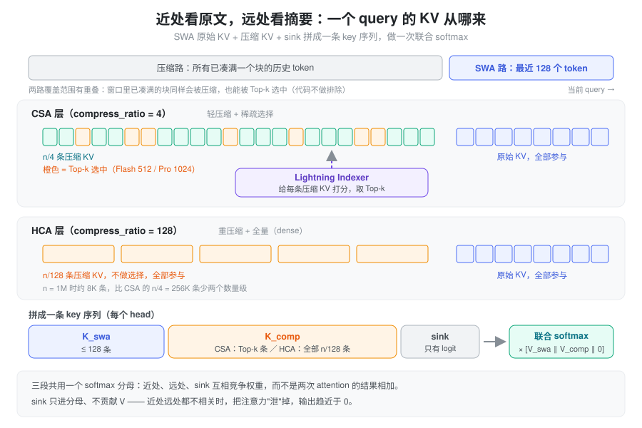
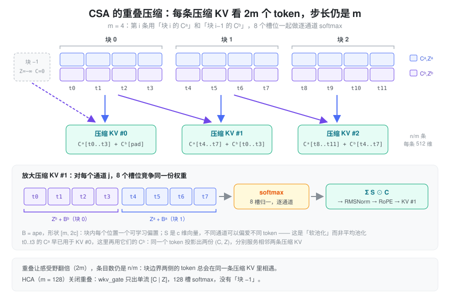
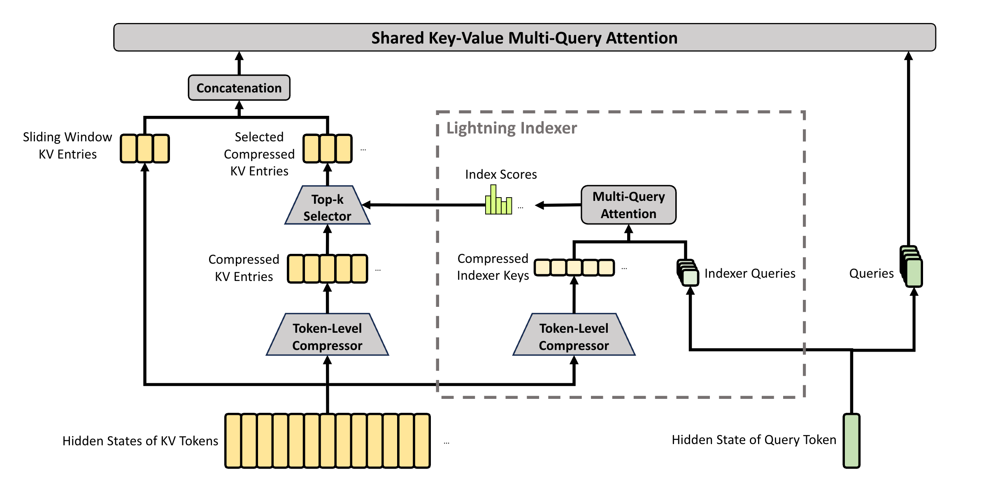
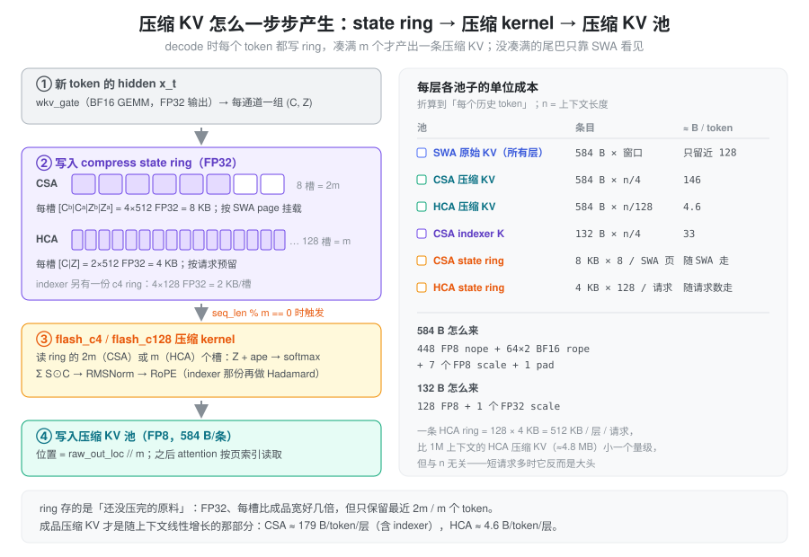

% CSA HCA

**CSA / HCA = 在序列方向上压缩 KV cache：近处用 SWA 看原文，远处只看"每 m 个 token 一条"的摘要。**

DeepSeek-V4 的每个 attention 层按 `compress_ratio` 分成三种：

- `0`：只有 SWA（滑动窗口 128），不压缩；
- `4`：**CSA**（Compressed Sparse Attention），轻压缩 + Lightning Indexer 稀疏选择；
- `128`：**HCA**（Heavily Compressed Attention），重压缩 + 全量 attention。

两者共用同一个压缩算子，只是超参不同。下文先讲要解决什么问题，再讲压缩算子和两种用法，最后对照 SGLang 的 KV cache 布局与实现。

### 问题：V3.2 省了算力，没省显存

V3.2 的 DSA 用 Lightning Indexer 给每个 query 选 top-k 个历史 token，把 attention 的**计算量**从 \(O(n)\) 降到 \(O(k)\)。但被选的对象仍然是逐 token 的原始 KV：**cache 里每个历史 token 都得留着**，因为不知道哪天会被选中。上下文到 1M 时，cache 的条目数就是 1M × 层数。

想让 cache 变小，只剩一条路：**不再为每个 token 单独存一条 KV**。这里有两个约束：

1. **近处的信息不能糊**。生成下一个 token 最依赖的是最近几十上百个 token，这部分必须是原文精度；
2. **远处的信息不能丢**。压缩可以有损，但不能整段截断——否则就退化成纯 SWA。

所以 V4 的思路是把"近"和"远"拆开处理，各用一种表示。

### 设计：近处看原文，远处看摘要

- **近处**：SWA 保留最近 `window_size = 128` 个 token 的原始 KV，**这部分永远不压缩**，每层都有；
- **远处**：每 \(m\) 个 token 压成一条**压缩 KV**（\(m=4\) 或 \(128\)），cache 条目数变成 \(n/m\)；
- **合并**：两路的 key 拼成一条序列，再加一个可学习的 sink，**做一次联合 softmax**。



写成公式，每个 head \(i\) 的输出是：

\[
\mathbf{o}_{t,i} = \mathrm{softmax}\!\left(\frac{\mathbf{q}_{t,i}\,\big[\,K^{\text{swa}}_t \,\Vert\, K^{\text{comp}}_t\,\big]^{\top} \;\Vert\; s_i}{\sqrt{d}}\right) \cdot \big[\,V^{\text{swa}}_t \,\Vert\, V^{\text{comp}}_t \,\Vert\, 0\,\big]
\]

- \(K^{\text{comp}}_t\) 在 CSA 层是 indexer 选出的 top-k 条，在 HCA 层是全部 \(n/128\) 条；
- 三段共用一个 softmax 分母，所以近处和远处是在**竞争**权重，不是两次 attention 的结果相加——模型自己学会什么时候依赖近处、什么时候依赖远处摘要；
- \(s_i\) 是 `attn_sink`，每个 head 一个可学习标量，只进分母、不贡献 V。近处远处都不相关时，权重"泄"到 sink 上，输出趋近于 0。

### 压缩算子：逐通道 softmax 的软池化

"每 \(m\) 个 token 压成一条"最朴素的做法是平均池化，但平均会把块内所有 token 一视同仁。V4 的做法是让**每个 token 自己给出一个"想被保留多少"的打分**，再按打分做加权和：

1. 每个 token 的 hidden \(h_t\) 过一个线性层，同时得到内容 \(C_t\) 和打分 \(Z_t\)（都是 \(c=512\) 维）；
2. 块内每个位置再加一个可学习的位置偏置 \(B\)（代码里叫 `ape`）；
3. 在块内的 token 之间做 softmax 得到权重 \(S\)，对 \(C\) 加权求和；
4. 结果过 RMSNorm、RoPE，就是一条压缩 KV。

关键在于 softmax 是**逐通道**的：\(S\) 是 \(c\) 维向量而不是标量，不同通道可以偏爱块内不同的 token。这让压缩更像"每个特征维度各自挑最有用的 token"，而不是整体取平均。

#### CSA 的重叠窗口

\(m=4\) 时块很短，一个语义单元很容易被块边界切开。CSA 的补救是**重叠**：每个 token 投影出两份 \((C, Z)\)——\((C^a, Z^a)\) 服务于自己所在的块，\((C^b, Z^b)\) 服务于下一个块。于是第 \(i\) 条压缩 KV 由块 \(i\) 的 \(C^a\) 和块 \(i-1\) 的 \(C^b\) 共 \(2m\) 个槽位共同产生，感受野翻倍，但步长仍是 \(m\)，条目数仍是 \(n/m\)。



\[
\left[S^a_{mi:m(i+1)-1};\; S^b_{m(i-1):mi-1}\right] = \operatorname{Softmax}_{\text{row}}\!\left(\left[Z^a_{mi:m(i+1)-1} + B^a;\; Z^b_{m(i-1):mi-1} + B^b\right]\right)
\]

\[
C_i^{\text{Comp}} = \operatorname{RoPE}\!\Big(\operatorname{Norm}\Big(\sum_{j=mi}^{m(i+1)-1} S_j^a \odot C_j^a + \sum_{j=m(i-1)}^{mi-1} S_j^b \odot C_j^b\Big)\Big)
\]

\(\odot\) 是逐元素乘；\(\text{Softmax}_{\text{row}}\) 在 \(Z^a, Z^b\) 合起来的 \(2m\) 个元素上归一化（对每个通道独立做）。

\(i = 0\) 时没有前一块：\(Z^b\) 用 \(-\infty\) 填充、\(C^b\) 用 0 填充。每条压缩 KV 来自 \(2m\) 个 token，但第 \(i\) 条用到的 \(C^b\) 与第 \(i-1\) 条用到的 \(C^a\) 来自同一批 token，所以序列长度仍压缩为 \(1/m\)。

#### HCA：同一个算子，关掉重叠

HCA 用 \(m=128\)，一条压缩 KV 吃 128 个 token，边界 token 的相对贡献只有 \(\sim 1/128\)，重叠的收益很小，代价却是双倍的投影参数和 kernel 带宽。所以 HCA **只保留单流** \((C, Z, B)\)，在 128 个槽位上做 softmax：

\[
S_{mi:m(i+1)-1} = \operatorname{Softmax}_{\text{row}}\!\left(Z_{mi:m(i+1)-1} + B\right), \qquad
C_i^{\text{Comp}} = \operatorname{RoPE}\!\Big(\operatorname{Norm}\Big(\sum_{j=mi}^{m(i+1)-1} S_j \odot C_j\Big)\Big)
\]

公式上，HCA 就是 CSA 把 \(C^a/C^b\)、\(Z^a/Z^b\)、\(B^a/B^b\) 各塌缩成一份、去掉"块 −1"。

### CSA：轻压缩 + 稀疏选择

\(m=4\) 压得轻，信息损失小，但条目仍有 \(n/4\) 条——1M 上下文下是 256K 条，每步全读一遍并不比 V3.2 便宜。所以 CSA 在压缩之后再接一级 **Lightning Indexer**，只挑 top-k 条参与 attention。这就是"轻压缩 + 稀疏选择"的两级方案：压缩管显存，稀疏管算力。

Indexer 本身也是一个小 attention，而且**有自己的一份压缩 K**（独立的压缩器，head_dim = 128，压缩后再做 Hadamard 旋转以便 FP8 量化）：

\[
\begin{aligned}
&K^{\text{IComp}} = \text{Compressor}_{\text{indexer}}(h) \\
&q^I_t = \left[ q_{t,1}^I; \dots; q_{t,n_h^I}^I \right] = \text{Hadamard}\big(\text{RoPE}(W^{\text{IUQ}} \cdot c^Q_t)\big) \\
&w^I_t = \left[ w_{t,1}^I; \dots; w_{t,n_h^I}^I \right] = \frac{W^w \cdot h_t}{\sqrt{c^I \cdot n^I_h}} \\
&I_{t,s} = \sum_h w^I_{t,h} \cdot \text{ReLU}\big( q^I_{t,h} \cdot K^{\text{IComp}}_{s} \big)  \\
&\mathcal{C}_t^{\text{SprsComp}} = \left\{ C_s^{\text{Comp}} \mid I_{t,s} \in \text{Top-k}(I_{t,:}) \right\}
\end{aligned}
\]

- \(c^Q_t = h_t W^{DQ}\) 是主 attention 的 Q 低秩中间量（`wq_a` + `q_norm`），indexer 的 Q 直接从它升维，不再单独过一遍 hidden；
- \(I\) 上标都表示"服务于 indexer"：\(n^I_h = 64\) 个 head，\(c^I = 128\)；
- 每个 head 的权重 \(w^I\) 是线性投影乘缩放，**没有 softmax**；
- \(K^{\text{IComp}}\) 与主压缩 KV 一一对应（同样每 4 个 token 一条、写入同一个位置），所以 indexer 选出的下标可以直接拿去读主压缩 KV；
- top-k 在 Flash 配置上是 512，Pro 配置上是 1024（后端只接受这两个值）。

**top-k 的选择范围不排除 SWA 窗口。** indexer 对全部 \(\lfloor n/4 \rfloor\) 条压缩 KV 打分，其中包括那些块完全落在最近 128 个 token 内的条目。所以同一段近处的内容可能既以原文形式出现在 \(K^{\text{swa}}\) 中、又以摘要形式出现在 \(K^{\text{comp}}\) 中。反过来，最后一个还没凑满 4 个 token 的块不会有压缩 KV，只能靠 SWA 看到。

一次 CSA 层 decode 的 key 序列形状（每个 head，\(d\) = head_dim = 512）：

| 段 | 条数 | 来源 |
|---|---|---|
| \(K^{\text{swa}}\) | \(W = \min(n, 128)\) | SWA 原始 KV |
| \(K^{\text{comp}}\) | \(\min(k, \lfloor n/4 \rfloor)\) | 按 top-k 下标读出的压缩 KV |
| sink | 1（只有 logit） | `attn_sink[i]` |

\(q_{t,i} \cdot K^\top\) 得到 \(W+k+1\) 个分数，跨三段归一化后对 \([V^{\text{swa}} \Vert V^{\text{comp}} \Vert 0]\) 加权，输出仍是 \([512]\)。V4 是 MQA（`num_key_value_heads = 1`），K 与 V 共用同一份 512 维向量。



### HCA：重压缩 + 全量

\(m=128\) 压得狠，1M 上下文压完只剩约 8K 条，已经接近 CSA top-k 的数量级，**不需要再做稀疏选择**：HCA 层不创建 indexer，attention 直接读全部 \(\lfloor n/128 \rfloor\) 条压缩 KV，再拼上 SWA 和 sink。

| 维度 | CSA（`compress_ratio = 4`） | HCA（`compress_ratio = 128`） |
|---|---|---|
| 压缩倍率 \(m\) | 4 | 128 |
| 重叠 | 是，双流 \(C^a/C^b, Z^a/Z^b\) | 否，单流 \(C, Z\) |
| softmax 槽数 | \(2m = 8\) | \(m = 128\) |
| 压缩器投影 `wkv_gate` | hidden → \(4c\) | hidden → \(2c\) |
| 位置偏置 `ape` | \([4, 2c]\) | \([128, c]\) |
| 远处 KV 选择 | Lightning Indexer + top-k | 无，全量 |
| 每步读的压缩条目 | \(\le k\)（与 \(n\) 无关） | \(n/128\)（随 \(n\) 线性增长，但斜率很小） |
| 额外参数 | indexer 的 `wq_b`、`weights_proj` 和它自己的压缩器 | 无 |

两者共用的部分——MLA 风格的低秩 Q、RMSNorm、RoPE、`attn_sink`、Grouped Output Projection、以及同一个 attention kernel 调用——完全不变。

### 层间分工

`config.compress_ratios` 是一个按层的列表，三种层交替铺开。仓库里没有附带 checkpoint 的 `config.json`，测试代码注释里记录的模式是：

- Flash：`[0, 0, 4, 128, 4, 128, ..., 0]`
- Pro：`[128, 128, 4, 128, 4, 128, ..., 0]`

即除了首尾少数几层，CSA 与 HCA 逐层交替。一种合理的理解是：CSA 层负责"能精确地找回远处某段细节"，HCA 层负责"粗粒度地看到整段上下文"，交替排布让每隔一层就有一次精确检索、一次全局概览。MTP（NextN）层固定为 `0`，只有 SWA。

### KV cache：成品与原料

压缩 KV 不是一次算出来的。decode 时 token 一个一个到来，凑满一个块之前没法做 softmax，所以每层还要有一块 **compress state**：一个环形缓冲（ring），存最近几个 token 投影出来、还没压完的 \((C, Z)\)。整个过程是"原料进 ring → 凑满 m 个触发一次压缩 → 成品进压缩 KV 池"：



- ring 存的是**原料**：FP32，每槽比成品宽好几倍，但只保留最近 \(2m\)（CSA，因为重叠要回看上一块）或 \(m\)（HCA）个 token；
- 压缩 KV 池存的是**成品**：与 SWA 原始 KV 同一种 FP8 布局，584 B/条，随上下文线性增长；
- CSA 的 ring 挂在 SWA page 上（每个 SWA 页一个 8 槽 ring），HCA 的 ring 按请求预留（每请求 128 槽）。

#### 一个 token 摊到多少字节

SGLang 在启动时按"每个 full token 摊到的字节数"切分显存，各项和上图一一对应（`DSV4PoolConfigurator._get_bytes_per_full_token`）：

```python
bytes_per_full_token = (
    swa_ratio * kv_bytes * L_total                              # ① SWA 原始 KV，每层都有
  + 1/4 * kv_bytes * L_c4                                       # ② CSA 压缩 KV
  + 1/128 * kv_bytes * L_c128                                   # ③ HCA 压缩 KV
  + 1/4 * indexer_bytes * L_c4                                  # ④ CSA indexer K
  + swa_ratio * c4_state_ratio * c4_state_bytes * L_c4          # ⑤ CSA state ring
  + 0                                                           # ⑥ HCA state ring：不按 token 摊
  + swa_ratio * c4_state_ratio * c4_indexer_state_bytes * L_c4  # ⑦ indexer state ring
)
```

| 符号 | 值 | 含义 |
|---|---|---|
| `kv_bytes` | 584 | 448 FP8 nope + 64×2 BF16 rope + 7 个 FP8 scale + 1 pad |
| `indexer_bytes` | 132 | 128 FP8 + 1 个 FP32 scale |
| `swa_ratio` | 0.1 | SWA 池容量 = full token 容量的 10%（DSV4 强制设置） |
| `c4_state_ratio` | 8 / 128 | 每个 SWA 页（128 token）配一个 8 槽 ring |
| `c4_state_bytes` | 8192 | \(4 \times 512\) FP32：\([C^b \vert C^a \vert Z^b \vert Z^a]\) |
| `c4_indexer_state_bytes` | 2048 | \(4 \times 128\) FP32 |

HCA 的 ring 改成按请求数单独预留：每层每请求 \(128 \times 2 \times 512 \times 4\,\text{B} = 512\,\text{KB}\)，总量 ≈ `max_running_requests × 512 KB × L_c128`。它与上下文长度无关——1M 上下文时只是 HCA 压缩 KV（≈4.8 MB/层）的零头，但短请求、高并发时反而是不可忽视的固定开销。

以 Flash 配置粗算（43 层、按上面的交替模式取 \(L_{c4} = L_{c128} = 20\)，层数以实际 checkpoint 为准）：

| 项 | 计算 | B / full token |
|---|---|---|
| ① SWA | \(0.1 \times 584 \times 43\) | 2511.2 |
| ② CSA KV | \(0.25 \times 584 \times 20\) | 2920 |
| ③ HCA KV | \(584 / 128 \times 20\) | 91.25 |
| ④ indexer K | \(0.25 \times 132 \times 20\) | 660 |
| ⑤ CSA ring | \(0.1 \times 0.0625 \times 8192 \times 20\) | 1024 |
| ⑦ indexer ring | \(0.1 \times 0.0625 \times 2048 \times 20\) | 256 |
| 合计 | | ≈ 7462 |

外加 HCA ring 每请求约 \(512\,\text{KB} \times 20 = 10\,\text{MB}\)。可以看到真正随上下文增长的大头是 ② CSA 压缩 KV；HCA 压缩 KV 几乎可以忽略。

- 开启 HiSparse 时 CSA 压缩 KV 的设备池会再缩小 `c4_shrink_factor` 倍（`c4_frac = 1/(4 × c4_shrink_factor)`，池类型换成 `HiSparseC4DevicePool`）；
- 开启投机解码时 ring 会翻倍（CSA 16 槽、HCA 256 槽），且总量再乘 \((L+1)/L\) 计入 draft 层；
- state 默认 FP32，可通过 `SGLANG_DSV4_COMPRESS_STATE_DTYPE` 改成 BF16；`SGLANG_OPT_USE_ONLINE_COMPRESS` 打开后 HCA 改为在线 softmax，ring 只剩 1 个 \((\max, \text{sum}, kv)\) 槽。

### 在 SGLang 里的落点

一层 attention 由 `MQALayer`（`srt/models/deepseek_v4.py`）构造，按 `compress_ratio` 决定挂哪些子模块：

```python
self.compressor = None
self.indexer = None
if self.compress_ratio in (4, 128):
    self.compressor = Compressor(..., compress_ratio=self.compress_ratio, head_dim=self.head_dim, rotate=False)
    if self.compress_ratio == 4:
        self.indexer = C4Indexer(...)   # 内部还有一个 Compressor(ratio=4, head_dim=128, rotate=True)
```

| 概念 | 代码位置 |
|---|---|
| 压缩器（CSA/HCA 同一个类） | `Compressor`，`srt/layers/attention/dsv4/compressor.py`：`overlap = (ratio == 4)`、`coff = 1 + overlap`、`wkv_gate: hidden → 2·coff·head_dim`、`ape: [ratio, coff·head_dim]` |
| 压缩 kernel | `kernels/jit/csrc/deepseek_v4/c4.cuh`（`flash_c4_decode/prefill`）、`c128.cuh`（`flash_c128_decode/prefill`），由 `compress_forward` JIT 调用；压缩后 `compress_fused_norm_rope_inplace` 做 RMSNorm + RoPE |
| ring 寻址 | `create_paged_compressor_data`：CSA 用 `swa_page * ring + swa_loc % ring`，HCA 用 `req_pool_idx * ring + pos % ring` |
| Indexer | `C4Indexer`，`srt/layers/attention/dsv4/indexer.py`：q 侧 `fused_q_indexer_rope_hadamard_quant`，logits 默认 `deep_gemm.fp8_paged_mqa_logits`，再 `topk_transform_512` |
| KV 池 | `DeepSeekV4TokenToKVPool`，`srt/mem_cache/deepseek_v4_memory_pool.py`：`swa_kv_pool`、`c4_kv_pool`、`c128_kv_pool`、`c4_indexer_kv_pool`、各层 `CompressStatePool` |
| 显存切分 | `DSV4PoolConfigurator`，`srt/model_executor/pool_configurator.py` |
| attention | `DeepseekV4AttnBackend.forward`，`srt/layers/attention/deepseek_v4_backend.py` |

两个值得知道的实现细节：

- **三段拼接是在 kernel 里完成的，不是在 Python 里 concat。** backend 对所有层都调用同一个 `flash_mla_with_kvcache`：`k_cache` + `indices` 指向 SWA 窗口，`extra_k_cache` + `extra_indices_in_kvcache` 指向压缩 KV（CSA 传 top-k 下标，HCA 传全部页下标），`attn_sink` 单独传入。`compress_ratio = 0` 时 extra 为空，就是纯 SWA。大批量 prefill 会改走 `flash_mla_sparse_fwd`，语义相同；
- **压缩只在块凑满时发生。** decode 每一步都把当前 token 的 \((C, Z)\) 写进 ring，但只有 `seq_len % m == 0` 的那一步 kernel 才真正产出一条压缩 KV，写到 `raw_out_loc // m`。CSA 那一步要读 8 个槽（本块 4 + 上一块 4），这也是它的 ring 必须是 \(2m\) 的原因。

### Grouped Output Projection

这一节与 KV 压缩无关，但同样属于 V4 attention 层的改动，三种层（0 / 4 / 128）都一样。

**问题**：attention 输出是 \(n_h \cdot c\) 维（Flash 是 \(64 \times 512 = 32768\)），直接一个 \(W_o \in \mathbb{R}^{d \times n_h c}\) 投回 hidden，参数和算力都很大。

**做法**：分组 + 低秩，两步完成：

1. 把 \(n_h\) 个 head 的输出切成 \(g = 8\) 组，每组 \(n_h c / g\) 维；
2. 每组用自己的矩阵 \(W_{o,a}^{(i)}\) 独立降到 \(d_g = 1024\) 维（组间不混合，`wo_a`）；
3. 把 \(g\) 组拼成 \(g \cdot d_g = 8192\) 维，再用 \(W_{o,b}\) 投到 \(d\)（`wo_b`）。

\[
\mathbb{R}^{n_h c} \xrightarrow{\text{切 } g \text{ 组}} \mathbb{R}^{g \times \frac{n_h c}{g}} \xrightarrow{W_{o,a}^{(i)}} \mathbb{R}^{g \times d_g} \xrightarrow{\text{concat}} \mathbb{R}^{g d_g} \xrightarrow{W_{o,b}} \mathbb{R}^{d}
\]

成立的前提是 \(d_g < n_h c / g\)，即每组确实被压缩了。

| | Flash（\(n_h=64,\ d=4096\)） | Pro（\(n_h=128,\ d=7168\)） |
|---|---|---|
| 朴素 \(W_o\) | \(4096 \times 32768 \approx 1.34 \times 10^8\) | \(7168 \times 65536 \approx 4.70 \times 10^8\) |
| `wo_a`：\(d_g \cdot n_h c\) | \(\approx 3.36 \times 10^7\) | \(\approx 6.71 \times 10^7\) |
| `wo_b`：\(d \cdot g d_g\) | \(\approx 3.36 \times 10^7\) | \(\approx 5.87 \times 10^7\) |
| 合计 / 朴素 | 50% | 27% |

（Pro 的头数与 hidden 取自测试代码注释，其余两种配置共用 \(c=512, g=8, d_g=1024\)。FLOPs 比例与参数比例相同。）

代码在 `MQALayer.forward` 的末尾：`o.view(T, n_local_groups, -1)` 切组，`wo_a` 的权重 view 成 `[g, d_g, n_h c / g]` 后用 `deep_gemm.fp8_einsum("bhr,hdr->bhd", ...)`（或 BF16 的 `torch.einsum("tgd,grd->tgr", ...)`）逐组投影，最后 `self.wo_b(o.flatten(1))`。`wo_a` 声明成一个 `ColumnParallelLinear`，但 forward 按组 einsum，所以等价于 block-diagonal。

和 Q 侧的 `wq_a → q_lora(1024) → wq_b` 放在一起看，V4 的 attention 两端都是"下投影 → 上投影"；输出侧多了一步分组，让不同 head 的信息先在组内压缩、再由 `wo_b` 统一融合。

### 小结

CSA 和 HCA 是同一个想法的两档参数：**把 KV cache 的条目数从"每个 token 一条"降到"每 m 个 token 一条"，近处用 SWA 原文兜住精度，三段 key 在一次 softmax 里竞争权重**。压缩算子是逐通道 softmax 的软池化；\(m=4\) 时加重叠保边界、接 indexer 控制算力，\(m=128\) 时直接全量读。落到 SGLang 里，代价是多出一套"原料"状态（FP32 ring）和多种池子并存的显存切分，但随上下文线性增长的部分基本只剩 CSA 的 \(n/4\) 条压缩 KV——这才是 V4 能撑到 1M 上下文的原因。
