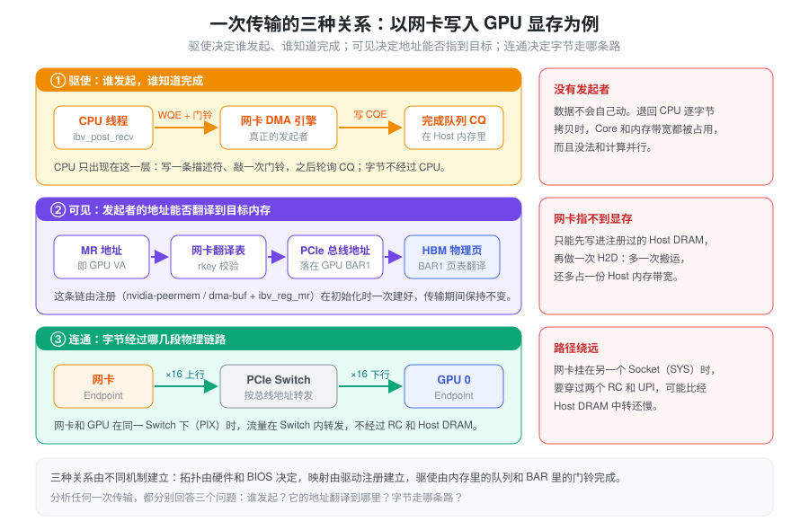
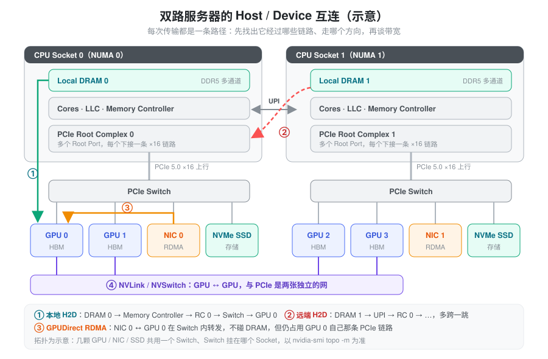
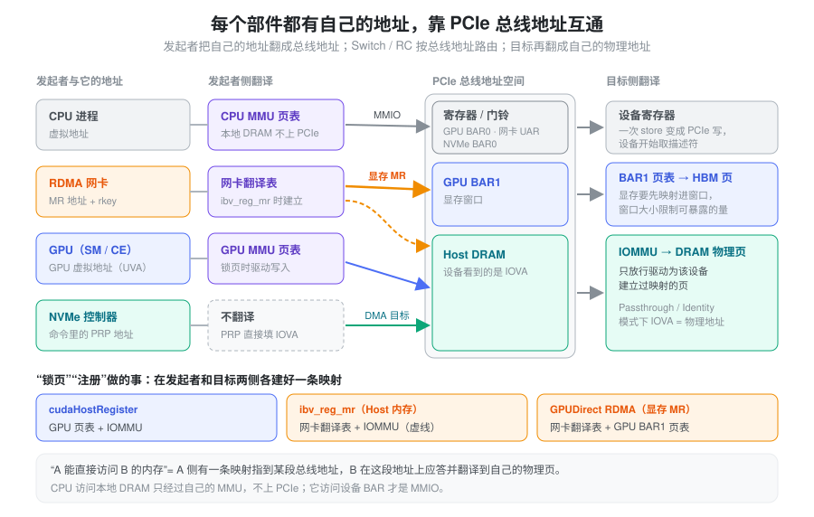
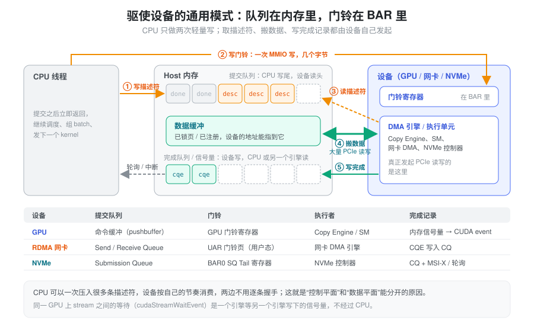
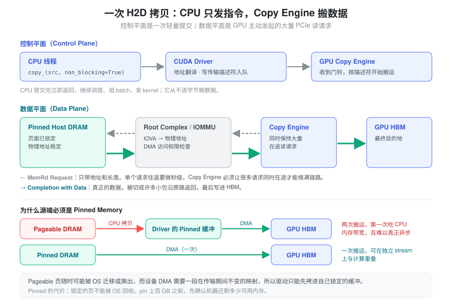
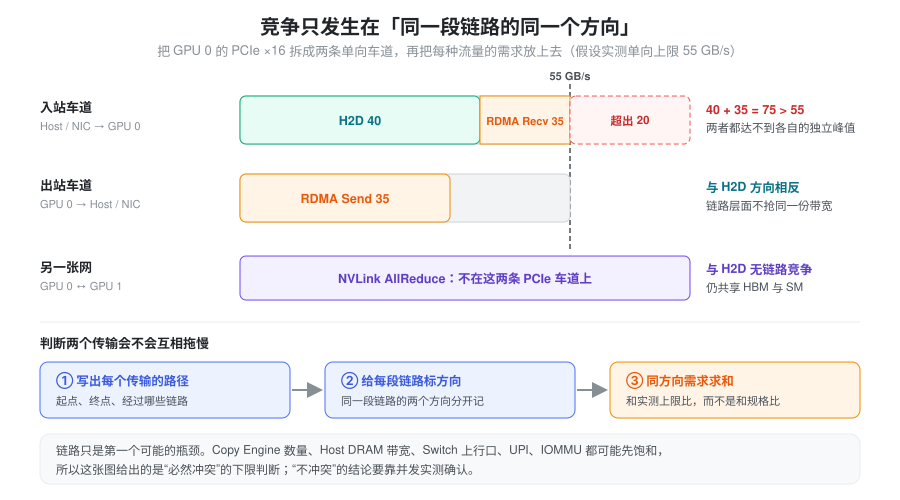
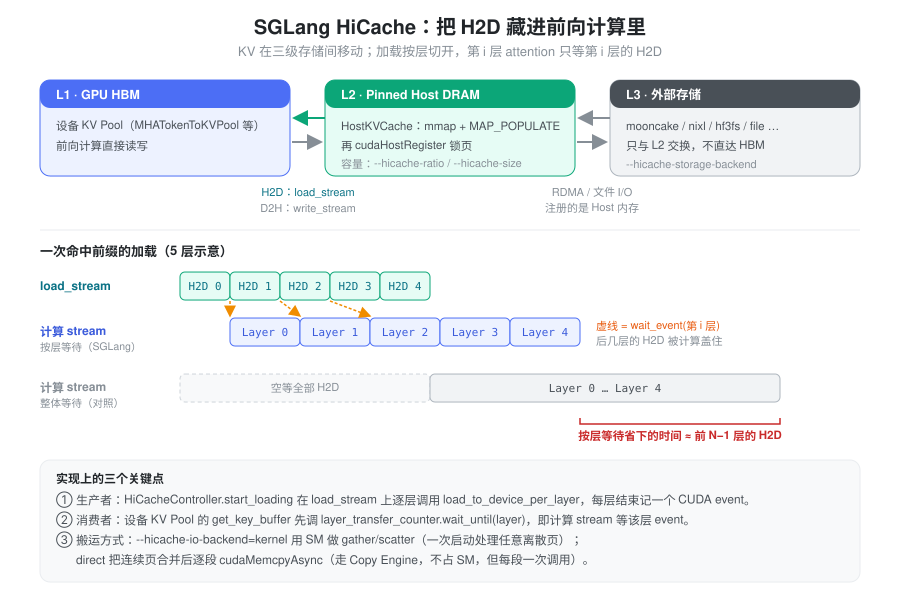

% Host Device Interconnect

### 要建立的认识：部件之间不只是“一根线”

一台 GPU 服务器里有很多会读写内存的部件：CPU Core、Host DRAM、GPU（内部有 SM、Copy Engine 和 HBM）、RDMA 网卡、NVMe SSD。推理服务的很多环节都在它们之间搬数据：加载权重，HiCache 把 KV 在显存和内存之间来回搬，PD 分离把 KV 从一台机器的 GPU 写到另一台机器的 GPU。

只说“CPU 和 GPU 之间是 PCIe”是不够的。设想网卡要把收到的数据写进 GPU 显存，至少要回答三件事：

- 网卡和 GPU 之间有没有物理通路，经过哪些链路和交换节点？
- 网卡手里的地址能不能指到 GPU 显存？能指到哪一部分，由谁授权？
- 谁让网卡开始写？写完之后谁会知道？

本页以双路 Intel Xeon + HGX B200 服务器为参考，把这三件事拆成三种关系，依次说明每种关系由哪些硬件和软件机制建立，最后看 SGLang 的 HiCache 和 PD 分离怎样把这些关系一一建好。

### 核心抽象：连通、可见、驱使

任意两个部件之间的一次数据传输，都要同时具备三种关系：

1. **连通（物理路径）**：字节从源到目的经过哪几段链路。路径由拓扑决定，涉及 Root Complex、PCIe Switch、UPI、NVLink。路径决定带宽上限，也决定这次传输和谁共享链路。
2. **可见（地址映射）**：发起传输的部件必须能用自己的地址指到目标内存。每个部件都有自己的地址翻译机制，彼此之间用 **PCIe 总线地址**作为公共语言：发起者把自己的地址翻成总线地址，PCIe 按总线地址路由，目标再把它翻成自己的物理地址。锁页、内存注册、BAR 映射，做的都是建立这条映射。
3. **驱使（控制）**：谁让发起者开始搬，搬完怎么通知。几乎所有设备都用同一种模式：CPU 把描述符写进内存里的队列，再写一下设备的门铃寄存器；设备自己取描述符、执行 DMA、写回完成记录。

这三种关系由不同的机制建立，可以分开分析。其中最容易混淆的一点是：**发指令的和搬数据的不是同一个角色**。CPU 通常只出现在“驱使”里，真正发起 PCIe 读写的是 Copy Engine、SM、网卡或 NVMe 控制器这些 DMA 发起者（initiator）。所以“能不能直接访问某段内存”，要问的是发起者的地址翻译里有没有它，而不是 CPU 能不能访问它。



用这三个问题看几种常见传输：

| 传输 | 发起者 | 可见：需要哪条映射 | 连通：路径 |
| --- | --- | --- | --- |
| H2D `cudaMemcpyAsync` | GPU Copy Engine | Host 内存锁页，并映射进 GPU 地址空间 | DRAM → RC → Switch → GPU |
| SM 直接读 Host 内存（zero-copy） | GPU SM | 同上，kernel 里直接解引用 Host 指针 | 同上 |
| GPUDirect RDMA 接收 | 网卡 | GPU 显存注册给网卡，经 BAR1 暴露 | NIC → Switch → GPU，不经过 DRAM |
| 普通 RDMA 接收 | 网卡 | Host 内存注册给网卡 | NIC → Switch → RC → DRAM |
| NVMe 读 | NVMe 控制器 | 命令里直接写 Host 内存的总线地址 | SSD → Switch → RC → DRAM |
| GPU 之间 P2P | GPU 的 SM / Copy Engine | 对端显存映射进本 GPU 的地址空间 | 有 NVLink 时走 NVLink，否则走 PCIe |

后面三节分别展开这三种关系。

### 连通：物理拓扑



图中的三条路径在后文反复出现：① 本地 H2D，② 跨 Socket 的远端 H2D，③ 网卡与 GPU 之间的 GPUDirect RDMA。NVLink（④）是另一张独立的网，GPU 之间的通信不走 PCIe。

#### Root Complex、Switch、Endpoint

PCIe 是一套点对点、分层交换的互连网络，由三类节点组成。

**Root Complex（RC）** 是 CPU 进入 PCIe 网络的根节点。它把 CPU 发出的 MMIO 访问转成 PCIe 事务，也把设备发来的 DMA 请求送进 Host 内存系统。一个 RC 有多个 Root Port，每个 Root Port 下接一条链路，可能直连设备，也可能接一个 Switch。双路服务器上每个 Socket 各有自己的 RC。

**PCIe Switch** 类似网络交换机，转发的是 Transaction Layer Packet（TLP）。它有一个上行口和多个下行口，按 TLP 里的总线地址决定往哪个口转发。所以**同一 Switch 下的两个 Endpoint，在平台允许 P2P 时可以直接交换数据，不经过 RC**。GPU 和网卡是否挂在同一个 Switch 下，直接决定了 GPUDirect RDMA 的路径长短。

**Endpoint** 是网络末端的设备：GPU、InfiniBand / Ethernet 网卡、NVMe SSD 等。每个 Endpoint 通过 BAR（Base Address Register）在总线地址空间里占一段窗口，别人往这段地址发的请求就会被路由到它。BAR 是“可见”关系的硬件基础，下一节展开。

实际拓扑用 `nvidia-smi topo -m` 查看。GPU 与网卡之间的连接类型从近到远依次是：`PIX`（经过至多一个 PCIe bridge）、`PXB`（经过多个 bridge，但不经过 Host Bridge）、`PHB`（经过 Host Bridge）、`NODE`（同一 NUMA 节点内跨 Host Bridge）、`SYS`（跨 Socket，经过 UPI）。

#### Socket 与 NUMA：DRAM 也有位置

双路 Xeon 服务器上，每个 Socket 各自拥有 CPU Core、LLC、内存控制器、本地 DRAM 和 PCIe RC，Socket 之间通过 UPI 互连。从任何一个设备看，DRAM 都分“近的”和“远的”。假设 GPU 接在 Socket 0 上：

\[
\text{本地 H2D：}\ \mathrm{DRAM}_0 \rightarrow \mathrm{RC}_0 \rightarrow \mathrm{GPU}
\qquad
\text{远端 H2D：}\ \mathrm{DRAM}_1 \rightarrow \mathrm{UPI} \rightarrow \mathrm{RC}_0 \rightarrow \mathrm{GPU}
\]

远端路径多了一段 UPI，延迟更高，还要和其他跨 Socket 的内存流量共享 UPI 带宽。所以一段 Host 内存“离哪颗 GPU 近”，取决于它的物理页落在哪个 NUMA 节点上。

控制这一点要同时约束线程和内存。`numactl --cpunodebind=0` 只约束线程在哪里运行；要让内存也落在节点 0，需要加 `--membind=0`。Linux 按 first-touch 分配物理页，页落在哪个节点取决于第一次访问它时的内存策略。验证手段：

```bash
nvidia-smi topo -m          # GPU 的 CPU Affinity / NUMA Affinity 列
numactl -H                  # 各节点的 CPU 与内存
cat /proc/<PID>/numa_maps   # 进程各段内存实际落在哪个节点
```

#### 链路带宽

PCIe 链路由多条 Lane 组成。以 PCIe 5.0 为例，每 Lane 32 GT/s，128b/130b 编码，×16 单向理论数据速率为：

\[
BW_{\mathrm{PCIe5\times16}} = 32\times\frac{128}{130}\times16\div8 \approx63.0\ \mathrm{GB/s}
\]

这个数还没扣除 TLP Header、DLLP、流控等协议开销，实测 H2D 通常落在理论值的 80%–90%。

| 代际 | 每 Lane 速率 | ×8 单向 | ×16 单向 |
| --- | --- | --- | --- |
| PCIe 3.0 | 8 GT/s | ≈ 7.9 GB/s | ≈ 15.8 GB/s |
| PCIe 4.0 | 16 GT/s | ≈ 15.8 GB/s | ≈ 31.5 GB/s |
| PCIe 5.0 | 32 GT/s | ≈ 31.5 GB/s | ≈ 63.0 GB/s |
| PCIe 6.0 | 64 GT/s（PAM4） | ≈ 60 GB/s | ≈ 121 GB/s |

PCIe 6.0 一列是 FLIT 模式下的近似有效数据速率。作为对照，B200 的 NVLink 5 每颗 GPU 总带宽约 1.8 TB/s（双向合计），比 PCIe 5.0 ×16 高一个数量级以上，所以 GPU 之间的数据走 NVLink，PCIe 主要承担 Host 与 GPU、网卡与 GPU 之间的流量。

连通关系还有两个性质，后面分析并发时会用到：

- **全双工。** 每段链路的两个方向各有约 63 GB/s，互不占用。H2D（GPU 入站）和 D2H（GPU 出站）不抢同一个方向。
- **Switch 上行口是共享段。** 同一 Switch 下的 GPU 和网卡同时往 Host DRAM 写数据时，两者共享一条上行链路；如果网卡直接 P2P 写 GPU，流量在 Switch 内转发，不经过上行口。

### 可见：每个部件都有自己的地址视图

连通只说明字节有路可走。发起者还得知道“往哪个地址读写”，而每个部件看到的地址都不一样：CPU 进程用虚拟地址，GPU kernel 用 GPU 虚拟地址，网卡用注册时给的 MR 地址，NVMe 命令里填的是总线地址。它们能互相访问，是因为各自都能翻译到同一个 PCIe 总线地址空间。



所以“A 能访问 B 的内存”可以拆成两半：**A 的翻译器里有一条映射，把 A 的地址翻成某个总线地址；B 在那段总线地址上应答，并把它翻成自己的物理地址。** 下面按图中从上到下的顺序看每个环节。

#### CPU：页表与 Pinned Memory

CPU 访问本地 DRAM 不上 PCIe，由 CPU 的 MMU 查页表把虚拟地址翻成物理地址，再交给内存控制器。设备不会查 CPU 的页表，所以一段 Host 内存要给设备用，必须把它的物理页（或对应的 IOVA）交给设备，并保证传输期间不变。

普通 CPU 内存是 Pageable 的，操作系统可以迁移或换出物理页，映射随时可能变化。**Pinned Memory（锁页内存）** 就是把这层映射冻结下来：页面常驻、物理地址固定，驱动才能把它的地址交给 GPU 或网卡。从 Pageable 内存发起 H2D 时，驱动只能先把数据拷进自己锁定的 staging 缓冲，再 DMA 到 GPU，多了一次 CPU 拷贝，`non_blocking=True` 也难以真正异步。锁页的代价是这些页不能被操作系统回收，锁定上百 GB 前要确认机器剩余的可用内存。

#### IOMMU：设备看到的是 IOVA

设备发出的 DMA 请求在进入 Host 内存系统前会经过 IOMMU。理解这一层要区分三种地址：

| 地址类型 | 使用者 | 含义 |
| --- | --- | --- |
| Virtual Address | CPU 进程 | 用户态虚拟地址 |
| Physical Address | Host 内存系统 | 实际物理内存地址 |
| IOVA | PCIe 设备 | 设备发起 DMA 时使用的 I/O 虚拟地址 |

IOMMU 把 IOVA 翻成 Host 物理地址，并把每个设备的 DMA 限制在驱动为它建立的映射范围内。没有它，任何 PCIe 设备都能读写整个物理内存。系统也可能配置成 Identity Mapping 或 Passthrough 模式，此时 IOVA 等于物理地址。启用 IOMMU 时通常也会启用 PCIe ACS，Switch 内的 P2P 请求会被重定向到 RC 再折返，原本在 Switch 内完成的路径因此变长。可见关系的配置会反过来改变连通路径。

#### BAR：设备把自己挂到总线地址空间上

每个 Endpoint 用 BAR 在总线地址空间里占几段窗口，窗口后面可能是寄存器，也可能是设备内存：

- GPU 的 BAR0 是控制寄存器，包括提交工作用的门铃；BAR1 是显存窗口，驱动可以把一部分 HBM 页映射到这段窗口里，让其他设备通过 PCIe 访问。
- 网卡的 BAR 里有门铃页（mlx5 称为 UAR），可以映射进用户进程，用户态直接写门铃，不进内核。
- NVMe 的 BAR0 里有每个队列的门铃寄存器。

CPU 访问 BAR 是 MMIO：BAR 映射进进程地址空间后，一条普通的 store 指令会变成一个 PCIe 写事务。BAR1 只是一扇窗，显存要先被驱动映射进窗口才能从外面访问，窗口大小也限制了同时能暴露多少显存（`nvidia-smi -q` 的 BAR1 Memory Usage）。

#### GPU：自己的页表与统一虚拟地址

GPU 有自己的 MMU 和页表，把 GPU 虚拟地址翻成本地 HBM 的物理地址，或者翻成一个系统内存的总线地址。后一种映射让 GPU 能访问 Host 内存：`cudaHostRegister` 或 `cudaHostAlloc` 锁页之后，驱动把这些页同时加进 GPU 页表和 IOMMU。

CUDA 的 UVA（Unified Virtual Addressing）让 Host 指针和 Device 指针落在同一个虚拟地址空间里。在支持的平台上，锁页注册过的 Host 内存可以在 kernel 里直接用原指针访问，SM 的一条 load 指令就会变成一个 PCIe 读请求。这就是 zero-copy 访问，SGLang 的 `kernel` 传输后端正是靠它工作的。GPU 之间同理：`cudaDeviceEnablePeerAccess` 把对端显存映射进本 GPU 的页表，有 NVLink 时访问走 NVLink。

#### 网卡：Memory Region

RDMA 网卡用 Memory Region（MR）管理可见性。`ibv_reg_mr` 做三件事：锁页；在网卡自己的翻译表里建立“MR 地址 → 总线地址”的映射；生成 lkey / rkey 作为访问凭证。之后远端只要拿着 rkey 和地址发起单边 RDMA Write，本地网卡就能直接写进这段内存，本地 CPU 不参与。

**GPUDirect RDMA 就是把 GPU 显存注册成 MR。** 通过 `nvidia-peermem` 内核模块或 dma-buf，GPU 驱动把对应的显存页钉在 BAR1 窗口里，把它们的总线地址交给网卡。从此网卡的 DMA 目标是 GPU 的 BAR1，数据不经过 Host DRAM。

#### 谁能直接访问谁

| 发起者 \ 目标 | Host DRAM | GPU HBM |
| --- | --- | --- |
| CPU | 直接访问，经内存控制器 | 只能经 BAR1 的 MMIO 映射（如 GDRCopy）；读很慢，通常交给 Copy Engine 做 D2H |
| GPU（SM / Copy Engine） | 锁页并映射进 GPU 页表后 | 本地直接访问；对端 GPU 需要 Peer Access |
| RDMA 网卡 | 注册成 MR 后 | 显存经 `nvidia-peermem` / dma-buf 注册成 MR 后（GPUDirect RDMA） |
| NVMe 控制器 | 命令里给出总线地址即可 | 需要 GPUDirect Storage 把显存地址交给存储栈 |

表里的每一格都是一条需要事先建立、并在传输期间保持不变的映射。“注册”“锁页”这类操作开销较大，所以工程上通常在初始化时一次性注册大块内存，之后反复复用。

### 驱使：队列、门铃与完成记录

有了路径和映射，还需要有人告诉发起者“现在开始，搬这些”。GPU、网卡、NVMe 在这件事上用的是同一种模式：



1. CPU 把一条描述符（要搬什么、从哪到哪）写进内存里的一个环形队列。
2. CPU 写设备的门铃寄存器，告诉它队尾前进了。这是一次 MMIO 写，只有几个字节。
3. 设备用 DMA 自己去读描述符。
4. 设备按描述符执行数据搬运，这才是大量 PCIe 读写发生的地方。
5. 设备把完成记录写回内存（完成队列或信号量），需要时再发中断；等待方轮询或被唤醒。

CPU 在整个过程中只做了两次轻量写。队列放在内存里、门铃放在 BAR 里，是为了让 CPU 和设备各自按自己的节奏工作：CPU 可以一次压入很多条描述符，设备按顺序消费，两边不用逐条握手。

三类设备的具体名字不同：

- **GPU**：CUDA 驱动把命令写进命令缓冲（pushbuffer），再写 GPU 的门铃。执行者可能是 Copy Engine（`cudaMemcpyAsync`），也可能是 SM（kernel）。完成通过写入内存的信号量表达，CUDA event 就建立在它之上。同一个 GPU 上的另一条 stream 可以直接在 GPU 上等这个信号量（`cudaStreamWaitEvent`），完全不经过 CPU。
- **RDMA 网卡**：Work Request 写进 Send Queue / Receive Queue，门铃写到映射进用户态的 UAR 页，完成记录（CQE）写进 Completion Queue，由用户态轮询。整条控制路径都不进内核，这就是 kernel bypass。
- **NVMe**：命令写进 Submission Queue，门铃是 BAR0 里的 SQ Tail 寄存器，完成写进 Completion Queue，再通过 MSI-X 中断或轮询通知。

#### 以 H2D 为例：控制平面与数据平面

把这个模式套到一行 PyTorch 代码上：

```python
gpu_tensor.copy_(cpu_tensor, non_blocking=True)   # cpu_tensor 位于 Pinned Memory
```



控制平面是上一节的第 1、2 步：CPU 调用 CUDA Runtime / Driver，驱动准备描述符并提交给 GPU，调用立即返回，CPU 继续调度、组 batch、发 kernel。

数据平面由 Copy Engine 完成：

1. Copy Engine 发出 MemRd Request，只带地址和长度。
2. 请求经过 Switch、RC（以及 IOMMU 地址转换）到达 Host 内存系统。
3. 内存控制器读出 DRAM 数据。
4. 数据以 Completion with Data 的形式切成许多小包沿原路返回。
5. Copy Engine 把数据写入 HBM。

这里三种关系同时在起作用：步骤 2 走的是连通关系给出的路径；Copy Engine 能发出这个地址，是因为锁页让 Host 页进了 GPU 页表和 IOMMU；整个过程由 CPU 的一次提交驱使。

单个读请求的往返是微秒级的。要填满链路，Copy Engine 必须同时保持足够多的在途读请求来隐藏延迟。所以小块传输主要受固定延迟限制，只有大块连续传输才接近链路带宽；把很多小块合并成少量大块，是提升 H2D 吞吐最直接的手段之一。

#### 搬运者决定和谁共享资源

同一份数据可以由不同的发起者来搬，代价落在不同的地方：

| 搬运者 | 典型场景 | 占用的资源 |
| --- | --- | --- |
| Copy Engine | `cudaMemcpyAsync` | 专用 DMA 引擎，不占 SM；引擎数量有限，每次调用有提交开销 |
| SM | 自定义搬运 kernel、zero-copy 访问 | 占用 SM，和计算 kernel 抢计算资源；一次 kernel 能处理任意离散的地址 |
| 网卡 DMA 引擎 | RDMA 读写 | 不占 CPU 和 GPU 计算资源；受网卡和它那条 PCIe 链路限制 |
| NVMe 控制器 | 文件 I/O | 写入 Host DRAM，占用内存带宽 |
| CPU Core | `memcpy`、Pageable 到 staging 的拷贝 | 占用 CPU 时间和内存带宽 |

### 三种关系叠在一起：并发传输会不会互相影响

把每次传输都画成“发起者 + 映射 + 路径”之后，判断两个并发传输会不会互相拖慢，就是看它们在哪种关系上有交集：

- **连通上：同一段链路的同一个方向。** PCIe 全双工，H2D（入站）和 RDMA Send（出站）方向相反，在链路层面不冲突；H2D 和 RDMA Receive 都是 GPU 入站，就会争抢同一个方向。带宽上限由路径上最窄的那一段决定，远端 NUMA 的 H2D 慢，是因为路径里多了一段 UPI。
- **驱使上：同一个搬运者。** 两个传输都用 Copy Engine 时会排队；用 SM 搬运时，和计算 kernel 抢 SM。
- **可见上：同一块目标内存。** 存储 I/O 写 DRAM 和 H2D 读 DRAM 共享 Host 内存带宽；IOMMU 的 IOTLB 也可能成为共享瓶颈。



以一颗 GPU 上的几种传输为例：

| 并发操作 | 交集 | 竞争风险 |
| --- | --- | --- |
| H2D + RDMA Send | 同一条 PCIe 链路，但方向相反 | 中 |
| H2D + RDMA Receive | GPU PCIe 入站方向 | 高 |
| H2D + NVMe → DRAM | Host DRAM 带宽；SSD 与 GPU 同 Switch 时还有上行口 | 中 |
| H2D + NVLink AllReduce | 只共享 HBM 带宽，不在同一张网上 | 通常较低 |

这套方法能确定“必然冲突”。“不冲突”的结论要靠并发实测确认，因为 GPU 内部的 I/O 通路、Copy Engine、内存控制器等资源也可能先饱和。

### 在 SGLang 中的落地

SGLang 里有两处大规模的 Host / Device 数据搬运：HiCache（分层 KV Cache）把 KV 在 GPU HBM、Pinned Host DRAM、外部存储三级之间移动；PD 分离把 KV 从 Prefill GPU 直接写到 Decode GPU。用三种关系看，它们的每个关键设计都在建立其中一种：

| 设计 | 建立的关系 | 位置（相对 `python/sglang/srt/`） |
| --- | --- | --- |
| mmap + `MAP_POPULATE` + `cudaHostRegister` | 可见：Host Pool 进入 GPU 地址空间，且映射稳定 | `mem_cache/pool_host/`、`mem_cache/storage/mmap/` |
| 进程级 NUMA 绑定 | 连通：Host Pool 落在 GPU 本地的 DRAM 上 | `utils/numa_utils.py` |
| `load_stream` / `write_stream` 与按层 event | 驱使：CPU 一次提交，GPU 侧按层同步 | `managers/cache_controller.py` |
| `kernel` / `direct` 传输后端 | 驱使：换一个搬运者 | `sgl-kernel/csrc/kvcacheio/transfer.cu` |
| L3 后端只注册 Host Pool | 可见：决定了 SSD → GPU 必经 L2 | `mem_cache/storage/` |
| PD 注册设备 KV Pool、选择网卡 | 可见 + 连通：GPUDirect RDMA | `disaggregation/mooncake/conn.py` |



#### Host Pool：让 GPU 看得见，也看得稳

Host KV Pool 的基类是 `mem_cache/pool_host/base.py` 中的 `HostKVCache`，MHA 和 MLA 的实现分别是 `pool_host/mha.py` 的 `MHATokenToKVPoolHost` 和 `pool_host/mla.py` 的 `MLATokenToKVPoolHost`。容量由 `--hicache-ratio`（相对设备池的倍数）或 `--hicache-size`（GB）决定。

内存分两步建立（`storage/mmap/mmap_allocator.py`、`pool_host/common.py`）：

1. `alloc_mmap` 用 `MAP_SHARED | MAP_ANONYMOUS | MAP_POPULATE` 匿名映射一段内存，可选通过 `SGLANG_HUGEPAGE_SIZE` 使用大页。`MAP_POPULATE` 让物理页在分配时就全部落下。
2. `alloc_with_host_register` 调用 `cudaHostRegister` 把这段内存锁页并映射进 GPU 地址空间。NPU、MUSA 平台改用 torch 的 `pin_memory`。

`alloc_mmap` 的注释说明了为什么两个标志缺一不可：锁定的必须是真实的、已经 fault 进来的物理页，否则注册可能和写时复制或缺页处理产生竞争，设备会读到过期数据。这正是“映射在 DMA 期间不能变”的要求。退出时 `HostKVCache.destroy` 在用户态显式 `cudaHostUnregister`，否则进程被杀时由内核回收大块锁定内存，可能卡住几十秒。

#### NUMA 绑定：让 Host Pool 落在 GPU 旁边

Host Pool 自己不做 NUMA 绑定，它依赖进程级的绑定。`utils/numa_utils.py` 的 `configure_subprocess` 在默认的 `SGLANG_NUMA_BIND_V2=True` 下，找出该 GPU 所在的 NUMA 节点（优先使用 `--numa-node`，否则通过 NVML 的 `nvmlDeviceGetMemoryAffinity` 查询），然后用 `numactl --cpunodebind=N --membind=N` 包装 Scheduler 子进程。绑定发生在任何大块 Host 分配之前，`MAP_POPULATE` 再在这个约束下一次性落下全部物理页，所以 L2 Pool 默认就在 GPU 本地的 DRAM 上，H2D 走的是拓扑图里的路径 ①。

这个绑定在几种情况下会被跳过：找不到 `numactl`、容器缺少设置内存策略的权限、或 seccomp / cpuset 拒绝策略（默认只打警告，设置 `SGLANG_CRASH_ON_NUMA_BIND_FAILURE` 可改成报错）。在容器里部署时，最好用 `/proc/<PID>/numa_maps` 确认 Pool 实际落在哪个节点。

#### 按层加载：同步只发生在 GPU 上

`managers/cache_controller.py` 的 `HiCacheController` 为两个方向各建了一条 stream：`load_stream` 负责 H2D，`write_stream` 负责 D2H 备份。加载时逐层调用 `load_to_device_per_layer`，每层结束记录一个 CUDA event。

消费端在设备 KV Pool 里：`get_key_buffer` 等访问函数先调用 `layer_transfer_counter.wait_until(layer_id)`，让当前计算 stream 只等待第 `layer_id` 层的 event。第 0 层 attention 在第 0 层加载完后就能开始，后面几层的 H2D 和前面几层的计算重叠。

这是“驱使”一节里完成记录模式的直接应用：CPU 一次性提交所有层的拷贝后就去做别的事，层与层之间的等待是计算 stream 在 GPU 上等 `load_stream` 写下的信号量，CPU 不参与。

#### `kernel` 与 `direct`：换一个搬运者

`--hicache-io-backend` 决定数据平面上由谁来搬：

| 后端 | 搬运者 | 做法 | 代价 |
| --- | --- | --- | --- |
| `kernel` | GPU SM | 每个 warp 用 8 字节非临时访存（`ld.global.nc` / `st.global.cg`）直接从 Pinned Host 内存读、写入 HBM；一次 kernel 处理任意离散的页 | 占用 SM，和前向计算抢计算资源 |
| `direct` | Copy Engine | 把源、目标都连续的页合并成段，每段一次 `cudaMemcpyAsync` | 不占 SM，但碎片越多调用越多 |

`kernel` 后端能成立，靠的是“可见”一节的 UVA：`cudaHostRegister` 过的 Host Pool 指针可以直接传进 kernel，SM 的 load 指令变成 PCIe 读请求，Copy Engine 不参与。

Host Pool 的内存布局（`--hicache-mem-layout`）决定一次传输被切成多少个连续段，也就决定了哪个搬运者更合适。L1 ↔ L2 按层加载希望“同一层连续”，L2 ↔ L3 按页存取希望“同一页连续”，两者矛盾：`layer_first` 适合 `direct`；默认的 `page_first` 下每个 token 的一层只是一小段，必须用 `kernel` gather；`page_first_direct` 把连续段放大到一页，让 `direct` 也可用。`server_args.py` 会自动修正不兼容的布局和后端组合。

#### L3 存储：只和 L2 交换

`--hicache-storage-backend` 支持 `mooncake`、`nixl`、`hf3fs`、`file` 等后端（目录 `mem_cache/storage/`）。它们注册给传输引擎或存储栈的都是 Host 内存：Mooncake Store 把整个 Host Pool 注册给传输引擎，由网卡直接 DMA；NIXL 在 `page_first` 系布局下把 Host Pool 以 `DRAM` 类型注册实现零拷贝；3FS 和 `file` 后端经过中间缓冲。

存储侧没有任何一条映射指向 HBM，所以 HiCache 里的 SSD → GPU 一定是两段：L3 → L2（存储 I/O，占用 Host 内存带宽），L2 → L1（H2D，占用 GPU 入站带宽）。当前实现没有 GPUDirect Storage 直写 HBM 的路径。

#### PD 分离：把显存注册给网卡

PD 分离的 KV 传输建立的是另一组关系。Mooncake 后端的 `MooncakeKVManager.register_buffer_to_engine`（`disaggregation/mooncake/conn.py`）把设备 KV Pool 的显存地址批量注册给传输引擎，Prefill 完成后用单边 RDMA Write 直接写进 Decode 的显存，也就是 GPUDirect RDMA。NIXL 后端同样以 `VRAM` 类型注册显存。详细流程见 [PD Design](./disaggregation_design.md)。

注册解决了可见，连通则取决于 GPU 和网卡在拓扑里的距离。SGLang 本身不做拓扑感知的网卡选择：`--disaggregation-ib-device` 可以是单个设备、逗号分隔的列表、按 GPU 编号的 JSON 映射（如 `{"0": "mlx5_0,mlx5_1", "1": "mlx5_2"}`）或映射文件路径，由 `get_ib_devices_for_gpu` 按当前 GPU 取对应条目；不指定时交给 Mooncake 自动发现。拓扑复杂的机器上，建议根据 `nvidia-smi topo -m` 给每个 GPU 显式配置 `PIX` / `PXB` 关系的网卡。还要注意 Decode 侧的 RDMA Receive 和 HiCache 的 H2D 都是 GPU 入站流量，同时进行时会争抢同一个方向。

#### 代码地图

| 关注点 | 位置 |
| --- | --- |
| Host Pool 基类与 MHA / MLA 实现 | `mem_cache/pool_host/base.py`、`mha.py`、`mla.py` |
| mmap 分配与 `cudaHostRegister` | `mem_cache/storage/mmap/mmap_allocator.py`、`mem_cache/pool_host/common.py` |
| 加载 / 写回 stream 与按层 event | `managers/cache_controller.py`（`HiCacheController`、`LayerDoneCounter`） |
| 按层等待的消费端 | `mem_cache/memory_pool.py`（`get_key_buffer` 中的 `wait_until`） |
| 搬运 kernel | `sgl-kernel/csrc/kvcacheio/transfer.cu` |
| NUMA 绑定 | `utils/numa_utils.py`（`configure_subprocess`、`get_numa_node_if_available`） |
| L3 存储后端 | `mem_cache/storage/` |
| PD 显存注册与网卡选择 | `disaggregation/mooncake/conn.py`、`distributed/device_communicators/mooncake_transfer_engine.py` |

### 小结

Host / Device 互连可以归结为三种关系：**连通**说明字节走哪条物理路径，由 RC、Switch、UPI、NVLink 组成的拓扑决定；**可见**说明发起者能不能用自己的地址指到目标内存，由页表、IOMMU、BAR、MR 这些翻译机制通过 PCIe 总线地址串起来；**驱使**说明谁发起、谁知道完成，由内存里的队列、BAR 里的门铃和完成记录实现，CPU 只发指令，Copy Engine、SM、网卡、NVMe 控制器才是搬数据的。锁页、注册、NUMA 绑定、选网卡，都是在事先把这三种关系建好。SGLang 的 HiCache 用 mmap 预取加锁页建立稳定的可见性，用进程级 NUMA 绑定让路径最短，用 GPU 侧的按层 event 把驱使和计算解耦；PD 分离则把显存注册给网卡，再靠正确的网卡映射用好拓扑。
