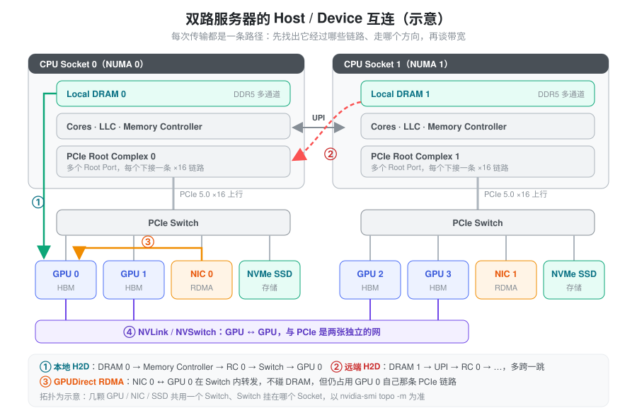
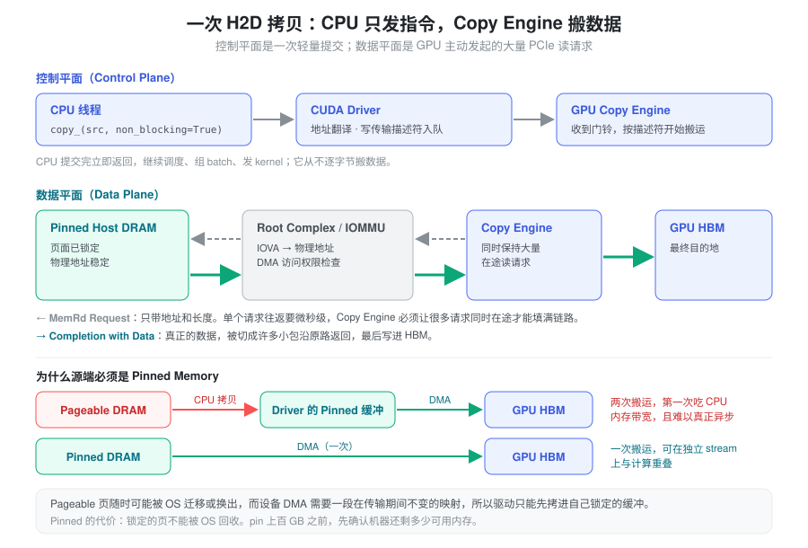
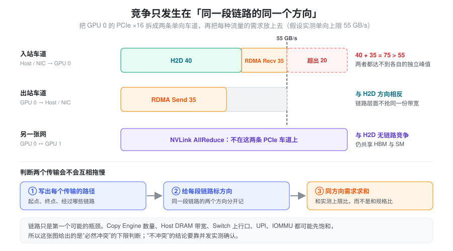
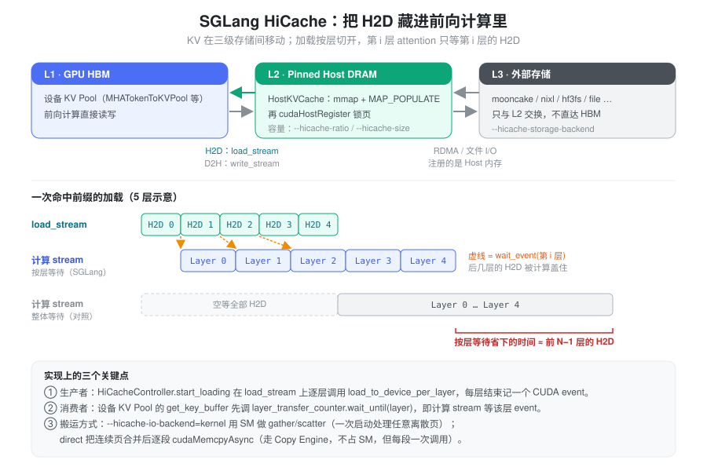

% Host Device Interconnect

### 要解决的问题：为什么 Prefix Cache Load 跑不满“63 GB/s”

推理服务里有一类很常见的数据搬运：前缀命中后，KV Cache 已经在 CPU 内存里，前向计算开始之前要把它搬回 GPU HBM。SGLang 的 HiCache 就是这样工作的，PD 分离、权重 offload 也有同样的路径。

规格表上写着 PCIe 5.0 ×16，单向约 63 GB/s。实际测下来却经常对不上：

- 单独跑 H2D 时只有 40 多 GB/s，换一台同型号机器又不一样。
- 一旦同时有 RDMA 接收在跑，H2D 明显变慢；但同时跑 RDMA 发送或 NVLink AllReduce，几乎没影响。
- 同一段代码，进程绑到另一个 CPU Socket 上，带宽掉了一截。
- 从 SSD 读进来再搬到 GPU，CPU 内存带宽先被打满了。

如果把 CPU 和 GPU 之间想象成“一根线”，这些现象都解释不了。需要换一个模型：先说清楚数据从哪里出发、经过哪些硬件、每一段走哪个方向，以及是谁在搬。

以双路 Intel Xeon + HGX B200 服务器为参考，本页依次回答：

1. CPU、GPU、NIC、SSD 在物理上是怎么连起来的。
2. 一次 H2D 拷贝里，CPU、驱动、Copy Engine 各做什么，为什么必须用 Pinned Memory。
3. IOMMU、NUMA 为什么会影响设备访问内存。
4. GPUDirect RDMA 绕过了什么、没绕过什么。
5. 多个传输并发时，怎样判断它们会不会互相拖慢。
6. SGLang 在 HiCache 和 PD 分离里是怎么处理这些问题的。

### 核心抽象：一次传输 = 一条路径上的若干段单向链路

整页只用一个思路：**把每次传输画成一条路径，路径由若干段链路组成，每段链路有两个互相独立的方向。**

由此得到三个判断规则：

1. **带宽上限由路径上最窄的那一段决定**，不是由两端设备决定。远端 NUMA 的 H2D 慢，是因为路径里多了一段 UPI。
2. **两个传输只有在同一段链路的同一方向上重叠时才争抢链路带宽。** PCIe 是全双工的，H2D（入站）和 D2H（出站）在链路层面不冲突；H2D 和 RDMA Receive 都是入站，就会冲突。
3. **搬数据的和发指令的不是同一个角色。** CPU 只负责提交（控制平面），真正的字节由 DMA 引擎或 SM 搬运（数据平面）。所以 CPU 可以在 H2D 期间继续调度；而“谁来搬”决定了它会和谁抢资源，比如 SM 搬运会和计算 kernel 抢 SM。

链路之外，Copy Engine、Host 内存控制器、Switch 上行口、IOMMU 也可能先成为瓶颈。所以这套方法能确定“必然冲突”，但“不冲突”的结论最后要靠并发实测确认。



图中三条路径会在后文反复出现：① 本地 H2D，② 跨 Socket 的远端 H2D，③ NIC 与 GPU 之间的 GPUDirect RDMA。NVLink（④）是另一张独立的网，GPU 之间的通信不走 PCIe。

### 拓扑的组成：Root Complex、Switch、Endpoint

PCIe 是一套点对点、分层交换的互连网络，由三类节点组成。

**Root Complex（RC）** 是 CPU 进入 PCIe 网络的根节点。它负责发起和接收 PCIe 事务、路由地址空间内的内存访问，并配合固件和操作系统枚举、配置设备。一个 RC 有多个 Root Port，每个 Root Port 下接一条链路，可能直连设备，也可能接一个 Switch。双路服务器上每个 Socket 各有自己的 RC。

**PCIe Switch** 类似网络交换机，转发的是 PCIe Transaction Layer Packet（TLP）。它有一个上行口和多个下行口，例如：上行接 CPU Root Port，下行分别接 GPU、NIC、SSD。Switch 按地址路由请求，所以**同一 Switch 下的两个 Endpoint，在平台允许 P2P 时可以直接交换数据，不经过 RC**。GPU 和 NIC 是否挂在同一个 Switch 下，直接决定了 GPUDirect RDMA 的路径长度。

**Endpoint** 是网络末端的设备：GPU、InfiniBand / Ethernet NIC、NVMe SSD 等。每个 Endpoint 通过 BAR（Base Address Register）暴露一段 PCIe 地址空间。比如 GPU 的 BAR1 为部分 GPU Memory 提供映射窗口，让其他设备在驱动支持、映射建立、权限允许的前提下通过 PCIe 事务访问它。BAR 映射不代表 CPU 或 NIC 能不受限制地访问全部 HBM。

实际拓扑用 `nvidia-smi topo -m` 查看。GPU 与 NIC 之间的连接类型从近到远依次是：`PIX`（经过至多一个 PCIe bridge）、`PXB`（经过多个 bridge，但不经过 Host Bridge）、`PHB`（经过 Host Bridge）、`NODE`（同一 NUMA 节点内跨 Host Bridge）、`SYS`（跨 Socket，经过 UPI）。GPUDirect RDMA 应尽量选 `PIX` / `PXB` 的网卡。
### 链路带宽：先算上限，再找真正的瓶颈

PCIe 链路由多条 Lane 组成。以 PCIe 5.0 为例，每 Lane 32 GT/s，128b/130b 编码，×16 共 16 条 Lane，单向理论数据速率为：

\[
BW_{\mathrm{PCIe5\times16}} = 32\times\frac{128}{130}\times16\div8 \approx63.0\ \mathrm{GB/s}
\]

这个数还没扣除 TLP Header、DLLP、流控等协议开销。实测 H2D 通常落在理论值的 80%–90%，具体取决于平台、Payload Size 和请求并发度。

| 代际 | 每 Lane 速率 | ×8 单向 | ×16 单向 |
| --- | --- | --- | --- |
| PCIe 3.0 | 8 GT/s | ≈ 7.9 GB/s | ≈ 15.8 GB/s |
| PCIe 4.0 | 16 GT/s | ≈ 15.8 GB/s | ≈ 31.5 GB/s |
| PCIe 5.0 | 32 GT/s | ≈ 31.5 GB/s | ≈ 63.0 GB/s |
| PCIe 6.0 | 64 GT/s（PAM4） | ≈ 60 GB/s | ≈ 121 GB/s |

PCIe 6.0 一列是 FLIT 模式下的近似有效数据速率，同样未扣除事务开销。作为对照，B200 的 NVLink 5 每颗 GPU 总带宽约 1.8 TB/s（双向合计），比它的 PCIe 5.0 ×16 高一个数量级以上。所以 GPU 之间的数据都走 NVLink，PCIe 主要承担 Host 与 GPU、NIC 与 GPU 之间的流量。

两点容易误判：

- **全双工。** 两个方向各有约 63 GB/s，H2D 和 D2H 不抢同一个方向的链路带宽。但这不代表两者能无限并发，Copy Engine、内存控制器等资源仍是共享的。
- **Switch 上行口可能是瓶颈。** 假设 Switch 上行 PCIe 5.0 ×16，下面挂了 GPU 和 NIC 各一条 ×16。如果 GPU 和 NIC 同时向 CPU DRAM 写数据，两个下行口的总需求会超过一条上行链路，两者共享上行带宽。但如果 NIC 直接 P2P 写 GPU，流量在 Switch 内转发，不经过上行口。是否竞争取决于事务实际经过哪些链路，而不是设备挂在哪个 Switch 下。

### H2D 如何执行：控制平面与数据平面

以一行 PyTorch 代码为例：

```python
gpu_tensor.copy_(cpu_tensor, non_blocking=True)
```

假设 `cpu_tensor` 位于 Pinned Host Memory。



#### 控制平面：CPU 只发指令

CPU 的工作是调用 CUDA Runtime / Driver API、准备地址映射和传输描述符、把任务提交给 GPU，必要时等待或查询完成状态。提交完成后调用立即返回，CPU 可以继续执行调度、组 batch、提交其他 kernel。CPU 不会逐字节循环拷贝，DMA 的意义正是把大规模搬运从 CPU Core 上卸载下来。

#### 数据平面：GPU 主动读 Host 内存

H2D 的常见实现是 GPU 的 Copy Engine 通过 PCIe 发起 Memory Read：

1. Copy Engine 发出 MemRd Request，请求只带地址和长度。
2. 请求经过 Switch、Root Complex（以及 IOMMU 地址转换）到达 Host 内存系统。
3. 内存控制器读出 DRAM 数据。
4. 数据以 Completion with Data 的形式切成许多小包沿原路返回。
5. Copy Engine 把数据写入 HBM。

单个读请求的往返是微秒级的。要填满链路，Copy Engine 必须同时保持足够多的在途请求（Outstanding Read Requests）来隐藏延迟。这就是带宽和延迟要分开看的原因：小块传输主要被固定延迟限制，只有大块连续传输才接近链路带宽。把很多小块合并成少量大块，是提升 H2D 吞吐最直接的手段之一。

#### Pinned Memory：让 DMA 看到稳定的物理页

普通 CPU 内存是 Pageable 的：操作系统可以迁移或换出物理页，虚拟地址到物理页的映射随时可能变化。而设备 DMA 需要一段在传输期间不变的映射。

所以从 Pageable 内存发起 H2D 时，驱动只能先把数据拷进自己锁定的 staging 缓冲，再 DMA 到 GPU。这条路径有两次搬运：

\[
\mathrm{Pageable\ DRAM} \xrightarrow{\text{CPU 拷贝}} \mathrm{Pinned\ DRAM} \xrightarrow{\text{DMA}} \mathrm{GPU\ HBM}
\]

第一次消耗 CPU 内存带宽，并且让 `non_blocking=True` 难以真正异步；第二次才消耗 PCIe 带宽。如果同时还有 SSD 写入 DRAM，三者会一起争抢 CPU 内存带宽。

Pinned Memory 的代价是这些页不能被操作系统回收。锁定上百 GB 之前要确认机器剩余的可用内存，否则会挤压其他进程和 page cache。

### IOMMU：设备看到的地址不一定是物理地址

理解 DMA 时要区分三种地址：

| 地址类型 | 使用者 | 含义 |
| --- | --- | --- |
| Virtual Address | CPU 进程 | 用户态虚拟地址 |
| Physical Address | Host 内存系统 | 实际物理内存地址 |
| IOVA | PCIe 设备 | 设备发起 DMA 时使用的 I/O 虚拟地址 |

IOMMU（I/O Memory Management Unit）把设备侧的 IOVA 转换成 Host 物理地址，并把设备的 DMA 限制在授权的内存范围内。没有它，任何 PCIe 设备都能读写整个物理内存。

地址转换有成本，比如 IOTLB Miss 和映射管理开销。不过：

- 并非所有 DMA 都经过启用的 IOMMU 转换，系统可能配置成 Identity Mapping 或 Passthrough 模式。
- 某些 GPU P2P / GPUDirect RDMA 配置对 IOMMU 模式有特定要求。另外，启用 IOMMU 时通常也会启用 PCIe ACS，Switch 内的 P2P 请求会被重定向到 RC 再折返，原本不经过上行口的路径因此变长。

不建议为了性能直接关闭 IOMMU。应先确认实际的 DMA 映射模式和驱动要求，再看是否真的测到了转换瓶颈。
### NUMA：DRAM 在哪个 Socket 上

双路 Xeon 服务器上，每个 Socket 各自拥有 CPU Core、LLC、内存控制器、本地 DRAM 和 PCIe Root Complex，Socket 之间通过 UPI 互连。假设 GPU 接在 Socket 0 上：

\[
\text{本地 H2D：}\ \mathrm{DRAM}_0 \rightarrow \mathrm{PCIe}_0 \rightarrow \mathrm{GPU}
\]

\[
\text{远端 H2D：}\ \mathrm{DRAM}_1 \rightarrow \mathrm{UPI} \rightarrow \mathrm{PCIe}_0 \rightarrow \mathrm{GPU}
\]

远端路径多了一段 UPI，因此延迟更高，还要和其他跨 Socket 内存流量共享 UPI 带宽，大规模 H2D 的吞吐也更不稳定。按照前面的规则，这就是“路径上多了一段可能更窄、更拥挤的链路”。

#### 线程绑定和内存绑定是两回事

```bash
numactl --cpunodebind=0 python benchmark.py
```

这只约束 CPU 线程在哪里运行，不保证 Buffer 分配在 NUMA 0。要同时约束内存：

```bash
numactl --cpunodebind=0 --membind=0 python benchmark.py
```

即便如此，还要考虑 Buffer 是在什么时候分配的、是否已经在其他节点上分配过、物理页实际是在哪次访问时落下的（Linux 的 first-touch 语义）、以及 GPU 实际靠近哪个 Socket。验证手段：

```bash
nvidia-smi topo -m          # GPU 的 CPU Affinity / NUMA Affinity 列
numactl -H                  # 各节点的 CPU 与内存
cat /proc/<PID>/numa_maps   # 进程各段内存实际落在哪个节点
```

### GPUDirect RDMA：绕过 DRAM，但不绕过 PCIe

没有 GPUDirect RDMA 时，GPU 数据要发到网络上，需要先拷到 CPU 内存：

\[
\text{GPU} \rightarrow \text{CPU DRAM} \rightarrow \text{NIC} \rightarrow \text{Network}
\]

GPUDirect RDMA 让支持它的 NIC 直接 DMA 访问 GPU Memory。GPU 显存先通过驱动注册给 NIC，之后 NIC 直接读写 HBM：

\[
\text{GPU HBM} \leftrightarrow \text{NIC} \leftrightarrow \text{Network}
\]

省掉的是 CPU DRAM 这一跳和一次拷贝。但在 PCIe NIC + GPU 拓扑里，数据仍然要走 GPU 与 NIC 之间的 PCIe 路径（拓扑图中的 ③）。最好的情况是两者在同一个 Switch 下、流量在 Switch 内转发；如果 NIC 挂在另一个 Socket 上，路径会穿过两个 RC 和 UPI，带宽可能比走 Host 内存中转还差。

所以要区分方向：

- **RDMA Receive（NIC → GPU）** 和 H2D 都是 GPU 的入站流量，会在 GPU 那条 PCIe 链路的同一方向上竞争。
- **RDMA Send（GPU → NIC）** 是出站流量，和 H2D 方向相反，链路层面更容易重叠，但仍可能共享 GPU 内部的 I/O 资源。

分析通信竞争时要分别看 Send、Receive、H2D、D2H，只看“通信带宽”一个数是不够的。

### 竞争分析：把需求放到具体车道上

把前面的规则用到一颗 GPU 上。考虑以下几种传输：

- A. CPU DRAM → GPU HBM（H2D）
- B. GPU HBM → NIC（RDMA Send）
- C. NIC → GPU HBM（RDMA Receive）
- D. NVMe SSD → CPU DRAM
- E. GPU 0 → GPU 1（NVLink）



假设 GPU 0 的 PCIe 5.0 ×16 实测单向上限 55 GB/s，H2D 想用 40 GB/s，RDMA Receive 想用 35 GB/s。两者都在入站车道上，总需求 75 GB/s 超过上限，不可能同时维持各自的独立峰值。换成 RDMA Send 或 NVLink AllReduce，就没有这个直接的链路冲突。

两两组合的定性判断如下：

| 并发操作 | 可能共享的瓶颈 | 竞争风险 |
| --- | --- | --- |
| A + B | GPU PCIe 链路（方向相反）、GPU 内部 I/O 路径 | 中 |
| A + C | GPU PCIe 入站方向、GPU 内部 I/O 路径 | 高 |
| A + D | CPU DRAM 带宽、Switch 上行 / RC（取决于 SSD 挂在哪） | 中 |
| A + E | HBM 带宽 | 通常较低 |
| B + C | GPU PCIe 两个方向、NIC、GPU 内部 I/O 路径 | 取决于实现 |

这是定性结论。比如 NIC 和 GPU 分属不同的 Root Complex，或者 GPU 内部数据通路先饱和时，结果会不同。
### 在 SGLang 中的落地

SGLang 里有两处大规模 Host / Device 数据搬运：HiCache（分层 KV Cache）把 KV 在 GPU HBM、Pinned Host DRAM、外部存储三级之间移动；PD 分离把 KV 从 Prefill GPU 直接写到 Decode GPU。前面的每条规则都能在代码里找到对应的设计。以下路径相对 `python/sglang/srt/`。



#### L2 Host Pool：先预取物理页，再锁页

Host KV Pool 的基类是 `mem_cache/pool_host/base.py` 中的 `HostKVCache`，MHA 和 MLA 的实现分别是 `pool_host/mha.py` 的 `MHATokenToKVPoolHost` 和 `pool_host/mla.py` 的 `MLATokenToKVPoolHost`。容量由 `--hicache-ratio`（相对设备池的倍数，默认 2.0）或 `--hicache-size`（GB）决定。

内存的来源分两步（`pool_host/common.py`、`storage/mmap/mmap_allocator.py`）：

1. `alloc_mmap` 用 `MAP_SHARED | MAP_ANONYMOUS | MAP_POPULATE` 匿名映射一段内存，可选通过 `SGLANG_HUGEPAGE_SIZE` 使用 2MB / 1GB 大页。`MAP_POPULATE` 让物理页在分配时就全部落下。
2. `alloc_with_host_register` 再调用 `cudaHostRegister` 把这段内存注册为 Pinned Memory。NPU、MUSA 平台改用 torch 的 `pin_memory`。

`alloc_mmap` 的注释说明了为什么两个标志缺一不可：锁定的必须是真实的、已经 fault 进来的物理页，否则注册可能和写时复制或缺页处理产生竞争，设备会读到过期数据。这正是 Pinned Memory 要解决的“映射在 DMA 期间不能变”的问题。退出时 `HostKVCache.destroy` 会在用户态显式 `cudaHostUnregister`，否则进程被杀时由内核回收大块锁定内存，可能卡住几十秒。

#### NUMA：在分配之前就把进程绑好

Host Pool 自己不做 NUMA 绑定，它依赖进程级的绑定。`entrypoints/engine.py` 启动每个 Scheduler 子进程时会进入 `utils/numa_utils.py` 的 `configure_subprocess`：在默认的 `SGLANG_NUMA_BIND_V2=True` 下，它找出该 GPU 所在的 NUMA 节点（优先使用 `--numa-node`，否则通过 NVML 的 `nvmlDeviceGetMemoryAffinity` 查询），然后用 `numactl --cpunodebind=N --membind=N` 包装子进程。`scheduler.py` 中 `run_scheduler_process` 的注释写明了目的：在任何大块 Host 分配之前完成绑定，让内存落在本节点。

把它和上一小节合起来看：进程先被 membind 到 GPU 的本地节点，`MAP_POPULATE` 再在这个约束下一次性落下全部物理页，所以 L2 Pool 默认就在本地 DRAM 上，H2D 走的是拓扑图里的路径 ①。

但这个绑定会在几种情况下被静默跳过：机器上找不到 `numactl`（只打一条 debug 日志）、容器缺少 `SYS_NICE` 权限导致无法设置内存策略（打警告）、或者 seccomp / cpuset 拒绝策略（打警告，设置 `SGLANG_CRASH_ON_NUMA_BIND_FAILURE` 可改成报错）。在容器里部署时，最好用 `/proc/<PID>/numa_maps` 确认 Pool 实际落在哪个节点。

#### 按层加载：让 H2D 藏在前向计算后面

`managers/cache_controller.py` 的 `HiCacheController` 为两个方向各建了一条 stream：`load_stream` 负责 H2D，`write_stream` 负责 D2H 备份。写回（`start_writing`）在 `write_stream` 上一次性搬全部层；加载（`start_loading`）则逐层调用 `load_to_device_per_layer`，每层结束时记录一个 CUDA event。

消费端在设备 KV Pool 里。`MHATokenToKVPool.get_key_buffer` 等访问函数会先调用 `layer_transfer_counter.wait_until(layer_id)`，它让当前计算 stream 只等待第 `layer_id` 层的 event。因此第 0 层 attention 在第 0 层加载完后就能开始，后面几层的 H2D 和前面几层的计算重叠。只要每层的计算时间不短于每层的加载时间，暴露在关键路径上的就只剩第一层的加载。

这是控制平面与数据平面分离的直接收益：CPU 一次性提交所有层的拷贝，然后去做别的事；同步发生在 GPU 的 stream 之间，CPU 不参与等待。

#### `kernel` 与 `direct`：由谁来搬

`--hicache-io-backend` 决定搬运者，对应“谁在数据平面上”这个问题（实现见 `sgl-kernel/csrc/kvcacheio/transfer.cu`）：

| 后端 | 搬运者 | 做法 | 代价 |
| --- | --- | --- | --- |
| `kernel`（默认） | GPU SM | 每个 warp 用 8 字节非临时访存，直接从 Pinned Host 内存读、写入 HBM；一次 kernel 启动处理任意离散的页 | 占用 SM，和前向计算抢计算资源；索引需要在 GPU 上 |
| `direct` | Copy Engine | 先把索引拷到 CPU，把源、目标都连续的页合并成段，每段一次 `cudaMemcpyAsync` | 不占 SM，但每段一次调用，碎片越多越慢 |

`kernel` 后端里，发起 PCIe 读请求的是 SM，Copy Engine 不参与。它把“许多小块、需要一次几百次 memcpy”的问题变成了一次 kernel 启动，换来的是和计算争抢 SM。
#### 内存布局：决定一次传输被切成多少段

前面说过，小块传输被延迟限制，大块连续传输才能接近链路带宽。Host Pool 的布局（`--hicache-mem-layout`，见 `pool_host/mha.py`）决定了一次传输在 Host 内存里有多少个连续段：

| 布局 | MHA 维度 | 按层 H2D 时 | 按页存取 L3 时 |
| --- | --- | --- | --- |
| `layer_first` | `(2, layer, size, head, dim)` | 一层内 token 连续，适合 `direct` | 一页的各层分散在各处 |
| `page_first`（默认） | `(2, size, layer, head, dim)` | 每个 token 的一层只是一小段，必须用 `kernel` gather | 一页所有层连续，可零拷贝 |
| `page_first_direct` | `(2, page_num, layer, page_size, head, dim)` | 每页的一层是 `page_size` 个 token 的连续段，`direct` 可用 | 一页所有层仍连续 |
| `page_head` | `(2, page_num, head, page_size, layer, dim)` | 每个 token 的一层只是一小段，用 `kernel` gather | 一页内按 head 连续，可按 head 拆分页存取 |

两个方向的需求是矛盾的：L1 ↔ L2 按层加载希望“同一层连续”，L2 ↔ L3 按页存取希望“同一页连续”。`page_first_direct` 是折中，把连续段从单个 token 放大到一页。`server_args.py` 会自动修正不兼容的组合：`page_first_direct` 配 `kernel` 时切到 `direct`，`page_first` 配 `direct` 时切到 `page_first_direct`；使用 Mooncake 存储后端时不会落到 `layer_first`。

#### L3 存储：总是经过 L2

`--hicache-storage-backend` 支持 `mooncake`、`nixl`、`hf3fs`、`file` 等后端（目录 `mem_cache/storage/`）。它们的共同点是**只和 L2 Host Pool 交换数据，不直接读写 HBM**：

- Mooncake Store 把整个 Host Pool 注册给传输引擎（`register_mem_pool_host`），之后 `batch_put_from` / `batch_get_into` 由 NIC 直接 DMA Host 内存，不做额外拷贝。
- NIXL 在 `page_first` / `page_first_direct` 布局下自动开启零拷贝，把 Host Pool 以 `DRAM` 类型注册；其他布局下经过注册过的 bounce buffer。它的文件插件里有 `GDS` 的名字，但注册的源内存仍是 DRAM。
- 3FS 通过 usrbio 与共享内存交换，再拷到 Host Pool；`file` 后端是普通的 `readinto` / `tofile`。

所以 HiCache 里的 SSD → GPU 一定是两段：L3 → L2（存储 I/O，消耗 Host 内存带宽），L2 → L1（H2D，消耗 PCIe 入站带宽）。当前实现没有 GPUDirect Storage 直写 HBM 的路径。

#### PD 分离：GPUDirect RDMA 与网卡选择

PD 分离的 KV 传输走的是另一条路。Mooncake 后端的 `MooncakeKVManager.register_buffer_to_engine`（`disaggregation/mooncake/conn.py`）把设备 KV Pool 的显存地址（`get_contiguous_buf_infos` 返回的 GPU 指针）批量注册给传输引擎，Prefill 之后直接用单边 RDMA Write 写进 Decode 的显存，也就是 GPUDirect RDMA。详细流程见 [PD Design](./disaggregation_design.md)。NIXL 后端同样以 `VRAM` 类型注册显存。一个例外是 Decode 侧开启 `--enable-hisparse` 时，注册的是 Host Pool。

按照 GPUDirect RDMA 一节的分析，这条路径的带宽取决于 GPU 和 NIC 是否在同一个 PCIe Switch 下。SGLang 本身不做拓扑感知的网卡选择：

- `--disaggregation-ib-device` 可以是单个设备、逗号分隔的共享列表、按 GPU 编号的 JSON 映射（如 `{"0": "mlx5_0,mlx5_1", "1": "mlx5_2"}`），或者指向映射文件的路径。`get_ib_devices_for_gpu` 按当前 GPU 取对应条目。
- 不指定时，SGLang 记录 “falling back to auto discovery”，由 Mooncake 自己选择网卡。

在拓扑复杂的机器上，建议根据 `nvidia-smi topo -m` 给每个 GPU 显式配置 `PIX` / `PXB` 关系的网卡，而不是依赖自动发现。同时要注意：Decode 侧的 RDMA Receive 和 HiCache 的 H2D 都是 GPU 入站流量，两者同时进行时会争抢同一条车道。
#### 代码地图

| 关注点 | 位置 |
| --- | --- |
| Host Pool 基类与 MHA / MLA 实现 | `mem_cache/pool_host/base.py`、`mha.py`、`mla.py` |
| mmap 分配与 `cudaHostRegister` | `mem_cache/storage/mmap/mmap_allocator.py`、`mem_cache/pool_host/common.py` |
| 加载 / 写回 stream 与按层 event | `managers/cache_controller.py`（`HiCacheController`、`LayerDoneCounter`） |
| 按层等待的消费端 | `mem_cache/memory_pool.py`（`get_key_buffer` 中的 `wait_until`） |
| 搬运 kernel | `sgl-kernel/csrc/kvcacheio/transfer.cu`、`python/sglang/kernels/ops/kvcache/hicache.py`（JIT 版本） |
| NUMA 绑定 | `utils/numa_utils.py`（`configure_subprocess`、`get_numa_node_if_available`） |
| L3 存储后端 | `mem_cache/storage/` |
| PD 显存注册与网卡选择 | `disaggregation/mooncake/conn.py`、`distributed/device_communicators/mooncake_transfer_engine.py` |

### 排查清单：Prefix Cache Load 慢的时候

按“路径 → 方向 → 搬运者”的顺序逐项排除。

**L2 → L1（Host DRAM → HBM）**

- 源内存是不是 Pinned 的。自己写的拷贝如果源是 Pageable，会多一次 CPU 拷贝，`non_blocking` 也会失效。
- Host Pool 在哪个 NUMA 节点上。用 `nvidia-smi topo -m` 找到 GPU 的 NUMA Affinity，再用 `/proc/<PID>/numa_maps` 看 Pool 实际的节点分布，确认 NUMA 绑定没有被静默跳过。
- H2D 和计算是否真的在不同 stream 上重叠。用 Nsight Systems 看 `load_stream` 和计算 stream 的时间线，排查意外的 `synchronize` 或 `.item()`。
- 传输是否被切成太多小段。`direct` 后端下，碎片化的页索引会变成大量小 `cudaMemcpyAsync`；`kernel` 后端则要看它是否抢了计算的 SM。
- 同一时刻是否有 RDMA Receive（PD 传输、跨机通信）在用 GPU 的入站车道。只有 NVLink 通信时不会和 H2D 抢 PCIe。

**L3 → L2 → L1（存储 → Host → HBM）**

此时有三段可能的耗时：

\[
\underbrace{\mathrm{Storage}\rightarrow\mathrm{DRAM}}_{T_{\mathrm{read}}} \rightarrow \underbrace{\mathrm{DRAM}\rightarrow\mathrm{Pinned}}_{T_{\mathrm{stage}}} \rightarrow \underbrace{\mathrm{Pinned}\rightarrow\mathrm{HBM}}_{T_{\mathrm{H2D}}}
\]

- 存储后端能否直接写进已注册的 Host Pool，从而省掉 \(T_{\mathrm{stage}}\)。Mooncake Store、NIXL（`page_first` 系布局）可以；3FS、`file` 后端会经过中间缓冲。
- 存储 I/O 和 H2D 是否在争抢 Host 内存带宽，以及 NVMe 和 GPU 是否共用同一个 Switch 上行口。
- GPUDirect Storage 能省掉 Host 内存这一跳，但依赖存储、驱动、文件系统和平台配置，并且 SGLang HiCache 当前没有这条路径。

### 小结

Host / Device 互连的问题，几乎都能归结为一句话：**一次传输是一条路径，带宽由最窄的那一段决定，竞争只发生在同一段链路的同一方向上，而 CPU 只发指令不搬数据。** 有了这个模型，规格表上的 63 GB/s 就只是路径里某一段的上限；远端 NUMA、Switch 上行口、RDMA Receive、Pageable 内存，分别对应路径变长、某段变窄、同向叠加和多一次搬运。SGLang 的 HiCache 把这些规则落成了具体设计：mmap 预取加锁页保证 DMA 看到稳定的本地物理页，进程级 NUMA 绑定让 Host Pool 落在 GPU 旁边，按层 event 把 H2D 藏进前向计算，内存布局和 `kernel` / `direct` 后端在“段数”和“搬运者”之间做取舍；PD 分离则用 GPUDirect RDMA 绕过 DRAM，但仍要靠正确的网卡映射才能用好 PCIe 拓扑。
