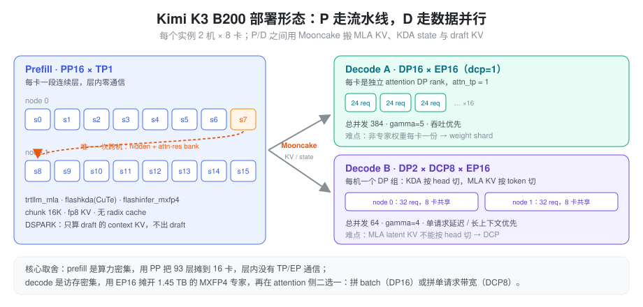
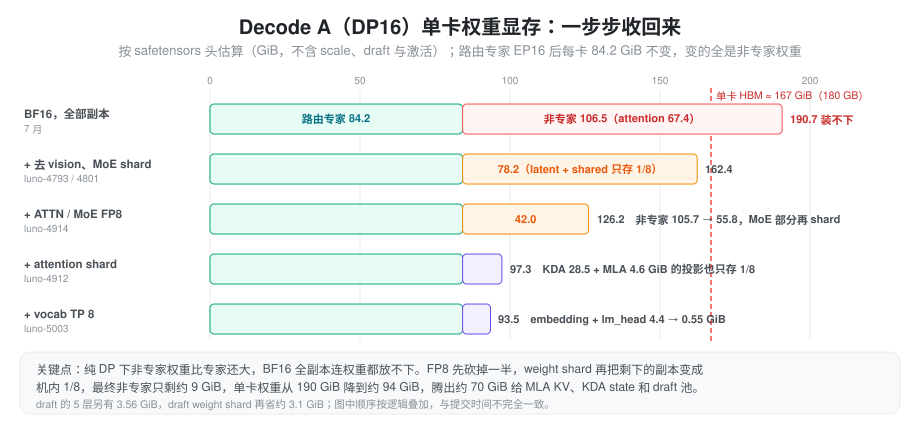
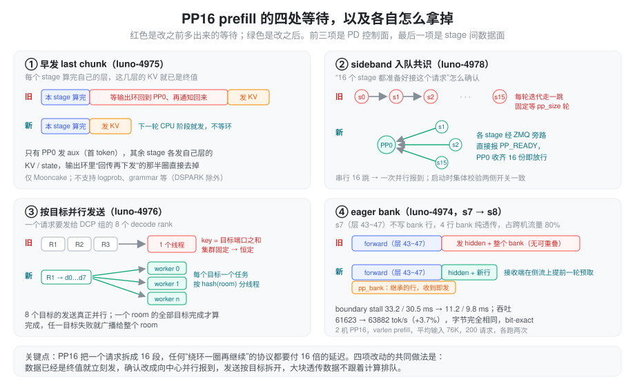
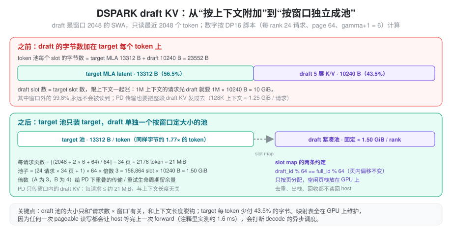
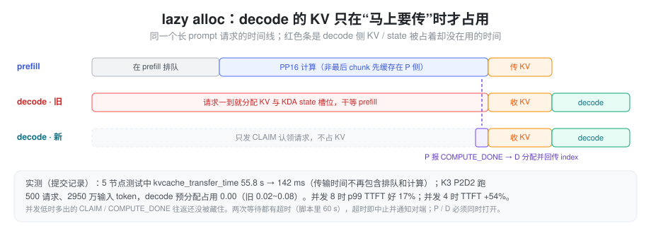
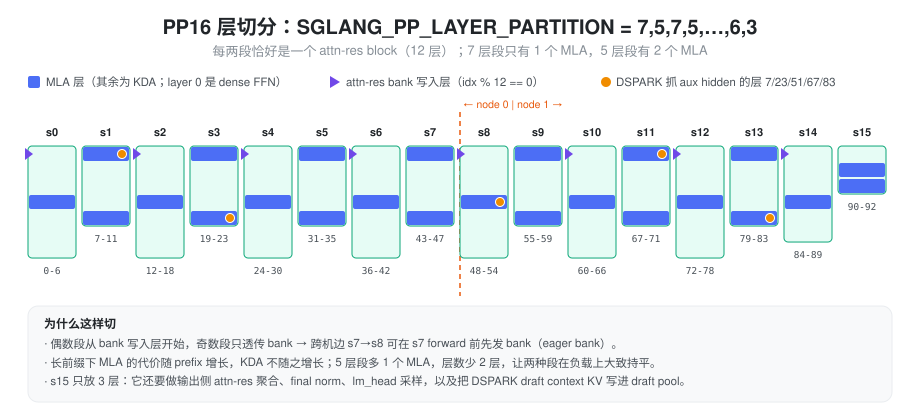
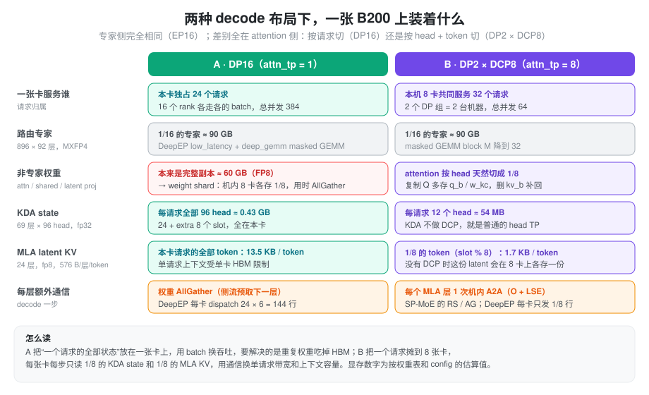
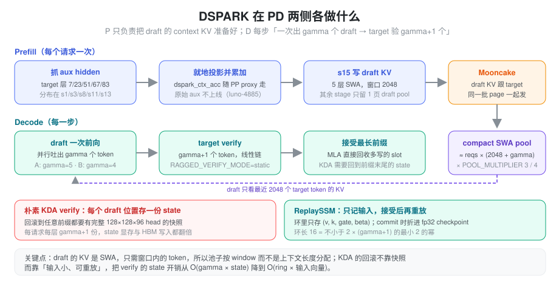

% Kimi K3 B200

本文梳理 Kimi K3 在 B200 上 PD 分离部署的优化思路：先说清楚这个模型难在哪里，再看 prefill（PP16）和两套 decode（DP16、DP2 + DCP8）分别怎么拆、为什么这么拆，最后落到启动脚本里每组开关在 SGLang 代码中的位置。

### 问题：K3 在 B200 上难在哪里

K3 的结构细节见 [kimi k3 weight](./kimi_k3_weight.md)，这里只摘和部署相关的几个事实：

- **大**：语言模型 2.78 T 参数，其中 2.72 T 是 92 层 × 896 个路由专家（top-16）。专家用 MXFP4 存储，约 1.45 TB；其余 BF16 权重约 113 GB。单机 8 张 B200 约 1.43 TB HBM，**连专家都装不下，两机起步**。
- **混合注意力**：93 层里 69 层是 KDA（线性注意力，每请求一份固定大小的递归 state），24 层是 MLA（每 token 一份 576 维的 latent KV）。两种层的显存形态完全不同：KDA state 跟请求数走，MLA KV 跟 token 数走。
- **Attention Residuals**：每 12 层一个 block，层与层之间除了 hidden 还要传一个历史 block 输出的 bank（见 [Attention Residuals](./attention_residuals.md)）。这让 PP 的 stage 间通信比普通模型大得多。
- **DSPARK 投机解码**：一个 5 层 SWA 的 draft 模型，吃 target 第 7/23/51/67/83 层的 hidden，一次前向并行吐出 gamma 个 token。

再叠加 prefill 和 decode 截然不同的瓶颈：prefill 是大矩阵乘，算力密集；decode 每步只有几个 token，但要读完整的专家、KV 和 state，访存密集。同一种并行方式很难两边都好，所以 P 和 D 各用一套。

### 总体设计：P 走流水线，D 走数据并行

- **Prefill：PP16 × TP1**。每张卡拿一段连续的层，层内没有任何 TP/EP 通信，MoE 也在本卡算完（本卡就有这段层的全部 896 个专家）。代价是 stage 间要传 hidden + attn-res bank，以及流水线的气泡。prefill 的 token 多、计算长，正好能盖住这些。
- **Decode：EP16 是共同底座**。专家按 EP16 摊开，每卡约 90 GB，靠 DeepEP low-latency 做 dispatch/combine。attention 侧有两个选择：
  - **A · DP16**：每卡一个独立 attention DP rank，每卡 24 个请求，总并发 384，追求吞吐。
  - **B · DP2 × DCP8**：每台机器是一个 DP 组，8 张卡一起服务 32 个请求，总并发 64，追求单请求延迟和长上下文。

两份权重都用 `/Kimi-K3-ATTN-MOE-DENSE-FP8`：路由专家保持 MXFP4，attention 投影、shared expert、latent 上下投影、layer 0 的 dense MLP 转成 block-FP8（128×128）。`SGLANG_K3_ATTN_MOE_FP8=1` 是加载这份混合 checkpoint 的总开关（`layers/quantization/modelopt_quant.py` 里的 `_is_k3_attn_fp8_target` / `_is_k3_moe_fp8_target`），非专家权重的显存和带宽因此减半。

### 优化时间线

按 aiak_sglang 的提交记录，K3 的优化大致分四波：

| 时间 | 主题 | 代表性提交 |
| :--- | :--- | :--- |
| 7 月下旬 | 跑起来：K3 模型接入、DSPARK、DCP 支持 Kimi Linear、DSpark 接 DeepEP | `[Kimi] Support kimi-k3`、luno-4671 |
| 8 月上中旬 | PP + PD + DSPARK 打通；decode 显存优化；MoE weight sharding；FlashKDA | luno-4774、luno-4793、luno-4801、luno-4777 |
| 8 月 27 日 | 集中一波性能：K3 weight shard（含 draft）、ATTN/MoE FP8、prefill / decode kernel 融合、PP PD 早发 last chunk / 目标并行传输 / sideband 共识、eager bank、vocab TP group | luno-4912、4914、4957、4958、4974~4978、5003 |
| 9 月 ~ 10 月 | 打磨：DSPARK SWA 池（DP / PP16）、block-FP8 q-proj 的 DCP、DCP 兼容 DP16、masked GEMM block M、lazy alloc、CuTe FlashKDA prefill | luno-5101、5242、5373、5408、5293、5416 |

下面把后三波里的重点逐个说清楚：每项先说原来卡在哪，再说怎么改、换来了什么。数字注明出处的来自提交记录或代码注释，其余是按 config 和 safetensors 头算出的估算值。更细的实现放在后面 P / D 的章节里。

#### 8 月上中旬：先把链路打通，把 decode 显存算准

- **PP + PD + DSPARK 打通（luno-4774）**。PD 传输的基本单位是传输条目：每层 KV / state 对应一段显存地址，P 侧第 k 条发到 D 侧第 k 条。PP=1 时两边条目一一对应，按下标配对没有问题。PP16 下每个 stage 只登记自己的层，decode 端却是完整模型。以 s1 为例，它持有第 7~11 层，其中 MLA 层是第 7、11 层。它的第 0 条 MLA 条目对应全局第 7 层，在 decode 端却是第 1 条（decode 的第 0 条是第 3 层）。按下标配对会把第 7 层的 KV 写进第 3 层；旧代码遇到两边条目数不一致时直接报错。
  - 改法是给每个条目带上**模型全局层号**，按层号而不是按下标配对。DSPARK 的 5 层 draft KV 用一段不会和真实层号冲突的合成编号，只由最后一个 stage 登记。
  - prefill 侧的 DSPARK 原先要求 PP=1。现在每个 stage 只抓自己范围内的 aux 层（第 7/23/51/67/83 层的 hidden），随 PP 消息往下传，由最后一个 stage 写 draft KV。其他 stage 只留 1 页 draft pool，也不建 lm_head。
  - 结果是 16 个 stage 各发各的一段，decode 收齐就是完整状态，不需要先汇总到某一张卡上。
- **decode 显存优化（luno-4793）**。通用的显存求解按"标准模型"推导，放到 K3 上有四处算错或白占。改法是不走通用公式：能显式给出的量，就按 K3 的实际结构写进环境变量；用不上的权重，直接删掉。省下的显存全部进 token 池和请求槽。

  | 问题 | 原来 | 改后 |
  | :--- | :--- | :--- |
  | target 每 token 字节数 | 通用公式 576 × 24 层 = 13,824 B | 脚本显式给 13,312 B（差值来源未在代码里找到说明） |
  | draft 每 token 字节数 | 按 target 比例推：target ×（24 + 5·dcp）/ 24。dcp1 时 draft 只算了约 2.9 KB；dcp8 时整格 36,864 B | 按 draft 实际形状：5 层 × K/V × 16 head × 64 × 1 B = 10,240 B。整格 23,552 B，dcp8 下同样显存多放约 1.57× token |
  | vision tower | 纯文本服务也加载：tower 802 MB + projector 92 MB | `ONLY_LANGUAGE` 不加载，每卡省约 0.83 GiB |
  | `kv_b_proj` | 拆出吸收用的 `w_kc` / `w_vc` 后原矩阵仍在：BF16 共 576 MiB | `DEL_MLA_KVB_DCP` 拆完即删；attn TP8 下每卡约 75 MB |

  draft 那一行偏差最大：dcp1 时 draft 被算小了约 3.5 倍，求出来的 token 数和实际能放下的对不上；dcp8 时 5·dcp 让 draft 份额随 dcp 线性变大，算成 23,040 B，是实际的 2.25 倍，同样显存少放约 36% 的 token。两个 decode 脚本都打开了 `ONLY_LANGUAGE` 和 `DEL_MLA_KVB_DCP`。
- **MoE weight sharding（luno-4801）**。DP attention 下，路由专家已经按 EP 摊开，每卡 84.2 GiB。但每层 MoE 前后的 latent 上下投影和 shared expert 不在 EP 里，16 张卡各存一份完整副本：BF16 下每层约 367 MB，92 层合计 31.45 GiB，比 attention 以外的任何部分都大。
  - 思路：既然每张卡上的内容都一样，就让机内 8 卡各存 1/8，用到时临时 AllGather 拼回来。decode 每步的计算很短，NVLink 大部分时间是空闲的，拿闲置带宽换 HBM 很划算。
  - 每卡回收 7/8：BF16 下约 27.5 GiB，FP8 之后（15.72 GiB 总量）约 13.8 GiB。
  - 实现上用 NCCL 的 CE symmetric memory 做 AllGather（要求 NCCL ≥ 2.28.3），走 copy engine，不占 SM。只向前看一层：两块 ping-pong buffer 轮流装"当前层"和"下一层"，所以完整权重常驻的只有两层。
  - 这一版也是后来通用 weight shard（luno-4912）的雏形。
- **FlashKDA（luno-4777）**。KDA 有 69 层，占 prefill 的绝大部分层数。通用的 Triton chunk 实现把块内计算、state 递推和输出拆成多个 kernel，中间结果要在 HBM 上来回读写。FlashKDA 把一个 chunk 的计算和 state 更新融进一个专用 kernel，中间量尽量留在片上，KDA 层的 prefill 时间直接反映到 TTFT 上。
  - 适用范围：默认只在 extend 长度 64~2048 之间启用。下限是一个 kernel chunk；上限是实测交叉点，再长 Triton 的分块 prefill 反而更快。batch 里最短的低于下限、或最长的超过上限，整个 batch 退回 Triton 的 `chunk_kda`。
  - prefill 脚本把上限放到 24576，让大的 chunked prefill batch 也留在 FlashKDA 上。
  - 后续的 CuTe DSL 版本（luno-4979）为 SM100 重写：chunk 32，每个 (序列, head) 一个 CTA，[128, 128] 的 fp32 state 放在 TMEM 里，H96 一波跑完。persistent kernel 把首尾填充 / 排空从约 10 µs 压到约 1 µs，LPT 调度（变长 batch 里按长度降序发 CTA，避免最长的序列最后才开始）在混合长度下 H64 / H96 分别再快 24% / 14%。注意这些数据是在 B300 上测的。

#### 8 月 27 日：一波集中的性能优化

下面这张图把 decode A（DP16）单卡权重显存按改动顺序叠起来，后面几项的显存账都可以对着它看。

- **K3 weight shard 推广到 attention 和 draft（luno-4912）**。luno-4801 只覆盖 MoE 周边。纯 DP attention（attn_tp = 1）下，KDA / MLA 的各个投影同样是每卡一份完整副本，于是把切分机制做成通用的，attention 投影也纳入进来。
  - 显存：FP8 下 KDA 投影 28.50 GiB、MLA 4.57 GiB、MoE 周边 15.72 GiB，三者合计 48.8 GiB，机内 8 卡各存 1/8 后每卡省约 42.7 GiB。
  - 重叠：在侧流上**提前一层**发起下一层的 AllGather，让通信和当前层的计算重叠。第 0 层的 AllGather 放在上一步收尾（ReplaySSM 的 state 提交）旁边发出，所以每步开头也不用干等。
  - draft：5 层共 3.56 GiB，照此切分再省约 3.1 GiB（`DRAFT_WEIGHT_SHARD`）。
  - 一个容易挂死的地方：AllGather 是集合通信，组内每张卡都必须参与。某些 DP rank 在某一步可能没有请求，bs=0 的 IDLE batch 没法 replay CUDA graph，只能走 eager。结果是其他卡在 graph 里做 AllGather，它在 eager 里做，次序对不上就互相等。解决办法是让空闲 rank 也跑一个 bs=1 的假 verify，所有 rank 走同一条 graph 分支，集合通信始终对齐。
- **ATTN / MoE FP8（luno-4914）**。非专家权重原来是 BF16。decode 每步都要把这些权重完整读一遍，读权重的时间就是步时间的一部分。
  - 做法：离线转成 block-FP8（128×128 一个 scale），用 DeepGEMM 的 FP8 GEMM 计算；精度损失由细粒度的 block scale 控制住。路由专家本来就是 MXFP4，不受影响。
  - 收益：权重显存和每步读取的字节数都减半。DP16 下每卡非专家权重从约 105.7 GiB 降到约 55.8 GiB；按 safetensors 头统计，checkpoint 从 1453.66 GiB 变成 1403.79 GiB。
  - 这一步之前，BF16 非专家里 attention 占 67.4 GiB、shared expert 22.6、latent 8.8、embedding + lm_head 4.38、dense 层 1.35、gate 1.10。可以看到纯 DP 下大头是 attention，这也是 luno-4912 要把 attention 一起切掉的原因。
- **prefill / decode kernel 融合（luno-4957、luno-4958）**。性能剖析发现，在大矩阵乘之外还有很多小 kernel 占时间：q/k/v 各做一次 conv1d、sigmoid 前要多一次 copy、拼 K 时多一次 concat、bf16→fp8 的 cast 分三次做，等等。这些操作每个都要从 HBM 读一遍、写一遍，还各有一次 launch 开销。思路是把同一份数据上相邻的逐元素操作合成一个 kernel，只读写一次。除了输出 norm 用了 fast-math（容差 8e-3），其余融合都和原路径 bit-exact，可以直接打开。提交和代码注释里的单项数据（均为 B200 上单独测 kernel）：

  | 位置 | 融合内容 | 测量形状 | 效果 |
  | :--- | :--- | :--- | :--- |
  | prefill KDA | q/k/v 三次串行 conv1d + SiLU + conv state 更新合成一个 kernel | 5 组形状合计 | 1.79× |
  | prefill KDA | 输出的 gated RMSNorm 直接按原始步长读 attention 输出，省掉之前 flatten 触发的一次拷贝 | — | 未给整体数字 |
  | prefill MLA | q/k/v 的 bf16→fp8 cast 按布局拆成两种 kernel。v 是跨步视图，原来 PyTorch 没法向量化 | T = 32768，12 head | 三项合计 1.58×。原来 v 的 cast 只有 0.667 TB/s，397.6 µs 里占 188.9 µs |
  | prefill MLA | 拼 K 改成按 (token, head) 平铺成行来写，96 head 不必是 2 的幂 | — | 未给数字 |
  | decode MLA | 吸收后 q 的 concat 和三次 bf16→fp8 cast 合成 1 个 launch，不再把 [token, head, 576] 的 bf16 中间结果写出去再读回 | 800 token，12 head | 12.805 → 3.369 µs（3.80×）；256 / 4 token 下 3.63× / 3.98× |
  | decode DCP | All2All 前后 4 次逐元素打包 / 解包合成 1 个 kernel | [800, 96, 512]，dcp 8 | 原来仅输出拷贝就 97.5 µs，瓶颈在地址计算（SM 75%、DRAM 只有 11%） |

  两个 FP8 cast 融合还特意复刻了 PyTorch 的溢出编码（|x| > 464 和 inf / nan 一律写成带符号的 0x7f，而不是硬件默认的截到 448），bit-exact 就是靠这种细节保证的。单个 kernel 只有几到几十微秒，但一步要过 93 层，每层省一点，乘起来就是步时间里可观的一段。
- **PP PD 早发 last chunk、目标并行传输、sideband 共识（luno-4975~4978）**。三项针对的都是"PP16 让 PD 的控制面变慢"。根子在于 PP16 把一个请求拆成 16 段，任何"绕环一圈再继续"的协议都要付 16 倍的延迟。
  - **早发 last chunk（luno-4975）**：原来最后一个 chunk 的 KV 要等输出沿 PP 环回到 PP0、再通知各 stage 才发。实际上每个 stage 算完自己那几层，这几层的 KV / state 就已经是终值了。改成非 PP0 的 stage 在下一轮 CPU 阶段直接发自己的那份，只有 PP0 负责发 aux（首 token），省掉"回传再下发"的那半圈。只支持 Mooncake；需要 logprob、grammar 等依赖最终输出的功能时不走这条路（DSPARK 例外）。
  - **目标并行传输（luno-4976）**：DCP 下一个请求要发给组内 8 个 decode rank。原来发送任务按"目标端口之和"选工作线程，decode 集群固定时这个和永远相同，所有请求都挤在一个线程上串行。改为每个目标单独一个任务，按请求号（room）散列到多个线程；一个 room 的全部目标都完成才算完成，任一目标失败就广播给整个 room。
  - **sideband 共识（luno-4978）**：原来"16 个 stage 都准备好接这个请求"靠就绪信号沿 PP 环每轮迭代走一跳，固定要等 pp_size 轮。改为各 stage 经 ZMQ 旁路直接向 PP0 报 PP_READY，PP0 收齐 16 份即放行，从串行 16 跳变成一次并行报到，最多省约 16 轮迭代。两侧开关是否一致在启动时集体校验。后来的 luno-5302 又让 PP0 提前把响应发给客户端，释放时的共识只卡出队这一步。

- **eager bank（luno-4974）**。PP 的 stage 间消息里，attn-res bank 比 hidden 大得多：T = 16384 时 bank 每行就是 234.9 MB，而 hidden 只有一行。这里面大部分行是从上游继承来的，本 stage 不会修改，却要等本 stage 的 forward 算完才跟着 hidden 一起发。最极端的是 s7（层 43~47）：它不写任何 bank 行，4 行 bank 纯透传，占 s7→s8 跨机流量的 80%。
  - 做法：把继承的行拆成单独一条消息（pp_bank），收到就立刻转发；只有本 stage 新写的行才等 forward 完成后和 hidden 一起发。接收端在侧流上提前一轮预取。字节完全相同，结果 bit-exact。
  - 实测（2 机 PP16，varlen prefill，平均输入 76K，200 请求，各跑两次）：s7→s8 的 boundary stall 从 33.2 / 30.5 ms 降到 11.2 / 9.8 ms，吞吐从 61623 提到 63882 tok/s（+3.7%）。
  - 切点位置也有讲究：第 48 层是 block 首层，会新写一行 bank。跨机切点放在 48 之前，跨机消息只带 4 行。当时的脚本注释记录，切点挪到 49 会让跨机消息多一行，吞吐掉 3.8%。
  - 后续修复（luno-4974 的另一笔）补上了收发顺序：发送端先发 bank 再发 proxy，接收端原来却先等 proxy，持续压力下会互相卡死。修好后开着 asradix 和动态 chunk，在 1.3 qps 下压测 61 分钟、4700 请求：打开 eager bank 时 QPS 1.29、TTFT 中位数 15.3 s、失败 1 个；关闭时 QPS 1.14、TTFT 中位数 25.1 s、失败 16 个。
- **vocab TP group（luno-5003）**。纯 DP 下 embedding 原来每卡一份完整副本；DSPARK 又要求 `--enable-dp-lm-head`，lm_head 也是每卡一份。词表 163840 × 7168 的一个 BF16 矩阵就是 2.19 GiB，两份合计 4.38 GiB。
  - 第一步：embedding 按 TP 组切开（`EMBED_DP_SHARD`），代价是每次查表前后多一次 DP 行收集、all-reduce 和 scatter。DSPARK 的 draft 和 target 共享 lm_head，改为直接用 TP 切好的分片（`DSPARK_LM_HEAD_DP_SHARD`）；各 rank 只 draft 自己的 token，所以 draft 的 base logits 要先在 DP 间收集行，再和本地分片做矩阵乘，最后用 All2All 分回去。
  - 第二步：切分组若是 DP 的全部 16 卡，embedding 的 all-reduce 和 logits 的 all-gather 每次都要过网卡。`VOCAB_TP_SIZE=8` 把它收窄到机内 8 卡，每台机器存一份完整词表，代价是多存一份，换来这些集合通信全部走 NVLink。
  - draft logits 的那次 All2All 还可以换成 ring all-gather（`DSPARK_LM_HEAD_VOCAB_ALL_GATHER`）。流量变成 8 倍，但 NCCL 不再在 draft CUDA graph 捕获时按需建 P2P 连接，实测每个 peer 约 0.4 GB，8 卡合计约 2.6 GB。DP16 脚本选的是这条。
  - 结果：每卡 embedding + lm_head 从 4.38 GiB 降到 0.55 GiB，省 3.83 GiB。

#### 9 月 ~ 10 月：打磨显存、兼容性和小 batch 效率

- **DSPARK SWA 池（luno-5101、luno-5102）**。draft 是窗口 2048 的 sliding attention，任意时刻只会读最近 2048 个 token 的 KV。但 draft KV 原来和 target 共用"按上下文长度"分配的 token 池：每个 slot 13,312 B 的 target 之外再附加 10,240 B 的 draft，draft 占了整格的 43.5%。1M 上下文的请求光 draft 就要预留约 10 GiB，其中窗口外的 99.8% 永远读不到。

  

  - 拆池：target 池只装 target，同样字节能放约 1.77× 的 token。draft 单独建一个按窗口定大小的紧凑池，每请求页数 = ⌈(窗口 + 2 × (gamma+1) + page) / page⌉。按 page 64、gamma+1 = 6 算是 34 页，约 21 MiB。
  - 定池子大小：池子从"请求数 × 上下文长度"缩到"请求数 ×（窗口 + gamma）"，再乘一个倍数（A 为 3，B 为 4）。倍数是为 PD 高并发留的：同一请求的传输和重试生命周期会互相重叠。DP16 脚本每 rank 24 请求，算下来是 156,864 slot ≈ 1.50 GiB；DP2 每 rank 32 请求、倍数 4，是 278,784 slot ≈ 2.66 GiB。
  - PD 传输：只传窗口内的 draft KV，每请求不超过约 21 MiB，和上下文长度无关。之前 128K 上下文就要发约 1.25 GiB 的 draft KV。
  - 映射表：target slot 用一张 slot map 翻译成 draft slot。约定 draft_id % 64 == full_id % 64，页内偏移不变，所以只需按页分配。空闲页栈放在 GPU 上，去重用 scatter 竞争写代替 `torch.unique`。
  - 不读回 host：这个池子要同时适配 DP 和 PP16 两种布局，分配、去重、回收全部在 GPU 上完成，原来那些 `.sum()`、`unique` 之类的同步都去掉了。原因是任何一次 pageable 读写都会让 host 等上一次 forward 跑完（代码注释里记的是约 1.6 ms），打断 decode 的异步调度。同一批改动还修了一个每次泄漏一页的 bug。
- **block-FP8 q-proj 的 DCP（luno-5242）**。DCP 的做法是在每张卡上复制全 head 的 Q 投影，启动时把各卡的 head 分片拼成完整矩阵。8 月 attention 权重转成 block-FP8 之后，权重附带一组 128×128 block 的 scale。DeepGEMM 重新量化之后，这组 scale 是 UE8M0 格式、4 个打包进一个 int32、再转置并按 TMA 对齐的布局，直接按 head 拼接会把 scale 和数据的对应关系拼乱。
  - 改法：先把 scale 解包成逐 block 的 fp32，和权重一起按 head 收集，再重新打包。
  - 代价：完整 q_b 是 [18432, 1536] 的 FP8，每层 27 MiB，本地分片只有 3.375 MiB；24 层 MLA 每 rank 多占约 648 MiB。换来的是 FP8 的显存和带宽收益与 DCP 可以同时拿到。
- **DCP 兼容 DP16（luno-5101、luno-5373）**。两套 decode 要共用同一份代码，两个方向都要处理。
  - DCP 方向：组内 8 张卡服务同一批请求，投机解码里的每个随机决策（采样、接受几个 token）在组内都必须完全一致，否则各卡写下的 KV 和 state 会逐渐分叉，最后在某次集合通信上错位挂死。做法是组内共用一个 seed 为 0 的随机数生成器，accept 结果统一以 rank 0 为准广播。
  - DP16 方向：draft 的提前重采样只在 DCP 下才需要，现在限定为 dcp > 1 且不是全 greedy 时才打开。在纯 DP 下，空闲 rank 跑的是假 replay，如果这个开关按 batch 决定，各 rank 的取值就可能不同，多出来的 base logits 集合通信对不上，直接挂死。
- **masked GEMM block M（luno-5408）**。decode 每步只有几百行 token，分到 896 个专家上，每个专家只有几行。masked grouped GEMM 默认按 128 行对齐一个 tile，大部分 MMA 都在算 padding。把对齐粒度（`MASKED_BLOCK_M`）降到 32，空算大幅减少，结果仍然 bit-exact（测试按位比较）。

  | 布局 | 每步 token × top-16 / 896 专家 | block M 128 时 tile 利用率 | block M 32 时 |
  | :--- | :--- | :--- | :--- |
  | Decode B（DP2） | 320 × 16 / 896 ≈ 5.7 行 / 专家 | 4.5%，每 tile 填约 122 行 padding | 17.9%，约 26 行 |
  | Decode A（DP16） | 约 41 行 / 专家 | 约 32% | 脚本未开启 |

  利用率按平均行数估算，提交里没有给端到端加速数字。DP16 每个专家的行数多得多，收益有限，所以只有 DP2 脚本打开了它。
- **lazy alloc（luno-5293）**。PD 原来的流程是请求一到 decode 就立刻分配 KV 和 state 槽位，再把地址告诉 prefill。可这个请求可能还要在 prefill 排很久的队、算很久，这段时间里 decode 的显存一直被占着却没有用。K3 的长 prompt 让这段时间特别长。

  

  - 两阶段协议：decode 先只发 CLAIM 认领请求，不占显存；prefill 算完报 COMPUTE_DONE，decode 这时才分配并回传地址，prefill 再开始传。prefill 的非最后 chunk 在等地址期间先缓存在 P 侧。
  - 超时：两次等待都有超时（默认 300 s，脚本里设为 60 s），超时就中止并通知对端，避免一方死等。
  - 实测（提交记录）：5 节点测试中，kvcache_transfer_time 从 55.8 s 降到 142 ms，因为传输时间里不再包含排队和计算。K3 P2D2 跑 500 请求、2950 万输入 token 全部成功，decode 预分配占用从 0.02~0.08 降到 0.00。
  - 代价：并发 8 时 TTFT 中位数持平（8.71 vs 8.78 s），p99 好 17%；并发 4 时 TTFT 反而 +54%，因为多出来的一次往返在低并发下没法被排队时间盖住。两侧协议必须一致，所以 P 和 D 要同时打开。
- **CuTe FlashKDA prefill（luno-5416）**。用 CuTe DSL 重写的 FlashKDA（luno-4979）在 SM100 上更快，要接进生产路径还得解决三件事。
  - 检查点对齐：前缀缓存（AttentionStore，块大小 256）要在固定 token 边界上保存 KDA 的 state 检查点。做法是把非最后一个 chunk 的长度截成 256 的整数倍，kernel 在 chunk 末尾产出的就是精确的检查点 state，不需要额外重算。只有 flashkda 和 asradix 同时打开时才截；按当前 prefill 脚本，第二个 `CACHE_OPT` 关掉了 radix，这条路径实际不会触发。
  - 去掉逐层读回：kernel 依赖一份 CPU 侧的切分计划，原来每层都可能要读回 device 数据来生成或校验它。改为一个 batch 只算一次计划，资格检查只看 metadata，校验通过后在所有层复用。后续的 luno-5570 又让计划直接从 CPU 侧数据算出，彻底去掉逐层的 `diff().tolist()`。不满足条件的 batch 整个退回 Triton，保证正确性。
  - 让显存：prefill 不分配投机用的 `intermediate_ssm_state_cache`（代码注释记为 γ = 7 时约 9 GB，是 conv state 的约 46 倍）。只算 context 的 DSPARK stage（非最后 stage）只给 draft 留最小的池子，预算 2 × 64 × 10,240 B = 1.25 MiB。原来没设窗口时，draft 按每 token 附加，cell 被放大 (Lt + 5) / Lt 倍（Lt 是该 stage 的 target 层数，只有 1 或 2 层时就是 6× 或 3.5×）。仓库内的 `start_prefill.sh` 借此把 max-mamba 从 256 提到 512、max-running 从 64 提到 128。

下面按 P / D 拆开讲。

### Prefill：PP16 的切分与流水

#### 层怎么切：SGLANG_PP_LAYER_PARTITION

默认均匀切会让 stage 负载失衡：MLA 层的注意力代价随前缀长度增长，KDA 不会；attn-res bank 只在每个 block 的首层写入。所以脚本手工指定 `7,5,7,5,…,7,5,6,3`（`distributed/utils.py` 的 `get_pp_indices` 读取，校验长度 = pp_size、和 = 93）。

切分规律：

- 每两个 stage 正好覆盖一个 12 层的 attn-res block。偶数 stage 从 bank 写入层（idx % 12 == 0）开始，奇数 stage 不写 bank，只透传。
- 7 层的 stage 里有 1 个 MLA，5 层的 stage 里有 2 个。少 2 层换多 1 个 MLA，让两种 stage 在长前缀下大致持平。
- 最后一个 stage 只放 3 层，因为它还要做输出侧 attn-res 聚合、final norm、lm_head 采样，以及写 DSPARK draft KV。

#### stage 间通信：把 bank 提前发出去

PP 线上传的是 `hidden_states` 加 attn-res bank `[T, NB, H]`，后者是大头。`SGLANG_PP_EAGER_BANK_FORWARD=1` 把它拆成两条消息（`managers/scheduler_pp_mixin.py` 的 `_pp_eager_bank_forward`）：

- **pp_bank**：上游继承来的 bank 行，收到后立刻转发，不等本 stage 的 forward；
- **proxy**：hidden 加本 stage 新写的 bank 行，forward 完再发。

接收端在侧流上提前一个迭代预取 bank。`SGLANG_PP_EAGER_BANK_RANKS="7"` 只在 s7 上开：s7 不写 bank 行，又恰好是 s7→s8 这条唯一的跨机边。提交 luno-4974 记录的效果是 boundary stall 33 ms → 11 ms，吞吐 +3.7%。

`--pp-async-batch-depth 2` 让微批槽位变成 `pp_size + 2`，上一个微批的输出回传和 CPU 侧预处理在当前微批 launch 之前提交，把 last stage → PP0 的回程和调度开销藏到 GPU 计算后面。

#### PD 衔接：别让 PP 再多转一圈

普通 PD prefill 里，一个请求的结束要靠 PP 环上的共识推进，16 个 stage 意味着每次共识都要绕一圈。几个开关逐个砍掉这些圈：

| 开关 | 做法 | 解决的问题 |
| :--- | :--- | :--- |
| `SGLANG_PP_PD_PREFILL_EARLY_LAST_CHUNK` | 非 PP0 的 stage 在下一轮 CPU 阶段直接发自己最后一个 chunk 的 KV/state；只有 PP0 发 aux（首 token） | 省掉 last chunk 的一整圈 PP 延迟 |
| `SGLANG_PP_PD_PREFILL_SIDEBAND_BOOTSTRAP_CONSENSUS` | 各 stage 通过 ZMQ 旁路向 PP0 报 ready，16 个都到齐才放行 | 取代固定等 pp_size 轮的入队共识 |
| `SGLANG_PP_PD_PREFILL_EARLY_STREAM_OUTPUT` | PP0 自己的 prefill 一完成就回客户端，释放共识只管 KV/slot 回收 | 第二圈共识逆流水方向，曾让 P 的 TTFT 比 D 还大（luno-5302） |
| `SGLANG_PP_PD_KV_TRANSFER_TARGET_PARALLEL` | 一个 room 的多目标发送拆成每个 decode 目标一条，按 `hash(bootstrap_room)` 分到 worker | 旧 key 是目标端口之和，decode 集群固定时所有 room 落在同一个线程上串行 |

#### 其余 prefill 开关

- **KDA kernel**：`--linear-attn-prefill-backend flashkda` + `SGLANG_OPT_FLASH_KDA_CUTE=1` 用仓内的 CuTe DSL FlashKDA（SM100），加载后预编译，避免首请求冷编译。`SGLANG_FLASHKDA_MAX_SEQ_LEN=24576` 高于 16K 的 chunk，保证每个 chunk 都走 FlashKDA 而不退回 Triton `chunk_kda`。`SGLANG_K3_KDA_SHORT_CONV`、`..._FUSED_BETA_SIGMOID`、`..._FUSED_TRACK_CONV_STATE`、`SGLANG_OPT_USE_KDA_STRIDED_ONORM` 是 luno-4957 的四个小融合：把 q/k/v 三次 conv1d、beta 的 copy + sigmoid、conv state 的 gather + index_put、输出布局 copy + gated RMSNorm 各合成一个 kernel，都与原路径 bit-exact。
- **MLA kernel**：`SGLANG_OPT_USE_FLATROW_CONCAT_MHA_K` 处理 K3 本地 96 个 head（不是 2 的幂，现有 fast path 不适用）的 k_nope/k_pe 拼接；`SGLANG_OPT_USE_TRITON_MLA_QKV_FP8_CAST` 把 trtllm_mla 需要的 bf16→fp8 q/k/v cast 合成一次 Triton，原先 strided V 只跑出 0.67 TB/s。
- **显存**：`SGLANG_MAX_KV_CHUNK_CAPACITY=65536` 限制 chunked-prefix MHA 里每次经 `kv_b_proj` 展开的前缀 token 数，展开后的临时 K/V buffer 减半。`--max-mamba-cache-size 512` 显式给 KDA state 池定大小，各 stage 本地 KDA 层数不同，显式值能让 16 个 stage 的 slot 数一致；此时 `--mamba-full-memory-ratio` 不参与求解。
- **加载与启动**：`SGLANG_ENABLE_PP_WEIGHT_FILTER` 把层范围过滤下推到 loader，不属于本 stage 的 shard 文件根本不打开；`SGLANG_PARALLEL_SCHEDULER_LAUNCH` 并发拉起 scheduler 进程并在进程内做 NUMA 绑定。

两个当前不生效的设置：`SGLANG_DYNAMIC_CHUNKING_COST_MODEL=1` 只在 `--enable-dynamic-chunking` 打开时才被读取，脚本没有开；`CACHE_OPT` 被定义了两次，第二次的 `--disable-radix-cache` 覆盖了 asradix cache。

### Decode 的共同底座：EP16 + DeepEP low-latency

两套 decode 的专家侧完全一样：`--ep-size 16 --moe-a2a-backend deepep --deepep-mode low_latency --moe-runner-backend deep_gemm`，每卡持有 1/16 的路由专家（约 90 GB MXFP4）。decode 每步 token 很少，平均到 896 个专家上每个专家只有个位数 token，几个开关都围绕这一点：

- `SGLANG_DEEPEP_NUM_MAX_DISPATCH_TOKENS_PER_RANK` 决定 DeepEP LL buffer 的容量，buffer 显存随它线性增长，所以按实际最大行数给。DP16 下是 `cuda-graph-max-bs 24 × (gamma + 1 = 6) = 144`；DP2 + DCP8 下 SP-MoE 先在 attention TP 组内 reduce-scatter，每卡只 dispatch 1/8 的行，给 48。
- `SGLANG_DEEPGEMM_MASKED_BLOCK_M=32`（luno-5408，仅 DP2 脚本）：masked grouped GEMM 的 M 对齐默认 128，每专家 1~8 个 token 时大部分 MMA 是空算，降到 32 后结果 bit-exact。
- `SGLANG_K3_SHARED_IN_COMBINE_HOOK=1`（仅 DP2 脚本）：shared expert 放到 alt stream，在 DeepEP combine 发送前打 event 启动，与 combine 的收发重叠，而不是和路由专家的 GEMM 抢 SM。

### Decode A：DP16，用 batch 换吞吐

DP16 下 `attn_tp = 1`，每张卡就是一个完整的 attention 副本：一个请求的 KDA state、MLA KV 全在本卡，16 个 rank 各跑 24 个请求。这让 attention 侧没有任何 TP 通信，代价是**所有非专家权重在每张卡上都是一份完整副本**：KDA/MLA 投影、shared expert、latent 上下投影加起来 FP8 下约 54 GB，再加 BF16 的 embedding 与 lm_head 各 2.35 GB。这部分是 DP16 优化的主线。

#### 重复权重：weight shard

`SGLANG_ENABLE_K3_WEIGHT_SHARD=1`（`sharding.py` 的 `WeightShardingConfig`，`models/kimi_k3.py` 的 `KimiK3DecoderLayer._setup_weight_shard`，luno-4912）：本来每卡都一样的权重，改成机内 8 卡各存 1/8 行，forward 时用一次 flat AllGather 拼回完整权重。思路见 [Weight Sharding](./weight_sharding.md)，K3 上的几个具体选择：

- **覆盖范围**：layer 1~92 的 MoE latent 上下投影和 shared expert，KDA 的 `qkv_proj` / `f_b_proj` / `o_proj` / `g_proj`，MLA 的 `q_b_proj` / `o_proj` / `g_proj`。attention 权重能被 shard 正是因为纯 DP 下它们是副本。
- **组是机内 8 卡而不是 16 卡**：AllGather 走 NCCL Copy-Engine / symmetric memory，只在一个 NVLink 域内有效，所以 `NCCL_CTA_POLICY=2` 是硬要求（不设会直接报错）。
- **隐藏通信**：`WeightShardForwardPlanner` 在侧流上提前一层发起下一层的 AllGather。decode 的 NVLink 本来就闲，换来的是 HBM 给 KV 和 state。
- `SGLANG_ENABLE_K3_DRAFT_WEIGHT_SHARD=1` 对 DSPARK draft 的 5 层做同样的事。

#### embedding / lm_head：按词表切，且不出机

- `SGLANG_ENABLE_EMBED_DP_SHARD=1`：DP attention 下 embedding 改为在整个 TP 组上切词表，查表变成「跨 DP 收集 ids → 各自查本地分片 → all-reduce → 取回自己的行」。
- `SGLANG_ENABLE_DSPARK_LM_HEAD_DP_SHARD=1`：draft 不再需要 `--enable-dp-lm-head` 的整份 lm_head，而是复用 target 已经切好的 lm_head 分片。要求 dp_size == tp_size，DP16 正好满足。
- `SGLANG_VOCAB_TP_SIZE=8`：把词表切分组从 16 卡收窄到机内 8 卡，每台机器一份完整词表，logits all-gather 和 embed all-reduce 永远不走网卡。
- `SGLANG_DSPARK_LM_HEAD_VOCAB_ALL_GATHER=1`：行块 × 词表分片的转置用 ring all-gather 代替 all-to-all。流量更大，但 all-to-all 会让 NCCL 在 draft 的 CUDA graph capture 里懒建 per-peer P2P 连接，每个 peer 约 0.4 GB。

#### 去掉每步的同步：静态 DP 形状

DP attention 每步都要 all-gather 各 rank 的 token 数、forward mode 等信息，才能决定 padding 和 CUDA graph。`SGLANG_SCHEDULER_SKIP_ALL_GATHER=1` 跳过这次阻塞集合通信（luno-4279），`SGLANG_DP_STATIC_SYNC_BOUND=24` 让每个 rank 直接假设 `global_num_tokens = [24] * 16`（`managers/scheduler_components/dp_attn.py` 的 `_fill_static_sync_values`）。24 就是 `max_running_requests / dp = 384 / 16`。所有 rank 都按 MAX_LEN 对齐，DP gather、词表切分的 embed / lm_head、DSPARK 的行容量都得到同一个固定布局，不需要任何通信；本地请求数超过 24 时 scheduler 直接报错。

#### 显存的零碎账

| 开关 | 作用 |
| :--- | :--- |
| `SGLANG_K3_ONLY_LANGUAGE=1` | 不构建 vision tower 和 projector |
| `SGLANG_K3_MLA_CELL_SIZE=13312` | 覆盖 token 池求解用的每 token 字节数，公式值为 576 × 24 = 13824；为什么取 13312 未查到说明 |
| `SGLANG_K3_DSPARK_MHA_CELL_SIZE=10240` | draft 每 token KV 字节数：5 层 × K/V × 16 kv head × 64 dim × 1 B |
| `SGLANG_LAZY_ATTN_WORKSPACE=1` | attention workspace 推迟到第一次 kernel 调用再分配；tokenspeed_mla 自带 workspace，不需要 trtllm / FlashInfer 那份 |
| `SGLANG_FLASHINFER_WORKSPACE_SIZE=134217728` | 把仍会用到的 FlashInfer workspace 压到 128 MB |
| `SGLANG_SKIP_DSPARK_VERIFY_TREE_MASK=1` | DSPARK verify 是线性链，不分配 max_tokens × max_ctx 的树 mask（1M 上下文时超过 1 GiB） |
| `SGLANG_ENABLE_STATIC_AUX_HIDDEN_CAT_BUFFER=1` | 各 CUDA graph 的 aux hidden 拼接共用一个静态 buffer，每个 graph 省约 40 MB |
| `SGLANG_BLOCK_METRICS_K3=1` | token_usage 不再取 KDA slot 占用的最大值，避免 KDA 主导限流 |

注意力 kernel 用 `--attention-backend tokenspeed_mla`：`TRTLLMMLABackend` 的子类，在 Blackwell 上跑 TokenSpeed 的 CuTe DSL MLA kernel，要求 fp8_e4m3 KV、page size 32/64，原生支持 DCP 的局部长度和 LSE 输出。`SGLANG_OPT_USE_FUSED_MLA_PREPARE_FP8` 把 q/k 的 concat 和三次 fp8 cast 合成一次 Triton。

### Decode B：DP2 × DCP8，用通信换单请求带宽

DP16 的上限在于一个请求只能用一张卡：每步要读 0.43 GB 的 KDA state 和全部上下文的 MLA KV，单卡 HBM 带宽决定了单请求的步时间，单卡容量决定了能放多长的上下文。DP2 把一台机器的 8 张卡变成一个 attention 组（`attn_tp = 16 / 2 = 8`），一个请求摊到 8 张卡上。

#### KDA 按 head 切，MLA 按 token 切

两种层的切法不同，原因在于它们的状态长什么样：

- **KDA 就是普通 head TP**。`KimiK3DeltaAttention` 按 `attn_tp_size` 切 head，每卡 12 个 head，也就只持有和读取每个请求 1/8 的递归 state。KDA 代码路径里没有任何 DCP 逻辑。
- **MLA 的 latent KV 没有 head 维度**，按 head 切不开：只用 TP8 时，8 张卡会各存一份完全相同的 latent KV。DCP 改为按 token 交错切：slot `p` 归 rank `p % 8`，存在本地第 `p // 8` 行（`layers/dcp/layout.py`，写入端 `memory_pool.py` 的 `set_mla_kv_buffer` 只写自己拥有的 slot）。原理见 [DCP](./decode_context_parallelism.md)。

`distributed/parallel_state.py` 里 DCP 组和 attention TP 组都是每个 TP 组内连续的 8 个 rank，dp=2 时两者恰好重合，也正好是一台机器，DCP 的通信全在 NVLink 内。

#### Q 复制，只交换 (O, LSE)

`_kimi_k3_overrides`（`arg_groups/overrides.py`）给 K3 强制 `dcp_replicate_q_proj=True`，通信后端在 MNNVL 设备上选 `fi_a2a`，否则选 `a2a`：

1. **权重准备**：capture 前 `ModelRunner._prepare_replicated_q_proj` 把各卡的 `q_b_proj` 和 `w_kc` head 分片 all-gather 成全 head 版本，之后每卡本地就能算出全部 96 个 head 的 Q，不需要 all-gather Q。block-FP8 的 q_proj 由 luno-5242 支持（解包 UE8M0 scale → gather → 重新打包）。
2. **局部 attention**：tokenspeed_mla 用本卡的局部序列长度算全部 head 对 1/8 token 的 attention，输出 `(O_r, LSE_r)`。
3. **合并**：`dcp_a2a_lse_reduce`（`layers/dcp/comm.py`）把 `[B, H, D]` 按 head 切成 8 份，fp32 LSE 附在后面，一次 `all_to_all_single` 后每卡拿到自己那 H/8 个 head 的 8 份局部结果，用 Triton 按 LSE 合并。结果回到 head 切分的 TP 布局，直接接 `w_vc` / `o_proj`。

复制 Q 的代价是每卡多存一份全 head 的 q_b / w_kc。`SGLANG_K3_DEL_MLA_KVB_DCP=1` 把它补回来：`w_kc` / `w_vc` 从 `kv_b_proj` 导出后释放 `kv_b_proj.weight`；在 replicate-Q 路径且 q_proj 为 16 bit 时，再删掉已被全 head 版本取代的本地 `w_kc` 和 `q_b_proj`（block-FP8 时保留，extend 还要用）。`SGLANG_OPT_USE_FUSED_DCP_A2A_PACK=1` 把 A2A 前的四次拷贝合成一个 Triton pack kernel，减少每个 MLA 层的 launch 数。

#### MoE 前后：SP-MoE

attention 输出是 8 卡共享 32 个请求的 TP 布局。如果直接进 MoE，8 张卡会把同样的行 dispatch 8 次。`kimi_k3.py` 的 SP-MoE 路径（`attn_tp > 1` 且用 DeepEP 时开启）把 `o_proj` 原本的组内 all-reduce 拆成 reduce-scatter + all-gather：中间整个 MoE 区域（norm、gate、latent 投影、TP1 的 shared expert、EP dispatch）每卡只处理 1/8 的行，MoE 结束后再 all-gather 回来。RS + AG 的字节数与原来的 all-reduce 相同，却去掉了 8 倍的重复 dispatch 和 MoE 前段计算。这也是 DP2 脚本里 dispatch buffer 只要 48 行的原因。

#### DCP 下的一致性

DCP 组内 8 张卡共同服务同一批请求，投机解码的每个随机决策都必须一致，否则各卡的 KV 和 state 会分叉。luno-5101 让组内用同一个 seed 的 RNG 采样，并从 DCP rank 0 广播 accept 结果；luno-5373 把 draft 的 eager resample 限制在 DCP 场景，因为在 DP16 下各 DP rank 的这个标志不同步，会让词表集合通信错位挂死。`--enable-dp-lm-head` 让 lm_head 只在 attention TP 组内切，DSPARK 在 DP attention 下需要它。

#### A 与 B 怎么选

| | A · DP16 | B · DP2 × DCP8 |
| :--- | :--- | :--- |
| 总并发 | 384（24 / 卡） | 64（32 / 机） |
| 每请求每卡读的 KDA state | 0.43 GB | 54 MB |
| 每 token 每卡 MLA KV | 13.5 KB | 1.7 KB |
| attention 权重 | 完整副本，靠 weight shard 回收 | 天然 1/8 |
| 额外通信 | 每层权重 AllGather（可预取） | 每 MLA 层一次机内 A2A；每层 o_proj 的 RS / AG |
| gamma | 5 | 4 |
| 适合 | 吞吐、中短上下文 | 单请求延迟、长上下文 |

两者不是谁替代谁：A 在并发足够时把 HBM 带宽摊给更多请求，B 在并发上不去或上下文很长时把一个请求的访存摊给 8 张卡。

表中 B 的并发是早期配置。当前 `start_k3_decode_dp2.sh` 用的是每 DP 192（总并发 384，dispatch 128）。在同样 384 并发下两者的逐项计算与显存对比见 [K3 Decode：DP16 vs DP2×DCP8](./kimi_k3_decode_dp16_vs_dp2.md)。

### DSPARK 与 KDA state：投机解码在两侧的分工

DSPARK 的 draft 是 5 层 dense 模型，全部是窗口 2048 的 sliding attention（64 q head / 16 kv head，head dim 64），输入是 target 第 7/23/51/67/83 层 hidden 的投影。它一次前向并行给出 gamma 个 token（`--speculative-dspark-block-size`，checkpoint 默认 7，P 和 D-B 用 4，D-A 用 5），topk 固定为 1，所以 target 验证的是一条 gamma+1 长的线性链。

**Prefill 侧**不出 draft，只准备 draft 的 context KV（`dspark_worker_v2.py` 的 `_forward_prefill`）：持有 aux 层的 stage 就地投影，把结果累加进 `dspark_ctx_acc` 随 PP proxy 传下去，原始 aux hidden 不上线（luno-4885）；最后一个 stage 把它写成 draft KV，放在与 target 相同的 `out_cache_loc` 上，Mooncake 随 target 的 page 一起发出。非最后 stage 只留 1 页 draft pool，不需要 lm_head。

**Decode 侧**的三个关键选择：

- **draft KV 只按窗口分配**。`--speculative-draft-window-size 2048` 让 draft 只保留最近 2048 个 target token 的 KV，池子从「按上下文长度」缩成约 `每 rank 请求数 × (2048 + gamma)`，按页对齐（`speculative/draft_swa_pool.py`）。`SGLANG_DSPARK_SWA_POOL_MULTIPLIER`（A 为 3，B 为 4）给这个池子和它的 `DraftWindowSlotMap` 留余量：PD 高并发下传输与重试的生命周期会重叠，1 倍会耗尽。注意 DCP 下 draft KV 不按 token 切，而是在组内复制。
- **静态 verify**。`SGLANG_RAGGED_VERIFY_MODE=static` 对每个请求都验证全部 gamma+1 个 token，不做按置信度裁剪的 ragged 布局，CUDA graph 形状固定；K3 的 DCP + DSPARK 和部分 ReplaySSM verify 后端都要求这个模式。
- **KDA 的回滚靠重放而不是快照**。MLA 验证失败只需回收多写的 slot；KDA 的 state 是递归的，要回到「接受前缀末尾」的那个 state。朴素做法是每个 draft 位置存一份完整 state（每请求每层 gamma+1 份 96 × 128 × 128）。`--enable-linear-replayssm-spec` 改成在每个 slot 上存一个小环，只记 `(v, k, gate, beta)` 这些输入，commit 时把接受的前缀折进一个 fp32 checkpoint。`--linear-replayssm-cache-len 16` 是环长，要求是 2 的幂且不小于 2 × (gamma+1)，gamma=5 时 12 向上取到 16。

### PD 传输：PP16 的 KV 怎么到 DCP8 / DP16

P 侧是 TP1、按层切；D 侧要么 TP1 但请求分散在 16 个 DP rank（A），要么 attention TP8 且 MLA 按 token 交错（B）。Mooncake 这边的处理（`disaggregation/common/conn.py`、`disaggregation/mooncake/conn.py`）：

- **映射**：`_resolve_rank_mapping` 发现 D 的 attn_tp 大于 P 时，一个 DP 组的 8 个 decode rank 都向每个 PP stage 注册；PP stage 只注册自己的层，按模型层号配对（`resolve_dcp_dst_entry_indices`）。
- **MLA KV 重排**：`requires_dcp_relayout` 判断 P 的 dcp=1、D 的 dcp>1 时，`build_dcp_token_transfer_plan` 对每个目标 rank 按步长 8 挑出它拥有的 token，映射到对方本地的 `relative_pos // 8` 行，再合并成连续段发送。luno-4879 把地址构建向量化（单次 34.7 ms → 3.1 ms），并把 draft 的连续 token 合并成大块描述符。
- **KDA state**：`_send_mamba_state_slice` 把 TP1 的完整 state 按 head 切成 8 份分别发。
- **draft KV**：组内复制，所以每个目标都发全部 token（`build_dcp_replicated_token_transfer_plan`）。
- **lazy alloc**：`SGLANG_DISAGGREGATION_DECODE_LAZY_ALLOC=true`（luno-5293）让 decode 先只认领请求，等 prefill 报告计算完成后才分配 KV 并回传 index，排队和正在 prefill 的请求不再占 decode 显存。两侧必须一致，否则启动报错；`SGLANG_DISAGGREGATION_LAZY_INDICES_TIMEOUT=60` 是 P 等 index 的超时。`--disaggregation-decode-extra-slots`（A 为 8，B 为 16）决定 decode 额外预留多少请求槽，直接影响预分配的 KDA state 和 SWA draft 池。

### 小结

K3 的部署优化可以归结为一句话：**按瓶颈选并行维度，再把每个维度带来的冗余一项项收回来**。prefill 算力密集，用 PP 把 93 层摊开换取零层内通信，然后按 MLA 与 attn-res block 的位置手工切层、提前转发 bank、砍掉 PD 共识的多余圈数。decode 访存密集，用 EP16 摊开专家，再在 attention 侧二选一：DP16 拼 batch，代价是非专家权重和词表的副本，用机内 weight shard 和词表切分收回；DP2 × DCP8 拼单请求带宽，KDA 按 head 切、MLA 按 token 切，代价是 Q 复制和每层的 A2A，用删除冗余权重和 SP-MoE 收回。投机解码这一层同理：draft KV 按窗口而不是按上下文分配，KDA 的验证按输入重放而不是按 state 快照，让 DSPARK 的收益不被显存吃掉。
