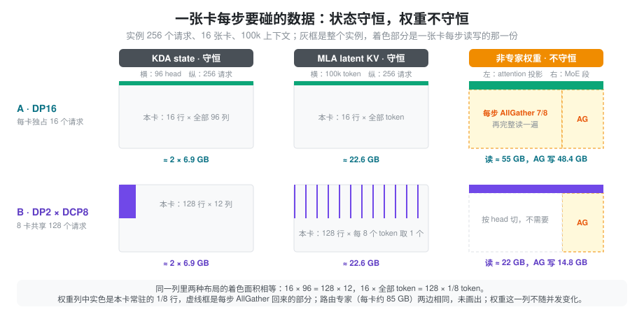
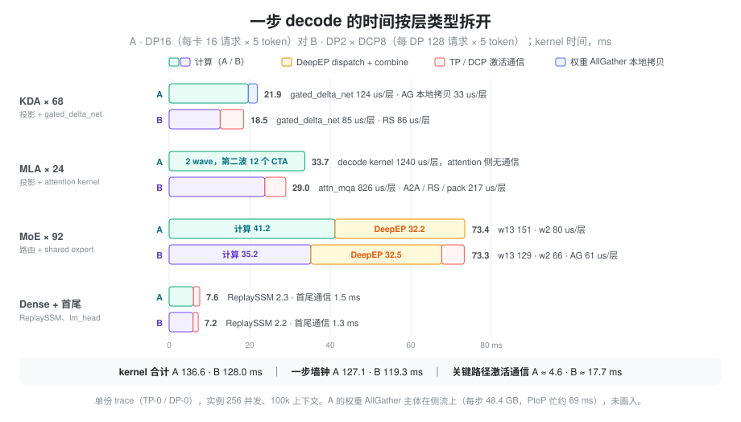
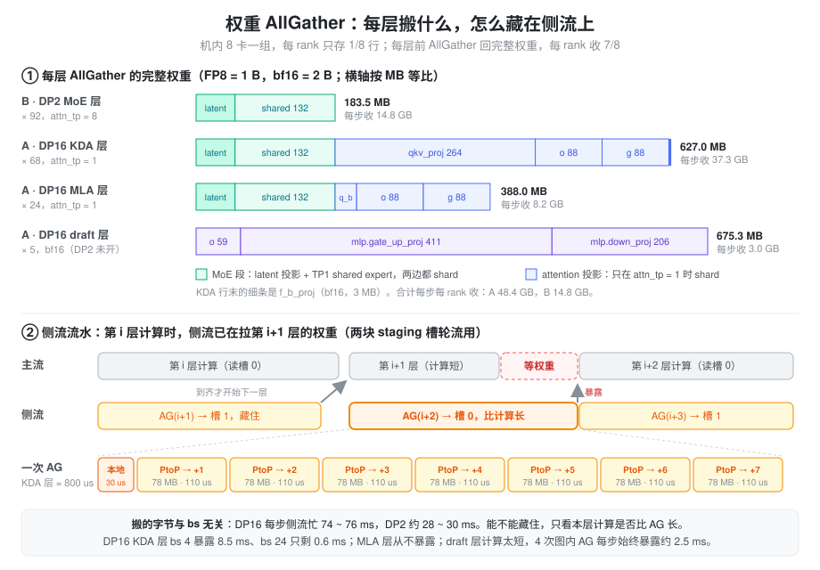
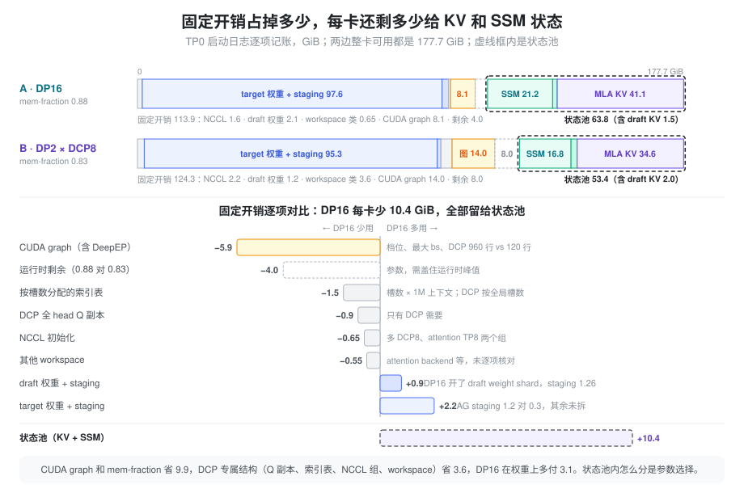

% Kimi K3 Decode：DP16 vs DP2 × DCP8

[Kimi K3 B200](./kimi_k3_b200.md) 里介绍了两套 decode 部署：A 是 DP16（每卡一个完整 attention 副本），B 是 DP2 × DCP8（一台机器 8 卡合成一个 attention 组）。本文用同一组 2 机 16 卡 B200 的 benchmark、100k 上下文下的 trace 和启动日志，把两者在**计算**和**显存**上逐项对齐，回答三个问题：同样的实例并发下谁快，为什么并发越低 DP16 越吃亏，以及 DP16 每卡多出来的 KV 和 SSM 状态池是从哪些固定开销里省出来的。

本文的 DP16 数据来自调整后的配置：`--speculative-dspark-block-size` 从 5 改成 4（每请求每步验证 5 个 token，与 DP2 相同），并关掉了 `SGLANG_DP_STATIC_SYNC_BOUND=24` 和 `SGLANG_SCHEDULER_SKIP_ALL_GATHER=1`。旧配置下每个 rank 都按 bs 24 的形状跑，100k 上下文时 bs 1 ~ 8 的步时间都是约 132.6 ms；现在 bs 1 降到 83.5 ms。

### 性能大图

`est_throughput` 按固定接受长度 3.5 估算（`bs × dp × 3.5 / generation_time`），两边每步验证的 token 数相同，所以它只反映步时间。

#### dp2dcp8

| ctx | bs/dp | bs*dp | est_throughput (tok/s) | generation_time (ms) | tpot (ms) |
| :--- | :--- | :--- | :--- | :--- | :--- |
| 100k | 16 | 32 | 2189.87 | 51.10 | 14.60 |
| 100k | 32 | 64 | 3741.62 | 59.90 | 17.10 |
| 100k | 48 | 96 | 4948.12 | 67.90 | 19.40 |
| 100k | 64 | 128 | 5848.60 | 76.60 | 21.90 |
| 100k | 80 | 160 | 6539.74 | 85.60 | 24.50 |
| 100k | 96 | 192 | 6776.56 | 99.20 | 28.30 |
| 100k | 112 | 224 | 7294.46 | 107.50 | 30.70 |
| 100k | 128 | 256 | 7601.14 | 117.90 | 33.70 |
| 100k | 144 | 288 | 8191.12 | 123.10 | 35.20 |
| 100k | 160 | 320 | 8386.50 | 133.50 | 38.20 |
| 100k | 176 | 352 | 8761.52 | 140.60 | 40.20 |
| 100k | 192 | 384 | 9083.68 | 148.00 | 42.30 |
| 200k | 16 | 32 | 2060.64 | 54.40 | 15.50 |
| 200k | 32 | 64 | 3433.92 | 65.20 | 18.60 |
| 200k | 48 | 96 | 4457.74 | 75.40 | 21.50 |
| 200k | 64 | 128 | 5222.48 | 85.80 | 24.50 |
| 200k | 80 | 160 | 5774.07 | 97.00 | 27.70 |
| 200k | 96 | 192 | 5967.03 | 112.60 | 32.20 |
| 400k | 16 | 32 | 1823.94 | 61.40 | 17.50 |
| 400k | 32 | 64 | 2906.99 | 77.10 | 22.00 |
| 400k | 48 | 96 | 3707.79 | 90.60 | 25.90 |

#### dp16

| ctx | bs/dp | bs*dp | est_throughput (tok/s) | generation_time (ms) | tpot (ms) |
| :--- | :--- | :--- | :--- | :--- | :--- |
| 100k | 1 | 16 | 670.39 | 83.50 | 23.90 |
| 100k | 4 | 64 | 2614.65 | 85.70 | 24.50 |
| 100k | 8 | 128 | 4539.85 | 98.70 | 28.20 |
| 100k | 12 | 192 | 6099.59 | 110.20 | 31.50 |
| 100k | 16 | 256 | 7091.10 | 126.40 | 36.10 |
| 100k | 20 | 320 | 7847.50 | 142.70 | 40.80 |
| 100k | 24 | 384 | 9302.64 | 144.50 | 41.30 |
| 200k | 1 | 16 | 667.80 | 83.90 | 24.00 |
| 200k | 4 | 64 | 2503.76 | 89.50 | 25.60 |
| 200k | 8 | 128 | 3976.07 | 112.70 | 32.20 |
| 200k | 12 | 192 | 5404.33 | 124.30 | 35.50 |
| 400k | 1 | 16 | 659.63 | 84.90 | 24.30 |
| 400k | 4 | 64 | 2283.40 | 98.10 | 28.00 |

DP16 只捕获了 `1 2 4 8 16 24` 这几档 CUDA graph，bs 12 和 bs 20 分别跑 bs 16 和 bs 24 的图，所以 bs 20 的步时间（142.7 ms）几乎和 bs 24（144.5 ms）一样。

### 问题：同样 16 张卡、同样的并发，按什么切

两套部署的专家侧完全相同：EP16，每卡 1/16 的路由专家，DeepEP low-latency + deep_gemm masked GEMM。差别只在 attention 侧怎么分请求：

- **DP16**：16 个 rank 各自独占 1/16 的请求。一个请求的 KDA state、MLA KV 都在一张卡上，attention 没有任何 TP 通信。
- **DP2 × DCP8**：每台机器的 8 张卡共同服务一半的请求。KDA 按 head 切（每卡 12 / 96 个 head），MLA latent KV 按 token 交错切（slot `p` 归 rank `p % 8`）。

直觉上两种说法都成立：「DP16 没有 attention 通信，应该更快」，「DP2 的 attention 权重天然只有 1/8，应该更省显存」。把 100k 上下文下相同实例并发的步时间放在一起：

| 实例并发 | DP16 bs/dp | DP2 bs/dp | DP16 步时间 (ms) | DP2 步时间 (ms) | DP16 吞吐 / DP2 |
| ---: | ---: | ---: | ---: | ---: | ---: |
| 64 | 4 | 32 | 85.7 | 59.9 | 0.70 |
| 128 | 8 | 64 | 98.7 | 76.6 | 0.78 |
| 192 | 12 | 96 | 110.2 | 99.2 | 0.90 |
| 256 | 16 | 128 | 126.4 | 117.9 | 0.93 |
| 320 | 20 | 160 | 142.7 | 133.5 | 0.94 |
| 384 | 24 | 192 | 144.5 | 148.0 | 1.02 |

步时间是 benchmark 的 `generation_time`。200k、400k 上趋势相同：实例并发 64 时 DP16 的吞吐是 DP2 的 0.73 和 0.79。显存上，DP16 每卡 MLA KV 池 41.1 GiB，DP2 是 34.6 GiB，实例 KV 容量 51.1 M 对 43.0 M token，DP16 多 19%。

所以两条直觉都只对一半。DP16 只有在每卡跑满 24 个请求时才追平并略快于 DP2，并发越低差得越多，bs 1 时一步也要 83.5 ms，而 DP2 在实例并发 32 时只要 51.1 ms。DP16 的权重常驻并不比 DP2 多多少，KV 反而更多。要解释这些，不能只看「谁有通信、谁有副本」，要看一张卡在一步里实际读写了多少字节、其中哪些随并发增长、哪些是固定的，以及哪些通信落在关键路径上。

### 抽象：状态守恒，权重不守恒，通信换了位置

decode 每步的主要开销是读 HBM。把一张卡每步要碰的数据分成两类，两种布局的差别就清楚了：

**跟请求走的状态，总量守恒，随并发增长。** KDA state 的大小是「请求数 × head 数」，实例并发 256 时 DP16 每卡 16 个请求 × 96 个 head，DP2 每卡 128 个请求 × 12 个 head，乘积相同。MLA KV 是「请求数 × token 数」，DP16 每卡 16 个请求 × 全部 token，DP2 每卡 128 个请求 × 1/8 的 token，乘积也相同。无论怎么切，16 张卡合起来要存、要读的都是全部请求的状态，平均到每卡一样多。

**跟模型走的非专家权重，总量不守恒，也不随并发变化。** DP16 的每张卡都要用完整的 KDA / MLA 投影、shared expert 和 latent 投影去乘自己那几个请求。weight shard 只解决了「存」（每卡存 1/8 行），没有解决「读」：每层前都要 AllGather 回完整权重，再完整读一遍。DP2 的 attention 投影按 head 切，每卡只读 1/8；只有 SP-MoE 段（latent 投影、shared expert）在 1/8 行上跑 TP1，仍需要完整权重。这部分开销每步都一样，bs 1 和 bs 24 付的一样多。

**通信换了位置，没有消失。** DP16 把通信换成了权重 AllGather，它与本层计算无关，可以在侧流上提前一层发起；但它的量也是固定的，本层计算太短时就藏不住。DP2 的通信是激活上的 reduce-scatter / all-gather / all-to-all，结果是下一个 kernel 的输入，落在关键路径上，量随行数增长。

按这个框架估一张卡每步的 HBM 读写（100k 上下文，实例并发 256）：

| 每卡每步 | A · DP16 | B · DP2 × DCP8 | 来源 |
| :--- | ---: | ---: | :--- |
| 路由专家权重读 | ≈ 85 GB | ≈ 85 GB | EP16 相同；w13 + w2 的 MBU × 时间 |
| KDA state 读 + 写 | 2 × 6.9 GB | 2 × 6.9 GB | 69 层 × 96 head × 128 × 128 × fp32，每请求 0.43 GB，× 16 个完整请求 |
| MLA KV 读 | ≈ 22.6 GB | ≈ 22.6 GB | 24 层 × 576 B × 100k token × 16 个完整请求 |
| 非专家权重读 | ≈ 55 GB | ≈ 22 GB | 由 trace 里 AllGather 的 PtoP 字节反推 |
| 权重 AllGather 写入 | 48.4 GB | 14.8 GB | trace 中每步 `Memcpy PtoP` 字节，bs 4 ~ 24 不变 |
| 关键路径上的激活通信 | ≈ 1.5 ms | ≈ 17.7 ms | 见「通信」一节 |

前三行完全相同，并随并发线性增长；后三行是两边各自的代价。DP16 每步多读写约 66 GB 权重，这是一笔与 bs 无关的固定开销；DP2 每步多约 16 ms 的关键路径通信，它随行数增长（DP2 bs 64 时约 6.5 ms）。并发低时，前三行小，DP16 的固定开销占比大，于是 DP16 慢得多；并发高时，DP2 的激活通信跟着行数涨上来，两边在每卡 24 个请求附近打平。

### 计算：一步的时间按层类型拆开

用 perfmap-pro 的 `analyze.py` 按 Kimi K3 的 block 标注（`annotations/sgl_b_k3_decode_dp16.json` / `sgl_b_k3_decode.json`）切开一步 decode，按层类型汇总 kernel 时间。取 100k 上下文下两个实例并发点，单位 ms：

| 层类型 | DP16 bs 8 | DP2 bs 64 | 差 | DP16 bs 16 | DP2 bs 128 | 差 |
| :--- | ---: | ---: | ---: | ---: | ---: | ---: |
| 实例并发 | 128 | 128 | | 256 | 256 | |
| KDA × 68 | 17.4 | 9.6 | +7.8 | 21.9 | 18.5 | +3.4 |
| MLA × 24 | 18.8 | 16.5 | +2.3 | 33.7 | 29.0 | +4.7 |
| MoE × 92 | 59.4 | 56.6 | +2.9 | 73.4 | 73.3 | +0.1 |
| Dense × 1 + 首尾 | 5.5 | 4.5 | +1.0 | 7.6 | 7.2 | +0.4 |
| kernel 合计 | 101.2 | 87.1 | +14.1 | 136.6 | 128.0 | +8.6 |
| 非 AllGather kernel 的并集 | 90.7 | 76.3 | +14.4 | 122.6 | 117.6 | +5.0 |
| 只有 AllGather 在跑 | 5.8 | 0.2 | +5.6 | 3.2 | 0.5 | +2.7 |
| GPU 全空 | 3.6 | 1.1 | +2.5 | 1.3 | 1.2 | +0.1 |
| trace 一步墙钟 | 100.1 | 77.6 | +22.5 | 127.1 | 119.3 | +7.8 |
| benchmark `generation_time` | 98.7 | 76.6 | +22.1 | 126.4 | 117.9 | +8.5 |

kernel 合计含多流重叠，所以比墙钟大。下面四行把墙钟拆成互不重叠的三段：除权重 AllGather（`Memcpy PtoP`）外任意 kernel 在跑的时间、只有 AllGather 在跑的时间、GPU 上什么都没跑的时间。trace 的墙钟和 benchmark 的 `generation_time` 相差不到 1.5 ms，可以直接对照。

两个并发点上 DP16 慢的原因不同：

- **实例并发 128**：差的 22.5 ms 里，KDA 的固定权重开销占 7.8 ms，「只有 AllGather 在跑」和「GPU 全空」占 8.1 ms。后者是 DP16 侧流上的权重 AllGather 跑到了关键路径上，见「通信」和「权重 AllGather」两节。
- **实例并发 256**：AllGather 基本藏住了，差的 7.8 ms 主要来自 MLA（+4.7）和 KDA（+3.4）。MLA 的差值来自 kernel 的 wave 量化，见下文。

#### KDA：投影读完整权重是固定开销，state kernel 慢 1.46 倍

DP16 每层的投影都乘完整权重。以 `kda_qkv_proj` 为例，实例并发 256 时 DP16 是 M = 80（16 请求 × 5）乘完整的 36864 × 7168 FP8 权重，主 GEMM 67.2 us，MBU 52%；DP2 是 M = 640（128 × 5）乘 1/8 的权重，28.6 us，MFU 44%。`kda_o_proj` 同理（30.6 对 11.2 us）。KDA block 的 kernel 时间里还算进了每层一次约 30 ~ 38 us 的 `memcpy128`，它是权重 AllGather 中本 rank 那 1/8 的本地拷贝，跑在侧流上，不占主流（见「权重 AllGather」一节）。这些读权重的开销与 bs 无关：DP16 的 KDA 投影加本地拷贝从 bs 4 到 bs 24 一直是每步 9.3 ~ 10.9 ms，其中本地拷贝占 2.0 ~ 2.6 ms，主流上的投影约 7 ~ 8 ms；DP2 只有约 2.7 ms。DP2 多出的是 SP-MoE 前的 reduce-scatter，bs 128 时每层 86 us，共 5.84 ms。

两边的 state 更新跑的是同一个 `kernel_cutlass_kda_decode_mtp_kernel`，每卡每层读写的 state 字节相同（16 × 96 head 与 128 × 12 head），q_len 现在也都是 5。但 DP16 每层 124 us（MBU 21.6%），DP2 每层 85 us（MBU 31.6%），慢 1.46 倍；实例并发 128 时是 68 对 46 us，1.48 倍。

旧版本猜测这来自侧流 AllGather 与 KDA kernel 抢 HBM。新 trace 里几乎每个 KDA kernel 都和 PtoP 重叠，bs 24 时少数没有重叠的 7 个平均 174.6 us，有重叠的平均 181.2 us，只快 3.6%。抢带宽不是主因，1.46 倍的来源目前没有找到，下一步需要用 ncu 对比两边同一 kernel 的 launch 配置和访存模式。

#### MLA：字节守恒，但 DP16 的 kernel 被 wave 量化拖慢

每卡要读的 KV 字节两边相同：DP16 一张卡算 16 个请求对全部 100k token 的 attention，DP2 一张卡算 128 个请求（复制 Q，全部 96 个 head）对 1/8 token 的 attention。但 DP16 的 decode kernel 每层 1240 us，DP2 的 `attn_mqa` 每层 826 us（MFU 46%）。

原因在 DP16 用的 tokenspeed MLA kernel 怎么划分 grid。q_len = 5 时走 M128 的 2-CTA 路径，KV 方向的切分数由 `tokenspeed_mla/mla_decode.py` 的 `_get_split_kv_and_workspace_size` 里的简化启发式决定：`split = min(148 // B // (q_len × 2), 32)`，B 是本卡请求数。B ≥ 8 时 split = 1，grid 是 (2, B × 5, split)：

| DP16 每卡 bs | grid | CTA 数 | B200 148 个 SM 上的 wave | 每层时间 |
| ---: | :--- | ---: | :--- | ---: |
| 4 | (2, 20, 3) | 120 | 1 | 214 us |
| 8 | (2, 40, 1) | 80 | 1 | 620 us |
| 16 | (2, 80, 1) | 160 | 2，第二波只有 12 个 CTA | 1240 us |
| 24 | (2, 120, 1) | 240 | 2 | 1248 us |

split = 1 时每个 CTA 要扫完整的 100k token，约 620 us。bs 16 的 160 个 CTA 比 SM 多 12 个，这 12 个 CTA 单独跑第二波，时间翻倍。如果 split 能按 wave 取整（FP8 的 M64 路径用的 `get_split_kv` 就是这样做的），按 CTA 数等比估算，bs 16 每层约 670 us、bs 24 约 1005 us、bs 8 约 335 us，每步分别省约 13.7、5.8、6.8 ms。这是估算，没有实测。DP2 bs 128 的 grid 是 (2, 640, 1)，1280 个 CTA 约 8.6 波，量化损失小。旧配置的 DP16 是 bs 24 × q_len 6，288 个 CTA 约 1.95 波，正好填满，所以当时两边 MLA 打平（802 对 798 us / 层）。

DP2 每层额外的通信开销（bs 128）：

- `dcp_exchange`：交换 `(O, LSE)` 的 all-to-all，132 us / 层，共 3.17 ms。
- `reduce_scatter`：o_proj 后进 SP-MoE，共 1.30 ms。
- `dcp_pack` + `dcp_lse_combine`：A2A 前的打包和按 LSE 合并，共 0.73 ms。
- `mla_prepare`：共 0.44 ms，处理 640 行而不是 80 行。

#### MoE：行数相同，两边打平

实例并发 256 时两边每卡 dispatch 的行数相同：DP16 是 16 × 5 = 80 行，DP2 先在组内 reduce-scatter，128 × 5 / 8 = 80 行。路由专家的 GEMM 是读权重受限的，每步把本卡 1/16 的专家几乎全部读一遍。DP16 的 w13 每层 151 us（MBU 约 50%），w2 80 us；DP2 是 129 us（MBU 约 57%）和 66 us。DP2 开了 `SGLANG_DEEPGEMM_MASKED_BLOCK_M=32`，同样 80 行下 GEMM 更快，可能与这个开关有关，没有单独验证。DeepEP 的 dispatch + combine 两边都是每步约 32 ms（32.2 对 32.5 ms）。

DP2 在 MoE 结束后还有一次 all-gather 把行拼回 TP 布局，每层 61 us，共 5.58 ms，正好抵掉它在 GEMM 上省下的时间，所以 MoE 段合计打平（73.4 对 73.3 ms）。

#### 首尾：词表切分的范围

DP16 的 `logits_all_gather` 0.61 ms、`lm_head` 前的 gather 0.26 ms、`lm_head` 0.24 ms；DP2 的尾部 all-gather 是 0.32 ms。两边的切法不同：DP16 用 `SGLANG_VOCAB_TP_SIZE=8` 把词表切到机内 8 个 DP rank 上，lm_head 要先把这 8 个 rank 的行收齐；DP2 用 `--enable-dp-lm-head`，词表只在本 DP 的 attention TP 组内切。两边的 KDA ReplaySSM 都在 2.2 ms 左右（2.27 对 2.15 ms）。

### 通信：关键路径上的，与侧流上的

把 DeepEP 之外的通信按「是否阻塞下一个 kernel」分开（实例并发 256）：

| 每步 | A · DP16 bs 16 | B · DP2 × DCP8 bs 128 |
| :--- | :--- | :--- |
| 关键路径 | dense all-reduce、logits / lm_head gather、首部 all-gather，共约 1.5 ms | KDA 后 RS 5.84 ms、MLA 的 A2A / RS / pack / 合并 5.2 ms、MoE 后 AG 5.58 ms、首尾约 1.1 ms，共约 17.7 ms |
| 侧流 | 权重 AllGather 48.4 GB，PtoP 忙约 69 ms（AllGather 的本地拷贝 `memcpy128` 也在这条流上） | MoE 段权重 AllGather 14.8 GB，PtoP 忙约 26 ms |
| DeepEP dispatch + combine | 32.2 ms | 32.5 ms |

DP16 侧流上的 AllGather 每步搬的字节固定，PtoP 的忙碌时间从 bs 4 到 bs 24 都在 69 ~ 70 ms。它能不能藏住，取决于主流上的计算够不够长：

| DP16 每卡 bs | 4 | 8 | 16 | 24 |
| :--- | ---: | ---: | ---: | ---: |
| 一步墙钟 | 87.5 | 100.1 | 127.1 | 145.1 |
| 非 AllGather kernel 的并集 | 71.9 | 90.7 | 122.6 | 140.9 |
| 只有 AllGather 在跑 | 10.8 | 5.8 | 3.2 | 2.9 |
| GPU 全空 | 4.8 | 3.6 | 1.3 | 1.4 |

bs 4 时计算本身只有 71.9 ms，和 AllGather 的 69 ms 差不多长，主流经常要等下一层的权重到齐，墙钟里有 10.8 ms 只有 AllGather 在跑，另有 4.8 ms GPU 全空。bs 16 以上计算变长，这两段降到 4 ~ 5 ms。DP2 两个点上这两段合计都不到 2 ms。这就是 DP16 小 bs 的下限：bs 1 也要 83.5 ms，其中权重读取和 AllGather 的固定开销占了大头。

### 权重 AllGather：shard 了什么、每层搬多少、多快

#### 要解决的问题：TP1 模块的权重在每张卡上都是完整副本

一个模块如果在本卡上以 TP1 运行，就要用完整权重去乘本卡的行。16 张卡各存一份完整副本，HBM 浪费在重复的权重上。weight shard 的做法是：机内 8 张卡组成一个 shard 组，每张卡只**存** 1/8 行；每层开始前，用一次 AllGather 把完整权重拼回到一块临时 buffer，算完就丢。显存省下 7/8，代价是每层每卡要从 NVLink 收 7/8 的完整权重，再从 HBM 完整读一遍。

已经按 TP 切过的权重本来就只有 1/8，没有必要再 shard。所以哪些权重被 shard，由各模块在本卡上的 TP 大小决定：

- **MoE 段两边都 shard。** 路由专家前后的 latent 投影和 TP1 的 shared expert 在两种布局下都是 TP1。
- **attention 投影只有 DP16 shard。** DP16 的 attn_tp = 1，KDA 和 MLA 的投影都是完整的；DP2 的 attn_tp = 8，投影已经按 head 切成 1/8。
- **draft 层只有 DP16 shard。** 它开了 `SGLANG_ENABLE_K3_DRAFT_WEIGHT_SHARD`，DP2 没开（日志 `0 weight-sharded layers`）。

#### 每层搬多少

每卡存 1/8，每次 AllGather 收 7/8。形状是 (out, in)，FP8 每元素 1 B，bf16 2 B：

| 层（层数） | 被 shard 的权重 | 完整 / 层 | 每卡收 / 层 | 每卡收 / 步 |
| :--- | :--- | ---: | ---: | ---: |
| DP2 MoE 层（92） | `routed_expert_down_proj` 3584 × 7168、`routed_expert_up_proj` 7168 × 3584、shared `gate_up_proj` 12288 × 7168、shared `down_proj` 7168 × 6144，均 FP8 | 183.5 MB | 160.6 MB | 14.77 GB |
| DP16 KDA 层（68） | MoE 段同上 4 项 + `qkv_proj` 36864 × 7168、`o_proj` 7168 × 12288、`g_proj` 12288 × 7168（FP8）、`f_b_proj` 12288 × 128（bf16） | 627.0 MB | 548.7 MB | 37.31 GB |
| DP16 MLA 层（24） | MoE 段同上 4 项 + `q_b_proj` 18432 × 1536、`o_proj` 7168 × 12288、`g_proj` 12288 × 7168，均 FP8 | 388.0 MB | 339.5 MB | 8.15 GB |
| DP16 draft 层（5） | `self_attn.o_proj` 7168 × 4096、`mlp.gate_up_proj` 28672 × 7168、`mlp.down_proj` 7168 × 14336，均 bf16 | 675.3 MB | 590.9 MB | 2.95 GB |

合计每卡每步收 DP16 48.41 GB、DP2 14.77 GB，与启动日志的 staging 容量（`capacity=627048448` / `183500800`，即最大一层的完整字节）和 trace 里 `Memcpy PtoP` 的字节都对得上。DP16 一层 KDA 要搬的量是 DP2 一层 MoE 的 3.4 倍，其中 `qkv_proj` 一项就有 264 MB。

有几类权重被刻意排除：

- **MLA 的 `fused_qkv_a_proj_with_mqa`。** `load_weights` 用手写的 `param.data[...]` 拷贝绕过了 `weight_loader`，加载时的行切分会被静默忽略；它也是 MLA 里最小的投影。
- **MLA 的 `kv_b_proj`、`w_kc` / `w_vc`。** `kv_b_proj` 被吸收进 `w_kc` / `w_vc` 后就释放了；后两者不是 `Linear.weight`，min-latency GEMM 的选择在初始化时按它们的形状定死。
- **draft 的 `qkv_proj`。** context KV 注入路径在 AllGather 窗口之外读它。
- **第 0 层（dense）。** `SGLANG_K3_WEIGHT_SHARD_LAYERS` 默认是 `1-92`，第 0 层不 shard。

#### 带宽：一个本地拷贝加 7 个 PtoP

每次 AllGather 在 trace 里是同一个 correlation 下的一组拷贝，都在侧流上：先是一个 `memcpy128` kernel，把本卡那 1/8 拷进 staging buffer；然后是 7 个串行的 `Memcpy PtoP`，即 NCCL 的 Copy Engine 路径，每个从一张对端卡拉 1/8。用「每卡收的 7/8 字节 ÷ 整组拷贝的墙钟」算等效带宽：

| | 每个 PtoP | 单个 PtoP 带宽 | 本地拷贝 | 一次 AllGather 墙钟 | 等效带宽 |
| :--- | ---: | ---: | ---: | ---: | ---: |
| DP16 KDA 层 | 78.4 MB | 707 ~ 712 GB/s | 28 ~ 38 us | 791 ~ 800 us | 686 ~ 694 GB/s |
| DP16 MLA 层 | 48.5 MB | 674 ~ 675 GB/s | 21 ~ 31 us | 524 ~ 525 us | 646 ~ 647 GB/s |
| DP16 draft 层 | 84.4 MB | 717 ~ 722 GB/s | 27 us | 836 ~ 843 us | 701 ~ 707 GB/s |
| DP2 MoE 层 | 22.9 MB | 579 ~ 614 GB/s | 9 ~ 14 us | 283 ~ 330 us | 514 ~ 568 GB/s |

B200 的 NVLink5 单向 900 GB/s，DP16 的单个 PtoP 能跑到约 80%。DP2 低一截，有两个原因：

- **拷贝小。** 每个 PtoP 只有 22.9 MB、约 37 us，PtoP 之间还有约 3 us 的空隙，固定开销占比高。
- **和激活通信抢 NVLink。** DP2 的侧流 AllGather 与 DCP 的 A2A、TP 的 RS / AG 和 DeepEP 同时在跑。bs 128 时与 NCCL / DeepEP kernel 重叠的 PtoP 中位数 563 GB/s，不重叠的 622 GB/s；bs 64 时两者没有差别（624 对 617）。DP16 bs 16 只有 685 对 715 的小差。

DP2 trace 里每步 846 个 `ncclDevKernel_AllGather_RING_LL` 是 DCP / TP 的激活 all-gather，不是权重 AllGather，不要和上面混在一起。

#### 能不能藏住：按层类型看暴露时间

搬的字节与 bs 无关，DP16 每步侧流忙 74 ~ 76 ms（PtoP 约 69 ms 加本地拷贝），DP2 约 28 ~ 30 ms。下表的「暴露」是 AllGather 的拷贝在跑、而其他流上没有任何 kernel 在跑的时间，即主流在等权重：

| 每步（ms） | 侧流忙 | 暴露合计 | KDA 层 | draft 层（图内 4 次） | MLA 层 + 图外的 draft AG |
| :--- | ---: | ---: | ---: | ---: | ---: |
| DP16 bs 4 | 73.8 | 11.45 | 8.54 | 2.75 | 0.16 |
| DP16 bs 8 | 74.1 | 6.42 | 3.60 | 2.71 | 0.11 |
| DP16 bs 16 | 75.1 | 3.67 | 0.94 | 2.63 | 0.10 |
| DP16 bs 24 | 76.0 | 3.18 | 0.58 | 2.52 | 0.08 |
| DP2 bs 64 | 27.5 | 0.40 | | | |
| DP2 bs 128 | 30.3 | 0.50 | | | |

这里把本地拷贝也算作 AllGather，所以比「通信」一节的「只有 AllGather 在跑」略大（那里本地拷贝算作普通 kernel）。三类层的情况不同：

- **KDA 层随 bs 藏住。** 第 i+1 层的 AllGather 要和第 i 层（attention + MoE）的计算重叠。一次 KDA AllGather 约 800 us，bs 4 时前一层的计算比它短，每步暴露 8.5 ms；bs 24 只剩 0.6 ms。
- **MLA 层基本藏住。** 它的 AllGather 只有约 525 us，比前一层的计算短，bs 4 时也只暴露约 0.1 ms。
- **draft 层始终暴露约 2.5 ms。** draft 是 5 个小 dense 层，每层计算远短于一次约 840 us 的 AllGather，图内 4 次 AllGather 几乎都在等。第 0 个 draft 层的 AllGather 被提到 CUDA graph 外、放在专门的 prefetch 流上，与 ReplaySSM 的 commit 重叠（日志 `draft hoisted 1/5 layer AG(s)`），bs 4 时也只暴露约 0.04 ms。

DP2 每步暴露不到 0.6 ms：它的 AllGather 每层只有约 300 us，而每层的计算更长，单 MoE 段就有约 615 us（bs 64）到 800 us（bs 128）。

#### 实现要点

代码在 `sglang/srt/sharding.py`，各模型用 `weight_shard_targets()` 声明可以 shard 的权重（`models/kimi_k3.py` 的 `KimiK3MoE`、KDA、MLA 三处，`models/dflash.py` 的 draft 层）。`KimiK3DecoderLayer._setup_weight_shard` 只在 `attn_tp_size == 1` 时把 attention 的目标加进来，这就是上面 DP2 不 shard attention 的那一行判断。几个值得知道的细节：

- **shard 组是机内 8 卡。** `get_weight_sharding_group_info` 从 TP16 组里按 `_K3_CE_GROUP_SIZE = 8` 切出机内的局部组，所以 AllGather 只走 NVLink，不跨机。
- **每层一次扁平 AllGather。** 一层所有目标的分片拼成一个连续 buffer，每层只发一次 `all_gather_into_tensor`，所有层共用一条侧流（`get_weight_sharding_side_stream`）。
- **提前一层发起，两块 staging 轮流用。** `WeightShardForwardPlanner` 在第 i 层开始前发起第 i+1 层的 AllGather；`FlatAGStagingPool` 有两块大小等于最大一层的 buffer，第 i+2 层的 AllGather 要等第 i 层用完它那块才能写。staging 因此占 2 × 最大一层，DP16 是 2 × 627 MB = 1196 MiB，DP2 是 350 MiB，即「显存」一节里的 staging pool。
- **FP8 先重量化再切。** block FP8 权重要先以完整形状走完 post-load 的重量化，再切成 1/8（日志 `requant-then-shard`）；`weight_scale_inv` 不切，各卡保留完整一份。这就是 DP16 加载峰值高的原因。bf16 权重在加载时直接切。
- **profile 标注只覆盖本地拷贝。** perfmap-pro 标注里的 `weight_ag` 匹配的是 `memcpy128`，也就是本地那 1/8 的拷贝；7 个 `Memcpy PtoP` 不在 block 的 kernel 时间里。

按上面的数字估算，DP16 的 draft weight shard 每步付约 2.5 ms 的暴露时间（bs 24 时约 1.7% 的步时间），换来的显存约 1.5 GiB（5 层完整 3.14 GiB，减去本地 1/8 的 0.39 GiB 和 1.26 GiB 的 staging），约合 2 个 KDA state 槽。这是估算，没有实测。

### 显存：固定开销决定状态池有多大

每卡显存可以分成两类。一类是**状态池**：MLA KV、KDA state、ReplaySSM ring 和 draft KV，它们跟着请求走。另一类是**固定开销**：权重、通信组、workspace、CUDA graph 和留给运行时的余量，它们跟着布局和启动参数走。

状态池的大小是算出来的结果，不是独立变量。启动时 sglang 先测当前空闲显存，扣掉 `(1 − mem_fraction_static)` 的运行时余量，剩下的就是状态池预算（`kv_cache_configurator.py` 的 `_profile_available_bytes()`）。在预算内，`_handle_max_mamba_cache()` 先按槽数扣掉 KDA state 和 ReplaySSM ring。本部署关了 radix cache，槽数就是每个 DP 的 `max_running_requests` 加 extra slots。余下的再分给 draft KV 和 MLA KV。所以 MLA KV 和 KDA state 之间怎么分，调参数就能改。比较两种布局时应该先比固定开销：它决定了状态池总共有多少。

两边启动时整卡可用都是 177.7 GiB（`Init torch distributed` 的占用 + `Load weight begin` 时的 avail）。下表按 TP0 启动日志逐项记账（sglang 日志里写的 GB 实际按 2^30 计，这里统一写 GiB）：

| 每卡固定开销 | A · DP16 | B · DP2 × DCP8 | 差 | 由什么决定 |
| :--- | ---: | ---: | ---: | :--- |
| NCCL / 分布式初始化 | 1.56 | 2.21 | −0.65 | 布局：DP2 多出 DCP8、attention TP8 两个组 |
| target 权重常驻（含 AG staging） | 97.55 | 95.32 | +2.23 | 布局 + weight shard 覆盖范围 |
| draft 权重（含 AG staging） | 2.11 | 1.23 | +0.88 | 开关：DP16 开了 draft weight shard，staging 1.26 |
| workspace 类 | 0.65 | 3.62 | −2.97 | 布局（DCP 专属结构）+ 每卡槽数 |
| CUDA graph（target + draft） | 8.06 | 13.96 | −5.90 | 参数（bs 档位、DeepEP 上限）+ 布局（每卡行数） |
| 运行时剩余 | 3.99 | 7.98 | −3.99 | 参数：`--mem-fraction-static` 0.88 对 0.83 |
| **固定开销合计** | **113.92** | **124.32** | **−10.40** | |
| **留给状态池** | **63.79** | **53.39** | **+10.40** | 177.7 减去上面合计 |

DP16 每卡的固定开销少 10.4 GiB，这就是它多出来的状态池。拆开看有三部分：

- CUDA graph 和运行时余量省了 9.9 GiB（CUDA graph 5.9，运行时余量 4.0）。这两项主要由参数决定，CUDA graph 里也有每卡行数这个布局因素。
- DCP 和每卡槽数带来的结构省了 3.6 GiB：全 head Q 副本、按槽数和全局槽数分配的表、两个 NCCL 组和 attention workspace。
- DP16 在 target 和 draft 的权重 staging 上多付了 3.1 GiB。

逐项看固定开销的来源：

- **权重常驻只差 2.2 GiB。** DP16 的非专家权重靠 weight shard 也只存 1/8，和 DP2 天然的 1/8 差不多；差额中能对上的一项是 AG staging pool（1196 MiB 对 350 MiB，DP16 要 staging 的权重更多），其余没有再拆。DeepEP buffer 不在这一行：它在第一次 dispatch 时才懒分配，也就是 CUDA graph 最大一档的 warmup 里，所以计入了下面的 CUDA graph。拆法见 [CUDA Graph 显存](./vram_cuda_graph.md)。
- **加载峰值 DP16 高得多。** DP16 的 `Load weight end` 占用 145.2 GiB，之后释放 47.7 GiB；DP2 是 109.9 GiB，释放 14.6 GiB。日志里的 `requant-then-shard: ... kept full through post-load` 说明 DP16 的被 shard 权重先以完整形状加载、重量化后才切成 1/8，加载时只剩 30.9 GiB 余量。这不影响稳态，但是 DP16 加更多 shard 范围或更大权重时要先撞上的墙。
- **draft 权重多 0.88 GiB。** draft 本身 DP16 只占 0.85 GiB（DP2 是 1.23 GiB），但 DP16 开了 `SGLANG_ENABLE_K3_DRAFT_WEIGHT_SHARD`，多了一个 1.26 GiB 的 AG staging pool（日志 `FlatAGStagingPool ... total=1288.0 MiB`）。
- **CUDA graph 少 5.9 GiB。** DP16 只捕获 6 个 batch size（1 ~ 24），DP2 捕获 23 个（8 ~ 192），但档位数只解释约 1.1 GiB。差额主要来自最大一档（7.19 对 10.24 GiB）和静态 buffer（0.17 对 1.33 GiB）：DCP8 的 attention 段每卡处理整个 DP 的 960 行，DP16 是 120 行。最大一档里的 DeepEP buffer 由 `SGLANG_DEEPEP_NUM_MAX_DISPATCH_TOKENS_PER_RANK` 决定，DP16 仍是 144（3.50 GiB），而它现在每卡只 dispatch 24 × 5 = 120 行，设成 120 可以降到 2.92 GiB。这是 DP16 省下显存最多的一项，逐项拆分见 [CUDA Graph 显存](./vram_cuda_graph.md)。
- **NCCL 初始化少 0.65 GiB。** 这一项只统计 `Init torch distributed` 期间建的通信组。TP0 进程在这期间建的 NCCL communicator，DP16 是 1 个 16 卡加 1 个 8 卡，DP2 是 1 个 16 卡加 2 个 8 卡。DP2 多出的组来自 DCP8 和 attention TP8（`parallel_state.py` 里 `_DCP` 只在 `dcp_size > 1` 时建，`_ATTN_TP` 的大小是 `tp / (cp × dp)`，DP16 下为 1，不需要通信）。这两个组都在节点内，各自还开了一份 CustomAllReduceV2（日志 `All Reduce config: symmetric_memory = 28.01 MB, local_buffer = 8.00 MB, multicast = True`，共 2 次）。DP16 剩下的 8 卡组是词表切分的 vocab TP，它显式关掉了 custom allreduce；TP16 组跨节点，两边的 custom allreduce 都被禁用。所以差额是一个节点内 NCCL comm 加两份 symmetric memory buffer，每项具体占多少没有单独测。两边之后还会懒建一些 comm（weight shard 组、EP 组），DP2 另外在 capture 前和 capture 中各多一个 8 卡 comm，这些计入后面的 workspace 和 CUDA graph。
- **workspace 类少 2.97 GiB。** 这一行是各区间 avail 下降减去有日志的分配后的残差。按区间拆开：

    | 区间残差（GiB） | DP16 | DP2 | 来源 |
    | :--- | ---: | ---: | :--- |
    | draft 加载后 → target 内存池结束 | 0.15 | 0.82 | `req_to_token` 表（DP16 的 draft AG staging 已归到 draft 权重） |
    | draft 内存池 | 0.13 | 0.83 | 与请求槽数同比例，未定位 |
    | attention backend 初始化 → capture 开始 | 0.36 | 1.58 | DCP 的全 head Q 副本、draft slot map、懒建的 DCP comm、backend workspace |
    | target graph 结束 → draft graph 开始 | 0 | 0.39 | 未定位 |

    能对上的几项都和 DCP 或每卡槽数有关：
    - **`req_to_token` 表按「槽数 × 最大上下文」分配。** decode 侧的表（`disaggregation/decode.py`）有 `size + pre_alloc_size + 1` 行，每行 `context_len = 1048576` 个 int32，也就是 4 MiB。DP2 是 192 + 16 + 1 = 209 行，0.82 GiB；DP16 是 24 + 8 + 1 = 33 行，0.13 GiB。两者和残差都对得上。DP16 每卡并发小 8 倍，这张表也小 8 倍。
    - **DCP 要在每卡上放一份全 head 的 Q 投影。** DCP 按序列切 KV，每卡都要算全部 96 个 head，而 attention TP8 只给每卡留了 12 个 head 的 `q_b_proj` 和 `w_kc`。`--dcp-replicate-q-proj` 在 capture 前用 `model_runner.py` 的 `_prepare_replicated_q_proj()` 把它们 all-gather 成全量：每层 `q_b_proj`（FP8）96 × 192 × 1536 = 28.3 MB，`w_kc`（bf16）96 × 128 × 512 × 2 = 12.6 MB，24 层 MLA 共 0.91 GiB。FP8 路径保留了原来的分片，因为非 decode 模式仍要用它，所以这 0.91 GiB 是纯增量。这次 all-gather 也是 DCP 组的 NCCL comm 第一次被用到的地方，日志里 DP2 在这个区间多建了一个 8 卡 comm。DP16 没有 DCP，这两项都没有。
    - **draft slot map 按全局 KV 槽数分配。** `DraftWindowSlotMap.full_to_swa` 是 int64，长度是 target 的全局槽数。DCP8 下全局槽数是每卡 KV 的 8 倍（21.5 M 对 3.19 M），所以 DP2 是 0.16 GiB，DP16 是 0.02 GiB。

    attention 区间扣掉以上几项后，DP2 还剩约 0.5 GiB，DP16 约 0.34 GiB。这部分应该是按最大 bs 和 head 数分配的 attention backend workspace，没有逐个 buffer 核对。
- **运行时剩余少 4.0 GiB。** 这一项完全由 `--mem-fraction-static` 决定，0.88 对 0.83。DP16 把更多显存划给了静态池，只给运行时留 4.0 GiB。它只需要盖住运行时的激活峰值，DP16 每卡行数少，所以能压得更低。

#### 状态池内部怎么分：参数选择

状态池总量定下之后，内部比例由参数决定：

| 状态池 | A · DP16 | B · DP2 × DCP8 | 由什么决定 |
| :--- | ---: | ---: | :--- |
| KDA state（mamba cache） | 16.16 | 12.79 | 槽数 × 本卡 head 数 |
| ReplaySSM ring buffer | 5.02 | 3.97 | 槽数 × `--linear-replayssm-cache-len` |
| draft KV（SWA 窗口池） | 1.50 | 2.00 | `--speculative-draft-window-size`、`SGLANG_DSPARK_SWA_POOL_MULTIPLIER` |
| target MLA KV | 41.11 | 34.63 | 前面扣完后剩下的全部 |
| 合计 | 63.79 | 53.39 | |

KDA state 和 ReplaySSM 都按槽分配，DP16 每槽 0.64 GiB，DP2 每槽 0.08 GiB。DP2 一个槽只存 12 个 head，乘 8 后，一个完整请求的代价两边都是 0.64 GiB，状态本身守恒。

两边真正的差别在槽数。槽数是每个 DP 的 `max_running_requests` 加 `--disaggregation-decode-extra-slots`，再加 1 个 padding 槽。DP16 是 24 + 8 + 1 = 33，DP2 是 192 + 16 + 1 = 209，折合完整请求约 26 个。DP16 为 extra slots 多留了 33% 的余量，DP2 只留了 8%。如果 DP16 也按 8% 留（extra slots 设成 2），能省约 6 个槽，也就是 3.8 GiB，这部分会全部流进 MLA KV。所以 KDA state 多、MLA KV 少，都是这组参数的结果，不是布局本身的代价。

另外，DP16 的 KDA state 从旧配置的 16.62 降到了 16.16 GiB。原因是其中的 conv window 部分按每请求 token 数分配，6 降到 5 之后，这部分从 2.81 降到 2.35 GiB。

日志里 `DSpark SWA draft: reclaimed 16.37 GiB`（DP16）和 `1.11 GiB`（DP2）差得很多。但这个数是和一个假想基线比出来的回收量，基线是「draft KV 按 target token 等比分配」，所以它不是两边实际占用的差。两边 draft KV 的实际占用是 1.5 对 2.0 GiB。DP2 的 draft KV 按 head 切到 8 卡上，每 slot 1280 B，DP16 是 10240 B。但 DP2 每个请求预留的窗口槽更多（`DSpark draft SWA slot map` 日志里 7997 对 4753），`SGLANG_DSPARK_SWA_POOL_MULTIPLIER` 也是 4 对 3，合起来仍比 DP16 大 0.5 GiB。

### 容量与吞吐

MLA KV 每 token 的字节在两种布局下相同（24 层 × 576 B，DCP 只是把 token 分到不同卡上），所以实例能放多少 token 只取决于 16 张卡的 KV 池总字节：

| | A · DP16 | B · DP2 × DCP8 |
| :--- | ---: | ---: |
| 每卡 KV slot | 3,193,344 | 2,690,112 |
| 每个 DP 的容量 | 3.19 M | 21.5 M（× dcp_size 8） |
| 实例容量 | 51.1 M | 43.0 M |
| 384 并发时每请求平均可用 | 133 k | 112 k |

注意 sglang 的 `sglang:max_total_num_tokens` 指标是每个 rank 本地池的大小，DCP 下一个 DP 的容量要乘 `dcp_size`（`/server_info` 里可以读到）。perfmap-pro 的 `d.py` 自动推 sweep 上限时就是这么算的。

吞吐方面，两边现在用同一个 draft、同样的 block size，每步每请求都验证 5 个 token，接受长度相同，吞吐之比就是步时间之比的倒数。100k 上下文下，DP16 只在实例并发 384 时快 2.4%，并发 256 时慢 7%，并发 64 时慢 30%。DP16 的优势在两处：满并发时没有关键路径上的激活通信，KV 容量多 19%。DP2 的优势在另一头：并发上不去时，它没有 DP16 那笔固定的权重读写和 AllGather，一个请求的访存还能摊到 8 张卡上；单请求能放的上下文也更长（一个 DP 21.5 M 对 3.19 M）。

### 实现与开关

两份启动脚本（`start_k3_decode_dp16.sh` / `start_k3_decode_dp2.sh`）中影响上面结论的差异：

| 开关 | A · DP16 | B · DP2 × DCP8 | 影响 |
| :--- | :--- | :--- | :--- |
| `--dp-size` / `--dcp-size` | 16 / 1 | 2 / 8 | 布局本身 |
| `SGLANG_ENABLE_K3_WEIGHT_SHARD` | 1，覆盖 attention 投影 + MoE 段 | 用旧名 `SGLANG_ENABLE_K3_MOE_WEIGHT_SHARD=1`，只覆盖 MoE 段 | 权重 AllGather 48.4 对 14.8 GB / 步 |
| `SGLANG_ENABLE_K3_DRAFT_WEIGHT_SHARD` | 1 | 未开 | draft 权重 0.85 对 1.23 GiB，DP16 另有 1.26 GiB staging |
| `--speculative-dspark-block-size` | 4（旧配置是 5） | 4 | 每步每请求验证 5 对 5 个 token |
| `SGLANG_DP_STATIC_SYNC_BOUND=24`、`SGLANG_SCHEDULER_SKIP_ALL_GATHER=1` | 已注释掉（旧配置开着） | 未设 | 开着时每个 rank 都按 bs 24 的形状跑，小 bs 也付满 bs 的时间 |
| `--max-running-requests` / `--cuda-graph-bs` | 24 / DP，`1 2 4 8 16 24` | 192 / DP，8 ~ 192 共 23 档 | CUDA graph 8.1 对 14.0 GiB；DP16 的 bs 12、20 会 pad 到 16、24 的图 |
| `--disaggregation-decode-extra-slots` | 8 | 16 | KDA state 槽 32 对 208 |
| `--mem-fraction-static` | 0.88 | 0.83 | 剩余 4.0 对 8.0 GiB |
| `SGLANG_DEEPEP_NUM_MAX_DISPATCH_TOKENS_PER_RANK` | 144，大于每卡实际的 120 行 | 128，覆盖每卡 120 行 | DeepEP buffer 3.50 对 3.11 GiB（计入 CUDA graph） |
| `SGLANG_DSPARK_SWA_POOL_MULTIPLIER` | 3 | 4 | draft KV 1.5 对 2.0 GiB |
| `SGLANG_DEEPGEMM_MASKED_BLOCK_M=32`、`SGLANG_K3_SHARED_IN_COMBINE_HOOK=1` | 未开 | 开 | MoE GEMM 对齐、shared expert 与 combine 重叠 |
| `SGLANG_ENABLE_EMBED_DP_SHARD`、`SGLANG_ENABLE_DSPARK_LM_HEAD_DP_SHARD`、`SGLANG_DSPARK_LM_HEAD_VOCAB_ALL_GATHER`、`--moe-dense-tp-size 1` | 开 | 未开 | 首尾 embedding / lm_head 和 dense 层的切法，影响在 1 ms 量级 |
| `SGLANG_OPT_FLASH_KDA_CUTE=1` | 未开 | 开 | 只作用于 prefill 的 KDA backend，与 decode 无关 |

weight shard 的覆盖范围由 `sharding.py` 的 `WeightShardingConfig` 决定，`environ.py` 里的注释写明 attention 投影只在「attention TP narrow 是 identity」时被 shard，也就是 attn_tp = 1 的 DP16。层范围由 `SGLANG_K3_WEIGHT_SHARD_LAYERS`（默认 `1-92`）控制。每次 AllGather 在 trace 里显示为侧流上的一个 `memcpy128`（本 rank 分片）加 7 个 `Memcpy PtoP`（NCCL Copy-Engine 路径），带宽和暴露时间见「权重 AllGather」一节。

### 测量方法与局限

- trace：`profile_dp16/d_bs{4,8,16,24}_100k/` 与 `profile_dp2/d_bs{64,128}_100k/`，各一份 TP-0 / DP-0 的 torch profile，7 ~ 13 个 decode 步。DP16 用 `python3 analyze.py -o <dir> -a annotations/sgl_b_k3_decode_dp16.json -qlen 5 -b 0` 分析，DP2 用 `-a annotations/sgl_b_k3_decode.json -b 0`。只看了一张卡，没有看 rank 间的差异。旧配置的 DP16 trace 已被覆盖，旧数字只在正文里引用。
- 权重 AllGather 的统计：在 PtoP 所在的侧流上，按「1 个 `memcpy128` + 后续连续的 `Memcpy PtoP`」切出每次 AllGather，按 PtoP 字节 × 8/7 还原完整大小来区分层类型。不能按 correlation 分组，一次 CUDA graph replay 里的拷贝共享同一个 correlation。暴露时间是 AllGather 拷贝区间减去其他所有 kernel / memcpy 区间并集后的剩余。
- DP16 的标注没有给 MLA 层的 kernel 打 tag，MLA × 24 是按 block 位置归类的（首尾之间、非 KDA / MoE / Dense 的 block）。
- 一步墙钟取 GPU 侧 `scheduler.run_batch` 标注中时长大于 10 ms 的那些（另一半是 0 ms 的空标注）的中位数，与 benchmark 的 `generation_time` 相差不到 1.5 ms。kernel 合计是各 block 内 kernel 时间之和，含多流重叠部分；「非 AllGather kernel 的并集」是除 `Memcpy PtoP` 外所有 kernel 和 memcpy 区间的并集。
- 每卡每步的 HBM 字节表里，路由专家和非专家权重的读取量是估算值（前者由 GEMM 的 MBU × 时间得出，后者由 AllGather 的 PtoP 字节按 8/7 反推）。
- MLA wave 量化的节省量是按 CTA 数等比估算的，没有改 kernel 实测。DP16 `gated_delta_net` 慢 1.46 倍的原因尚未找到。
- 显存数字来自每种部署的一次启动日志（TP0）。benchmark 来自 perfmap-pro 的 `output/batch_2026_10_29_20_13/`（DP16）。

几个可以直接试的方向：

- **MLA 的 split 按 wave 取整。** 让 M128 2-CTA 路径也用 wave-aware 的 `get_split_kv`，估计 DP16 bs 16 每步省约 13.7 ms，bs 24 省约 5.8 ms。
- **DeepEP 上限降到 120。** DP16 每卡 dispatch 120 行，`SGLANG_DEEPEP_NUM_MAX_DISPATCH_TOKENS_PER_RANK` 从 144 改成 120，DeepEP buffer 省约 0.6 GiB，masked GEMM 中间张量估计再省约 0.4 GiB。
- **减少 extra-slots。** DP16 的 KDA state 和 ReplaySSM 每槽约 0.64 GiB。extra-slots 从 8 降到 2，余量和 DP2 一样是 8%，能把约 3.8 GiB 让给 MLA KV。
- **对齐 MoE 开关。** DP2 上已经开的 `SGLANG_DEEPGEMM_MASKED_BLOCK_M=32` 和 `SGLANG_K3_SHARED_IN_COMBINE_HOOK=1` 在 DP16 上没开。同样 80 行时 DP16 的 w13 / w2 每层比 DP2 慢 22 / 14 us，合计每步约 3 ms，是否兼容 attn_tp = 1 需要先确认。

### 小结

两种布局下，跟请求走的 KDA state 和 MLA KV 在每卡上的字节完全相同，差别来自它们各自付出的代价。DP16 每步多读写约 66 GB 权重，侧流上还有约 69 ms 的 AllGather，这些都与 bs 无关。它 shard 了 attention 投影、MoE 段和 draft 层，每卡每步从 NVLink 收 48.4 GB，单个 PtoP 跑到约 710 GB/s；KDA 层的 AllGather 在 bs 24 时基本藏住，draft 层的始终暴露约 2.5 ms。DP2 每步多一段关键路径上的激活通信，实例并发 256 时约 17.7 ms，随行数增长。所以并发越低 DP16 越吃亏（实例并发 64 时吞吐只有 DP2 的 0.70，bs 1 也要 83.5 ms），每卡跑满 24 个请求时才追平并略快。在此之上，DP16 的 MLA kernel 因 wave 量化在 bs 16 多花将近一倍时间，这是目前最值得修的一项。显存上，两边的权重常驻只差 2 GiB。DP16 的固定开销每卡少 10.4 GiB，主要来自更少的 CUDA graph、更高的 `mem-fraction-static`，以及不需要 DCP 专属的 Q 副本、索引表和通信组，这 10.4 GiB 全部留给了 KV 和 SSM 状态池。状态池内 KDA state 和 MLA KV 怎么分，由槽数等参数决定。高并发、中短上下文时 DP16 能放更多 KV、步时间略短；并发不足或单请求上下文很长时，DP2 更合适。
