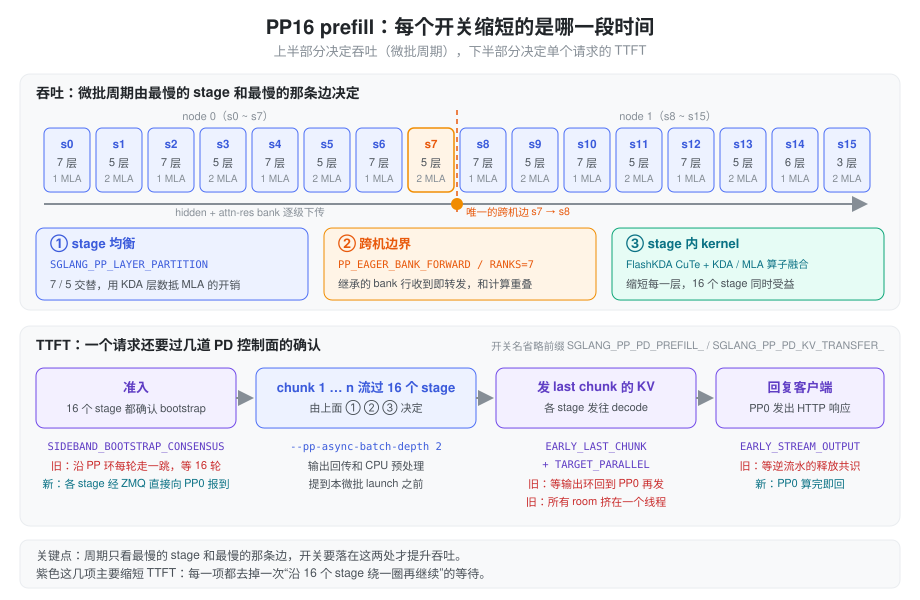
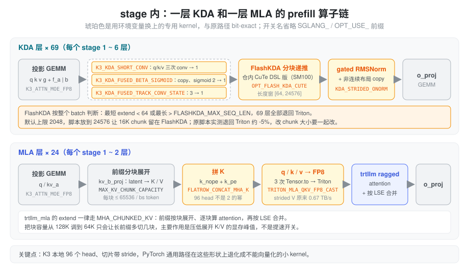

% Kimi K3 Prefill PP16

[Kimi K3 B200](./kimi_k3_b200.md) 介绍了 prefill 为什么用 PP16 × TP1，以及每个优化是哪次提交引入的。本文换一个角度：拿 prefill 启动脚本 `start_k3_prefill_pp16.sh` 里的环境变量逐个对照 aiak_sglang 代码，说清楚每个开关缩短的是哪一段时间、为什么能缩短，以及哪些开关其实没有生效。

### 问题：PP16 prefill 的时间花在哪

PP16 把 93 层切成 16 段，一张卡一段。层内没有任何 TP 或 EP 通信，代价转移到了三个地方：

- **最慢的 stage**。流水线稳定后，每个微批的周期等于最慢 stage 的耗时。层数平均分不等于耗时平均分：MLA 层的注意力代价随前缀变长而增长，KDA 层不会。
- **最慢的那条边**。stage 之间传的是 hidden 加 attn-res bank `[T, NB, H]`（见 [Attention Residuals](./attention_residuals.md)），bank 比 hidden 大好几倍。16 段里只有 s7 → s8 跨机，其余 14 条边走 NVLink。
- **绕环一圈的协议**。PD 分离要求"16 个 stage 都准备好"之后才接请求、"16 个 stage 都发完 KV"之后才算结束。如果这些确认沿 PP 环一跳一跳地传，每次都要多付 16 轮迭代。

另外，单个 stage 内部还有一个和 PP 无关的问题：K3 每卡 96 个 head，不是 2 的幂；投影输出切出来的张量带 stride。PyTorch 的通用实现在这些形状上会退化成不能向量化的小 kernel。

### 抽象：吞吐看周期，TTFT 看确认次数

把脚本里的开关按"缩短的是哪段时间"分成两组，就容易看清：

- **吞吐**由微批周期决定。周期取决于最慢的 stage 和最慢的边，开关要落在这两处才有用：层怎么切、跨机边上传什么、每层的 kernel 有多快。
- **TTFT** 除了计算本身，还取决于一个请求要经过几次需要全体 stage 确认的协议。这一组开关的共同做法是把"沿环串行传 16 跳"改成"各 stage 直接报到"，或者干脆不等确认。

下面三节讲吞吐，第四节讲 TTFT，最后两节是不影响速度但必须设对的开关，以及当前脚本里没生效的设置。

### 吞吐一：层怎么切

`SGLANG_PP_LAYER_PARTITION="7,5,7,5,7,5,7,5,7,5,7,5,7,5,6,3"` 指定每个 stage 的层数，由 `distributed/utils.py` 的 `get_pp_indices` 读取，启动时校验个数等于 pp_size、总和等于 93。

按 config 的 `full_attn_layers` 数下来，这个切法有以下规律：

- **7 层的 stage 有 1 个 MLA，5 层的有 2 个**。多 2 层 KDA 换少 1 层 MLA，让两种 stage 在长前缀下耗时接近。这条是按层分布推断的设计意图，仓库里没有逐 stage 的实测耗时。
- **每两个 stage 正好是一个 12 层的 attn-res block**。偶数 stage 从 `layer_idx % 12 == 0` 的层开始，会往 bank 里写一行；奇数 stage 一行都不写，只透传。
- 最后一个 stage 只放 3 层，因为它还要做输出侧 attn-res 聚合、final norm、lm_head 采样和 DSPARK draft KV 写入。

跨机切点的位置是这个切法里最讲究的地方。前 8 段合计 48 层，所以 s7 负责第 43 ~ 47 层（0-based），跨机消息里的 bank 只有 4 行（第 0、12、24、36 层写入）。最初的 PP16 脚本（luno-4974）注释里记录：切点挪到 49 会让第 48 层写的第 5 行也跨机，吞吐下降 3.8%。

旧版脚本还有一条约束：前缀和不能落在 8/24/52/68/84，否则 DSPARK 的 aux 抓取层（0-based 7/23/51/67/83）正好是某个 stage 的最后一层，会访问只有最后一个 stage 才有的 `output_attn_res_proj` 而报错。现在的切法前缀和里有 24 和 84，能启动是因为 luno-5270 给非最后 stage 加了 `next_stage_attn_res_proj`（`models/kimi_k3.py` 的 `_dspark_capture_stream`），这条约束已经不存在。

### 吞吐二：跨机边上的 bank

PP 消息由 `KimiK3Model.forward` 在非最后 stage 组装：`hidden_states` 加 `residual`，而 K3 的 `residual` 实际是 `attn_res.block_residual`，形状 `[T, NB, H]`。在 48 层切开时 NB = 4，bank 占 s7 → s8 流量的 80%。

问题在于这 4 行 s7 一行都没改，却要等 s7 的 forward 跑完才跟着 hidden 一起发出去。这时下一个微批还没开始算，传输没有可以重叠的计算。

`SGLANG_PP_EAGER_BANK_FORWARD=1` 把消息拆成两条（`managers/scheduler_pp_mixin.py` 的 `_pp_eager_bank_forward` / `_pp_eager_bank_strip`）：

- **pp_bank**：从上游继承的行，收到后立刻转发，不等本 stage 的 forward。每轮迭代都发一条，没有内容时发空消息，保证两端的消息数不会错开。
- **proxy**：hidden 加本 stage 新写的行（`residual[:, k:, :]`），forward 完再发。

接收端默认（`SGLANG_PP_EAGER_BANK_PREFETCH=1`）在侧流上提前一轮收 bank。传的字节和原来完全相同，结果 bit-exact。`SGLANG_PP_EAGER_BANK_RANKS="7"` 把改写限定在 s7 这个发送端，也就是唯一的跨机边。

luno-4974 的实测（2 机 PP16，varlen prefill，平均输入 76K，200 请求，各跑两次）：s7 → s8 的 boundary stall 从 33.2 / 30.5 ms 降到 11.2 / 9.8 ms，吞吐从 61623 提到 63882 tok/s，提升 3.7%。

这是一个两端协议：s8 是否要收 pp_bank，取决于 s7 是否发。两台机器的 pod 各自读环境变量，如果一台设了一台没设，就会有一端的 send 没有对应的 recv。所以 `_pp_resolve_eager_bank_cfg` 启动时在 PP 组里 all-gather 配置，一律以 PP0 的为准，不一致只打 warning。

`--pp-async-batch-depth 2` 是同一类的命令行参数：微批槽位变成 `pp_size + 2`，上一个微批的输出回传和 CPU 侧预处理放到当前微批 launch 之前提交，藏到 GPU 计算后面。

### 吞吐三：stage 内的 kernel

前两节决定的是"哪个 stage、哪条边最慢"，这一节让每一层本身变快。93 层里 69 层是 KDA、24 层是 MLA，每个 stage 都有两种层，所以这些优化 16 个 stage 一起受益，不会改变谁是瓶颈。

#### KDA

| 开关 | 换掉了什么 | 代码位置 |
| :--- | :--- | :--- |
| `SGLANG_OPT_FLASH_KDA_CUTE=1` | 外部 `flash_kda` 包换成仓内 CuTe DSL 实现（SM100+），加载完权重后预编译，避免首个请求冷编译 | `layers/attention/linear/kernels/kda_flashkda.py`；预编译在 `models/kimi_k3.py` 的 `precompile_kernels_after_loading` |
| `SGLANG_FLASHKDA_MIN_SEQ_LEN=64` / `MAX_SEQ_LEN=24576` | FlashKDA 的适用长度窗，默认上限 2048 | `FlashKDAKernel._should_fall_back` |
| `SGLANG_K3_KDA_SHORT_CONV=1` | q/k/v 三次 Triton `causal_conv1d_fn`（含 SiLU 和 conv state 更新）合成一次 CUDA launch；5 种 prefill 形状上合计快 1.787 倍 | `layers/attention/linear/kda_backend.py` 的 `forward_extend` |
| `SGLANG_OPT_USE_K3_KDA_FUSED_BETA_SIGMOID=1` | 从 `[f_a\|b]` 的 strided 切片上做 BF16 → FP32 copy 和 sigmoid，两个 kernel 合成一个 | `models/kimi_k3.py` 的 `kda_activate_beta` |
| `SGLANG_OPT_USE_K3_KDA_FUSED_TRACK_CONV_STATE=1` | `prefix_lens > 0` 比较、conv 窗口 gather、`index_put` 三个小 kernel 合成一个，原地写 conv pool | `kda_backend.py` |
| `SGLANG_OPT_USE_KDA_STRIDED_ONORM=1` | `FusedRMSNormGated` 的 `reshape` 被迫做的非连续 copy 和 gated RMSNorm 合成一个 kernel | `models/kimi_k3.py` 的 KDA 输出尾部 |

这一组里最容易踩坑的是 FlashKDA 的长度窗。判断是**按整个 batch** 做的：batch 里最短的 extend 低于下限，或者最长的超过上限，这个 batch 的 69 层 KDA 全部退回 Triton `chunk_kda`。原 PP16 脚本注释记录这会慢约 5%，并且单独调大 chunk 会因此表现为负优化。所以 `SGLANG_FLASHKDA_MAX_SEQ_LEN` 必须不小于 `--chunked-prefill-size`。当前脚本 chunk 是 16K、上限是 24K，满足要求。

四个小融合单看每个只省几微秒，但它们都在 KDA 层的 forward 里，一个 chunk 要乘以 69 层。四个都与原路径 bit-exact，形状覆盖不到时自动回退。

#### MLA

`trtllm_mla` 后端处理 extend 时一律走 `MHA_CHUNKED_KV`（`models/deepseek_common/attention_backend_handler.py` 的 `handle_attention_trtllm_mla`）：KV pool 里只存 latent，每次 forward 都要把前缀经 `kv_b_proj` 分块展开成完整的 K/V，逐块算 attention 再按 LSE 合并。

| 开关 | 作用 |
| :--- | :--- |
| `SGLANG_OPT_USE_FLATROW_CONCAT_MHA_K=1` | 把 `k_nope` 和 `k_pe` 拼成 K。现有的两个快速 kernel 分别只支持 128 head 和 2 的幂个 head，K3 的 96 head 都不满足，PyTorch 切片赋值会退化成两个每线程只搬 2 字节的 copy。开启后按 (token, head) 平铺成行，用 Triton 写。新 token 和每个前缀块的拼接都会用到 |
| `SGLANG_OPT_USE_TRITON_MLA_QKV_FP8_CAST=1` | `_quantize_fp8_qkv` 里三次 bf16 → fp8 的 `Tensor.to` 换成 Triton。v 是 `kv[..., 128:]` 的视图，head stride 256、只有内层 128 个元素连续，torch 的 cast 无法向量化，只有 0.667 TB/s。在 B200、T = 32768、12 head 的形状上，它占这组算子 397.6 µs 中的 188.9 µs |
| `SGLANG_MAX_KV_CHUNK_CAPACITY=65536` | 每个前缀块最多展开多少 token（按 batch 平分），默认 128K。调小后长前缀会多切几块，主要作用是压低展开 K/V 的临时显存峰值。这个值是在 luno-5385（修复 PP 重放时准入不一致的崩溃）里改的，应该看作稳定性设置，不是提速开关 |

FP8 cast 那个 kernel 连 PyTorch 的溢出编码都照搬了：|x| > 464 以及 inf / nan 一律写成带符号的 0x7f，而不是硬件默认的截到 448。bit-exact 就是靠这种细节保证的。

`SGLANG_K3_ATTN_MOE_FP8=1` 不是可选的优化。它是加载 `/Kimi-K3-ATTN-MOE-DENSE-FP8` 这份混合 checkpoint 的总开关：attention 投影、shared expert 等按 ModelOpt FP8 加载，路由专家保持 MXFP4（`layers/quantization/modelopt_quant.py` 的 `_k3_attn_moe_fp8_enabled`）。换了 checkpoint 就必须开。

### TTFT：去掉绕环一圈的确认

一个请求在 PD prefill 里要过三道全体 stage 的关口：准入前 16 个 stage 都要确认 bootstrap 完成；最后一个 chunk 算完，16 个 stage 各自的 KV 都要发出去；全部发完后才释放 KV 页和请求槽位。原来这三道关口都沿 PP 环推进，每一跳占一个微批槽位。下面四个开关都只在 `pp_size > 1` 时生效，前三个要求 Mooncake 传输后端。

| 开关 | 原来卡在哪 | 现在 |
| :--- | :--- | :--- |
| `SGLANG_PP_PD_PREFILL_SIDEBAND_BOOTSTRAP_CONSENSUS=1` | "所有 stage 都确认了这个 room"沿 PP 中继链每轮迭代走一跳，准入前固定多等 pp_size 轮 | 每个 stage 自己的 transfer_infos 齐了就经旁路 ZMQ 直接向 PP0 报 PP_READY，PP0 收齐 16 份才把 room 置为 `WaitingForInput`。准入条件不变，只是确认改成并行 |
| `SGLANG_PP_PD_PREFILL_EARLY_LAST_CHUNK=1` | 最后一个 chunk 的 KV 在 `process_batch_result` 里发，要等输出沿 PP 环回到 PP0 | 非 PP0 的 stage 在下一轮迭代的 CPU 阶段就发自己那几层的 KV/state；aux（首 token）只由 PP0 写和发；输出环里中继的那半圈去掉，只剩最后一个 stage 发、PP0 收 |
| `SGLANG_PP_PD_KV_TRANSFER_TARGET_PARALLEL=1` | 发送队列的 key 是目标 rpc 端口之和，decode 集群固定时这个值不变，一个 rank 的所有 room 都挤在同一个队列、同一个线程上串行 | 按 `hash(bootstrap_room)` 选队列；一个 room 有多个 decode 目标时拆成每个目标一个任务。这个开关隐含打开 `SGLANG_PP_PD_KV_TRANSFER_ROOM_SHARDING` |
| `SGLANG_PP_PD_PREFILL_EARLY_STREAM_OUTPUT=1` | HTTP 响应要等释放共识。共识的第二圈逆着流水线方向走，曾经让 prefill 侧的 TTFT 比 decode 还大（luno-5302） | PP0 自己的 prefill 一完成就回复客户端。共识只控制 KV 页和请求槽位的释放。decode 端靠自己收到的传输通知判断 KV 是否成功，不依赖这个响应 |

旁路共识和 eager bank 一样是两端协议，但处理更严格：`disaggregation/common/conn.py` 的 `_check_uniform_sideband_flag` 在启动时广播 PP0 的值，任何 rank 不一致就直接报错退出。原因是共识环上的消息不带 tag，只按发送顺序配对；一端少发一条，后面所有消息都会错位，而且不会有任何异常。

开启 `EARLY_STREAM_OUTPUT` 后，prefill 侧上报的 TTFT 指标不再按"KV 传完"计时（`disaggregation/prefill.py`），看监控时要注意口径变了。

为这条路径服务的两个容量参数：`SGLANG_DISAGGREGATION_QUEUE_SIZE=50` 和 `SGLANG_DISAGGREGATION_THREAD_POOL_SIZE=50`。默认是 4 个队列，线程数按 CPU 数算，最多 12 个。每个队列独占一个工作线程，按 room 分片要有足够多的队列才能真正并行。`SGLANG_MOONCAKE_SEND_AUX_TCP=1` 让 aux 这种几十字节的元数据走 TCP，不占 RDMA 传输。

`SGLANG_DISAGGREGATION_DECODE_LAZY_ALLOC=true` 让 decode 先认领请求，等 prefill 报告算完再分配 KV，`SGLANG_DISAGGREGATION_LAZY_INDICES_TIMEOUT=60` 是 prefill 等 decode 回传 KV 地址的超时。这个开关 prefill 和 decode 必须设成一样：prefill 会通过 `/route` 公布自己的值，decode 在 bootstrap 时发现不一致就拒绝请求。

### 不影响速度、但要设对的开关

这一组只作用于启动、预热或运维，不改变稳态的 prefill 吞吐和 TTFT：

- **加载**：`SGLANG_ENABLE_PP_WEIGHT_FILTER=1` 把层范围过滤下推到 loader（`model_loader/loader.py` 的 `_resolve_pp_layer_range`）。不含本 stage 层的 safetensors 文件根本不打开，打开的文件也只读本 stage 需要的张量。默认情况下每个 rank 都读完整 checkpoint，在 `load_weights` 里再丢掉不要的层。
- **进程启动**：`SGLANG_PARALLEL_SCHEDULER_LAUNCH=1` 并发拉起 scheduler 进程（`utils/numa_utils.py`）。要求 multiprocessing 用 spawn 方式、`dp_size <= 1`、没开 memory saver，条件不满足时自动退回串行。
- **预热**：`SGLANG_JIT_DEEPGEMM_PRECOMPILE=0` 跳过 DeepGEMM 按形状全量预编译；`SGLANG_WARMUP_PREFILL_LENS="512,2048,8192,32768,65536"` 让启动时按这些长度各跑一次 prefill，把 JIT 编译和 autotune 放在服务就绪之前，`SGLANG_WARMUP_BATCH_SIZE` 和 `SGLANG_WARMUP_TIMEOUT` 是每个长度的并发数和总超时。两者配合的效果是：只编译真正会用到的形状，同时首批请求不会撞上冷编译。
- **容错**：`SGLANG_ENABLE_STRICT_MEM_CHECK_DURING_IDLE=0` 让空闲时的内存泄漏检查只告警、不让进程退出（`managers/scheduler_components/invariant_checker.py`）。
- **其他**：`MC_*`、`NCCL_*`、`NVSHMEM_*` 是 Mooncake、NCCL 和 NVSHMEM 的网卡与 QP 参数；`SGLANG_MC_POOL_GB` 只用于多模态 embedding 的传输池；`SGLANG_IDLE_METRIC_HEARTBEAT` 让空闲时延迟直方图也有零值样本，监控面板不会断线；`SGLANG_TOOL_STRICT_LEVEL`、`SGLANG_HEALTH_CHECK_TIMEOUT`、`SGLANG_TBO_DEBUG` 与性能无关。

### 当前脚本里没生效的设置

| 设置 | 为什么没生效 | 怎么处理 |
| :--- | :--- | :--- |
| `SGLANG_DYNAMIC_CHUNKING_COST_MODEL=1` | 只在 `profile_and_init_predictor` 里读取，而这个函数只有开了 `--enable-dynamic-chunking` 才会调用（`managers/scheduler.py` 的 `init_chunked_prefill`，条件是 `enable_dynamic_chunking and pp_size > 1`）。脚本的 `PARALLEL_ARGS` 里没有这个参数 | 想要它就在 `PARALLEL_ARGS` 里加 `--enable-dynamic-chunking`。最初的 PP16 脚本（luno-4974）是带着这个参数测出上面那组吞吐数字的 |
| `CACHE_OPT` 第一次赋值 | 数组被定义两次，第二次的 `--disable-radix-cache` 覆盖了 `--enable-asradix-cache` | 如果本意是关 cache，删掉第一段，避免误读 |
| `AS_*` 环境变量 | 只有 asradix cache 会读，cache 已关 | 随 asradix 一起生效 |
| `DEEPEP_CONFIG_JSON` | aiak_sglang 和已安装的 `deep_ep` 包里都没有代码读这个变量；而且 TP1 加 `--moe-runner-backend flashinfer_mxfp4` 的 prefill 不走 DeepEP。DeepEP 的配置入口是命令行参数 `--deepep-config` | 可以删掉 |

如果打开 dynamic chunking，cost model 的作用是：按每个 stage 的 FLOPs 给 chunk 定价，`cost_s(L, x) = k_g·x + k_e·(L + x) + k_a·x·(L + 0.5x)`，其中 L 是已缓存的前缀长度、x 是本次新算的 token 数（`managers/chunk_cost_model.py`）。预算等于"前缀为 0 时一个 `--chunked-prefill-size` chunk 的代价"，所以前缀越长、chunk 越小，每个微批的耗时保持接近。系数直接从加载好的权重数出来，16 个 stage 各算一份再取最大值，因为短前缀时 GEMM 多的 stage 是瓶颈，长前缀时 MLA 多的 stage 是瓶颈。在当前关掉 cache 的配置下 L 来自 chunked prefill 自己的前几块，这个功能仍然有意义：同一个长请求的后几个 chunk 会自动变小。

### 小结

PP16 prefill 的开关可以按一个问题来读：它缩短的是周期，还是确认次数。层切分、跨机边上的 eager bank 和 stage 内的 kernel 融合缩短微批周期，决定吞吐；旁路共识、早发 last chunk、按目标并行发送和提前回复客户端各去掉一次"沿 16 个 stage 绕一圈"的等待，决定 TTFT。两类开关里有几个是跨 pod 的两端协议（eager bank、旁路共识、lazy alloc），两台机器必须设成一样；FlashKDA 的长度上限必须跟着 chunk 大小走。dynamic chunking 的 cost model 在当前脚本里没有生效，补上 `--enable-dynamic-chunking` 才会起作用。
