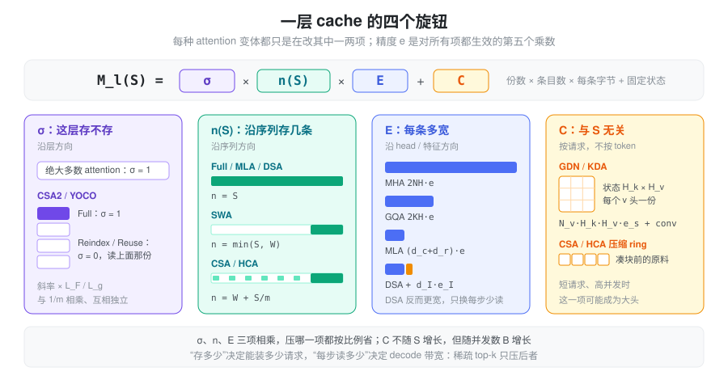
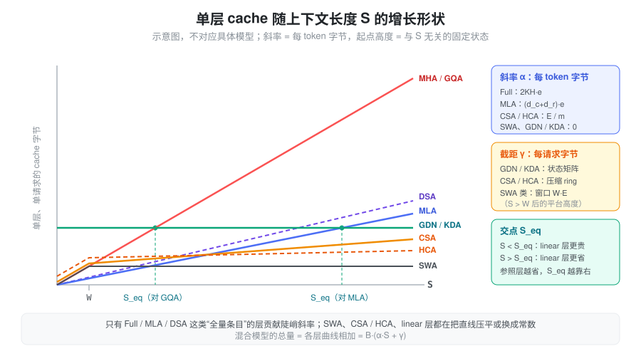

% KV Cache 大小

### 问题：KV cache 不再是一个简单的乘法

对标准的 MHA / GQA，KV cache 的大小就是一串乘法：

\[
M = B \cdot L \cdot S \cdot 2KH \cdot e
\]

每个请求、每一层、每个历史 token，都留下 \(K\) 个头的 K 和 V。这个公式里每一项都是线性的，所以过去比较两个模型的 KV 开销，只需要比较 \(2KH\) 这一个数。

近几年的 attention 变体各自攻击这个乘积里的**不同因子**，有的还直接改变了它对 \(S\) 的依赖形状：

- MLA 改的是每条有多宽，DSA 在它旁边又多存了一份；
- SWA 让 \(S\) 截断在窗口 \(W\)，CSA / HCA 让 \(S\) 除以压缩率 \(m\)；
- CSA2 让一部分层干脆不存；
- GDN / KDA 把整个与 \(S\) 相关的项换成一个常数。

一个混合模型往往同时用了其中好几种，"每 token 多少字节"这个问题本身就不再有唯一答案——有的部分按 token 增长，有的部分封顶，有的部分按请求固定。本篇不对应具体模型，而是建立一个统一的记账方式，用符号推出每类 attention 的总 cache 大小，再看它们分别动了哪一项。

### 符号

沿用 [Attention 计算量](./attention_computation.md) 的记号，并补充本篇用到的量：

| 符号 | 含义 |
| :-: | --- |
| \(B\) | 并发请求数（batch） |
| \(S\) | 每个请求当前的上下文长度（即 kv length） |
| \(L\) | 层数；\(L_x\) 表示 \(x\) 类层的层数 |
| \(N,\ K,\ G\) | query 头数、KV 头数、每组 query 头数（\(N = KG\)） |
| \(H\) | head dim |
| \(e\) | KV 每个元素的字节数（BF16 为 2，FP8 为 1） |
| \(e_s\) | 递推状态每个元素的字节数（通常 FP32，为 4） |
| \(d_c,\ d_r\) | MLA 的 latent 维度、解耦 RoPE 维度 |
| \(d_I\) | indexer key 的维度 |
| \(d_{kv}\) | 压缩类 attention 一条 KV 条目的宽度（K、V 共用一个向量） |
| \(W\) | 滑动窗口长度 |
| \(m\) | 序列方向的压缩率：每 \(m\) 个 token 产生一条压缩 KV |
| \(k_{\text{top}}\) | 稀疏 attention 每个 query 选中的条目数 |
| \(N_{qk},\ N_v,\ H_k,\ H_v\) | linear attention 的 q/k 头数、v 头数、key 维度、value 维度 |
| \(w\) | short conv 的卷积核长度 |

为简洁起见，下文统一用元素个数乘 \(e\) 表示字节数；量化 scale 这类小开销只在需要时单列。

### 抽象：一层 = 份数 × 条目数 × 条目宽度 + 固定状态

把每一层的存储拆成两部分：一部分随上下文增长，一部分按请求固定。

\[
\boxed{\;
M_l(S) \;=\; \underbrace{\sigma_l}_{\text{份数}} \cdot \underbrace{n_l(S)}_{\text{条目数}} \cdot \underbrace{E_l}_{\text{每条字节}} \;+\; \underbrace{C_l}_{\text{固定状态}},
\qquad
M_{\text{total}} = B \sum_{l=1}^{L} M_l(S)
\;}
\]

- **\(E_l\)：每条 KV 多宽**。MHA 是 \(2NH\cdot e\)，GQA 是 \(2KH\cdot e\)，MLA 是 \((d_c + d_r)\cdot e\)。
- **\(n_l(S)\)：沿序列存多少条**。只有三种形状：全量 \(S\)、窗口 \(\min(S, W)\)、压缩 \(\lfloor S/m \rfloor\)，以及它们的和。
- **\(\sigma_l\)：这一层是否持有自己的一份**。绝大多数 attention 里恒为 1；跨层共享 cache 的设计（CSA2、YOCO）让大部分层取 0，转而读别的层。
- **\(C_l\)：与 \(S\) 无关的每请求状态**。linear attention 的递推状态、压缩 attention 里还没凑满一块的"原料"都属于这一项。

于是每种 attention 都可以归结为"它改变了哪个旋钮"：

精度 \(e\) 是正交于这四个旋钮的第五个乘数：FP8 / FP4 KV 对上面每一项都同样有效，所以下文推导时把它当作常数带着走。

还有一个需要先分清的概念：**存多少**和**每步读多少**是两件事。decode 每一步需要从显存读出的条目数记为 \(r_l(S)\)，它决定 decode 的带宽开销；\(n_l(S)\) 决定能装多少请求。dense attention 里两者相等，稀疏 attention（DSA、CSA 的 top-k）只压低了 \(r_l\)，并不改变 \(n_l\)。下文每种 attention 都会把两者分开写。

### 基线：MHA / GQA / MQA

每层每 token 存 \(K\) 个头的 K 和 V，条目数是全量 \(S\)：

\[
E = 2KH \cdot e, \qquad n(S) = S, \qquad
M_{\text{layer}} = S \cdot 2KH \cdot e, \qquad r(S) = S
\]

MHA、GQA、MQA 只是 \(K\) 的三个取值：\(K = N\)、\(1 < K < N\)、\(K = 1\)。相对 MHA 的压缩比就是 \(K/N = 1/G\)。

TP 按 KV 头切分，每卡持有 \(\max(1, K/\text{TP})\) 个头；TP 超过 \(K\) 之后 KV 被复制，每卡开销不再下降（详见 [常驻显存](./vram_persistent.md)）。

### MLA：缩小条目宽度

MLA 不存每个头的 K、V，只存一个可以还原所有头的低秩 latent \(c_{KV}\)，外加一段所有头共享的 RoPE key（原理见 [MLA](./mla.md)）：

\[
E = (d_c + d_r) \cdot e, \qquad n(S) = S, \qquad
M_{\text{layer}} = S \cdot (d_c + d_r) \cdot e
\]

两个有用的换算：

- **相对 MHA**：压缩比为 \(\dfrac{d_c + d_r}{2NH}\)。
- **等效 KV 头数**：令 \(2K_{\text{eq}} H = d_c + d_r\)，得 \(K_{\text{eq}} = \dfrac{d_c + d_r}{2H}\)。也就是说，MLA 的 cache 大小相当于一个只有 \(K_{\text{eq}}\) 个 KV 头的 GQA，但每个 query 头看到的 K、V 仍各不相同。

latent 没有头维度，所以 attention TP 不能再切它：TP 组里每张卡都存一整份。比较 MLA 与 GQA 的显存效率时，要用每卡的 \(\max(1, K/\text{TP})\cdot 2H\) 去和 \(d_c + d_r\) 比，而不是用全局的 \(2KH\)。

低精度时，rope 段通常保留高精度，nope 段按块量化。设量化块大小为 \(g\)，每个 scale 占 \(e_{\text{sc}}\) 字节：

\[
E_{\text{fp8}} = d_c \cdot 1 + d_r \cdot 2 + \frac{d_c}{g}\, e_{\text{sc}}
\]

### DSA：多存一份 indexer key，换每步少读

DSA 在 MLA 的基础上增加了一个 Lightning Indexer：用一组很窄的 key 给所有历史 token 打分，只对 top-\(k_{\text{top}}\) 做真正的 attention（见 [DSA](./dsa.md)）。哪个 token 会被选中事先不知道，所以**主 cache 一条都不能少**，indexer key 也要为每个 token 存一份：

\[
E = \underbrace{(d_c + d_r)\, e}_{\text{主 cache}} + \underbrace{d_I\, e_I}_{\text{indexer key}}, \qquad n(S) = S
\]

其中 \(e_I\) 是 indexer key 的元素字节数（通常 FP8，另加少量 scale）。存储上 DSA **比 MLA 更大**，增量比例是 \(\dfrac{d_I\, e_I}{(d_c + d_r)\, e}\)。

变的是每步读的量。decode 一步需要读：

\[
r(S) = \underbrace{S \cdot d_I\, e_I}_{\text{indexer 扫全量}} + \underbrace{\min(S, k_{\text{top}}) \cdot (d_c + d_r)\, e}_{\text{主 cache 只读选中的}}
\]

当 \(S \gg k_{\text{top}}\) 时，带宽的斜率从 \((d_c + d_r)\,e\) 降到 \(d_I\, e_I\)。这个"存得多、读得少"的不对称，正是 HiSparse 这类方案的出发点：既然每步只读 \(k_{\text{top}}\) 条主 cache，完整的主 cache 可以放到 host 内存，显存里只留一个工作集，设备侧的主 cache 从 \(S\) 条降到约 \(S/\rho\) 条（\(\rho\) 为 host 与 device 的容量比）。

### SWA：把条目数截断在窗口

SWA 层的每个 query 只看最近 \(W\) 个 token，窗口外的 KV 再也不会被读到（见 [SWA](./swa.md)）：

\[
n(S) = \min(S, W), \qquad M_{\text{layer}} = \min(S, W) \cdot E, \qquad r(S) = \min(S, W)
\]

\(E\) 仍然由这一层自己的头结构决定（GQA 的 \(2KH\,e\) 或 MLA 的 \((d_c+d_r)\,e\)），SWA 只动条目数。单独一层 SWA 的 cache 是常数；有意义的是它和 full 层混合后的总量：

\[
M_{\text{total}} = B\Big[\,S \cdot L_{\text{full}} E_{\text{full}} \;+\; \min(S, W) \cdot L_{\text{swa}} E_{\text{swa}}\,\Big]
\]

\(S \gg W\) 时，第二项可以忽略，每 token 的增长斜率只剩 full 层的 \(L_{\text{full}} E_{\text{full}}\)。所以 SWA 模型的长上下文 KV 开销几乎完全由 **full 层的比例**决定，窗口大小只影响一个常数。

这是理论下界。推理引擎为了让 prefix cache 也能复用 SWA 层的 KV，通常不会把 SWA 池开到恰好 \(B \cdot W\)，而是按 full 池的一个比例 \(r\) 分配，实际记账变成 \(L_{\text{full}} E_{\text{full}} + r \cdot L_{\text{swa}} E_{\text{swa}}\) 每 token——SWA 的成本被打折，而不是清零。

### CSA / HCA：沿序列方向压缩

CSA 和 HCA 每 \(m\) 个 token 压成一条压缩 KV，近处再用一个 SWA 窗口看原文（见 [CSA HCA](./hca_csa.md)）。一层的存储分三块：

- **SWA 原文**：\(\min(S, W)\) 条，每条 \(E = d_{kv}\, e\)；
- **压缩 KV**：\(\lfloor S/m \rfloor\) 条，同样每条 \(d_{kv}\, e\)；
- **压缩状态（ring）**：凑满一块之前的"原料" \((C, Z)\)，与 \(S\) 无关。

两者的区别在于压缩率、是否重叠、是否带 indexer：

| | CSA（小 \(m\)，重叠，带 indexer） | HCA（大 \(m\)，不重叠，无 indexer） |
| --- | --- | --- |
| 压缩 KV | \(\lfloor S/m \rfloor \cdot d_{kv}\, e\) | \(\lfloor S/m \rfloor \cdot d_{kv}\, e\) |
| indexer key | \(\lfloor S/m \rfloor \cdot d_I\, e_I\) | 无 |
| SWA 原文 | \(\min(S, W) \cdot d_{kv}\, e\) | \(\min(S, W) \cdot d_{kv}\, e\) |
| 压缩状态 \(C\) | \(2m\) 槽 × \(4 d_{kv}\, e_s\)，另有 indexer 的 \(2m \times 4 d_I\, e_s\) | \(m\) 槽 × \(2 d_{kv}\, e_s\) |
| 每步读 \(r(S)\) | \(\min(S,W) + \min(k_{\text{top}}, S/m)\) 条主 KV，外加扫 \(S/m\) 条 indexer key | \(\min(S,W) + S/m\) 条 |

压缩状态的形状来自压缩算子本身：重叠时每个 token 投影出 \((C^a, C^b, Z^a, Z^b)\) 四份 \(d_{kv}\) 维向量，并且要回看上一块，所以是 \(2m\) 槽、每槽 \(4d_{kv}\)；不重叠时只有 \((C, Z)\) 两份、只需本块的 \(m\) 槽。状态通常用 FP32 存，单槽比一条成品 KV 宽得多，但槽数固定。

\(S \gg W\) 时，每层每 token 的增长斜率是：

\[
\alpha_{\text{CSA}} = \frac{d_{kv}\, e + d_I\, e_I}{m_{\text{CSA}}}, \qquad
\alpha_{\text{HCA}} = \frac{d_{kv}\, e}{m_{\text{HCA}}}
\]

和 DSA 对照看最清楚：DSA 的稀疏只压了 \(r(S)\)，CSA 的压缩先把 \(n(S)\) 除以 \(m\)，再用 top-k 压 \(r(S)\)。前者"省算不省存"，后者两样都省。HCA 的 \(m\) 大到 \(S/m\) 已经和 \(k_{\text{top}}\) 同一个量级，所以干脆全读，不需要 indexer。

HCA 的固定状态 \(m \cdot 2d_{kv}\, e_s\) 值得单独注意：它与 \(S\) 无关，但正比于并发数 \(B\)。长上下文时它只是零头；短请求、高并发时，它反而可能比压缩 KV 本身还大。

### CSA2：沿层方向共享

CSA2 不再让每层都持有自己的一份压缩 cache：只有 Full 层产出 main KV 和 indexer key，Reindex 层和 Reuse 层都读最近一个 Full 层的那一份（见 [CSA2](./csa2.md)）。这正是公式里的 \(\sigma_l\)：

\[
\sigma_l = \begin{cases} 1, & l \in \text{Full} \\ 0, & l \in \text{Reindex} \cup \text{Reuse} \end{cases}
\]

SWA 原文仍然每层各一份，于是：

\[
M_{\text{total}} = B\Big[\,\underbrace{L \cdot \min(S, W) \cdot d_{kv}\, e}_{\text{每层自己的 SWA}} \;+\; \underbrace{\sum_{l \in \text{Full}} \left\lfloor \frac{S}{m_l} \right\rfloor (d_{kv}\, e + d_I\, e_I)}_{\text{只有 Full 层存}} \;+\; \sum_{l \in \text{Full},\, m_l > 1} C_l \,\Big]
\]

设全局 attention 层共 \(L_g\) 层，其中 Full 层 \(L_F\) 层。层共享相当于把压缩 KV 的斜率乘上 \(L_F / L_g\)；它与序列方向的 \(1/m\) **相乘**，彼此独立。另外两点：

- indexer key 由 main KV 投影得到，但仍按条目存一份，随 main KV 一起共享，所以和 main KV 共用同一个 \(\sigma_l\)；
- \(m = 1\) 时没有压缩，也就没有 ring，\(C_l = 0\)；\(m > 1\) 时 ring 不重叠，只需 \(m\) 槽。

层次化 indexer 不改变存储，只改变 indexer 的读量：Full 层扫全部 \(S/m\) 条 indexer key，Reindex 层只在一个固定大小 \(P\) 的候选池里打分，Reuse 层不读。每层每步的 indexer 读量从"每层 \(S/m\)"变成"每组一次 \(S/m\)，其余 \(P\) 或 0"。

[YOCO](./yoco.md) 是同一个旋钮的另一种用法：后半网络全部读前半产出的一份 KV，等价于后半各层 \(\sigma_l = 0\)。

### GDN / KDA：把随 S 增长的项换成常数

linear attention 层不存任何按 token 的 KV，而是把整段历史压缩进一个 \(H_k \times H_v\) 的状态矩阵，每步原地更新（见 [Linear Attention](./linear_attention.md)）。对这类层，\(n(S) = 0\)，只剩固定项 \(C\)。它由两份状态组成：

- **递推状态 \(S_t\)**：每个 v 头一个 \(H_k \times H_v\) 矩阵；
- **conv 状态**：q、k、v 进入 delta rule 前有一个核长 \(w\) 的因果卷积，要保留最近 \(w-1\) 步的输入。

\[
C_{\text{GDN}} = \underbrace{N_v\, H_k\, H_v \cdot e_s}_{\text{递推状态}} \;+\; \underbrace{(w - 1)\,(N_v H_v + 2 N_{qk} H_k) \cdot e_{\text{conv}}}_{\text{conv 状态}}
\]

KDA 的 q、k、v 头数相同（\(N_{qk} = N_v = N\)），且 \(H_k = H_v = H\)：

\[
C_{\text{KDA}} = N H^2 \cdot e_s \;+\; 3(w - 1)\, N H \cdot e_{\text{conv}}
\]

两点值得注意：

- **KDA 的逐通道遗忘门不增加状态**。门 \(\alpha_t \in (0,1]^{H_k}\) 是每个 token 现算现用的，用完即弃；状态矩阵的形状和 GDN 一样。细粒度门控的代价落在计算上，不在显存上。
- **递推状态远大于 conv 状态**。前者是 \(H^2\) 量级，后者只有 \(3(w-1)H\)；而且递推状态要反复读写、误差会累积，默认用 FP32（\(e_s = 4\)），这让它又贵了一倍。

#### 等效 token 数：从哪个长度开始划算

固定状态和按 token 增长的 KV 不能直接比，但可以换算：一个 linear 层的状态，相当于多少个 token 的 full attention KV？以一个同头数、同 head dim 的 GQA 层为参照（\(N_v = N,\ H_k = H_v = H\)，忽略 conv）：

\[
S_{\text{eq}} = \frac{N H^2\, e_s}{2 K H\, e} = \frac{G H}{2} \cdot \frac{e_s}{e}
\]

常见的 \(e_s = 4\)（FP32 状态）、\(e = 2\)（BF16 KV）时，\(S_{\text{eq}} = G H\)。意思是：**上下文短于 \(GH\) 个 token 时，linear 层反而比一个 GQA 层更占显存**；超过之后，GQA 层的 KV 继续线性增长，linear 层保持不变。以 MLA 层为参照时，分母换成 \((d_c + d_r)\, e\)，\(S_{\text{eq}}\) 会更大，因为 MLA 本身已经很省。

这也解释了为什么 linear attention 总是和少量 full attention 层混合：纯 linear 模型的召回能力不足；混合之后，长上下文的增长斜率由少数 full 层决定，linear 层只贡献一个按请求计的固定开销。

#### 状态不能切开：prefix cache 与投机解码的额外份数

KV cache 可以按 token 截断复用，状态却只对应"前缀长度恰好为 \(t\)"这一个位置。所以凡是需要回到某个中间位置的特性，都要额外存状态的副本：

- **prefix cache**：每个可命中的前缀位置都要存一份完整的 \(C\)。按间隔 \(\Delta\) 打快照时，一条长度为 \(P\) 的缓存前缀最多要 \(\lfloor P/\Delta \rfloor\) 份；
- **投机解码**：verify \(d\) 个 draft token 时，每个 draft 位置都要一份中间状态，直到确定接受长度，临时开销约 \(d \cdot C\)。

对 linear 层来说，这些副本才是"随长度增长"的那部分，只是增长的单位从 token 变成了快照。

### 汇总：一张表看每种 attention 动了哪一项

单层、单请求，\(S \gg W\) 时：

| 类型 | 份数 \(\sigma\) | 条目数 \(n(S)\) | 每条宽度 \(E\) | 固定状态 \(C\) | 每步读 \(r(S)\)（条） |
| --- | :-: | :-: | :-: | :-: | :-: |
| MHA / GQA | 1 | \(S\) | \(2KH\, e\) | 0 | \(S\) |
| MLA | 1 | \(S\) | \((d_c + d_r)\, e\) | 0 | \(S\) |
| DSA | 1 | \(S\) | \((d_c + d_r)\, e + d_I\, e_I\) | 0 | \(k_{\text{top}}\) 主 KV + \(S\) indexer |
| SWA | 1 | \(W\) | 同本层头结构 | 0 | \(W\) |
| CSA | 1 | \(W + S/m\) | \(d_{kv} e\)；压缩条目另加 \(d_I e_I\) | \(2m\) 槽 ring | \(W + k_{\text{top}}\) 主 KV + \(S/m\) indexer |
| HCA | 1 | \(W + S/m\) | \(d_{kv}\, e\) | \(m\) 槽 ring | \(W + S/m\) |
| CSA2 | Full 层 1，其余 0 | \(W\) + Full 层 \(S/m\) | \(d_{kv} e + d_I e_I\) | \(m > 1\) 时 \(m\) 槽 ring | \(W + k_{\text{top}}\) |
| GDN | — | 0 | — | \(N_v H_k H_v\, e_s\) + conv | 状态本身 |
| KDA | — | 0 | — | \(N H^2\, e_s\) + conv | 状态本身 |

把各层的 \(M_l(S)\) 放在同一张坐标图里，形状差别一目了然：

#### 混合模型：一条斜率加一个截距

实际模型几乎都是混合结构，但不管怎么混，只要 \(S > W\)，总量都可以整理成一个关于 \(S\) 的仿射函数：

\[
M_{\text{total}} = B\,(\alpha\, S + \gamma), \qquad
\alpha = \sum_{l} \frac{\sigma_l\, E_l}{m_l}, \qquad
\gamma = \sum_{l \in \text{SWA 类}} W\, E_l^{\text{swa}} + \sum_l C_l
\]

其中 full 层取 \(m_l = 1\)，linear 层和 SWA 层对 \(\alpha\) 没有贡献。

- **\(\alpha\) 是"每 token 字节"**：长上下文的容量由它决定。MLA 压 \(E\)，CSA / HCA 加大 \(m\)，CSA2 让 \(\sigma\) 变成 0，混合 SWA / linear 层则是减少能贡献 \(\alpha\) 的层数——本质上都在压这一个数；
- **\(\gamma\) 是"每请求字节"**：SWA 窗口、压缩 ring、linear 状态都在这里。它决定短请求、高并发场景的上限。

给定 KV 预算 \(M_{\text{budget}}\)，能同时服务的请求数是

\[
B_{\max} = \frac{M_{\text{budget}}}{\alpha\, S + \gamma}
\]

\(S\) 小时分母由 \(\gamma\) 主导，\(S\) 大时由 \(\alpha\) 主导，两者相等的位置 \(S^{*} = \gamma / \alpha\) 就是一个模型"从按请求受限转为按 token 受限"的分界。把大量层换成 linear / SWA 会降低 \(\alpha\)、抬高 \(\gamma\)，\(S^{*}\) 随之右移——这类模型的主场在长上下文，短请求上并不占便宜。

### 在 SGLang 中：\(\alpha\) 和 \(\gamma\) 分别在哪里算

SGLang 启动时先用剩余显存除以"每 token 字节"解出 token 容量（流程见 [常驻显存](./vram_persistent.md)），上面的 \(\alpha\) 就是这里的 cell size；\(\gamma\) 中按请求的部分则先单独扣掉。以下路径相对于 `python/sglang/srt/`，都在 `model_executor/pool_configurator.py` 中：

- **MHA / GQA / MLA / DSA**：`DefaultPoolConfigurator._compute_cell_size`。MLA 分支是 `calculate_mla_kv_cache_dim × 层数 × 元素字节`，没有任何 TP 除数，对应"latent 不可按头切"；DSA 模型再加上 `_compute_dsa_indexer_cell_size`，即 \(d_I\) 加每 128 维一个 4 B scale。
- **SWA 混合**：`HybridSWAPoolConfigurator` 的 cell 是 \(E_{\text{full}} L_{\text{full}} + r \cdot E_{\text{swa}} L_{\text{swa}}\)，也就是前文说的"打折而不清零"。
- **CSA / HCA / CSA2**：`DSV4PoolConfigurator._get_bytes_per_full_token` 对每种压缩率累加 `_compressed_bytes_per_full_token(ratio) × 层数`，其中 ratio 4 是 \(\tfrac14\)(主 KV + indexer)，ratio 128 是 \(\tfrac{1}{128}\) 主 KV，ratio 1 / 2 是 (主 KV + indexer) ÷ ratio。参与累加的层由 `collect_sources_by_ratio`（`mem_cache/deepseek_v4_memory_pool.py`）给出：ratio 4 / 128 的层全部计入，ratio 1 / 2 的层只计入 config 中 `kv_source_layer_ids` 列出的层——这就是代码里的 \(\sigma_l\)。CSA 的 ring 挂在 SWA 页上，被并进 SWA 每槽的字节数；HCA 的 ring 按请求预留，属于 \(\gamma\)。
- **GDN / KDA**：状态形状由 `configs/mamba_utils.py` 的 `Mamba2StateShape` / `KimiLinearStateShape` 给出，每请求字节数是 `mamba_cache_per_req = (conv 元素数 × conv 字节 + 状态元素数 × 状态字节) × linear 层数`，与前面 \(C_{\text{GDN}}\)、\(C_{\text{KDA}}\) 的公式逐项对应。这部分在解 token 容量之前由 `MambaPool` 预留。

### 小结

KV cache 的总大小可以统一写成"份数 × 条目数 × 条目宽度 + 固定状态"，各种 attention 变体只是在拧不同的旋钮：MLA 缩小条目宽度，DSA 反而多存一份 indexer key、只换来每步少读；SWA 截断条目数，CSA / HCA 把条目数除以压缩率；CSA2 让大部分层不再持有自己的一份；GDN / KDA 则把随 \(S\) 增长的项整个换成常数状态。混合之后，总量总能整理成 \(B(\alpha S + \gamma)\)：\(\alpha\) 是每 token 字节，决定长上下文的容量；\(\gamma\) 是每请求字节，决定短请求高并发的上限。比较两个模型的 KV 开销时，要同时看这两个数，以及"存多少"和"每步读多少"的区别，而不是只看一个"每 token 多少 KB"。

