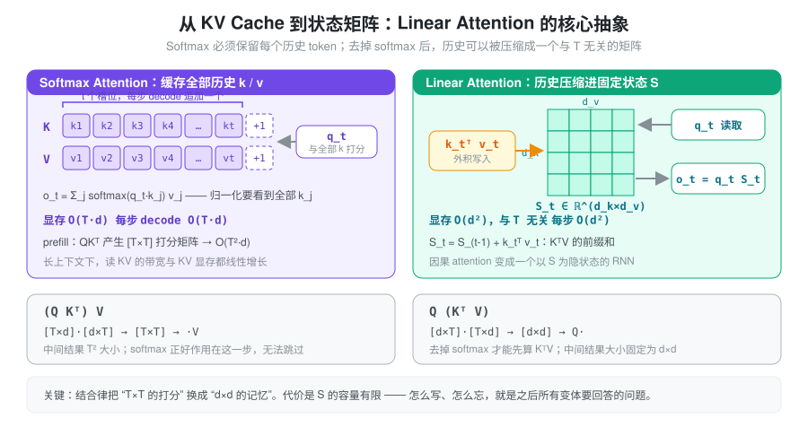
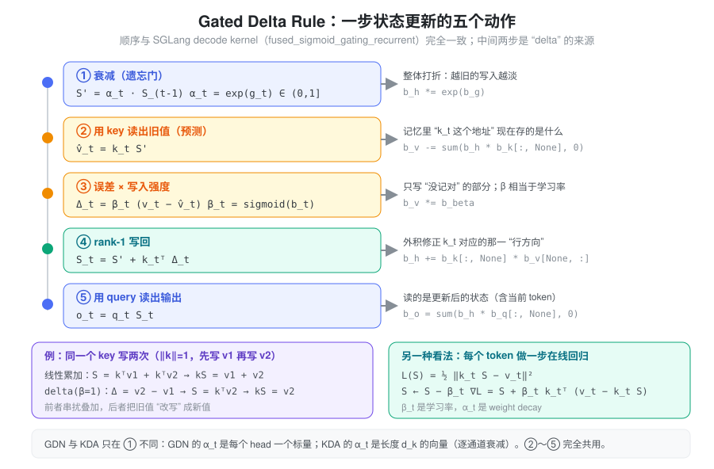
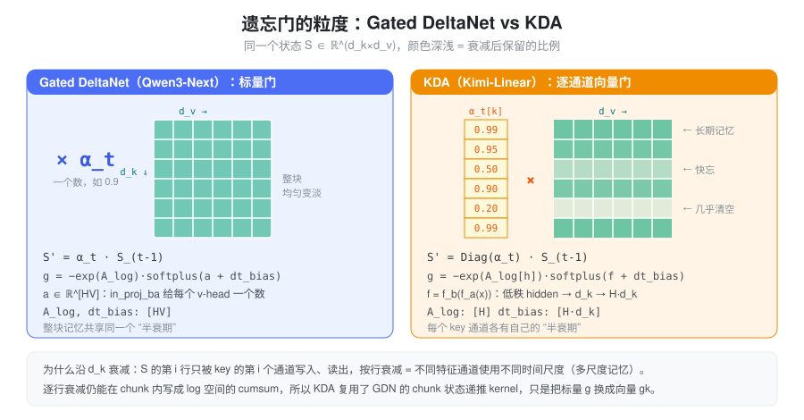
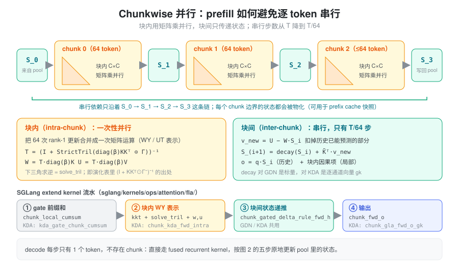
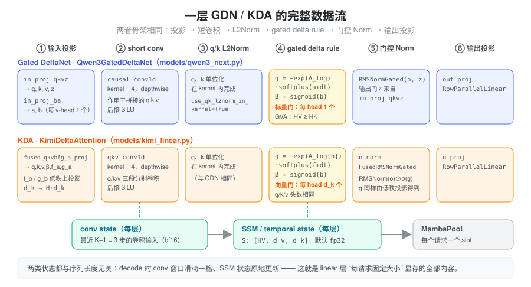
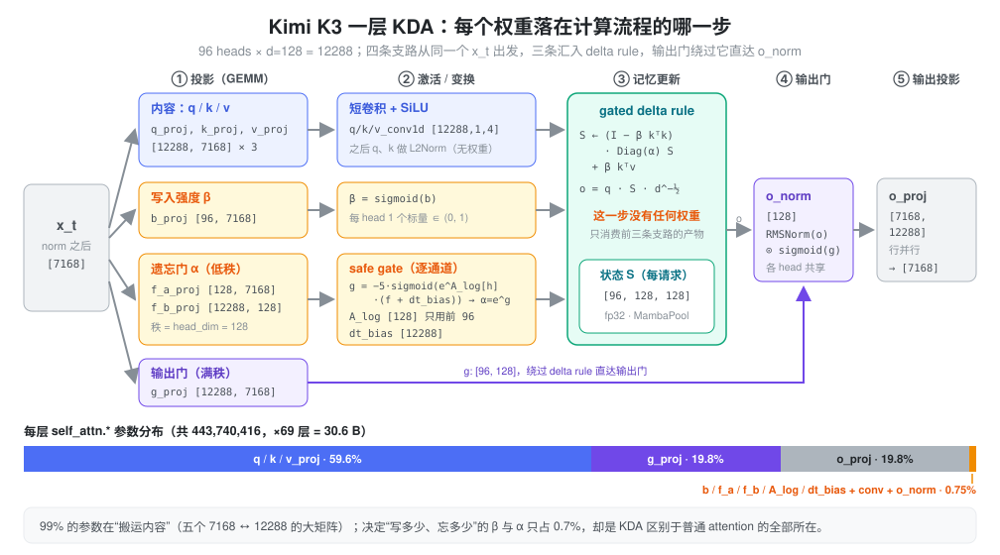
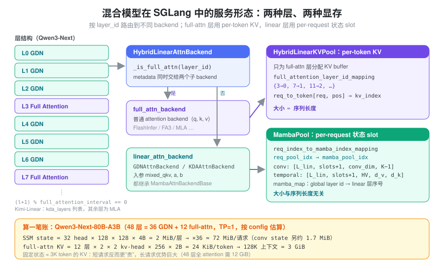

% Linear Attention

### 问题：Softmax Attention 的两笔账

\[
\boldsymbol{S} = \frac{\boldsymbol{Q} \boldsymbol{K}^\top}{\sqrt{d}} \in \mathbb{R}^{n \times n}, \qquad
\boldsymbol{A} = \mathrm{softmax}(\boldsymbol{S}), \qquad
\boldsymbol{O} = \boldsymbol{A} \boldsymbol{V} \in \mathbb{R}^{n \times d}
\]

推理时，softmax attention 有两笔账都随序列长度 \(T\) 增长：

- **计算**：prefill 时 \(QK^\top\) 产生 \([B, H, T, T]\) 的打分矩阵，计算量 \(BT^2HD\)。
- **显存与带宽**：decode 每生成一个 token，都要把完整的 KV cache 读一遍；KV 大小 \(\propto T\)。上下文到 128K 时，读 KV 的带宽和 KV 显存往往比 MLP 更贵。

根源在 softmax 的归一化：\(o_t\) 依赖 \(q_t\) 与**所有** \(k_j\) 的打分之和，任何一个历史 token 都不能提前丢掉。Linear attention 的出发点是：如果能把历史压缩成一个与 \(T\) 无关的东西，这两笔账就都不存在了。

### 核心抽象：把历史压缩成一个状态矩阵

#### 结合律

去掉 softmax 后，矩阵乘法可以按结合律重排：\((QK^\top)V = Q(K^\top V)\)。

考虑完整的 MHA，\(Q, K, V\) 的 shape 都是 \([B, T, H, D]\)。计算 \(K^\top V\) 时，\(B, H\) 是 batch 维，\(D\) 是自由维，\(T\) 是被收缩掉的维度。结果的 shape 为 \([B, H, D, D]\)，计算量 \(BTHD^2\)：复杂度里的 \(T^2\) 变成了 \(D^2\)。

#### 递归形式：Attention 变成 RNN

下文统一用**行向量**约定：\(q_t, k_t \in \mathbb{R}^{1\times d_k}\)，\(v_t \in \mathbb{R}^{1\times d_v}\)，状态 \(S \in \mathbb{R}^{d_k \times d_v}\)。因果版本的输出为

\[
o_t=\sum_{j=1}^{t} (q_t k_j^\top)\, v_j = q_t \sum_{j=1}^{t} k_j^\top v_j = q_t S_t,
\qquad S_t = S_{t-1} + k_t^\top v_t
\]

\(S_t\) 就是 \(K^\top V\) 的前缀和。因果 attention 于是变成一个以 \(S_t\) 为隐状态的 RNN：每步写入一个外积、读出一次矩阵乘，状态大小恒为 \(d_k \times d_v\)。



#### 把 S 看成联想记忆

\(S\) 是一个 key→value 的**线性联想存储**：写入是外积 \(k^\top v\)，读取是用 key 去乘 \(S\)。如果写入过的 key 两两正交且单位长，\(k_i S = v_i\) 可以精确读回。

问题也在这里：\(d_k\) 维空间最多容纳 \(d_k\) 个正交 key，token 数远超 \(d_k\) 后写入必然互相串扰。而且纯累加让所有历史等权叠加，没有任何机制去**忘掉**过时的信息，或**改写**同一个 key 下的旧值。

所以 linear attention 真正要回答的问题是：**容量固定的记忆，应该怎么写、怎么忘。** 下面所有变体都是对这个问题的不同回答。

### 演化：从累加到 Gated Delta Rule

#### 统一递归形式

\[
\boxed{
\begin{aligned}
\hat{v}_t &= k_t \,(\gamma_t S_{t-1}) &&\text{（先衰减，再用当前 key 读出旧值）}\\
\Delta_t &= v_t - \hat{v}_t &&\text{（真实值与记忆预测值的误差）}\\
S_t &= \gamma_t S_{t-1} + \alpha_t \, k_t^\top v_t + \beta_t \, k_t^\top \Delta_t &&\text{（统一状态更新）}\\
o_t &= q_t \, S_t &&\text{（用 query 读出输出）}
\end{aligned}
}
\]

- \(\gamma_t\)：**遗忘门**，写入前对旧状态打折；
- \(\alpha_t\)：**直接写入系数**，把 \(k^\top v\) 原样加进记忆；
- \(\beta_t\)：**误差写入系数**，只把“没记对的部分”写回去，相当于写入强度 / 学习率。

| 模型/方法 | \(\gamma_t\) | \(\alpha_t\) | \(\beta_t\) | 退化后的更新 |
| :--- | :--- | :--- | :--- | :--- |
| 最早的线性 Attention | \(1\) | \(1\) | \(0\) | \(S_t = S_{t-1} + k_t^\top v_t\)（纯累加） |
| 加入遗忘门（RetNet / GLA / Mamba2 一类） | \(\gamma_t\) | \(1\) | \(0\) | \(S_t = \gamma_t S_{t-1} + k_t^\top v_t\)（带衰减的累加） |
| DeltaNet | \(1\) | \(0\) | \(\beta_t\) | \(S_t = S_{t-1} + \beta_t k_t^\top (v_t - k_t S_{t-1})\)（误差驱动） |
| Gated DeltaNet | \(\gamma_t\) | \(0\) | \(\beta_t\) | \(S_t = \gamma_t S_{t-1} + \beta_t k_t^\top (v_t - k_t\, \gamma_t S_{t-1})\)（遗忘 + 误差驱动） |

注意 Gated DeltaNet 的预测值 \(\hat v_t\) 用的是**衰减之后**的状态——SGLang kernel 里也是先 `h *= exp(g)`，再 `v -= h·k`。

#### 为什么 delta rule 更好

两个角度理解：

- **改写而不是叠加**：同一个 key 先写 \(v_1\) 再写 \(v_2\)，纯累加读出 \(v_1+v_2\)；delta rule（\(\beta=1\)）第二次只写入误差 \(v_2-v_1\)，读出的正是 \(v_2\)。
- **在线回归**：对损失 \(\mathcal{L}(S)=\tfrac12\lVert k_t S - v_t\rVert^2\) 做一步梯度下降，\(S \leftarrow S - \beta_t \nabla \mathcal{L} = S + \beta_t k_t^\top (v_t - k_t S)\)，正好是 delta rule。每个 token 都对记忆做一次 SGD，\(\beta_t\) 是学习率，\(\gamma_t\) 是 weight decay。



#### 矩阵（并行）形式

把递归在整段序列上展开，可以得到等价的矩阵形式（\(M\) 是因果 mask，\(M^-\) 是严格下三角 mask，\(\Gamma\) 是累积衰减 mask；为简洁省略 \(\beta\)，可视作并入 \(k, v\)）：

| 模型/方法 | 矩阵形式 |
|---|---|
| Softmax Attention | \((\exp(QK^\top) \odot M)V\) |
| 最早的线性 Attention | \((QK^\top \odot M)V\) |
| 加入遗忘门 | \((QK^\top \odot \Gamma)V\) |
| DeltaNet | \((QK^\top \odot M)(I + KK^\top \odot M^-)^{-1}V\) |
| Gated DeltaNet | \((QK^\top \odot \Gamma)(I + KK^\top \odot \Gamma^-)^{-1}V\) |

\[
\Gamma_{i,j} =
\begin{cases}
\displaystyle \prod_{\tau=j+1}^{i} \gamma_\tau, & i > j \\
1, & i = j \\
0, & i < j
\end{cases}
\]

那个下三角逆矩阵 \((I + KK^\top \odot M^-)^{-1}\) 不是额外加的归一化，而是 delta rule 递归在多步展开后的**闭式解**：每一步的误差 \(\Delta_t\) 依赖前面所有步写入的结果，把这条依赖链解开就是一个下三角线性方程组。它的实际用途是让 prefill 可以按块并行（见下文 chunkwise 一节）。

### Gated DeltaNet

Gated DeltaNet（GDN，Qwen3-Next / Qwen3.5 的 linear 层）把更新写成更紧凑的形式：

\[
S_t = \alpha_t \left(I - \beta_t k_t^\top k_t\right) S_{t-1} + \beta_t k_t^\top v_t,
\qquad \alpha_t = e^{g_t} \in (0, 1],\quad \alpha_t \text{ 是每个 head 一个标量}
\]

展开括号：

\[ \boxed{ S_t=\alpha_t S_{t-1} -\alpha_t\beta_t k_t^\top k_t S_{t-1} +\beta_t k_t^\top v_t } \]


\((I - \beta_t k_t^\top k_t)\) 是一个“部分 Householder 变换”：只沿 \(k_t\) 方向把旧记忆收缩 \(\beta_t\)，其余方向不动。这也是 q、k 必须做 **L2 归一化**的原因：\(\lVert k_t\rVert = 1\) 时这个矩阵沿 \(k_t\) 方向的特征值是 \(1-\beta_t \in [0, 1)\)，递归不会发散。

门的参数化沿用 Mamba2：

\[
g_t=-\exp(A_{\log})\cdot\operatorname{softplus}(a_t+dt_{\mathrm{bias}})
\]

\[
\beta_t=\operatorname{sigmoid}(b_t)
\]

`A_log`、`dt_bias` 是每个 v-head 一个的可学习参数，\(a_t, b_t\) 由输入投影 `in_proj_ba` 给出（每个 v-head 各一个数）。\(\exp(A_{\log})\) 决定这个 head 的基础衰减速率，\(\operatorname{softplus}(a_t+dt_{\mathrm{bias}})\) 是数据相关的“步长”，两者相乘再取负保证 \(g_t \le 0\)。

\[ \underbrace{S' = \alpha S_{t-1}}_{\text{遗忘}} \quad\longrightarrow\quad \underbrace{\hat v=kS'}_{\text{读取旧值}} \quad\longrightarrow\quad \underbrace{\delta=\beta(v-\hat v)}_{\text{计算修正}} \quad\longrightarrow\quad \underbrace{S_t=S'+k^\top\delta}_{\text{更新记忆}} \quad\longrightarrow\quad \underbrace{o=qS_t}_{\text{输出}} \]


一个与 kernel 语义一致的逐 token 参考实现：

```py
def gated_delta_rule_ref(q, k, v, g, beta, S=None):
    # q, k: [b, h, t, dk]   v: [b, h, t, dv]
    # g: [b, h, t]（log 空间衰减，≤ 0）   beta: [b, h, t]
    b, h, t, dk = k.shape
    q = F.normalize(q, dim=-1) * dk ** -0.5   # 先 L2Norm 再乘 scale
    k = F.normalize(k, dim=-1)
    if S is None:
        S = k.new_zeros(b, h, dk, v.shape[-1])
    outs = []
    for i in range(t):
        q_i, k_i, v_i = q[:, :, i], k[:, :, i], v[:, :, i]
        S = S * g[:, :, i].exp()[..., None, None]                 # ① 衰减
        v_hat = torch.einsum("bhk,bhkv->bhv", k_i, S)             # ② 预测
        delta = beta[:, :, i, None] * (v_i - v_hat)               # ③ 误差
        S = S + torch.einsum("bhk,bhv->bhkv", k_i, delta)         # ④ 写回
        outs.append(torch.einsum("bhk,bhkv->bhv", q_i, S))        # ⑤ 读出
    return torch.stack(outs, dim=2), S
```

GDN 的 v-head 数可以多于 k-head 数（GVA，类似 GQA 反过来：多个 v-head 共享一组 q/k），状态按 v-head 存，形状是 \([H_V, d_v, d_k]\)。

### KDA：逐通道的遗忘门

Kimi Delta Attention（KDA，Kimi-Linear 的 linear 层）只改了一处：遗忘门从每个 head 一个**标量**变成每个 head 一个长度 \(d_k\) 的**向量**。

\[
S_t = \left(I - \beta_t k_t^\top k_t\right) \mathrm{Diag}(\alpha_t)\, S_{t-1} + \beta_t k_t^\top v_t,
\qquad \alpha_t \in (0, 1]^{d_k}
\]

\(S\) 的第 \(i\) 行只被 key 的第 \(i\) 个通道写入和读出，所以 \(\mathrm{Diag}(\alpha_t)\) 按行衰减，等于让不同特征通道拥有不同的记忆“半衰期”：有的通道几乎永久保留，有的通道每几个 token 就清空。这是 GLA 式细粒度门控与 delta rule 的结合。上面的参考实现只需改一行：`g` 变成 `[b, h, t, dk]`，衰减写成 `S * g[:, :, i].exp()[..., None]`。



门的参数化与 GDN 同构，只是 \(f_t\) 变成了向量，并且由**低秩投影**得到以控制参数量：

\[
f_t = W_{f_b}\,(W_{f_a}\, x_t) \in \mathbb{R}^{H \cdot d_k},\qquad
g_t = -\exp(\texttt{A\_log}[h]) \cdot \mathrm{softplus}(f_t + \texttt{dt\_bias})
\]

其中 `f_a_proj: hidden → head_dim`、`f_b_proj: head_dim → H·head_dim`；`A_log` 每个 head 一个，`dt_bias` 每个通道一个（\([H \cdot d_k]\)）。部分模型（如 Kimi K3，config 中的 `gate_lower_bound=-5`）改用 “safe gate”：\(g = \text{lower\_bound} \cdot \mathrm{sigmoid}(\exp(\texttt{A\_log}) \cdot (f + \texttt{dt\_bias}))\)，把衰减限制在一个有界区间内（见下文 Kimi K3 一节）。

| | Gated DeltaNet | KDA |
|---|---|---|
| 遗忘门 | 每 head 一个标量 \(\alpha_t\) | 每 head 一个 \(d_k\) 维向量 \(\alpha_t\) |
| 门的来源 | `in_proj_ba` 直接投影 | `f_a_proj` → `f_b_proj` 低秩投影 |
| 头数 | v-head 可多于 k-head（GVA） | q/k/v 头数相同 |
| 输出门 | `RMSNormGated(o, z)`，z 来自 `in_proj_qkvz` | `RMSNorm(o) ⊙ sigmoid(g)`，g 来自低秩 `g_a_proj → g_b_proj`（K3 改为满秩 `g_proj`） |
| 搭配的 full attention 层 | Gated Attention（GQA） | MLA |
| SGLang 模型 | `Qwen3GatedDeltaNet`（`models/qwen3_next.py`） | `KimiDeltaAttention`（`models/kimi_linear.py`） |

代价是门张量从 \([T, H]\) 变成 \([T, H, d_k]\)，chunk kernel 里的衰减也不能再当作一个标量 mask 提出来，需要把 \(k\) 按累积衰减逐通道缩放（kernel 里的 `kg`）。好在状态递推的结构没变，SGLang 的 KDA prefill 直接复用了 GDN 的块间递推 kernel `chunk_gated_delta_rule_fwd_h`，只是传入向量门 `gk`。

### 两种计算形态：chunkwise prefill 与 recurrent decode

逐 token 的递归在 decode 时刚好合适（每步本来就只有一个 token），但用在 prefill 上就是 \(T\) 步串行，GPU 吃不满。矩阵形式虽然完全并行，却又回到了 \(T^2\)。chunkwise 算法折中两者：把序列切成大小 \(C=64\) 的块（`fla/chunk.py` 中的 `CHUNK_SIZE`）。

- **块内**：64 次 rank-1 更新用 WY / UT 表示合并成一次矩阵运算。前文矩阵形式里的下三角逆，在这里只需要对一个 \(64\times 64\) 的块求（`solve_tril`）。
- **块间**：只沿块边界传递状态 \(S_i\)。先用 \(S_i\) 扣掉历史已能预测的部分（`v_new = U − W·S_i`），再更新到 \(S_{i+1}\)。

串行步数从 \(T\) 降到 \(T/64\)，总计算量是 \(O(T\,C\,d + T\,d^2)\)。



这个形态在 serving 上有一个副产品：每个块边界的状态 \(h\) 都会被物化出来，等于免费拿到了“前缀长度为 64 的倍数处”的状态快照，prefix cache 就是靠它来保存中间状态的（见下文）。

decode 时没有 chunk，直接调用 fused recurrent kernel（`fused_recurrent_gated_delta_rule_packed_decode` / `fused_recurrent_kda_packed_decode`，或者非 packed 的 `fused_sigmoid_gating_delta_rule_update`）。它在一个 kernel 里完成门计算和上图五步更新，并原地改写 pool 里的状态。

### 一层 GDN / KDA 的完整数据流

delta rule 只是一层的核心，GDN 和 KDA 在它前后都包了一样的骨架：



有两个容易被忽略的组件：

- **short conv**：q/k/v 在进入 delta rule 之前，先过一个 kernel=4 的 depthwise 因果卷积再接 SiLU。linear 层没有 RoPE，这个卷积提供了局部的位置/顺序信息，同时让 key 能混合相邻 token，便于形成“归纳头”式的匹配。
- **输出门**：delta rule 的输出要经过一个门控 RMSNorm。GDN 的门 z 由 `in_proj_qkvz` 一起投影出来，KDA 的门由低秩 `g_a → g_b` 得到、用 sigmoid 激活。

结果是每个 linear 层有**两份**与序列长度无关的状态：conv state（最近 \(K-1=3\) 步的卷积输入）和 SSM state \(S\)。

### 实例：Kimi K3 的 KDA 权重如何对上计算流程

[Kimi K3 权重精算](./kimi_k3_weight.md) 列出了一个 KDA 层的 20 个张量。光看名字和形状，很难说清哪个张量对应上面公式里的哪个符号，也看不出参数量都花在了哪里。这一节把它们逐个挂回计算流程。

K3 的 KDA 配置：96 个 head，\(d_k = d_v = 128\)，投影宽度 \(96 \times 128 = 12288\)，短卷积核 4，`use_full_rank_gate=true`，`gate_lower_bound=-5`。

#### 先分角色，再对形状

20 个张量里有 6 个（`input_layernorm`、`post_attention_layernorm` 以及 `*_res_norm` / `*_res_proj`）是每层都有的公共 norm 和 Attention Residual 权重，MLA 层也有，与 KDA 无关。剩下 14 个 `self_attn.*` 按它们在递推里**干什么**可以分成四组：

- **内容**：q / k / v 是记忆的“地址”和“数据”，决定读写什么。
- **写入强度 \(\beta\)**：每个 head 每个 token 一个标量，决定这一步把误差写进记忆多少。
- **遗忘门 \(\alpha\)**：每个 head 每个通道一个，决定旧记忆按行保留多少。
- **输出**：delta rule 读出 \(o\) 之后的门控 norm 和输出投影。

另外有几步**没有任何权重**：q/k 的 L2Norm、\(d^{-1/2}\) 缩放、状态递推本身。递推是纯计算，可学习的东西全在它的输入（q、k、v、β、α）和输出端。



写成公式（行向量，省略 head 下标；\(\hat{\cdot}\) 表示 L2 归一化）：

\[
\begin{aligned}
q_t, k_t, v_t &= \mathrm{SiLU}\big(\mathrm{Conv}_4(x\,W_{q,k,v}^\top)\big)_t &&\texttt{q/k/v\_proj},\ \texttt{q/k/v\_conv1d}\\
\beta_t &= \sigma(x_t W_b^\top) \in (0,1)^{96} &&\texttt{b\_proj}\\
f_t &= (x_t W_{f_a}^\top)\, W_{f_b}^\top \in \mathbb{R}^{96\times 128} &&\texttt{f\_a\_proj},\ \texttt{f\_b\_proj}\\
g_t &= -5\cdot\sigma\!\big(e^{\texttt{A\_log}[h]}\,(f_t + \texttt{dt\_bias})\big),\quad \alpha_t = e^{g_t} &&\texttt{A\_log},\ \texttt{dt\_bias}\\
S_t &= (I-\beta_t \hat k_t^\top \hat k_t)\,\mathrm{Diag}(\alpha_t)\,S_{t-1} + \beta_t \hat k_t^\top v_t &&\text{无权重}\\
o_t &= d^{-1/2}\,\hat q_t S_t &&\text{无权重}\\
y_t &= \big(\mathrm{RMSNorm}_{w}(o_t)\odot\sigma(x_t W_g^\top)\big)\,W_o^\top &&\texttt{o\_norm},\ \texttt{g\_proj},\ \texttt{o\_proj}
\end{aligned}
\]

| 权重 | 形状 / dtype | 对应操作 | 产物 |
| :--- | :--- | :--- | :--- |
| `q_proj` / `k_proj` / `v_proj` | `[12288, 7168]` BF16 ×3 | \(x W^\top\)，按 head 切成 `[96, 128]` | 卷积前的 q、k、v |
| `q_conv1d` / `k_conv1d` / `v_conv1d` | `[12288, 1, 4]` F32 ×3 | 每通道 4 个 tap 的因果 depthwise 卷积，后接 SiLU | 进入 delta rule 的 q、k、v |
| `b_proj` | `[96, 7168]` BF16 | \(\sigma(x W_b^\top)\) | \(\beta\)，每 head 一个 |
| `f_a_proj` | `[128, 7168]` BF16 | 低秩下投影到 128 维 | 遗忘门的瓶颈表示 |
| `f_b_proj` | `[12288, 128]` BF16 | 上投影回每 head 每通道 | 原始门 \(f\)，`[96, 128]` |
| `dt_bias` | `[12288]` F32 | 加到 \(f\) 上，**逐通道** | 每个通道的基础门值 |
| `A_log` | `[128]` F32（只用前 96） | \(e^{\texttt{A\_log}[h]}\) 作 sigmoid 的斜率，**逐 head** | 与上面一起得到 \(g\)、\(\alpha=e^g\) |
| `g_proj` | `[12288, 7168]` BF16 | 满秩输出门，\(\sigma(\cdot)\) | 与 \(o\) 逐元素相乘的门 |
| `o_norm` | `[128]` F32 | head 内 RMSNorm 的缩放，96 个 head 共享 | 归一化后的 \(o\) |
| `o_proj` | `[7168, 12288]` BF16 | 拼接各 head 后投影回 hidden | 层输出 `[7168]` |

把这 14 项加起来是每层 443,740,416，乘 69 层正好是精算总览里的 30,618,088,704，说明没有遗漏或重复的张量。

#### 几个从形状里读出来的细节

- **门很便宜，内容很贵。** q/k/v/g/o 五个 \(7168\leftrightarrow 12288\) 的大矩阵占 99.25% 的参数；真正决定“写多少、忘多少”的 `b_proj`、`f_a/f_b`、`A_log`、`dt_bias` 合计约 319 万，只占 0.72%。遗忘门用秩 128 的低秩分解（\(7168\to128\to12288\)，约 249 万），如果做成满秩会是 8800 万。
- **门的粒度是三层叠加的。** `A_log` 是 head 级（96 个），`dt_bias` 是通道级（12288 个），`f_t` 是 token × 通道级。于是每个通道的衰减 = head 的整体灵敏度 × (通道偏置 + 数据相关项)。
- **`A_log` 存了 128 个，只用 96 个。** checkpoint 里它的形状是 `[head_dim]` 而不是 `[num_heads]`；加载时 `_a_log_weight_loader` 先截取前 `num_heads` 个，再按 TP 切分，后 32 个值从未参与计算。
- **safe gate 给遗忘设了下限。** GDN / Kimi-Linear 的 \(g=-e^{A}\cdot\mathrm{softplus}(\cdot)\) 没有下界，一个 token 理论上能把某行记忆清零。K3 的 \(g = -5\cdot\sigma(\cdot) \in (-5, 0)\)，即 \(\alpha\in(e^{-5}, 1)\approx(0.0067, 1)\)：单步最多忘掉 99.3%，不会一步清空。这里 \(e^{\texttt{A\_log}}\) 的含义也变了，不再是“衰减速率”，而是 sigmoid 的斜率，决定门对输入有多敏感。
- **K3 的输出门是满秩的。** Kimi-Linear 用低秩 `g_a_proj → g_b_proj`，K3 换成了一个 `g_proj [12288, 7168]`（`use_full_rank_gate`），单这一项就占 KDA 参数的 19.8%，与 `o_proj` 一样大。它也是唯一绕过 delta rule 的支路：直接从 \(x_t\) 投影到 `o_norm`。
- **精度分两档。** 大矩阵是 BF16；卷积核、`A_log`、`dt_bias`、`o_norm` 是 F32。后几项会进入指数、sigmoid 或递推，而且参数量极小，存 F32 几乎不占空间。

#### 在 SGLang 里的落地

模型类是 `KimiK3DeltaAttention`（`models/kimi_k3.py`），checkpoint 的张量名和运行时模块并不一一对应，`load_weights` 在加载时做了合并：

- `q_proj` / `k_proj` / `v_proj` / `g_proj` 作为 shard 0–3 合进 **`fused_qkvg_proj`**，一次 GEMM 算出 4×12288 列，再 split 成 `qkv` 和输出门。
- `q/k/v_conv1d` 合进 **`qkv_conv1d`**（`[3×12288, 1, 4]`），squeeze 成 `[36864, 4]` 交给 `RadixLinearAttention` 当 `conv_weights`。
- `b_proj`、`f_a_proj` **不并入**宽 GEMM。源码注释的理由是：把 96 + 128 这种窄输出拼进去会让输出维度变得别扭，影响 GEMM kernel 选择。加载后 `_merge_bfa_weights` 把这两个同输入的小 GEMV 合成一个 `[f_a | b]`；在 CUDA graph 的 decode 中，它放在 side stream 上，与宽 GEMM 重叠执行。
- `A_log`、`dt_bias`、`lower_bound` 随 `RadixLinearAttention` 交给 `KDAAttnBackend`，门的激活在 kernel 内完成：prefill 时由 `kda_gate_chunk_cumsum` 把 safe gate、块内 cumsum 和 \(\beta\) 的 sigmoid 融成一个 kernel（`beta_is_raw=True`）；decode 时直接融进 recurrent kernel。q/k 的 L2Norm 同样在 kernel 内（`use_qk_l2norm_in_kernel=True`）。
- `o_norm` 是 `FusedRMSNormGated(head_dim, activation="sigmoid")`。decode / verify 时，模型把门张量交给 backend（`_k3_onorm_gate`），能融合的 kernel 会把门控 RMSNorm 也一起算掉。
- TP 按 head 切：TP8 时每张卡 12 个 head，对应 `A_log` 12 个、`dt_bias` 12×128 个、`b_proj` 12 行；`f_a_proj` 只有 128 个输出，用 `ReplicatedLinear` 每卡一份；`o_proj` 行并行，attention-TP 的求和不在 `o_proj` 内做（`reduce_results=False`），而是推迟到层边界，与 residual 相加一起融合进 all-reduce。

### 在 SGLang 中的实现

以下路径都相对于 `python/sglang/srt/`。

#### 混合层结构

纯 linear 模型的召回能力不够，所以实际模型都是混合结构：

- **Qwen3-Next**：每 `full_attention_interval`（默认 4）层放一层 full attention，判定条件是 `(l+1) % full_attention_interval == 0`，其余是 GDN 层，比例为 3:1。
- **Kimi-Linear**：config 里有一个 `kda_layers` 列表，由 `is_kda_layer` 判定哪些层是 KDA，其余层是 MLA。

模型层只负责投影和门控，真正的 attention 计算交给 `layers/radix_linear_attention.py` 里的 `RadixLinearAttention`。它带着 `layer_id`、头数/维度、conv 权重、`A_log`、`dt_bias` 等信息，把 `mixed_qkv, a, b` 交给当前的 attention backend。这和 full attention 层的 `RadixAttention` 是对称的。

#### 状态存在哪里：两种显存



- **`HybridLinearKVPool`**（`mem_cache/memory_pool.py`）：只为 full attention 层分配 per-token KV。`full_attention_layer_id_mapping` 把全局 layer id 映射到紧凑的 KV buffer 下标。
- **`MambaPool`**：为 linear 层分配 per-request 的状态 slot，张量布局是 `[num_mamba_layers, size+1, *shape]`。`HybridReqToTokenPool` 用 `req_index_to_mamba_index_mapping` 把请求映射到 slot，用 `mamba_map` 把全局 layer id 映射到 linear 层序号。
- **状态形状**（`configs/mamba_utils.py`）：
  - GDN（`Mamba2StateShape`）：conv 为 `(conv_dim, K−1)`，其中 `conv_dim = HV·d_v + 2·HK·d_k`；temporal 为 `(HV, d_v, d_k)`。
  - KDA（`KimiLinearStateShape`）：conv 为转置的 `(K−1, …)`；temporal 为 `(H, d, d)`。
  - 注意 temporal 按 `[V, K]` 存，与上文数学约定 \(S\in\mathbb{R}^{d_k\times d_v}\) 互为转置。
- **dtype**：conv 默认 bf16（`SGLANG_MAMBA_CONV_DTYPE`）。SSM 默认 fp32，可由 config 的 `mamba_ssm_dtype` 或 `SGLANG_MAMBA_SSM_DTYPE` 覆盖，KDA 只读环境变量。状态被反复读写、误差会累积，所以默认不用低精度。
- **两个 pool 的比例**：由 `--mamba-full-memory-ratio`（默认 0.9）控制。

图中的账说明了取舍：每个请求的固定状态约等于 3K token 的 KV。所以短请求在 linear 层上反而更“贵”，长上下文才是混合模型的主场。

#### backend 路由与两条路径

`layers/attention/hybrid_linear_attn_backend.py` 中的 `HybridLinearAttnBackend` 持有两个子 backend，用 `_is_full_attn(layer_id)` 按层路由：full attention 层走普通 backend（FlashInfer / FA3 / MLA 等），linear 层走 `GDNAttnBackend` / `KDAAttnBackend`（`layers/attention/linear/`，都继承 `MambaAttnBackendBase`）。

metadata 只在每个 batch 开始时准备一次，主要包括：

- `mamba_cache_indices`：每个请求对应的状态 slot，由 `get_mamba_indices` 得到；
- `query_start_loc`：变长序列在拼接 batch 里的起点。

以 GDN 为例，两条路径的分工如下：

- **decode**：先通过 `mamba2_layer_cache(layer_id)` 取出该层的 conv/temporal 状态，然后 `causal_conv1d_update` 把卷积窗口滑动一格，最后用 recurrent kernel 原地更新 \(S\)。
- **extend**：`has_initial_states = extend_prefix_lens > 0` 决定是否从 pool 里读入初始状态（命中 prefix cache 的请求才有）。之后依次执行 `causal_conv1d_fn`、`fused_gdn_gating`，再调用 chunk kernel `chunk_gated_delta_rule`；KDA 对应调用 `chunk_kda`。

#### kernel 抽象

具体 kernel 被再抽象一层：

- `layers/attention/linear/kernels/kernel_backend.py` 定义 `LinearAttnKernelBase`，要求实现 `decode` / `extend`，`target_verify` 可选。
- 实现有 `TritonGDNKernel`、`TritonKDAKernel`，以及 CuTe DSL、FlashInfer、FlashKDA 等变体。
- `GDNKernelDispatcher` / `KDAKernelDispatcher` 按阶段选择实现。
- 命令行用 `--linear-attn-backend`，或分阶段的 `--linear-attn-decode-backend` / `--linear-attn-prefill-backend` 指定；verify 阶段未设置时跟随 decode。

#### prefix cache 与投机解码

这两个特性都会撞上同一个事实：**状态是对整段前缀的压缩，不能切开**。KV cache 可以按 token 截断复用；而 \(S_t\) 只对应前缀长度恰好为 \(t\) 的位置，任意截断点的状态都需要事先存下来。

- **prefix cache**：由 `mem_cache/mamba_radix_cache.py` 中的 `MambaRadixCache` 负责。
  - radix 树节点除了 KV 索引，还挂一个状态 slot。节点被分裂时，前半段直接得到 `mamba_value = None`（源码注释：mamba cache can not be split）。
  - 为了让更多前缀可命中，prefill 会把 chunk kernel 物化的块边界状态 \(h\) 拷进 track slot。decode 则按 `--mamba-track-interval`（默认 256）定期留快照。
  - 命中后，状态先拷贝到请求自己的 slot（COW）再继续更新，以免污染缓存。
  - `--enable-int8-mamba-checkpoint` 可以把缓存的状态存成 int8，大约省一半空间。
- **投机解码**：verify 时有多个 draft token，但只有被接受的前缀才能提交状态。
  - `target_verify` 以 `disable_state_update=True` 运行，把每个 draft 位置的中间状态写进 `SpeculativeState` 的 buffer。
  - accept 之后，由 `update_mamba_state_after_mtp_verify` 按接受长度把对应的中间状态 scatter 回 pool。
  - 另一条路是 `--enable-linear-replayssm-spec`（仅限 topk ≤ 1 的链式 draft）：verify 不再给每个 draft 存一份完整状态，只把每步的原始输入（k、v、gate、β）存进每个 slot 的小窗口；commit 时把被接受的前缀重放进 fp32 状态。状态 \(d_k\times d_v\) 远大于单步输入，这样省掉了大量显存和带宽。

### 小结

Linear attention 的核心是把 softmax attention 随长度增长的 KV cache，换成一个 \(d_k\times d_v\) 的固定状态，attention 因此变成 RNN。随之而来的问题是固定容量的记忆怎么写、怎么忘：

- delta rule 用“只写误差”实现改写，相当于每个 token 对记忆做一步在线回归；
- 遗忘门负责淘汰旧信息。GDN 用每 head 一个标量，KDA 把它细化成逐通道向量，让不同特征有不同的时间尺度。

落到 Kimi K3 的权重上，可学习参数几乎全在递推的两端：99% 是搬运内容的 q/k/v/g/o 大矩阵，决定写入与遗忘的 β、α 只占不到 1%，而递推本身没有权重。

工程上，chunkwise 算法让 prefill 能并行，recurrent kernel 让 decode 只需常数开销。SGLang 用“full attention 层 per-token KV + linear 层 per-request 状态 slot”的两种显存来服务混合模型；代价是状态不可切分，prefix cache 和投机解码都要靠显式的状态快照来补。
