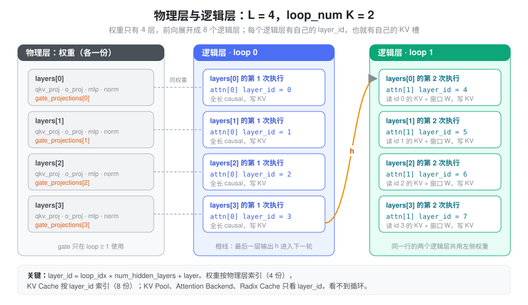
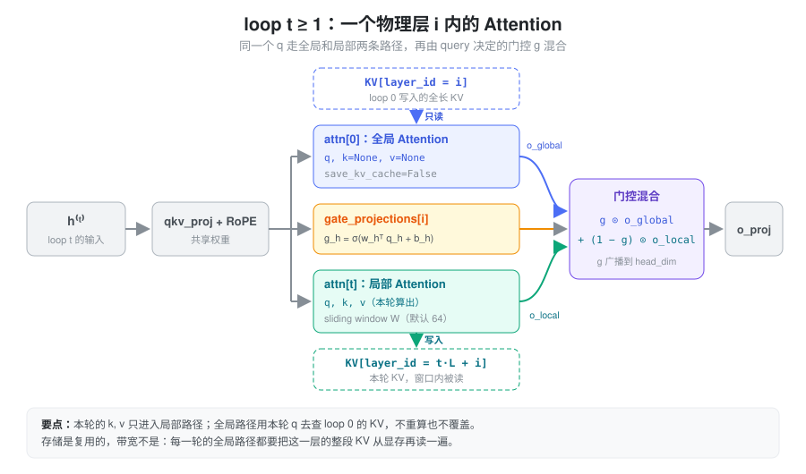
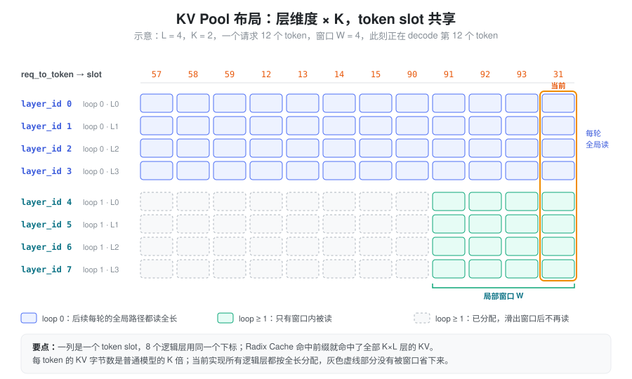

% Loop Transformer

Loop Transformer 把同一组 Decoder Layer 重复执行多次：参数只有 \(L\) 层，前向却走了 \(K\times L\) 层。本文以 SGLang 中的 IQuest LoopCoder（`python/sglang/srt/models/iquest_loopcoder.py`）为主线，说明推理引擎如何处理循环层的计算、权重存储和 KV Cache 存储；最后用 HRM-Text（`python/sglang/srt/models/hrm_text.py`）说明同一套做法如何推广到嵌套循环。

### 问题：想要更深，但不想要更多参数

模型的有效深度和参数量通常绑定在一起：多一层就多一份 Attention 和 MLP 权重。Loop Transformer 解开这个绑定，让 \(L\) 层权重循环 \(K\) 次（LoopCoder 的配置项是 `loop_num`，默认 2）：

\[ h^{(t+1)} = F_{\theta}\big(h^{(t)}\big),\qquad t=0,\ldots,K-1 \]

其中 \(F_\theta\) 是完整的 \(L\) 层堆叠，\(\theta\) 在每次循环中相同。它用计算换参数：FLOPs 约是同参数量普通模型的 \(K\) 倍，权重显存不变。

推理引擎里有一个默认假设：**一个 `layer_id` 对应一份权重，也对应一份 KV Cache。** Loop 打破了这个假设。同一层权重被执行 \(K\) 次，每次的输入 hidden state 不同，算出的 K/V 也不同。于是有三个问题：

| 问题 | 普通 Transformer | Loop Transformer |
| --- | --- | --- |
| 怎么算 | 每层执行一次 | 每层执行 \(K\) 次，后续循环如何利用前一次的结果 |
| 权重存几份 | 每层一份 | 仍然每层一份，所有循环共享 |
| KV 存几份 | 每层一份 | 每次执行都产生新的 K/V，不能互相覆盖 |

### 抽象：物理层与逻辑层

把“层”拆成两个概念就能回答上面三个问题：

- **物理层**：一份权重。LoopCoder 有 \(L\) 个物理层（`num_hidden_layers`）。
- **逻辑层**：物理层的一次执行，用 \((\text{loop}, \text{layer})\) 标识，共 \(K\times L\) 个。

权重按物理层索引，KV Cache 按逻辑层索引。逻辑层的编号就是展开后的位置：

\[ \text{layer\_id} = \text{loop}\times L + \text{layer} \]



这个编号是整个实现的关键。SGLang 的 KV Pool、Attention Backend 和 Radix Cache 只认 `layer_id`，不知道循环的存在。只要每个逻辑层拿到一个不重复的 `layer_id`，并且 KV Pool 按 \(K\times L\) 层分配，下游组件不需要任何改动就能工作。在模型里，权重放在物理层模块上，`layer_id` 放在不带权重的 `RadixAttention` 上，每个物理层持有 \(K\) 个这样的 Attention 对象，一个循环用一个。

### Layer 计算：loop 在外，layer 在内

`IQuestLoopCoderModel.forward` 的执行顺序是两层循环，外层是 loop，内层是物理层：

```python
for loop_idx in range(self.loop_num):
    for layer_idx in range(self.start_layer, self.end_layer):
        gate_proj = self.gate_projections[layer_idx] if loop_idx > 0 else None
        hidden_states = layer(positions, hidden_states, forward_batch, loop_idx, gate_proj)
```

外层是 loop，意味着整个 \(L\) 层堆叠先完整走一遍，最后一层的输出再作为下一轮第 0 层的输入。这个顺序还保证了一件事：进入 loop 1 时，loop 0 所有层的 K/V 已经写进 KV Pool，loop 1 可以直接读。

#### loop 0：普通的全局 Attention

第一轮和标准 Llama 层完全一样：QKV 投影、RoPE、全长 causal Attention、写 KV Cache、MLP。

#### loop ≥ 1：全局读 + 局部写，再用门控混合

后续循环的每个 Attention 用同一个 \(q^{(t)}\) 走两条路径：

\[
o = g\odot \underbrace{\operatorname{Attn}\big(q^{(t)}, K^{(0)}, V^{(0)}\big)}_{\text{全局：读 loop 0 的 KV}}
+ (1-g)\odot \underbrace{\operatorname{Attn}_{W}\big(q^{(t)}, K^{(t)}, V^{(t)}\big)}_{\text{局部：本轮 KV，窗口 }W}
\]



- **全局路径**：调用 `self.attn[0](q, None, None, forward_batch, save_kv_cache=False)`。`k`、`v` 传 `None`，Backend 改从 KV Pool 里取 loop 0 这一层的 K/V；`save_kv_cache=False` 保证不覆盖它们。本轮算出的 \(k^{(t)}\) 不参与全局路径。
- **局部路径**：调用 `self.attn[loop_idx](q, k, v, forward_batch)`，这个 `RadixAttention` 的 `sliding_window_size` 是 `loop_window_size`（默认 64），只看最近 \(W\) 个 token，并把本轮 K/V 写入自己的 KV 槽。
- **门控**：`LoopGateProjection` 对每个 head 算一个标量 \(g_h=\sigma(w_h^\top q_h+b_h)\)，广播到该 head 的 `head_dim` 个通道。\(g\) 由 query 决定，所以每个 token、每个 head 都可以自己选择更依赖全局上下文还是局部细节。

可以这样理解：loop 0 负责从完整上下文建立表示，后续循环在这份全局 K/V 上反复“重读”，只为最近的窗口额外生成新的 K/V。

#### 计算量

每个 token 的 QKV 投影、o_proj、MLP 都执行 \(K\) 次。Attention 部分，设上下文长度为 \(S\)，每个物理层在 Decode 时读取的 KV 行数为：

\[ \underbrace{S}_{\text{loop 0}} + (K-1)\big(\underbrace{S}_{\text{全局}} + \underbrace{\min(S, W)}_{\text{局部}}\big) \approx K\cdot S \]

全局路径虽然复用了 loop 0 的 KV 存储，但每一轮都要把这份 KV 从 HBM 再读一遍。因此长上下文 Decode 的 KV 访存也约是普通模型的 \(K\) 倍，存储共享并不等于带宽共享。

### Weight 存储：每个物理层只存一份

LoopCoder 只用 `make_layers(config.num_hidden_layers, ...)` 构造 \(L\) 个 `LoopCoderDecoderLayer`，没有任何按 loop 复制的权重。每层的组成：

| 组件 | 数量 | 是否随 loop 复制 | 说明 |
| --- | --- | --- | --- |
| `qkv_proj` / `o_proj` / `mlp` / 两个 RMSNorm | \(L\) 份 | 否 | 所有循环共享，MLP 直接复用 `LlamaMLP` |
| `self_attn.attn`（`RadixAttention`） | \(K\times L\) 个 | 是，但没有参数 | 只携带 `layer_id` 和 `sliding_window_size` |
| `gate_projections[i]`（`LoopGateProjection`） | \(L\) 份 | 否 | loop 1 到 loop \(K-1\) 共用同一份 |

关键在第二行：“每个循环一个 Attention 对象”是必须的，因为 KV 槽要按逻辑层区分；但这个对象只是 KV 的地址，不是权重。权重和 KV 地址分离以后，循环只增加地址，不增加参数。

门控权重的形状是 `[num_heads, head_dim]`（加 `[num_heads]` 的 bias），用 `ColumnParallelLinear(head_dim, num_heads)` 按 head 维切到各 TP rank。forward 里先让每个 head 的 \(q_h\) 和本 rank 所有 head 的权重相乘，再用 `torch.diagonal` 取出 head \(h\) 对应的第 \(h\) 列。这样多算了 `num_heads` 倍，但这部分计算量远小于 QKV 投影，换来的是可以直接复用标准的并行线性层。

加载时 checkpoint 里的 `gate_projections.{i}.weight` / `.bias` 被改名为 `gate_projections.{i}.gate_proj.weight` / `.bias`。其余权重名与 Llama 相同，`q/k/v_proj` 合并成 `qkv_proj`，`gate/up_proj` 合并成 `gate_up_proj`。

### KV Cache 存储：每个逻辑层一份 KV

#### 为什么不能共用

同一个物理层在 loop 0 和 loop 1 的输入不同，所以 \(k^{(0)}\ne k^{(1)}\)。两者在后续 Decode 中都还会被读：loop 0 的 K/V 供所有后续循环的全局路径使用，loop \(t\) 的 K/V 供本轮局部路径使用。任何一份被覆盖，后面的 token 都会读到错误的历史。

#### 布局：层维度乘以 K，token slot 共享

`LoopCoderAttention.__init__` 为每个循环创建一个 `RadixAttention`，`layer_id = loop_idx * num_hidden_layers + layer_id`。引擎侧有两处配合，把 KV Pool 的层数扩成 \(K\times L\)：

- `configs/model_config.py`：架构为 `IQuestLoopCoderForCausalLM` 时，`num_attention_layers = num_hidden_layers * loop_num`。
- `model_executor/model_runner_components/layer_setup.py`：`loop_num > 1` 时 `num_effective_layers *= loop_num`。`pool_configurator.py` 用它计算每 token 的 `cell_size`，`kv_cache_configurator.py` 用它作为 KV Pool 的 `layer_num`。



token 维度不变。`req_to_token` 给每个 token 分配一个 slot 下标，\(K\times L\) 个逻辑层的 buffer 都用同一个下标。这带来两个直接结果：

- **容量按 \(K\) 倍缩小**。每 token 的 KV 字节数是 \(2\times n_{kv}\times d_{head}\times \text{dtype}\times L\times K\)，同样的显存能放下的 token 数是普通模型的 \(1/K\)。
- **前缀复用不需要改动**。Radix Cache 命中一个前缀，就同时命中了这些 token 在所有循环里的 KV。LoopCoder 的 Attention 都是 causal 的，一个 token 在每个逻辑层的 K/V 只依赖它之前的 token，所以 Chunked Prefill 和 Radix Cache 都可以照常开启。

#### 只读访问

全局路径的 `k=None, v=None, save_kv_cache=False` 需要 Attention Backend 支持“只读、不写”。以 Triton Backend 为例，`forward_extend` 发现 `k`、`v` 为 `None` 时，用 `forward_batch.out_cache_loc` 从 `layer_id` 对应的 buffer 里取出本批 token 刚写入的 K/V，再与前缀一起计算；Decode 和 paged prefill 本来就从 KV Pool 读，只需跳过写入。FlashInfer 的 ragged prefill 分支对 `k is None` 有单独处理（取该层的整块 buffer），使用这条路径时值得单独验证正确性。

#### 窗口没有转化为显存节省

loop ≥ 1 的局部 Attention 只读最近 \(W\) 个 token，理论上每个物理层只需 \(S+(K-1)W\) 行 KV。但 `IQuestLoopCoderForCausalLM` 不在 `is_hybrid_swa_model` 的列表里，所有 \(K\times L\) 个逻辑层都按全长分配，实际占用 \(K\cdot S\) 行。\(W=64\) 时，loop ≥ 1 的 KV 几乎全部是“已分配、不再被读”的空间。如果要省这部分显存，方向是让 loop ≥ 1 的逻辑层走 SWA Pool（参考 [SWA](./swa.md)），代价是要处理 hybrid SWA 的层号映射。

#### 一个约束：Pipeline Parallelism

`layer_id` 的公式用的是全局层号和全部层数 `num_hidden_layers`，而 KV Pool 按 `layer_id - start_layer` 寻址，大小为 \((\text{end\_layer}-\text{start\_layer})\times K\)。只有 `start_layer = 0` 且 `end_layer = L`（即 PP = 1）时两者一致；PP > 1 时 loop ≥ 1 的 `layer_id` 会超出本 stage 的 Pool 范围。

### 推广：HRM-Text 的嵌套循环

HRM-Text（Hierarchical Reasoning Model）用同一套“物理层/逻辑层”做法处理更复杂的循环。它有两个 Transformer 堆叠：快的 `L_module` 和慢的 `H_module`，每个堆叠 `num_layers_per_stack` 层。前向是嵌套循环：每个 H cycle 里先跑 `L_cycles`（记 \(L_c\)）次 L 堆叠，再跑一次 H 堆叠，共 `H_cycles`（记 \(H\)）个 H cycle。每跑一次堆叠记为一个 step。

| 维度 | LoopCoder | HRM-Text |
| --- | --- | --- |
| 物理层 | \(L\) 层，一个堆叠 | 两个堆叠，各 \(n\) 层 |
| 循环结构 | 单层循环，\(K\) 次 | 嵌套循环，共 \(H\times(L_c+1)\) 个 step |
| 逻辑层编号 | `loop * L + layer` | `step * n + layer`，L 用 step \(h(L_c+1)+l\)，H 用 \(h(L_c+1)+L_c\) |
| Attention 对象 | `nn.ModuleList`，按 loop 下标 | `nn.ModuleDict`，只为本堆叠用到的 step 创建 |
| KV 层数来源 | `ModelConfig` 和 `layer_setup.py` 里乘 `loop_num` | HF config 的 `__post_init__` 已把 `num_hidden_layers` 改成总 slot 数 |
| 后续循环如何读历史 | 门控混合 loop 0 全局 KV 与本轮窗口 KV | 每个 step 只读自己的 KV |

L 和 H 的 step 编号互不重叠，所以每个 \((\text{step}, \text{layer})\) 对应唯一的 KV 槽。

HRM-Text 多了一个约束：Prompt 部分用双向 Attention（`AttentionType.DECODER_BIDIRECTIONAL`）。在双向 Attention 下，一个 token 的 K/V 依赖它后面的 token，前缀不再能被别的请求复用。`server_args.py` 的 `_handle_model_capability_adjustments` 因此对这个模型强制使用 Triton Backend，并关闭 Radix Cache、Chunked Prefill 和 CUDA Graph。LoopCoder 是纯 causal 的，没有这些限制。

### 小结

Loop Transformer 在推理引擎里的处理可以归结为一句话：**权重按物理层存，KV 按逻辑层存。** 把同一层的每次执行展开成一个独立的 `layer_id`，再把 KV Pool 的层数乘以循环次数，KV Pool、Attention Backend 和 Radix Cache 就都能像处理一个 \(K\times L\) 层的普通模型一样工作；权重则只挂在 \(L\) 个物理层上，被所有循环共享。代价同样直接：计算量、KV 显存和 Decode 时的 KV 访存都约为同参数量普通模型的 \(K\) 倍。LoopCoder 用“后续循环读 loop 0 全局 KV、只为窗口内 token 写新 KV”降低了后续循环对长上下文的依赖，但在当前实现里，窗口还没有转化为显存节省。
