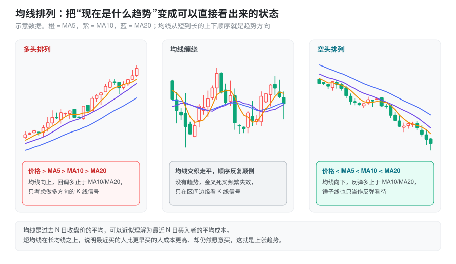
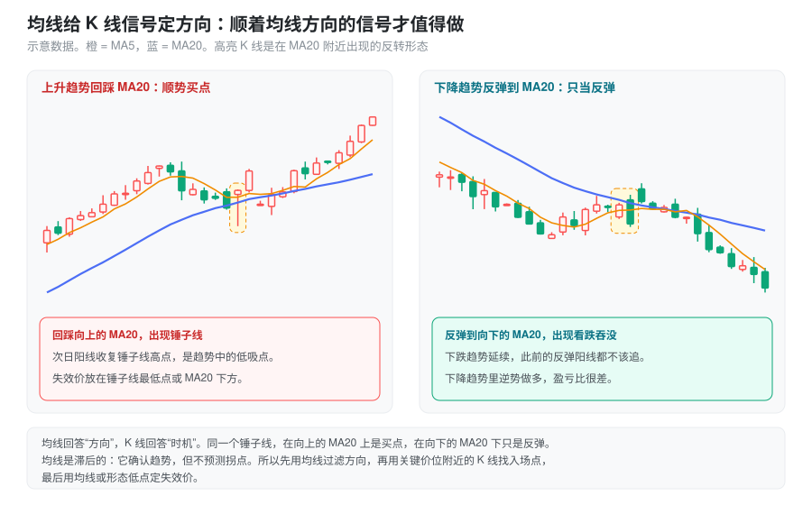
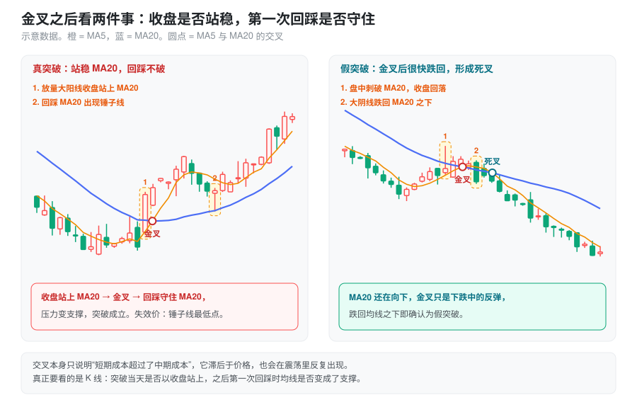
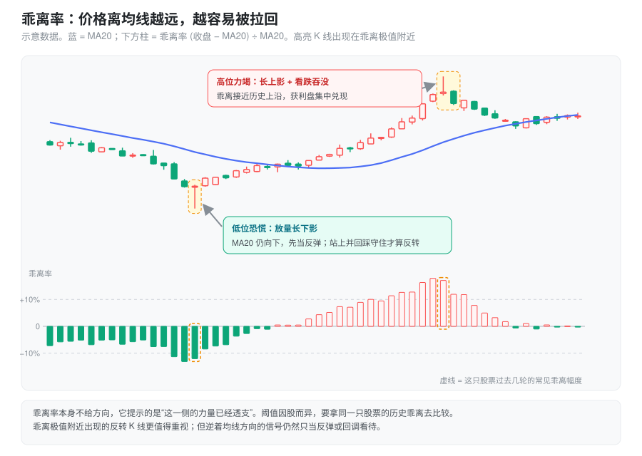

% 均线结合 K 线的趋势分析

### 要解决什么问题

[基础 K 线分析](./kline_analyze.md) 里的四步读法，第一步就是"判断趋势"。但只看 K 线判断趋势有两个困难：

- **K 线太密，噪音太多。** 一段上涨里也会有不少阴线，单看几根很容易把回调误判成反转。
- **"高低点依次抬高"需要主观画线。** 哪个算高点、哪个算低点，不同的人会画出不同的结论。

均线（N 日线）把"趋势"从需要主观判断的东西，变成一条可以直接看的线。反过来，均线也有自己的问题：它是用过去的收盘价算的，天然滞后，拐点出现时它往往还在原来的方向上。

所以两者的分工很自然：**均线回答方向，K 线回答时机。** 这一页讲怎么把两者结合起来用。

### 抽象：均线是最近 N 日买入者的平均成本

N 日均线（MA N）是最近 N 个交易日收盘价的平均值，计算方式见 [财务与技术分析基础](./concepts.md) 的 MA 一节。把它理解成"最近 N 日买入者的大致平均成本"，很多用法就能推出来：

- **价格在均线之上**：最近 N 日买入的人整体是赚钱的，他们没有卖出压力，回调时还可能加仓。均线因此常常起到支撑作用。
- **价格在均线之下**：最近 N 日买入的人整体被套，价格反弹到他们的成本附近时，很多人会选择解套卖出。均线因此常常起到压力作用。
- **短均线在长均线之上**：最近买入的人成本比更早买入的人更高，却仍然愿意买。这就是上涨趋势的定义。

这里的"成本"是近似说法，均线没有按成交量加权，也不区分谁在买。但它足够解释为什么均线附近经常出现多空交手，而这正是 K 线信号最有意义的地方。

A 股软件默认的几条均线，对应的时间尺度大致是：

| 均线 | 时间尺度 | 常见用途 |
| --- | --- | --- |
| MA5 | 一周 | 短线强弱，判断 K 线是否站稳 |
| MA10 | 两周 | 强势股的回调支撑 |
| MA20 | 一个月 | 波段趋势的分界线，最常用 |
| MA60 | 一个季度 | 中期趋势，常被称为"生命线" |
| MA120 / MA250 | 半年 / 一年 | 长期牛熊分界 |

### 范式一：用均线排列判断趋势状态

几条均线从短到长的上下顺序，直接给出趋势状态：

- **多头排列**：价格 > MA5 > MA10 > MA20，而且均线都向上。这是确定的上涨趋势，K 线分析只看做多方向的信号，回调到 MA10 或 MA20 附近的止跌形态是机会。
- **空头排列**：顺序完全反过来，均线向下。这时锤子线、看涨吞没都只能当作反弹信号，不能当作底部。
- **均线缠绕**：均线走平并相互交织，顺序反复颠倒。市场没有趋势，均线本身也失去指导意义，这时改用区间思路：只在区间上下边缘看 K 线信号。

除了排列顺序，还要看**斜率**。均线排列正确但已经走平，说明趋势在减速；均线陡峭向上，说明趋势强但也更容易出现急跌回调。

### 范式二：均线定方向，K 线定时机

趋势确认之后，下一个问题是在哪里入场。最常见、也最有效的组合是"回踩均线 + K 线止跌信号"：

- **上升趋势回踩向上的均线**：价格回落到 MA20 附近，出现锤子线、看涨吞没等止跌形态，次日阳线确认，就是顺势低吸点。均线是关键价位，K 线是确认信号，失效价放在形态低点或均线下方。
- **下降趋势反弹到向下的均线**：价格反弹到 MA20 附近被压回，出现看跌吞没或长上影。这说明被套的人在解套卖出，下跌趋势还在延续。此前反弹途中的阳线都不值得追。

两张图里的 K 线形态本身都是"标准"的，区别只在于均线方向。这和 [基础 K 线分析](./kline_analyze.md) 里"位置决定含义"是同一个道理，均线只是把"位置"变成了一条随时间移动的线。

### 范式三：金叉死叉要看位置和确认

短均线上穿长均线叫金叉，下穿叫死叉。它是最常被提到、也最容易被误用的信号，原因是均线天然滞后：等到 MA5 上穿 MA20，价格通常已经从低点涨了一段。

金叉死叉的可靠程度，主要看它出现在什么状态下：

| 出现的情境 | 含义 | 可靠程度 |
| --- | --- | --- |
| 长期均线（MA60 等）向上，短均线回调后重新金叉 | 上升趋势中的回调结束 | 较高 |
| 长期均线向下，短均线反弹金叉 | 下降趋势里的反弹 | 低，常很快死叉 |
| 均线缠绕、走平时的金叉死叉 | 震荡中的随机交叉 | 很低，反复打脸 |
| 价格远离均线后的金叉 | 信号滞后，追入时已偏离成本区 | 低，盈亏比差 |

所以金叉死叉不适合单独当作买卖点，更适合当作"状态切换"的提示，具体动作仍然交给 K 线：

- **突破均线看收盘。** 盘中刺破均线不算，收盘站上（或跌破）才算。连续两三天站稳，或者伴随放量的大阳线，比单日的交叉更可信。
- **突破后的第一次回踩是检验。** 价格站上 MA20 后回落，在 MA20 上方出现止跌 K 线，说明原来的压力已经变成支撑。如果回踩直接跌回均线之下，这次突破就是假突破。

### 范式四：离均线越远，越要警惕回归

价格不会一直远离均线。离均线越远，最近买入的人浮盈越多，获利了结的意愿越强；反过来，离均线越远的下跌，被套的人越多，割肉卖盘也越容易枯竭。价格偏离均线的幅度叫乖离率：`(收盘价 − MA N) ÷ MA N`。

这一范式和 K 线结合时，最有用的是识别"高位的力竭信号"和"低位的恐慌信号"：

- **价格大幅高于 MA5、MA10，出现长上影或看跌吞没**：短期上涨过快、获利盘集中兑现，这时的见顶 K 线比贴着均线出现时更值得重视。
- **价格大幅低于 MA20，放量长下影**：恐慌盘集中卖出后被接住，可能出现技术性反弹。但如果均线仍是空头排列，这只是反弹，不是反转。

乖离率没有统一的阈值，波动大的个股和波动小的指数相差很多。比较可行的做法是对照同一只股票过去几轮行情里的乖离幅度，而不是套用固定数字。

### 范式五：大周期定方向，小周期找入场

同一套方法可以在不同周期上用，而且应该叠加着用：

1. **周线看大方向。** 周线的 MA20 大约对应日线的 MA100，周线均线向上，说明中期趋势向上。
2. **日线找位置。** 在周线向上的前提下，等日线回踩 MA20 或 MA60。
3. **日线 K 线确认。** 在回踩位置等锤子线、看涨吞没等止跌信号，并在入场前写下失效价。

周期冲突时，以大周期为准。日线金叉但周线仍是空头排列，这个金叉多半只是大级别下跌中的反弹。

### 实际使用时的注意事项

- **均线参数没有魔法。** 5、10、20、60 只是约定俗成，便于和其他人看同一条线。频繁调参数去拟合历史，只会让结论更不可靠。
- **震荡市里均线会失效。** 均线是趋势工具，在没有趋势的阶段，所有均线信号的胜率都会明显下降。先用范式一判断是否处在趋势中，再决定要不要用均线。
- **MA 和 EMA 的差别。** EMA 给近期价格更大权重，拐头更快，但也更容易被噪音带偏。用哪种不重要，重要的是固定一种，不要混着看。
- **看前复权数据。** 分红送转会让不复权的均线出现假突破、假跌破。
- **均线跟随价格，不预测价格。** 它的价值在于让你不逆势、不追高，并给出一个清楚的失效位置。估值和基本面判断仍然需要单独做，可以参考 [A 股特性](./stock_feature.md)。

### 小结

均线把"最近 N 日买入者的平均成本"画成一条线：价格在线上方，持仓者有利润，线成为支撑；价格在线下方，持仓者被套，线成为压力。均线的排列和斜率给出趋势状态，K 线在均线附近给出入场时机，两者分工明确。结合使用的核心只有一句话：**先用均线确认方向，再在均线这类关键价位上等 K 线信号，最后以均线或形态低点作为失效价。** 金叉死叉、乖离率、多周期叠加，都是这条主线上的补充。
