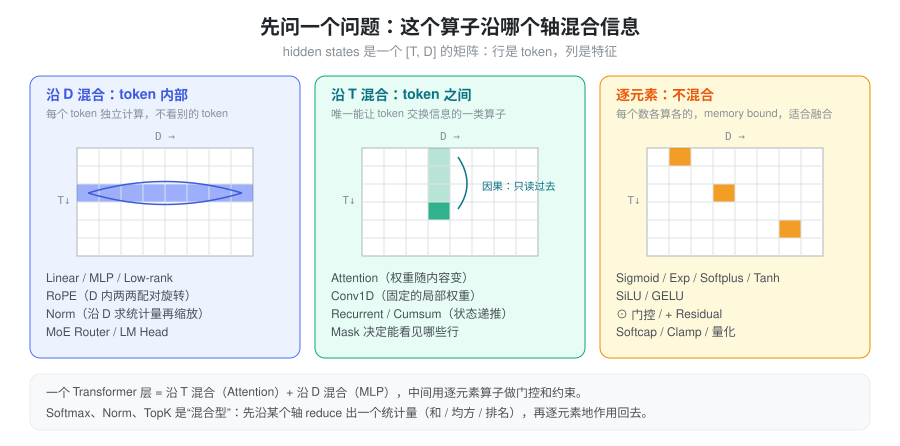
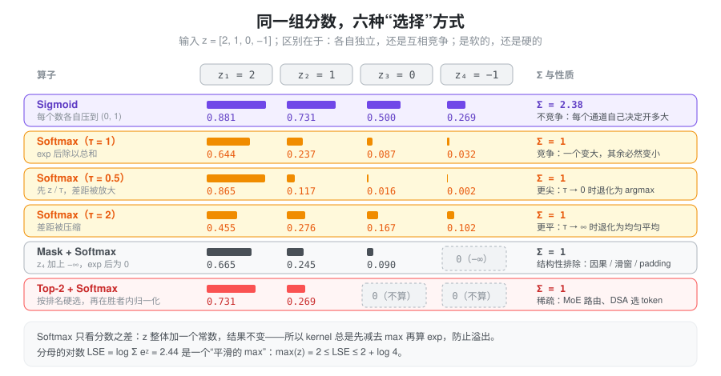
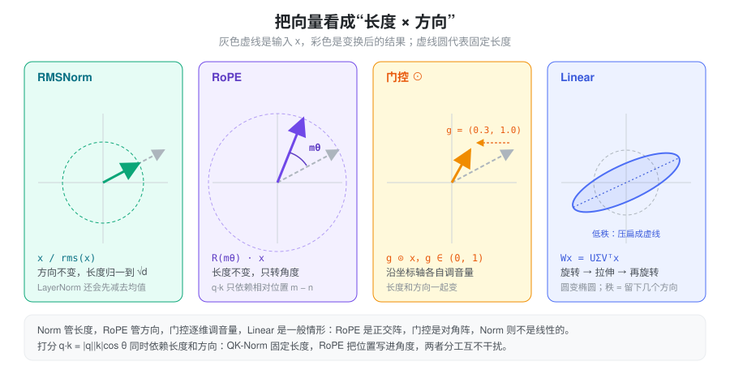
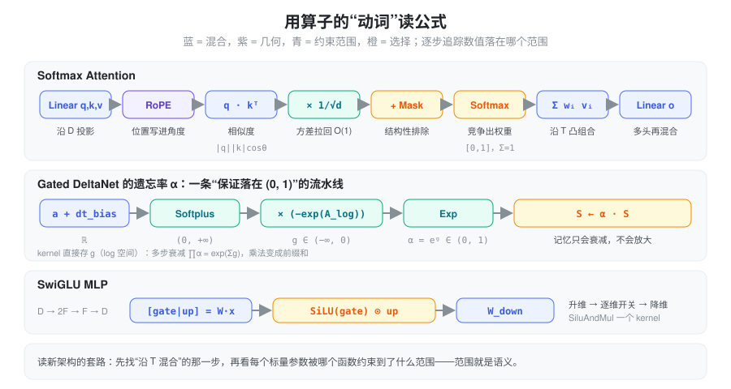

% Math Ops

### 问题：为什么要对基本算子建立直觉

打开任何一个新架构（MLA、Gated DeltaNet、KDA、DSA……），公式看起来都很长，但拆开以后，用到的基本算子不过二十来个：矩阵乘、softmax、sigmoid、exp、norm、旋转、逐元素乘……新架构的“新”，几乎总是**同一批算子的不同组合**。

如果只把这些算子记成“Sigmoid：映射到 (0,1)”，读公式时仍然要逐项硬啃。更有用的是给每个算子一个**动词**：它在**混合**信息、在**选择**信息、在**约束**某个数的范围，还是在改变向量的**几何**（长度或方向）。有了动词，一条公式就能读成一句话——比如 Gated DeltaNet 的遗忘率 \(\alpha = \exp(-e^{A}\cdot\mathrm{softplus}(a+b))\)，读作“把任意实数约束成一个 (0,1) 的衰减系数”，而不需要去记它的具体形状。

本页按动词把算子分成五组：

1. **混合**：Linear、加权求和、Conv1D、Recurrent、外积——信息从哪里流到哪里；
2. **选择**：Sigmoid、Softmax、温度、Mask、TopK、LogSumExp——谁多拿、谁少拿、谁出局；
3. **约束范围**：Exp、Softplus、Tanh / Softcap——把一个自由参数关进有语义的区间；
4. **几何**：RMSNorm、L2Norm、RoPE、门控——管向量的长度和方向；
5. **非线性**：SiLU、GELU——让层不能被合并成一个矩阵。

### 第一个问题：沿哪个轴混合

Transformer 里的 hidden states 是一个 \([T, D]\) 的矩阵（暂时忽略 batch 和 head）：行是 token，列是特征。对任何一个算子，先问一个问题——**它沿哪个轴把数混在一起**：

- **沿 D 混合**（token 内部）：Linear、MLP、RoPE、Norm、MoE Router、LM Head。每个 token 各算各的，所以天然可以按 token 并行，也不需要任何 cache。
- **沿 T 混合**（token 之间）：Attention、Conv1D、Recurrent / 前缀和。这是**唯一**能让 token 之间交换信息的一类算子；推理系统里所有关于 KV cache、state cache、因果性、prefill/decode 不对称的复杂度，都来自这一类。
- **逐元素**（不混合）：Sigmoid、Exp、SiLU、门控乘法、残差加、Softcap、量化。计算量极小、纯粹 memory bound，所以总是被融合进前后的 kernel。

有些算子是“混合型”：**先沿某个轴 reduce 出一个统计量，再逐元素地作用回去**。Softmax 沿行求 \(\sum e^{z}\)，Norm 沿 D 求均方，TopK 沿候选求排名。识别出这个 reduce 的轴，就知道它在并行切分时需不需要通信（例如 TP 切了 D 维以后，RMSNorm 的均方就必须先 all-reduce）。

一个 Transformer 层因此可以概括为：**沿 T 混合一次（Attention），沿 D 混合一次（MLP），中间用逐元素算子做门控和约束，用 Norm 管住尺度。** Linear attention、SSM 替换的只是“沿 T 混合”那一步。

### 混合：信息从哪里流到哪里

#### Linear：一组同时问的“问题”

\(y = xW\)，\(W\in\mathbb{R}^{D_{in}\times D_{out}}\)。最有用的读法是**按列看**：\(W\) 的每一列 \(w_j\) 是一个方向，\(y_j = x\cdot w_j\) 是“\(x\) 在这个方向上有多少分量”。一个 Linear 就是**同时问 \(D_{out}\) 个问题**，每个输出维度是一个问题的答案。

- Q/K/V 投影：同一个 hidden state，问三组不同的问题，分别得到“我在找什么”“我是什么”“我能提供什么”。
- 多头：把 \(D_{out}\) 切成 \(H\) 份，每份是一组独立的问题。
- 按行看则是另一面：\(y = \sum_i x_i\, W_{i,:}\)，输出是 \(W\) 各行的加权和，\(x\) 给出权重——Embedding 查表就是 \(x\) 为 one-hot 的特例。

#### 低秩投影：强制经过一个瓶颈

\(W = AB\)，\(A\in\mathbb{R}^{D\times r}\)，\(B\in\mathbb{R}^{r\times D'}\)，\(r \ll D\)。几何上，任何矩阵都可以写成 \(U\Sigma V^\top\)：先旋转、再沿 \(r\) 个轴拉伸、再旋转（见下文几何一节的图）。秩 \(r\) 就是**最多留下几个方向**，其余方向被压成 0。

低秩不只是省参数，它是一个**语义约束**：所有信息必须先挤进 \(r\) 维。MLA 把 K/V 压进一个共享 latent，LoRA 把权重增量限制在低维子空间，都是在利用“真正有用的方向远少于维度数”这一假设。

#### 加权求和：凸组合 = 在“插值”

\(o = \sum_i w_i v_i\)。当 \(w_i \ge 0\) 且 \(\sum w_i = 1\)（softmax 的输出正好满足），\(o\) 是 \(v_i\) 的**凸组合**：结果一定落在这些 \(v_i\) 围成的凸包里，不会凭空跑出去。所以 attention 的输出可以理解为“在历史 value 之间插值”，权重越尖，越接近直接复制某一个 value。

#### Conv1D：固定权重的局部混合

\(y_t = \sum_{j=0}^{K-1} w_j\, x_{t-j}\)，每个通道独立（depthwise）。它和 attention 都是沿 T 的加权求和，区别只有两点：权重**与内容无关**（是学出来的常数），窗口**很短**（Linear Attention 层里通常是 4）。直觉上它给每个 token 补上“前几个 token 是什么”的局部上下文，让后面的 q/k 不必只靠自己。因果卷积在 decode 时只需缓存最近 \(K-1\) 个输入，是一个极小的 state。

#### Recurrent / 前缀和：把历史折叠成状态

\(S_t = \gamma_t S_{t-1} + k_t^\top v_t\)。纯累加（\(\gamma=1\)）就是前缀和 cumsum；带衰减就是指数滑动平均。这类算子把“沿 T 混合”从“每次回头看所有历史”变成“维护一个固定大小的摘要”，代价是摘要容量有限。详见 [Linear Attention](./linear_attention.md)。

#### 外积：一次“写入”

\(k^\top v\in\mathbb{R}^{d_k\times d_v}\) 是秩 1 矩阵，可以理解为“在 key 方向 \(k\) 上存入 value \(v\)”；之后用 \(q\) 去乘 \(S\) 就是“按 key 读出”。点积 \(q\cdot k\) 是**比较**（两个向量变一个数），外积 \(k^\top v\) 是**存储**（两个向量变一个矩阵）。Softmax attention 只用点积，Linear attention 用外积把每个 token 写进状态。

### 选择：谁多拿、谁少拿、谁出局

给一组分数 \(z\)，“选择”类算子决定每一项拿多少权重。区分它们只需要两个问题：**各项之间是否竞争**（总量是否固定），以及**选择是软的还是硬的**。

#### Sigmoid：各自独立的开关

\(\sigma(z) = \frac{1}{1+e^{-z}}\in(0,1)\)。每个数独立决定自己开多大，加起来不等于 1。所以它适合**门**：每个通道 / 每个 head 自己决定放行多少，不需要和别人抢。Linear attention 的写入强度 \(\beta\)、gated attention 的输出门、部分 MoE 的路由打分都用它。

一个好记的等式：\(\sigma(z) = \mathrm{softmax}([z, 0])_1\)——sigmoid 就是“和一个固定为 0 的对手”做二选一的 softmax。

#### Softmax：在固定预算里竞争

\(p_i = e^{z_i}/\sum_j e^{z_j}\)。总量恒为 1，**一个变大，其余必然变小**。这正是“注意力”的含义：注意力是有限的，分给了这个 token 就少分给那个。

三个必须记住的性质：

- **只看差值**：\(z\) 整体加常数，结果不变。所以 kernel 一定先减去 \(\max z\) 再算 exp（数值稳定），这也是 Mask 能用 \(-\infty\) 实现的原因。
- **差 1 意味着倍数 \(e\)**：\(z_1 - z_2 = 1\) 时 \(p_1/p_2 = e \approx 2.7\)。分数是**对数尺度**的权重。
- **温度控制尖锐度**：\(\mathrm{softmax}(z/\tau)\)。\(\tau\to 0\) 退化为 argmax（硬选一个），\(\tau\to\infty\) 退化为均匀平均。采样的 temperature 就是它。

#### 缩放 \(1/\sqrt{d}\)：其实是一个温度

如果 \(q, k\) 的每一维独立、方差为 1，则 \(q\cdot k = \sum_{i=1}^{d} q_ik_i\) 的方差是 \(d\)。不缩放的话，\(d=128\) 时分数的标准差约 11，softmax 几乎总是 one-hot，梯度也几乎为 0。除以 \(\sqrt{d}\) 把方差拉回 1，等价于取温度 \(\tau = \sqrt d\)。

#### Mask：结构性排除

给分数加上 \(-\infty\)，exp 之后精确为 0，且不影响其余项之间的相对比例。因果 mask、滑动窗口、padding、prefix-cache 的块边界都是这个操作——它表达的是“**按规则**不能看”，而不是“学出来不想看”。

#### TopK：硬选择

按排名留下前 \(k\) 个，其余直接丢弃（连计算都省掉），再在胜者内部做 softmax 或 sigmoid 归一化。它是唯一能**真正省算力**的选择：MoE 只激活 \(k\) 个专家，DSA 只对 top-k 个 token 做 attention。代价是不可导、且容易“马太效应”，所以 MoE 路由常配合 bias 或负载均衡项来调整排名。

#### LogSumExp：平滑的 max，也是可合并的“摘要”

\(\mathrm{LSE}(z) = \log\sum_i e^{z_i}\)，满足 \(\max z \le \mathrm{LSE}(z) \le \max z + \log n\)。它是 softmax 的分母，也是一个“平滑版的 max”。

它在推理里的真正价值是**可合并**：把 key 分成两段分别算 attention，得到 \((o_a, \mathrm{lse}_a)\) 和 \((o_b, \mathrm{lse}_b)\)，就能精确拼回整体结果：

\[
o = \frac{e^{\mathrm{lse}_a}\, o_a + e^{\mathrm{lse}_b}\, o_b}{e^{\mathrm{lse}_a} + e^{\mathrm{lse}_b}},\qquad
\mathrm{lse} = \log\left(e^{\mathrm{lse}_a} + e^{\mathrm{lse}_b}\right)
\]

Flash Attention 的 online softmax、split-KV decode、cascade attention、DCP 跨卡合并都是这一个公式。

### 约束范围：值域就是语义

网络里很多标量（遗忘率、写入强度、步长、门）都有天然的取值范围：遗忘率必须在 (0,1]，步长必须为正。网络直接输出的是任意实数，所以需要一个函数把它**关进**正确的区间。看到一个陌生公式时，**先看最外层的函数决定了值域，值域基本就告诉你这个量的语义**。

| 函数 | 值域 | 典型语义 | 直觉 |
| --- | --- | --- | --- |
| \(\sigma(x)\) | \((0, 1)\) | 门、写入强度 \(\beta\)、概率 | 软开关；\(x=0\) 时半开 |
| \(e^{x}\) | \((0, +\infty)\) | 正的尺度、步长、未归一化权重 | 加法 → 乘法；\(x\) 加 1，结果乘 \(e\) |
| \(\mathrm{softplus}(x)=\log(1+e^x)\) | \((0, +\infty)\) | 正的步长 \(\Delta t\)、强度 | 平滑的 ReLU；大 \(x\) 时 \(\approx x\)，不像 exp 那样爆炸 |
| \(e^{-e^{A}\cdot\mathrm{softplus}(x)}\) | \((0, 1)\) | 遗忘率 \(\alpha\)、衰减 | 正数取负再 exp，必然落在 (0,1) |
| \(\tanh(x)\) | \((-1, 1)\) | 有界的有符号值 | 中心对称的 sigmoid：\(\tanh x = 2\sigma(2x)-1\) |
| \(c\cdot\tanh(x/c)\) | \((-c, c)\) | Softcap：限制 logit 上界 | 小值几乎不变，大值被平滑地压住 |

这几个函数之间关系很紧：\(\frac{d}{dx}\mathrm{softplus}(x) = \sigma(x)\)，\(\mathrm{SiLU}(x)=x\,\sigma(x)\)，\(\tanh\) 是拉伸平移过的 \(\sigma\)。记住 \(\sigma\) 和 \(\exp\)，其余都能推出来。

#### Exp 与 log 空间：把连乘变成前缀和

衰减系数要跨很多步连乘：\(\prod_{\tau=j+1}^{t}\alpha_\tau\)。直接连乘既慢又会下溢；如果存的是 \(g = \log\alpha\)，连乘就变成 \(\exp\left(\sum g\right)\)，而 \(\sum g\) 就是一个**前缀和**，可以按块并行计算。这就是为什么 Mamba2 / GDN / KDA 的 kernel 接口传的都是 \(g\)（log 空间的衰减），而不是 \(\alpha\) 本身。

同理，概率在 log 空间相加、softmax 在 log 空间合并（LSE）——**乘法难并行、易溢出时，就换到 log 空间做加法**，是一条反复出现的工程套路。

#### Softcap：不让任何一个 logit 一家独大

\(\mathrm{softcap}(z) = c\cdot\tanh(z/c)\)。Gemma 2 对 attention 分数和最终 logits 都做了这一步。它和 \(1/\sqrt d\) 的区别在于：缩放对所有分数一视同仁，softcap 只压住**极端值**，小分数几乎不受影响。

### 几何：长度和方向分开管

把向量写成“长度 × 方向”，\(x = \lVert x\rVert\cdot \hat x\)，很多算子的作用就一目了然：有的只管长度，有的只管方向，有的两者一起改。

#### RMSNorm / L2Norm：只管长度

\[
\mathrm{RMSNorm}(x) = \frac{x}{\sqrt{\frac1d\sum_i x_i^2 + \epsilon}} \odot \gamma
\]

除以 RMS 等价于把 \(\lVert x\rVert\) 归一到 \(\sqrt d\)，**方向完全保留**，再用可学习的 \(\gamma\) 逐维重新缩放。它的意义是让下一层看到的输入尺度恒定：无论残差流累积到多大，进入 attention / MLP 的数都在 \(O(1)\)。LayerNorm 多做一步减均值（去掉沿全 1 方向的分量）；L2Norm 不带 \(\gamma\)、归一到 1，常用于 QK-Norm 和 linear attention 的 q/k。

为什么 linear attention 必须对 q/k 做 L2Norm？因为它的状态是外积累加，\(\lVert k\rVert\) 直接决定写入强度：key 长度失控，状态就会爆炸；固定长度后，写入强度只由 \(\beta\) 决定。

#### RoPE：只管方向

把 \(D\) 维两两配对，每对看成一个复数，按位置 \(m\) 旋转角度 \(m\theta_i\)：

\[
\begin{pmatrix} x_1' \\ x_2' \end{pmatrix} =
\begin{pmatrix} \cos m\theta & -\sin m\theta \\ \sin m\theta & \cos m\theta \end{pmatrix}
\begin{pmatrix} x_1 \\ x_2 \end{pmatrix}
\]

旋转不改变长度。关键性质是：\(q\) 转 \(m\theta\)，\(k\) 转 \(n\theta\)，点积只剩下夹角之差，\(\langle R_m q, R_n k\rangle = \langle q, R_{n-m} k\rangle\)——**绝对位置在点积中自动变成了相对位置**。不同配对用不同频率 \(\theta_i = b^{-2i/D}\)：高频对分辨近距离，低频对编码远距离，像一个多指针的时钟。YaRN 等长度外推方法就是在改这些频率。

#### 门控 \(\odot\)：逐维调音量

\(g\odot x\) 是对角矩阵乘法：每一维独立缩放，长度和方向都会变。和 Linear 的区别是**不混合维度**——它不产生新特征，只决定已有特征放行多少。门的取值来自 sigmoid（不竞争），所以每一维可以同时全开或同时全关。

#### Residual：保留一条恒等通路

\(x_{l+1} = x_l + f(x_l)\)。每层只学一个**增量**，而不是重写整个表示；梯度可以沿恒等通路直接传回。由此，残差流可以看成所有层共享的一块“黑板”，每层读一部分、写一点增量。Pre-Norm（先 norm 再进 \(f\)）让黑板本身的尺度可以自由增长，而每层读到的都是归一化后的版本。

#### Linear：一般情形

上面几种都是 Linear 的特例或近亲：RoPE 是正交矩阵（只转不拉），门控是对角矩阵（只拉不转），Norm 本身不是线性的（缩放系数依赖输入）。一般的 \(W = U\Sigma V^\top\) 把圆变成椭圆：先转、再沿主轴拉伸、再转；奇异值为 0 的方向被彻底丢弃。

打分 \(q\cdot k = \lVert q\rVert\lVert k\rVert\cos\theta\) 同时依赖长度和方向，于是可以清楚地分工：QK-Norm 固定长度（防止分数爆炸），RoPE 把位置写进角度，剩下的方向差异才是内容的相似度。

### 非线性：让层不能合并

如果只有线性层，\(W_2W_1\) 可以合并成一个矩阵，堆多少层都没用。非线性函数插在中间打断这种合并（见 [Activation](./activation.md)）。

- **ReLU** \(\max(0,x)\)：硬开关，负半轴完全关闭。
- **SiLU** \(x\,\sigma(x)\)、**GELU** \(x\,\Phi(x)\)：都可以读成“**用自己给自己开门**”——\(x\) 越大门越开，\(x\) 很负时门关上，中间平滑过渡。
- **SwiGLU** \(\mathrm{SiLU}(xW_g)\odot(xW_u)\)：把“开门”和“内容”拆成两路投影，门来自一路、内容来自另一路，再逐元素相乘。这比单路激活多了一个自由度：决定“放不放行”的特征和“放行什么”的特征可以不同。

从这个角度看，门控 MLP 和 gated attention、linear attention 的 \(\beta\) 是同一种结构：**一路算内容，一路算门，逐元素相乘**。

### 组合：用动词读公式

有了上面的动词，读一个新公式的套路是：**先找沿 T 混合的那一步，再看每个标量被哪个函数约束到了什么范围。**

- **Softmax attention**：Linear 投影（沿 D）→ RoPE 写入位置（几何）→ 点积比较 → \(1/\sqrt d\) 控温 → Mask 排除 → Softmax 竞争 → 加权求和（沿 T 的凸组合）→ 输出投影。一句话：“按相似度在历史 value 之间插值”。
- **Gated DeltaNet 的遗忘率**：\(g = -e^{A}\cdot\mathrm{softplus}(a + b_{dt})\)，\(\alpha = e^{g}\)。从右往左读：任意实数 → softplus 变正 → 乘一个可学习的正数再取负 → exp 落进 (0,1)。一句话：“每个 head 学一个保证不放大的衰减率”，而且以 log 形式 \(g\) 交给 kernel。
- **SwiGLU MLP**：升维 → 一路做门、一路做内容 → 逐维开关 → 降维。一句话：“在宽空间里有选择地放行特征”。

### 在 SGLang 里的落点

这些算子在 SGLang 中大多是独立的 layer 或融合 kernel，命名本身就体现了上面的分组（路径相对 `python/sglang/`）：

| 动词 | 算子 | 位置 | 值得知道的细节 |
| --- | --- | --- | --- |
| 混合（D） | Linear | `srt/layers/linear.py`：`QKVParallelLinear`、`MergedColumnParallelLinear`、`RowParallelLinear` | 多个投影合并成一个大 GEMM：q/k/v 一次算完，gate/up 一次算完 |
| 混合（T） | Conv1D | `srt/layers/attention/mamba/causal_conv1d.py`：`causal_conv1d_fn` / `causal_conv1d_update` | prefill 走整段卷积，decode 只用缓存的最近 \(K-1\) 个输入 |
| 选择 | LSE 合并 | `srt/layers/attention/merge_state.py`：`merge_state` | Triton 版先减去两者的 `max_lse` 再 exp，与上文合并公式一致 |
| 选择 | TopK | `srt/layers/moe/topk.py`：`TopK`、`fused_topk`、`biased_grouped_topk_gpu` | 分组 / 加 bias 后再排名，是对硬选择的修正 |
| 约束 | Softplus / Exp / Sigmoid | `kernels/ops/attention/fla/fused_gdn_gating.py` | 一个 kernel 同时算 \(g=-e^{A}\,\mathrm{softplus}(a+b_{dt})\) 与 \(\beta=\sigma(b)\)；softplus 在 \(x>20\) 时直接返回 \(x\)，避免 exp 溢出 |
| 约束 | Softcap | `srt/layers/logits_processor.py`（`final_logit_softcapping`）、`srt/layers/radix_attention.py`（`logit_cap`） | logits 上是 \(c\cdot\tanh(z/c)\)，GPU 上走融合 kernel |
| 几何 | RMSNorm | `srt/layers/layernorm.py`：`RMSNorm`、`GemmaRMSNorm` | 传入 `residual` 时先做残差加再 norm，一个 kernel 完成；Gemma 的权重语义是 \(1+\gamma\) |
| 几何 | RoPE | `srt/layers/rotary_embedding/`：`RotaryEmbedding`，`utils.py` 的 `apply_rotary_emb` | `is_neox_style` 决定配对方式：前后两半配对 vs 相邻两维配对，数学相同、内存布局不同 |
| 非线性 | SwiGLU | `srt/layers/activation.py`：`SiluAndMul` | 输入是 gate、up 两半拼在一起的张量，native 实现就是 `silu(x[..., :d]) * x[..., d:]` |

一个反复出现的工程模式：**逐元素和“reduce + 逐元素”类算子几乎从不单独成 kernel**。它们计算量可以忽略，成本全在读写显存，所以总是融合进相邻的算子（residual + norm、norm + 量化、silu + mul、gating 的四步合一、softcap + cast）。看到一个新的 fused kernel，基本可以按“它把哪几个动词粘在了一起”来理解。

### 速查表

| 操作 | 动词 | 混合的轴 | 值域 / 不变量 | 常见架构语义 |
| --- | --- | --- | --- | --- |
| Linear / MatMul | 混合 | D | — | 投影、问 \(D_{out}\) 个问题 |
| Low-rank Projection | 混合 | D | 秩 \(\le r\) | 瓶颈、latent 压缩、LoRA |
| Weighted Sum | 混合 | T | 凸组合（权重和为 1 时） | attention 读出、插值 |
| Conv1D | 混合 | T（局部） | — | 短程上下文 |
| Recurrent / Cumsum | 混合 | T（因果） | 状态大小固定 | 记忆、流式计算 |
| Outer Product | 混合 | — | 秩 1 | 向状态写入一个 key→value |
| Sigmoid | 选择 / 约束 | 逐元素 | \((0,1)\)，不竞争 | 门、写入强度 |
| Softmax | 选择 | 沿候选 reduce | \(\Sigma=1\)，平移不变 | 竞争性分配 |
| Temperature / \(1/\sqrt d\) | 选择 | 逐元素 | — | 控制尖锐度 |
| Mask | 选择 | 逐元素 | 被 mask 项精确为 0 | 因果、窗口、padding |
| TopK | 选择 | 沿候选 reduce | 只保留 \(k\) 项 | MoE 路由、稀疏 attention |
| LogSumExp | 选择 | 沿候选 reduce | \(\max \le \mathrm{LSE} \le \max+\log n\) | 分块 attention 合并 |
| Exp | 约束 | 逐元素 | \((0,\infty)\) | 正尺度、log 空间衰减 |
| Softplus | 约束 | 逐元素 | \((0,\infty)\) | 正的步长 |
| Tanh / Softcap | 约束 | 逐元素 | \((-c, c)\) | 限制 logit 上界 |
| RMSNorm / L2Norm | 几何 | D 上 reduce | 长度固定，方向不变 | 稳定尺度、QK-Norm |
| RoPE | 几何 | D 内两两配对 | 长度不变 | 相对位置 |
| Elementwise Multiply | 几何 / 门控 | 逐元素 | — | 门控、特征调制 |
| Residual Add | 几何 | 逐元素 | 保留恒等通路 | 增量更新、梯度通路 |
| SiLU / GELU | 非线性 | 逐元素 | — | 自门控、增强表达能力 |

### 小结

模型里的基本算子不多，难的是把它们读成意义而不是公式。先问“沿哪个轴混合”，就能区分出决定推理复杂度的那一步（沿 T）和可以随意并行的部分（沿 D、逐元素）；再问“这个数被约束到了什么范围”，值域几乎就是它的语义——(0,1) 是门或遗忘率，\(\Sigma=1\) 是竞争性权重，正数是尺度或步长；最后把几何算子拆成“管长度”和“管方向”，Norm 和 RoPE 的分工就自然清楚了。新架构在这三个问题上的回答，通常就是它全部的设计。
