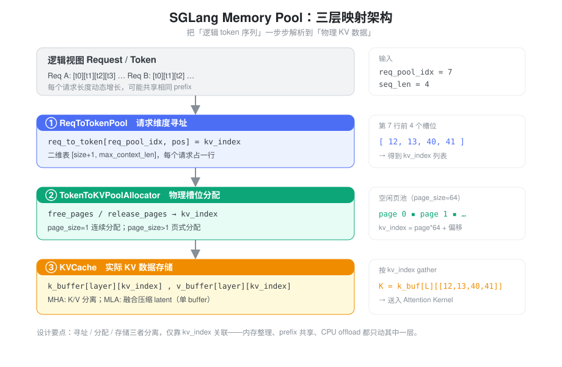
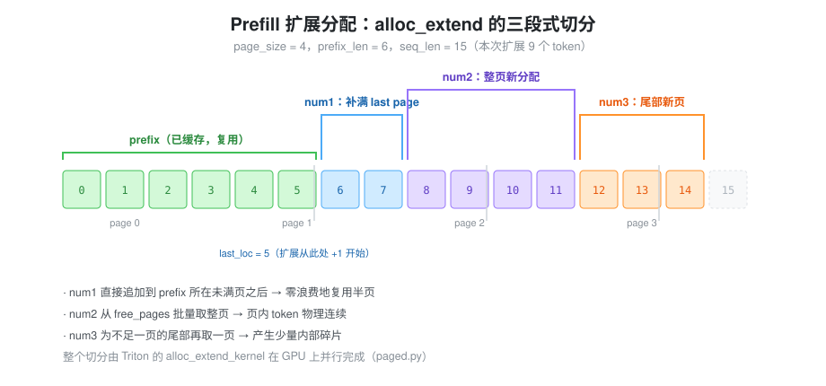
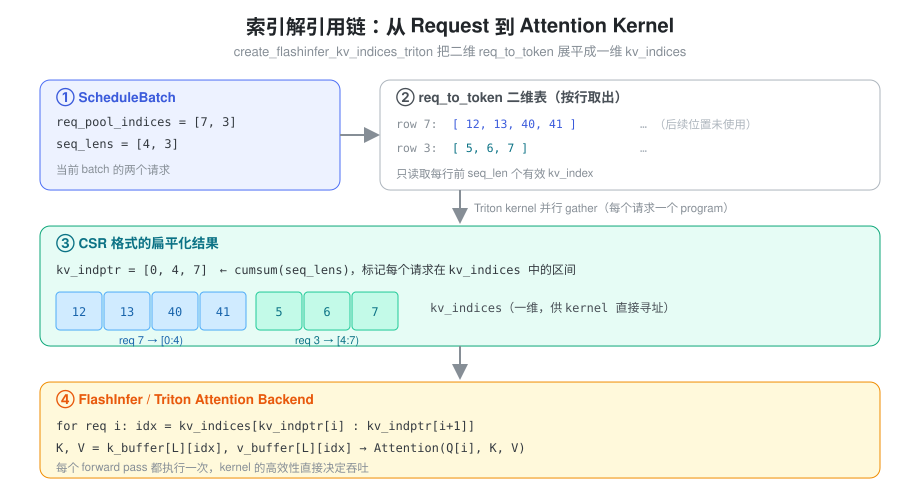
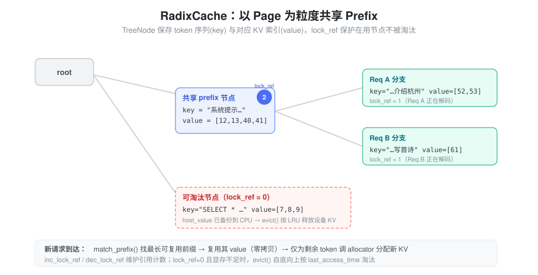

% Memory Pool

Transformer 模型在推理时，每生成一个新 token，都需要访问之前所有 token 的 Key 和 Value（KV Cache）。这带来三个核心挑战：

1. **动态长度**：不同请求的序列长度不同，且每个请求的长度都在持续增长
2. **内存碎片**：频繁的分配和释放会产生内存碎片，降低内存利用率
3. **共享需求**：多个请求可能有相同的 prefix，共享 KV Cache 可以节省计算和内存

传统的连续内存分配方式难以同时解决这三个问题。这引出了 **Page 机制** 的设计思想。

### 核心抽象：三层映射关系

SGLang 的 Memory Pool 本质上建立了一个**三层映射架构**，让逻辑上的 token 序列能够找到物理上的 KV 数据：



这三层在初始化时一起创建、彼此通过索引关联，各自解决一个维度的问题：

- **ReqToTokenPool** 解决「请求维度」的寻址问题：给定请求和 token 位置，找到 KV 槽位索引
- **TokenToKVPoolAllocator** 解决「物理内存」的分配问题：管理 KV 槽位（或页）的分配与释放
- **KVCache** 解决「数据存储」的实际问题：真正存放每一层的 K/V 张量

三者分离、各司其职，仅靠 `kv_index` 这一个整数相互关联。这个「薄索引」正是后面所有灵活性（内存整理、prefix 共享、CPU offload）的来源。

### req_to_token 与 token_to_kv 的深层关联

#### ReqToTokenPool：请求维度的二维表

`ReqToTokenPool`（`memory_pool.py:256`）的核心就是一张二维表加一个空闲链表：

```python
## 一行对应一个请求槽位，一列对应一个 token 位置
self.req_to_token = torch.zeros(
    (size + 1, max_context_len), dtype=torch.int32, device=device
)
## 注意是 range(1, size+1)：index 0 被刻意保留
self.free_slots = list(range(1, self._alloc_size))
self.req_generation = torch.zeros(self._alloc_size, dtype=torch.int64)
```

这里有几个容易忽略但很关键的工程细节：

- **padding row at index 0**：第 0 行是预留的「哑行」。CUDA Graph 捕获的 padded batch 会把多余的 `req_pool_indices` 默认填 0，这些 dummy 读写就落在第 0 行，不会破坏真实数据。分配器里的 page 0 同理也被保留。
- **从尾部弹出空闲槽位**：`alloc` 时用 `free_slots[-need_size:]` 从尾部取，复杂度 `O(need_size)`，比从头部弹出的 `O(len(free_slots))` 更快。
- **复用槽位**：chunked prefill 跨 chunk 的请求 `req_pool_idx` 已经存在，会直接复用原来的行，而不重新分配。
- **`req_generation`**：每次槽位被重新分配时自增，用于区分「同一个物理行」被不同请求先后占用的代际，避免陈旧引用。

#### 数据结构对比

| 特性 | req_to_token | token_to_kv（由 Allocator 管理） |
|------|-------------|--------------------------------|
| 维度 | `[size+1, max_context_len]` 二维 int32 | 一维页/槽位索引池 |
| 含义 | 每个请求每个位置的 KV 槽位 | 物理 KV Cache 槽位 |
| 分配单位 | 按「请求」分配一行 | 按 Page 分配槽位 |
| 生命周期 | 与请求绑定 | 与 KV 数据绑定 |

#### 索引流转过程

当 Attention 算子需要访问 KV Cache 时，发生了一次**索引解引用链**：

```
步骤 1: 获取请求的 pool index
        req_pool_idx = request.req_pool_idx

步骤 2: 找到该请求所有 token 的 KV 索引
        kv_indices = req_to_token[req_pool_idx, :seq_len]

步骤 3: 通过 KV 索引访问实际数据
        K = kv_cache.k_buffer[layer_id][kv_indices]
        V = kv_cache.v_buffer[layer_id][kv_indices]
```

这个设计的关键洞察是：**分离「寻址」和「存储」**。

- `req_to_token` 负责「寻址」：知道数据在哪里
- `kv_cache` 负责「存储」：知道数据是什么
- `allocator` 负责「管理」：知道哪里有空位

#### 为什么需要两层索引？

一个直观的疑问是：为什么不直接让 `req_to_token` 指向物理地址？

答案在于**灵活性**：

1. **内存重分配**：当需要整理内存碎片时，只需修改 `kv_cache` 的物理布局，无需遍历所有请求更新 `req_to_token`
2. **Prefix 共享**：多个请求的 `req_to_token` 可以指向相同的 `kv_cache_index`，实现零拷贝共享
3. **CPU Offload**：当 KV Cache 需要换入换出时，`req_to_token` 保持不变，只移动 `kv_cache` 的数据

---

### 分配器内部：空闲页是怎么管理的

`BaseTokenToKVPoolAllocator`（`allocator/base.py`）用两个张量管理空闲资源，这个设计比「一个空闲链表」要讲究：

```python
self.free_pages = None      # 当前可直接分配的页
self.release_pages = None   # 刚释放、尚未并回 free_pages 的页
self.need_sort = need_sort  # 是否需要保持页有序
self.free_group = []        # 批量释放缓冲
```

- **`free_pages` / `release_pages` 两段式**：常规场景释放直接拼回 `free_pages`；而在 **PD 分离（Prefill/Decode disaggregation）** 等需要有序页的场景（`need_sort=True`），释放先进 `release_pages`，等到容量不够时才通过 `merge_and_sort_free()` 合并排序，把排序开销摊销掉。
- **`free_group_begin/end`**：一个 batch 内多个请求结束时，把 free 操作缓存进 `free_group`，到 `free_group_end` 一次性 `torch.cat` 释放，减少 kernel launch。
- **page 0 保留**：和 `ReqToTokenPool` 一样，`free_pages = arange(1, num_pages+1)`，第 0 页留给 padded token 的 dummy 写入。

连续分配器（`page_size=1`）的 `alloc` 就是从 `free_pages` 头部切一段；页式分配器把页号展开成 token 索引：

```python
## PagedTokenToKVPoolAllocator.alloc：取 num_pages 个页，展开成连续 token 索引
out_pages = self.free_pages[:num_pages]
out_indices = (out_pages[:, None] * self.page_size
               + torch.arange(self.page_size, device=self.device)).reshape(-1)
```

释放时则反向：`torch.unique(free_index // self.page_size)` 把 token 索引折回页号再回收。

---

### 内存分配的两个关键路径

#### 路径一：Prefill（Extend）阶段

处理新 prompt 时要为大量 token 一次性分配 KV Cache。页式分配器的 `alloc_extend` 把扩展区间巧妙地切成三段，最大化复用、最小化碎片：



```python
## PagedTokenToKVPoolAllocator.alloc_extend(...)
## 调用 Triton kernel 在 GPU 上并行完成三段切分
alloc_extend_kernel[(bs,)](
    prefix_lens,   # 已缓存的 prefix 长度（prefix 停在某个未满页中间）
    seq_lens,      # 扩展后的总长度
    last_loc,      # prefix 最后一个 token 的物理位置
    self.free_pages,
    out_indices,
    next_power_of_2(bs),
    self.page_size,
)
```

三段的含义（对应 `alloc_extend_naive` 的参考实现）：

- **num1 — 补满 last page**：prefix 往往停在一个未满的页中间，先把这个半页的剩余槽位追加使用（紧跟 `last_loc + 1`），**零浪费地复用半页**。
- **num2 — 整页新分配**：中间部分从 `free_pages` 批量取整页，保证页内 token 物理连续。
- **num3 — 尾部新页**：末尾不足一页的部分再取一页，产生少量可接受的内部碎片。

#### 路径二：Decode 阶段

每步只生成一个新 token，追求「最小化分配」。`alloc_decode` 同样用 Triton kernel：当前页未满就复用，满了就取一页新页，每个请求只返回一个 `kv_index`，然后写回 `req_to_token[req_pool_idx, seq_len]`。

---

### Attention 算子与元数据的结合

#### Attention 需要哪些元数据？

Attention 算子执行时，需要回答以下问题：

```
Q1: Query 来自哪些位置？        → qo_indptr
Q2: Key/Value 来自哪些位置？    → kv_indptr, kv_indices
Q3: 每个请求有多少 KV？         → seq_lens
Q4: 最后一个 Page 有多少有效？  → kv_last_page_len
```

这些答案都要从 Memory Pool 的数据结构中推导。核心的转换是把**二维的 `req_to_token` 展平成一维的 `kv_indices`**：



#### 关键转换：create_flashinfer_kv_indices_triton

这个 Triton kernel（`kernels/ops/kvcache/kv_indices.py`）是连接 Memory Pool 和 Attention Backend 的桥梁。它为 batch 里每个请求启动一个 program，各自把自己那一行的有效索引搬到 `kv_indices` 的对应区间：

```python
@triton.jit
def create_flashinfer_kv_indices_triton(
    req_to_token_ptr,       # [max_batch, max_context_len]
    req_pool_indices_ptr,   # 本 batch 各请求的 pool index
    page_kernel_lens_ptr,   # 各请求的序列长度
    kv_indptr,              # CSR 指针数组 = cumsum(seq_lens)
    kv_start_idx,
    kv_indices_ptr,         # 输出：展平后的一维 KV 索引
    req_to_token_ptr_stride: tl.constexpr,
):
    pid = tl.program_id(axis=0)                       # 每个请求一个 program
    req_pool_index = tl.load(req_pool_indices_ptr + pid)
    kv_indices_offset = tl.load(kv_indptr + pid)      # 该请求在输出中的起点
    ## 分块把 req_to_token[req_pool_index, kv_start:kv_end] 搬到 kv_indices
```

调用方（`triton_backend.py`）先用一行 `kv_indptr[1:] = torch.cumsum(seq_lens, dim=0)` 建好 CSR 指针，再启动 kernel 填充索引。这个 kernel 在**每个 forward pass 都会执行**，所以它的高效性至关重要。

> 对于 MLA 的页式后端，还有一个姊妹 kernel `create_flashmla_kv_indices_triton`，它以 **page 粒度**生成 block table，并支持 unified-memory 下的虚拟页→物理页映射（`v2p`）。

---

### 代码实现的关键节点

#### 核心类关系

Memory Pool 由三组类协作，分别对应三层映射：

```
ReqToTokenPool（memory_pool.py:256）
  └─ HybridReqToTokenPool          混合（Mamba + Attention）模型

BaseTokenToKVPoolAllocator（allocator/base.py）  抽象基类
  ├─ TokenToKVPoolAllocator        page_size=1，连续分配（allocator/token.py）
  ├─ PagedTokenToKVPoolAllocator   page_size>1，页式分配（allocator/paged.py）
  └─ SWATokenToKVPoolAllocator     滑动窗口注意力（allocator/swa.py）
       └─ PureSWATokenToKVPoolAllocator

KVCache（memory_pool.py:1624）  抽象基类
  ├─ MHATokenToKVPool             标准多头注意力，K/V 分离
  │    ├─ MHATokenToKVPoolFP4 / MXFP8   低精度量化变体
  │    ├─ PageMajorMHATokenToKVPool     page-major 内存布局
  │    └─ NoOpMHATokenToKVPool          占位（如纯 linear 层）
  └─ MLATokenToKVPool             DeepSeek MLA，融合压缩 latent
       └─ MLATokenToKVPoolFP4
```

> 相比早期版本，`allocator` 已从单文件拆成独立 package，且 KVCache 家族新增了多种量化/布局变体；所有变体都隐藏在 `get_key_buffer` / `get_value_buffer` / `set_kv_buffer` 等统一接口之后。

#### KVCache 基类：被抽象掉的细节

`KVCache` 抽象基类（`memory_pool.py:1624`）封装了几个对上层透明、但对正确性/性能很关键的点：

- **`store_dtype`**：FP8（`float8_e4m3fn` 等）会以 `torch.uint8` 存储，因为 `index_put` 对 FP8 尚未实现——取出时再 `view` 回原 dtype。
- **`start_layer` / `end_layer`**：流水线并行（PP）下，每个 rank 只持有自己负责的层区间。
- **`layer_transfer_counter`**：layer-wise KV 加载时，`get_key_buffer` 会 `wait_until(layer_id)` 等待该层数据就绪，从而让 KV 传输与计算 overlap。
- **padded slot 0**：所有 buffer 的实际大小都是 `size + page_size`，首个槽位留给 padded token。

#### MHA vs MLA：同一套索引，不同的存储形态

```
MHATokenToKVPool:  k_buffer[layer], v_buffer[layer]       ← 标准 KV 分离
MLATokenToKVPool:  kv_buffer[layer]（单个融合 buffer）     ← 压缩的 latent
```

MLA 把 KV 压缩成一个低维 latent，所以只有**一个** `kv_buffer`，其最后一维为 `kv_lora_rank + qk_rope_head_dim`：

```python
## MLATokenToKVPool._create_buffers
self.kv_buffer = [
    torch.zeros((size + page_size, 1, self.kv_cache_dim),  # kv_cache_dim = kv_lora_rank + qk_rope_head_dim
                dtype=self.store_dtype, device=self.device)
    for _ in range(self.layer_num)
]
```

这正是「抽象带来可扩展性」的体现：无论 K/V 分离还是融合，上层只通过 `get_kv_buffer(layer_id)` 取数据，不关心底层形态。

#### Prefix Cache：Radix Tree 的角色

`RadixCache`（`radix_cache.py:303`）位于 Memory Pool 之上，用一棵基数树实现 **Prefix 共享**。每个 `TreeNode` 保存一段 token 序列及其对应的 KV 索引：



`TreeNode`（`radix_cache.py:238`）的关键字段：

- **`key: RadixKey`**：该节点代表的 token 序列；`extra_key` 可区分 LoRA / 采样盐 / 缓存版本等不同命名空间，避免误共享。
- **`value`**：这些 token 的 KV 索引（设备上的一维 int64 张量）；`value is None` 表示节点已被淘汰。
- **`children`**：`token_id → TreeNode` 的字典。
- **`lock_ref`**：引用计数，正在被请求使用的节点 `lock_ref > 0`，受保护不被淘汰。
- **`host_value`**：CPU 侧备份，支撑 KV 的 host offload。
- **`last_access_time` / `priority`**：驱动 LRU 及优先级淘汰策略。

核心操作：

- `match_prefix(key)`：找最长可复用前缀，必要时**分裂**节点以暴露精确边界；返回拼接好的 KV 索引
- `insert(key, value)`：插入新的 prefix 节点
- `cache_finished_req` / `cache_unfinished_req`：请求（部分）完成时把 KV 回写进树
- `inc_lock_ref` / `dec_lock_ref`：维护引用计数
- `evict`：显存不足时自底向上按访问时间淘汰 `lock_ref=0` 的节点

当新请求到达时：

```
1. match_prefix(request_tokens) → 找到可复用的 prefix
2. 复用 prefix 对应的 kv_cache_indices → 无需重新计算这些 token 的 KV
3. 只为剩余的 tokens 调 allocator 分配新的 KV Cache
```

这就是 Memory Pool 设计中「共享需求」的具体落地。

---

### 总结：架构的核心价值

回顾整个 Memory Pool 架构，其核心价值体现在三个方面：

#### 解耦带来的灵活性

三层映射关系将「逻辑请求」「索引管理」「物理存储」解耦：

- 调整分配策略（连续 vs 页式）不影响存储层
- 实现共享（Radix Cache）不需要修改底层存储
- 支持 Offload 只需扩展存储层的操作（`host_value` + `layer_transfer_counter`）

#### 抽象带来的可扩展性

KVCache 的多种实现共享相同的索引机制：

```
MHATokenToKVPool:   k_buffer[layer], v_buffer[layer]   ← 标准 KV 分离
MLATokenToKVPool:   kv_buffer[layer]                   ← KV 融合压缩
+ FP4 / MXFP8 / PageMajor 等变体                        ← 量化与布局差异
```

这些差异被封装在 `get_key_buffer`、`get_value_buffer` 等接口背后，上层代码无需关心。

#### 元数据流的清晰性

从 Request → req_to_token → kv_indices → Attention Kernel，数据流转路径清晰：

```
Request 级别信息 (req_pool_idx, seq_len)
         ↓  req_to_token 解引用
Token 级别索引 (kv_cache_index)
         ↓  create_flashinfer_kv_indices_triton 展平
一维 kv_indices（CSR: kv_indptr 分段）
         ↓
Attention Kernel 按 index gather K/V
```

每一步的输入输出明确，便于调试和优化。
