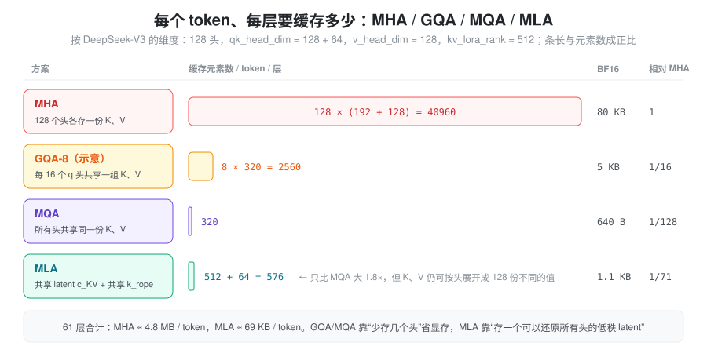
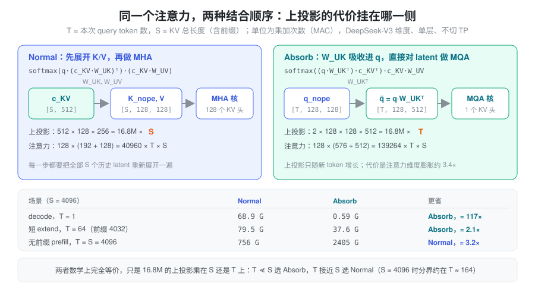
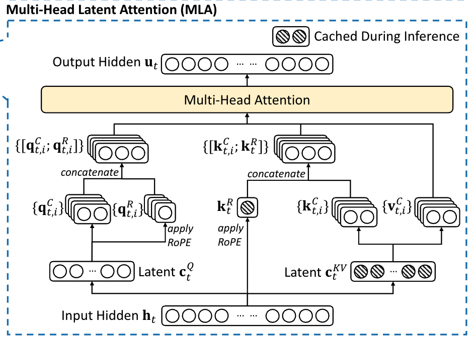
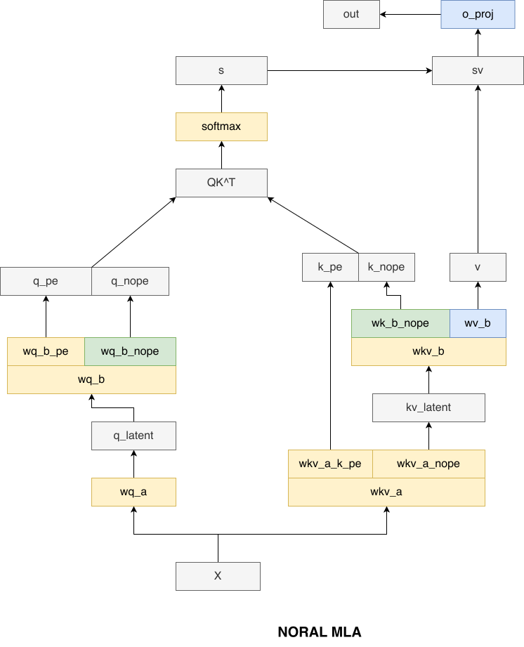
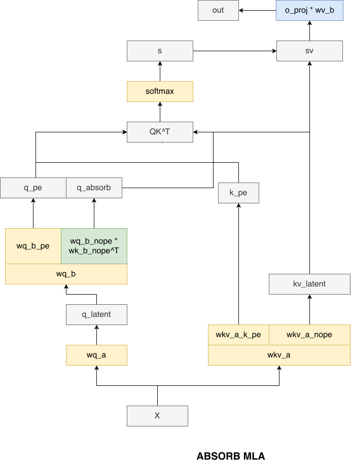
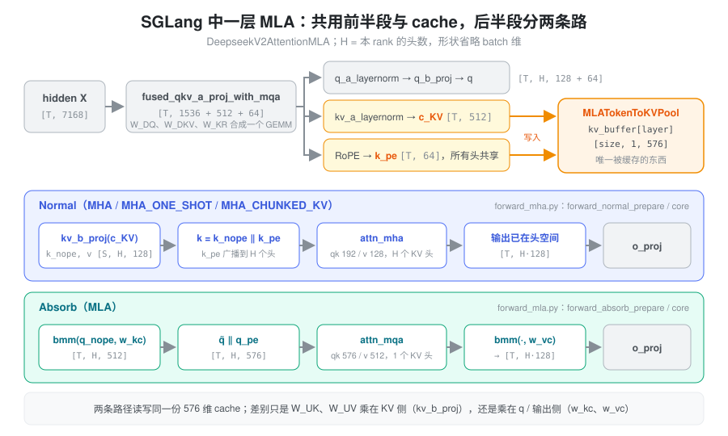

% MLA

### 问题：KV cache 成了推理的瓶颈

自回归推理时，每生成一个 token 都要和全部历史 token 做注意力，所以历史的 K、V 必须缓存下来。MHA 里每个头都有自己的 K、V，按 DeepSeek-V3 的维度（128 个头，K 192 维、V 128 维）算，**一个 token 在一层里就要存 40960 个元素**，61 层合计约 4.8 MB。KV cache 的大小直接决定了一张卡能同时服务多少请求、能支持多长的上下文；而 decode 阶段每一步都要把这些 cache 从显存完整读一遍，它又决定了 decode 的速度。

MQA、GQA 的办法是减少 KV 头的数量：让多个 query 头共用一组 K、V，cache 立刻缩小几倍到上百倍。代价也很直接——K、V 的表达能力跟着头数一起被砍掉了，模型效果会打折扣。

于是问题变成：**能不能只缓存很少的东西，却仍然让每个头看到各不相同的 K、V？**

### 核心思想：缓存一个能还原所有头的 latent

MLA（Multi-head Latent Attention）的回答来自 LoRA 式的低秩分解。传统注意力直接用 \(W_{Q}\)、\(W_{K}\)、\(W_{V}\) 从输入 \(X\) 得到 \(Q\)、\(K\)、\(V\)：

\[Q = X W_{Q} \quad K = X W_{K} \quad V = X W_{V}\]

MLA 在中间插入一个“先压缩、再展开”的步骤：

\[c_{Q} = X W_{DQ} \qquad Q = c_{Q} W_{UQ}\]

\[c_{KV} = X W_{DKV} \qquad K = c_{KV} W_{UK} \qquad V = c_{KV} W_{UV}\]

\(D\) 表示 down（压缩），\(U\) 表示 up（展开）。压缩后的低维张量叫 latent：\(c_{KV}\) 只有 512 维，却能通过 \(W_{UK}\)、\(W_{UV}\) 展开成 128 个头各不相同的 K、V。

关键在于**缓存什么**。展开后的 K、V 完全由 \(c_{KV}\) 决定，所以只需要缓存 \(c_{KV}\) 本身，需要时再展开。GQA/MQA 是“少存几个头”，MLA 是“存一个可以还原所有头的低秩表示”：



图里 MLA 的 576 比 512 多出来的 64 维是 RoPE 部分，原因见后文的 RoPE 一节。先忽略 RoPE，看看“只存 latent”之后注意力怎么算。

### 同一个注意力，两种算法：Normal 与 Absorb

#### Normal：先展开，再做 MHA

最直接的做法是把 cache 里的 \(c_{KV}\) 展开成每个头的 K、V，然后照常做 MHA。下面用 \(W_{qb}\) 表示 \(W_{UQ}\)，\(W_{kb}\)、\(W_{vb}\) 分别表示 \(W_{UK}\)、\(W_{UV}\)（合起来就是代码里的 `kv_b_proj`）：

\[
\begin{aligned}
\text{MHA 路径} &= \text{softmax}\left( \frac{QK^{T}}{\sqrt{k}} \right) V \\
&= \text{softmax}\left( \frac{c_{q} W_{qb} (c_{KV} W_{kb})^T}{\sqrt{k}} \right) (c_{KV} W_{vb})
\end{aligned}
\]

这条路径叫 **Normal 模式**。它在效果上就是 MHA，cache 也确实只存了 latent。问题是每次计算都要把**全部 S 个历史 token** 的 latent 重新展开一遍，展开的代价随 KV 长度 S 增长。

#### Absorb：把上投影吸收到 q 和输出上

矩阵乘法满足结合律，可以换一个结合顺序：

\[
\begin{aligned}
\text{MQA 路径} &= \text{softmax}\left( \frac{QK^{T}}{\sqrt{k}} \right) V \\
&= \text{softmax}\left( \frac{c_{q} W_{qb} (c_{KV} W_{kb})^T}{\sqrt{k}} \right) c_{KV} W_{vb} \\
&= (\text{softmax}\left( \frac{(c_{q} W_{qb} W_{kb}^T) c_{KV}^T}{\sqrt{k}} \right) c_{KV}) W_{vb}
\end{aligned}
\]

最后一行里，\(W_{kb}\) 被“吸收”进了 query：先算 \(\tilde{q} = c_{q} W_{qb} W_{kb}^{T}\)（每个头一个 512 维向量），再直接和 \(c_{KV}\) 做点积；\(W_{vb}\) 则挪到注意力之后，先对 latent 做加权求和，再展开到每个头。

这时所有头的 K 和 V 都是**同一份** \(c_{KV}\)——这正是 MQA 的形状：128 个 query 头，1 个 KV 头。这条路径叫 **Absorb 模式**。它数学上与 Normal 完全等价，却只需要把上投影乘在 T 个新 token 上，而不是 S 个历史 token 上。

#### 谁更省：看 T 和 S 的比例

两种模式交换的是两笔开销：

- **上投影**：Normal 每层要做 \(S\times 512\times 128\times 256\) 次乘加来展开 K、V；Absorb 换成 \(T\times 2\times 128\times 128\times 512\) 次来吸收 q、展开输出。两者系数都约是 16.8M，区别只是乘 S 还是乘 T。
- **注意力本身**：Normal 每个头的 qk 是 192 维、v 是 128 维；Absorb 每个头的 qk 是 576 维、v 是 512 维，注意力的计算量膨胀约 \((576+512)/(192+128)\approx 3.4\) 倍。



于是有了推理里的分工：

- **decode**（\(T=1\ll S\)）：Absorb 碾压。而且 decode 本来就是访存瓶颈，Absorb 每从显存读一行 576 维的 latent，就被 128 个 query 头复用一次，算术强度远高于 MHA 的 decode；
- **无前缀的 prefill**（\(T=S\)）：上投影两边一样多，Absorb 只剩下注意力膨胀的劣势，Normal 胜出。所以 prefill 时 MLA 就是一个“多此一举的 MHA”——先压缩再展开，但不吃亏；
- **带前缀的 extend**：介于两者之间，取决于这一轮的 T 有多大。当 S 较大时分界线约在 \(T\approx 16.8\text{M}/(139264-40960)\approx 170\)，几乎与 S 无关。

### RoPE 为什么要单独拆出来

上面的推导有个前提：\(Q\) 和 \(K\) 之间只隔着与位置无关的矩阵。RoPE 打破了这个前提。给 query 位置 \(i\)、key 位置 \(j\) 加上旋转矩阵 \(R_i\)、\(R_j\) 之后：

\[q_i^{T} k_j = (R_i\, q_i)^{T} (R_j\, W_{UK}^{T} c_j) = q_i^{T}\, R_{j-i}\, W_{UK}^{T}\, c_j\]

\(W_{UK}\) 和 query 之间夹了一个随 \(j-i\) 变化的旋转矩阵，没法再预先把 \(W_{UK}\) 吸收进 q；要算这一项，就只能对每个历史 token 展开 K，Absorb 的意义就没了。

DeepSeek 的解法叫 **decoupled RoPE**：把每个头的 q、k 拆成两段——

- **nope 段**（128 维）：不加位置编码，走上面的 latent 路径，可以吸收；
- **rope 段**（64 维）：单独承载位置信息。query 侧每个头一份，由 \(c_Q\) 经 \(W_{QR}\) 得到；key 侧**所有头共享一份**，由 \(X\) 经 \(W_{KR}\) 直接得到，并与 \(c_{KV}\) 一起缓存。

两段的点积相加就是完整的注意力分数。这就是 cache 里每个 token 是 \(512 + 64 = 576\) 维的原因。DeepSeek-V2 论文中的原始流程图如下：



Normal（MHA）路径的完整数学流程：

\[c_{Q} = X W_{DQ}\]
\[Q_{nope} = c_{Q} W_{UQ}\]
\[Q_{rope} = \text{RoPE}(c_{Q} W_{QR})\]
\[c_{KV} = X W_{DKV}\]
\[K_{nope} = c_{KV} W_{UK}\]
\[V = c_{KV} W_{UV}\]
\[K_{rope} = \text{RoPE}(X W_{KR})\]
\[Q = \text{Concat}(Q_{nope}, Q_{rope})\]
\[K = \text{Concat}(K_{nope}, K_{rope})\]
\[\text{MHA} = \text{softmax}(\frac{QK^T}{\sqrt{k}})V\]

注意 \(K_{nope}\) 不加 RoPE，\(K_{rope}\) 只有一份，拼接时在所有头之间广播。对应的流程图：



decode 阶段走的 Absorb（MQA）路径只改动 nope 段，rope 段原样保留：

\[c_{Q} = X W_{DQ}\]
\[Q_{nope} = c_{Q} W_{UQ}\]
\[Q_{rope} = \text{RoPE}(c_{Q} W_{QR})\]
\[Q = \text{Concat}(Q_{nope} W_{UK}^{T}, Q_{rope})\]
\[c_{KV} = X W_{DKV}\]
\[K_{rope} = \text{RoPE}(X W_{KR})\]
\[K = \text{Concat}(c_{KV}, K_{rope})\]
\[V = c_{KV} W_{UV}\]
\[\text{MQA} = \text{softmax}(\frac{QK^T}{\sqrt{k}})V\]

这里的 \(K\) 只有一个头：所有 query 头共享同一个 576 维的 K。最后一行是简写，实际计算时先用 \(c_{KV}\)（即 K 的前 512 维）做加权求和，再乘 \(W_{UV}\)，与上一节 MQA 路径公式的最后一行一致。缩放因子 \(\sqrt{k}\) 仍按原始的 192 维计算，因为吸收不改变点积的值。对应的流程图：



### 计算量分析

用 \(T\) 表示 q_len，\(S\) 表示 kv_len（含前缀），单位为乘加次数，单层、不切 TP：

\[
\begin{aligned}
&\text{两条路径共有的部分} \\
&\quad \text{flops\_q\_a\_and\_kv\_a}: \quad T \times 7168 \times (1536 + 512 + 64) \\
&\quad \text{flops\_qb}: \quad T \times 1536 \times 128 \times 192 \\
&\quad \text{flops\_oproj}: \quad T \times 128 \times 128 \times 7168 \\
\\
&\text{Normal（MHA）路径} \\
&\quad \text{flops\_kb}: \quad S \times 512 \times 128 \times 128 \\
&\quad \text{flops\_vb}: \quad S \times 512 \times 128 \times 128 \\
&\quad \text{flops\_mha}: \quad 128 \times (T \times S \times 192 + T \times S \times 128) \\
\\
&\text{Absorb（MQA）路径} \\
&\quad \text{flops\_absorb\_kb}: \quad T \times 128 \times 128 \times 512 \\
&\quad \text{flops\_absorb\_vb}: \quad T \times 128 \times 512 \times 128 \\
&\quad \text{flops\_mqa}: \quad 128 \times (T \times S \times 576 + T \times S \times 512)
\end{aligned}
\]

定性结论：

* prefill 阶段 \(T = S\)，两条路径的上投影一样多，Absorb 只多出约 3.4 倍的注意力计算，所以用 Normal；
* decode 阶段 \(T \ll S\)，Absorb 的注意力虽然变贵，但省掉了与 \(S\) 成正比的 kv_b 展开，所以用 Absorb。

### SGLang 中的实现

SGLang 里 DeepSeek V2/V3 的 MLA 层是 `DeepseekV2AttentionMLA`（`srt/models/deepseek_v2.py`）。它本身只负责初始化和分派，两条路径的前向分别放在 `srt/models/deepseek_common/attention_forward_methods/` 下的 mixin 里：`forward_mha.py`（Normal）和 `forward_mla.py`（Absorb），另有 ROCm、CPU、NPU 的变体。



#### 代码符号与数学符号的对应

读代码时最容易绕晕的是两套命名。代码按“合并后的 GEMM”命名，数学按“语义”命名，对应关系如下：

| 代码 | 数学 | 说明 |
|---|---|---|
| `q_lora_rank` / `kv_lora_rank` | \(c_Q\) / \(c_{KV}\) 的维度 | 1536 / 512 |
| `qk_nope_head_dim` / `qk_rope_head_dim` / `v_head_dim` | nope 段 / rope 段 / v 的每头维度 | 128 / 64 / 128 |
| `fused_qkv_a_proj_with_mqa` | \([W_{DQ}, W_{DKV}, W_{KR}]\) | 三个 down 投影合成一个 GEMM，输出 1536 + 512 + 64 |
| `q_b_proj` | \([W_{UQ}, W_{QR}]\) | 每头输出 192 = 128 + 64 |
| `kv_b_proj` | \([W_{UK}, W_{UV}]\) | 每头输出 256 = 128 + 128，Normal 用 |
| `w_kc` / `w_vc` | \(W_{UK}\) / \(W_{UV}\) | 从 `kv_b_proj` 拆出来的逐头矩阵，Absorb 用 |
| `kv_a_layernorm` 之后的 latent | \(c_{KV}\) | 缓存的前 512 维 |
| `k_pe` | \(k^{rope}\) | 缓存的后 64 维 |

checkpoint 里 `q_a_proj` 和 `kv_a_proj_with_mqa` 仍是两个张量，加载时（`deepseek_common/deepseek_weight_loader.py`）先各自缓存，两者都到齐后沿输出维 `torch.cat` 成 `fused_qkv_a_proj_with_mqa` 的权重。前向时这次 GEMM 的结果按 `[q_lora_rank, kv_lora_rank + qk_rope_head_dim]` 切开，后一段再切成 `c_KV` 和 `k_pe`。V2-Lite 这类 `q_lora_rank is None` 的模型没有 q 压缩，走 `q_proj` + `kv_a_proj_with_mqa` 两个独立投影。

#### 两套权重从一份 checkpoint 而来

Normal 需要 `kv_b_proj` 这个大 GEMM，Absorb 需要逐头的 `w_kc`、`w_vc` 做 batched matmul。它们是同一份权重的两种视图，在 `post_load_weights` 里派生：

```python
w_kc, w_vc = w.unflatten(0, (-1, qk_nope_head_dim + v_head_dim)).split(
    [qk_nope_head_dim, v_head_dim], dim=1)   # 均为 [H, 128, 512]
# 之后 w_vc 转置为 [H, 512, 128]；w_kc 逻辑形状不变，只改成列主序存储
```

Absorb 时 `torch.bmm(q_nope.transpose(0, 1), self.w_kc)` 把 `[H, T, 128]` 乘成 `[H, T, 512]`，注意力之后再用 `w_vc` 乘回 `[T, H·128]`。fp8 checkpoint 会在这里先反量化或转成 per-tensor scale，另有 `bmm_fp8`、DeepGEMM masked grouped GEMM 等变体，但逻辑上都是这两次 bmm。

#### KV cache：一份 576 维的 latent

MLA 的 cache 由 `MLATokenToKVPool`（`srt/mem_cache/memory_pool.py`）管理。与 MHA 的 pool 分别存 K、V 不同，它每层只有一个 buffer，形状是 `[size + page_size, 1, kv_lora_rank + qk_rope_head_dim]`：中间那个 1 就是“只有一个 KV 头”。写入用 `set_mla_kv_buffer(layer, loc, cache_k_nope, cache_k_rope)`，把归一化后的 `c_KV` 和**已经加过 RoPE 的** `k_pe` 拼进同一行；读出用 `get_mla_kv_buffer` 再拆回两段。索引与分配和其他 pool 完全一样，详见[显存池](./memory_pool.md)。

两条路径读写的是同一份 cache，这是 Normal / Absorb 能逐 batch 自由切换的前提。在模型里它们对应两个 `RadixAttention` 实例：

- `attn_mha`：`num_kv_heads = H`，qk 192 维、v 128 维，调用时 `save_kv_cache=False`，因为 cache 已在 prepare 阶段由模型自己写过；
- `attn_mqa`：`num_kv_heads = 1`，qk 576 维、v 512 维。V 就是 K 的前 512 维，所以调用时 v 传入的正是 k 中的 latent 部分。

这个设计也带来一个副作用：所有头共享同一份 latent，attention TP 无法再按头切分 KV，每个 rank 都持有完整副本，[DCP](./decode_context_parallelism.md) 正是为此沿 token 维度切分 cache。

#### 路径选择：按 batch 决定，而不是按阶段

前面说“prefill 用 Normal、decode 用 Absorb”是一个近似。SGLang 实际上对**每个 batch**调用 `dispatch_attn_forward_method`，返回一个 `AttnForwardMethod`（`deepseek_common/attention_forward_methods/forward_methods.py`），再由 `forward_prepare` / `forward_core` 分派。规则按 attention backend 注册在 `deepseek_common/attention_backend_handler.py` 中。fa3、flashinfer、flashmla 共用的规则大致是：

| batch 情况 | 结果 |
|---|---|
| decode、投机解码的 verify / draft extend、CUDA graph 中 | `MLA`（Absorb） |
| 普通 extend，前缀为 0 | `MHA_ONE_SHOT`；总长度超过单块容量时 `MHA_CHUNKED_KV` |
| 普通 extend，前缀 ≥ `SGLANG_CHUNKED_PREFIX_CACHE_THRESHOLD`（默认 8192） | 同上 |
| 普通 extend，0 < 前缀 < 阈值 | `MLA`（Absorb） |

三个 MHA 变体都是 Normal，区别在于前缀怎么处理：

- `MHA`：只算本轮新 token 的 KV，用于没有前缀的情况（如 triton backend 下前缀为 0 时）；
- `MHA_ONE_SHOT`：把前缀的 latent 从 cache 一次读出，和新 token 一起展开，做一次完整的 MHA；
- `MHA_CHUNKED_KV`：前缀分块读出、分块用 `kv_b_proj` 展开、分块做注意力，再用 `merge_state` 按 LSE 合并，把展开前缀所需的临时显存限制在一个块的大小。

短前缀走 Absorb 是工程上的取舍：为一小段前缀多做一次读出和展开得不偿失，并不是 flops 上的精确分界。不同 backend 的规则也不完全相同，例如 triton 只在前缀为 0 时走 `MHA`，`trtllm_mla` 在 extend 时倾向 `MHA_CHUNKED_KV`。

#### 一个容易踩的细节：k_pe 的广播

Normal 路径里 `k_pe` 只有一份，而 `attn_mha` 要的是每个头一份完整的 192 维 K。`_concat_and_cast_mha_k` 负责把 `k_nope [S, H, 128]` 和广播后的 `k_pe [S, 1, 64]` 拼成 `[S, H, 192]`，并按需转成 fp8；对常见的 128 头 / 128 / 64 维组合有专门的 `concat_mla_k` CUDA kernel。Absorb 路径则完全没有这一步，`q_pe` 和 `k_pe` 直接拼在 576 维的末尾——这也是 Absorb 在 decode 上更轻的原因之一。

### shape 速查

以 DeepSeek-V3 为例，\(T\) 为 q_len，\(S\) 为 kv_len，均省略 batch 维：

- \(X\)：`[T, hidden_size]`，即 `[T, 7168]`
- \(c_{Q}\)：`[T, q_lora_rank]`，即 `[T, 1536]`
- \(c_{KV}\)：`[S, kv_lora_rank]`，即 `[S, 512]`；\(k^{rope}\)：`[S, 64]`
- \(W_{DQ}\)：`[7168, 1536]`；\(W_{DKV}\)：`[7168, 512]`；\(W_{KR}\)：`[7168, 64]`
- \(W_{UQ}\)：`[1536, 128 heads, 128]`；\(W_{QR}\)：`[1536, 128 heads, 64]`
- \(W_{UK}\)：`[512, 128 heads, 128]`；\(W_{UV}\)：`[512, 128 heads, 128]`
- Absorb 中的 \(\tilde{q}\)：`[T, 128 heads, 512 + 64]`；注意力输出：`[T, 128 heads, 512]`

### 小结

MLA 的价值在于把“缓存多少”和“每个头看到什么”拆开了：cache 里只存一个 576 维的低秩 latent，体积接近 MQA；而通过 \(W_{UK}\)、\(W_{UV}\) 的展开，每个头仍然拥有不同的 K、V，表达能力接近 MHA。矩阵乘法的结合律让同一个注意力有两种算法：Normal 把上投影乘在 KV 侧，适合 \(T\approx S\) 的 prefill；Absorb 把上投影吸收进 q 和输出，适合 \(T\ll S\) 的 decode。decoupled RoPE 则让位置编码绕开 latent，保住了吸收的可能。SGLang 把这些落实为一份共享的 `MLATokenToKVPool`、两套由 `kv_b_proj` 派生的权重视图，以及按 batch 选择路径的 `AttnForwardMethod` 分派。
