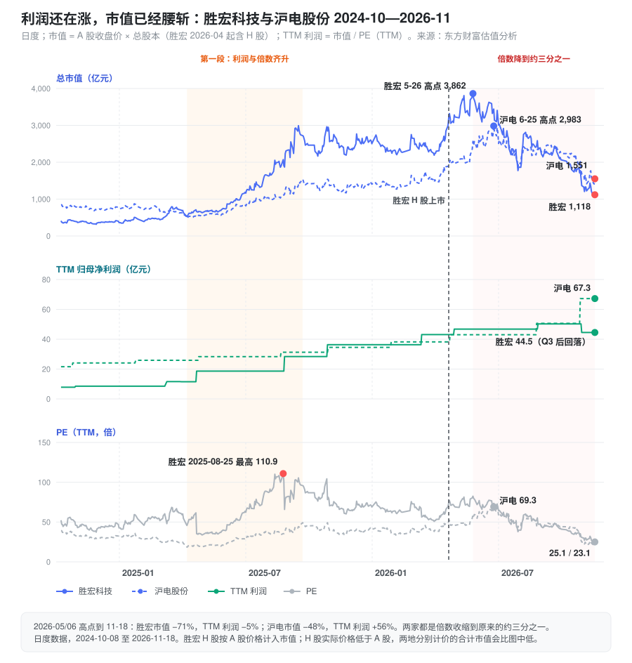
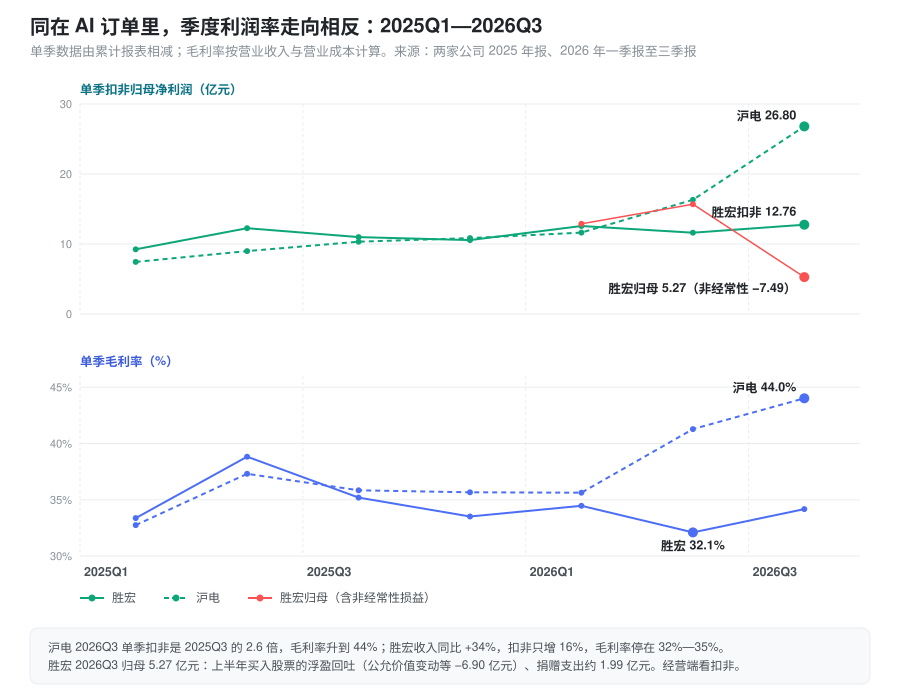
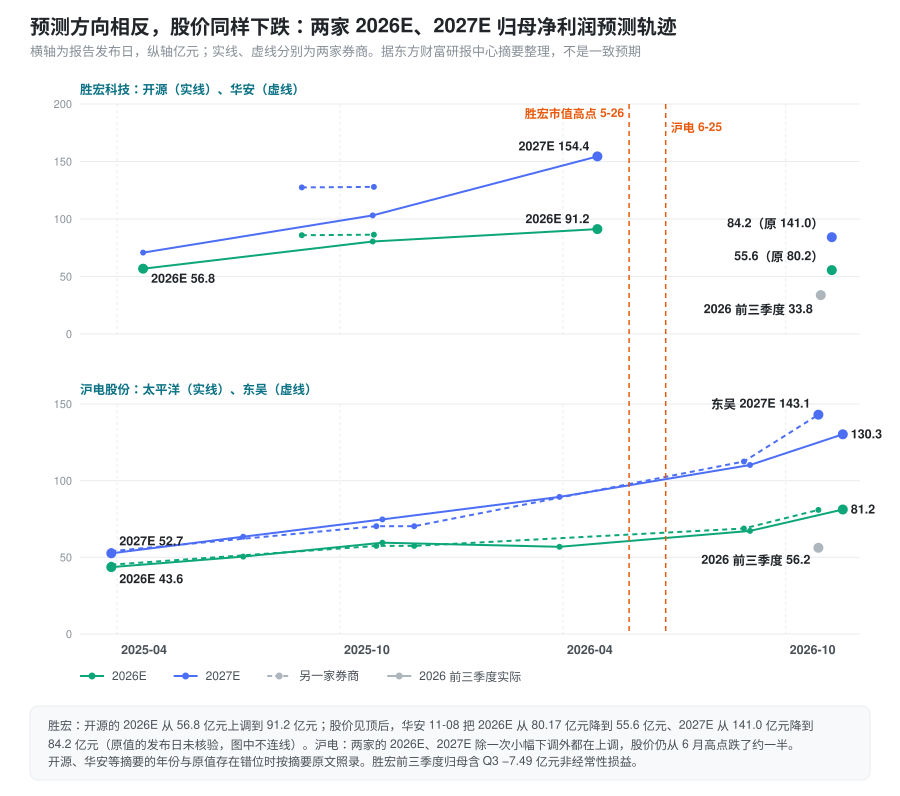
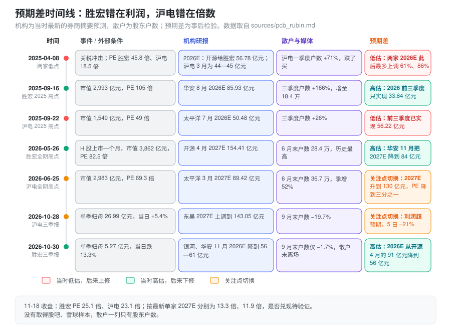

% 胜宏科技与沪电股份：历史定价、资产产能与 Vera Rubin 的财务影响

**核心判断：2026 年 5、6 月到 11-18，两家公司的市值分别跌了 71% 和 48%，但下跌的原因不同。胜宏的利润停在原地，市场同时下调了它的利润和倍数；沪电的利润还在加速，市场只压缩倍数。** 胜宏 TTM 归母净利润从 46.8 亿元降到 44.5 亿元，PE（TTM）从 82.5 倍降到 25.1 倍。沪电 TTM 利润从 43.0 亿元升到 67.3 亿元，PE 从 69.3 倍降到 23.1 倍。

沿时间线看，可以分成四段：

- 2020—2022 年：普通电子制造股。两家利润都在增长，PE 从 30 多倍降到 15—16 倍（2022-10-11 同日见底）。
- 2023—2024 年：AI 预期先行。沪电 2024 年利润增长 71%，倍数基本不变；胜宏利润 2023 年下滑，2024 年 PE 一度升到 56 倍。
- 2025-04 到 2026 年中：利润和倍数一起涨。胜宏 2025 年利润增长 274%，市值从 2025-04-08 的 528 亿元涨到 2026-05-26 的 3,862 亿元。
- 2026 年中以后：市场开始交易“这一轮资本开支的峰值在哪里”。整个 AI 硬件板块的倍数一起收缩，胜宏另有利润率和非经常性损益的问题。

当前的财务状况：两家都在用借款和融资大规模扩产。胜宏 2026 年前三季度购建长期资产花了 117 亿元，是经营现金流的 3.3 倍，靠 H 股募资约 200 亿元撑住；沪电花了 53 亿元，有息负债从 46 亿元增至 94 亿元。Vera Rubin 对两家的影响，会通过五条路径进入报表：单板价值和价格、新材料成本、良率爬坡、新产能折旧、备货与回款。只有第一条是正向的，下文分开讨论。

本文不预测 2026 年全年结果，也不提供买卖价格。2020—2024 年的产业背景和同业分类见 [PCB](./pcb.md)，Blackwell 链条的材料瓶颈见 [Blackwell 产业链](./blackwell_supply_chain.md)。

### 研究范围与数据边界

- **标的**：胜宏科技（惠州）股份有限公司，深交所创业板 A 股 **300476.SZ**；2026-04-21 起另有港交所 H 股 **02476.HK**。沪士电子股份有限公司（沪电股份），深交所主板 A 股 **002463.SZ**。沪电 2025-09 公告筹划 H 股，截至 11-18 尚未上市。
- **期间**：2020—2025 年六个完整年度，2026 年为截至 11-18 的 YTD。数据提取日为 2026-11-19，信息截止日为 **2026-11-18** 收盘。
- **日度估值**：东方财富估值分析（`RPT_VALUEANALYSIS_DET`），两家各 2,153 个交易日（2018-01-02 至 2026-11-18），字段为收盘价（不复权）、总市值、总股本、PE（TTM）、PB（MRQ）。2020—2026 年没有缺日，也没有非正 PE。PE（TTM）= 总市值 / 已披露的最近四季度归母净利润，分母在定期报告或业绩快报披露日更新，没有用事后利润回填。年末值与 [PCB](./pcb.md) 所引青柠量化的年末记录完全一致。
- **股本口径**：东方财富的总市值等于 A 股价格乘以全部股本。胜宏 H 股上市后，总股本从 8.73 亿股增至 9.83 亿股，H 股占 11.22%，这部分也按 A 股价格计算。11-18 胜宏 H 股收盘 94.05 港元，A 股 113.74 元；港元币值低于人民币，不折算也能看出 H 股更便宜，按两地实际价格计算的合计市值会更低。跨期比较用市值，不用股价。
- **财务**：人民币亿元，取自两家的定期报告与业绩预告（巨潮资讯；沪电经新浪财经公告页转载，公告编号与原件一致）。单季数据由累计值相减，2026 年三季报未经审计。
- **机构预测**：东方财富研报中心的报告摘要，只引用摘要里能看到的字段，标“据摘要整理”。胜宏取开源、华安，沪电取太平洋、东吴。胜宏的一致预期快照来自东方财富 F10“近六月平均”（6 家机构，2026-11-19 抓取）；沪电没有取得 Wind、Choice 一致预期。
- **散户与媒体**：只取定期报告中的股东户数。本次没有抽取股吧、雪球样本，也没有系统收集媒体报道，散户情绪部分的证据因此偏弱。
- **Vera Rubin**：NVIDIA 官方表态与供应链报道分开写。官方只确认了出货时间和无线缆托盘、midplane 的架构方向；PCB 价值量、层数、材料和份额都来自券商与媒体转述，原报告未取得，不当作公司披露。两家公司在公告与调研纪要中都没有点名客户或份额。
- 本文不计算股价收益率。两家都有分红、送转或增发，价格变化不等于股东回报。

### 年度 PE 与利润：两次倍数扩张，只有一次有利润跟上

PE 单位为倍。全年平均为当年全部交易日日度 PE（TTM）的算术平均，年末值取最后一个交易日；2026 年是 YTD。

**胜宏科技**

| 年份 | 交易日 | 全年平均 PE | 最低 PE / 日期 | 最高 PE / 日期 | 年末 PE |
| --- | ---: | ---: | --- | --- | ---: |
| 2020 | 243 | 36.2 | 30.4 / 2020-03-30 | 52.5 / 2020-02-24 | 31.8 |
| 2021 | 243 | 32.0 | 25.6 / 2021-06-16 | 39.1 / 2021-01-20 | 36.4 |
| 2022 | 242 | 22.7 | 14.8 / 2022-10-11 | 37.2 / 2022-01-18 | 16.2 |
| 2023 | 242 | 24.5 | 16.6 / 2023-01-03 | 33.9 / 2023-05-31 | 21.6 |
| 2024 | 242 | 35.2 | 17.4 / 2024-01-31 | 56.0 / 2024-10-21 | 42.7 |
| 2025 | 243 | 65.5 | 33.8 / 2025-04-30 | 110.9 / 2025-08-25 | 68.9 |
| 2026 YTD | 211 | 57.2 | 23.6 / 2026-11-17 | 82.5 / 2026-05-26 | 25.1（11-18） |

**沪电股份**

| 年份 | 交易日 | 全年平均 PE | 最低 PE / 日期 | 最高 PE / 日期 | 年末 PE |
| --- | ---: | ---: | --- | --- | ---: |
| 2020 | 243 | 32.3 | 23.7 / 2020-11-02 | 51.2 / 2020-02-25 | 24.7 |
| 2021 | 243 | 20.6 | 15.5 / 2021-10-22 | 27.8 / 2021-12-24 | 26.8 |
| 2022 | 242 | 22.9 | 16.2 / 2022-10-11 | 31.4 / 2022-03-01 | 18.8 |
| 2023 | 242 | 28.4 | 19.2 / 2023-02-06 | 36.7 / 2023-07-17 | 30.3 |
| 2024 | 242 | 33.8 | 26.0 / 2024-02-02 | 43.2 / 2024-07-10 | 31.6 |
| 2025 | 243 | 32.5 | 18.5 / 2025-04-08 | 49.2 / 2025-09-22 | 40.7 |
| 2026 YTD | 211 | 45.8 | 21.0 / 2026-11-17 | 69.3 / 2026-06-25 | 23.1（11-18） |

来源：东方财富估值分析日度序列，提取于 2026-11-19。

| 年份 | 胜宏归母净利润 | 同比 | 胜宏平均 PE | 沪电归母净利润 | 同比 | 沪电平均 PE |
| --- | ---: | ---: | ---: | ---: | ---: | ---: |
| 2020 | 5.19 | +12.1% | 36.2 | 13.43 | — | 32.3 |
| 2021 | 6.70 | +29.2% | 32.0 | 10.64 | −20.8% | 20.6 |
| 2022 | 7.91 | +17.9% | 22.7 | 13.62 | +28.0% | 22.9 |
| 2023 | 6.71 | −15.1% | 24.5 | 15.13 | +11.1% | 28.4 |
| 2024 | 11.54 | +72.0% | 35.2 | 25.87 | +71.1% | 33.8 |
| 2025 | 43.12 | +273.5% | 65.5 | 38.22 | +47.7% | 32.5 |
| 2026 前三季度 | 33.84 | +4.3% | — | 56.22 | +106.9% | — |

利润单位为亿元，来源与披露日见 [PCB](./pcb.md) 的利润表；2026 年前三季度取两家三季报（胜宏 2026-10-30，沪电 2026-10-28）。全年利润都在次年 3 月前后才披露，这张表只用于事后对照。

两张表有三个可以直接看出的差别：

1. **2022 年两家的倍数同一天见底**（2022-10-11，胜宏 14.8 倍、沪电 16.2 倍），当时两家的利润都在增长。这一年的下跌来自整个电子制造板块的倍数收缩。
2. **沪电 2024—2025 年平均 PE 在 32—34 倍之间几乎不动**，利润两年增长 153%，涨幅基本由利润贡献。胜宏同期平均 PE 从 24.5 倍升到 65.5 倍，倍数和利润同时上升。
3. **2026 年两家的最低 PE 都出现在 11-17**。11-18 的 25.1 倍和 23.1 倍落回 2022—2023 年的区间（胜宏 2023 年 16.6—33.9 倍，沪电 2022 年 16.2—31.4 倍），但 TTM 利润分别是胜宏 2023 年的 6.6 倍、沪电 2022 年的 4.9 倍。

### 节点表：市值、TTM 利润与 PE 谁在动

TTM 利润 = 当日总市值 / PE（TTM），是当日已披露的最近四季度归母净利润。

**胜宏科技**

| 日期 | 收盘价（元，不复权） | 市值（亿元） | TTM 利润（亿元） | PE（TTM） | 节点说明 |
| --- | ---: | ---: | ---: | ---: | --- |
| 2022-10-11 | 12.58 | 109 | 7.33 | 14.82 | 2022 年最低 PE |
| 2024-01-31 | 14.84 | 128 | 7.37 | 17.38 | 2024 年最低 PE |
| 2024-10-21 | 51.00 | 440 | 7.86 | 55.99 | 利润几乎没动，市值涨到 3.4 倍 |
| 2025-04-08 | 61.22 | 528 | 11.54 | 45.75 | 关税冲击后的低点 |
| 2025-04-30 | 73.15 | 631 | 18.65 | 33.83 | 一季报后分母跳升，2025 年最低 PE |
| 2025-08-25 | 239.90 | 2,070 | 18.65 | 110.94 | 全期最高 PE，半年报披露前两天 |
| **2025-09-16** | **346.99** | **2,993** | **28.39** | **105.46** | **2025 年市值最高** |
| 2025-12-31 | 287.58 | 2,503 | 36.35 | 68.86 | |
| 2026-03-31 | 251.00 | 2,190 | 43.12 | 50.79 | 2025 年报后 |
| **2026-05-26** | **392.95** | **3,862** | **46.80** | **82.52** | **全期市值最高**，H 股上市一个月后 |
| 2026-07-31 | 190.40 | 1,871 | 46.80 | 39.99 | 两个月市值 −52%，分母没变 |
| 2026-10-30 | 139.04 | 1,366 | 44.51 | 30.70 | 三季报，TTM 利润首次下降，当日 −13.3% |
| 2026-11-18 | 113.74 | 1,118 | 44.51 | 25.11 | 信息截止日 |

**沪电股份**

| 日期 | 收盘价（元，不复权） | 市值（亿元） | TTM 利润（亿元） | PE（TTM） | 节点说明 |
| --- | ---: | ---: | ---: | ---: | --- |
| 2022-10-11 | 9.55 | 181 | 11.17 | 16.21 | 2022 年最低 PE |
| 2024-07-10 | 41.25 | 789 | 18.27 | 43.21 | 2024 年最高 PE |
| 2025-04-08 | 24.94 | 479 | 25.87 | 18.53 | 2025 年最低 PE |
| **2025-09-22** | **80.06** | **1,540** | **31.29** | **49.22** | **2025 年市值最高** |
| 2025-12-31 | 73.07 | 1,406 | 34.56 | 40.68 | |
| 2026-02-05 | 65.97 | 1,270 | 38.22 | 33.21 | 2026 年最低收盘价 |
| **2026-06-25** | **154.99** | **2,983** | **43.02** | **69.33** | **全期市值最高** |
| 2026-07-31 | 103.75 | 1,997 | 43.02 | 46.41 | 一个月 −33%，分母没变 |
| 2026-10-28 | 104.57 | 2,017 | 67.27 | 29.98 | 三季报，TTM 利润 +33%，当日 +5.4% |
| 2026-11-18 | 80.19 | 1,551 | 67.27 | 23.06 | 信息截止日 |

#### 乘法分解：市值 = TTM 利润 × PE

| 区间 | 胜宏市值 | 胜宏 TTM 利润 | 胜宏 PE | 沪电区间 | 沪电市值 | 沪电 TTM 利润 | 沪电 PE |
| --- | ---: | ---: | ---: | --- | ---: | ---: | ---: |
| 2022-10-11 → 2025-04-08 | ×4.84 | ×1.57 | ×3.09 | 同左 | ×2.65 | ×2.32 | ×1.14 |
| 2025-04-08 → 2025 年高点 | ×5.67 | ×2.46 | ×2.31 | → 2025-09-22 | ×3.21 | ×1.21 | ×2.66 |
| 2025 年高点 → 2026 年高点 | ×1.29 | ×1.65 | ×0.78 | → 2026-06-25 | ×1.94 | ×1.37 | ×1.41 |
| 2026 年高点 → 2026-11-18 | ×0.29 | ×0.95 | ×0.30 | 同左 | ×0.52 | ×1.56 | ×0.33 |

胜宏的高点为 2025-09-16 和 2026-05-26。胜宏 2025-10 定增 766 万股、2026-04 发行 H 股 1.10 亿股，市值的增幅里有一部分是股本增加，不是每股价值上升；按每股算，第三段的 PE 收缩更明显。

分解得出的结论：

- **2025-04 之前，胜宏的上涨主要靠倍数（×3.09），沪电主要靠利润（×2.32）。** 这和两家 2023—2024 年平均 PE 的走势一致。
- **2025 年的主升段，两家都是利润与倍数同时扩张。** 胜宏的利润贡献更大（×2.46），沪电的倍数贡献更大（×2.66）。
- **2026 年高点之后，两家的倍数都收缩到原来的约三分之一。** 区别在利润：胜宏 TTM 利润略降，沪电增长 56%。沪电的利润增长抵消了一部分倍数收缩，胜宏没有。
- 同一时期，深南电路、生益电子、生益科技、中际旭创、工业富联也从 6 月前后的高点下跌 50%—71%（东方财富同一估值序列，11-18 收盘对比 2026 年最高收盘）。倍数收缩是整个 AI 硬件板块的事，不能只用两家公司自身的事件解释。

### 季度经营：同一轮订单，两种利润率

| 季度 | 胜宏营收 | 胜宏归母 | 胜宏扣非 | 胜宏毛利率 | 沪电营收 | 沪电归母 | 沪电扣非 | 沪电毛利率 |
| --- | ---: | ---: | ---: | ---: | ---: | ---: | ---: | ---: |
| 2025Q1 | 43.12 | 9.21 | 9.24 | 33.4% | 40.38 | 7.62 | 7.45 | 32.8% |
| 2025Q2 | 47.19 | 12.22 | 12.25 | 38.8% | 44.56 | 9.20 | 8.99 | 37.3% |
| 2025Q3 | 50.86 | 11.02 | 10.99 | 35.2% | 50.19 | 10.35 | 10.33 | 35.8% |
| 2025Q4 | 51.75 | 10.67 | 10.56 | 33.5% | 54.33 | 11.05 | 10.84 | 35.7% |
| 2026Q1 | 55.19 | 12.88 | 12.57 | 34.5% | 62.14 | 12.42 | 11.63 | 35.6% |
| 2026Q2 | 61.10 | 15.68 | 11.61 | 32.1% | 74.75 | 16.81 | 16.32 | 41.3% |
| 2026Q3 | 68.31 | 5.27 | 12.76 | 34.2% | 95.36 | 26.99 | 26.80 | 44.0% |

单位亿元。2025 年取年报的分季度数据，2026 年由累计报表相减；毛利率按营业收入和营业成本计算，胜宏 2026Q3 为公司口径。

**沪电：量价同时上升。** 2026Q3 营收同比 +90%，归母 +161%，毛利率从 2025Q3 的 35.8% 升到 44.0%。2026 年上半年数据通讯板收入 113.30 亿元（+73.5%），毛利率 43.3%；其中交换机及配套路由约 71.39 亿元，AI 服务器与 HPC 约 18.28 亿元，通用服务器约 20.46 亿元。增长最快的是交换机，公司在 2026-10、2026-11 的调研中仍这样表述。半年报称 1.6T 交换机产品已批量出货，224Gbps 核心产品小批量供货。汽车板拖累结构：上半年收入 14.38 亿元，仅增 1.1%，毛利率 19.0%。[沪电 2026 半年报](https://vip.stock.finance.sina.com.cn/corp/view/vCB_AllBulletinDetail.php?id=12534427&stockid=002463)、[2026 三季报](https://vip.stock.finance.sina.com.cn/corp/view/vCB_AllBulletinDetail.php?id=12664696&stockid=002463)

**胜宏：收入在增，利润率没有跟上。** 2026Q3 营收同比 +34%，扣非 +16%，毛利率在 32%—35% 之间。三个因素可以从报表里找到：

1. **非经常性损益反转。** Q2 归母比扣非多 4.07 亿元，Q3 少 7.49 亿元。公司上半年买入股票（成本 7.20 亿元，6-30 浮盈 6.78 亿元），Q3 公允价值变动及处置损益为 −6.90 亿元；营业外净支出 1.99 亿元，三季报列为捐赠学校支出。
2. **汇兑与利息。** 前三季度财务费用 4.76 亿元，上年同期 0.82 亿元，报告的解释是汇兑损失增加；有息负债同期翻倍。
3. **扩产期的人和折旧。** 公司在调研中把 Q2 毛利率下降归于人员增加 30% 以上和新厂折旧，把 Q3 的回升归于涨价和 mSAP 1.6T 光模块板放量。员工从 2024 年末 1.3 万余人增至 2025 年末接近 1.8 万人。[胜宏 2026 三季报](https://static.cninfo.com.cn/finalpage/2026-10-30/1225644765.PDF)、[2026-10-30 调研纪要](https://static.cninfo.com.cn/finalpage/2026-10-30/1225646040.PDF)、[2026-04-04 调研纪要](https://static.cninfo.com.cn/finalpage/2026-04-04/1225080850.PDF)

胜宏在调研中说 AI 相关收入约占 2025 年的一半、2026 年前三季度的约 40%。占比下降说明非 AI 业务也在增长，或者 AI 板的增速慢于整体；公司没有拆分，无法判断是哪一种。

### 机构研报：一家在下调，一家在上调

以下据东方财富研报中心摘要整理。所选券商的评级在整个期间都是“买入”，摘要大多没有目标价，因此只看利润预测。东方财富列表接口里的 EPS 字段存在年份错位，数字全部取自摘要正文。

**胜宏科技：开源证券与华安证券（亿元）**

| 发布日 | 券商 | 当年 E | 次年 E | 第三年 E | 当日市值 | 隐含 PE（次年） |
| --- | --- | ---: | ---: | ---: | ---: | ---: |
| 2025-04-23 | 开源 | 2025E 43.88 | 2026E 56.78 | 2027E 70.75 | 659 | 11.6 |
| 2025-08-31 | 华安 | 2025E 54.79 | 2026E 85.93 | 2027E 127.47 | 2,306 | 26.8 |
| 2025-10-28 | 开源 | 2025E 47.90 | 2026E 80.40 | 2027E 103.17 | 2,846 | 35.4 |
| 2025-10-29 | 华安 | 2025E 54.79 | 2026E 86.38 | 2027E 127.90 | 2,950 | 34.2 |
| 2026-04-30 | 开源 | 2026E 91.19 | 2027E 154.41 | 2028E 222.88 | 3,228 | 20.9 |
| 2026-11-08 | 华安 | 2026E 55.60 | 2027E 84.21 | 2028E 147.96 | 1,222 | 14.5 |

华安 2026-11-08 的报告注明下调，原值为 80.17 / 141.01 / 204.93 亿元，原值的发布日未核验。周末发布的报告用前一个交易日市值。2025 年实际为 43.12 亿元。

**沪电股份：太平洋证券与东吴证券（亿元）**

| 发布日 | 券商 | 当年 E | 次年 E | 第三年 E | 当日市值 | 隐含 PE（次年） |
| --- | --- | ---: | ---: | ---: | ---: | ---: |
| 2025-03-28 | 太平洋 | 2025E 35.54 | 2026E 43.61 | 2027E 52.65 | 625 | 14.3 |
| 2025-03-28 | 东吴 | 2025E 35.74 | 2026E 45.19 | 2027E 53.98 | 625 | 13.8 |
| 2025-07-14 | 太平洋 | 2025E 37.70 | 2026E 50.48 | 2027E 63.48 | 924 | 18.3 |
| 2025-10-31 | 东吴 | 2025E 36.15 | 2026E 57.45 | 2027E 70.28 | 1,366 | 23.8 |
| 2025-11-05 | 太平洋 | 2025E 40.01 | 2026E 59.54 | 2027E 74.74 | 1,355 | 22.8 |
| 2026-03-30 | 太平洋 | 2025 实际 38.22 | 2026E 56.86 | 2027E 89.42 | 1,524 | 26.8（当年）/ 17.0（次年） |
| 2026-08-28 | 东吴 | — | 2026E 68.82 | 2027E 112.49 | 2,342 | 20.8 |
| 2026-09-02 | 太平洋 | — | 2026E 67.22 | 2027E 110.21 | 2,278 | 20.7 |
| 2026-10-28 | 东吴 | — | 2026E 80.95 | 2027E 143.05 | 2,017 | 14.1 |
| 2026-11-17 | 太平洋 | — | 2026E 81.21 | 2027E 130.26 | 1,410 | 10.8 |

2026 年的报告，“次年”指 2027E。来源：东方财富研报中心对应报告页，如 [太平洋 2026-11-17](https://data.eastmoney.com/report/info/AP202611171831776413.html)、[东吴 2026-10-28](https://data.eastmoney.com/report/info/AP202610281831047523.html)、[开源 2026-04-30](https://data.eastmoney.com/report/info/AP202604301821801387.html)、[华安 2026-11-08](https://data.eastmoney.com/report/info/AP202611081831535316.html)，提取于 2026-11-19。

**一致预期快照。** 胜宏：东方财富 F10“近六月平均”（6 家，2026-11-19 抓取）为 2026E 72.00 亿元、2027E 121.58 亿元、2028E 182.05 亿元。这个平均值包含较早的报告；11 月的两份新报告是中国银河（11-05，2026E 60.79 亿元）和华安（55.60 亿元），都明显低于平均。前三季度已实现 33.84 亿元，72 亿元意味着 Q4 单季要赚 38 亿元，是 Q3 扣非的 3 倍，可信度低。沪电：取三季报后的三家（东吴 10-28、华安 11-13、太平洋 11-17）简单平均，2026E 80.68 亿元、2027E 130.65 亿元，是自行计算，不是供应商一致预期。

三点观察：

1. **胜宏 2025 年的利润预测基本准确，上涨来自对 2026—2027 年的上修。** 2025-04 开源预测 2025 年 43.88 亿元，实际 43.12 亿元。同期 2026E 从 56.78 亿元上调到 91.19 亿元，2027E 从 70.75 亿元上调到 154.41 亿元。股价在开源把 2027E 调到 154 亿元的一个月后见顶。
2. **胜宏的预测下调晚于股价。** 市值 2026-05-26 见顶、7 月底已腰斩，可见的第一次大幅下调是 11 月（银河 11-05、华安 11-08），这时市值已经跌了近七成。
3. **沪电的预测一直在上调，股价却按“峰值利润”定价。** 太平洋的 2027E 从 52.65 亿元调到 130.26 亿元，提高到 2.5 倍；同期按次年预测计的隐含 PE 先从 14 倍升到 23—27 倍，再降到 10.8 倍。11-17 的市值是 2027E 的 10.8 倍，比 2025-03-28 按当时 2027E 计算的 11.9 倍还低，而 2027E 本身已是当时的 2.5 倍。市场不再为“2027 年之后还会增长”付钱。

### 散户：股东户数在顶部之后见顶

| 截止日 | 胜宏户数 | 环比 | 胜宏收盘价 | 沪电户数 | 环比 | 沪电收盘价 |
| --- | ---: | ---: | ---: | ---: | ---: | ---: |
| 2024-12-31 | 51,713 | — | 42.09 | 125,215 | — | 39.65 |
| 2025-03-31 | 59,466 | +15.0% | 81.01 | 214,177 | +71.0% | 32.80 |
| 2025-06-30 | 69,189 | +16.4% | 134.38 | 128,168 | −40.2% | 42.58 |
| 2025-09-30 | 183,942 | +165.9% | 285.50 | 162,040 | +26.4% | 73.47 |
| 2025-12-31 | 187,467 | +1.9% | 287.58 | 198,942 | +22.8% | 73.07 |
| 2026-03-31 | 232,160 | +23.8% | 251.00 | 240,937 | +21.1% | 75.97 |
| 2026-06-30 | 284,039 | +22.3% | 346.43 | 367,113 | +52.4% | 152.80 |
| 2026-09-30 | 279,289 | −1.7% | 210.30 | 294,739 | −19.7% | 115.93 |

来源：两家定期报告披露的股东户数（胜宏 2026-09-30 含 H 股登记股东 4 户）。表中只列季末，两家在 2 月末另有披露；环比按相邻季末计算。9 月末之后没有新的披露。

- **胜宏的户数跟着价格走，晚一步。** 2025 年三季度股价翻倍，户数增至 2.7 倍；2026 年二季度股价创新高，户数增长 22%。股价从 5 月高点到 9 月末下跌 46%，户数只减少 1.7%，散户基本没有离场。
- **沪电的户数和价格方向相反过一次。** 2025 年一季度股价下跌，户数增长 71%；二季度股价上涨，户数减少 40%。这是“跌了买、涨了卖”的模式。到 2026 年二季度又变为和价格同向，户数增长 52%，峰值与股价顶点同季。
- 两家在 2026-06-30 的户数都处于历史最高，6 月末之后的下跌是在散户持股最分散的时候发生的。

本次没有取得股吧、雪球的点击量排序样本，以上只能说明“有多少人持有”，不能说明“他们怎么想”。

### 事件与预期差

**胜宏科技**

| 日期 | 事件 | 当日 / 5 日涨跌 | 当时市场在看什么 |
| --- | --- | --- | --- |
| 2025-03-10 | 2024 年快报与 2025Q1 预告 | +8.6% / +37.7% | 利润拐点出现 |
| 2025-04-07 | 美国关税冲击 | −13.3% | 出口与订单风险 |
| 2025-08-28 | 2025 半年报次日 | +19.6% / +22.5% | 利润跳升，PE 仍在 80—110 倍 |
| 2025-10-28 | 2025 三季报 | −3.9% / −12.4% | 单季利润环比下降 |
| 2026-04-21 | H 股上市，发行价 209.88 港元 | −3.5% / −7.5% | 募资约 199 亿港元净额 |
| 2026-04-29 | 2026 一季报 | +6.7% / +14.6% | 一个月后市值见顶 |
| 2026-07-20 | 限制性股票与员工持股计划草案 | −7.2% | — |
| 2026-08-28 | 2026 半年报（Q2 毛利率 32.1%） | −8.2% / −15.4% | 收入增、利润率降 |
| 2026-10-30 | 2026 三季报（单季归母 5.27 亿元） | −13.3% / −15.8% | 利润首次同比下降 |
| 2026-11-06 | 经营情况公告：排产至 2028 年 | −7.9% / +2.1% | 订单表态不再推动股价 |
| 2026-11-16 | 回购 1.5—3 亿元 | −11.5% | — |

**沪电股份**

| 日期 | 事件 | 当日 / 5 日涨跌 | 当时市场在看什么 |
| --- | --- | --- | --- |
| 2025-04-09 | 2025Q1 预告，关税冲击后 | +1.9% / +10.4% | 低 PE 下的利润确认 |
| 2025-08-22 | 2025 半年报 | +3.9% / +19.7% | 交换机板高增 |
| 2025-09-22 | 2025 年市值高点 | — | PE 49 倍 |
| 2026-04-14 | 2026Q1 预告 | +10.0% / +10.5% | 利润加速 |
| 2026-05-27 | 股价异动公告，提示“行业利润空间或将面临结构性挤压” | −3.8% | 公司自己提示风险 |
| 2026-07-14 | 2026H1 预告，泰国 Q2 扭亏 | +10.0% / −7.7% | 利润超预期，股价已过顶 |
| 2026-10-28 | 2026 三季报（单季归母 26.99 亿元） | +5.4% / −21.2% | 利润再超预期，一周后跌回 |
| 2026-11-10 | 回购 5—10 亿元，控股股东关联方增持 | +5.5% / −4.1% | — |
| 2026-11-16 | 无对应公告，原因未核验 | −10.0% | — |

涨跌幅为公告日（遇周末顺延到下一交易日）相对前一交易日收盘，5 日为第 5 个交易日累计；由两家日 K 行情计算，只表示时间上的对应，不代表因果。事件来源为两家在巨潮资讯的公告，公告编号见文末。

**预期差逐节点检验**

| 节点 | 当时的主流预期 | 后来的事实 | 方向 | 证据 |
| --- | --- | --- | --- | --- |
| 2025-04 胜宏低点 | 开源预测 2025E 43.88 亿元、2026E 56.78 亿元 | 2025 年实际 43.12 亿元；2026E 半年后升到 80—86 亿元 | **低估（under）** 次年 | 次年隐含 PE 只有 11.6 倍 |
| 2025-04 沪电低点 | 2026E 约 44 亿元 | 2026 年前三季度已实现 56.22 亿元 | **低估（under）** | 预测 14 倍隐含 PE 下，实际利润高出近一倍 |
| 2025-09—11 两家 2025 年高点前后 | 胜宏 2026E 80—86 亿元，沪电 57—60 亿元 | 胜宏前三季度 33.84 亿元，沪电 56.22 亿元 | 胜宏**高估（over）**，沪电**低估（under）** | 胜宏此后七个月市值在 2,170—2,960 亿元之间震荡；沪电三季报后预测继续上调 |
| 2026-05/06 两家全期高点 | 胜宏 2027E 154 亿元，沪电 2027E 约 90—110 亿元 | 胜宏 2027E 被华安降到 84 亿元；沪电 2027E 被升到 130—143 亿元 | 胜宏 **over**；沪电 **关注点切换（shift）** | 沪电利润继续上修，倍数仍降到三分之一 |
| 2026-10 三季报 | 胜宏：等待 Rubin 放量；沪电：利润加速 | 胜宏单季归母 −52%；沪电 +161% | 胜宏 over，沪电 shift | 沪电三季报后 5 日 −21%，与利润方向相反 |
| 2026-11-18 截止日 | 胜宏 2026E 56—61 亿元（新报告）；沪电 2027E 约 131 亿元 | 待验证 | 待定 | 胜宏 2027E 隐含 14.5 倍，沪电 10.8 倍 |

两家的预期差在 2025 年 9 月以后分开：

- **胜宏错在利润。** 市场在 2025-10 到 2026-05 为 2026—2027 年翻倍的利润付钱，实际是收入增长、利润率下降、非经常性损益反转，预测在股价见顶后被下调约三到四成。
- **沪电错在倍数。** 利润没有让人失望，而且一再超预期。2026-06 之后，市场不再问“今年赚多少”，转而问“这一轮 AI 资本开支和交换机升级周期的峰值在哪一年”。这和 [工业富联](./gyfl.md) 2026 年的“利润增、估值降”相同，也是同期板块普遍下跌的原因。

事后看也有当时合理但后来错了的判断：2025-04 关税冲击时，按普通电子制造股给 12—14 倍隐含 PE 是合理的，事后两家都被大幅上修；2026-05 认为“胜宏扩产加 H 股募资能换来 2027 年 150 亿元利润”也有产能与订单的依据，问题出在利润率而不是需求。

### 当前资产：两家都在用资产负债表换产能

**资产负债表（亿元）**

| 项目 | 胜宏 2025-12-31 | 胜宏 2026-09-30 | 沪电 2025-12-31 | 沪电 2026-09-30 |
| --- | ---: | ---: | ---: | ---: |
| 总资产 | 352.44 | 712.97 | 282.54 | 432.57 |
| 货币资金 + 交易性金融资产 | 34.17 | 188.10 | 25.79 | 65.53 |
| 应收账款 | 58.71 | 82.42 | 55.07 | 96.50 |
| 存货 | 31.62 | 92.49 | 42.46 | 71.39 |
| 固定资产 | 91.64 | 128.13 | 57.06 | 84.60 |
| 在建工程 | 36.10 | 63.07 | 24.60 | 33.05 |
| 其他非流动资产（含预付设备款） | 32.97 | 77.17 | 27.57 | 33.99 |
| 有息负债（短借 + 长借 + 一年内到期） | 63.63 | 127.77 | 45.56 | 94.25 |
| 应付票据及应付账款 | 105.26 | 174.72 | 56.96 | 95.13 |
| 归母净资产 | 166.18 | 383.12 | 151.13 | 205.31 |
| 资产负债率 | 52.9% | 46.3% | 46.5% | 52.5% |

来源：两家 2026 年三季报。沪电的“应付票据及应付账款”只计应付账款；沪电的一年内到期非流动负债可能含租赁负债，有息负债为近似值。沪电另有一年内到期的非流动资产 13.56 亿元，2025 年末主要是定期存款 26.42 亿元，计入后 2025 年末的可用资金约 54 亿元。

**前三季度现金流（亿元）**

| 项目 | 胜宏 2026 前三季度 | 胜宏上年同期 | 沪电 2026 前三季度 | 沪电上年同期 |
| --- | ---: | ---: | ---: | ---: |
| 归母净利润 | 33.84 | 32.45 | 56.22 | 27.18 |
| 经营活动现金流净额 | 35.21 | — | 27.04 | 28.95 |
| 购建长期资产支付的现金 | 117.24 | 36.54 | 52.77 | 21.04 |
| 经营现金流 − 资本开支 | −82.03 | — | −25.73 | +7.91 |

沪电上年同期的经营现金流按本期 27.04 亿元、同比 −6.61% 反推。胜宏上年同期的经营现金流本次未取得。

两家扩张的方式不同：

- **胜宏：用股权融资扩产，资产翻倍。** 2026-04 H 股募资净额约 198.89 亿港元，招股书用途为大陆扩产 74%、mSAP 设备 7%、研发 9%、营运资金 10%。总资产九个月从 352 亿元增至 713 亿元，归母净资产增至 2.3 倍。资产负债率反而下降。账上 188 亿元现金和理财，覆盖 128 亿元有息负债有余。存货从 31.6 亿元增至 92.5 亿元，是营收增幅的数倍，公司称为“备货增加”；这是需要跟踪的风险点。
- **沪电：用借款和经营现金扩产，杠杆上升。** 有息负债翻倍，资产负债率升到 52.5%，财务费用从上年同期的 −0.76 亿元变为 3.99 亿元（含汇兑损失，上半年约 2.76 亿元）。经营现金流低于利润，主要来自营运资金：应收增加 41.4 亿元、存货增加 28.9 亿元，应付增加 38.2 亿元只抵消了一部分。公司在一季报和半年报中解释为“订单饱满，增加原物料采购”。Q3 单季经营现金流回升到 15.53 亿元。

股东回报方面，沪电控股股东 2026-10-16 提议 2026 年现金分红不低于 22 亿元，2026-11-10 公布 5—10 亿元回购；胜宏 2026-11-16 公布 1.5—3 亿元回购，H 股董事会 11-24 审议特别股息。两家回购金额都不到当前市值的 1%。

### 产能：2027 年是两家新产能集中释放的年份

**胜宏科技**

| 项目 | 状态（公司披露） | 时间 |
| --- | --- | --- |
| 2025 年产能 | 总产能 982.2 万平方米，利用率 82.4%；HDI 56.4 万平方米，利用率 97.7%（H 股招股书） | 2025 年 |
| 2026 年投资计划 | 不超过 200 亿元，其中固定资产不超过 180 亿元 | 2026-03-13 公告 |
| 惠州厂房四（含 mSAP） | 2025-10 部分投产，2026-03 处于爬坡与量产阶段 | 已投产 |
| 惠州厂房十 | 2026 年下半年设备进场 | 2027 年满产 |
| 惠州厂房十一 | 2026 年 8—9 月土建 | 未披露 |
| 两座 mSAP 厂 | 规划年产值约 200 亿元 | 2027 年起 |
| 泰国 A1 / A2 | A1 二期已通过客户审厂；A2 2026Q2 封顶 | A1 2026Q4 满产；A2 2027 年释放 |
| 越南北宁 | 招股书口径 15 万平方米/年；主体结构基本完成 | 2027 年部分投产 |
| 马来西亚 | 收购 SunPower，不超过 5,100 万美元 | 2026-02-13 交割 |
| 招股书扩产规划 | 惠州高多层板新增 102 万平方米/年 | — |

2026-03 的调研中，公司把建设顺序调整为“优先进行中国大陆产能的设备安装调试”，原因是客户需求变化和海外工程师不足。2026-11-06 公告称排产至 2028 年，2027 年北美客户与 ASIC 客户的需求“略超公司产能”。2030 年的目标是千亿元产值，是 2025 年营收的 5 倍多。技术上，公司披露已攻克 30 层 10 阶、36 层 14 阶 HDI，具备 100 层以上高多层板能力，M7、M8 材料已验证，M9、M10 在认证。[胜宏 H 股招股书](https://www1.hkexnews.hk/listedco/listconews/sehk/2026/0413/2026041300005.pdf)、[2026 投资计划公告](https://static.cninfo.com.cn/finalpage/2026-03-13/1225007484.PDF)、[2026-03-18 调研纪要](https://static.cninfo.com.cn/finalpage/2026-03-18/1225017058.PDF)、[2026-11-06 经营情况公告](https://static.cninfo.com.cn/finalpage/2026-11-06/1225660607.pdf)

**沪电股份**

| 项目 | 投资 | 新增产能 / 收入 | 时间与进度 |
| --- | ---: | --- | --- |
| 人工智能芯片配套高端 PCB 扩产（昆山） | 约 43 亿元 | 一期 18 万平方米/年，二期 11 万平方米/年；合计新增收入约 48 亿元 | 2025-06 开工，预计 2026H2 试产；一期 2028 年前投产 |
| 高端 PCB 生产项目 | 33 亿元 | 14 万平方米/年，收入 30.5 亿元，净利约 5 亿元 | 2026-02 公告，建设期 2 年 |
| 沪利微电扩建 | 55 亿元，分三期 | 新增产值约 65 亿元 | 2026-03 公告，08 月调整分期 |
| 与昆山高新区合作项目 | 68 亿元 | 未披露 | 2026-04 公告 |
| 高密度光电集成线路板（CoWoP / mSAP） | 3 亿美元 | 130 万片/年，收入约 20 亿元 | 一期改由胜伟策实施 |
| 泰国 C5P1 / C5P2 一期 | 27 / 16 亿元 | — | 6 月末进度 72.9% / 51.6% |
| 黄石年产 300 万平方米 / 高层 HDI | 26.87 / 18 亿元 | — | 6 月末进度 86.7% / 3.5% |

截至 2026-06-30，沪电在建工程项目预算合计 217.28 亿元，是 2025 年末固定资产的 3.8 倍。泰国工厂 2025 年亏损约 1.39 亿元，2026Q2 单季扭亏（收入约 3.75 亿元，净利约 0.43 亿元），一季度产能利用率超过 90%。国内工厂没有披露产能数字，调研中只说“整体产能持续保持高位运行”。[沪电 2026 半年报](https://vip.stock.finance.sina.com.cn/corp/view/vCB_AllBulletinDetail.php?id=12534427&stockid=002463)、[43 亿元扩产项目公告](https://vip.stock.finance.sina.com.cn/corp/view/vCB_AllBulletinDetail.php?id=10542485&stockid=002463)、[33 亿元项目公告](https://vip.stock.finance.sina.com.cn/corp/view/vCB_AllBulletinDetail.php?id=11966858&stockid=002463)

**客户集中度。** 沪电 2025 年前五大客户占 53.3%，第一大客户 14.3%。胜宏 H 股招股书口径的前五大客户占 51.0%，第一大客户为一家台湾代工厂，占 29.7%；A 股年报口径为 41.98%，公司称两者统计口径不同。两家都没有点名 NVIDIA、Google 等终端客户。

### Vera Rubin：会怎样进入两家的报表

本节把三类信息分开写：NVIDIA 官方表态、两家公司的公开表态、券商与媒体的估计。PCB 价值量、份额、层数和材料等级，目前都只有第三类来源。

#### NVIDIA 官方：已经批量出货，没有点名 PCB 厂

| 日期 | NVIDIA 官方表态 | 与 PCB 有关的含义 |
| --- | --- | --- |
| 2026-01-05（CES） | Rubin “in full production”，合作伙伴产品 2026H2 上市；计算托盘去掉线缆、软管和风扇，技术博客配图出现 “PCIe Gen6 midplane” | 原来走线缆的连接改走板子，新增 midplane 板型 |
| 2026-05-31（Computex） | 量产出货“starting this fall”；台湾 25 个厂区已生产 100 多万个 MGX 机柜部件 | 没有点名 PCB 供应商 |
| 2026-08-26（FY27 Q2 财报） | Vera Rubin “now in full production”，已有机柜在 CoreWeave、Google Cloud、Azure 等处运行 | 与胜宏 2026-08-28 称“已量产”时间一致 |
| 2026-11-17（FY27 Q3 财报） | Q3 开始批量出货 Vera Rubin NVL72，称为“公司史上最快的产品爬坡”；营收 1,158 亿美元，数据中心 1,076 亿美元；Q4 指引 1,300 亿美元 ±3%（含多出的一周），毛利率 71%—72%，Q3 为 74.9% | 新平台爬坡时，NVIDIA 自己的毛利率也指引下降 3—4 个百分点 |
| 2026-11-17（供应链承诺） | 点名台积电、鸿海、Amkor、矽品、京元电、三星电机、景硕、IBIDEN、欣兴 | 只涉及载板和封测，新闻稿没有出现 “PCB” |

来源：[CES 新闻稿](https://nvidianews.nvidia.com/news/rubin-platform-ai-supercomputer)、[Rubin 平台技术博客](https://developer.nvidia.com/blog/inside-the-nvidia-rubin-platform-six-new-chips-one-ai-supercomputer/)、[Computex 新闻稿](https://nvidianews.nvidia.com/news/vera-rubin-full-production-agentic-ai-factory)、[FY27 Q2 财报](https://nvidianews.nvidia.com/news/nvidia-announces-financial-results-for-second-quarter-fiscal-2027)、[FY27 Q3 财报](https://nvidianews.nvidia.com/news/nvidia-announces-financial-results-for-third-quarter-fiscal-2027)、[供应链承诺](https://nvidianews.nvidia.com/news/nvidia-expands-commitments-with-supply-chain-partners-to-support-ai-infrastructure-buildout)。Q3 财报与供应链新闻稿于 2026-11-19 重新打开核对，其余由检索代理提取。

还有两点值得注意。第一，NVIDIA 的 Q3 财报由临时 CEO 兼 CFO Colette Kress 发言，风险因素新增了“领导层交接”和“董事会独立委员会的调查”。第二，按 Q3 电话会的媒体转述，Rubin 本季贡献约 200 亿美元收入，Rubin Ultra 仍计划“明年”推出。这两条都是官方只给了框架、细节来自媒体的信息。

**尚未确认的部分。** 2026-07 SemiAnalysis 称 Kyber NVL144 机柜因 midplane PCB 难造延后 12 个月以上，NVIDIA 发言人回应“路线图保持不变”，没有逐条否认。2026-05 有报道称 Rubin CPX 事实上取消，NVIDIA 没有表态，GTC 新闻稿也没有提 CPX。正交背板属于 Rubin Ultra / Kyber，券商普遍认为最早 2027H2 量产（摩根大通称 CCL 规格 2027 年上半年定案，初期良率低于 50%）。**因此，2026Q4—2027H1 进入两家报表的是 Rubin NVL72 的计算托盘、交换托盘和 midplane，正交背板最早在 2027H2 才有收入。**

#### 券商与媒体：价值量升 2—3 倍，份额说法互相矛盾

**单柜 / 单 GPU 的 PCB 价值量（均为券商估计，据媒体或平台转述）**

| 机构 | 日期 | 估计 |
| --- | --- | --- |
| 中金 | 2025-09-17 | VR200 NVL144 单柜 PCB 约 45.6 万元，比 GB300 高 113% |
| 摩根士丹利 | 2026-05 | GB300 机柜 PCB 约 3.51 万美元，VR200 高 233% |
| 广发香港 | 2026-08-10 | 单 GPU PCB：GB200 400 美元，Rubin 750 美元；AI 服务器 PCB 市场 2026 年约 130 亿美元、2027 年约 290 亿美元 |
| 高盛 | 2026-08 | AI 服务器 PCB 2027 年 375 亿美元、2028 年 840 亿美元；驱动力是 midplane、交换板等新板型 |

各家估计的增幅在 +113% 到 +233% 之间，差别主要来自口径：是否计入 midplane、交换托盘和网卡板，以及 GPU 按 72 颗还是 144 颗计。材料方面，券商摘要称交换托盘用 M8 级 CCL 加 HVLP4 铜箔的高层 HDI，midplane 用 M9 加石英布，最高超过 100 层；这些规格也没有官方确认。

**供应份额。** 检索到的说法里，胜宏的 Rubin 份额从 15% 到 75% 不等，沪电从 12% 到 60% 不等，来源包括野村、瑞银、商学院杂志、雪球、股吧和财富号文章。瑞银的调研纪要写明“约 50% 是管理层目标，财报未披露”。比较集中的说法是：胜宏以计算托盘 HDI 为主，沪电以交换板和背板测试为主；鹏鼎、景旺、方正、臻鼎被反复提到是第二供应商。摩根大通把新增供应商解释为正常的备份安排。2026-07-13 胜宏称“NVIDIA 要求降价 10%”“产能落后导致 Rubin 延期”两条传闻严重失实。**本文不采用任何份额数字。**

**材料涨价。** 2026 年 CCL、玻纤布、铜箔普遍涨价：台光电 2026 年 3、4 月对 M7 以上产品涨约 25%（广发香港），建滔全年发了 7 次涨价函，Low-Dk 布和石英布报道累计上涨 45%—100%。广发香港估计 HVLP4 铜箔 2026 年底月产能约 1,250 吨，需求约 1,650 吨。胜宏管理层在瑞银调研中称成本转嫁顺畅，沪电称对关键材料有安全库存。这些说法对应下文“五条传导路径”中的第 2 条：材料按金额转嫁时，毛利率仍会被稀释。

来源（均为转载，原报告未取得）：[中金，和讯转载](https://m.hexun.com/stock/2025-09-17/221414047.html)、[摩根士丹利，新浪转载](https://www.sina.cn/news/detail/5301496673735958.html)、[广发香港](https://www.techflowpost.com/article/33161)、[高盛，雪球转载](https://www.xueqiu.com/3951090421/404331462)、[份额说法汇编，雪球](https://www.xueqiu.com/1215457102/409882075)、[瑞银调研](https://news.marsbit.co/20260701125907884140.html)、[胜宏澄清](https://c.m.163.com/news/a/L1R8K17I0550UPH3.html)、[Kyber 延期报道与 NVIDIA 回应](https://finance.sina.com.cn/tech/roll/2026-07-07/doc-inifyvat1556893.shtml)、[建滔涨价](https://www.eet-china.com/mp/a531716.html)。提取于 2026-11-18 至 11-19。

#### 两家公司自己说了什么

| 公司 | 公开表态 | 来源 |
| --- | --- | --- |
| 胜宏 | Vera Rubin 新一代产品“已量产”；涉及 Rubin、CPX、LPU 的具体产品均回复“不便讨论具体客户” | 2026-08-28 调研纪要 |
| 胜宏 | 投资者问及正交背板方案，公司回复“以上为不实消息”，未确认是否量产 | 2026-03-18 调研纪要 |
| 胜宏 | 排产至 2028 年；2027 年北美客户与 ASIC 客户需求略超产能 | 2026-11-06 经营情况公告 |
| 胜宏 | M7、M8 材料已验证，M9、M10 在认证；攻克 30 层 10 阶、36 层 14 阶 HDI | 2026-03-18 调研纪要、2026 半年报 |
| 沪电 | 定期报告与调研纪要中没有出现 Rubin、NVIDIA、Google、正交背板等词，不点名平台 | 2025 年报至 2026 三季报 |
| 沪电 | 224Gbps 核心产品小批量供货，448Gbps 预研；1.6T 交换机产品批量出货，3.2T 预研；NPO/CPO 开发中 | 2026 半年报、2025 年报 |
| 沪电 | “订单需求充沛”，交换机/路由仍是增速最快的板块 | 2026-10-20、2026-11-09 调研纪要 |
| 沪电 | 股价异动公告提示“行业利润空间或将面临结构性挤压” | 2026-05-27 公告 |

券商摘要中有沪电受益于 Google TPU（东吴 2025-12-01）、涉及正交背板（中邮 2025-11-20）的说法，客户关系未核验。

#### 五条传导路径

Rubin 的影响不能只看“出货量翻倍”。它通过下面五条路径进入利润表和资产负债表，方向并不一致：

| 路径 | 报表科目 | 方向 | 两家目前的证据 |
| --- | --- | --- | --- |
| 1. 单板价值量 | 收入、单价 | 正 | 层数、HDI 阶数、材料等级上升，每平方米售价提高；胜宏称 Q3 毛利率回升来自涨价和 mSAP 1.6T 光模块板 |
| 2. 新材料成本 | 营业成本、毛利率 | 不确定 | M9 级 CCL、石英布、HVLP4 铜箔价格高且紧缺。成本按金额转嫁时毛利额不变、毛利率下降；按毛利率定价时才不稀释 |
| 3. 新产品良率爬坡 | 营业成本、存货减值 | 短期负 | 胜宏 2025Q1 毛利率 33.4%，Q2 升到 38.8%，与上一代平台放量的节奏一致；新平台导入初期报废率与工时更高 |
| 4. 新产能折旧与人工 | 营业成本、管理费用 | 投产后 1—2 年负 | 胜宏 2026Q2 毛利率降到 32.1%，公司归因于人员增加 30% 以上和新厂折旧 |
| 5. 备货与回款 | 存货、应收、经营现金流 | 负（占用现金） | 胜宏存货九个月增至 2.9 倍；沪电应收与存货合计增加 70 亿元，经营现金流低于利润 |

路径 1 是市场在 2026 年上半年定价的部分；路径 2—5 是 2026 年三季报开始显现的部分。两家的差别在于：沪电目前的增长主要来自交换机（1.6T 换代），对 NVIDIA 计算板的依赖较低，路径 3、4 的冲击较小；胜宏 AI 收入占比约四成，又处在产能翻倍的阶段，五条路径同时作用。

#### 粗算：新产能要带来多少收入，才不摊薄利润率

以下是用公司披露数据做的机械换算，不是预测：

- **胜宏的折旧压力。** 2025 年固定资产折旧 8.51 亿元，约为年末固定资产 91.64 亿元的 9.3%。2026 年计划新增固定资产不超过 180 亿元，若按同一比例计提，全部投产后每年新增折旧约 16.7 亿元，相当于 2026Q3 单季扣非年化（51.0 亿元）的三分之一。2025 年胜宏的营收约为年末固定资产的 2.1 倍；新资产要达到同样的周转，需要新增收入约 380 亿元，即 2025 年营收的 2 倍。公司规划的两座 mSAP 厂年产值约 200 亿元，从 2027 年起释放。
- **沪电的项目回报假设。** 已披露收入的四个项目（43 亿元、33 亿元、55 亿元三个人民币项目，加上 3 亿美元光电项目）合计新增收入或产值约 163.5 亿元。三个人民币项目共投资 131 亿元，对应收入或产值 143.5 亿元（55 亿元项目披露的是产值 65 亿元），收入 / 投资约 1.1 倍，远低于 2025 年营收 / 年末固定资产的 3.3 倍。新产能每元收入需要的资产，大约是存量产能的 3 倍；存量资产已经折旧多年，这个差距在投产后会体现为毛利率下降。33 亿元项目的可研假设为收入 30.5 亿元、净利约 5 亿元，净利率约 16%，低于沪电 2026Q3 单季约 28% 的归母净利率。公司自己的可研没有假设当前利润率能延续。

两项换算的结论相同：**新一代平台如果只带来“量”，而单价和良率不能抵消新产能的折旧，2027—2028 年的利润率会低于 2026 年下半年。** 这和券商把 2027 年利润预测为 2026 年的 1.5—1.8 倍并不矛盾，但两家利润的增长将更多来自收入规模，而不是利润率继续上升。

### 定价阶段：市场在为哪种未来付钱

| 阶段 | 时间 | 胜宏：TTM 利润 / PE | 沪电：TTM 利润 / PE | 市场在为什么付钱 | 结束信号 |
| --- | --- | --- | --- | --- | --- |
| 一、电子制造周期 | 2020—2022-10 | 利润增长，PE 52 → 15 倍 | 利润波动，PE 51 → 16 倍 | 通信、汽车、消费电子的周期 | 2022-10-11 同日见底 |
| 二、AI 预期 | 2022-10 → 2025-04 | ×1.57 / ×3.09 | ×2.32 / ×1.14 | 胜宏为预期付钱，沪电为利润付钱 | 关税冲击，2025-04-08 低点 |
| 三、利润与倍数齐升 | 2025-04 → 2025-09 | ×2.46 / ×2.31 | ×1.21 / ×2.66 | GB200/GB300 放量、交换机换代 | 2025 三季报后 5 日分别 −12%、−11% |
| 四、高位换手 | 2025-09 → 2026-05/06 | ×1.65 / ×0.78 | ×1.37 / ×1.41 | 2027 年产能与 Rubin 份额 | 胜宏 H 股上市一个月后见顶；沪电提示利润挤压 |
| 五、倍数收缩 | 2026-06 → 至今 | ×0.95 / ×0.30 | ×1.56 / ×0.33 | 资本开支周期的峰值在哪一年 | 尚未结束 |

第四、五阶段两家的走势开始分开：胜宏在第四阶段已经出现倍数收缩，利润增长推着市值继续上涨；第五阶段利润不再增长，市值跟着倍数一起下跌。沪电在第四阶段还有倍数扩张，第五阶段靠利润增长抵消了一部分倍数收缩。

### 当前价格隐含了什么

11-18 收盘，用不同的利润口径换算（市值按 A 股价格计入全部股本）：

| 利润口径 | 胜宏（市值 1,118 亿元） | 沪电（市值 1,551 亿元） |
| --- | --- | --- |
| TTM 归母净利润 | 44.51 亿元 → 25.1 倍 | 67.27 亿元 → 23.1 倍 |
| 2026Q3 单季年化 | 扣非 12.76 × 4 = 51.0 亿元 → 21.9 倍 | 归母 26.99 × 4 = 108.0 亿元 → 14.4 倍 |
| 2027E 最新单家预测 | 华安 84.21 亿元 → 13.3 倍 | 太平洋 130.26 亿元 → 11.9 倍 |
| 2027E 平均 | 东方财富近六月平均 121.58 亿元 → 9.2 倍 | 三家平均 130.65 亿元 → 11.9 倍 |
| PB（MRQ） | 2.92 倍 | 7.56 倍 |
| 净现金（现金及理财 − 有息负债） | 约 60 亿元 | 约 −29 亿元（另有一年内到期非流动资产 13.56 亿元） |

几个可以从表中读出的判断：

- **沪电的价格大致相当于“Q3 的利润就是峰值”。** 按 Q3 年化只有 14.4 倍，低于 2021、2022、2025 年各自的年内最低 PE（15.5、16.2、18.5 倍）。只要 2027 年利润不低于 Q3 的年化水平，当前价格就没有为增长付钱。否定它的证据是 Q4 毛利率回落到 40% 以下、交换机订单放缓。
- **胜宏的价格仍为增长留了一部分溢价。** 按 Q3 扣非年化仍有 21.9 倍，高于沪电。市场在为新产能投产付钱，同时对新报告的 2027E（84 亿元）打了折扣：要回到 2026-04 开源给出的 2027E 154 亿元，利润需要达到 Q3 扣非年化的 3 倍。PB 只有 2.9 倍，净资产中有相当一部分来自 H 股募资（净额约 199 亿港元），这些钱目前是现金和在建资产，还没有产生利润。
- **两家都没有按 2027 年的一致预期定价。** 9—12 倍的远期 PE 说明，市场要么认为预测偏高，要么认为 2027 年之后利润会回落。哪一种更接近事实，要看 2027 年的 AI 资本开支和 Rubin 的放量。

这些换算只说明“在什么利润假设下对应什么倍数”，不是估值目标或买卖阈值。

### 尚待验证的问题

1. **胜宏 Q4 的利润率。** Q3 扣非毛利率 34.2%，公司称涨价和 mSAP 产品带动回升。如果 Q4 回到 35% 以上、非经常性损益不再拖累，TTM 利润会恢复增长；如果毛利率停在 32%—34%，新产能的折旧会进一步压低利润率。
2. **胜宏的存货。** 92.5 亿元存货约为单季营收的 1.4 倍。要区分是为 Rubin 平台备料（价格上涨的原材料），还是在制品与成品积压；年报的存货分类与跌价准备能回答这一点。
3. **沪电的毛利率能否维持在 40% 以上。** 2026Q2—Q3 的毛利率跳升，与 1.6T 交换机放量同步。2027 年新产能投产、汽车板低迷时，综合毛利率会被稀释多少。
4. **沪电的营运资金与杠杆。** 应收和存货增速高于营收增速时，经营现金流会持续低于利润；有息负债已经翻倍，H 股是否发行、何时发行，会改变它的扩产方式。
5. **Rubin 的放量节奏与份额。** 两家都没有公开平台份额。NVIDIA 已在 Q3 开始批量出货，Q4 收入指引 1,300 亿美元；下一个节点是 Rubin Ultra / Kyber 的时间表，它决定正交背板何时产生收入。可跟踪的是 NVIDIA 季度财报对 Rubin 出货的表态、台系同业（金像电、欣兴等）的月营收，以及高端 CCL、玻纤布的价格。
6. **资本开支周期。** 北美云厂商 2027 年资本开支的指引，决定的是两家 2027—2028 年新产能的利用率。截至 10 月底的财报，Amazon 称 2027 年将“远高于”2026 年的约 2,200 亿美元，Alphabet 称“显著”增加，Meta 称继续扩大，Microsoft 没有给出数字；摩根士丹利预计 2027 年增长 29%（据东吴 2026-11-13 报告汇总，[金谷讯转载](https://jinguxun.com/article/news/11074671)）。这一变量同时影响板块所有公司的倍数，是 2026 年下半年下跌的共同原因。
7. **数据缺口。** 本次没有取得股吧与雪球样本、沪电的 Wind/Choice 一致预期、胜宏 2026 年前三季度折旧、胜宏 A/H 股按汇率折算的合计市值。补齐后可以更精确地还原散户情绪和点时估值。

两家的经历说明，同一轮 AI 订单可以对应相反的利润率走势。接下来的问题已经不是“有没有订单”，而是**新产能、新材料、新平台叠加之后，每投入一元资本还能留下多少利润和现金**。

### 主要公告索引

- **胜宏科技**（巨潮资讯，前缀 `https://static.cninfo.com.cn/finalpage/`）：[2026 三季报](https://static.cninfo.com.cn/finalpage/2026-10-30/1225644765.PDF)、[2026 半年报](https://static.cninfo.com.cn/finalpage/2026-08-28/1225522515.PDF)、[2026 一季报](https://static.cninfo.com.cn/finalpage/2026-04-29/1225238227.PDF)、[2025 年报](https://static.cninfo.com.cn/finalpage/2026-03-13/1225007455.PDF)、[2026-08-28 调研纪要](https://static.cninfo.com.cn/finalpage/2026-08-28/1225523576.PDF)、[2026-11-16 回购方案](https://static.cninfo.com.cn/finalpage/2026-11-16/1225674434.PDF)；港交所 [H 股配发结果](https://www1.hkexnews.hk/listedco/listconews/sehk/2026/0420/2026042001650.pdf)。
- **沪电股份**（新浪财经转载，`stockid=002463`）：[2026 一季报](https://vip.stock.finance.sina.com.cn/corp/view/vCB_AllBulletinDetail.php?id=12144419&stockid=002463)、[2025 年报](https://vip.stock.finance.sina.com.cn/corp/view/vCB_AllBulletinDetail.php?id=12014866&stockid=002463)、[2026-05 股价异动公告](https://vip.stock.finance.sina.com.cn/corp/view/vCB_AllBulletinDetail.php?id=12355201&stockid=002463)、[22 亿元分红提议](https://vip.stock.finance.sina.com.cn/corp/view/vCB_AllBulletinDetail.php?id=12644359&stockid=002463)、[回购方案](https://vip.stock.finance.sina.com.cn/corp/view/vCB_AllBulletinDetail.php?id=12698244&stockid=002463)、[沪利微电项目](https://vip.stock.finance.sina.com.cn/corp/view/vCB_AllBulletinDetail.php?id=11985366&stockid=002463)。
- 行情与估值：东方财富估值分析日度序列；股价涨跌幅另用腾讯、新浪日 K 交叉核对。全部提取于 2026-11-19。
