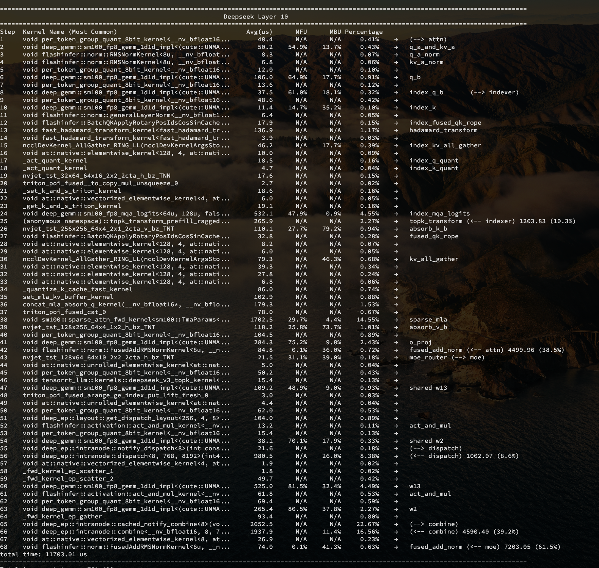

% 性能体系

## 压测工具 aiakperf

- 外部通用测试
- 引擎单测
    - Prefill 定长/变长 单测
    - Decode 定长/变长 单测
- 自带简单 Router

## 性能大图

### Prefill

- 结合 `[chunked size, seq_len]` 分析 prefill 的绝对性能
- 分析 `[seq_len, prefix_hit_rate]` 情况下的 prefix cache 性能损耗

### Decode

结合这三个维度 `[q_len, kv_len, bs]` 自动化测试测量引擎定长的绝对性能

## 算子大图

- 自动化测试 Prefill/Decode 定长 Profile 和分析，导出图表
- 自动计算 Kernel 的 MFU/MBU/时间占比

