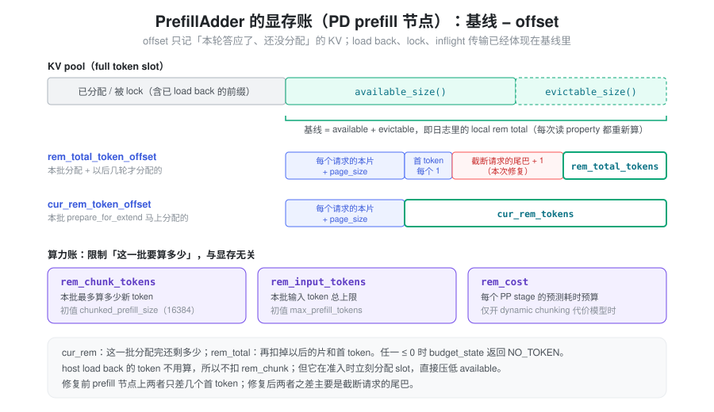
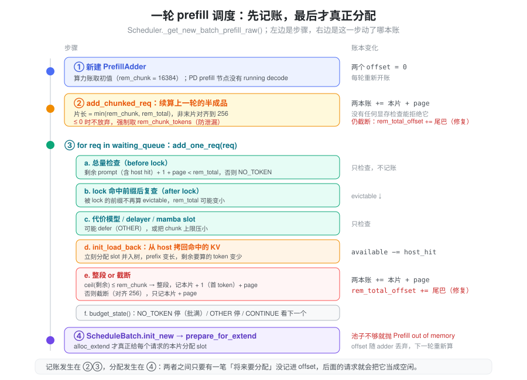
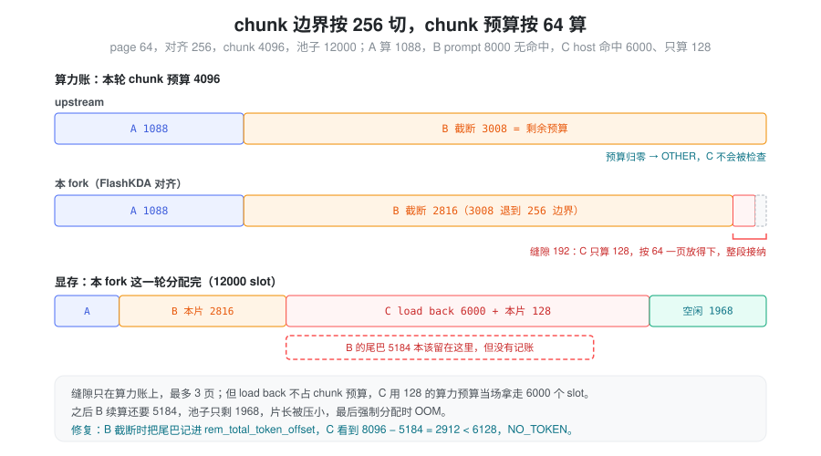
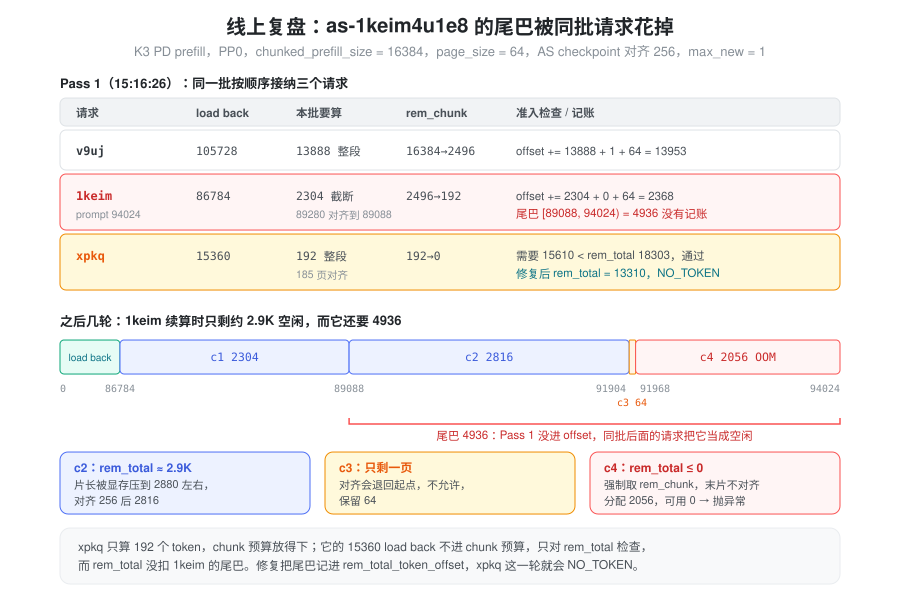

% Prefill 准入：显存账与截断请求的尾巴

本文只讨论 PD 分离的 prefill 节点。这里的请求只做 prefill、生成首 token，算完就把 KV 传给 decode 节点，不会留在本节点做 decode。所以下文不涉及 decode 阶段的显存预留。

### 问题：准入检查说“装得下”，几轮之后却 OOM

2026-11-02，线上 Kimi-K3 PD 分离的 prefill 节点（PP0）抛出：

```
Prefill out of memory. Try to lower your batch size.
Try to allocate 2056 tokens.
Available full tokens: 0 (full_available_size=0 + full_evictable_size_=0)
```

出错的请求 `as-1keim4u1e8` 在两轮之前就已经通过了准入检查。检查时，它的整段 prompt（94024 token）加上首 token 是放得下的。它被切成几片，前几片都跑完了，最后一片 2056 个 token 却拿不到显存，scheduler 进程直接退出。

“接纳时检查过、后面还是不够”，说明问题不在检查本身，而在**检查之后的记账**：调度器答应给这个请求的显存，有一部分没有记下来，被同一批里后面的请求当成空闲用掉了。要讲清楚这件事，得先讲清楚调度器记的是什么账，以及 `rem_total_tokens` 这类变量各自是什么意思。

### 抽象：实时余量，减去“答应了还没分配的”

组一个 prefill batch 时，`PrefillAdder` 不会边接纳边分配显存。它先按顺序决定接纳谁、每个请求本批算多少，最后由 `prepare_for_extend` 统一分配 KV slot。在“决定”和“分配”之间，它靠记账防止同一轮里后面的请求超卖前面的请求。账有两类：

- **算力账：这一批要算多少新 token？** 管单次 forward 的规模，只关心需要经过模型计算的 token。主要是 `rem_chunk_tokens`。
- **显存账：KV pool 给得起吗？** 管 KV slot 够不够，关心的是将来要占多少 slot。对应 `rem_total_tokens` 和 `cur_rem_tokens`。

显存账是一个减法：

> 还能答应的 = 基线（空闲 slot + 可驱逐的前缀） − offset（本轮已经答应、但还没分配的 KV）

基线从 allocator 和 radix tree 实时读取，已经发生的分配会直接体现在里面。offset 由 adder 自己累加。本轮答应出去的 KV 按兑现时间分成两部分：

- **本批分配**：这一批 `prepare_for_extend` 马上要拿走的，也就是每个请求的本片。
- **以后分配**：本轮答应了、要到以后的轮次才分配的。在 prefill 节点上只有两样：整段接纳请求的首 token（每个 1），以及被截断请求剩下没算的那段（下文叫“尾巴”）。

`cur_rem_token_offset` 只记前者，`rem_total_token_offset` 两者都记。尾巴在两边都没有记：它不在本批分配，也没进 `rem_total_token_offset`。upstream 也是这样，但以前不会出事，因为另有一条规则保证尾巴没人能抢。本 fork 的 FlashKDA checkpoint 对齐让这条规则失效了，下文“根因”一节会讲清楚。



两本账互相独立。命中 host 上大段前缀的请求，要算的新 token 只有几百，却要把上万 token 的 KV 从 host 拷回 GPU。它在算力账上几乎不花钱，在显存账上花很多。显存账只要漏记一笔，这种请求最容易钻空子。

### 变量到底是什么意思

以下变量都在 `PrefillAdder`（`srt/managers/schedule_policy.py`）里。K3 用的是 KDA + MLA 混合模型，走 `is_hybrid_ssm_cache` 分支，可驱逐量取的是 `full_evictable_size()`。

#### 显存侧

在 prefill 节点上，三个量的关系可以直接写出来：

```
基线 = available_size() + full_evictable_size()

cur_rem_token_offset   = Σ 本批每个请求的（本片 + page_size）
rem_total_token_offset = cur_rem_token_offset
                         + Σ 整段接纳请求的首 token（每个 1）
                         + Σ 截断请求的（尾巴 + 1）          ← 本次修复

cur_rem_tokens   = 基线 − cur_rem_token_offset     # 这一批分配完还剩多少
rem_total_tokens = 基线 − rem_total_token_offset   # 再扣掉以后一定要用的，还剩多少
```

| 变量 | 含义 | 怎么变 |
|------|------|--------|
| `available_size()` | KV pool 此刻的空闲 slot | 任何分配/释放立即反映，包括准入过程中的 `init_load_back` |
| `full_evictable_size()` | radix tree 里 `lock_ref == 0`、可以驱逐腾出的 slot | 请求 lock 住命中前缀后，这部分就不再可驱逐 |
| `cur_rem_token_offset` | 本批分配 | 每接纳一个请求加 `本片 + page_size` |
| `rem_total_token_offset` | 本批分配 + 以后分配 | 整段接纳加 `本片 + 1 + page_size`；截断加 `本片 + page_size`，修复后再加 `尾巴（页对齐） + 1` |
| `cur_rem_tokens` / `rem_total_tokens` | 基线减去对应 offset | property，每次读都重新算；可以是负数 |
| `rem_swa_tokens` / `rem_mamba_slots` | SWA 池、mamba state slot 的同类账 | 只在对应模型上生效，本文不展开 |

几点容易误解的地方：

- **`rem_total_tokens` 不是“池子里剩多少”。** 日志里同时打印了两者：`local rem total` 是基线，`current rem_total_tokens` 是扣掉 offset 之后的值，两者之差就是 `rem_total_token_offset`。
- **`cur_rem_tokens` 总是不小于 `rem_total_tokens`。** `cur_rem_token_offset` 的每一项都包含在 `rem_total_token_offset` 里。所以起拦截作用的几乎总是 `rem_total_tokens`，`cur_rem_tokens` 是防御性的下限。
- **修复前，prefill 节点上两本账几乎重合。** “以后分配”的部分只有首 token，每个请求 1。线上那一轮 `rem_total_tokens = 18303`、`cur_rem_tokens = 18304`，只差 `v9uj` 的首 token。`rem_total_tokens` 本该表示“还能答应多少”，实际上退化成了“这一批分配完还剩多少”。修复后，两者之差主要就是尾巴。
- **每轮重新开账。** `PrefillAdder` 每一轮调度新建一次，两个 offset 从 0 开始，组完 batch 就整个丢弃。offset 只在**同一轮内**防止后面的请求超卖前面的请求，跨轮的状态都落在基线里。

#### 基线里已经有的，不进 offset

| 事件 | 对基线的影响 |
|------|------|
| `init_load_back()` 拷回 host 命中的 KV | 当场分配 slot，空闲量立刻减少 |
| lock 住 device 命中的前缀 | 这段前缀不再可驱逐 |
| 上一轮算完、正在把 KV 传给 decode 的请求 | 一直占着 slot，传完才释放，下一轮的基线随之上升 |
| 上一轮半成品已经算完的前几片 | 已经分配，并且被 lock 住 |

这些占用已经体现在基线里，再记进 offset 就会重复扣。offset 只记一件事：**本轮已经答应、但还没分配的 KV**。

#### 算力侧

| 变量 | 含义 | 初值 |
|------|------|------|
| `rem_chunk_tokens` | 本批最多算多少新 token | `chunked_prefill_size`（K3 线上 16384） |
| `rem_input_tokens` | 本批输入 token 总上限 | `max_prefill_tokens`（K3 线上 512K，基本不起作用） |
| `rem_cost` | 每个 PP stage 的预测耗时预算 | 只在 `--enable-dynamic-chunking` 且 PP > 1 时启用。K3 线上设置了 `SGLANG_DYNAMIC_CHUNKING_COST_MODEL=1`，但没开 `--enable-dynamic-chunking`，所以这次没生效 |

#### 请求侧

| 字段 | 含义 |
|------|------|
| `prefix_indices` | 已经在 GPU KV 里的前缀（device 命中，或上一片算完 stash 进来的） |
| `host_hit_length` | 前缀里命中在 host（AttentionStore）上、还需要 load back 的长度 |
| `full_untruncated_fill_ids` | 完整输入；`len(...) − len(prefix_indices)` 是还没进 GPU 的部分 |
| `extend_range` | 本批要算的区间 `[start, end)`；`end < len(full)` 就是被截断了 |

#### `budget_state()` 的三个返回值

每接纳一个请求后，adder 用 `budget_state()` 决定还要不要继续看下一个：

- `NO_TOKEN`：`rem_total_tokens ≤ 0` 或 `cur_rem_tokens ≤ 0`（以及 SWA / mamba 的同类条件）。显存不够了，scheduler 会把 `running_batch.batch_is_full` 置为 True。
- `OTHER`：显存还够，但 `rem_input_tokens`、`rem_chunk_tokens` 或 `rem_cost` 用完了。这一批算力满了。
- `CONTINUE`：继续看下一个请求。

### 调度：一轮 prefill 里谁先记账、什么时候真正分配



`Scheduler._get_new_batch_prefill_raw()` 每轮按下面的顺序走：

1. **新建 `PrefillAdder`。** 算力账取初值，两个 offset 从 0 开始。
2. **续算上一轮的半成品。** 如果 `Scheduler.chunked_req` 不为空，先调 `add_chunked_req()`。片长取 `min(rem_chunk_tokens, rem_total_tokens)`，显存紧时片长会被压小；非最后一片再对齐到 checkpoint 边界。这里**没有拒绝的选项**：半成品已经占着 `req_to_token` 行和前缀 KV，丢下它会泄漏。所以当 `rem_total_tokens ≤ 0` 时，代码会把片长强制设成 `rem_chunk_tokens`，照样塞进 batch。
3. **从 waiting queue 依次 `add_one_req()`。** 每个请求要过几道关：
   - **总量检查**：`剩余 prompt（含 host hit）+ 1 + page_size < rem_total_tokens`，否则 `NO_TOKEN`。这里用的是请求**全部剩余长度**，因为它以后的每一片都要从同一个池子里拿 slot。
   - **lock 后复查**：lock 住命中前缀后，这部分不再可驱逐，`rem_total_tokens` 可能变小，要再查一次。
   - **代价模型、prefill delayer、mamba slot** 等可选检查。
   - **load back**：如果前缀命中在 host 上，`init_load_back()` 立刻把这段 KV 拷回 GPU。它当场分配 slot，所以直接压低基线，不经过 offset。load back 之后前缀变长，剩下要算的 token 变少。
   - **整段或截断**：剩余要算的（页对齐后）≤ `rem_chunk_tokens` 就整段接纳，记 `本片 + 1 + page_size`；否则截断成新的半成品，只记 `本片 + page_size`。
   - **`budget_state()`**：返回非 `CONTINUE` 就停止接纳。
4. **真正分配。** `ScheduleBatch.init_new()` 之后，`prepare_for_extend()` → `alloc_for_extend()` 给每个请求的本片分配 slot。池子不够就抛 `Prefill out of memory`。

几个与本次问题直接相关的设计：

- **load back 只占显存，不占算力。** 拷回来的 KV 在本次 forward 里是 prefix，不参与计算，所以不扣 `rem_chunk_tokens`。它也不需要进 offset，因为它在准入时就已经真实分配了，基线里看得到。
- **一批里最多一个半成品。** 截断意味着这一批的 chunk 预算用完了，正常情况下后面的请求也进不来。
- **非最后一片的结束位置对齐到 256。** 这是 FlashKDA 的 checkpoint 要求，详见下一节。

### 根因：chunk 边界按 256 切，chunk 预算按 64 算

#### 前提：尾巴原本靠什么保护

chunked prefill 的 KV 是每轮按本片分配的。一个 1M 的请求不会一开始就占住 1M 个 slot：准入时按全长检查一次，然后每轮只分配本片。准入检查和 offset 都不占 slot，offset 本轮结束就丢弃。

那后面几片靠什么保证有显存？upstream 靠的是调度顺序：

- 请求被截断时，截断片正好用完剩下的 chunk 预算，`budget_state()` 返回 `OTHER`，本轮不再接纳别人。
- 之后每一轮，`add_chunked_req()` 最先执行，又用光 chunk 预算，scheduler 跳过 waiting queue（`skip_waiting_admission`）。
- 只有最后一片不截断，剩下的预算才留给后面的请求。这时它已经没有尾巴了。

所以从准入到最后一片之间，没有新请求能插进来分配 KV。尾巴虽然没记账，但没人能抢，这是一种隐式预留。它成立的条件是：**截断 ⇒ chunk 预算归零**。

#### 两个粒度

| 粒度 | 来源 | 管什么 |
|------|------|--------|
| 64 | `--page-size 64` | GPU KV pool 的分配单位。显存账、chunk 预算、准入检查都按它取整 |
| 256 | `AS_BLOCK_SIZE`（`mem_cache/storage/asradix/types.py`） | AttentionStore 的 block，也是 KDA 状态做 checkpoint 的位置 |

KDA 是线性 attention，片与片之间要传递递推状态。这个状态只在 AS block 边界上存 checkpoint，片在 block 中间结束的话，那个位置的状态既写不进 AttentionStore，也没法被后面的请求当前缀复用。所以 FlashKDA 下，`Scheduler._get_prefill_checkpoint_end_align_size()` 返回 256，`_align_chunk_extend_end()` 把**非最后一片**的结束位置向下对齐到 256 的整数倍。最后一片不对齐。这条规则来自 `a39f854b5e`（luno-5416）。它只要求 `256 % page_size == 0`，所以每个 256 边界也是页边界，GPU 侧的分配仍按 64 进行。

256 只决定片在哪里结束，不改变显存账：一片被对齐成 2816，它就占 2816 个 slot，按 64 一页记账。粒度不一致出现在**算力账**上：片长按 256 缩短了，chunk 预算却只扣掉实际取走的部分，剩下不到一个 AS block 的零头；后面的请求又按 64 一页去用这点零头。

#### 一个简单的例子

page 64，对齐 256，chunk 预算 4096，池子里 12000 个空闲 slot，可驱逐量为 0。为了好算，忽略每个请求额外的那一页。waiting queue 里依次是：

- **A**：要算 1088，没有命中。
- **B**：prompt 8000，没有命中，要分好几轮算。
- **C**：前缀 6000 命中在 host 上，只需要算 128 个新 token。



**upstream（没有 256 对齐）：**

1. A 整段接纳，chunk 预算 4096 → 3008。
2. B 准入检查按全长：8000 < 12000 − 1088，通过。剩余 8000 > 3008，截断。截断长度按页向下取整，3008 本来就是 64 的倍数，本片就是 3008，chunk 预算 → **0**。
3. `budget_state()` 返回 `OTHER`，本轮结束。**C 根本不会被检查。**

B 的尾巴 4992 没有记账，但也没人能抢：之后每一轮 B 都最先续算，又把 chunk 预算用光，直到最后一片。准入时按全长检查过的那部分显存，就一直留给 B。

**本 fork（256 对齐）：**

1. A 整段接纳，chunk 预算 4096 → 3008。
2. B 准入检查通过，截断。结束位置 3008 不是 256 的倍数，退到 2816，本片 2816。chunk 预算只扣 2816，3008 → **192**。
3. `budget_state()` 返回 `CONTINUE`，继续看 C。
4. C 只需要算 128 ≤ 192，按 64 一页的口径放得下，走整段接纳。显存检查：6128 < 12000 − 1088 − 2816 = 8096，通过。这个余量里还包含 B 的尾巴 5184。
5. C 的 `init_load_back()` 当场分配 6000 个 slot。

这一轮分配完，池子只剩约 12000 − 1088 − 2816 − 6128 = 1968，B 还需要 5184。之后几轮 B 的片长被显存压小，余量降到 0 后 `add_chunked_req()` 强制分配，OOM。

#### 为什么缝隙只有 192，却能造成几千的缺口

缝隙在算力账上，最多 3 页。如果从缝隙进来的是一个普通小请求，它最多多占 192 + 1 + 64 个 slot，影响不大。但 host load back 不占 chunk 预算：C 只用了 128 的 chunk 预算，却在准入时当场拿走 6000 个 slot。算力上的几页零头，变成了显存上的几千个 slot。

所以这次 OOM 要三件事同时成立：

1. **截断后还剩 chunk 预算。** 256 对齐缩短了片长，而 chunk 预算按 64 剩下零头。片的结束位置（前缀长度 + 剩余 chunk 预算）恰好是 256 的倍数时，不会留下缝隙。
2. **截断请求的尾巴没有记账。** upstream 一直如此，以前靠“截断就把 chunk 预算用光”兜底。
3. **有一个算力小、显存大的请求从缝隙进来。** host load back 正好是这种请求。

`add_one_req()` 截断分支的注释写着 "Checkpoint alignment can leave a few pages after a partial admission. They may fit a final request"：代码作者知道有缝隙，也有意让它被整段请求用掉，只禁止了第二个半成品。缺的是第 2 条：没人想到尾巴原本是靠“chunk 预算用光”保护的。

### 线上复盘：`as-1keim4u1e8` 的尾巴被同批请求花掉



PP0 在 15:16:26 组的一批里依次接纳了三个请求（日志 68297–68315 行）。它们和上面的例子一一对应：`v9uj` 是 A，`1keim` 是 B，`xpkq` 是 C。

| 请求 | load back | 本批要算 | `rem_chunk_tokens` | 记账 |
|------|----------:|---------:|-------------------|------|
| `v9uj` | 105728 | 13888（整段） | 16384 → 2496 | offset += 13888 + 1 + 64 = 13953 |
| `1keim`（prompt 94024） | 86784 | 2304（截断） | 2496 → 192 | offset += 2304 + 64 = 2368 |
| `xpkq` | 15360 | 192（整段，185 页对齐） | 192 → 0 | offset += 192 + 1 + 64 |

逐个看：

1. **`1keim` 的准入检查是按全长做的。** `94024 + 1 + 64 = 94089 < 94463`，通过。load back 之后只剩 7240 要算，chunk 预算只剩 2496，于是截断。结束位置 `86784 + 2496 = 89280` 不是 256 的倍数，退到 89088，本片 2304。chunk 预算按 64 剩下 **192**，尾巴 `[89088, 94024)` 共 4936 个 token 没有进 offset。
2. **`xpkq` 从缝隙里进来。** 它只需要算 185 个 token，页对齐后 192，正好等于缝隙，走整段分支。显存检查用的是没扣尾巴的 `rem_total_tokens`，通过后它把 15360 个 token load back 进了 GPU，当场分配。
3. **`1keim` 之后几轮被显存卡住。** 下一轮它照样最先续算，调度顺序没有问题，但 slot 已经被 `xpkq` 实际占走。按 AS write 的 block 数和对齐规则推算，它后续三片是：
   - c2 `[89088, 91904)` 2816：显存只剩约 2.9K，片长被 `rem_total_tokens` 压小，再对齐到 256。
   - c3 `[91904, 91968)` 64：只剩一页。对齐会退回起点，`_align_chunk_extend_end()` 不允许，保留 64。
   - c4 `[91968, 94024)` 2056：`rem_total_tokens ≤ 0`，`add_chunked_req()` 走强制分支取 `rem_chunk_tokens`，最后一片不对齐，按 2056 去分配。池子是 0，抛异常。

`2816 + 64 + 2056 = 4936`，正好是那段没记账的尾巴。

接纳 `xpkq` 之前，基线是 34624（日志里的 `local rem total`）。把两本账展开：

| | 修复前 | 修复后 |
|--|--|--|
| `cur_rem_token_offset` | (13888 + 64) + (2304 + 64) = 16320 | 16320 |
| `rem_total_token_offset` | 16320 + 1（`v9uj` 首 token）= 16321 | 16321 + (4992 + 1)（`1keim` 尾巴）= 21314 |
| `cur_rem_tokens` | 18304 | 18304 |
| `rem_total_tokens` | 18303 | 13310 |
| `xpkq` 需要 15545 + 1 + 64 = 15610 | 通过 | `NO_TOKEN` |

`cur_rem_tokens` 修复前后都是 18304：只看本批分配，`xpkq` 确实放得下。能拦住它的只有记了尾巴的 `rem_total_tokens`。拦下之后，这 15360 个 slot 就留给了 `1keim`。

c2、c3 的区间是从 AS write 的 block 数（348 → 89088，359 → 结束在 `[91904, 92160)`）加对齐规则推出来的，日志里没有直接打印每片的区间；“约 2.9K 空闲”也是推算值。正在把 KV 传给 decode 的 inflight 请求也占着显存，它们已经体现在基线里，这几轮里不会新增占用。

### 修复：截断时把尾巴记进 `rem_total_token_offset`

#### 两种修法

根因里的三个条件，堵住第 1 条或第 2 条都能避免这次 OOM：

| | 截断后停止接纳（堵第 1 条） | 把尾巴记进显存账（堵第 2 条，采用） |
|--|--|--|
| 做法 | 截断后把 `rem_chunk_tokens` 清零或返回 `OTHER` | 截断时 `rem_total_token_offset += 尾巴 + 1` |
| 修的是 | 恢复“截断 ⇒ chunk 预算归零”这个间接保证 | 显存账本身，不再依赖算力账有没有用完 |
| 对齐缝隙 | 浪费掉，每批最多 192 个 token 的算力 | 显存够的话仍然可以用 |
| 其他原因留下的缝隙 | 要逐个堵 | 都不影响 |
| 和截断分支注释的意图 | 相反（注释希望缝隙能放进一个整段请求） | 一致 |

“其他原因”是实际存在的：截断分支里还有一条 `truncation_align_size` 路径（flashinfer 确定性推理用），它把截断长度向下对齐到 split size，同样会剩下 chunk 预算。

采用后者的理由是两本账各管各的：算力账管这一批算多少，显存账管 slot 够不够。显存安全不应该依赖算力账恰好用光。

#### 实现

修复只补上漏记的那一笔：请求被截断时，把它的尾巴（页对齐）和首 token 记进 `rem_total_token_offset`。

```python
def _reserve_unscheduled_tail(self, *, tail_len: int, max_new_tokens: int):
    if tail_len <= 0:
        return
    self.rem_total_token_offset += self.ceil_paged_tokens(tail_len) + max_new_tokens
```

`max_new_tokens` 在 prefill 节点上就是首 token 的 1。截断片原来不记它，现在跟着尾巴一起记，口径和整段接纳一致。只记 `rem_total_token_offset`、不记 `cur_rem_token_offset`，是因为尾巴要在后面几轮才分配，不是这一批 `prepare_for_extend` 要拿走的。

调用点有两处：

- `add_one_req()` 的截断分支：新请求第一次被切开。
- `add_chunked_req()` 续算后仍然截断：半成品还有下一片。这里只在**决策侧**（`planned_admission is None`）记账。PP 下 PP0 决定接纳计划，其余 rank 按计划重放；重放 rank 的本地余量可能和 PP0 不同，在那边多扣一笔，可能让它拒掉 PP0 已经接纳的请求，导致各 stage 的 batch 不一致。

修复不会多占显存，截断请求本身也不会因此被多拒，因为它被接纳时已经按全长检查过。修复只让同一轮里排在后面的请求不能再把尾巴当成空闲。在上面的例子里，B 截断后 `rem_total_tokens` 变成 8096 − 5184 = 2912，C 需要 6128，返回 `NO_TOKEN`，6000 个 slot 留给了 B。

多拒的请求只出现在两个条件同时成立时：截断后还剩 chunk 预算，并且剩余显存放不下“尾巴 + 新请求”。后一个条件成立时，放它进来迟早会让半成品 OOM，所以拒绝是对的。显存宽裕时，修复不改变任何行为。

修复的边界：

- offset 只在一轮之内有效。跨轮的保护仍然来自“下一轮先续算半成品”这条既有规则。
- 被拒的请求拿到 `NO_TOKEN`，本轮不进 batch，scheduler 置 `batch_is_full`，等 inflight 请求传完 KV、显存释放后再接纳。这是用一点首 token 延迟换不 OOM。
- `add_chunked_req()` 在余量 ≤ 0 时强制取 `rem_chunk_tokens` 的兜底逻辑没有改。更稳的做法是这种情况下本轮先不续算、等显存释放，但这会牵涉 PP 重放的一致性，留作后续。

### 实现落点

以下路径相对于 `python/sglang/`。

| 概念 | 代码 |
|------|------|
| 两本账、`budget_state()` | `PrefillAdder.__init__`、`rem_total_tokens` / `cur_rem_tokens`、`budget_state()`（`srt/managers/schedule_policy.py`） |
| 记账 | `PrefillAdder._update_prefill_budget()` |
| 尾巴预留（本次修复） | `PrefillAdder._reserve_unscheduled_tail()` |
| 续算半成品、强制兜底 | `PrefillAdder.add_chunked_req()` |
| 新请求准入、load back、截断 | `PrefillAdder.add_one_req()` |
| checkpoint 对齐 | `_align_chunk_extend_end()`；对齐粒度来自 `Scheduler._get_prefill_checkpoint_end_align_size()` |
| 组 batch 主流程、跳过 waiting queue | `Scheduler._get_new_batch_prefill_raw()`（`srt/managers/scheduler.py`） |
| 真正分配、OOM 报错 | `alloc_for_extend()` → `alloc_paged_token_slots_extend()`（`srt/mem_cache/allocation.py`） |

单测在 `test/registered/unit/managers/test_prefill_adder.py`，用 page_size 64、chunk 704、对齐 256 的小规模参数复现了两种情形：

- `test_truncated_req_tail_blocks_host_load_back_admission`：新请求被对齐截断后，一个“要算的很少、要 load back 很多”的请求不能再进本批，而且 `init_load_back` 不会被调用。对应线上的 `xpkq`。
- `test_resumed_chunk_tail_blocks_waiting_admission`：续算的半成品仍被截断时，它的尾巴同样挡住普通 waiting 请求。

两个用例在修复前都会失败。

### 小结

**根源：chunk 显存切分边界 256 page size 和准入 chunk 准入边界 64 page size 的不匹配**

在 prefill 节点上，`PrefillAdder` 的显存账是“基线减去本轮答应了还没分配的 KV”。截断请求的尾巴从来没有记进这本账，upstream 靠“截断就把 chunk 预算用光、本轮没人能插进来”替它做了隐式预留。FlashKDA 的 checkpoint 要求非最后一片在 256 边界结束，而 chunk 预算和准入检查都按 64 一页计算，于是截断后会剩下不到一个 AS block 的 chunk 预算，后面的请求可以按 64 的口径整段进来。缝隙在算力上只有几页，但 host load back 不占算力预算，能在准入时当场拿走上万个 slot，这些 slot 正是尾巴需要的。修复把尾巴显式记进 `rem_total_token_offset`，显存账不再依赖算力账有没有用完，“接纳时装得下”重新等价于“能算完”。
