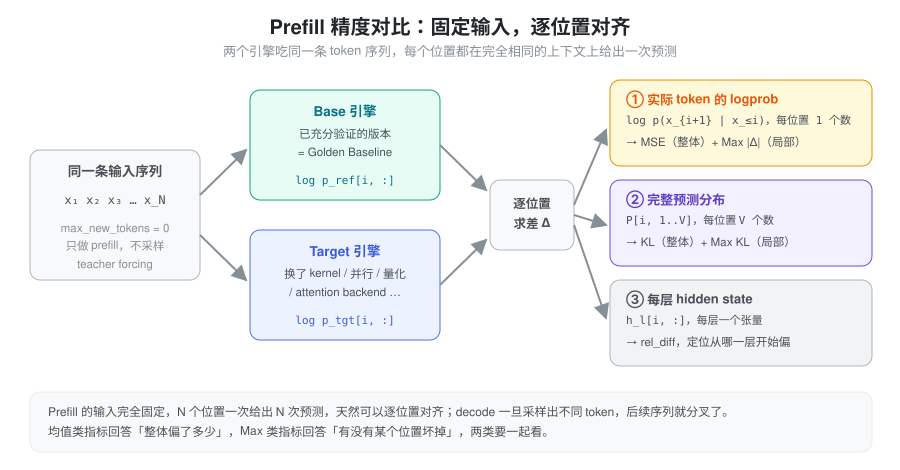
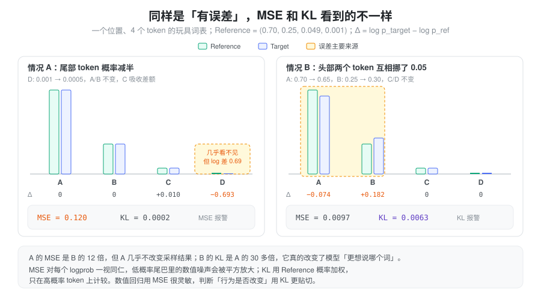
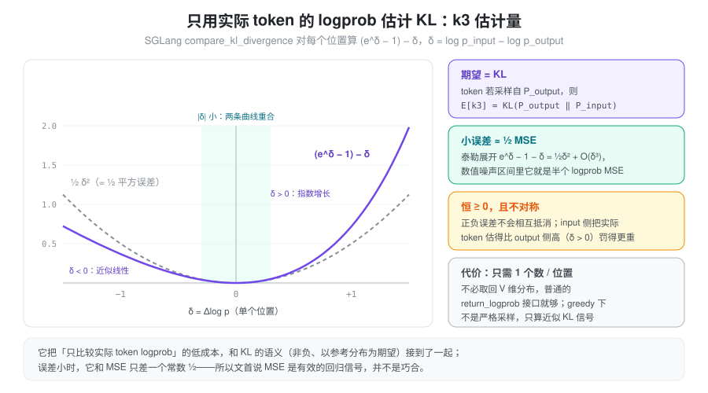
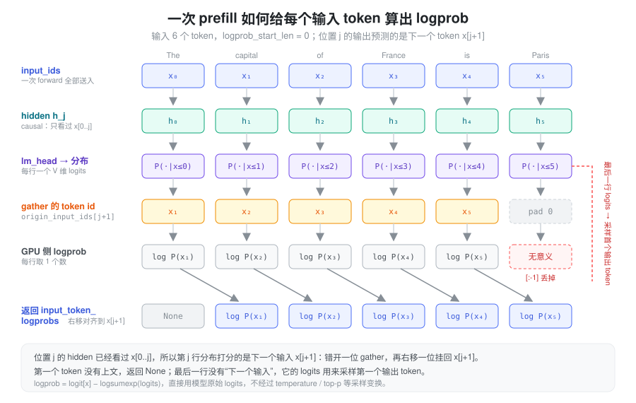
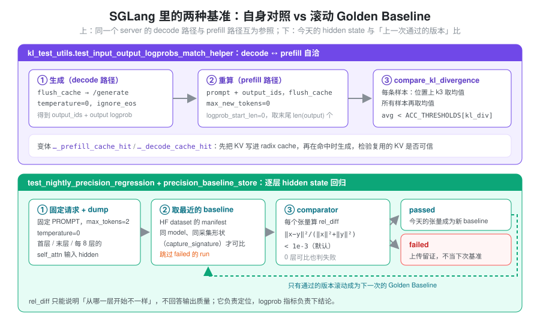

% Prefill Logprob MSE

### 问题：怎么判断“新引擎算得还对”

推理引擎几乎每天都在变：换 attention backend、上新的融合 kernel、改 TP/DP/CP 切分、调整 chunked prefill 的切法、开 radix cache 复用 KV。每一处改动都可能引入数值偏差，而偏差几乎从不以“报错”的形式出现——服务照常返回，只是模型悄悄变笨了一点。

最直接的检测手段是跑 benchmark（GSM8K、MMLU……），但它有两个问题：

- **不灵敏**：分数是大量样本的离散统计，0.5 分的波动可能是噪声，也可能是一个 kernel 在某种 shape 下算错了。
- **不可定位**：分数掉了，不知道是哪个请求、哪个位置、哪一层出的问题。

所以需要一种**端到端、连续、可逐位置定位**的数值信号：拿同一份输入分别喂给“可信的版本”和“待测的版本”，直接比较它们算出来的概率。

### 抽象：固定输入，逐位置对齐

关键观察是 **prefill 天然适合做对比**。一条长度为 \(N\) 的序列做一次 prefill（teacher forcing），模型在每个位置 \(i\) 都基于完全相同的上下文 \(x_{\le i}\) 给出一次下一个 token 的预测，一次 forward 就得到 \(N\) 组可以一一对齐的结果。

Decode 则不同：只要某一步采样出的 token 不同，后面的上下文就分叉了，之后的比较失去意义。因此即使要验证 decode 路径，常见做法也是把 decode 生成的序列再用 prefill 重算一遍，回到“固定输入”的框架里（见后文 SGLang 的自洽测试）。

在每个对齐的位置上，可以从三个粒度取数据来比：

1. **实际 token 的 logprob**：\(\log p(x_{i+1}\mid x_{\le i})\)，每个位置一个数，几乎所有引擎都能直接返回。对应 **Logprob MSE / Max Error**。
2. **完整预测分布**：每个位置一个 \(V\) 维分布。对应 **KL Divergence / Max KL**。
3. **每层 hidden state**：用来定位“从哪一层开始偏”，而不是判断结果好坏。

每个粒度都要同时看两类统计量：**均值类**（MSE、平均 KL）回答“整体偏了多少”，**最大值类**（Max Error、Max KL）回答“有没有某个位置坏掉”。一个只在 chunk 边界上出错的 bug，可能一万个位置里只坏一两个，均值几乎不动，但 Max 会立刻跳出来。

| 目标 | 合适的指标 |
| :--- | :--- |
| 检测新旧引擎输出是否变化 | Logprob MSE |
| 衡量完整预测分布的变化 | KL Divergence |
| 检测局部严重数值异常 | Max Logprob Error / Max KL |
| 判断新版本是否更接近高精度结果 | 相对于 Reference 的 MSE / KL 变化 |

### 基准选谁：Golden Baseline 与高精度 Reference

“和谁比”决定了指标能回答什么问题：

- **高精度 Reference**（例如 FP32 / 不做激进融合的实现）：回答“新版本是否**更接近真值**”。代价是每次都要跑一遍昂贵的参考实现。
- **Golden Baseline**（已经充分验证过的上一个版本）：回答“新版本**有没有变**”。它不是真值，但工程上足够。

对于 Prefill 测试，如果 Base 版本已经经过充分验证，那么将它作为工程上的 Golden Baseline 是合理的。此时 Logprob MSE 可以作为非常有效的 Numerical Regression Signal，不需要每次都重新运行高精度 Reference；只有当 MSE 报警、需要判断“这次变化是变好还是变坏”时，才拿高精度 Reference 做裁决。

一个容易忽略的前提：logprob 对 GPU 型号、kernel、torch 版本都很敏感，**Golden Baseline 必须和 Target 在同一套硬件与软件环境下生成**，跨机器的 baseline 没有意义。SGLang 的 `test/manual/test_logprobs.py` 在文件头就明确说了这一点，所以它要求贡献者先在本机 `gen` 一份 baseline 再 `test`。

### Logprob MSE

Logprob 的 MSE（Mean Squared Error，均方误差），就是对两个推理引擎在相同位置、相同 Token 上计算出的 Log Probability 求差、平方，再取平均。

假设 Reference 和 Target 引擎分别输出：

\[ \log p_i^{ref},\quad \log p_i^{target} \]

那么：

\[ \boxed{ \mathrm{MSE}=\frac{1}{N}\sum_{i=1}^{N} \left(\log p_i^{target}-\log p_i^{ref}\right)^2 } \]

其中 \(N\) 是参与比较的 Token 预测位置数量。RMSE 就是 \(\sqrt{\mathrm{MSE}}\)，量纲回到 logprob，更直观。

例如：

| Token 位置 | Reference logprob | Target logprob | 平方误差   |
| -------- | ----------------- | -------------- | ------ |
| 1        | -1.2              | -1.3           | 0.0100 |
| 2        | -2.5              | -2.4           | 0.0100 |
| 3        | -0.8              | -0.85          | 0.0025 |
| 4        | -3.0              | -3.2           | 0.0400 |

因此：

\[ \mathrm{MSE}=\frac{0.01+0.01+0.0025+0.04}{4} =0.015625 \]

同一组数据的 Max Error 是 \(\max_i |\Delta_i| = 0.2\)（位置 4）。MSE 只需要每个位置一个数，计算便宜、对任何数值变化都很灵敏，因此是最常用的回归信号。

### KL Divergence

**KL Divergence（Kullback–Leibler Divergence，KL 散度）** 衡量的是两个概率分布之间的差异。

假设 Reference 和 Target 引擎在同一个 Token 位置输出两个 vocabulary 概率分布：

\[ P_{ref}=(p_1,p_2,\ldots,p_V) \]

\[ P_{target}=(q_1,q_2,\ldots,q_V) \]

KL Divergence 定义为：

\[ \boxed{ D_{KL}(P_{ref}\Vert P_{target}) =\sum_{i=1}^{V}p_i\log\frac{p_i}{q_i} } \]

也可以写成：

\[ D_{KL}(P_{ref}\Vert P_{target}) =\sum_{i=1}^{V}p_i(\log p_i-\log q_i) \]

这里的 \(V\) 是 vocabulary size。第二种写法揭示了它和 MSE 的关系：同样是 logprob 的差，只是**用 Reference 概率 \(p_i\) 加权**后求和，而不是平方后等权平均。

注意，KL 不对称：

\[ D_{KL}(P\Vert Q)\neq D_{KL}(Q\Vert P) \]

通常把高精度 Reference 放在前面——“以参考分布的视角，看 Target 偏了多少”。

假设只有三个 Token：

| Token | Reference 概率 | Target 概率 |
| ----- | ------------ | --------- |
| A     | 0.7          | 0.6       |
| B     | 0.2          | 0.3       |
| C     | 0.1          | 0.1       |

KL Divergence：

\[ D_{KL} =0.7\log\frac{0.7}{0.6} +0.2\log\frac{0.2}{0.3} +0.1\log\frac{0.1}{0.1} \]

\[ \boxed{D_{KL}\approx0.0268} \]

### MSE 与 KL：看到的误差不一样

两者最大的区别是：

- Logprob MSE：对参与比较的 Logprob 误差直接平方平均，**每个 logprob 一视同仁**。
- KL Divergence：按照 Reference 概率加权，**更关注高概率 Token 的分布变化**。

下图用一个 4-token 的玩具词表构造了两种“误差”：A 只动了一个概率 0.001 的尾部 token，B 在两个头部 token 之间挪了 0.05 的概率。

情况 A 中尾部 token 概率减半，log 差高达 0.69，MSE 被平方放大到 0.12；但这个 token 几乎不可能被采到，KL 只有 0.0002。情况 B 的 log 差都不大，MSE 不到 A 的十分之一，但它实实在在地改变了模型“更想说哪个词”，KL 高出 A 三十多倍。

这正是两种指标的分工：低概率尾巴里的数值噪声（bf16 下 softmax 尾部本来就不精确）会让 MSE 显得很吓人，却不影响生成；KL 对模型最终预测行为的衡量通常更有意义。反过来，MSE 的“过度灵敏”在回归检测里恰恰是优点——任何数值路径的改变它都能看到。

| 对比维度            | Logprob MSE                | KL Divergence |
| --------------- | -------------------------- | ------------- |
| 需要完整 vocabulary | 不需要，可以只比较 selected logprob | 需要            |
| 衡量数值一致性         | 很适合                        | 适合            |
| 衡量概率分布差异        | 有限                         | 很适合           |
| 对低概率 Token 敏感性  | 较高                         | 通常较低          |
| 计算成本            | 低                          | 较高            |
| 发现少量异常位置        | 结合 Max Error               | 结合 Max KL     |

### 只用一个 logprob 估 KL：k3 估计量

完整 KL 需要每个位置取回 \(V\) 维分布（\(V\) 动辄十几万），对线上引擎的接口和带宽都不友好。一个折中是：**只用实际 token 的 logprob，构造一个期望等于 KL 的估计量**。

设实际 token \(x\) 来自分布 \(P\)，两边对它的 logprob 之差为 \(\delta=\log Q(x)-\log P(x)\)，令

\[ \boxed{ k_3(\delta)=(e^{\delta}-1)-\delta } \]

则 \(\mathbb{E}_{x\sim P}[k_3]=\mathbb{E}_{P}\!\left[\tfrac{Q}{P}\right]-1-\mathbb{E}_{P}\!\left[\log\tfrac{Q}{P}\right]=0+D_{KL}(P\Vert Q)\)。它有三个好性质：

- **无偏**：期望恰好是 KL，且只需要每个位置一个数。
- **恒非负**：\(e^\delta\ge 1+\delta\)，正负误差不会像直接平均 \(\delta\) 那样相互抵消。
- **小误差下就是半个平方误差**：泰勒展开 \(k_3=\tfrac12\delta^2+O(\delta^3)\)。在数值噪声的量级里，它和 Logprob MSE 只差一个常数 \(\tfrac12\)。

最后一点把前文两个指标串了起来：**MSE 之所以是有效的回归信号，是因为在误差小的时候它本身就近似（两倍的）KL**；只有误差大到 \(|\delta|\) 接近 1 时两者才分道扬镳，此时 k3 对 \(\delta>0\) 一侧惩罚更重。需要注意，greedy（temperature = 0）生成的 token 不是从分布中采样的，严格说期望不再等于 KL，k3 只能当作“近似 KL 信号”使用。

### 每个输入 token 的 logprob 是怎么算出来的

前面所有指标都假设“每个输入位置都有一个 logprob”。这个数的来历值得单独讲清楚，因为它有一个容易弄错的错位。

Causal attention 下，位置 \(j\) 的 hidden state \(h_j\) 只看过 \(x_{\le j}\)。它经过 lm_head 得到的分布 \(P(\cdot\mid x_{\le j})\) 预测的是**下一个** token，所以这一行能打分的是 \(x_{j+1}\)，而不是 \(x_j\) 自己：

\[ \log p(x_{j+1}\mid x_{\le j}) = z_j[x_{j+1}] - \operatorname{logsumexp}(z_j) \]

其中 \(z_j\) 是第 \(j\) 行的原始 logits。于是一次长度为 \(N\) 的 prefill：

- 产出 \(N\) 行分布，前 \(N-1\) 行分别给 \(x_1,\ldots,x_{N-1}\) 打分；
- 第一个 token \(x_0\) 没有上文，没有 logprob，返回 None；
- 最后一行没有“下一个输入”可以打分，它正是用来采样第一个输出 token 的那一行。

实现上就是两次错位：GPU 上第 \(j\) 行 gather 的是 `x[j+1]`；返回给用户前再右移一位，把结果挂到 \(x_{j+1}\) 下面，使 `input_token_logprobs[i]` 和 `input_ids[i]` 一一对应。

#### 一个可以手算的例子

为了好算，假设词表只有 4 个 token：A、B、C、D。输入是 `[A, C, B]`，`logprob_start_len = 0`。

| 返回位置 \(i\) | 用哪个 hidden | logits (A, B, C, D) | log_softmax 后 (A, B, C, D) | 真实 token \(x_i\) | 返回值 |
| :--- | :--- | :--- | :--- | :--- | :--- |
| 0 | - | - | - | A | None |
| 1 | \(h_0\)（只看过 A） | 2.0, 1.0, 0.5, −1.0 | −0.50, −1.50, −2.00, −3.50 | C | −2.00 |
| 2 | \(h_1\)（看过 A C） | 0.0, 3.0, 1.0, 0.0 | −3.21, −0.21, −2.21, −3.21 | B | −0.21 |
| （丢弃） | \(h_2\)（看过 A C B） | … | … | 第一个输出 token | 属于 `output_token_logprobs` |

位置 1 的计算：

\[ \operatorname{logsumexp} = \log\left(e^{2}+e^{1}+e^{0.5}+e^{-1}\right)\approx 2.50 \]

所以 C 的 logprob 是 \(0.5-2.50=-2.00\)。位置 2 同理，\(\operatorname{logsumexp}\approx 3.21\)，B 的 logprob 是 \(3.0-3.21=-0.21\)。

如果请求里带 `top_logprobs_num=2`，位置 1 还会在 `input_top_logprobs` 里返回分布中最高的两个 token：`[(A, −0.50), (B, −1.50)]`（实际接口返回的是 `(logprob, token_id, text)` 三元组，这里简写）。注意 top-k 看的是 \(h_0\) 这一行的整个分布，和真实 token C 是否在其中无关。

#### SGLang 的计算路径

1. **要 logprob 的 token 必须真正算一遍**（`managers/schedule_batch.py`）。`logprob_start_len` 指定从哪个输入位置开始返回 logprob，-1 表示不要输入 logprob。命中 radix cache 的前缀不会重新 forward，也就没有 hidden state，所以 `Req._compute_max_prefix_len` 把可复用的前缀限制在 `min(input_len - 1, logprob_start_len)` 以内。随后为本次 extend 准备错一位的目标 id：`origin_input_ids[start+1 : end+1]`，序列末尾不够的位置补 0（图中的 pad 0），id 还会 clamp 到 `vocab_size - 1`，防止多模态的 hash token 越界。Chunked prefill 下这一步按 chunk 做，源码注释的例子是输入 `[1,2,3,4]` 切成 `[1,2]`、`[3,4]`，目标 id 分别是 `[2,3]` 和 `[4,0]`。

2. **只把需要的行送进 lm_head**（`LogitsProcessor._get_pruned_states`，`layers/logits_processor.py`）。不要 logprob 时，每条序列只保留最后一个 token 的 hidden，lm_head 只算 batch size 行。要 logprob 时保留每条序列 `[start_len, extend_len)` 这一段，并生成三组索引：`sample_indices` 指向每条序列的最后一行，交给采样；`input_logprob_indices` 指向参与 input logprob 的行；`token_to_seq_idx` 记录每行属于哪条序列。如果某个 chunk 里一个要 logprob 的位置都没有（`extend_len == start_len`），会把 `start_len` 减 1，保证最后一行仍然留给采样。

3. **只算需要的那一个数，不展开整个 log_softmax**（`InputLogprobProcessor`，`layers/logprob_processor.py`）。logits 是 `[行数, V]` 的矩阵，32k token × 15 万词表的 fp32 log_softmax 约 20 GB。所以这里按行分块（`SGLANG_LOGPROB_CHUNK_SIZE`，默认 2048），并默认走快路径：每行只在 fp32 下算一个归一化常数（`row_max` 加 `logsumexp`），再用目标 token 的 logit 减去它，不物化 \(V\) 维结果；需要 top-k 时，一个融合 kernel 在一次读 logits 的过程中同时得到归一化常数和 top-k。开启 deterministic inference 时退回精确的 `log_softmax`，因为换一种规约顺序，prefill 和 decode 算出的 logprob 就不再 bit-exact。

4. **跨 chunk 拼接，最后右移**（`SchedulerLogprobResultProcessor`，`managers/scheduler_components/logprob_result_processor.py`）。Chunked prefill 每一轮把本 chunk 的结果追加到请求上，只在最后一个 chunk 收尾：返回值是 `[None] + logprobs[:-1]`，丢掉的末尾元素就是 pad 0 那一行；对应的 token id 是 `origin_input_ids[logprob_start_len:]`，最后断言两者等长。Top-k 和指定 token id 的 logprob 也做同样的处理。

还有一个和精度测试直接相关的细节：**input logprob 不受采样参数影响**，它直接用 lm_head 的原始 logits，只经过 `logit_scale`、`final_logit_softcapping` 这类模型自带的变换。Output logprob 则不同：`layers/sampler.py` 在非 greedy 时先把 logits 原地除以 temperature 再算 logprob（除非设置 `SGLANG_RETURN_ORIGINAL_LOGPROB`）。所以 decode 的 output logprob 和 prefill 的 input logprob 只有在 temperature = 0 时才是同一个量，这也是下面的自洽测试用 greedy 生成的原因。

### SGLang 里的实现

SGLang 的测试代码里同时存在上面几种思路，按“和谁比”可以分成两类：**自身对照**（同一个 server 的两条计算路径互为参照）和**滚动 Golden Baseline**（今天的结果和上一次通过的版本比）。

#### decode ↔ prefill 自洽：`kl_test_utils.py`

`python/sglang/test/kl_test_utils.py` 里的 `test_input_output_logprobs_match_helper` 不需要任何外部 baseline：

1. `flush_cache` 后用 `/generate` 以 `temperature=0`、`ignore_eos` 生成，记下 `output_ids` 和每个输出 token 的 logprob——这是 **decode 路径**算出的值；
2. 把 `prompt + output_ids` 作为新输入，再次 `flush_cache`，以 `max_new_tokens=0`、`logprob_start_len=0` 做一次纯 prefill，取 `input_token_logprobs` 的末尾 `len(output)` 个——这是 **prefill 路径**对同一批 token 算出的值；
3. `compare_kl_divergence` 对每条样本逐位置算 k3 并取均值，再对样本取均值，要求小于 `ACC_THRESHOLDS[model]["kl_div"]`。

第二次之前的 `flush_cache` 是关键：否则 prefill 会命中 radix cache，直接复用 decode 时写下的 KV，等于拿结果和自己比。两个变体 `..._prefill_cache_hit_helper` / `..._decode_cache_hit_helper` 则反过来**故意**先把 prefix 写进缓存、在命中时生成，再用无缓存的 prefill 做参照，专门检验“复用的 KV 是否和重算一致”；它们还会断言命中率超过一半，避免一次没命中的“空跑”被当成通过。

阈值随场景而定：radix cache 系列的测试大多在 `0.0025 ~ 0.03` 之间，强调 bit-exact 的混合模型测试则用 `1e-9`。

#### Top-k logprob 的 Max / Mean 误差：`test_logprobs.py`

`test/manual/test_logprobs.py` 是“Golden Baseline + Max Error”的直接体现：先在本机生成一份 baseline（ShareGPT 采样，记录 top-20 logprob），改代码后在不同 `chunked_prefill_size` × `max_running_requests` 组合下重跑，对两边**共同出现**的 top-k token 取 `|Δlogprob|`，每条样本的 max 和 mean 都必须 `≤ 1e-5`。扫 chunk 大小和并发，本质是在检验 prefill 结果对 batch 组成和切块方式是否不变。

#### 逐层 hidden state 回归：nightly precision

`test/registered/debug_utils/test_nightly_precision_regression.py` 走的是第三个粒度。它用固定 prompt、`temperature=0`、`max_tokens=2` 请求 server，通过 dumper 抓取首层、末层和每隔 8 层的 `self_attn` 输入 hidden state，再交给 `sglang.srt.debug_utils.comparator` 逐张量计算

\[ \mathrm{rel\_diff}=1-\frac{2\langle x,y\rangle}{\Vert x\Vert^2+\Vert y\Vert^2}=\frac{\Vert x-y\Vert^2}{\Vert x\Vert^2+\Vert y\Vert^2} \]

默认阈值 `1e-3`（`SGLANG_PRECISION_DIFF_THRESHOLD` 可调）。这个指标对整体缩放不敏感、只看方向和相对大小，适合比较量级差异很大的各层激活。

Baseline 的管理在 `python/sglang/test/precision_baseline_store.py`，存放在 HF dataset 上，有两处设计值得一提：

- **只有可比的才比**：manifest 里每次 run 带一个 `capture_signature`（采集了哪些层、TP 大小等），取 baseline 时只选同 model、同 signature 的记录；对不上就重新建立 baseline，而不是拿形状不同的张量硬比。
- **失败的 run 不能成为下一次的基准**：`_select_latest_run` 优先跳过 `pass_label == "failed"` 的记录。否则一次回归被上传后会成为第二天的 baseline，持续存在的回归就被“洗白”了。失败的张量照样上传，只是作为诊断证据。另外，comparator 实际比较了 0 层也判失败，防止张量命名对不上导致的“空通过”。

逐层 rel_diff 只能说明“从哪一层开始不一样”，不直接回答输出质量；它负责定位，logprob 层面的指标负责下结论。

### 小结

Prefill 端到端精度测试的核心是一个很朴素的抽象：**固定输入，让两个版本在每个位置上给出可对齐的预测，然后比较概率**。这些概率来自 prefill 的逐行 logits：第 \(j\) 行给 \(x_{j+1}\) 打分，用原始 logits、不受 temperature 影响，所以同一份输入在两个版本上得到的是严格可比的同一个量。Logprob MSE 便宜、灵敏，配合一份同环境下充分验证过的 Golden Baseline 就是好用的回归信号；KL 用参考概率加权，更贴近“模型行为有没有变”；k3 估计量让我们只用一个 logprob 就拿到近似 KL，并解释了为什么小误差下 MSE 和 KL 说的是同一件事。再配上 Max 类指标抓局部异常、逐层 rel_diff 定位源头，就构成了从“有没有变”到“哪里变了”的完整链条。
