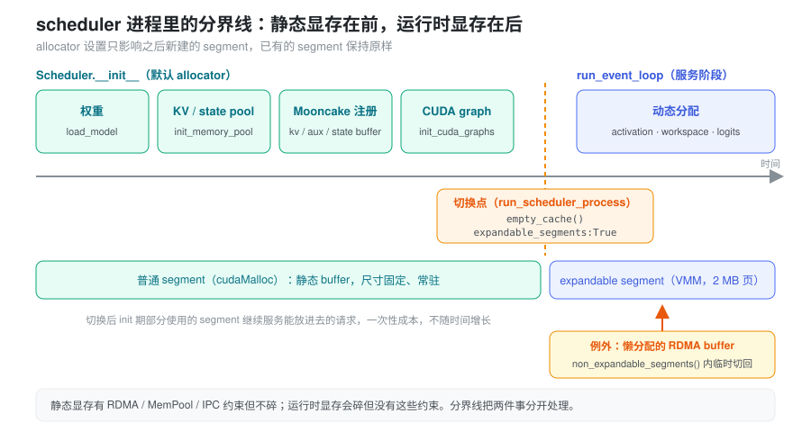

% 运行时显存碎片：分阶段开启 expandable_segments

本文讨论 PD 分离部署里 prefill / decode scheduler 进程在长时间运行后出现的 OOM。KV 的记账问题见 [Prefill 准入与显存账](./prefill_admission_budget.md)。本文的问题出在 KV pool 之外，也就是 PyTorch caching allocator 管理的运行时显存。

### 问题：跑了两三天，3 GB 分配失败，reserved 里还有一大块空闲

线上 Kimi-K3 P2D2-EPD 部署在连续运行两三天后，scheduler 抛出 `torch.cuda.OutOfMemoryError`：一次约 3 GB 的分配失败，而报错里 PyTorch 自己还持有大量 `reserved but unallocated` 显存。

这个现象本身已经排除了几种常见原因：

- **不是 KV pool 不够。** KV slot 不足时报的是 `Prefill out of memory ... Available full tokens`，走的是 SGLang 自己的 token allocator，不是 torch OOM。
- **不是活跃张量太多。** allocator 在抛 OOM 之前，已经把完全空闲的 segment 还给驱动并重试过一次。此时剩下的 `reserved − allocated` 都在还有存活 block 的 segment 里。
- **不是启动配置算错。** 同样的配置能跑两三天，说明单次 forward 的峰值装得下，装不下的是“跑了很久之后的同一个峰值”。

剩下的解释是碎片：空闲总量够，但散落在许多 segment 的空洞里，没有一个空洞有 3 GB；每个 segment 又被一两个长寿的小张量钉住，整段还不回去。

部署的几个特点会让碎片累积得更快：

- prefill 的 token 数逐轮变化，activation 和 MHA 展开 KV（`SGLANG_MAX_KV_CHUNK_CAPACITY`）的临时张量尺寸也逐轮变化，大块被不同尺寸反复切分。
- 多个 stream 并行（PP 异步、通信、传输），空闲 block 只能给同一 stream 复用。
- 进程不重启，所以“偶尔被钉住一段”会一直累加，直到某一轮的大请求碰上。

所有 yaml 里都没有设置 `PYTORCH_CUDA_ALLOC_CONF`，走的是默认 allocator。segment、block 和碎片的基本机制见 [显存管理与生命周期](./torch_memory_management.md) 中的“分配器内部”一节。

### 抽象：把回收粒度从 segment 降到页

默认 allocator 的回收单位是 **segment**：一段 `cudaMalloc` 出来的显存，只有其中所有 block 都空闲时才能整体 `cudaFree`。碎片的代价因此按 segment 计：一个几 KB 的小张量能让一整段几百 MB 的显存无法再给大请求用。

`expandable_segments:True` 换了一种组织方式。每个 segment 是一段很长的**虚拟地址**，物理显存按 2 MB 页通过 CUDA VMM（`cuMemCreate` / `cuMemMap`）映射进去：

- 分配时，优先用已有空闲 block；不够就把新物理页映射到段尾，地址仍然连续。
- 回收时（OOM 前的重试，或 `empty_cache()`），空闲 block 覆盖的**整页**被解除映射、还给驱动，不要求整段空闲。

于是“3 GB 能不能分配”的条件，从“某个 segment 里有 3 GB 连续空闲”变成了“空闲物理页总共够 3 GB”。虚拟地址上的空洞依然存在，但它不再占物理显存。每个空洞最多损失两端不足 2 MB 的零头，碎片的代价从“一个 segment”降到“几 MB”。


#### 为什么不直接在启动时打开

最省事的做法是在 yaml 里加 `PYTORCH_CUDA_ALLOC_CONF=expandable_segments:True`。但这样从第一次分配起就生效，权重、KV pool 和所有通信 buffer 都会变成 VMM 内存，而 scheduler 进程里有几类显存对 VMM 有约束：

| 显存 | 约束 |
|------|------|
| Mooncake 注册给 RDMA 的 kv / aux / state buffer | 注册的是固定地址范围，VMM 内存能否正确注册、传输没有验证过 |
| `torch.cuda.MemPool` 里的分配（custom mem pool、symm-mem） | torch 直接报错：`torch.cuda.MemPool doesn't currently support expandable_segments` |
| 走 CUDA IPC 共享的张量 | 需要较新的 torch 和内核 `pidfd_open` / `pidfd_getfd`；`weight_cache/daemon.py` 发现该配置会直接拒绝启动 |

注意这几类显存的共同点：它们都是**启动时一次分配、尺寸固定、常驻**的。它们有约束，但从不制造碎片。制造碎片的是服务阶段的 activation、workspace、logits，而这些张量没有上面任何一条约束。

两类显存的需求正好错开，所以可以按时间分开处理：初始化阶段用默认 allocator，把所有静态 buffer 都分配在普通 segment 上；进入服务循环之前，再把 allocator 切到 expandable。torch 允许运行时调用 `torch.cuda.memory._set_allocator_settings("expandable_segments:True")`，这个设置只影响**之后新建**的 segment，已有的 segment 不受影响。



### 分界线画在哪里

分界线要满足一个条件：**所有有约束的显存都已经分配完，而服务循环还没开始。** 在 scheduler 进程里，这个时刻就是 `Scheduler(...)` 构造完成、`run_event_loop()` 之前。`Scheduler.__init__` 依次完成了：

- 加载权重；
- `init_memory_pool` 分配 KV / state pool；
- `init_disaggregation` 创建 Mooncake KVManager，它在构造时把 kv / aux / state buffer 注册给传输引擎；
- 启动期的 staging buffer（AS、PD staging）；
- `init_cuda_graphs` 捕获 CUDA graph，graph 私有内存池也在这之前分配好。

切换时先调一次 `empty_cache()`，把初始化过程中留下的完全空闲的 segment 还给驱动，让这部分显存可以重新被 expandable segment 使用。初始化期间只用了一部分的 segment 会留下来，继续服务能放进去的小分配。这是一次性的成本，不随运行时间增长。

#### 例外：服务阶段才分配的 RDMA buffer

分界线只在“服务阶段不再分配有约束的显存”时成立。检查初始化链路时发现了一个例外：`DraftKVGatherPool`（DSPARK 的 draft KV gather，`SGLANG_ENABLE_DISAGG_DRAFT_GATHER` 默认开启）在第一次使用某个 slot 时才创建 `StagingBuffer`，并当场注册给 RDMA；需要更大的 buffer 时还会重新分配、重新注册。

这类分配用 `non_expandable_segments()` 包起来，在这段代码里临时切回默认 allocator，结束后再切回 expandable。allocator 设置是进程全局的，所以：

- 切换窗口内其他线程的分配也会落到普通 segment，这只是少享受一次 expandable，不影响正确性。窗口应只包住分配本身。
- 多个窗口可能并发，用一把锁防止一个窗口在另一个窗口中途把设置恢复。

以后新增“服务阶段分配、需要注册 RDMA 或进 MemPool”的显存，都要走这个上下文。

#### 跳过的情况

以下情况不切换，打日志后继续用默认 allocator：

- allocator 后端不是 `native`（例如 `cudaMallocAsync`）；
- 开了 `--enable-symm-mem`：symm-mem 的输出在 forward 中分配在 `torch.cuda.MemPool` 里，与 expandable 不兼容；
- `PYTORCH_CUDA_ALLOC_CONF` / `PYTORCH_ALLOC_CONF` 已经开启了 expandable segments；
- `_set_allocator_settings` 抛异常（例如旧版本 torch 或驱动不支持）。

### 观测：让碎片在日志里可见

修复前，碎片只有在 OOM 那一刻才看得见。为了判断开关是否有效，prefill / decode 的周期统计日志末尾追加了一段 allocator 水位：

```
torch mem (GiB) alloc: 52.31, reserved: 55.80, frag_gap: 3.49, max_alloc: 58.02
```

| 字段 | 含义 |
|------|------|
| `alloc` | 当前活跃张量占用（`allocated_bytes.all.current`） |
| `reserved` | allocator 持有的显存（`reserved_bytes.all.current`） |
| `frag_gap` | `reserved − alloc`：缓存着但没在用的显存 |
| `max_alloc` | 进程启动以来的活跃峰值（`allocated_bytes.all.peak`） |

这些数取自一次 `torch.cuda.memory_stats()`，只读 host 端计数器，不做 device 同步，可以放在调度热路径上。scheduler 捕获到 CUDA OOM 时（包括被包在其他异常里、通过 `__cause__` / `__context__` 串起来的 OOM），也会额外打印一行同样格式的水位。

判读方式：

- **默认 allocator**：`frag_gap` 随运行时间缓慢上涨，最终某一轮的大分配失败。
- **开启后**：`frag_gap` 在 OOM 重试或 `empty_cache` 时能被回收，长期应保持平稳。若开启后仍然单调上涨，说明问题不只是碎片，要回到 [运行时显存](./vram_runtime.md) 中“动态显存的两个账户”一节，排查池外增长或泄漏。

### 启用与验证

开关默认关闭，在 prefill / decode 的 yaml 里加：

```bash
export SGLANG_ENABLE_RUNTIME_EXPANDABLE_SEGMENTS=1
```

不要改用 `PYTORCH_CUDA_ALLOC_CONF=expandable_segments:True`，那会让静态 buffer 也落到 VMM 上，正好违背上文的分界。

启动日志里看到下面这行，说明切换成功：

```
Enabled PyTorch CUDA expandable_segments for runtime dynamic allocations
(empty_cache reserved X GiB -> Y GiB; torch mem (GiB) ...)
```

上线前需要在预发验证的点：

1. **RDMA 传输**：PD 之间的 KV 传输、AS 读写、DSPARK draft gather 都要跑通，日志里没有 `register` 相关的报错。
2. **torch 版本**：确认镜像里实际的 torch 版本支持运行时 `_set_allocator_settings`；不支持时会看到 `Failed to enable ...`，服务照常用默认 allocator 运行。
3. **长稳**：跑 1–2 天，对比开关前后的 `frag_gap` 曲线。

### 方案的边界

- **初始化后的懒分配**：除 `DraftKVGatherPool` 外，没有逐一确认服务阶段是否还有懒捕获的 CUDA graph 或其他懒注册的 buffer。新增此类分配时要记得 `non_expandable_segments()`。
- **覆盖范围**：只改了 scheduler 进程。encoder 进程没有接入；非主线程里的 OOM 不会打印水位。
- **expandable 自身的开销**：映射新物理页要调用驱动，比从缓存里切 block 慢。对 prefill 的大块分配影响很小，但要在压测里确认。
- **不改峰值**：expandable 解决的是“有空闲却拿不到”，不解决“峰值本身装不下”。后者仍然要靠 chunked prefill、`SGLANG_MAX_KV_CHUNK_CAPACITY` 等手段封顶。

### 实现落点

以下路径相对于 `python/sglang/`。

| 概念 | 代码 |
|------|------|
| 开关 | `SGLANG_ENABLE_RUNTIME_EXPANDABLE_SEGMENTS`（`srt/environ.py`） |
| 切换、跳过条件、`empty_cache` | `enable_runtime_expandable_segments()`（`srt/utils/cuda_allocator_utils.py`） |
| 分界线 | `run_scheduler_process()` 中 `Scheduler(...)` 之后（`srt/managers/scheduler.py`） |
| 临时切回默认 allocator | `non_expandable_segments()`（`srt/utils/cuda_allocator_utils.py`） |
| 服务阶段的 RDMA buffer | `StagingBuffer.__init__`（`srt/disaggregation/common/staging_buffer.py`），由 `DraftKVGatherPool._ensure_slot()`（`srt/disaggregation/common/draft_kv_gather.py`）触发 |
| 水位日志 | `format_torch_memory_stats()`；`SchedulerMetricsReporter` 的 prefill / decode 统计（`srt/managers/scheduler_components/metrics_reporter.py`） |
| OOM 时打印水位 | `is_cuda_oom_exception()`，在 `run_scheduler_process()` 的异常处理里调用 |

单测在 `test/registered/unit/utils/test_cuda_allocator_utils.py`，全部 mock 掉 `torch.cuda`，可以在 CPU 上跑。覆盖水位格式、OOM 异常链识别、各个跳过分支、切换失败时保持默认 allocator，以及 `non_expandable_segments()` 在正常退出和抛异常时都会恢复设置。

### 小结

长时间运行的 OOM 不是显存不够，而是默认 allocator 按 segment 回收：一个长寿的小张量就能让整段显存对大请求失效，碎片随运行时间只增不减。expandable segments 把回收粒度降到 2 MB 页，让“空闲总量够”重新等价于“分配得到”。它不能全局打开，因为 RDMA 注册、MemPool、IPC 这些静态显存对 VMM 有约束。好在有约束的显存都在初始化时分配、从不制造碎片，制造碎片的运行时显存又没有这些约束。所以把分界线画在 scheduler 初始化之后、服务循环之前，再用 `non_expandable_segments()` 处理少数服务阶段才分配的 RDMA buffer，就能同时满足两边。
