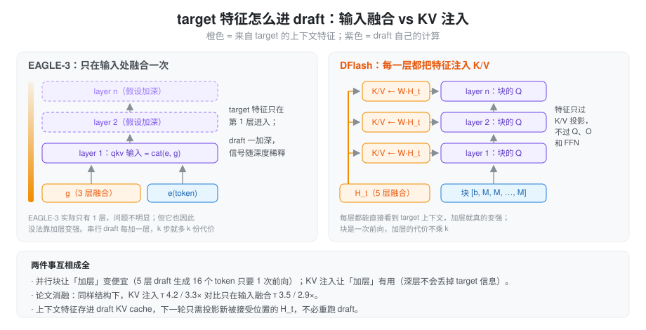

% 投机解码（六）：DFlash，用块扩散一次前向出整块

> 系列总览见 [投机解码方案对比](./speculative_decoding.md)。上一篇：[EAGLE-3](./spec_eagle3.md)。

### 问题：串行 draft 的 k 开不大

从 EAGLE 到 MTP 再到 EAGLE-3，draft 都是自回归的：猜 k 个 token 就要 k 次 draft 前向。这带来两个互相牵制的限制：

- **k 开不大**。每多猜一个就多一次前向，越往后接受率越低，边际收益很快变成负的，EAGLE 系通常只开 3～5 步。
- **draft 不敢加深**。draft 每加一层，k 次前向里每一次都要多算这一层，所以 EAGLE 系的 draft 只有 1 层。能力被卡死在「一层 transformer 能做到的程度」。

DFlash（Chen、Liang、Liu，UCSD，[arXiv 2602.06036](https://arxiv.org/abs/2602.06036)）的出发点是：如果 k 个 token 能在**一次**前向里出来，draft 的代价就和 k 基本无关，这两个限制同时解开。

### insight：扩散模型单独用不行，当 draft 刚好

块扩散（block diffusion）语言模型可以一次前向去噪出一整块 token，但作为独立模型，它的质量明显不如自回归模型。论文的观察是：投机解码里 draft 的质量不决定结果，target 的 verify 保证了无损，所以扩散模型最大的短板在这里不要紧。甚至不需要多轮去噪，**一次去噪**就够了：猜得不完美的位置交给 verify 剔掉。

光靠扩散还不够。一个从零理解上下文的小扩散模型猜不准，论文里不用 target 特征时 GSM8K 上只有 2.83×。第二个 insight 被作者概括为 **the target knows best**：target 的 hidden 里已经编码了后续多个 token 的信息（EAGLE-3 的多层融合也是这个思路），draft 只要能充分读到这些特征即可。

把两者合起来：并行块让 draft 加层变便宜，于是 draft 可以有 5 层甚至 8 层；但前提是每一层都能直接看到 target 特征，否则加层也没用。这引出了 DFlash 的核心结构 **KV 注入**。

### draft 结构

- **target 特征**：从 target 取 5 层 hidden，在第 2 层到倒数第 3 层之间均匀分布，拼成 5D 后过 W_c ∈ ℝ^{D×5D} 和 RMSNorm，得到上下文特征 H_t。
- **KV 注入**：在 draft 的**每一层**里，K 和 V 都是 `concat(W^K·H_t, W^K·H_d)`（V 同理），H_d 是块内位置自己的 hidden。上下文特征只过 K/V 投影，不过 Q、输出投影和 FFN，算完就存进 draft 的 KV cache。EAGLE-3 只在输入处融合一次，信号随深度稀释；DFlash 每层都重新看一遍 target。
- **块输入**：第 1 位是 anchor，也就是上一轮 verify 的 bonus token，其余位置都是 mask token。块内是**双向**注意力，块对上下文是正常的因果注意力。
- **输出**：块内第 2 位往后每个位置的 hidden 过 lm_head，一次得到 block_size − 1 个 draft token。embedding 和 lm_head 与 target 共享并冻结。
- **规模**：block size 16（LLaMA 上用 10），5 层 draft（Coder 模型用 8 层）。

和 EAGLE 系比，draft 的状态维护也换了一种方式：上下文全部在 draft KV 里，verify 之后只需要把新被接受位置的 target hidden 投影成 K/V 写进去，不需要再跑一次 draft 前向。

### 训练

- **随机 anchor**：训练时不是按固定间隔切块，而是在每条序列上随机采 512 个 anchor 位置，每个 anchor 后面接一个 mask 块。推理时 anchor 落在哪里取决于上一轮接受到哪，随机采样让训练覆盖这种分布。对比固定切块，加速比 4.69× vs 4.13×。
- **位置加权损失**：块内越靠前的位置越重要（前面错了后面就没用），第 k 位的权重 w_k = exp(−(k−1)/γ)，block 16 时 γ = 7。
- **数据**：约 80 万条，回复由 target 重新生成；6 个 epoch，lr 6e-4。

### 结果

- **Qwen3-8B，T=0**：平均 4.86×（τ 6.49），最高是 MATH-500 上的 6.08×（τ 7.87）；T=1 时平均 4.03×。摘要里的「超过 6×」指的是单项峰值，不是平均。
- **对比 EAGLE-3**：同设置下 EAGLE-3 平均 1.76×（树 16 节点）和 2.02×（树 60 节点）。摘要说比 EAGLE-3 快「最高 2.5×」，这个倍数取决于选哪个 EAGLE-3 配置和哪个任务。
- **层数**：8 层的 τ 最高，但 5 层的端到端加速最好。draft 再便宜也不是零成本。
- **服务化**：SGLang、B200、Qwen3-8B Math500，并发 1/4/8/16/32 时分别是 5.1/4.5/4.5/3.9/2.8×。

局限也很直接：并发越高收益越小；块越大，后面那些大概率被拒绝的位置越浪费 verify 算力；超过 4K 的上下文需要再微调。下一篇的 DSpark 正是从「块内越往后越不准」和「大 batch 下 verify 浪费」这两点切入的。

### 在 SGLang 里

`DFLASH` 是独立的算法和 worker（`speculative/dflash_worker_v2.py` 里的 `DFlashWorkerV2`），不再复用 EAGLE 的 worker。

**draft 模型**是 `models/dflash.py` 的 `DFlashDraftModel`，结构和论文一一对应：

- `fc` + `hidden_norm`：把拼起来的 target hidden 投影成上下文特征，对应论文的 W_c 和 RMSNorm。
- 每层的 `kv_proj_only`：只算上下文特征的 K/V，再做 k_norm 和 RoPE，写进 draft KV（`set_kv_buffer_prefix_valid`）。非量化权重直接切出 `qkv_proj.weight` 里 K/V 那一段做一次 GEMM；量化权重切不了，就回退成算完整 qkv 再丢掉 Q。
- full attention 层用 `ENCODER_ONLY`，即块内双向；sliding 层仍是带窗口的因果注意力。
- 模型自己**没有 embedding 和 lm_head**，都用 target 的。mask token 默认是 `<|MASK|>`。

**取哪几层**：`build_target_layer_ids`（`speculative/dflash_utils.py`）返回的层数和 draft 层数相同。draft 只有 1 层时取中间层 N//2；否则在 [1, N−3] 上均匀取。SGLang 在「第 i 层之前」捕获，hook 里会再加 1。

**每个 decode step**：

> 1 次 draft 块前向 + 1 次 target verify + 1 次「投影写 KV」

prefill 时把整个 prompt 的 target hidden 投影写进 draft KV；verify 之后按 `commit_lens` 只写被接受的位置。这里没有 EAGLE 那样的 draft extend 前向。

**参数**：DFlash 强制 `num_steps = topk = 1`，这两个字段对它没有意义，只是通用的显存计算要用；block size 就是 `num_draft_tokens`，不指定时从 draft 配置推断，默认 16。限制是只支持 CUDA、不支持 DP attention、要求 PP = 1。draft 是 sliding window 时可以打开 `--speculative-draft-window-size`，draft KV 只按窗口分配（`draft_swa_pool.py`），见 [总览里的说明](./speculative_decoding.md)。

### 后续工作

DFlash 只验一条链，块内每个位置的分布里其实还有别的候选。两篇后续分别在这两处继续推：

- **DDTree**（[arXiv 2604.12989](https://arxiv.org/abs/2604.12989)）：把 DFlash 每个位置的输出分布展开成一棵树，用 best-first 堆在固定节点预算内选最可能的分支，target 用 ancestor-only mask 一次验完。draft 不变，只改树怎么长，思路和 EAGLE-2 之于 EAGLE 一样。
- **DFlare**（[arXiv 2606.02091](https://arxiv.org/abs/2606.02091)）：DFlash 每一层注入的都是同一份 H_t，来自少数几层 target。DFlare 让每个 draft 层学自己的一组 target 层加权组合，draft 加深后收益更稳定；用 240 万条数据训练，Qwen3-8B 平均 5.46×，比 DFlash 快约 8%。

### 小结

DFlash 把两个看似不相关的想法拼在了一起：块扩散让 k 个 token 一次前向出来，于是 draft 可以加深、k 可以开到 16；KV 注入让每一层都直接读 target 的多层特征，于是加深真的有用，状态维护也只剩投影写 KV。它的代价在块内：同一次前向里的各位置看不到彼此最后取了什么，越往后越容易各说各的，而大 batch 下这些后面的位置还要白白占 verify 的算力。这两点是 [DSpark](./spec_dspark.md) 要补的。